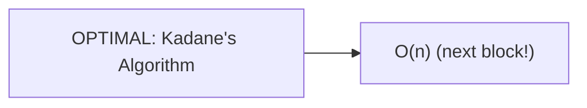
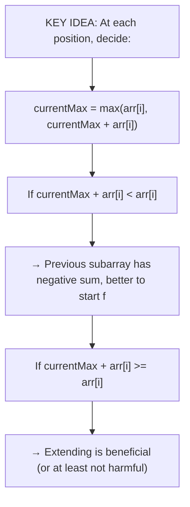
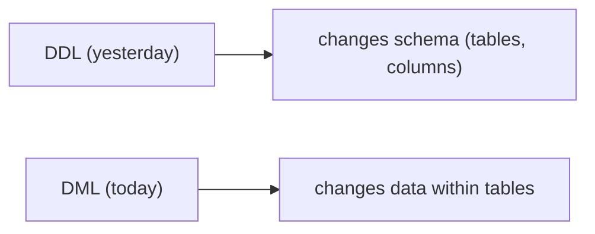

> **Navigation**: [< Previous](Day_003_Mar05_Wed.md) | [Back to Index](../../00_MASTER_INDEX.md) | [Next >](Day_005_Mar07_Fri.md)

# Day 004 - Thursday, March 6, 2026

> **Week 01** | **Difficulty:** EASY-MEDIUM | **Theme:** Subarrays + Kadane's + SQL DML
> [Prev Day](Day_003_Mar05_Wed.md) | [Daily Index](../00_DAILY_PRACTICE_INDEX.md) | [Next Day](Day_005_Mar07_Fri.md)

---

## Completion Checklist

- [ ] DS: Subarrays vs Subsequences — concepts + generation (30 min)
- [ ] ALGO: Kadane's Algorithm — maximum subarray sum (30 min)
- [ ] COMBO: Maximum product subarray (20 min)
- [ ] REAL: Temperature monitoring alert system (20 min)
- [ ] SQL: DML — INSERT/UPDATE/DELETE + transactions preview (40 min)
- [ ] Q1: Coding problem 1 (20 min)
- [ ] Q2: Coding problem 2 (20 min)

---

## BLOCK 1: DATA STRUCTURE (30 min)

### Topic: Subarrays, Subsets, and Subsequences — Know the Difference

#### WHY does it matter?
Interviewers test whether you understand these precisely. Getting them confused leads to wrong algorithms.

```
For array [1, 2, 3]:

SUBARRAY (contiguous):          SUBSEQUENCE (ordered, not contiguous):
  [1], [2], [3]                    [1], [2], [3]
  [1,2], [2,3]                     [1,2], [1,3], [2,3]
  [1,2,3]                          [1,2,3]
  Total = n(n+1)/2 = 6            Total = 2^n - 1 = 7

SUBSET (any order, not contiguous):
  [], [1], [2], [3], [1,2], [1,3], [2,3], [1,2,3]
  Total = 2^n = 8
```

#### HOW to generate all subarrays

```java
// Generate all subarrays of arr — O(n²) total subarrays
public static void printAllSubarrays(int[] arr) {
    int n = arr.length;
    for (int start = 0; start < n; start++) {
        for (int end = start; end < n; end++) {
            // Subarray from arr[start] to arr[end]
            System.out.print("[");
            for (int k = start; k <= end; k++) {
                System.out.print(arr[k] + (k < end ? "," : ""));
            }
            System.out.println("]");
        }
    }
}

// Count: n(n+1)/2 subarrays
// For n = 4: 4*5/2 = 10 subarrays
```

#### Brute force vs. optimal for subarray problems

```
PROBLEM: Find maximum sum subarray

BRUTE FORCE: Try all subarrays, compute sum
  for each start (0 to n-1):
      for each end (start to n-1):
          sum = 0
          for each element:  ← can optimize away
              sum += arr[k]
  → O(n³) or O(n²) with running sum

OPTIMAL: Kadane's Algorithm → O(n)  (next block!)
```

> **Flow**: OPTIMAL: Kadane's Algorithm → O(n) (next block!)



---

## BLOCK 2: ALGORITHM (30 min)

### Topic: Kadane's Algorithm — Maximum Subarray Sum

#### WHY is this fundamental?
- LeetCode #53 (Maximum Subarray) — top 10 most-asked interview problem
- Foundation for many DP problems
- Used in finance (maximum profit period), signal processing (strongest signal window)

#### The core insight

```
KEY IDEA: At each position, decide:
  "Should I EXTEND the previous subarray, or START a new one here?"
  
  currentMax = max(arr[i], currentMax + arr[i])
  
  If currentMax + arr[i] < arr[i]
    → Previous subarray has negative sum, better to start fresh
  
  If currentMax + arr[i] >= arr[i]
    → Extending is beneficial (or at least not harmful)
```

> **Flow**: KEY IDEA: At each position, decide: → currentMax = max(arr[i], currentMax + arr[i]) | currentMax = max(arr[i], currentMax + arr[i]) → If currentMax + arr[i] &lt; arr[i] | If currentMax + arr[i] &lt; arr[i] → → Previous subarray has negative sum, better to start f | → Previous subarray has negative sum, better to start f → If currentMax + arr[i] &gt;= arr[i] | If currentMax + arr[i] &gt;= arr[i] → → Extending is beneficial (or at least not harmful)



#### Step-by-step trace

```
arr = [-2, 1, -3, 4, -1, 2, 1, -5, 4]

i=0: arr[i]=-2  currentMax = max(-2, 0+(-2)) = -2    globalMax = -2
i=1: arr[i]= 1  currentMax = max(1, -2+1) = max(1,-1) = 1    globalMax = 1
i=2: arr[i]=-3  currentMax = max(-3, 1+(-3)) = max(-3,-2) = -2  globalMax = 1
i=3: arr[i]= 4  currentMax = max(4, -2+4) = max(4, 2) = 4    globalMax = 4
i=4: arr[i]=-1  currentMax = max(-1, 4+(-1)) = max(-1, 3) = 3  globalMax = 4
i=5: arr[i]= 2  currentMax = max(2, 3+2) = max(2, 5) = 5    globalMax = 5
i=6: arr[i]= 1  currentMax = max(1, 5+1) = max(1, 6) = 6    globalMax = 6
i=7: arr[i]=-5  currentMax = max(-5, 6+(-5)) = max(-5, 1) = 1  globalMax = 6
i=8: arr[i]= 4  currentMax = max(4, 1+4) = max(4, 5) = 5    globalMax = 6

ANSWER: 6 (subarray [4, -1, 2, 1])
```

#### Code with subarray tracking

```java
public static int[] kadane(int[] arr) {
    int currentMax = arr[0];
    int globalMax = arr[0];
    int start = 0, end = 0, tempStart = 0;
    
    for (int i = 1; i < arr.length; i++) {
        if (arr[i] > currentMax + arr[i]) {
            currentMax = arr[i];
            tempStart = i;  // New subarray starts here
        } else {
            currentMax = currentMax + arr[i];
        }
        
        if (currentMax > globalMax) {
            globalMax = currentMax;
            start = tempStart;
            end = i;
        }
    }
    
    return new int[]{globalMax, start, end};
    // Returns [maxSum, startIndex, endIndex]
}
// Time: O(n) | Space: O(1)
```

---

## BLOCK 3: COMBO (20 min)

### Problem: Maximum Product Subarray (LC 152 — Medium)

```
Input: nums = [2, 3, -2, 4]
Output: 6 (subarray [2, 3])

Input: nums = [-2, 0, -1]
Output: 0 (subarray [0])
```

**KEY INSIGHT:** Unlike sum, a **negative × negative = positive**. So we must track both maximum AND minimum at each step.

```
arr = [2, 3, -2, 4]

i=0: maxProd=2, minProd=2, result=2
i=1: maxProd=max(3, 2*3, 2*3) = 6
     minProd=min(3, 2*3, 2*3) = 3     result=6
i=2: maxProd=max(-2, 6*(-2), 3*(-2)) = max(-2, -12, -6) = -2
     minProd=min(-2, 6*(-2), 3*(-2)) = min(-2, -12, -6) = -12   result=6
i=3: maxProd=max(4, -2*4, -12*4) = max(4, -8, -48) = 4
     minProd=min(4, -2*4, -12*4) = min(4, -8, -48) = -48  result=6
```

<details>
<summary>Solution</summary>

```java
public int maxProduct(int[] nums) {
    int maxProd = nums[0], minProd = nums[0], result = nums[0];
    
    for (int i = 1; i < nums.length; i++) {
        // If negative, swap max and min (negative flips sign)
        if (nums[i] < 0) {
            int temp = maxProd;
            maxProd = minProd;
            minProd = temp;
        }
        
        maxProd = Math.max(nums[i], maxProd * nums[i]);
        minProd = Math.min(nums[i], minProd * nums[i]);
        result = Math.max(result, maxProd);
    }
    return result;
}
// Time: O(n) | Space: O(1)
// The swap trick when negative is the elegant insight!
```
</details>

---

## BLOCK 4: REAL-TIME SCENARIO (20 min)

### Scenario: Temperature Monitoring Alert System

**Problem:** An IoT sensor sends temperature readings every minute. Design a system that:
1. Detects if temperature rises continuously for 5+ readings (overheating alert)
2. Finds the maximum temperature swing in any 10-minute window

```java
public class TempMonitor {
    
    // 1. Detect continuous rise of k+ readings
    public static List<Integer> detectOverheating(double[] temps, int threshold) {
        List<Integer> alerts = new ArrayList<>();
        int risingCount = 1;
        
        for (int i = 1; i < temps.length; i++) {
            if (temps[i] > temps[i - 1]) {
                risingCount++;
                if (risingCount >= threshold) {
                    alerts.add(i);  // Alert at this index
                }
            } else {
                risingCount = 1;
            }
        }
        return alerts;
    }
    
    // 2. Max swing in window of k readings (max - min in window)
    // Simple approach: O(n*k) — fine for moderate k
    public static double maxSwing(double[] temps, int windowSize) {
        double maxSwing = 0;
        
        for (int i = 0; i <= temps.length - windowSize; i++) {
            double min = temps[i], max = temps[i];
            for (int j = i; j < i + windowSize; j++) {
                min = Math.min(min, temps[j]);
                max = Math.max(max, temps[j]);
            }
            maxSwing = Math.max(maxSwing, max - min);
        }
        return maxSwing;
    }
}
```

**CONNECTION:** The overheating detection is a **longest consecutive sequence** pattern. The swing detection is a **sliding window min/max** problem — in Week 3 you'll learn the O(n) Deque-based approach.

---

## BLOCK 5: SQL (40 min)

### Topic: DML — INSERT, UPDATE, DELETE + Safe Practices

#### WHAT is DML?

```
DML = Data Manipulation Language — changes DATA, not structure
  INSERT — add rows
  UPDATE — modify existing rows
  DELETE — remove rows
  
DDL (yesterday) → changes schema (tables, columns)
DML (today)     → changes data within tables
```

> **Flow**: DDL (yesterday) → changes schema (tables, columns) | DML (today) → changes data within tables



#### UPDATE — the command you must FEAR and RESPECT

```sql
-- SAFE: Update one specific row
UPDATE products SET price = 899.99 WHERE product_id = 1;

-- SAFE: Update with multiple conditions
UPDATE products SET stock = stock - 1 WHERE product_id = 2 AND stock > 0;

-- DANGEROUS!!! No WHERE clause updates ALL rows!
UPDATE products SET price = 0;  -- Sets EVERY product price to 0!

-- GOLDEN RULE: Always write the WHERE clause FIRST, then the SET
-- Step 1: SELECT * FROM products WHERE product_id = 1;  ← verify it matches
-- Step 2: UPDATE products SET price = 899.99 WHERE product_id = 1;  ← execute
```

#### DELETE — equally dangerous without WHERE

```sql
-- SAFE: Delete one specific order
DELETE FROM orders WHERE order_id = 3;

-- DANGEROUS!!! Deletes ALL orders!
DELETE FROM orders;

-- SAFER ALTERNATIVE: TRUNCATE (faster, resets auto-increment)
TRUNCATE TABLE orders;

-- RECOVERY TIP: In production, use soft deletes instead:
ALTER TABLE orders ADD COLUMN is_deleted BOOLEAN DEFAULT FALSE;
UPDATE orders SET is_deleted = TRUE WHERE order_id = 3;
-- Now you can "undelete" by setting is_deleted = FALSE
```

#### Practice with our e-commerce data

```sql
-- Setup (if not from yesterday)
INSERT INTO products (product_name, price, stock, category) VALUES
    ('Laptop', 999.99, 50, 'Electronics'),
    ('Mouse', 29.99, 200, 'Electronics'),
    ('Notebook', 4.99, 500, 'Stationery'),
    ('Pen', 1.99, 1000, 'Stationery'),
    ('Headphones', 149.99, 75, 'Electronics');
```

#### Practice Questions

**Q1:** Increase the price of all Electronics products by 10%.

<details>
<summary>Answer</summary>

```sql
UPDATE products 
SET price = price * 1.10 
WHERE category = 'Electronics';

-- Verify: SELECT * FROM products WHERE category = 'Electronics';
-- Laptop: 1099.99, Mouse: 32.99, Headphones: 164.99
```
</details>

**Q2:** Delete all products where stock is greater than 500 (surplus clearance).

<details>
<summary>Answer</summary>

```sql
-- Step 1: See what will be deleted
SELECT * FROM products WHERE stock > 500;
-- Returns: Pen (stock 1000)

-- Step 2: Delete
DELETE FROM products WHERE stock > 500;
```
</details>

**Q3 (Challenge):** Reduce stock by the ordered quantity for each product that has orders. (This would need a JOIN — preview of Week 2, but try to think about it!)

<details>
<summary>Answer</summary>

```sql
-- Using a subquery approach (JOIN version comes in Week 2)
UPDATE products 
SET stock = stock - (
    SELECT SUM(quantity) FROM orders WHERE orders.product_id = products.product_id
)
WHERE product_id IN (SELECT product_id FROM orders);

-- What this does:
-- Laptop: 50 - 1 = 49
-- Mouse: 200 - 3 = 197
-- Notebook: 500 - 10 = 490
-- Headphones: 75 - 1 = 74
```
</details>

> **Read more:** [08_SQL/04_DML_Manipulating_Data.md](../../08_SQL/04_DML_Manipulating_Data.md)

---

## BLOCK 6: CODING PROBLEMS (40 min)

### Q1: LC 53 — Maximum Subarray (Medium)

Given an integer array `nums`, find the subarray with the largest sum and return its sum.

```
Input: nums = [-2, 1, -3, 4, -1, 2, 1, -5, 4]
Output: 6 (subarray [4, -1, 2, 1])
```

<details>
<summary>Solution</summary>

```java
public int maxSubArray(int[] nums) {
    int currentMax = nums[0];
    int globalMax = nums[0];
    
    for (int i = 1; i < nums.length; i++) {
        currentMax = Math.max(nums[i], currentMax + nums[i]);
        globalMax = Math.max(globalMax, currentMax);
    }
    return globalMax;
}
// This IS Kadane's Algorithm — you learned it in Block 2!
// Time: O(n) | Space: O(1)
```
</details>

---

### Q2: Equilibrium Index (HackerEarth / Codeforces style)

An equilibrium index is where the sum of elements on the left equals the sum on the right.

```
Input: arr = [-7, 1, 5, 2, -4, 3, 0]
Output: 3 (left sum = -7+1+5 = -1, right sum = -4+3+0 = -1)

Input: arr = [1, 2, 3]
Output: -1 (no equilibrium)
```

**HINT:** Use prefix sum concept from Day 2!

<details>
<summary>Solution</summary>

```java
public int equilibriumIndex(int[] arr) {
    int totalSum = 0;
    for (int num : arr) totalSum += num;
    
    int leftSum = 0;
    for (int i = 0; i < arr.length; i++) {
        int rightSum = totalSum - leftSum - arr[i];
        if (leftSum == rightSum) return i;
        leftSum += arr[i];
    }
    return -1;
}
// Time: O(n) | Space: O(1)
// KEY INSIGHT: rightSum = totalSum - leftSum - arr[i]
// No need for a separate prefix sum array!
```
</details>

---

## End of Day 4

### What you learned today:
1. **Subarray vs Subsequence vs Subset** — precise definitions with counts
2. **Kadane's Algorithm** — the single most important subarray algorithm
3. **Max Product Subarray** — tracking min AND max (negative flipping)
4. **Equilibrium Index** — clever use of total sum (prefix sum variant)
5. **SQL DML** — UPDATE/DELETE are dangerous without WHERE (always verify first!)
6. **Soft deletes** — production pattern to avoid permanent data loss

### Tomorrow's Preview: Day 5 — 2D Arrays + Merge Sort + SQL SELECT mastery

---

> **Mentor Note:** Kadane's Algorithm is a MUST-KNOW. If you could only memorize 
> one algorithm from this week, make it this one. It appears directly or as a 
> sub-problem in dozens of medium/hard problems.


---

> **Navigation**: [< Previous](Day_003_Mar05_Wed.md) | [Back to Index](../../00_MASTER_INDEX.md) | [Next >](Day_005_Mar07_Fri.md)