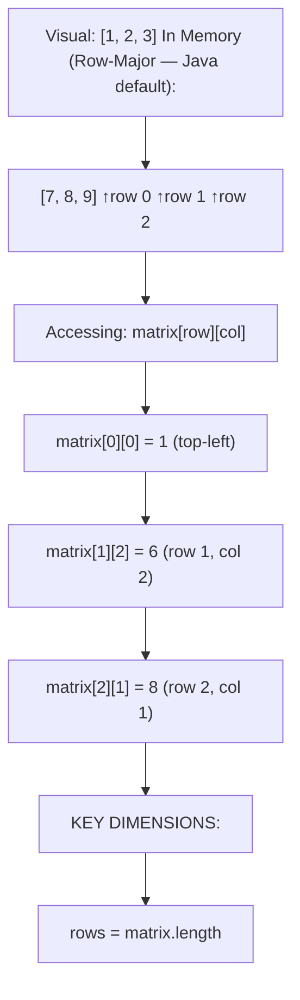
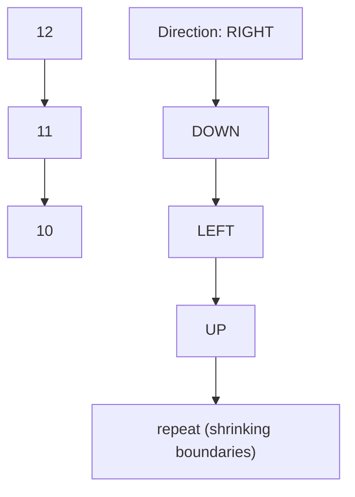
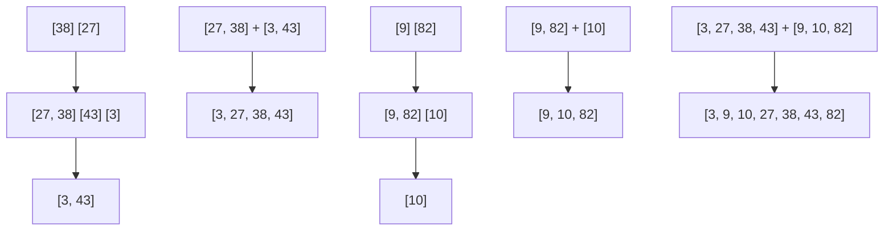
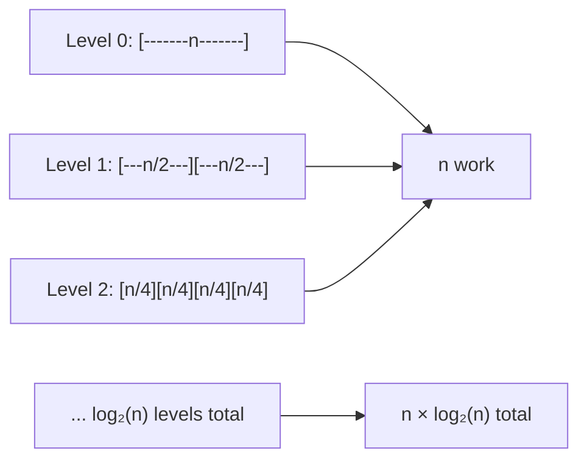
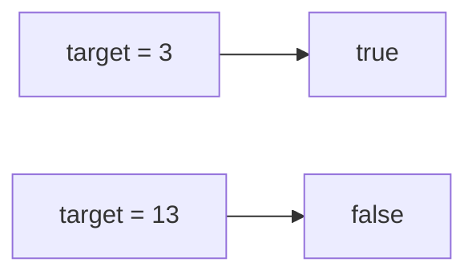
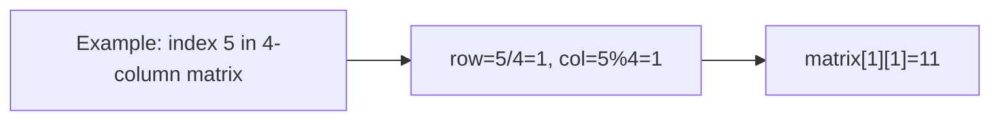
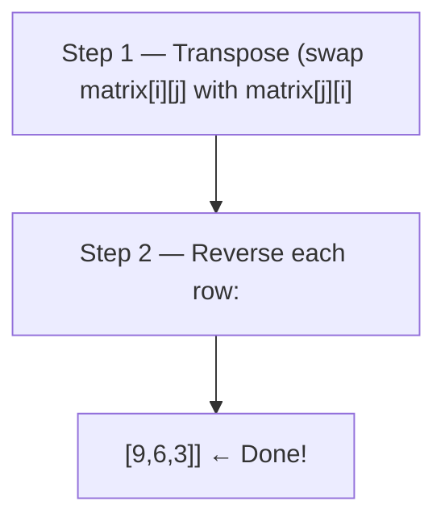
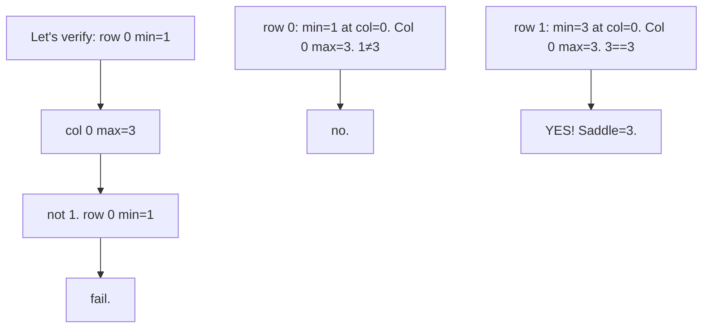

> **Navigation**: [< Previous](Day_004_Mar06_Thu.md) | [Back to Index](../00_MASTER_INDEX.md) | [Next >](Day_006_Mar08_Sat.md)

# Day 005 - Friday, March 7, 2026

> **Week 01** | **Difficulty:** EASY-MEDIUM | **Theme:** 2D Arrays + Merge Sort + SQL SELECT
> [Prev Day](Day_004_Mar06_Thu.md) | [Daily Index](../00_DAILY_PRACTICE_INDEX.md) | [Next Day](Day_006_Mar08_Sat.md)

---

## Completion Checklist

- [ ] DS: 2D arrays (matrix) — creation, traversal, spiral order (30 min)
- [ ] ALGO: Merge Sort — divide and conquer explained (30 min)
- [ ] COMBO: Search in a sorted matrix (20 min)
- [ ] REAL: Seat reservation system for a cinema (20 min)
- [ ] SQL: SELECT mastery — aliases, DISTINCT, LIKE, BETWEEN, IN (40 min)
- [ ] Q1: Coding problem 1 (20 min)
- [ ] Q2: Coding problem 2 (20 min)

---

## BLOCK 1: DATA STRUCTURE (30 min)

### Topic: 2D Arrays (Matrix) — How They Work

#### WHY 2D arrays?

Matrices represent images (pixel grids), game boards (chess, tic-tac-toe), spreadsheets, adjacency matrices for graphs, and screen layouts. Any grid-based problem uses 2D arrays.

#### WHAT: Memory layout

```
Visual:    [1, 2, 3]     In Memory (Row-Major — Java default):
           [4, 5, 6]     [1][2][3][4][5][6][7][8][9]
           [7, 8, 9]      ↑row 0  ↑row 1  ↑row 2

Accessing: matrix[row][col]
  matrix[0][0] = 1 (top-left)
  matrix[1][2] = 6 (row 1, col 2)
  matrix[2][1] = 8 (row 2, col 1)

KEY DIMENSIONS:
  rows = matrix.length
  cols = matrix[0].length
```

> **Flow**: Visual: [1, 2, 3] In Memory (Row-Major — Java default): → [7, 8, 9] ↑row 0 ↑row 1 ↑row 2 | [7, 8, 9] ↑row 0 ↑row 1 ↑row 2 → Accessing: matrix[row][col] | Accessing: matrix[row][col] → matrix[0][0] = 1 (top-left) | matrix[0][0] = 1 (top-left) → matrix[1][2] = 6 (row 1, col 2) | matrix[1][2] = 6 (row 1, col 2) → matrix[2][1] = 8 (row 2, col 1) | matrix[2][1] = 8 (row 2, col 1) → KEY DIMENSIONS: | ...+1 more



#### HOW: Traversal patterns

```java
int[][] matrix = {{1,2,3}, {4,5,6}, {7,8,9}};
int rows = matrix.length, cols = matrix[0].length;

// 1. Row-by-row (most common)
for (int i = 0; i < rows; i++)
    for (int j = 0; j < cols; j++)
        System.out.print(matrix[i][j] + " ");
// Output: 1 2 3 4 5 6 7 8 9

// 2. Column-by-column
for (int j = 0; j < cols; j++)
    for (int i = 0; i < rows; i++)
        System.out.print(matrix[i][j] + " ");
// Output: 1 4 7 2 5 8 3 6 9

// 3. Diagonal (main diagonal: i == j)
for (int i = 0; i < rows; i++)
    System.out.print(matrix[i][i] + " ");
// Output: 1 5 9

// 4. Anti-diagonal (i + j == n - 1)
for (int i = 0; i < rows; i++)
    System.out.print(matrix[i][rows - 1 - i] + " ");
// Output: 3 5 7
```

#### Spiral order traversal

```
Matrix:    1  2  3  4       Spiral output: 1→2→3→4→8→12→11→10
           5  6  7  8       →9→5→6→7
           9  10 11 12

Direction: RIGHT → DOWN → LEFT → UP → repeat (shrinking boundaries)
```

> **Flow**: 12 → 11 | 11 → 10 | Direction: RIGHT → DOWN | DOWN → LEFT | LEFT → UP | UP → repeat (shrinking boundaries)



```java
public List<Integer> spiralOrder(int[][] matrix) {
    List<Integer> result = new ArrayList<>();
    int top = 0, bottom = matrix.length - 1;
    int left = 0, right = matrix[0].length - 1;
    
    while (top <= bottom && left <= right) {
        // Go right
        for (int j = left; j <= right; j++) result.add(matrix[top][j]);
        top++;
        // Go down
        for (int i = top; i <= bottom; i++) result.add(matrix[i][right]);
        right--;
        // Go left
        if (top <= bottom)
            for (int j = right; j >= left; j--) result.add(matrix[bottom][j]);
        bottom--;
        // Go up
        if (left <= right)
            for (int i = bottom; i >= top; i--) result.add(matrix[i][left]);
        left++;
    }
    return result;
}
```

---

## BLOCK 2: ALGORITHM (30 min)

### Topic: Merge Sort — Divide and Conquer

#### WHY Merge Sort?

```
Merge Sort GUARANTEES O(n log n) — always. No bad inputs.
  - QuickSort worst case is O(n²)
  - Merge Sort worst case is STILL O(n log n)
  - Used by: Java's Arrays.sort() for objects (needs stability)
  - Also: foundation of external sorting (sorting TB of data on disk)
```

#### HOW it works — visual trace

```
DIVIDE phase (recursive splitting):
  [38, 27, 43, 3, 9, 82, 10]
          /                 \
  [38, 27, 43, 3]    [9, 82, 10]
     /        \         /       \
  [38, 27]  [43, 3]  [9, 82]  [10]
   /   \     /   \    /   \     |
 [38] [27] [43] [3] [9] [82]  [10]

MERGE phase (combine sorted halves):
 [38] [27] → [27, 38]     [43] [3] → [3, 43]
     [27, 38] + [3, 43] → [3, 27, 38, 43]

 [9] [82] → [9, 82]       [10] → [10]
     [9, 82] + [10] → [9, 10, 82]

 [3, 27, 38, 43] + [9, 10, 82] → [3, 9, 10, 27, 38, 43, 82]
```

> **Flow**: [38] [27] → [27, 38] [43] [3] | [27, 38] [43] [3] → [3, 43] | [27, 38] + [3, 43] → [3, 27, 38, 43] | [9] [82] → [9, 82] [10] | [9, 82] [10] → [10] | [9, 82] + [10] → [9, 10, 82] | ...+1 more



#### Code

```java
public static void mergeSort(int[] arr, int left, int right) {
    if (left >= right) return;  // Base case: 0 or 1 element
    
    int mid = left + (right - left) / 2;  // Avoid overflow
    mergeSort(arr, left, mid);       // Sort left half
    mergeSort(arr, mid + 1, right);  // Sort right half
    merge(arr, left, mid, right);    // Merge sorted halves
}

private static void merge(int[] arr, int left, int mid, int right) {
    int[] temp = new int[right - left + 1];
    int i = left, j = mid + 1, k = 0;
    
    while (i <= mid && j <= right) {
        if (arr[i] <= arr[j]) {  // <= for STABILITY
            temp[k++] = arr[i++];
        } else {
            temp[k++] = arr[j++];
        }
    }
    while (i <= mid) temp[k++] = arr[i++];
    while (j <= right) temp[k++] = arr[j++];
    
    // Copy back
    System.arraycopy(temp, 0, arr, left, temp.length);
}

// Time: O(n log n) ALWAYS | Space: O(n) — needs temp array
// This is the MERGE function from Day 2, used recursively!
```

#### Complexity breakdown

```
WHY O(n log n)?
  - We split log₂(n) times (halving each time)
  - Each level does O(n) work (merging all elements)
  - Total = O(n) × O(log n) = O(n log n)

Level 0:  [-------n-------]               → n work
Level 1:  [---n/2---][---n/2---]           → n work  
Level 2:  [n/4][n/4][n/4][n/4]            → n work
   ...    log₂(n) levels total             → n × log₂(n) total
```

> **Flow**: Level 0: [-------n-------] → n work | Level 1: [---n/2---][---n/2---] → n work | Level 2: [n/4][n/4][n/4][n/4] → n work | ... log₂(n) levels total → n × log₂(n) total



---

## BLOCK 3: COMBO (20 min)

### Problem: Search in a Sorted Matrix (LC 74)

Each row is sorted. First element of each row > last element of previous row.

```
matrix = [[1,  3,  5,  7],
          [10, 11, 16, 20],
          [23, 30, 34, 60]]
target = 3 → true
target = 13 → false
```

> **Flow**: target = 3 → true | target = 13 → false



**KEY INSIGHT:** Treat the 2D matrix as a 1D sorted array.

```
Flattened: [1, 3, 5, 7, 10, 11, 16, 20, 23, 30, 34, 60]
           Indices 0-11

Convert 1D index to 2D:
  row = index / cols
  col = index % cols
  
Example: index 5 in 4-column matrix → row=5/4=1, col=5%4=1 → matrix[1][1]=11
```

> **Flow**: Example: index 5 in 4-column matrix → row=5/4=1, col=5%4=1 | row=5/4=1, col=5%4=1 → matrix[1][1]=11



<details>
<summary>Solution</summary>

```java
public boolean searchMatrix(int[][] matrix, int target) {
    int rows = matrix.length, cols = matrix[0].length;
    int lo = 0, hi = rows * cols - 1;
    
    while (lo <= hi) {
        int mid = lo + (hi - lo) / 2;
        int val = matrix[mid / cols][mid % cols];  // 1D → 2D conversion
        
        if (val == target) return true;
        else if (val < target) lo = mid + 1;
        else hi = mid - 1;
    }
    return false;
}
// Time: O(log(m*n)) | Space: O(1)
// Binary search on a virtual 1D array!
```
</details>

---

## BLOCK 4: REAL-TIME SCENARIO (20 min)

### Scenario: Cinema Seat Reservation

**Problem:** A cinema has `rows × cols` seats (2D array). Design functions to:
1. Display available seats (0 = empty, 1 = booked)
2. Book a block of N adjacent seats in any row
3. Find the row with most available seats

```java
public class CinemaHall {
    private int[][] seats;
    private int rows, cols;
    
    public CinemaHall(int rows, int cols) {
        this.rows = rows;
        this.cols = cols;
        this.seats = new int[rows][cols]; // All 0 (empty)
    }
    
    // Display seat map
    public void display() {
        System.out.println("  " + "1 ".repeat(cols));
        for (int i = 0; i < rows; i++) {
            System.out.print((char)('A' + i) + " ");
            for (int j = 0; j < cols; j++) {
                System.out.print(seats[i][j] == 0 ? "O " : "X ");
            }
            System.out.println();
        }
    }
    
    // Book N adjacent seats — returns row or -1
    public int bookAdjacent(int n) {
        for (int i = 0; i < rows; i++) {
            int consecutive = 0;
            for (int j = 0; j < cols; j++) {
                if (seats[i][j] == 0) {
                    consecutive++;
                    if (consecutive == n) {
                        // Book from j-n+1 to j
                        for (int k = j - n + 1; k <= j; k++) seats[i][k] = 1;
                        return i;
                    }
                } else {
                    consecutive = 0;
                }
            }
        }
        return -1; // No row has N adjacent seats
    }
    
    // Row with most available seats
    public int bestRow() {
        int maxFree = 0, bestRow = 0;
        for (int i = 0; i < rows; i++) {
            int free = 0;
            for (int j = 0; j < cols; j++) if (seats[i][j] == 0) free++;
            if (free > maxFree) { maxFree = free; bestRow = i; }
        }
        return bestRow;
    }
}
```

**WHERE?** BookMyShow, AMC, PVR — all use 2D seat maps. The adjacent-seat booking problem is a real constraint in their APIs.

---

## BLOCK 5: SQL (40 min)

### Topic: SELECT Mastery — Filtering, Pattern Matching, Ranges

#### Building your SELECT vocabulary

```sql
-- Use our products and orders tables from Day 3

-- ALIAS: Give columns display names
SELECT product_name AS "Product", price AS "Price (USD)" FROM products;

-- DISTINCT: Remove duplicate values
SELECT DISTINCT category FROM products;
-- Returns: Electronics, Stationery (just 2 unique values)

-- LIKE: Pattern matching
SELECT * FROM products WHERE product_name LIKE 'L%';    -- Starts with L
SELECT * FROM products WHERE product_name LIKE '%phone%'; -- Contains 'phone'
SELECT * FROM products WHERE product_name LIKE '_en';    -- 3 chars ending 'en'
--   % = any number of characters
--   _ = exactly one character

-- BETWEEN: Range (inclusive on both ends)
SELECT * FROM products WHERE price BETWEEN 10 AND 200;
-- Same as: WHERE price >= 10 AND price <= 200

-- IN: Match any value in a list
SELECT * FROM products WHERE category IN ('Electronics', 'Stationery');
-- Cleaner than: WHERE category = 'Electronics' OR category = 'Stationery'
```

#### NULL handling — the trap that catches everyone

```sql
-- NULL means "unknown" — NOT "0" or "empty string"!
-- NULL comparisons are ALWAYS false:
SELECT * FROM products WHERE category = NULL;    -- Returns NOTHING (wrong!)
SELECT * FROM products WHERE category IS NULL;   -- Correct way

-- NULL in math:  5 + NULL = NULL
-- NULL in logic:  TRUE AND NULL = NULL

-- COALESCE: Replace NULL with a default
SELECT product_name, COALESCE(category, 'Uncategorized') FROM products;

-- IF NULL shorthand (MySQL specific)
SELECT product_name, IFNULL(category, 'Uncategorized') FROM products;
```

#### Practice Questions

**Q1:** Find all products whose names contain the letter 'o' (case insensitive), sorted by price.

<details>
<summary>Answer</summary>

```sql
SELECT product_name, price 
FROM products 
WHERE LOWER(product_name) LIKE '%o%'
ORDER BY price;
-- Returns: Notebook (4.99), Mouse (29.99), Headphones (149.99)
```
</details>

**Q2:** Write a query to find all orders placed between March 1 and March 3, 2026.

<details>
<summary>Answer</summary>

```sql
SELECT * FROM orders 
WHERE order_date BETWEEN '2026-03-01' AND '2026-03-03';
-- Returns orders by Harsha (Mar 1), Alice (Mar 2), Bob (Mar 3)
```
</details>

**Q3 (Challenge):** Write a query showing product name, price, stock, and a calculated column 'inventory_value' (price × stock), for products where inventory value exceeds $1000, sorted by inventory value descending.

<details>
<summary>Answer</summary>

```sql
SELECT product_name, 
       price, 
       stock, 
       price * stock AS inventory_value
FROM products
WHERE price * stock > 1000
ORDER BY inventory_value DESC;
-- Laptop: 999.99 * 50 = 49999.50
-- Headphones: 149.99 * 75 = 11249.25
-- Mouse: 29.99 * 200 = 5998.00
-- Notebook: 4.99 * 500 = 2495.00
-- Pen: 1.99 * 1000 = 1990.00
```
</details>

> **Read more:** [08_SQL/05_SELECT_Filtering.md](../../08_SQL/05_SELECT_Filtering.md)

---

## BLOCK 6: CODING PROBLEMS (40 min)

### Q1: LC 48 — Rotate Image (Medium)

Rotate an n×n matrix 90 degrees clockwise, in-place.

```
Input:  [[1,2,3],    Output: [[7,4,1],
         [4,5,6],             [8,5,2],
         [7,8,9]]             [9,6,3]]
```

**TRICK:** Transpose + Reverse each row = 90° clockwise rotation

```
Step 1 — Transpose (swap matrix[i][j] with matrix[j][i]):
  [[1,4,7],
   [2,5,8],
   [3,6,9]]

Step 2 — Reverse each row:
  [[7,4,1],
   [8,5,2],
   [9,6,3]]  ← Done!
```

> **Flow**: Step 1 — Transpose (swap matrix[i][j] with matrix[j][i] → Step 2 — Reverse each row: | Step 2 — Reverse each row: → [9,6,3]] ← Done!



<details>
<summary>Solution</summary>

```java
public void rotate(int[][] matrix) {
    int n = matrix.length;
    
    // Transpose
    for (int i = 0; i < n; i++) {
        for (int j = i + 1; j < n; j++) {  // j = i+1 to avoid double-swap
            int temp = matrix[i][j];
            matrix[i][j] = matrix[j][i];
            matrix[j][i] = temp;
        }
    }
    
    // Reverse each row
    for (int i = 0; i < n; i++) {
        int left = 0, right = n - 1;
        while (left < right) {
            int temp = matrix[i][left];
            matrix[i][left] = matrix[i][right];
            matrix[i][right] = temp;
            left++;
            right--;
        }
    }
}
// Time: O(n²) | Space: O(1) — in-place!
```
</details>

---

### Q2: Saddle Point in a Matrix (Codeforces / competitive programming classic)

A saddle point is an element that is the minimum in its row AND the maximum in its column.

```
Matrix: [[1, 2, 3],
         [4, 5, 6],
         [7, 8, 9]]
Saddle point: 7 (min of row 2, max of col 0)

Matrix: [[1, 2],
         [3, 4]]
Saddle point: 2 (min of row 0, max of col 1)
       OR:     3 (min of row 1? No, 3 is not min of [3,4]. Actually check!)
Let's verify: row 0 min=1 → col 0 max=3 → not 1. row 0 min=1→ fail.
              row 0: min=1 at col=0. Col 0 max=3. 1≠3 → no.
              row 1: min=3 at col=0. Col 0 max=3. 3==3 → YES! Saddle=3.
```

> **Flow**: Let's verify: row 0 min=1 → col 0 max=3 | col 0 max=3 → not 1. row 0 min=1 | not 1. row 0 min=1 → fail. | row 0: min=1 at col=0. Col 0 max=3. 1≠3 → no. | row 1: min=3 at col=0. Col 0 max=3. 3==3 → YES! Saddle=3.



<details>
<summary>Solution</summary>

```java
public int findSaddlePoint(int[][] matrix) {
    int rows = matrix.length, cols = matrix[0].length;
    
    for (int i = 0; i < rows; i++) {
        // Find min in row i and its column index
        int minVal = matrix[i][0], minCol = 0;
        for (int j = 1; j < cols; j++) {
            if (matrix[i][j] < minVal) {
                minVal = matrix[i][j];
                minCol = j;
            }
        }
        
        // Check if this element is max in its column
        boolean isSaddle = true;
        for (int k = 0; k < rows; k++) {
            if (matrix[k][minCol] > minVal) {
                isSaddle = false;
                break;
            }
        }
        
        if (isSaddle) return minVal;
    }
    return -1; // No saddle point (possible in some matrices)
}
// Time: O(rows × cols) | Space: O(1)
```
</details>

---

## End of Day 5

### What you learned today:
1. **2D arrays** — row/col traversal, diagonal, spiral order
2. **Merge Sort** — O(n log n) guaranteed, divide and conquer, stable
3. **Binary search on matrix** — treat 2D as virtual 1D sorted array
4. **Matrix rotation** — transpose + reverse rows trick
5. **SQL SELECT** — LIKE, BETWEEN, IN, NULL handling, COALESCE
6. **Saddle point** — combining row/column analysis in a matrix

### Tomorrow's Preview: Day 6 (Saturday) — Spring Boot Foundations + SQL practice + Week review

---

> **Mentor Note:** You now know 4 sorting algorithms (Selection, Insertion, 
> Bubble, Merge). Next week adds Quick Sort and Counting Sort. At that point 
> you'll have a complete sorting toolkit for any interview.


---

> **Navigation**: [< Previous](Day_004_Mar06_Thu.md) | [Back to Index](../00_MASTER_INDEX.md) | [Next >](Day_006_Mar08_Sat.md)