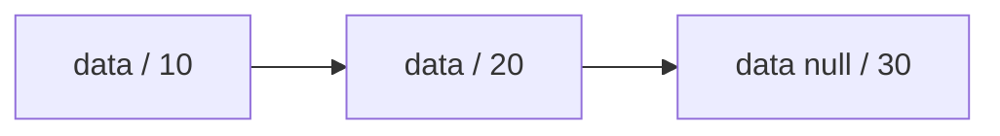
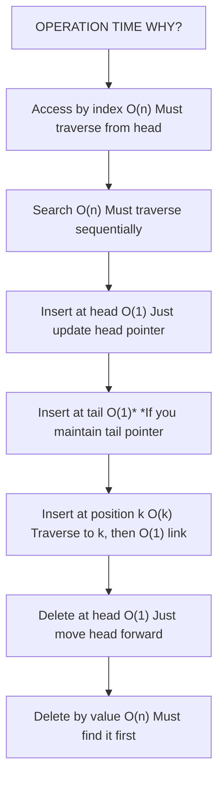
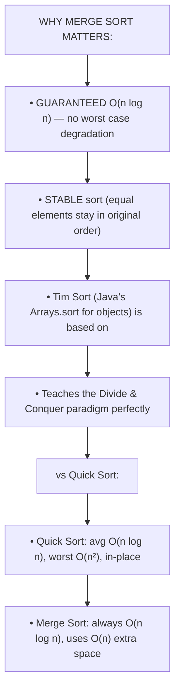
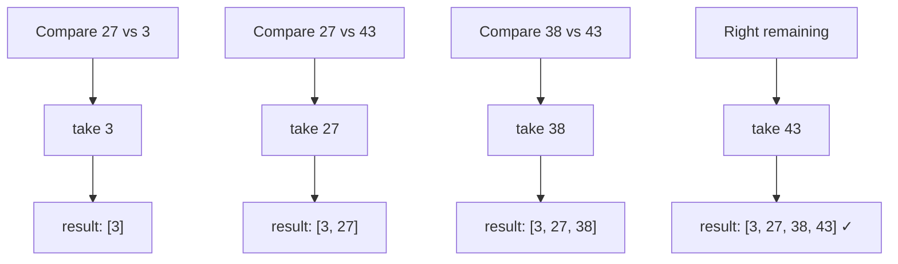
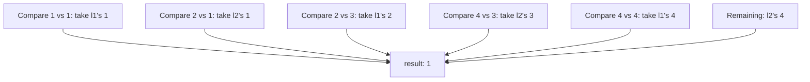
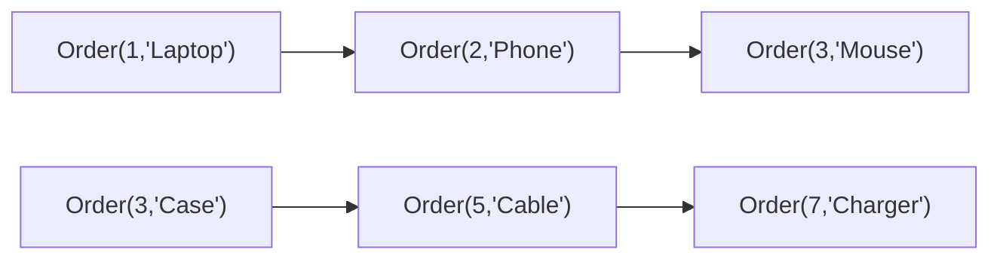
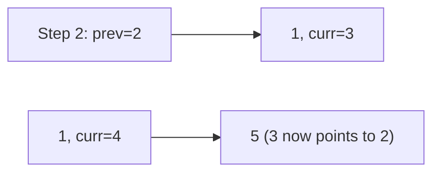
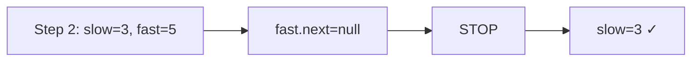

> **Navigation**: [Back to Index](../00_MASTER_INDEX.md) | [Next >](Day_009_Mar11_Tue.md)

# Day 008 - Monday, March 10, 2026

> **Week 02** | **Difficulty:** EASY-MEDIUM | **Theme:** LinkedList + Merge Sort Mastery + SQL WHERE
> [Daily Index](../00_DAILY_PRACTICE_INDEX.md) | [Prev Day](../Week_01/Day_007_Mar09_Sun.md) | [Next Day](Day_009_Mar11_Tue.md)

---

## Completion Checklist

- [ ] DS: Singly LinkedList (30 min)
- [ ] ALGO: Merge Sort deep dive (30 min)
- [ ] COMBO: Merge two sorted lists (20 min)
- [ ] REAL: Real-time scenario problem (20 min)
- [ ] SQL: WHERE, AND, OR, BETWEEN, IN (40 min)
- [ ] Q1: Coding problem 1 (20 min)
- [ ] Q2: Coding problem 2 (20 min)

---

> ## 📖 CHAPTER REFERENCES — Deep Dive Links
>
> Today's topics link to detailed chapter files for deeper study:
>
> | **DS: LinkedList** | [LinkedList Complete Guide](../../02_Data_Structures/01c_LinkedList.md) |
> | **ALGO: Merge Sort** | [Sorting Fundamentals](../../03_Algorithms/02a_Sorting_Fundamentals.md) |
> | **SQL: WHERE, AND, OR, BETWEEN, IN** | [SQL: SELECT & Filtering](../../08_SQL/05_Queries_SELECT_WHERE.md) |
>
> *Open the linked file for full theory, diagrams, and practice problems.*

---


## BLOCK 1: DATA STRUCTURE (30 min)

### Topic: Singly Linked List — Chain of Nodes

#### WHY does this exist?

Arrays are great, but they have a fatal flaw: **inserting/deleting in the middle is O(n)** because you must shift all elements. Linked Lists solve this — insert/delete at any known position is O(1).

**WHO invented it?** Allen Newell, Cliff Shaw, and Herbert A. Simon (1955-1956) at RAND Corporation, for their Information Processing Language. It was one of the first abstract data structures.

**WHERE is it used?**
- Browser's back/forward button (doubly linked list)
- Music player next/prev track
- Operating system process scheduling
- Java's `LinkedList` class (doubly linked internally)
- Blockchain (each block points to previous)

#### WHAT is a Linked List?

```
DEFINITION: A sequence of nodes where each node stores data + a reference (pointer) to the next node.

VISUAL:
  head
   │
   ▼
┌──────┬──┐    ┌──────┬──┐    ┌──────┬──────┐
│ data │ ─┼───▶│ data │ ─┼───▶│ data │ null │
│  10  │  │    │  20  │  │    │  30  │      │
└──────┴──┘    └──────┴──┘    └──────┴──────┘
  Node 0         Node 1         Node 2 (tail)

KEY DIFFERENCE FROM ARRAY:
  Array:  [10][20][30]  ← contiguous memory, random access O(1)
  List:   10→20→30      ← scattered memory, sequential access O(n)
```

> **Flow**: data / 10 → data / 20 | data / 20 → data null / 30



#### HOW does it work internally?

```
OPERATION               TIME      WHY?
──────────────────────────────────────────────────────────
Access by index         O(n)      Must traverse from head
Search                  O(n)      Must traverse sequentially
Insert at head          O(1)      Just update head pointer
Insert at tail          O(1)*     *If you maintain tail pointer
Insert at position k    O(k)      Traverse to k, then O(1) link
Delete at head          O(1)      Just move head forward
Delete by value         O(n)      Must find it first
```

> **Flow**: OPERATION TIME WHY? → Access by index O(n) Must traverse from head | Access by index O(n) Must traverse from head → Search O(n) Must traverse sequentially | Search O(n) Must traverse sequentially → Insert at head O(1) Just update head pointer | Insert at head O(1) Just update head pointer → Insert at tail O(1)* *If you maintain tail pointer | Insert at tail O(1)* *If you maintain tail pointer → Insert at position k O(k) Traverse to k, then O(1) link | Insert at position k O(k) Traverse to k, then O(1) link → Delete at head O(1) Just move head forward | ...+1 more



#### IMPLEMENT: Build a LinkedList from scratch

```java
public class SinglyLinkedList {

    // ─── Node definition ───
    static class Node {
        int data;
        Node next;
        Node(int data) {
            this.data = data;
            this.next = null;
        }
    }

    private Node head;
    private int size;

    // ─── Insert at head: O(1) ───
    public void insertAtHead(int data) {
        Node newNode = new Node(data);
        newNode.next = head;     // Point new node to current head
        head = newNode;          // Update head
        size++;
    }

    // ─── Insert at tail: O(n) ───
    // (O(1) if you maintain a tail pointer — try it as exercise!)
    public void insertAtTail(int data) {
        Node newNode = new Node(data);
        if (head == null) {
            head = newNode;
        } else {
            Node curr = head;
            while (curr.next != null) {
                curr = curr.next;
            }
            curr.next = newNode;
        }
        size++;
    }

    // ─── Delete by value: O(n) ───
    public boolean delete(int data) {
        if (head == null) return false;

        // Special case: deleting head
        if (head.data == data) {
            head = head.next;
            size--;
            return true;
        }

        Node curr = head;
        while (curr.next != null && curr.next.data != data) {
            curr = curr.next;
        }

        if (curr.next == null) return false;  // Not found

        curr.next = curr.next.next;  // Skip the node
        size--;
        return true;
    }

    // ─── Search: O(n) ───
    public boolean contains(int data) {
        Node curr = head;
        while (curr != null) {
            if (curr.data == data) return true;
            curr = curr.next;
        }
        return false;
    }

    // ─── Print: for debugging ───
    public void print() {
        Node curr = head;
        while (curr != null) {
            System.out.print(curr.data + " → ");
            curr = curr.next;
        }
        System.out.println("null");
    }
}
```

**Exercise:** Add a `reverse()` method. This is the #1 most asked LinkedList interview question.

---

## BLOCK 2: ALGORITHM (30 min)

### Topic: Merge Sort — Divide & Conquer Mastery

#### WHY Merge Sort?

```
┌─────────────────────────────────────────────────────────────────────┐
│  WHY MERGE SORT MATTERS:                                            │
│                                                                     │
│  • GUARANTEED O(n log n) — no worst case degradation                │
│  • STABLE sort (equal elements stay in original order)              │
│  • Foundation of external sorting (sorting data too big for RAM)    │
│  • Tim Sort (Java's Arrays.sort for objects) is based on it         │
│  • Teaches the Divide & Conquer paradigm perfectly                  │
│                                                                     │
│  vs Quick Sort:                                                     │
│  • Quick Sort: avg O(n log n), worst O(n²), in-place                │
│  • Merge Sort: always O(n log n), uses O(n) extra space             │
│  • Java uses Merge Sort for objects (stability needed)              │
│  • Java uses Quick Sort for primitives (speed, no stability need)   │
└─────────────────────────────────────────────────────────────────────┘
```

> **Flow**: WHY MERGE SORT MATTERS: → • GUARANTEED O(n log n) — no worst case degradation | • GUARANTEED O(n log n) — no worst case degradation → • STABLE sort (equal elements stay in original order) | • STABLE sort (equal elements stay in original order) → • Tim Sort (Java's Arrays.sort for objects) is based on | • Tim Sort (Java's Arrays.sort for objects) is based on → • Teaches the Divide & Conquer paradigm perfectly | • Teaches the Divide & Conquer paradigm perfectly → vs Quick Sort: | vs Quick Sort: → • Quick Sort: avg O(n log n), worst O(n²), in-place | ...+1 more



#### HOW it works — Visual

```
DIVIDE PHASE: Split array in half recursively until single elements
MERGE PHASE: Merge sorted halves back together

    [38, 27, 43, 3, 9, 82, 10]          ← Original
           /               \
   [38, 27, 43, 3]    [9, 82, 10]       ← Split
      /       \          /      \
  [38, 27]  [43, 3]  [9, 82]  [10]      ← Split
   /   \     /   \    /   \     |
 [38] [27] [43]  [3] [9] [82] [10]      ← Base case (size 1)
   \   /     \   /    \   /     |
  [27, 38]  [3, 43]  [9, 82]  [10]      ← Merge pairs
      \       /          \      /
   [3, 27, 38, 43]    [9, 10, 82]       ← Merge
           \               /
    [3, 9, 10, 27, 38, 43, 82]          ← Final merged

MERGE STEP DETAIL (merging [27,38] and [3,43]):
  Left:  [27, 38]    Right: [3, 43]
  
  Compare 27 vs 3  → take 3   → result: [3]
  Compare 27 vs 43 → take 27  → result: [3, 27]
  Compare 38 vs 43 → take 38  → result: [3, 27, 38]
  Right remaining   → take 43 → result: [3, 27, 38, 43] ✓
```

> **Flow**: Compare 27 vs 3 → take 3 | take 3 → result: [3] | Compare 27 vs 43 → take 27 | take 27 → result: [3, 27] | Compare 38 vs 43 → take 38 | take 38 → result: [3, 27, 38] | ...+2 more



#### IMPLEMENT: Merge Sort

```java
public class MergeSort {

    public static void mergeSort(int[] arr, int left, int right) {
        if (left >= right) return;   // Base case: 0 or 1 element

        int mid = left + (right - left) / 2;   // Avoid overflow!

        mergeSort(arr, left, mid);       // Sort left half
        mergeSort(arr, mid + 1, right);  // Sort right half
        merge(arr, left, mid, right);    // Merge sorted halves
    }

    private static void merge(int[] arr, int left, int mid, int right) {
        // Create temp arrays
        int n1 = mid - left + 1;
        int n2 = right - mid;
        int[] L = new int[n1];
        int[] R = new int[n2];

        // Copy data
        for (int i = 0; i < n1; i++) L[i] = arr[left + i];
        for (int j = 0; j < n2; j++) R[j] = arr[mid + 1 + j];

        // Merge back
        int i = 0, j = 0, k = left;
        while (i < n1 && j < n2) {
            if (L[i] <= R[j]) {     // <= makes it STABLE
                arr[k++] = L[i++];
            } else {
                arr[k++] = R[j++];
            }
        }

        // Copy remaining elements
        while (i < n1) arr[k++] = L[i++];
        while (j < n2) arr[k++] = R[j++];
    }

    // ─── Driver ───
    public static void main(String[] args) {
        int[] arr = {38, 27, 43, 3, 9, 82, 10};
        mergeSort(arr, 0, arr.length - 1);
        System.out.println(Arrays.toString(arr));
        // [3, 9, 10, 27, 38, 43, 82]
    }
}
```

**Complexity:**
- Time: O(n log n) — always (best, average, worst)
- Space: O(n) — for the temporary arrays during merge
- Stable: Yes

---

## BLOCK 3: COMBO CHALLENGE (20 min)

### Merge Two Sorted Linked Lists (LeetCode 21 — Easy)

This combines today's DS (LinkedList) + ALGO (merge logic).

```
Input:  list1 = 1→2→4,  list2 = 1→3→4
Output: 1→1→2→3→4→4

VISUAL:
  l1: 1 → 2 → 4
  l2: 1 → 3 → 4
  
  Compare 1 vs 1: take l1's 1  → result: 1
  Compare 2 vs 1: take l2's 1  → result: 1→1
  Compare 2 vs 3: take l1's 2  → result: 1→1→2
  Compare 4 vs 3: take l2's 3  → result: 1→1→2→3
  Compare 4 vs 4: take l1's 4  → result: 1→1→2→3→4
  Remaining: l2's 4            → result: 1→1→2→3→4→4 ✓
```

> **Flow**: Compare 1 vs 1: take l1's 1 → result: 1 | Compare 2 vs 1: take l2's 1 → result: 1 | Compare 2 vs 3: take l1's 2 → result: 1 | Compare 4 vs 3: take l2's 3 → result: 1 | Compare 4 vs 4: take l1's 4 → result: 1 | Remaining: l2's 4 → result: 1



```java
public ListNode mergeTwoLists(ListNode list1, ListNode list2) {
    ListNode dummy = new ListNode(-1);  // Sentinel node
    ListNode curr = dummy;

    while (list1 != null && list2 != null) {
        if (list1.val <= list2.val) {
            curr.next = list1;
            list1 = list1.next;
        } else {
            curr.next = list2;
            list2 = list2.next;
        }
        curr = curr.next;
    }

    // Attach remaining
    curr.next = (list1 != null) ? list1 : list2;

    return dummy.next;
}
// Time: O(n+m), Space: O(1)
```

---

## BLOCK 4: REAL-WORLD SCENARIO (20 min)

### Problem: E-Commerce Order Processing Queue

```
SCENARIO:
An e-commerce system receives orders from two regional warehouses.
Each warehouse sends orders sorted by priority (1=highest).
You need to merge them into a single processing queue.

Warehouse A: [Order(1,"Laptop"), Order(3,"Mouse"), Order(5,"Cable")]
Warehouse B: [Order(2,"Phone"), Order(3,"Case"), Order(7,"Charger")]

Merged processing queue:
Order(1,"Laptop") → Order(2,"Phone") → Order(3,"Mouse") → 
Order(3,"Case") → Order(5,"Cable") → Order(7,"Charger")

Notice: Order(3,"Mouse") comes before Order(3,"Case") — STABILITY matters!
If sort is unstable, Warehouse A's order might get pushed behind B's.
```

> **Flow**: Order(1,'Laptop') → Order(2,'Phone') | Order(2,'Phone') → Order(3,'Mouse') | Order(3,'Case') → Order(5,'Cable') | Order(5,'Cable') → Order(7,'Charger')



**Think about:** Why does Java use Merge Sort (TimSort) for object sorting?
Answer: Because stability preserves the relative order of equal elements — critical in business applications.

---

## BLOCK 5: SQL (40 min)

### Topic: Filtering with WHERE Clause

#### WHY: Without WHERE, you get ALL rows — useless for real queries

```sql
-- ═══════════════════════════════════════════════════════════════
-- WHERE — The Filter Clause
-- ═══════════════════════════════════════════════════════════════

-- BASIC: Find employees with salary > 50000
SELECT first_name, last_name, salary
FROM employees
WHERE salary > 50000;

-- MULTI-CONDITION with AND (both must be true)
SELECT * FROM employees
WHERE department = 'Engineering'
  AND salary > 60000;

-- MULTI-CONDITION with OR (either can be true)
SELECT * FROM employees
WHERE department = 'Engineering'
  OR department = 'Marketing';

-- ═══════════════════════════════════════════════════════════════
-- COMPARISON OPERATORS
-- ═══════════════════════════════════════════════════════════════

-- =    Equal
-- !=   Not equal (also <>)
-- >    Greater than
-- <    Less than
-- >=   Greater than or equal
-- <=   Less than or equal

-- ═══════════════════════════════════════════════════════════════
-- SPECIAL OPERATORS
-- ═══════════════════════════════════════════════════════════════

-- BETWEEN: Range (inclusive on both ends)
SELECT * FROM products
WHERE price BETWEEN 10 AND 50;
-- Same as: price >= 10 AND price <= 50

-- IN: Match any value in a list
SELECT * FROM employees
WHERE department IN ('Engineering', 'Marketing', 'Sales');
-- Same as: dept = 'Eng' OR dept = 'Mkt' OR dept = 'Sales'

-- LIKE: Pattern matching
-- % = any characters, _ = single character
SELECT * FROM employees
WHERE last_name LIKE 'S%';        -- Starts with S
-- WHERE email LIKE '%@gmail.com'; -- Ends with @gmail.com
-- WHERE name LIKE '_a%';          -- Second char is 'a'

-- IS NULL: Check for missing values (NOT = NULL, that doesn't work!)
SELECT * FROM employees
WHERE manager_id IS NULL;           -- Top-level managers

-- IS NOT NULL
SELECT * FROM employees
WHERE phone IS NOT NULL;
```

#### SQL Practice Exercises

```sql
-- Exercise 1: Find all products cheaper than $20
-- Exercise 2: Find employees hired between 2020 and 2023
-- Exercise 3: Find customers whose name starts with 'J' and city is 'Mumbai'
-- Exercise 4: Find orders where amount is NULL (incomplete orders)
-- Exercise 5: Find employees NOT in Engineering or Sales departments
```

---

## BLOCK 6: CODING PROBLEMS (40 min)

### Q1: Reverse a Linked List (LeetCode 206 — Easy)

```
THE most asked linked list question. Period.

Input:  1 → 2 → 3 → 4 → 5
Output: 5 → 4 → 3 → 2 → 1

VISUAL (iterative):
Step 0: prev=null, curr=1→2→3→4→5
Step 1: prev=1, curr=2→3→4→5       (1 now points to null)
Step 2: prev=2→1, curr=3→4→5       (2 now points to 1)
Step 3: prev=3→2→1, curr=4→5       (3 now points to 2)
Step 4: prev=4→3→2→1, curr=5       (4 now points to 3)
Step 5: prev=5→4→3→2→1, curr=null  (5 now points to 4) DONE!
```

> **Flow**: Step 2: prev=2 → 1, curr=3 | 1, curr=4 → 5 (3 now points to 2)



```java
// ITERATIVE: O(n) time, O(1) space
public ListNode reverseList(ListNode head) {
    ListNode prev = null;
    ListNode curr = head;

    while (curr != null) {
        ListNode next = curr.next;  // Save next
        curr.next = prev;           // Reverse pointer
        prev = curr;                // Move prev forward
        curr = next;                // Move curr forward
    }

    return prev;  // prev is new head
}
```

### Q2: Middle of Linked List (LeetCode 876 — Easy)

```
Input:  1 → 2 → 3 → 4 → 5
Output: 3  (middle node)

Input:  1 → 2 → 3 → 4 → 5 → 6
Output: 4  (second middle)

TRICK: Two-pointer (slow + fast)
  slow moves 1 step, fast moves 2 steps
  When fast reaches end, slow is at middle!

Step 0: slow=1, fast=1
Step 1: slow=2, fast=3
Step 2: slow=3, fast=5  → fast.next=null → STOP → slow=3 ✓
```

> **Flow**: Step 2: slow=3, fast=5 → fast.next=null | fast.next=null → STOP | STOP → slow=3 ✓



```java
public ListNode middleNode(ListNode head) {
    ListNode slow = head, fast = head;

    while (fast != null && fast.next != null) {
        slow = slow.next;
        fast = fast.next.next;
    }

    return slow;
}
// Time: O(n), Space: O(1)
// This two-pointer pattern is used everywhere: cycle detection, etc.
```

---

## End of Day Reflection

```
WHAT I LEARNED TODAY:
- [ ] LinkedList: when to use over array
- [ ] Merge Sort: divide & conquer + stability
- [ ] Merge pattern works on both arrays and linked lists
- [ ] SQL WHERE with AND/OR/BETWEEN/IN/LIKE/IS NULL

CONFIDENCE LEVEL: (circle one)
😟 Struggled | 😐 Got it with help | 😊 Solid | 🔥 Crushed it

TOMORROW'S PREVIEW: Doubly LinkedList + Quick Sort + SQL ORDER BY/LIMIT
```


---

> **Navigation**: [Back to Index](../00_MASTER_INDEX.md) | [Next >](Day_009_Mar11_Tue.md)