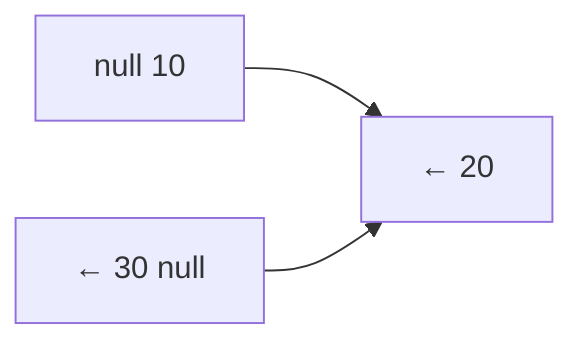
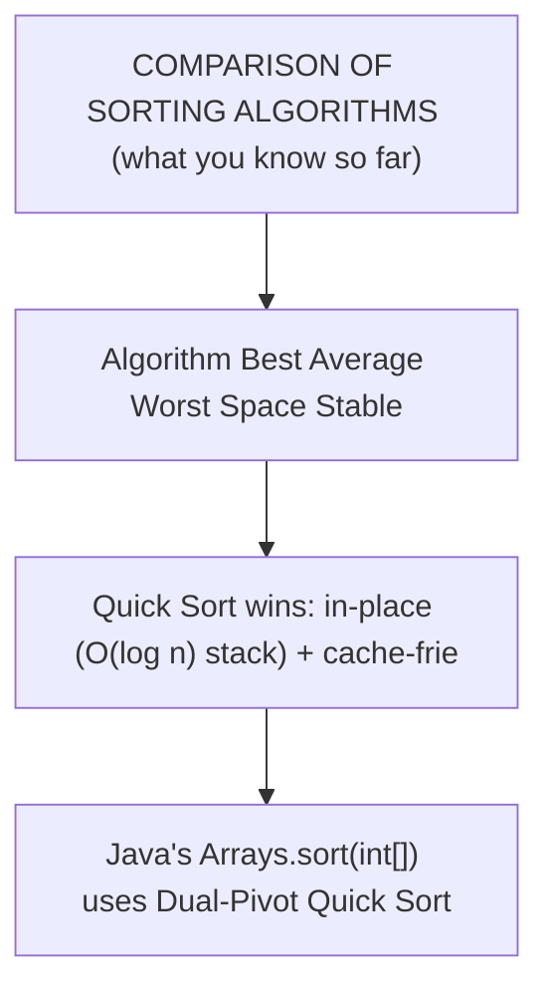
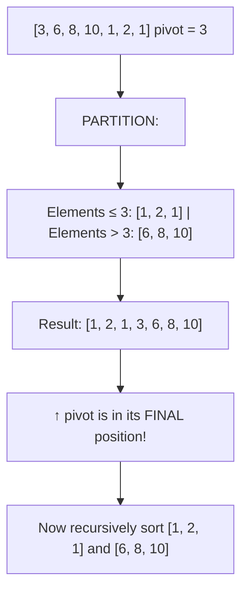
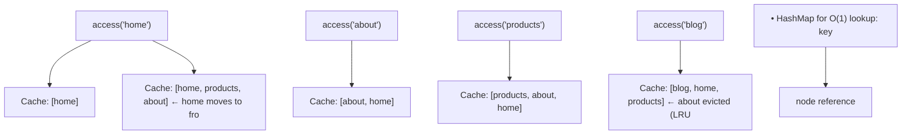
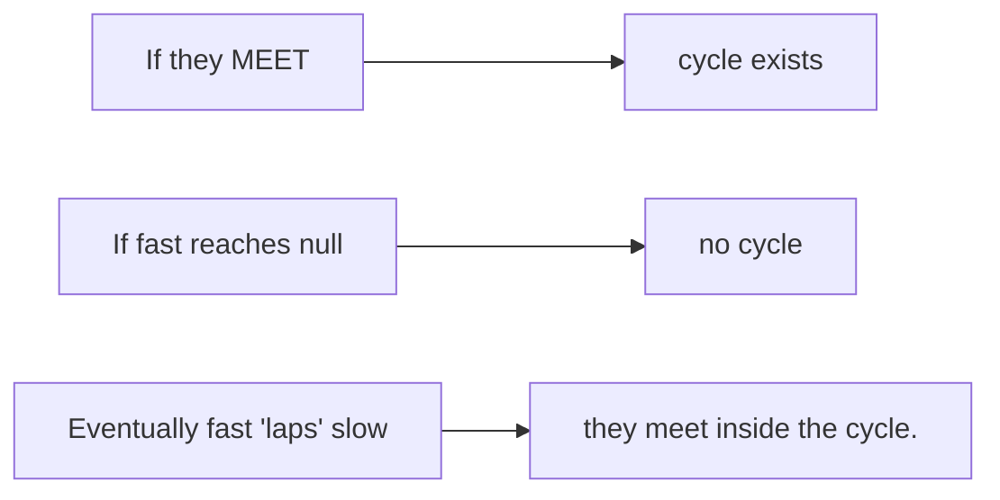
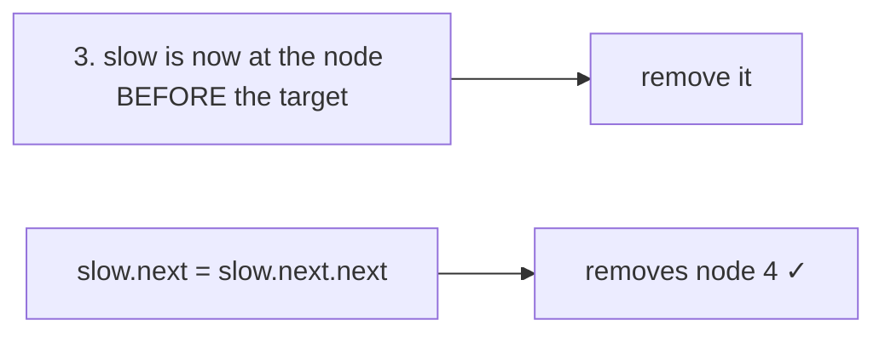

> **Navigation**: [< Previous](Day_008_Mar10_Mon.md) | [Back to Index](../../00_MASTER_INDEX.md) | [Next >](Day_010_Mar12_Wed.md)

# Day 009 - Tuesday, March 11, 2026

> **Week 02** | **Difficulty:** EASY-MEDIUM | **Theme:** Doubly LinkedList + Quick Sort + SQL ORDER BY
> [Daily Index](../00_DAILY_PRACTICE_INDEX.md) | [Prev Day](Day_008_Mar10_Mon.md) | [Next Day](Day_010_Mar12_Wed.md)

---

## Completion Checklist

- [ ] DS: Doubly LinkedList (30 min)
- [ ] ALGO: Quick Sort deep dive (30 min)
- [ ] COMBO: Partition-based problem (20 min)
- [ ] REAL: Real scenario (20 min)
- [ ] SQL: ORDER BY, LIMIT, OFFSET, aliases (40 min)
- [ ] Q1: Coding problem 1 (20 min)
- [ ] Q2: Coding problem 2 (20 min)

---

> ## 📖 CHAPTER REFERENCES — Deep Dive Links
>
> Today's topics link to detailed chapter files for deeper study:
>
> | **DS: Doubly LinkedList** | [LinkedList Complete Guide](../../02_Data_Structures/01c_LinkedList.md) |
> | **ALGO: Quick Sort** | [Sorting Fundamentals](../../03_Algorithms/02a_Sorting_Fundamentals.md) |
> | **SQL: ORDER BY, LIMIT, OFFSET** | [SQL: SELECT & Filtering](../../08_SQL/05_Queries_SELECT_WHERE.md) |
>
> *Open the linked file for full theory, diagrams, and practice problems.*

---


## BLOCK 1: DATA STRUCTURE (30 min)

### Topic: Doubly Linked List — Move Both Directions

#### WHY?

```
Singly linked list has a weakness: you can ONLY go forward.
If you need to go backward (browser back button, undo), you're stuck.

Doubly linked list adds a `prev` pointer so you can traverse both ways.

TRADE-OFF:
  Singly: Less memory (1 pointer per node), simpler
  Doubly:  More memory (2 pointers), but bidirectional traversal + O(1) delete if you have the node
```

#### WHAT: Structure

```
         head                                           tail
          │                                              │
          ▼                                              ▼
  ┌────┬──────┬────┐    ┌────┬──────┬────┐    ┌────┬──────┬────┐
  │null│  10  │  ─┼───▶│ ←─ │  20  │  ─┼───▶│ ←─ │  30  │null│
  │    │      │    │◀──┼─   │      │    │◀──┼─   │      │    │
  └────┴──────┴────┘    └────┴──────┴────┘    └────┴──────┴────┘
    prev data next       prev data next       prev data next
```

**Flow:**
- null 10
- ↓
- ← 20
- ↓
- ← 30 null
- ↓
- ← 20



#### 🔧 Implement

```java
public class DoublyLinkedList {
    static class Node {
        int data;
        Node prev, next;
        Node(int data) { this.data = data; }
    }

    private Node head, tail;
    private int size;

    // Insert at head: O(1)
    public void insertAtHead(int data) {
        Node newNode = new Node(data);
        if (head == null) {
            head = tail = newNode;
        } else {
            newNode.next = head;
            head.prev = newNode;
            head = newNode;
        }
        size++;
    }

    // Insert at tail: O(1) — we maintain tail pointer!
    public void insertAtTail(int data) {
        Node newNode = new Node(data);
        if (tail == null) {
            head = tail = newNode;
        } else {
            tail.next = newNode;
            newNode.prev = tail;
            tail = newNode;
        }
        size++;
    }

    // Delete a specific node: O(1) if you have the reference!
    public void deleteNode(Node node) {
        if (node == null) return;
        if (node.prev != null) node.prev.next = node.next;
        else head = node.next;   // Deleting head

        if (node.next != null) node.next.prev = node.prev;
        else tail = node.prev;   // Deleting tail

        size--;
    }
}
```

**Key Insight:** Java's `LinkedList` is internally a doubly linked list. `LinkedList` implements both `List` and `Deque` interfaces.

---

## BLOCK 2: ALGORITHM (30 min)

### Topic: Quick Sort — The Fastest Average-Case Sort

#### WHY Quick Sort?

```
┌─────────────────────────────────────────────────────────────────┐
│  COMPARISON OF SORTING ALGORITHMS (what you know so far):       │
│                                                                 │
│  Algorithm       │ Best    │ Average  │ Worst   │ Space │ Stable│
│  ─────────────────────────────────────────────────────────────  │
│  Selection Sort  │ O(n²)   │ O(n²)    │ O(n²)   │ O(1) │  No    │
│  Insertion Sort  │ O(n)    │ O(n²)    │ O(n²)   │ O(1) │  Yes   │
│  Bubble Sort     │ O(n)    │ O(n²)    │ O(n²)   │ O(1) │  Yes   │
│  Merge Sort      │ O(nlogn)│ O(nlogn) │ O(nlogn)│ O(n) │  Yes   │
│  Quick Sort      │ O(nlogn)│ O(nlogn) │ O(n²)   │ O(logn)│ No   │
│                                                                 │
│  Quick Sort wins: in-place (O(log n) stack) + cache-friendly    │
│  Java's Arrays.sort(int[]) uses Dual-Pivot Quick Sort           │
└─────────────────────────────────────────────────────────────────┘
```

**Flow:**
- COMPARISON OF SORTING ALGORITHMS (what you know so far)
- ↓
- Algorithm Best Average Worst Space Stable
- ↓
- Quick Sort wins: in-place (O(log n) stack) + cache-frie
- ↓
- Java's Arrays.sort(int[]) uses Dual-Pivot Quick Sort



#### HOW: Partition then Recurse

```
IDEA: Pick a "pivot". Put smaller elements LEFT, larger RIGHT. Repeat.

    [3, 6, 8, 10, 1, 2, 1]   pivot = 3
     
    PARTITION:
    Elements ≤ 3: [1, 2, 1]     |  Elements > 3: [6, 8, 10]
    
    Result: [1, 2, 1, 3, 6, 8, 10]
                      ↑ pivot is in its FINAL position!
    
    Now recursively sort [1, 2, 1] and [6, 8, 10]
```

**Flow:**
- [3, 6, 8, 10, 1, 2, 1] pivot = 3
- ↓
- PARTITION:
- ↓
- Elements ≤ 3: [1, 2, 1]
- ↓
- Elements > 3: [6, 8, 10]
- ↓
- Elements ≤ 3: [1, 2, 1]
- ↓
- Elements > 3: [6, 8, 10]
- ↓
- Result: [1, 2, 1, 3, 6, 8, 10]
- ↓
- ↑ pivot is in its FINAL position!
- ↓
- Now recursively sort [1, 2, 1] and [6, 8, 10]



#### IMPLEMENT: Lomuto Partition Scheme

```java
public class QuickSort {

    public static void quickSort(int[] arr, int low, int high) {
        if (low < high) {
            int pivotIdx = partition(arr, low, high);
            quickSort(arr, low, pivotIdx - 1);   // Left of pivot
            quickSort(arr, pivotIdx + 1, high);   // Right of pivot
        }
    }

    // Lomuto partition: pivot is last element
    private static int partition(int[] arr, int low, int high) {
        int pivot = arr[high];
        int i = low - 1;  // Index of "smaller than pivot" boundary

        for (int j = low; j < high; j++) {
            if (arr[j] <= pivot) {
                i++;
                swap(arr, i, j);  // Move small element to left side
            }
        }
        swap(arr, i + 1, high);   // Place pivot in correct position
        return i + 1;              // Return pivot's index
    }

    private static void swap(int[] arr, int a, int b) {
        int temp = arr[a];
        arr[a] = arr[b];
        arr[b] = temp;
    }
}
```

**Why O(n²) worst case?**
If pivot is always the smallest or largest element (e.g., already sorted array), partition creates one empty side. Fix: random pivot or median-of-three.

---

## BLOCK 3: COMBO CHALLENGE (20 min)

### Sort Colors / Dutch National Flag (LeetCode 75 — Medium)

```
Uses the PARTITION concept from Quick Sort!

Input:  [2, 0, 2, 1, 1, 0]
Output: [0, 0, 1, 1, 2, 2]

Constraint: Do it in ONE PASS, O(1) space (no counting sort)

THREE POINTERS:
  low  = boundary for 0s  (everything before low is 0)
  mid  = current element
  high = boundary for 2s  (everything after high is 2)
```

```java
public void sortColors(int[] nums) {
    int low = 0, mid = 0, high = nums.length - 1;

    while (mid <= high) {
        if (nums[mid] == 0) {
            swap(nums, low, mid);
            low++;
            mid++;
        } else if (nums[mid] == 1) {
            mid++;
        } else {  // nums[mid] == 2
            swap(nums, mid, high);
            high--;
            // Don't increment mid — swapped element needs checking
        }
    }
}
```

---

## BLOCK 4: REAL-WORLD SCENARIO (20 min)

### Problem: LRU Cache with Doubly LinkedList

```
SCENARIO:
Your web server caches the most recently accessed pages.
Cache size = 3 pages.

Operations:
  access("home")     → Cache: [home]
  access("about")    → Cache: [about, home]
  access("products") → Cache: [products, about, home]
  access("home")     → Cache: [home, products, about]  ← home moves to front!
  access("blog")     → Cache: [blog, home, products]   ← about evicted (LRU)

WHY DOUBLY LINKED LIST?
  • Move any node to front: O(1) (delete + insert at head)
  • Remove from tail (LRU): O(1) (tail pointer)
  • HashMap for O(1) lookup: key → node reference

This is LeetCode 146 (Medium) — implement it as a bonus challenge!
```

**Flow:**
- access('home')
- ↓
- Cache: [home]
- ↓
- access('about')
- ↓
- Cache: [about, home]
- ↓
- access('products')
- ↓
- Cache: [products, about, home]
- ↓
- access('home')
- ↓
- Cache: [home, products, about] ← home moves to fro
- ↓
- access('blog')
- ↓
- Cache: [blog, home, products] ← about evicted (LRU
- ↓
- • HashMap for O(1) lookup: key
- ↓
- node reference



---

## BLOCK 5: SQL (40 min)

### Topic: ORDER BY, LIMIT, OFFSET, Aliases

```sql
-- ═══════════════════════════════════════════════════════════════
-- ORDER BY — Sort your results
-- ═══════════════════════════════════════════════════════════════

-- Ascending (default)
SELECT first_name, salary FROM employees
ORDER BY salary;              -- Lowest first (ASC is default)

-- Descending
SELECT first_name, salary FROM employees
ORDER BY salary DESC;         -- Highest first

-- Multiple columns (tie-breaking)
SELECT * FROM employees
ORDER BY department ASC, salary DESC;
-- First sort by department A-Z, then within each dept, highest salary first

-- ═══════════════════════════════════════════════════════════════
-- LIMIT + OFFSET — Pagination
-- ═══════════════════════════════════════════════════════════════

-- Top 5 highest-paid employees
SELECT first_name, salary FROM employees
ORDER BY salary DESC
LIMIT 5;

-- Page 2 (skip first 5, get next 5)
SELECT * FROM employees
ORDER BY salary DESC
LIMIT 5 OFFSET 5;

-- ═══════════════════════════════════════════════════════════════
-- ALIASES — Rename columns/tables for readability
-- ═══════════════════════════════════════════════════════════════

-- Column alias
SELECT first_name AS name, salary * 12 AS annual_salary
FROM employees;

-- Table alias (useful later with JOINs)
SELECT e.first_name, e.salary
FROM employees AS e
WHERE e.salary > 50000;
```

#### SQL Practice

```sql
-- Exercise 1: Show top 3 most expensive products
-- Exercise 2: Show employees ordered by hire_date (newest first)
-- Exercise 3: Show page 3 of products (10 per page)
-- Exercise 4: Select name and price*1.18 as price_with_gst from products
```

---

## BLOCK 6: CODING PROBLEMS (40 min)

### Q1: Linked List Cycle Detection (LeetCode 141 — Easy)

```
Can you detect if a linked list has a cycle?

  1 → 2 → 3 → 4 → 5
              ↑       │
              └───────┘   ← Cycle! (5 points back to 3)

FLOYD'S CYCLE DETECTION (Tortoise & Hare):
  slow moves 1 step, fast moves 2 steps
  If they MEET → cycle exists
  If fast reaches null → no cycle

WHY does it work?
  If there's a cycle, fast gains 1 step per iteration on slow.
  Eventually fast "laps" slow → they meet inside the cycle.
```

**Flow:**
- If they MEET
- ↓
- cycle exists
- ↓
- If fast reaches null
- ↓
- no cycle
- ↓
- Eventually fast 'laps' slow
- ↓
- they meet inside the cycle.



```java
public boolean hasCycle(ListNode head) {
    ListNode slow = head, fast = head;

    while (fast != null && fast.next != null) {
        slow = slow.next;
        fast = fast.next.next;
        if (slow == fast) return true;  // They met → cycle!
    }

    return false;  // fast reached end → no cycle
}
// Time: O(n), Space: O(1) — can't beat this!
```

### Q2: Remove Nth Node from End (LeetCode 19 — Medium)

```
Input:  1 → 2 → 3 → 4 → 5,  n = 2
Output: 1 → 2 → 3 → 5   (removed 4, which is 2nd from end)

TRICK: Two-pointer with gap of n
  1. Move fast pointer n steps ahead
  2. Move both slow and fast until fast reaches end
  3. slow is now at the node BEFORE the target → remove it

    fast (after n=2 steps):  _ _ fast
    1 → 2 → 3 → 4 → 5
    slow

    Move both:               
    1 → 2 → 3 → 4 → 5
              slow     fast(null)
    
    slow.next = slow.next.next → removes node 4 ✓
```

**Flow:**
- 3. slow is now at the node BEFORE the target
- ↓
- remove it
- ↓
- slow.next = slow.next.next
- ↓
- removes node 4 ✓



```java
public ListNode removeNthFromEnd(ListNode head, int n) {
    ListNode dummy = new ListNode(0);
    dummy.next = head;
    ListNode fast = dummy, slow = dummy;

    // Move fast n+1 steps ahead
    for (int i = 0; i <= n; i++) fast = fast.next;

    // Move both until fast reaches end
    while (fast != null) {
        slow = slow.next;
        fast = fast.next;
    }

    slow.next = slow.next.next;  // Remove target node
    return dummy.next;
}
```

---

## End of Day Reflection

```
WHAT I LEARNED TODAY:
- [ ] Doubly linked list: prev + next pointers, O(1) delete
- [ ] Quick Sort: partition scheme, pivot selection
- [ ] Dutch National Flag: 3-way partition
- [ ] SQL ORDER BY / LIMIT / OFFSET / aliases

CONFIDENCE LEVEL: 😟 | 😐 | 😊 | 🔥

TOMORROW'S PREVIEW: Stack + Binary Search + SQL Aggregate Functions
```


---

> **Navigation**: [< Previous](Day_008_Mar10_Mon.md) | [Back to Index](../../00_MASTER_INDEX.md) | [Next >](Day_010_Mar12_Wed.md)