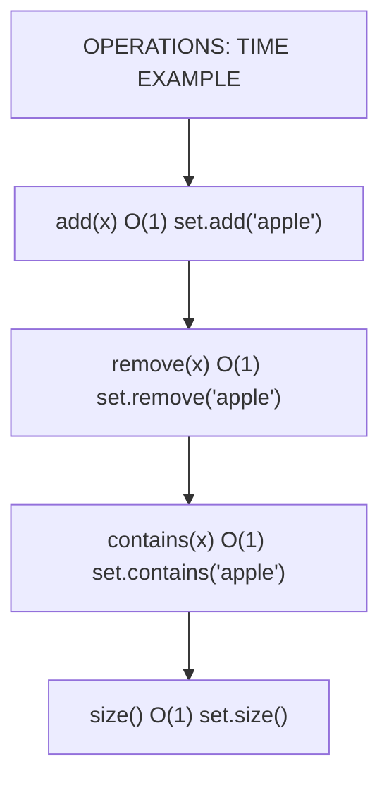
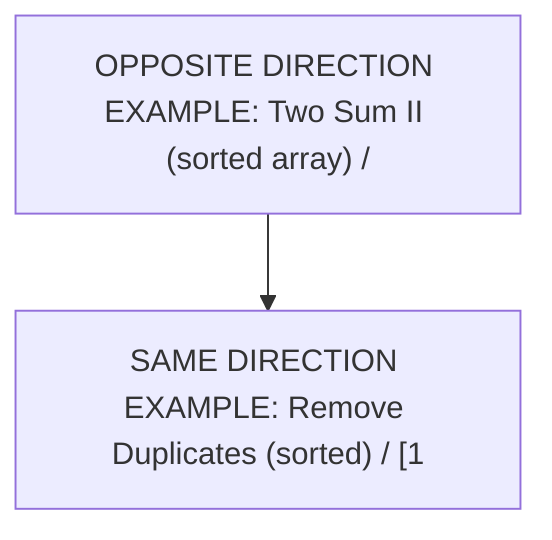
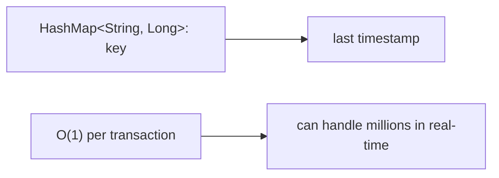

> **Navigation**: [< Previous](Day_011_Mar13_Thu.md) | [Back to Index](../00_MASTER_INDEX.md) | [Next >](Day_013_Mar15_Sat.md)

# Day 012 - Friday, March 14, 2026

> **Week 02** | **Difficulty:** MEDIUM | **Theme:** HashSet + Two Pointers + SQL Subqueries
> [Daily Index](../00_DAILY_PRACTICE_INDEX.md) | [Prev Day](Day_011_Mar13_Thu.md) | [Next Day](Day_013_Mar15_Sat.md)

---

## Completion Checklist

- [ ] DS: HashSet (30 min)
- [ ] ALGO: Two Pointer technique (30 min)
- [ ] COMBO: Set + Two pointers (20 min)
- [ ] REAL: Duplicate detection system (20 min)
- [ ] SQL: Subqueries + EXISTS (40 min)
- [ ] Q1: Coding problem 1 (20 min)
- [ ] Q2: Coding problem 2 (20 min)

---

> ## 📖 CHAPTER REFERENCES — Deep Dive Links
>
> Today's topics link to detailed chapter files for deeper study:
>
> | **DS: HashSet** | [Hash Table Complete Guide](../../02_Data_Structures/01e_HashTable.md) |
> | **ALGO: Two Pointers Pattern** | [Two Pointers Complete](../../04_Patterns_Templates/07_Two_Pointers_Complete.md) |
> | **SQL: Subqueries & EXISTS** | [SQL: Subqueries & CTEs](../../08_SQL/08_Subqueries_CTEs.md) |
>
> *Open the linked file for full theory, diagrams, and practice problems.*

---


## BLOCK 1: DATA STRUCTURE (30 min)

### Topic: HashSet — Unique Collection

#### WHY?

```
You need to answer: "Have I seen this before?" in O(1).

Array:   contains() is O(n) — must scan everything
List:    contains() is O(n)
HashSet: contains() is O(1) — like HashMap but stores only keys

USE CASES:
  • Duplicate detection ("seen these IDs before?")
  • Set operations (union, intersection, difference)
  • Visited tracking in graph algorithms (BFS/DFS)
  • Word dictionaries (is this word valid?)
```

#### 📌 What

```
HashSet is just HashMap<K, PRESENT> internally (value is a dummy constant).

OPERATIONS:     TIME      EXAMPLE
───────────────────────────────────────
add(x)          O(1)      set.add("apple")
remove(x)       O(1)      set.remove("apple")
contains(x)     O(1)      set.contains("apple")
size()          O(1)      set.size()
```

> **Flow**: OPERATIONS: TIME EXAMPLE → add(x) O(1) set.add('apple') | add(x) O(1) set.add('apple') → remove(x) O(1) set.remove('apple') | remove(x) O(1) set.remove('apple') → contains(x) O(1) set.contains('apple') | contains(x) O(1) set.contains('apple') → size() O(1) set.size()



```java
// Common patterns
Set<Integer> set = new HashSet<>();

// Remove duplicates from array
Set<Integer> unique = new HashSet<>(Arrays.asList(1, 2, 2, 3, 3, 3));
// unique = {1, 2, 3}

// Set operations
Set<Integer> a = new HashSet<>(Arrays.asList(1, 2, 3, 4));
Set<Integer> b = new HashSet<>(Arrays.asList(3, 4, 5, 6));

// Intersection (common elements)
Set<Integer> intersection = new HashSet<>(a);
intersection.retainAll(b);  // {3, 4}

// Union
Set<Integer> union = new HashSet<>(a);
union.addAll(b);  // {1, 2, 3, 4, 5, 6}

// Difference
Set<Integer> diff = new HashSet<>(a);
diff.removeAll(b);  // {1, 2}
```

---

## BLOCK 2: ALGORITHM (30 min)

### Topic: Two Pointer Technique

#### WHY?

```
Many problems that seem O(n²) can be solved in O(n) with two pointers.

TWO VARIANTS:

1. OPPOSITE DIRECTION: left→    ←right (converging)
   Used for: sorted array problems, palindromes, container

2. SAME DIRECTION: slow→  fast→  (fast-slow / sliding window)
   Used for: remove duplicates, linked list cycle, partition

┌──────────────────────────────────────────────────────────┐
│  OPPOSITE DIRECTION EXAMPLE: Two Sum II (sorted array)   │
│  [2, 7, 11, 15]  target = 9                              │
│   L→                ←R                                   │
│   2 + 15 = 17 > 9  → move R left                         │
│   2 + 11 = 13 > 9  → move R left                         │
│   2 + 7  = 9  == 9  → FOUND! ✓                           │
└──────────────────────────────────────────────────────────┘

┌──────────────────────────────────────────────────────────┐
│  SAME DIRECTION EXAMPLE: Remove Duplicates (sorted)      │
│  [1, 1, 2, 2, 3]                                         │
│   s  f                                                   │
│   slow tracks "unique so far" position                   │
│   fast scans ahead for next unique                       │
│   Result: [1, 2, 3, _, _]  return slow+1 = 3             │
└──────────────────────────────────────────────────────────┘
```

> **Flow**: OPPOSITE DIRECTION EXAMPLE: Two Sum II (sorted array) / → SAME DIRECTION EXAMPLE: Remove Duplicates (sorted) / [1



#### 📐 Templates

```java
// TEMPLATE 1: Opposite direction (sorted array)
int left = 0, right = arr.length - 1;
while (left < right) {
    int sum = arr[left] + arr[right];
    if (sum == target) return true;
    else if (sum < target) left++;
    else right--;
}

// TEMPLATE 2: Same direction (fast-slow)
int slow = 0;
for (int fast = 1; fast < arr.length; fast++) {
    if (arr[fast] != arr[slow]) {
        slow++;
        arr[slow] = arr[fast];
    }
}
return slow + 1;  // Number of unique elements
```

---

## BLOCK 3: COMBO CHALLENGE (20 min)

### Intersection of Two Arrays (LeetCode 349 — Easy)

HashSet + Two concepts combined.

```
Input:  nums1 = [1,2,2,1], nums2 = [2,2]
Output: [2]

Input:  nums1 = [4,9,5], nums2 = [9,4,9,8,4]
Output: [9,4]
```

```java
// Approach 1: HashSet — O(n+m) time
public int[] intersection(int[] nums1, int[] nums2) {
    Set<Integer> set1 = new HashSet<>();
    for (int n : nums1) set1.add(n);

    Set<Integer> result = new HashSet<>();
    for (int n : nums2) {
        if (set1.contains(n)) result.add(n);
    }

    return result.stream().mapToInt(Integer::intValue).toArray();
}

// Approach 2: Sort + Two Pointers — O(n log n) time, O(1) extra space
public int[] intersection2(int[] nums1, int[] nums2) {
    Arrays.sort(nums1);
    Arrays.sort(nums2);
    Set<Integer> result = new HashSet<>();
    int i = 0, j = 0;
    while (i < nums1.length && j < nums2.length) {
        if (nums1[i] == nums2[j]) {
            result.add(nums1[i]);
            i++; j++;
        } else if (nums1[i] < nums2[j]) i++;
        else j++;
    }
    return result.stream().mapToInt(Integer::intValue).toArray();
}
```

---

## BLOCK 4: REAL-WORLD SCENARIO (20 min)

### Problem: Duplicate Transaction Detection

```
SCENARIO: Bank processes millions of transactions daily.
Flag DUPLICATE transactions (same account, amount, within 60 seconds).

Input: Stream of transactions (account_id, amount, timestamp)

APPROACH:
  Key = account_id + "_" + amount (e.g., "ACC001_500.00")
  HashMap<String, Long>: key → last timestamp

  For each transaction:
    Create key
    If key exists AND timestamp - lastTimestamp < 60:
      FLAG AS DUPLICATE
    Update map with new timestamp

WHY HashMap + HashSet?
  O(1) per transaction → can handle millions in real-time
  LinkedHashMap can auto-evict old entries (removeEldestEntry)
```

> **Flow**: HashMap&lt;String, Long&gt;: key → last timestamp | O(1) per transaction → can handle millions in real-time



---

## BLOCK 5: SQL (40 min)

### Topic: Subqueries

```sql
-- ═══════════════════════════════════════════════════════════════
-- SUBQUERY — A query INSIDE another query
-- ═══════════════════════════════════════════════════════════════

-- Scalar subquery (returns single value)
SELECT name, salary
FROM employees
WHERE salary > (SELECT AVG(salary) FROM employees);
-- "Find employees earning above average"

-- List subquery (returns a column)
SELECT name FROM employees
WHERE dept_id IN (
    SELECT dept_id FROM departments WHERE location = 'Mumbai'
);
-- "Find employees in Mumbai departments"

-- ═══════════════════════════════════════════════════════════════
-- EXISTS — Check if subquery returns ANY rows (efficient!)
-- ═══════════════════════════════════════════════════════════════

-- Customers who have placed at least one order
SELECT c.name
FROM customers c
WHERE EXISTS (
    SELECT 1 FROM orders o WHERE o.customer_id = c.id
);

-- Customers who have NEVER ordered
SELECT c.name
FROM customers c
WHERE NOT EXISTS (
    SELECT 1 FROM orders o WHERE o.customer_id = c.id
);

-- ═══════════════════════════════════════════════════════════════
-- CORRELATED SUBQUERY — References outer query (runs per row!)
-- ═══════════════════════════════════════════════════════════════

-- Employees earning more than their department average
SELECT e.name, e.salary, e.dept_id
FROM employees e
WHERE e.salary > (
    SELECT AVG(e2.salary) FROM employees e2
    WHERE e2.dept_id = e.dept_id    -- ← references outer e!
);
```

#### SQL Practice

```sql
-- Exercise 1: Find the second highest salary (subquery approach)
-- Exercise 2: Find products more expensive than the average in their category
-- Exercise 3: Find customers who ordered more than 3 times (EXISTS)
-- Exercise 4: Find departments where ALL employees earn > 50000
```

---

## BLOCK 6: CODING PROBLEMS (40 min)

### Q1: Contains Duplicate (LeetCode 217 — Easy)

```java
public boolean containsDuplicate(int[] nums) {
    Set<Integer> seen = new HashSet<>();
    for (int n : nums) {
        if (!seen.add(n)) return true;  // add() returns false if already present
    }
    return false;
}
// Time: O(n), Space: O(n)
// One-liner: return nums.length != Arrays.stream(nums).distinct().count();
```

### Q2: Container with Most Water (LeetCode 11 — Medium)

```
Given heights[i], find two lines that form container holding most water.

Input:  [1, 8, 6, 2, 5, 4, 8, 3, 7]
Output: 49 (between heights 8 and 7, width = 7-1 = 6... wait, 8*7? No: min(8,7)*6 = 42... 
Actually: indices 1 and 8, width=7, min(8,7)=7, area=49 ✓)

TWO POINTERS (opposite direction):
  Start with widest container (left=0, right=end)
  Move the SHORTER side inward (only way to potentially increase area)
  Track maximum area seen
```

```java
public int maxArea(int[] height) {
    int left = 0, right = height.length - 1;
    int maxWater = 0;

    while (left < right) {
        int h = Math.min(height[left], height[right]);
        int w = right - left;
        maxWater = Math.max(maxWater, h * w);

        if (height[left] < height[right]) left++;
        else right--;
    }

    return maxWater;
}
// Time: O(n), Space: O(1)
// WHY move shorter side? Longer side can't improve area (limited by shorter)
```

---

## End of Day Reflection

```
WHAT I LEARNED TODAY:
- [ ] HashSet: O(1) contains, backed by HashMap
- [ ] Two Pointers: opposite + same direction patterns
- [ ] SQL Subqueries: scalar, list, EXISTS, correlated
- [ ] Container problem: greedy with two pointers

CONFIDENCE LEVEL: 😟 | 😐 | 😊 | 🔥

TOMORROW (SAT): Spring Boot Day #2 — Dependency Injection Deep + SQL Practice
```


---

> **Navigation**: [< Previous](Day_011_Mar13_Thu.md) | [Back to Index](../00_MASTER_INDEX.md) | [Next >](Day_013_Mar15_Sat.md)