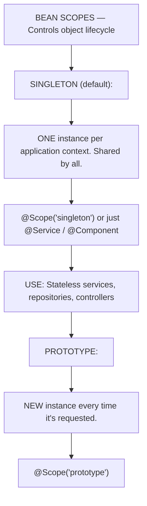
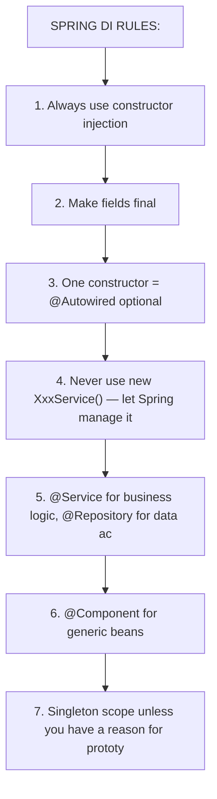
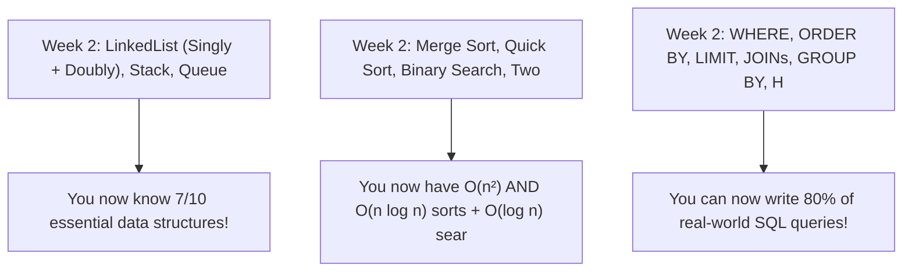

> **Navigation**: [< Previous](Day_012_Mar14_Fri.md) | [Back to Index](../../00_MASTER_INDEX.md) | [Next >](Day_014_Mar16_Sun.md)

# Day 013 - Saturday, March 15, 2026

> **Week 02** | **Weekend** | **Theme:** Spring Boot — Beans & DI Deep Dive + SQL Practice
> [Daily Index](../00_DAILY_PRACTICE_INDEX.md) | [Prev Day](Day_012_Mar14_Fri.md) | [Next Day](Day_014_Mar16_Sun.md)

---

## Completion Checklist

- [ ] Spring Boot: Bean Scopes & Dependency Injection (90 min)
- [ ] SQL Practice: JOINs + Aggregates mixed drills (45 min)
- [ ] Review: Week 2 concepts recap (45 min)

---

> ## 📖 CHAPTER REFERENCES — Deep Dive Links
>
> Today's topics link to detailed chapter files for deeper study:
>
> | **Spring Boot: Bean Scopes & DI** | [Spring Boot: IoC & Beans](../../07_Modern_Java/Ch32_SB_Data_Part2.md) |
> | **SQL: JOINs + Aggregate Drills** | [SQL: JOINs Complete](../../08_SQL/07_JOINs_Complete.md) |
>
> *Open the linked file for full theory, diagrams, and practice problems.*

---


## BLOCK 1: SPRING BOOT (90 min)

### Topic: Beans, Scopes, and Dependency Injection

> Cross-reference: [Spring Boot Part 2 — IoC & Beans](../../07_Modern_Java/Ch32_SB_Data_Part2.md)

#### Chapter 1: Bean Scopes — WHEN Spring Creates Objects

```
┌─────────────────────────────────────────────────────────────────────┐
│  BEAN SCOPES — Controls object lifecycle                            │
│                                                                     │
│  SINGLETON (default):                                               │
│    ONE instance per application context. Shared by all.             │
│    @Scope("singleton") or just @Service / @Component                │
│    USE: Stateless services, repositories, controllers               │
│                                                                     │
│  PROTOTYPE:                                                         │
│    NEW instance every time it's requested.                          │
│    @Scope("prototype")                                              │
│    USE: Stateful objects (shopping cart, form builder)              │
│                                                                     │
│  REQUEST (Web only):                                                │
│    One per HTTP request. Destroyed after response sent.             │
│    @Scope("request")                                                │
│    USE: Request-specific data (user context)                        │
│                                                                     │
│  SESSION (Web only):                                                │
│    One per user session. Lives until session expires.               │
│    @Scope("session")                                                │
│    USE: User preferences, shopping cart                             │
└─────────────────────────────────────────────────────────────────────┘
```

> **Flow**: BEAN SCOPES — Controls object lifecycle → SINGLETON (default): | SINGLETON (default): → ONE instance per application context. Shared by all. | ONE instance per application context. Shared by all. → @Scope('singleton') or just @Service / @Component | @Scope('singleton') or just @Service / @Component → USE: Stateless services, repositories, controllers | USE: Stateless services, repositories, controllers → PROTOTYPE: | PROTOTYPE: → NEW instance every time it's requested. | ...+1 more



#### Chapter 2: Dependency Injection — The 3 Ways

```java
// ═══════════════════════════════════════════════════════════════
// WAY 1: CONSTRUCTOR INJECTION (✅ RECOMMENDED)
// ═══════════════════════════════════════════════════════════════
@Service
public class OrderService {
    private final OrderRepository orderRepo;
    private final NotificationService notifier;

    // Spring automatically injects dependencies
    // @Autowired is optional if only one constructor
    public OrderService(OrderRepository orderRepo, 
                        NotificationService notifier) {
        this.orderRepo = orderRepo;
        this.notifier = notifier;
    }
}
// WHY best?
// • final fields → immutable → thread-safe
// • Required dependencies are explicit
// • Easy to test (just pass mocks in constructor)
// • Fails fast at startup if dependency missing

// ═══════════════════════════════════════════════════════════════
// WAY 2: FIELD INJECTION (❌ AVOID)
// ═══════════════════════════════════════════════════════════════
@Service
public class OrderService {
    @Autowired
    private OrderRepository orderRepo;  // Can't be final!
}
// WHY bad?
// • Can't make fields final
// • Hidden dependencies (not visible in constructor)
// • Hard to test (need reflection to inject mocks)
// • Can create objects in invalid state

// ═══════════════════════════════════════════════════════════════
// WAY 3: SETTER INJECTION (Rarely used)
// ═══════════════════════════════════════════════════════════════
@Service
public class OrderService {
    private OrderRepository orderRepo;

    @Autowired
    public void setOrderRepo(OrderRepository orderRepo) {
        this.orderRepo = orderRepo;
    }
}
// WHEN? Only for optional dependencies
```

#### Chapter 3: Practical Exercise — Build a Service Layer

```java
// STEP 1: Entity
@Entity
@Table(name = "products")
public class Product {
    @Id @GeneratedValue(strategy = GenerationType.IDENTITY)
    private Long id;
    private String name;
    private BigDecimal price;
    private Integer stock;
    // getters, setters
}

// STEP 2: Repository
@Repository
public interface ProductRepository extends JpaRepository<Product, Long> {
    List<Product> findByPriceLessThan(BigDecimal price);
    List<Product> findByNameContainingIgnoreCase(String keyword);
}

// STEP 3: Service
@Service
public class ProductService {
    private final ProductRepository productRepo;

    public ProductService(ProductRepository productRepo) {
        this.productRepo = productRepo;  // Constructor injection
    }

    public Product createProduct(String name, BigDecimal price, int stock) {
        Product p = new Product();
        p.setName(name);
        p.setPrice(price);
        p.setStock(stock);
        return productRepo.save(p);
    }

    public List<Product> getAffordableProducts(BigDecimal maxPrice) {
        return productRepo.findByPriceLessThan(maxPrice);
    }

    public Product reduceStock(Long productId, int quantity) {
        Product p = productRepo.findById(productId)
            .orElseThrow(() -> new RuntimeException("Product not found"));
        if (p.getStock() < quantity) {
            throw new RuntimeException("Insufficient stock");
        }
        p.setStock(p.getStock() - quantity);
        return productRepo.save(p);
    }
}

// STEP 4: Controller
@RestController
@RequestMapping("/api/products")
public class ProductController {
    private final ProductService productService;

    public ProductController(ProductService productService) {
        this.productService = productService;
    }

    @GetMapping
    public List<Product> getAll() {
        return productService.getAffordableProducts(BigDecimal.valueOf(99999));
    }

    @PostMapping
    public Product create(@RequestBody Product product) {
        return productService.createProduct(
            product.getName(), product.getPrice(), product.getStock());
    }
}
```

#### Key Takeaways

```
┌─────────────────────────────────────────────────────────────────────┐
│  SPRING DI RULES:                                                   │
│  1. Always use constructor injection                                │
│  2. Make fields final                                               │
│  3. One constructor = @Autowired optional                           │
│  4. Never use new XxxService() — let Spring manage it               │
│  5. @Service for business logic, @Repository for data access        │
│  6. @Component for generic beans                                    │
│  7. Singleton scope unless you have a reason for prototype          │
└─────────────────────────────────────────────────────────────────────┘
```

> **Flow**: SPRING DI RULES: → 1. Always use constructor injection | 1. Always use constructor injection → 2. Make fields final | 2. Make fields final → 3. One constructor = @Autowired optional | 3. One constructor = @Autowired optional → 4. Never use new XxxService() — let Spring manage it | 4. Never use new XxxService() — let Spring manage it → 5. @Service for business logic, @Repository for data ac | 5. @Service for business logic, @Repository for data ac → 6. @Component for generic beans | ...+1 more



---

## BLOCK 2: SQL PRACTICE (45 min)

### Mixed Drills — JOINs + Aggregates + Subqueries

```sql
-- DRILL 1: Show each department name and its total salary expense
SELECT d.dept_name, SUM(e.salary) AS total_expense
FROM departments d
LEFT JOIN employees e ON d.dept_id = e.dept_id
GROUP BY d.dept_name
ORDER BY total_expense DESC;

-- DRILL 2: Find the highest-paid employee in each department
SELECT e.name, e.salary, d.dept_name
FROM employees e
INNER JOIN departments d ON e.dept_id = d.dept_id
WHERE e.salary = (
    SELECT MAX(e2.salary) FROM employees e2
    WHERE e2.dept_id = e.dept_id
);

-- DRILL 3: Show customers who spent more than $1000 total
SELECT c.name, SUM(o.amount) AS total_spent
FROM customers c
INNER JOIN orders o ON c.id = o.customer_id
GROUP BY c.id, c.name
HAVING SUM(o.amount) > 1000
ORDER BY total_spent DESC;

-- DRILL 4: Find products never ordered
SELECT p.name
FROM products p
LEFT JOIN order_items oi ON p.id = oi.product_id
WHERE oi.product_id IS NULL;
-- Alternative with NOT EXISTS:
SELECT p.name FROM products p
WHERE NOT EXISTS (
    SELECT 1 FROM order_items oi WHERE oi.product_id = p.id
);

-- DRILL 5: Rank employees by salary within their department
SELECT e.name, e.salary, d.dept_name,
       RANK() OVER (PARTITION BY e.dept_id ORDER BY e.salary DESC) AS dept_rank
FROM employees e
JOIN departments d ON e.dept_id = d.dept_id;
```

---

## BLOCK 3: REVIEW (45 min)

### Week 2 Concept Map

```
WEEK 2 KNOWLEDGE TREE:
───────────────────────

DATA STRUCTURES LEARNED:
  Week 1: Array, 2D Array
  Week 2: LinkedList (Singly + Doubly), Stack, Queue/Deque, HashMap, HashSet
         └── You now know 7/10 essential data structures!

ALGORITHMS LEARNED:
  Week 1: Linear Search, Selection Sort, Insertion Sort, Bubble Sort, Kadane's
  Week 2: Merge Sort, Quick Sort, Binary Search, Two Pointers
         └── You now have O(n²) AND O(n log n) sorts + O(log n) search!

SQL PROGRESS:
  Week 1: CREATE TABLE, INSERT, SELECT, data types
  Week 2: WHERE, ORDER BY, LIMIT, JOINs, GROUP BY, HAVING, Subqueries
         └── You can now write 80% of real-world SQL queries!

PATTERNS:
  • Fast-slow pointer (cycle detection, middle of list)
  • Two pointers (sorted array problems)
  • HashMap frequency count
  • Stack for matching/validation
  • Merge logic (arrays, lists)
```

> **Flow**: Week 2: LinkedList (Singly + Doubly), Stack, Queue → You now know 7/10 essential data structures! | Week 2: Merge Sort, Quick Sort, Binary Search, Two → You now have O(n²) AND O(n log n) sorts + O(log n) sear | Week 2: WHERE, ORDER BY, LIMIT, JOINs, GROUP BY, H → You can now write 80% of real-world SQL queries!



### Self-Test (try without looking at notes)

```
1. Implement reverse linked list from scratch
2. Write binary search (both templates)
3. Explain Quick Sort partition step
4. Write SQL: "Top 3 departments by average salary, excluding depts with < 5 employees"
5. Solve Two Sum using HashMap
6. What's the time complexity of HashMap get() and why?
```

---

## End of Day Reflection

```
WEEK 2 CONFIDENCE:
- [ ] LinkedList: implement and reverse
- [ ] Sorting: Merge vs Quick (trade-offs clear)
- [ ] Binary Search: both templates memorized
- [ ] HashMap/HashSet: O(1) operations understood
- [ ] Stack/Queue: use cases and implementations
- [ ] SQL JOINs: INNER, LEFT, RIGHT understood
- [ ] Spring Boot: DI, bean scopes, service layer

AREAS TO REVISIT: _______________
```


---

> **Navigation**: [< Previous](Day_012_Mar14_Fri.md) | [Back to Index](../../00_MASTER_INDEX.md) | [Next >](Day_014_Mar16_Sun.md)