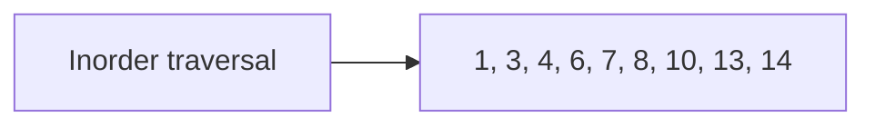
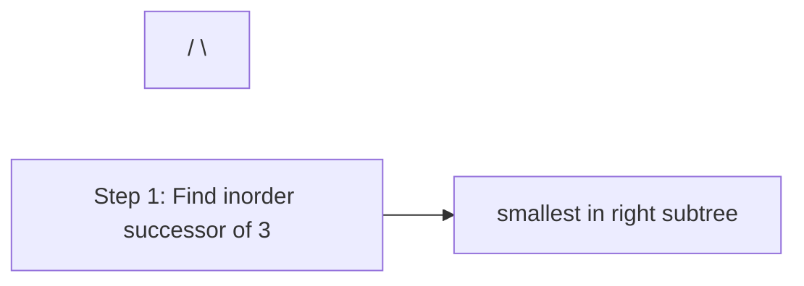
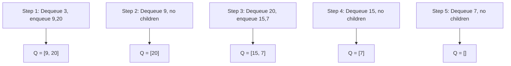
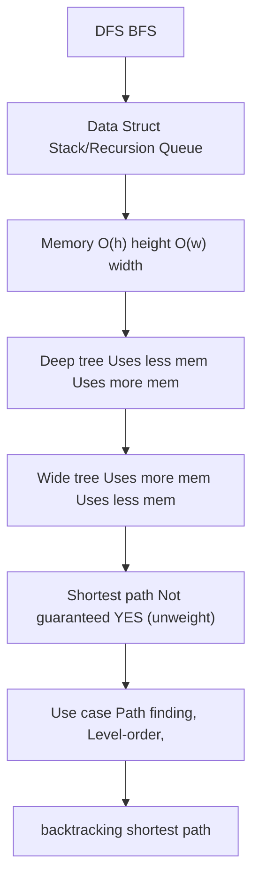
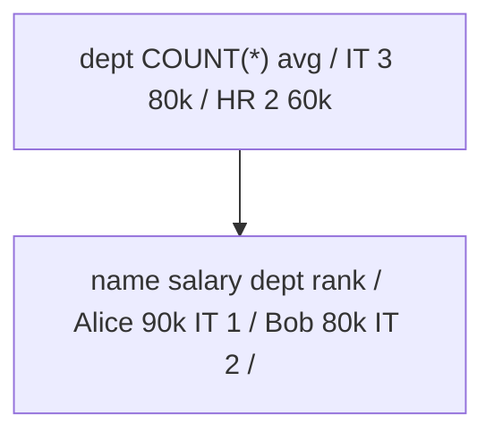
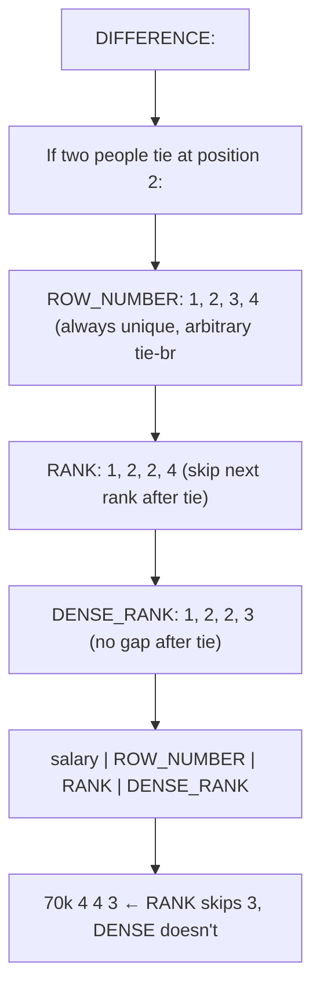
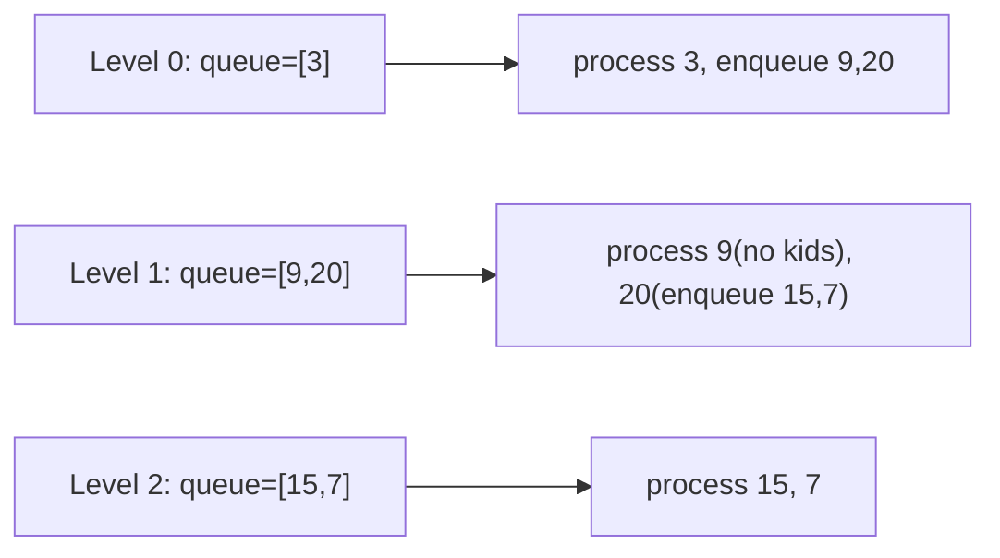
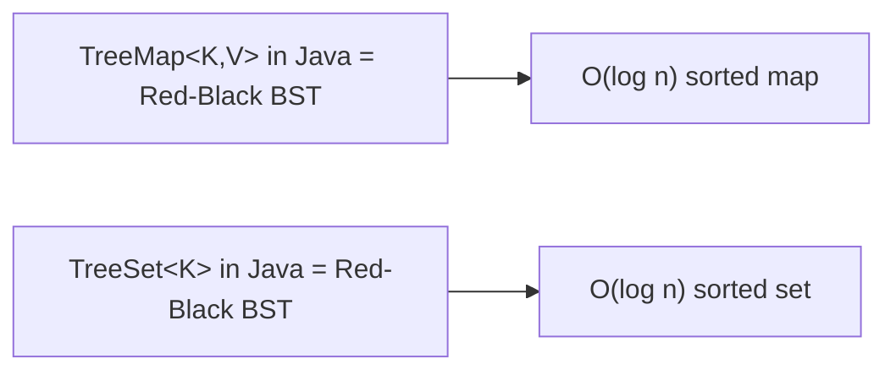

> **Navigation**: [< Previous](Day_015_Mar17_Mon.md) | [Back to Index](../../00_MASTER_INDEX.md) | [Next >](Day_017_Mar19_Wed.md)

# Day 016 — Tuesday, March 18, 2026

> **Week 03** | **Day 2** | **Theme:** Binary Search Tree (BST) + BFS (Level-Order) + SQL Window Functions Intro
> [Daily Index](../00_DAILY_PRACTICE_INDEX.md) | [Prev Day](Day_015_Mar17_Mon.md) | [Next Day](Day_017_Mar19_Wed.md)

---

## Completion Checklist

- [ ] DS Deep Dive: BST — properties, insert, search, delete (30 min)
- [ ] ALGO Deep Dive: BFS / Level-Order Traversal (30 min)
- [ ] SQL Lesson: Window Functions — ROW_NUMBER, RANK, DENSE_RANK (40 min)
- [ ] Problem 1: LC 700 — Search in a BST (15 min)
- [ ] Problem 2: LC 102 — Binary Tree Level Order Traversal (25 min)
- [ ] Real-World Connection (10 min)

---

> ## 📖 CHAPTER REFERENCES — Deep Dive Links
>
> Today's topics link to detailed chapter files for deeper study:
>
> | **DS: Binary Search Tree** | [Trees Complete Guide](../../03_Algorithms/05_Trees.md) |
> | **ALGO: BFS / Level-Order Traversal** | [Graph Fundamentals](../../03_Algorithms/05c_Graphs_Fundamentals.md) |
> | **SQL: Window Functions (ROW_NUMBER, RANK)** | [SQL: Window Functions](../../08_SQL/09_Window_Functions.md) |
>
> *Open the linked file for full theory, diagrams, and practice problems.*

---


## 1. DS DEEP DIVE: Binary Search Tree (30 min)

### WHY?
A BST is a binary tree with a rule: left < root < right. This rule gives us O(log n) search, insert, delete — the basis for TreeMap, TreeSet, database indexes. It's the most important tree variant.

### WHAT — BST Property

```
BST INVARIANT: For every node N:
  ALL values in left subtree  < N.val
  ALL values in right subtree > N.val

          [8]
         /   \
       [3]    [10]
      /   \      \
    [1]   [6]    [14]
         /   \   /
       [4]  [7] [13]

  Inorder traversal → 1, 3, 4, 6, 7, 8, 10, 13, 14
  ALWAYS SORTED! That's the magic.
```

> **Flow**: Inorder traversal → 1, 3, 4, 6, 7, 8, 10, 13, 14



### HOW — Operations

```java
class BST {
    TreeNode root;
    
    // SEARCH: O(log n) average, O(n) worst (skewed)
    TreeNode search(TreeNode node, int target) {
        if (node == null || node.val == target) return node;
        if (target < node.val) return search(node.left, target);
        return search(node.right, target);
    }
    
    // INSERT: Find correct leaf position, attach
    TreeNode insert(TreeNode node, int val) {
        if (node == null) return new TreeNode(val);
        if (val < node.val) node.left = insert(node.left, val);
        else if (val > node.val) node.right = insert(node.right, val);
        // val == node.val → duplicate, skip (or handle)
        return node;
    }
    
    // DELETE: Three cases
    TreeNode delete(TreeNode node, int val) {
        if (node == null) return null;
        
        if (val < node.val) {
            node.left = delete(node.left, val);
        } else if (val > node.val) {
            node.right = delete(node.right, val);
        } else {
            // Found it! Three cases:
            // Case 1: Leaf → just remove
            if (node.left == null && node.right == null) return null;
            
            // Case 2: One child → replace with child
            if (node.left == null) return node.right;
            if (node.right == null) return node.left;
            
            // Case 3: Two children → replace with inorder successor
            TreeNode successor = findMin(node.right);
            node.val = successor.val;
            node.right = delete(node.right, successor.val);
        }
        return node;
    }
    
    TreeNode findMin(TreeNode node) {
        while (node.left != null) node = node.left;
        return node;
    }
}
```

### Delete Case 3 — Visual

```
Delete 3 from:
      [5]              [5]
     /   \    →       /   \
   [3]    [8]       [4]    [8]
  /   \            /
[1]   [4]        [1]

Step 1: Find inorder successor of 3 → smallest in right subtree → 4
Step 2: Copy 4's value to 3's position
Step 3: Delete 4 from right subtree (it's a leaf, easy)
```

> **Flow**: / \ → / \ | Step 1: Find inorder successor of 3 → smallest in right subtree



---

## 2. ALGO DEEP DIVE: BFS / Level-Order Traversal (30 min)

### WHY?
BFS processes nodes level by level. Needed for: shortest path in unweighted graph, level-order printing, finding minimum depth, connecting nodes at same level. It's the natural complement to DFS.

### HOW — Queue-Based BFS

```
BFS uses a QUEUE (FIFO), DFS uses a STACK (LIFO).

          [3]           Level 0
         /   \
       [9]    [20]      Level 1
              /   \
           [15]   [7]   Level 2

Queue trace:
  Start:  Q = [3]
  Step 1: Dequeue 3, enqueue 9,20   → Q = [9, 20]
  Step 2: Dequeue 9, no children     → Q = [20]
  Step 3: Dequeue 20, enqueue 15,7  → Q = [15, 7]
  Step 4: Dequeue 15, no children    → Q = [7]
  Step 5: Dequeue 7, no children     → Q = []

Output: [[3], [9, 20], [15, 7]]
```

> **Flow**: Step 1: Dequeue 3, enqueue 9,20 → Q = [9, 20] | Step 2: Dequeue 9, no children → Q = [20] | Step 3: Dequeue 20, enqueue 15,7 → Q = [15, 7] | Step 4: Dequeue 15, no children → Q = [7] | Step 5: Dequeue 7, no children → Q = []



### Implementation — Level-by-Level BFS

```java
List<List<Integer>> levelOrder(TreeNode root) {
    List<List<Integer>> result = new ArrayList<>();
    if (root == null) return result;
    
    Queue<TreeNode> queue = new LinkedList<>();
    queue.offer(root);
    
    while (!queue.isEmpty()) {
        int levelSize = queue.size();  // KEY: snapshot size before processing
        List<Integer> currentLevel = new ArrayList<>();
        
        for (int i = 0; i < levelSize; i++) {
            TreeNode node = queue.poll();
            currentLevel.add(node.val);
            if (node.left != null) queue.offer(node.left);
            if (node.right != null) queue.offer(node.right);
        }
        result.add(currentLevel);
    }
    return result;
}

/*
CRITICAL PATTERN:
  int levelSize = queue.size();  ← snapshot BEFORE the loop
  This separates levels! Without it, you can't tell which
  nodes belong to which level.
*/
```

### DFS vs BFS Comparison

```
┌──────────────┬────────────────┬────────────────┐
│              │     DFS        │     BFS        │
├──────────────┼────────────────┼────────────────┤
│ Data Struct  │ Stack/Recursion│ Queue          │
│ Memory       │ O(h) height   │ O(w) width      │
│ Deep tree    │ Uses less mem  │ Uses more mem  │
│ Wide tree    │ Uses more mem  │ Uses less mem  │
│ Shortest path│ Not guaranteed │ YES (unweight) │
│ Use case     │ Path finding,  │ Level-order,   │
│              │ backtracking   │ shortest path  │
└──────────────┴────────────────┴────────────────┘
```

> **Flow**: DFS BFS → Data Struct Stack/Recursion Queue | Data Struct Stack/Recursion Queue → Memory O(h) height O(w) width | Memory O(h) height O(w) width → Deep tree Uses less mem Uses more mem | Deep tree Uses less mem Uses more mem → Wide tree Uses more mem Uses less mem | Wide tree Uses more mem Uses less mem → Shortest path Not guaranteed YES (unweight) | Shortest path Not guaranteed YES (unweight) → Use case Path finding, Level-order, | ...+1 more



---

## 3. SQL LESSON: Window Functions Intro (40 min)

### WHY?
Window functions calculate across rows **without collapsing them** (unlike GROUP BY). They're the most powerful SQL feature for analytics, ranking, running totals, and comparisons within groups.

### WHAT — The Concept

```
GROUP BY collapses rows:         Window functions KEEP rows:
┌─────┬────────┬─────┐          ┌─────┬────────┬──────┬──────┐
│dept │COUNT(*)│ avg │          │name │ salary │ dept │ rank │
├─────┼────────┼─────┤          ├─────┼────────┼──────┼──────┤
│ IT  │   3    │ 80k │          │Alice│  90k   │  IT  │  1   │
│ HR  │   2    │ 60k │          │Bob  │  80k   │  IT  │  2   │
└─────┴────────┴─────┘          │Carol│  70k   │  IT  │  3   │
 (lost individual rows!)         │Dave │  65k   │  HR  │  1   │
                                 │Eve  │  55k   │  HR  │  2   │
                                 └─────┴────────┴──────┴──────┘
                                  (kept all rows + added rank!)
```

> **Flow**: dept COUNT(*) avg / IT 3 80k / HR 2 60k → name salary dept rank / Alice 90k IT 1 / Bob 80k IT 2 /



### Syntax

```sql
function_name() OVER (
    PARTITION BY column    -- like GROUP BY but doesn't collapse
    ORDER BY column        -- ordering within partition
)
```

### Three Ranking Functions

```sql
SELECT name, department, salary,
    ROW_NUMBER() OVER (PARTITION BY department ORDER BY salary DESC) AS row_num,
    RANK()       OVER (PARTITION BY department ORDER BY salary DESC) AS rank,
    DENSE_RANK() OVER (PARTITION BY department ORDER BY salary DESC) AS dense_rank
FROM employees;
```

```
DIFFERENCE:
  If two people tie at position 2:
  
  ROW_NUMBER: 1, 2, 3, 4  (always unique, arbitrary tie-break)
  RANK:       1, 2, 2, 4  (skip next rank after tie)
  DENSE_RANK: 1, 2, 2, 3  (no gap after tie)

  salary | ROW_NUMBER | RANK | DENSE_RANK
  ──────────────────────────────────────
  90k    │     1      │  1   │    1
  80k    │     2      │  2   │    2
  80k    │     3      │  2   │    2
  70k    │     4      │  4   │    3    ← RANK skips 3, DENSE doesn't
```

> **Flow**: DIFFERENCE: → If two people tie at position 2: | If two people tie at position 2: → ROW_NUMBER: 1, 2, 3, 4 (always unique, arbitrary tie-br | ROW_NUMBER: 1, 2, 3, 4 (always unique, arbitrary tie-br → RANK: 1, 2, 2, 4 (skip next rank after tie) | RANK: 1, 2, 2, 4 (skip next rank after tie) → DENSE_RANK: 1, 2, 2, 3 (no gap after tie) | DENSE_RANK: 1, 2, 2, 3 (no gap after tie) → salary | ROW_NUMBER | RANK | DENSE_RANK | salary | ROW_NUMBER | RANK | DENSE_RANK → 70k 4 4 3 ← RANK skips 3, DENSE doesn't



### Practice Exercises

```sql
-- Exercise 1: Rank employees by salary within department
SELECT name, department, salary,
    DENSE_RANK() OVER (PARTITION BY department ORDER BY salary DESC) AS dept_rank
FROM employees;

-- Exercise 2: Find 2nd highest salary per department
SELECT * FROM (
    SELECT name, department, salary,
        DENSE_RANK() OVER (PARTITION BY department ORDER BY salary DESC) AS rnk
    FROM employees
) ranked
WHERE rnk = 2;

-- Exercise 3: Add row numbers to query results
SELECT 
    ROW_NUMBER() OVER (ORDER BY hire_date) AS emp_number,
    name, hire_date
FROM employees;

-- Exercise 4: Compare via UNION + CASE + Window
SELECT name, salary, department,
    CASE 
        WHEN DENSE_RANK() OVER (PARTITION BY department ORDER BY salary DESC) = 1
        THEN 'Highest in dept'
        ELSE 'Other'
    END AS status
FROM employees;
```

---

## 4. PROBLEM 1: LC 700 — Search in a BST

**Link:** https://leetcode.com/problems/search-in-a-binary-search-tree/

### Problem
Given root of BST and value `val`, find the node whose value equals `val`. Return the subtree rooted at that node. If not found, return null.

```java
class Solution {
    // Recursive — clean
    public TreeNode searchBST(TreeNode root, int val) {
        if (root == null || root.val == val) return root;
        return val < root.val 
            ? searchBST(root.left, val) 
            : searchBST(root.right, val);
    }
    
    // Iterative — no stack needed!
    public TreeNode searchBSTIterative(TreeNode root, int val) {
        while (root != null && root.val != val) {
            root = val < root.val ? root.left : root.right;
        }
        return root;
    }
}
// Time: O(h), Space: O(1) iterative / O(h) recursive
```

---

## 5. PROBLEM 2: LC 102 — Binary Tree Level Order Traversal

**Link:** https://leetcode.com/problems/binary-tree-level-order-traversal/

### Problem
Return the level-order traversal as a list of lists.

### Visual Walkthrough

```
          [3]
         /   \
       [9]    [20]
              /   \
           [15]   [7]

Level 0: queue=[3]     → process 3, enqueue 9,20
Level 1: queue=[9,20]  → process 9(no kids), 20(enqueue 15,7)
Level 2: queue=[15,7]  → process 15, 7

Output: [[3], [9,20], [15,7]]
```

> **Flow**: Level 0: queue=[3] → process 3, enqueue 9,20 | Level 1: queue=[9,20] → process 9(no kids), 20(enqueue 15,7) | Level 2: queue=[15,7] → process 15, 7



### Solution

```java
class Solution {
    public List<List<Integer>> levelOrder(TreeNode root) {
        List<List<Integer>> result = new ArrayList<>();
        if (root == null) return result;
        
        Queue<TreeNode> queue = new LinkedList<>();
        queue.offer(root);
        
        while (!queue.isEmpty()) {
            int size = queue.size();
            List<Integer> level = new ArrayList<>();
            
            for (int i = 0; i < size; i++) {
                TreeNode node = queue.poll();
                level.add(node.val);
                if (node.left != null) queue.offer(node.left);
                if (node.right != null) queue.offer(node.right);
            }
            result.add(level);
        }
        return result;
    }
}
// Time: O(n), Space: O(n) — queue holds up to n/2 nodes (last level)
```

---

## 📌 6. Real — World Connection

```
BST POWERS:
  TreeMap<K,V> in Java = Red-Black BST → O(log n) sorted map
  TreeSet<K>   in Java = Red-Black BST → O(log n) sorted set
  Database B-Tree index = balanced BST variant
  
BFS POWERS:
  Social network "People You May Know" = BFS from your profile
  Web crawlers = BFS through hyperlinks
  GPS navigation shortest path = BFS/Dijkstra
  Network broadcast = BFS from source
```

> **Flow**: TreeMap&lt;K,V&gt; in Java = Red-Black BST → O(log n) sorted map | TreeSet&lt;K&gt; in Java = Red-Black BST → O(log n) sorted set


