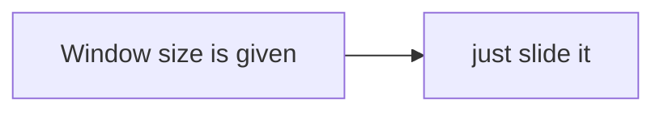
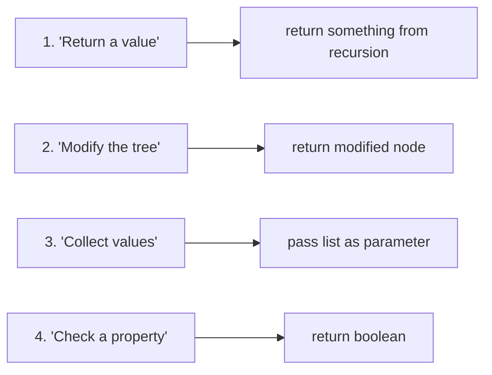
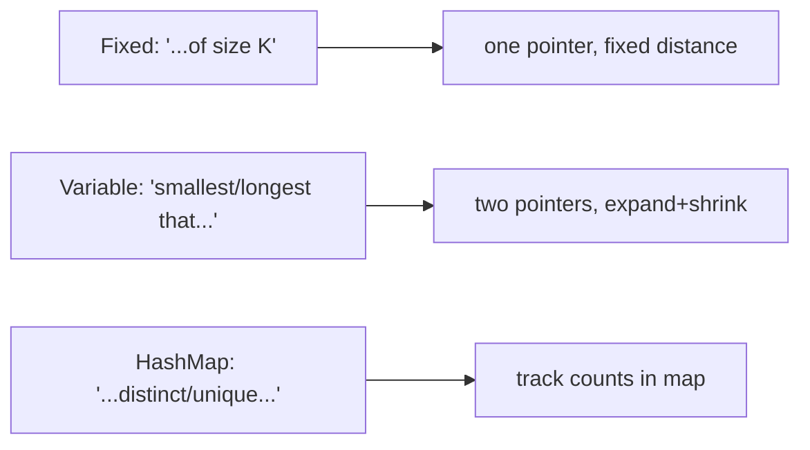

> **Navigation**: [< Previous](Day_018_Mar20_Thu.md) | [Back to Index](../../00_MASTER_INDEX.md) | [Next >](Day_020_Mar22_Sat.md)

# Day 019 — Friday, March 21, 2026

> **Week 03** | **Day 5** | **Theme:** Sliding Window + Tree Problems Combo + SQL CTEs (Common Table Expressions)
> [Daily Index](../00_DAILY_PRACTICE_INDEX.md) | [Prev Day](Day_018_Mar20_Thu.md) | [Next Day](Day_020_Mar22_Sat.md)

---

## Completion Checklist

- [ ] ALGO Deep Dive: Sliding Window (Fixed + Variable) (30 min)
- [ ] COMBO: Tree + DFS Problems (30 min)
- [ ] SQL Lesson: CTEs — WITH clause (40 min)
- [ ] Problem 1: LC 3 — Longest Substring Without Repeating Characters (25 min)
- [ ] Problem 2: LC 104 — Maximum Depth of Binary Tree (15 min)
- [ ] Problem 3: LC 226 — Invert Binary Tree (15 min)

---

> ## 📖 CHAPTER REFERENCES — Deep Dive Links
>
> Today's topics link to detailed chapter files for deeper study:
>
> | **ALGO: Sliding Window (Fixed + Variable)** | [Sliding Window Patterns](../../04_Patterns_Templates/01_Sliding_Window.md) |
> | **COMBO: Tree + DFS Problems** | [Trees Complete Guide](../../03_Algorithms/05_Trees.md) |
> | **SQL: CTEs (WITH clause)** | [SQL: Subqueries & CTEs](../../08_SQL/08_Subqueries_CTEs.md) |
>
> *Open the linked file for full theory, diagrams, and practice problems.*

---


## 1. ALGO DEEP DIVE: Sliding Window (30 min)

### WHY?
Any time you need to find something in a **contiguous subarray/substring**, sliding window reduces brute force O(n²) or O(n³) to O(n). It's one of the top 3 most common interview patterns.

### WHAT — Two Types

```
TYPE 1: FIXED-SIZE WINDOW
  "Find max sum of subarray of size k"
  Window size is given → just slide it

  [2, 1, 5, 1, 3, 2], k=3
   ├──────┤              sum=8
      ├──────┤           sum=7
         ├──────┤        sum=9  ← max
            ├──────┤     sum=6

TYPE 2: VARIABLE-SIZE WINDOW
  "Find smallest subarray with sum ≥ target"
  Window expands right, shrinks left

  [2, 3, 1, 2, 4, 3], target=7
   ├────────────┤       sum=12 ≥ 7, try shrinking
      ├─────────┤       sum=10 ≥ 7, shrink
         ├──────┤       sum=7 ≥ 7, shrink
            ├───┤       sum=6 < 7, expand →
            ├──────┤    sum=9 ≥ 7, shrink
               ├───┤    sum=7 ≥ 7 ← smallest! (len=2)
```

**Flow:**
- Window size is given
- ↓
- just slide it



### TEMPLATE: Fixed-Size Window

```java
int maxSumSubarray(int[] arr, int k) {
    int windowSum = 0, maxSum = 0;
    
    for (int i = 0; i < arr.length; i++) {
        windowSum += arr[i];           // Expand: add right element
        
        if (i >= k) {
            windowSum -= arr[i - k];   // Shrink: remove left element
        }
        
        if (i >= k - 1) {
            maxSum = Math.max(maxSum, windowSum);
        }
    }
    return maxSum;
}
```

### TEMPLATE: Variable-Size Window

```java
int minSubArrayLen(int target, int[] nums) {
    int left = 0, sum = 0, minLen = Integer.MAX_VALUE;
    
    for (int right = 0; right < nums.length; right++) {
        sum += nums[right];            // Expand
        
        while (sum >= target) {        // Try to shrink
            minLen = Math.min(minLen, right - left + 1);
            sum -= nums[left++];       // Shrink from left
        }
    }
    return minLen == Integer.MAX_VALUE ? 0 : minLen;
}
```

### TEMPLATE: Window with HashMap (for character counting)

```java
// Used for "longest substring with at most K distinct chars" type problems
int lengthOfLongestSubstringKDistinct(String s, int k) {
    Map<Character, Integer> window = new HashMap<>();
    int left = 0, maxLen = 0;
    
    for (int right = 0; right < s.length(); right++) {
        char c = s.charAt(right);
        window.merge(c, 1, Integer::sum);     // Add to window
        
        while (window.size() > k) {          // Window invalid
            char leftChar = s.charAt(left);
            window.merge(leftChar, -1, Integer::sum);
            if (window.get(leftChar) == 0) window.remove(leftChar);
            left++;
        }
        
        maxLen = Math.max(maxLen, right - left + 1);
    }
    return maxLen;
}
```

---

## 2. COMBO: Tree + DFS Problems (30 min)

### Max Depth — The Foundation

```java
// LC 104 — one of the most fundamental recursive patterns
int maxDepth(TreeNode root) {
    if (root == null) return 0;
    return 1 + Math.max(maxDepth(root.left), maxDepth(root.right));
}
```

### Invert Binary Tree — Swap Left/Right

```java
// LC 226 — "Google's most asked interview question" legend
TreeNode invertTree(TreeNode root) {
    if (root == null) return null;
    
    TreeNode temp = root.left;
    root.left = invertTree(root.right);
    root.right = invertTree(temp);
    
    return root;
}
```

```
Before:           After:
    [4]               [4]
   /   \             /   \
  [2]  [7]         [7]  [2]
 / \   / \        / \   / \
[1][3][6][9]    [9][6][3][1]
```

### Same Tree — Compare Two Trees

```java
// LC 100
boolean isSameTree(TreeNode p, TreeNode q) {
    if (p == null && q == null) return true;
    if (p == null || q == null) return false;
    return p.val == q.val 
        && isSameTree(p.left, q.left) 
        && isSameTree(p.right, q.right);
}
```

### Pattern Recognition

```
TREE PROBLEM PATTERNS:
  1. "Return a value"     → return something from recursion
     Examples: maxDepth, isBalanced, diameter
  
  2. "Modify the tree"    → return modified node
     Examples: invertTree, pruneTree, deleteNode
  
  3. "Collect values"     → pass list as parameter
     Examples: traversals, pathSum, leafValues
  
  4. "Check a property"   → return boolean
     Examples: isSameTree, isSymmetric, isValidBST
```

**Flow:**
- 1. 'Return a value'
- ↓
- return something from recursion
- ↓
- 2. 'Modify the tree'
- ↓
- return modified node
- ↓
- 3. 'Collect values'
- ↓
- pass list as parameter
- ↓
- 4. 'Check a property'
- ↓
- return boolean



---

## 3. SQL LESSON: CTEs — WITH Clause (40 min)

### WHY?
CTEs make complex queries readable by naming subqueries. Instead of deeply nested subqueries, you build step-by-step. Many interview queries become trivial with CTEs.

### Basic CTE Syntax

```sql
WITH cte_name AS (
    SELECT ... FROM ... WHERE ...
)
SELECT * FROM cte_name;
```

### Example: Step-by-Step Analysis

```sql
-- Without CTE (messy nested subqueries):
SELECT name, salary, department FROM employees
WHERE salary > (SELECT AVG(salary) FROM employees WHERE department = employees.department)

-- With CTE (clean, readable):
WITH dept_avg AS (
    SELECT department, AVG(salary) AS avg_salary
    FROM employees
    GROUP BY department
)
SELECT e.name, e.salary, e.department, d.avg_salary
FROM employees e
JOIN dept_avg d ON e.department = d.department
WHERE e.salary > d.avg_salary;
```

### Multiple CTEs

```sql
-- Chain CTEs for complex analytics
WITH 
monthly_sales AS (
    SELECT 
        MONTH(order_date) AS month,
        SUM(amount) AS total
    FROM orders
    WHERE YEAR(order_date) = 2025
    GROUP BY MONTH(order_date)
),
sales_with_growth AS (
    SELECT month, total,
        LAG(total) OVER (ORDER BY month) AS prev_month,
        ROUND((total - LAG(total) OVER (ORDER BY month)) * 100.0 
              / LAG(total) OVER (ORDER BY month), 2) AS growth_pct
    FROM monthly_sales
)
SELECT *, 
    CASE 
        WHEN growth_pct > 10 THEN 'Growing'
        WHEN growth_pct < -10 THEN 'Declining'
        ELSE 'Stable'
    END AS trend
FROM sales_with_growth;
```

### Practice Exercises

```sql
-- Exercise 1: Find employees whose salary is above company average
WITH company_avg AS (
    SELECT AVG(salary) AS avg_sal FROM employees
)
SELECT e.name, e.salary, c.avg_sal
FROM employees e, company_avg c
WHERE e.salary > c.avg_sal;

-- Exercise 2: Rank products by sales within category, show top 3 per category
WITH product_sales AS (
    SELECT p.category, p.name, SUM(o.quantity) AS total_sold,
        DENSE_RANK() OVER (PARTITION BY p.category ORDER BY SUM(o.quantity) DESC) AS rnk
    FROM products p
    JOIN order_items o ON p.id = o.product_id
    GROUP BY p.category, p.name
)
SELECT * FROM product_sales WHERE rnk <= 3;

-- Exercise 3: Find departments where avg salary increased year over year
WITH yearly_dept AS (
    SELECT department, YEAR(hire_date) AS yr, AVG(salary) AS avg_sal
    FROM employees
    GROUP BY department, YEAR(hire_date)
)
SELECT curr.department, curr.yr, curr.avg_sal,
    prev.avg_sal AS prev_year_avg,
    curr.avg_sal - prev.avg_sal AS increase
FROM yearly_dept curr
JOIN yearly_dept prev ON curr.department = prev.department
    AND curr.yr = prev.yr + 1
WHERE curr.avg_sal > prev.avg_sal;
```

---

## 4. PROBLEM 1: LC 3 — Longest Substring Without Repeating Characters

**Link:** https://leetcode.com/problems/longest-substring-without-repeating-characters/

### Visual Walkthrough

```
Input: "abcabcbb"

  a b c a b c b b
  L     R           window="abc", len=3
    L     R         'a' repeated! move L past previous 'a'
    L     R         window="bca", len=3
      L     R       'b' repeated! move L
        L     R     window="cab", len=3, etc.

Answer: 3 ("abc")
```

### Solution

```java
class Solution {
    public int lengthOfLongestSubstring(String s) {
        Map<Character, Integer> lastSeen = new HashMap<>();
        int maxLen = 0, left = 0;
        
        for (int right = 0; right < s.length(); right++) {
            char c = s.charAt(right);
            
            if (lastSeen.containsKey(c) && lastSeen.get(c) >= left) {
                left = lastSeen.get(c) + 1;  // Jump past duplicate
            }
            
            lastSeen.put(c, right);
            maxLen = Math.max(maxLen, right - left + 1);
        }
        return maxLen;
    }
}
// Time: O(n), Space: O(min(n, charset))
```

---

## 5. PROBLEM 2: LC 104 — Maximum Depth of Binary Tree

```java
class Solution {
    public int maxDepth(TreeNode root) {
        if (root == null) return 0;
        return 1 + Math.max(maxDepth(root.left), maxDepth(root.right));
    }
    
    // BFS approach — count levels
    public int maxDepthBFS(TreeNode root) {
        if (root == null) return 0;
        Queue<TreeNode> queue = new LinkedList<>();
        queue.offer(root);
        int depth = 0;
        
        while (!queue.isEmpty()) {
            int size = queue.size();
            depth++;
            for (int i = 0; i < size; i++) {
                TreeNode node = queue.poll();
                if (node.left != null) queue.offer(node.left);
                if (node.right != null) queue.offer(node.right);
            }
        }
        return depth;
    }
}
```

---

## 6. PROBLEM 3: LC 226 — Invert Binary Tree

```java
class Solution {
    public TreeNode invertTree(TreeNode root) {
        if (root == null) return null;
        
        TreeNode left = invertTree(root.left);
        TreeNode right = invertTree(root.right);
        
        root.left = right;
        root.right = left;
        
        return root;
    }
}
// Time: O(n), Space: O(h)
```

---

## Sliding Window Pattern Summary

```
WHEN TO USE SLIDING WINDOW:
  ✓ "Contiguous subarray/substring"
  ✓ "Maximum/minimum length"
  ✓ "Sum equals/exceeds target"
  ✓ "At most K distinct elements"

WHICH TYPE:
  Fixed:    "...of size K" → one pointer, fixed distance
  Variable: "smallest/longest that..." → two pointers, expand+shrink
  HashMap:  "...distinct/unique..." → track counts in map
```

**Flow:**
- Fixed: '...of size K'
- ↓
- one pointer, fixed distance
- ↓
- Variable: 'smallest/longest that...'
- ↓
- two pointers, expand+shrink
- ↓
- HashMap: '...distinct/unique...'
- ↓
- track counts in map




---

> **Navigation**: [< Previous](Day_018_Mar20_Thu.md) | [Back to Index](../../00_MASTER_INDEX.md) | [Next >](Day_020_Mar22_Sat.md)