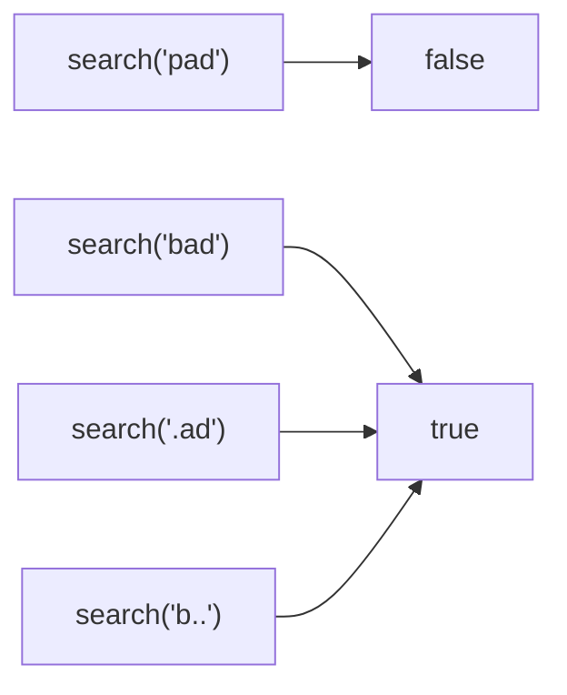

> **Navigation**: [< Previous](Day_022_Mar24_Mon.md) | [Back to Index](../../00_MASTER_INDEX.md) | [Next >](Day_024_Mar26_Wed.md)

# DAY 023 — Tuesday, March 25, 2026
## Graph DFS + Trie Applications + SQL EXPLAIN & Query Optimization

> **Theme**: Depth-first graph traversal + Trie prefix tricks + SQL performance tuning

---

## 📅 SCHEDULE

| Time Block | Duration | Topic |
|------------|----------|-------|
| 0:00–0:30 | 30 min | DS: Trie — Autocomplete + Word Search |
| 0:30–1:00 | 30 min | ALGO: Graph DFS — Cycle Detection |
| 1:00–1:20 | 20 min | COMBO: LC 211 + LC 547 |
| 1:20–1:40 | 20 min | REAL-WORLD: Spell checker = Trie + Edit Distance |
| 1:40–2:20 | 40 min | SQL: EXPLAIN Plans + Query Optimization |
| 2:20–3:00 | 40 min | PROBLEMS: Q1 + Q2 |

---

> ## 📖 CHAPTER REFERENCES — Deep Dive Links
>
> Today's topics link to detailed chapter files for deeper study:
>
> | **DS: Trie Applications** | [Advanced DS: Segment Tree, Trie & More](../../03_Algorithms/07a_Advanced_DS_Core.md) |
> | **ALGO: Graph DFS + Cycle Detection** | [Graph Fundamentals](../../03_Algorithms/05c_Graphs_Fundamentals.md) |
> | **SQL: EXPLAIN Plans & Query Optimization** | [SQL: Query Optimization](../../08_SQL/14_Query_Optimization.md) |
>
> *Open the linked file for full theory, diagrams, and practice problems.*

---


## 🧱 DS BLOCK: Trie — Autocomplete & Word Search

### Autocomplete: Collect All Words with Prefix

```java
// Return all words starting with given prefix
List<String> autocomplete(TrieNode root, String prefix) {
    List<String> results = new ArrayList<>();
    TrieNode node = findNode(root, prefix);
    if (node == null) return results;
    
    // DFS from this node to find all complete words
    dfs(node, new StringBuilder(prefix), results);
    return results;
}

void dfs(TrieNode node, StringBuilder path, List<String> results) {
    if (node.isEnd) results.add(path.toString());
    
    for (int i = 0; i < 26; i++) {
        if (node.children[i] != null) {
            path.append((char)('a' + i));
            dfs(node.children[i], path, results);
            path.deleteCharAt(path.length() - 1);  // backtrack
        }
    }
}
```

### Word Search with Wildcards (LC 211)

```java
// Search with '.' as wildcard matching any letter
boolean searchWithWildcard(TrieNode node, String word, int index) {
    if (index == word.length()) return node.isEnd;
    
    char c = word.charAt(index);
    if (c == '.') {
        // Try ALL children
        for (int i = 0; i < 26; i++) {
            if (node.children[i] != null 
                && searchWithWildcard(node.children[i], word, index + 1)) {
                return true;
            }
        }
        return false;
    } else {
        int idx = c - 'a';
        if (node.children[idx] == null) return false;
        return searchWithWildcard(node.children[idx], word, index + 1);
    }
}
```

---

## ⚡ ALGO BLOCK: Graph DFS + Cycle Detection

### DFS Template (Adjacency List)

```java
// DFS — recursive
void dfs(List<List<Integer>> graph, int node, boolean[] visited) {
    visited[node] = true;
    // Process node
    
    for (int neighbor : graph.get(node)) {
        if (!visited[neighbor]) {
            dfs(graph, neighbor, visited);
        }
    }
}

// DFS — iterative (using stack)
void dfsIterative(List<List<Integer>> graph, int start) {
    boolean[] visited = new boolean[graph.size()];
    Stack<Integer> stack = new Stack<>();
    stack.push(start);
    
    while (!stack.isEmpty()) {
        int node = stack.pop();
        if (visited[node]) continue;
        visited[node] = true;
        // Process node
        
        for (int neighbor : graph.get(node)) {
            if (!visited[neighbor]) {
                stack.push(neighbor);
            }
        }
    }
}
```

### Cycle Detection in Directed Graph (3-Color DFS)

```java
// WHITE=0 (unvisited), GRAY=1 (in progress), BLACK=2 (done)
// Cycle exists if we find a GRAY node during DFS
boolean hasCycle(List<List<Integer>> graph) {
    int n = graph.size();
    int[] color = new int[n];  // all WHITE initially
    
    for (int i = 0; i < n; i++) {
        if (color[i] == 0 && dfsDetectCycle(graph, i, color)) {
            return true;
        }
    }
    return false;
}

boolean dfsDetectCycle(List<List<Integer>> graph, int node, int[] color) {
    color[node] = 1;  // GRAY: currently exploring
    
    for (int neighbor : graph.get(node)) {
        if (color[neighbor] == 1) return true;   // Back edge → CYCLE!
        if (color[neighbor] == 0 && dfsDetectCycle(graph, neighbor, color)) {
            return true;
        }
    }
    
    color[node] = 2;  // BLACK: fully explored
    return false;
}
```

---

## 🗃️ SQL BLOCK: EXPLAIN & Query Optimization

### Reading EXPLAIN Output

```sql
EXPLAIN SELECT e.name, d.dept_name 
FROM employees e 
JOIN departments d ON e.dept_id = d.id 
WHERE e.salary > 50000;

-- Key columns in EXPLAIN output:
-- type:    ALL (bad) → index → range → ref → eq_ref → const (best)
-- key:     Which index is used (NULL = no index used!)
-- rows:    Estimated rows to examine
-- Extra:   "Using index" (good), "Using filesort" (might be slow)
```

### Optimization Rules

```sql
-- RULE 1: Index your WHERE columns
CREATE INDEX idx_salary ON employees(salary);

-- RULE 2: Avoid SELECT * (fetch only needed columns)
-- BAD:  SELECT * FROM employees WHERE dept_id = 5;
-- GOOD: SELECT name, salary FROM employees WHERE dept_id = 5;

-- RULE 3: Use LIMIT for large results
SELECT name FROM employees ORDER BY salary DESC LIMIT 10;

-- RULE 4: Avoid functions on indexed columns
-- BAD:  WHERE YEAR(hire_date) = 2024   ← can't use index!
-- GOOD: WHERE hire_date >= '2024-01-01' AND hire_date < '2025-01-01'

-- RULE 5: Use EXISTS instead of IN for subqueries
-- Slower: WHERE dept_id IN (SELECT id FROM departments WHERE ...)
-- Faster: WHERE EXISTS (SELECT 1 FROM departments WHERE d.id = e.dept_id AND ...)
```

---

## 🎯 PROBLEMS

### Q1: Design Add and Search Words (LC 211) — Medium

```
Design a data structure that supports:
- addWord(word): Adds word to the data structure
- search(word): Search with '.' as wildcard

addWord("bad"), addWord("dad"), addWord("mad")
search("pad") → false
search("bad") → true  
search(".ad") → true
search("b..") → true
```

**Flow:**
1. search('pad')
2. false search('bad')
3. true search('.ad')
4. true search('b..')
5. true



### Q2: Number of Provinces (LC 547) — Medium

```
n cities, some connected directly. If city a connects to b, 
and b connects to c, then a-b-c form one province.

Input: isConnected = [[1,1,0],[1,1,0],[0,0,1]]
Output: 2 (cities 0,1 = one province; city 2 = another)
```

**Pattern**: DFS/BFS count connected components, or Union-Find.

---

## ✅ CHECKLIST

- [ ] Trie autocomplete with DFS collection
- [ ] Trie wildcard search with '.'
- [ ] Graph DFS (recursive + iterative)
- [ ] Cycle detection with 3-color DFS
- [ ] SQL EXPLAIN output interpretation
- [ ] Solved LC 211 (Add and Search Words)
- [ ] Solved LC 547 (Number of Provinces)

---

> **Navigation**: [< Previous](Day_022_Mar24_Mon.md) | [Back to Index](../../00_MASTER_INDEX.md) | [Next >](Day_024_Mar26_Wed.md)