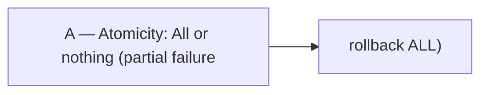
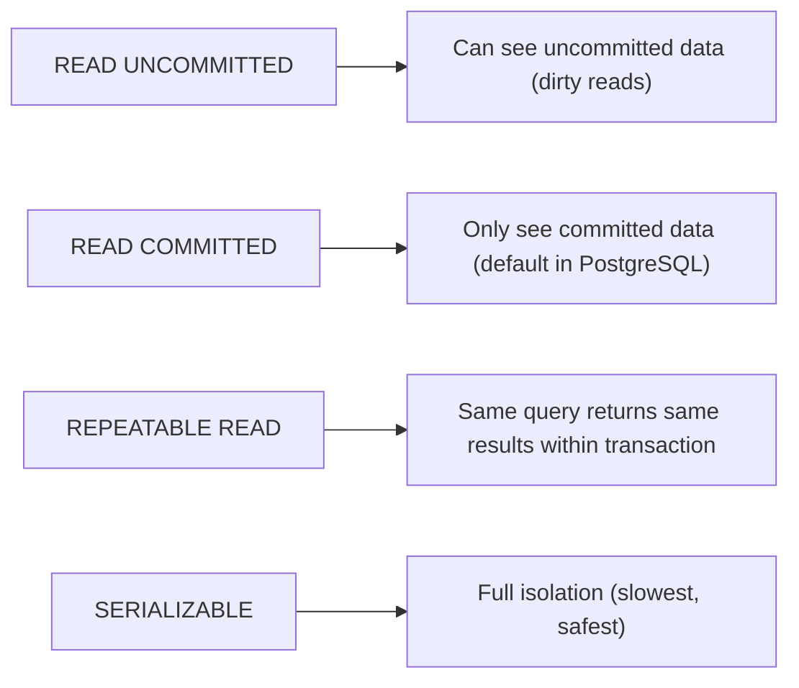
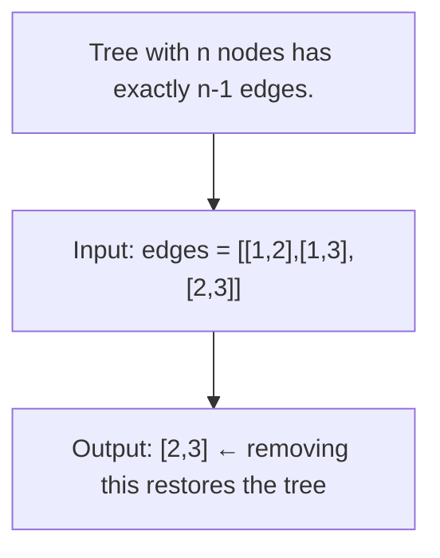

> **Navigation**: [< Previous](Day_023_Mar25_Tue.md) | [Back to Index](../../00_MASTER_INDEX.md) | [Next >](Day_025_Mar27_Thu.md)

# DAY 024 — Wednesday, March 26, 2026
## Dijkstra's Algorithm + Union-Find + SQL Transactions

> **Theme**: Weighted shortest path + Disjoint Set Union + SQL ACID properties

---

## 📅 SCHEDULE

| Time Block | Duration | Topic |
|------------|----------|-------|
| 0:00–0:30 | 30 min | DS: Union-Find (Disjoint Set) |
| 0:30–1:00 | 30 min | ALGO: Dijkstra's Shortest Path |
| 1:00–1:20 | 20 min | COMBO: LC 684 + LC 743 |
| 1:20–1:40 | 20 min | REAL-WORLD: GPS = Dijkstra + A* |
| 1:40–2:20 | 40 min | SQL: Transactions & ACID |
| 2:20–3:00 | 40 min | PROBLEMS: Q1 + Q2 |

---

> ## 📖 CHAPTER REFERENCES — Deep Dive Links
>
> Today's topics link to detailed chapter files for deeper study:
>
> | **DS: Union-Find (Disjoint Set)** | [Union-Find / DSU Complete](../../03_Algorithms/14_Union_Find_DSU_Complete.md) |
> | **ALGO: Dijkstra's Shortest Path** | [Graph Advanced Algorithms](../../03_Algorithms/05d_Graphs_Advanced_Algos.md) |
> | **SQL: Transactions & ACID** | [SQL: Transactions & ACID](../../08_SQL/13_Transactions_ACID.md) |
>
> *Open the linked file for full theory, diagrams, and practice problems.*

---


## 🧱 DS BLOCK: Union-Find (Disjoint Set Union)

### WHY: Track Connected Components Dynamically

```
Scenario: Social network — users connect over time
Question: "Are users A and B in the same group?"

Array approach: O(N) to check connectivity
Union-Find:    O(α(N)) ≈ O(1) amortized!
```

### Complete Implementation (with Path Compression + Union by Rank)

```java
class UnionFind {
    int[] parent, rank;
    int components;
    
    UnionFind(int n) {
        parent = new int[n];
        rank = new int[n];
        components = n;
        for (int i = 0; i < n; i++) parent[i] = i;
    }
    
    // FIND with path compression — O(α(N))
    int find(int x) {
        if (parent[x] != x) {
            parent[x] = find(parent[x]);  // path compression
        }
        return parent[x];
    }
    
    // UNION by rank — O(α(N))
    boolean union(int x, int y) {
        int px = find(x), py = find(y);
        if (px == py) return false;  // already connected
        
        // Attach shorter tree under taller tree
        if (rank[px] < rank[py]) { int temp = px; px = py; py = temp; }
        parent[py] = px;
        if (rank[px] == rank[py]) rank[px]++;
        components--;
        return true;
    }
    
    boolean connected(int x, int y) {
        return find(x) == find(y);
    }
}
```

### When to Use Union-Find vs DFS/BFS

```
Use Union-Find when:
✓ Edges added dynamically (online connectivity)
✓ "Are A and B connected?" queries
✓ Counting connected components
✓ Kruskal's MST algorithm

Use DFS/BFS when:
✓ Need actual path (not just connectivity)
✓ Shortest path in unweighted graph
✓ Static graph (built once, queried many times)
```

---

## ⚡ ALGO BLOCK: Dijkstra's Algorithm

### Complete Implementation

```java
// Dijkstra: Single-source shortest path (non-negative weights)
// Returns dist[] where dist[i] = shortest distance from source to i
int[] dijkstra(List<List<int[]>> graph, int source) {
    int n = graph.size();
    int[] dist = new int[n];
    Arrays.fill(dist, Integer.MAX_VALUE);
    dist[source] = 0;
    
    // Priority Queue: {distance, node}
    PriorityQueue<int[]> pq = new PriorityQueue<>((a, b) -> a[0] - b[0]);
    pq.offer(new int[]{0, source});
    
    while (!pq.isEmpty()) {
        int[] curr = pq.poll();
        int d = curr[0], u = curr[1];
        
        if (d > dist[u]) continue;  // skip outdated entries
        
        for (int[] edge : graph.get(u)) {
            int v = edge[0], w = edge[1];
            if (dist[u] + w < dist[v]) {
                dist[v] = dist[u] + w;
                pq.offer(new int[]{dist[v], v});
            }
        }
    }
    return dist;
}
```

### Time Complexity: O((V + E) log V)

```
Why log V? Each node extracted from PQ once = V log V
           Each edge relaxed once = E log V
Total = O((V + E) log V)
```

---

## 🗃️ SQL BLOCK: Transactions & ACID

### WHAT: ACID Properties

```
A — Atomicity:    All or nothing (partial failure → rollback ALL)
C — Consistency:  DB goes from one valid state to another
I — Isolation:    Concurrent transactions don't interfere
D — Durability:   Once committed, data survives crashes
```

**Flow:**
1. A — Atomicity: All or nothing (partial failure rollback ALL)



### HOW: Transaction Syntax

```sql
-- Basic transaction
BEGIN TRANSACTION;
    UPDATE accounts SET balance = balance - 500 WHERE id = 1;
    UPDATE accounts SET balance = balance + 500 WHERE id = 2;
COMMIT;

-- If something fails:
BEGIN TRANSACTION;
    UPDATE accounts SET balance = balance - 500 WHERE id = 1;
    -- Error occurs here!
ROLLBACK;  -- Undo everything, balance unchanged

-- Savepoints (partial rollback)
BEGIN TRANSACTION;
    INSERT INTO orders (id, total) VALUES (1, 100);
    SAVEPOINT sp1;
    INSERT INTO order_items (order_id, item) VALUES (1, 'Widget');
    -- Oops, wrong item
    ROLLBACK TO sp1;  -- Only undo the item insert
    INSERT INTO order_items (order_id, item) VALUES (1, 'Gadget');
COMMIT;
```

### Isolation Levels (from least to most strict)

```
READ UNCOMMITTED → Can see uncommitted data (dirty reads)
READ COMMITTED   → Only see committed data (default in PostgreSQL)
REPEATABLE READ  → Same query returns same results within transaction
SERIALIZABLE     → Full isolation (slowest, safest)

-- Set isolation level
SET TRANSACTION ISOLATION LEVEL REPEATABLE READ;
```

**Flow:**
1. READ UNCOMMITTED
2. Can see uncommitted data (dirty reads)
3. READ COMMITTED
4. Only see committed data (default in PostgreSQL)
5. REPEATABLE READ
6. Same query returns same results within transaction
7. SERIALIZABLE
8. Full isolation (slowest, safest)



---

## 🎯 PROBLEMS

### Q1: Redundant Connection (LC 684) — Medium

```
Tree with n nodes has exactly n-1 edges.
Given n edges (one extra), find the edge that creates a cycle.

Input: edges = [[1,2],[1,3],[2,3]]
Output: [2,3]  ← removing this restores the tree
```

**Flow:**
1. Tree with n nodes has exactly n-1 edges.
2. Input: edges = [[1,2],[1,3],[2,3]]
3. Output: [2,3] ← removing this restores the tree



**Pattern**: Union-Find — when union returns false, that edge creates a cycle.

### Q2: Network Delay Time (LC 743) — Medium

```
n nodes, times[i] = [source, target, weight].
Signal sent from node k. Return time for all nodes to receive it.
Return -1 if not all nodes reachable.

Input: times = [[2,1,1],[2,3,1],[3,4,1]], n = 4, k = 2
Output: 2
```

**Pattern**: Dijkstra from source k, answer = max(dist[]).

---

## ✅ CHECKLIST

- [ ] Union-Find: find + union with both optimizations
- [ ] When to use UF vs DFS/BFS
- [ ] Dijkstra's algorithm from scratch
- [ ] SQL: BEGIN/COMMIT/ROLLBACK
- [ ] SQL: ACID properties explained
- [ ] Solved LC 684 (Redundant Connection)
- [ ] Solved LC 743 (Network Delay Time)

---

> **Navigation**: [< Previous](Day_023_Mar25_Tue.md) | [Back to Index](../../00_MASTER_INDEX.md) | [Next >](Day_025_Mar27_Thu.md)