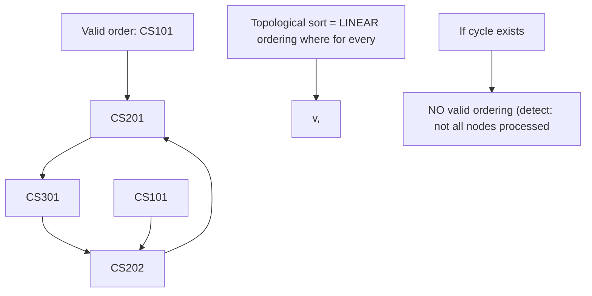
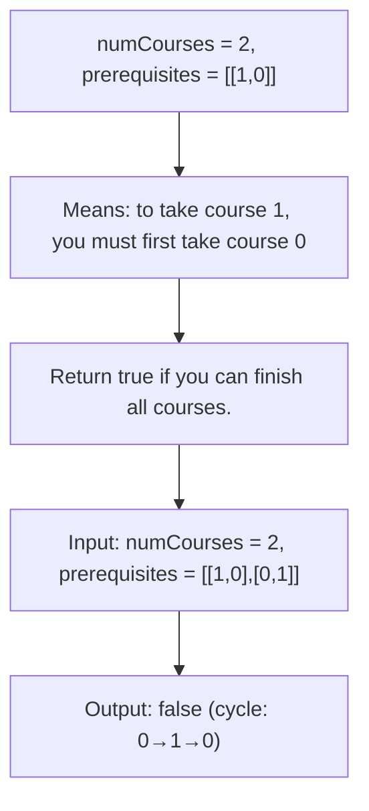

> **Navigation**: [< Previous](Day_024_Mar26_Wed.md) | [Back to Index](../../00_MASTER_INDEX.md) | [Next >](Day_026_Mar28_Fri.md)

# DAY 025 — Thursday, March 27, 2026
## Topological Sort + Kruskal's MST + SQL Views & Stored Procedures

> **Theme**: Dependency ordering + Minimum spanning tree + SQL abstraction layers

---

## 📅 SCHEDULE

| Time Block | Duration | Topic |
|------------|----------|-------|
| 0:00–0:30 | 30 min | DS: Topological Sort (Kahn's BFS) |
| 0:30–1:00 | 30 min | ALGO: Kruskal's MST with Union-Find |
| 1:00–1:20 | 20 min | COMBO: LC 207 + LC 1584 |
| 1:20–1:40 | 20 min | REAL-WORLD: Build systems = Topo Sort |
| 1:40–2:20 | 40 min | SQL: Views + Stored Procedures |
| 2:20–3:00 | 40 min | PROBLEMS: Q1 + Q2 |

---

> ## 📖 CHAPTER REFERENCES — Deep Dive Links
>
> Today's topics link to detailed chapter files for deeper study:
>
> | **ALGO: Topological Sort (Kahn's BFS)** | [Graph Fundamentals](../../03_Algorithms/05c_Graphs_Fundamentals.md) |
> | **ALGO: Kruskal's MST** | [Graph Advanced Algorithms](../../03_Algorithms/05d_Graphs_Advanced_Algos.md) |
> | **SQL: Views & Stored Procedures** | [SQL: Views & Stored Procedures](../../08_SQL/12_Views_StoredProcs_Triggers.md) |
>
> *Open the linked file for full theory, diagrams, and practice problems.*

---


## 🧱 DS BLOCK: Topological Sort (Kahn's Algorithm)

### WHY: Order Tasks with Dependencies

```
Course prerequisites:
  CS201 requires CS101
  CS301 requires CS201
  CS202 requires CS101
  
Valid order: CS101 → CS201 → CS301 → CS202
             CS101 → CS202 → CS201 → CS301

Topological sort = LINEAR ordering where for every edge u→v,
                   u comes BEFORE v
Only works on DAG (Directed Acyclic Graph)
If cycle exists → NO valid ordering (detect: not all nodes processed)
```

**Flow:**
- Valid order: CS101
- ↓
- CS201
- ↓
- CS301
- ↓
- CS202
- ↓
- CS101
- ↓
- CS202
- ↓
- CS201
- ↓
- CS301



### Kahn's Algorithm (BFS-based)

```java
// Returns topological order, or empty if cycle exists
List<Integer> topologicalSort(int n, List<List<Integer>> graph) {
    int[] inDegree = new int[n];
    
    // Step 1: Calculate in-degrees
    for (int u = 0; u < n; u++) {
        for (int v : graph.get(u)) {
            inDegree[v]++;
        }
    }
    
    // Step 2: Start with all nodes having in-degree 0
    Queue<Integer> queue = new LinkedList<>();
    for (int i = 0; i < n; i++) {
        if (inDegree[i] == 0) queue.offer(i);
    }
    
    // Step 3: Process
    List<Integer> order = new ArrayList<>();
    while (!queue.isEmpty()) {
        int node = queue.poll();
        order.add(node);
        
        for (int neighbor : graph.get(node)) {
            inDegree[neighbor]--;
            if (inDegree[neighbor] == 0) {
                queue.offer(neighbor);
            }
        }
    }
    
    // If not all nodes processed → cycle exists
    return order.size() == n ? order : Collections.emptyList();
}
```

---

## ⚡ ALGO BLOCK: Kruskal's MST

### WHY: Connect All Nodes with Minimum Total Cost

```
Problem: Connect 5 cities with roads. Each road has a cost.
         Find cheapest way to connect ALL cities.

Answer: Minimum Spanning Tree (MST)
        Uses exactly N-1 edges for N nodes
```

### Kruskal's Algorithm (Greedy + Union-Find)

```java
// edges[i] = {u, v, weight}
int kruskalMST(int n, int[][] edges) {
    // Step 1: Sort edges by weight (greedy: cheapest first)
    Arrays.sort(edges, (a, b) -> a[2] - b[2]);
    
    // Step 2: Use Union-Find to add edges that don't create cycles
    UnionFind uf = new UnionFind(n);
    int totalCost = 0;
    int edgesUsed = 0;
    
    for (int[] edge : edges) {
        int u = edge[0], v = edge[1], w = edge[2];
        if (uf.union(u, v)) {  // Only add if different components
            totalCost += w;
            edgesUsed++;
            if (edgesUsed == n - 1) break;  // MST complete
        }
    }
    
    return edgesUsed == n - 1 ? totalCost : -1;  // -1 if disconnected
}
```

### Time: O(E log E) for sorting + O(E * α(V)) for union-find = O(E log E)

---

## 🗃️ SQL BLOCK: Views & Stored Procedures

### Views: Virtual Tables (Saved Queries)

```sql
-- Create a view (like a saved query)
CREATE VIEW high_earners AS
SELECT e.name, e.salary, d.dept_name
FROM employees e
JOIN departments d ON e.dept_id = d.id
WHERE e.salary > 80000;

-- Use it like a regular table
SELECT * FROM high_earners WHERE dept_name = 'Engineering';

-- WHY views?
-- 1. Simplify complex queries (write once, use many)
-- 2. Security (expose only certain columns/rows)
-- 3. Abstraction (hide table structure changes)

-- Drop a view
DROP VIEW IF EXISTS high_earners;
```

### Stored Procedures: Reusable SQL Programs

```sql
-- Create a stored procedure
DELIMITER //
CREATE PROCEDURE GetEmployeesByDept(IN dept_name VARCHAR(100))
BEGIN
    SELECT e.name, e.salary
    FROM employees e
    JOIN departments d ON e.dept_id = d.id
    WHERE d.dept_name = dept_name
    ORDER BY e.salary DESC;
END //
DELIMITER ;

-- Call it
CALL GetEmployeesByDept('Engineering');

-- Procedure with OUT parameter
DELIMITER //
CREATE PROCEDURE GetAvgSalary(IN dept_id INT, OUT avg_sal DECIMAL(10,2))
BEGIN
    SELECT AVG(salary) INTO avg_sal
    FROM employees
    WHERE department_id = dept_id;
END //
DELIMITER ;

-- Use:
CALL GetAvgSalary(5, @result);
SELECT @result;
```

---

## 🎯 PROBLEMS

### Q1: Course Schedule (LC 207) — Medium

```
numCourses = 2, prerequisites = [[1,0]]
Means: to take course 1, you must first take course 0
Return true if you can finish all courses.

Input: numCourses = 2, prerequisites = [[1,0],[0,1]]
Output: false (cycle: 0→1→0)
```

**Flow:**
- numCourses = 2, prerequisites = [[1,0]]
- ↓
- Means: to take course 1, you must first take course 0
- ↓
- Return true if you can finish all courses.
- ↓
- Input: numCourses = 2, prerequisites = [[1,0],[0,1]]
- ↓
- Output: false (cycle: 0
- ↓
- 1
- ↓
- 0)



**Pattern**: Topological sort — if cycle detected, return false.

### Q2: Min Cost to Connect All Points (LC 1584) — Medium

```
points[i] = [xi, yi]. Cost to connect = |xi-xj| + |yi-yj|
Return min cost to connect all points.

Input: points = [[0,0],[2,2],[3,10],[5,2],[7,0]]
Output: 20
```

**Pattern**: Kruskal's MST — generate all edges, sort, union-find.

---

## ✅ CHECKLIST

- [ ] Topological sort (Kahn's BFS) from scratch
- [ ] Detect cycle using topo sort (not all nodes processed)
- [ ] Kruskal's MST with union-find
- [ ] SQL: CREATE VIEW and query views
- [ ] SQL: CREATE PROCEDURE with IN/OUT params
- [ ] Solved LC 207 (Course Schedule)
- [ ] Solved LC 1584 (Min Cost Connect Points)

---

> **Navigation**: [< Previous](Day_024_Mar26_Wed.md) | [Back to Index](../../00_MASTER_INDEX.md) | [Next >](Day_026_Mar28_Fri.md)