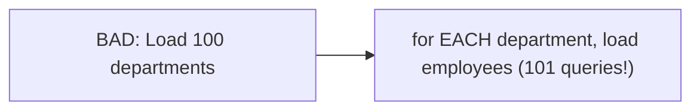
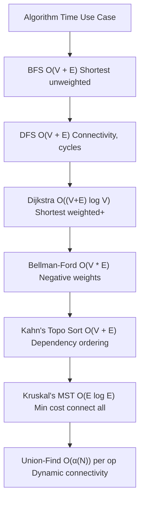

> **Navigation**: [< Previous](Day_026_Mar28_Fri.md) | [Back to Index](../00_MASTER_INDEX.md) | [Next >](Day_028_Mar30_Sun.md)

# DAY 027 — Saturday, March 29, 2026
## Spring Boot: JPA & Hibernate Deep Dive + SQL Practice

> **Theme**: Weekend = Spring Boot (ORM, Entity mapping, Repository pattern) + SQL drills

---

## 📅 SCHEDULE

| Time Block | Duration | Topic |
|------------|----------|-------|
| 0:00–1:30 | 90 min | Spring Boot: JPA & Hibernate |
| 1:30–2:15 | 45 min | SQL: Mixed Drill (Indexes + Transactions + Normalization) |
| 2:15–3:00 | 45 min | Week Review + Graph Algorithm Summary |

---

> ## 📖 CHAPTER REFERENCES — Deep Dive Links
>
> Today's topics link to detailed chapter files for deeper study:
>
> | **Spring Boot: JPA & Hibernate Deep Dive** | [Spring Boot: JPA Deep Dive](../../07_Modern_Java/10_Spring_Boot_Part8_JPA_Deep_Dive.md) |
> | **SQL: Mixed Drill (Indexes + Transactions)** | [SQL: Indexes & Performance](../../08_SQL/11_Indexes_Performance.md) |
>
> *Open the linked file for full theory, diagrams, and practice problems.*

---


## 🌱 SPRING BOOT BLOCK: JPA & Hibernate

### WHY: Object-Relational Mapping (ORM)

```
WITHOUT ORM (raw JDBC):
  String sql = "SELECT * FROM employees WHERE id = ?";
  PreparedStatement ps = conn.prepareStatement(sql);
  ps.setInt(1, id);
  ResultSet rs = ps.executeQuery();
  Employee e = new Employee();
  e.setName(rs.getString("name"));
  // ... manual mapping for EVERY field, EVERY query

WITH JPA:
  Employee e = employeeRepository.findById(id).orElseThrow();
  // That's it. JPA maps table → object automatically.
```

> **Flow**: // That's it. JPA maps table → object automatically.


### WHAT: Key Concepts

```
JPA    = Java Persistence API (specification/interface)
Hibernate = JPA implementation (the actual engine)
Spring Data JPA = Spring's abstraction over JPA (Repository pattern)

Entity (@Entity) = Java class mapped to a database table
Repository       = Interface for CRUD operations (auto-implemented!)
```

### HOW: Entity Mapping

```java
@Entity
@Table(name = "employees")
public class Employee {
    
    @Id
    @GeneratedValue(strategy = GenerationType.IDENTITY)
    private Long id;
    
    @Column(name = "full_name", nullable = false, length = 100)
    private String name;
    
    @Column(nullable = false)
    private BigDecimal salary;
    
    @Enumerated(EnumType.STRING)
    private Department department;
    
    @CreationTimestamp
    private LocalDateTime createdAt;
    
    // Constructors, getters, setters
}
```

### Repository Pattern (Spring Data JPA Magic)

```java
// Just DECLARE the interface — Spring implements it automatically!
@Repository
public interface EmployeeRepository extends JpaRepository<Employee, Long> {
    
    // Method name → SQL query (auto-generated!)
    List<Employee> findByDepartment(Department dept);
    
    List<Employee> findBySalaryGreaterThan(BigDecimal salary);
    
    List<Employee> findByNameContainingIgnoreCase(String name);
    
    // Custom query when method naming gets too complex
    @Query("SELECT e FROM Employee e WHERE e.salary > :min AND e.department = :dept")
    List<Employee> findHighEarners(@Param("min") BigDecimal min, 
                                   @Param("dept") Department dept);
    
    // Native SQL query
    @Query(value = "SELECT * FROM employees WHERE YEAR(created_at) = :year", 
           nativeQuery = true)
    List<Employee> findByYear(@Param("year") int year);
}
```

### Relationships

```java
// ONE-TO-MANY: Department has many Employees
@Entity
public class Department {
    @Id @GeneratedValue(strategy = GenerationType.IDENTITY)
    private Long id;
    private String name;
    
    @OneToMany(mappedBy = "department", cascade = CascadeType.ALL)
    private List<Employee> employees = new ArrayList<>();
}

@Entity
public class Employee {
    @Id @GeneratedValue(strategy = GenerationType.IDENTITY)
    private Long id;
    private String name;
    
    @ManyToOne(fetch = FetchType.LAZY)  // LAZY = don't load dept until accessed
    @JoinColumn(name = "dept_id")
    private Department department;
}

// MANY-TO-MANY: Employee has many Skills, Skill has many Employees
@Entity
public class Employee {
    @ManyToMany
    @JoinTable(
        name = "employee_skills",
        joinColumns = @JoinColumn(name = "employee_id"),
        inverseJoinColumns = @JoinColumn(name = "skill_id")
    )
    private Set<Skill> skills = new HashSet<>();
}
```

### The N+1 Problem

```
BAD: Load 100 departments → for EACH department, load employees (101 queries!)

List<Department> depts = deptRepo.findAll();       // 1 query
for (Department d : depts) {
    d.getEmployees().size();                        // +100 queries (N+1!)
}

FIX 1: @EntityGraph
@EntityGraph(attributePaths = {"employees"})
List<Department> findAll();  // 1 query with JOIN

FIX 2: JPQL JOIN FETCH
@Query("SELECT d FROM Department d JOIN FETCH d.employees")
List<Department> findAllWithEmployees();  // 1 query
```

> **Flow**: BAD: Load 100 departments → for EACH department, load employees (101 queries!)



### application.properties

```properties
# Database connection
spring.datasource.url=jdbc:mysql://localhost:3306/mydb
spring.datasource.username=root
spring.datasource.password=secret

# JPA/Hibernate settings
spring.jpa.hibernate.ddl-auto=update   # create | create-drop | update | validate
spring.jpa.show-sql=true               # Log all SQL queries
spring.jpa.properties.hibernate.format_sql=true
```

---

## 🗃️ SQL DRILL: Mixed Practice

```sql
-- DRILL 1: Create indexed table
CREATE TABLE products (
    id INT PRIMARY KEY AUTO_INCREMENT,
    name VARCHAR(200) NOT NULL,
    category VARCHAR(50),
    price DECIMAL(10,2),
    stock INT DEFAULT 0,
    created_at TIMESTAMP DEFAULT CURRENT_TIMESTAMP
);
CREATE INDEX idx_category ON products(category);
CREATE INDEX idx_price ON products(price);

-- DRILL 2: Transaction — transfer stock between warehouses
BEGIN TRANSACTION;
    UPDATE inventory SET quantity = quantity - 50 
    WHERE product_id = 1 AND warehouse = 'A';
    UPDATE inventory SET quantity = quantity + 50 
    WHERE product_id = 1 AND warehouse = 'B';
COMMIT;

-- DRILL 3: Normalized query with JOIN + Window Function
SELECT 
    e.name,
    d.dept_name,
    e.salary,
    RANK() OVER (PARTITION BY d.dept_name ORDER BY e.salary DESC) as dept_rank
FROM employees e
JOIN departments d ON e.dept_id = d.id;

-- DRILL 4: View for department summary
CREATE VIEW dept_summary AS
SELECT 
    d.dept_name,
    COUNT(e.id) as employee_count,
    AVG(e.salary) as avg_salary,
    MAX(e.salary) as max_salary
FROM departments d
LEFT JOIN employees e ON d.id = e.dept_id
GROUP BY d.dept_name;

-- DRILL 5: EXPLAIN to check performance
EXPLAIN SELECT * FROM products WHERE category = 'Electronics' AND price > 100;
```

---

## 📊 WEEK 04 GRAPH ALGORITHM SUMMARY

```
┌──────────────────┬──────────────────┬───────────────────────┐
│ Algorithm        │ Time             │ Use Case              │
├──────────────────┼──────────────────┼───────────────────────┤
│ BFS              │ O(V + E)         │ Shortest unweighted   │
│ DFS              │ O(V + E)         │ Connectivity, cycles  │
│ Dijkstra         │ O((V+E) log V)   │ Shortest weighted+    │
│ Bellman-Ford     │ O(V * E)         │ Negative weights      │
│ Kahn's Topo Sort │ O(V + E)         │ Dependency ordering   │
│ Kruskal's MST    │ O(E log E)       │ Min cost connect all  │
│ Union-Find       │ O(α(N)) per op   │ Dynamic connectivity  │
│ 2-Color BFS      │ O(V + E)         │ Bipartite check       │
│ A*               │ O(E log V) best  │ Targeted shortest     │
└──────────────────┴──────────────────┴───────────────────────┘
```

> **Flow**: Algorithm Time Use Case → BFS O(V + E) Shortest unweighted | BFS O(V + E) Shortest unweighted → DFS O(V + E) Connectivity, cycles | DFS O(V + E) Connectivity, cycles → Dijkstra O((V+E) log V) Shortest weighted+ | Dijkstra O((V+E) log V) Shortest weighted+ → Bellman-Ford O(V * E) Negative weights | Bellman-Ford O(V * E) Negative weights → Kahn's Topo Sort O(V + E) Dependency ordering | Kahn's Topo Sort O(V + E) Dependency ordering → Kruskal's MST O(E log E) Min cost connect all | ...+1 more



---

## ✅ CHECKLIST

- [ ] JPA: @Entity, @Id, @Column, @Table annotations
- [ ] Repository: JpaRepository with derived query methods
- [ ] Relationships: @OneToMany, @ManyToOne, @ManyToMany
- [ ] N+1 problem: understood and 2 fixes (EntityGraph, JOIN FETCH)
- [ ] SQL drills: index, transaction, view, EXPLAIN
- [ ] Can recite all graph algorithms and when to use each

---

> **Navigation**: [< Previous](Day_026_Mar28_Fri.md) | [Back to Index](../00_MASTER_INDEX.md) | [Next >](Day_028_Mar30_Sun.md)