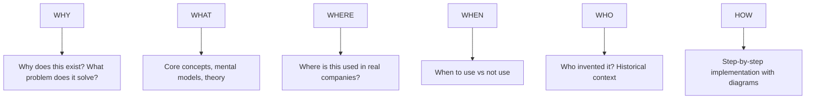

# 🛠️ Developer Essentials — Master Index

> **Purpose**: Skills every developer needs at EVERY career phase, from junior to principal engineer.
> **Teaching Style**: MIT/KTH — WHY before WHAT, theory before tools, diagrams before commands.

---

## 📚 Chapter List

| # | Chapter | Lines | Career Phase | Why It Matters |
|---|---------|-------|-------------|----------------|
| 01 | [Git & Version Control](01_Git_Version_Control.md) | ~1800 | Day 1 → Forever | You WILL lose code without this |
| 02 | [Linux CLI & Shell](02_Linux_CLI_Shell.md) | ~1600 | Month 1 → Forever | Every server runs Linux |
| 03 | [Docker & Containers](03_Docker_Containers.md) | ~1500 | Month 3 → Forever | "Works on my machine" is dead |
| 04 | [CI/CD Pipelines](04_CICD_Pipelines.md) | ~1400 | Month 6 → Forever | Manual deployment = human error |
| 05 | [Clean Code Principles](05_Clean_Code.md) | ~1500 | Day 1 → Forever | Code is read 10x more than written |
| 06 | [Testing Fundamentals](06_Testing_Fundamentals.md) | ~1500 | Month 1 → Forever | Untested code is broken code |
| 07 | [API Design & REST](07_API_Design_REST.md) | ~1400 | Month 3 → Forever | Every app talks to APIs |
| 08 | [Security Fundamentals](08_Security_Fundamentals.md) | ~1400 | Month 6 → Forever | One breach = career damage |
| 09 | [System Design Foundations](09_System_Design.md) | ~1500 | Year 1 → Forever | How to build things that scale |
| 10 | [Developer Tools & Productivity](10_Dev_Tools_Productivity.md) | ~1200 | Day 1 → Forever | Work smarter, not harder |

---

## 🗺️ Reading Order by Career Phase

### Phase 0: Getting Started (First 3 months)
```
01_Git → 05_Clean_Code → 02_Linux → 10_Dev_Tools → 06_Testing
```

### Phase 1: Building Things (3-12 months)
```
07_API_Design → 03_Docker → 04_CI_CD → 08_Security
```

### Phase 2: Scaling Up (1-3 years)
```
09_System_Design → All chapters as deep reference
```

---

## 📖 Each Chapter Follows This Structure

```
WHY   → Why does this exist? What problem does it solve?
WHAT  → Core concepts, mental models, theory
WHERE → Where is this used in real companies?
WHEN  → When to use vs not use
WHO   → Who invented it? Historical context
HOW   → Step-by-step implementation with diagrams
```

**Flow:**
1. WHY
2. Why does this exist? What problem does it solve?
3. WHAT
4. Core concepts, mental models, theory
5. WHERE
6. Where is this used in real companies?
7. WHEN
8. When to use vs not use
9. WHO
10. Who invented it? Historical context
11. HOW
12. Step-by-step implementation with diagrams



---

> **Cross-reference**: These guides complement the DSA chapters in `02_Data_Structures/`, `03_Algorithms/`, 
> the SQL guides in `08_SQL/`, and the Spring Boot guides in `07_Modern_Java/`.
