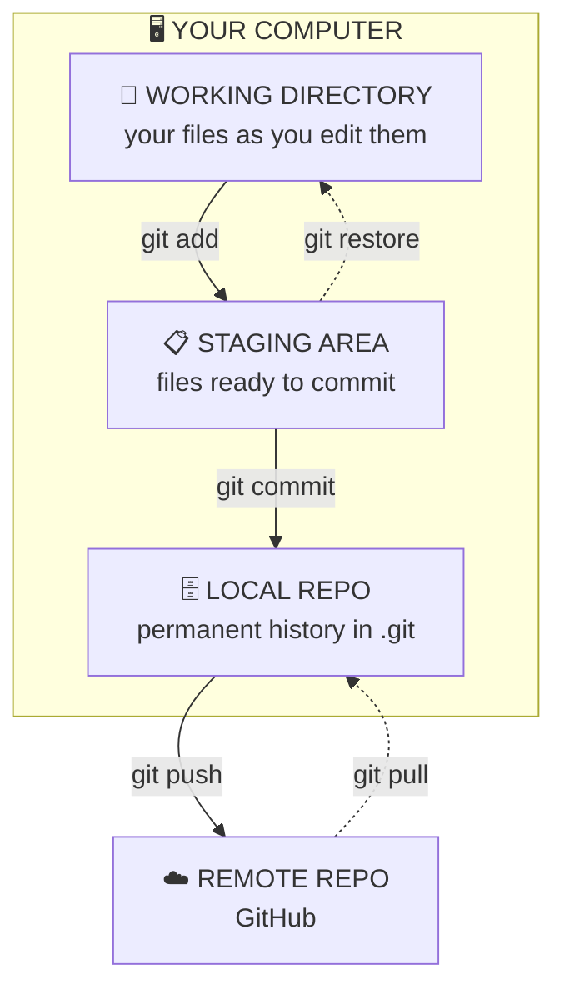
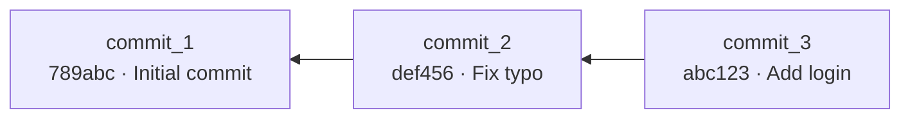
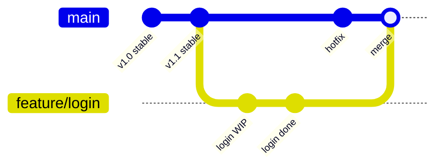
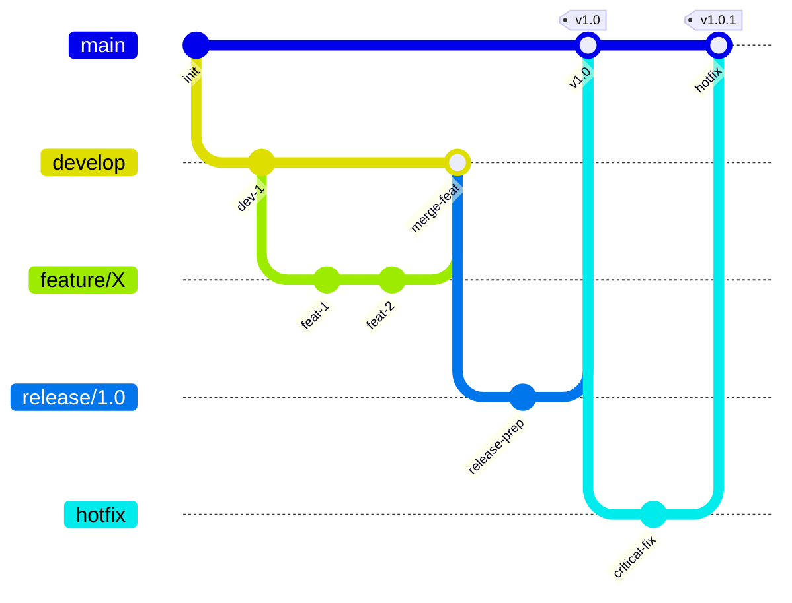
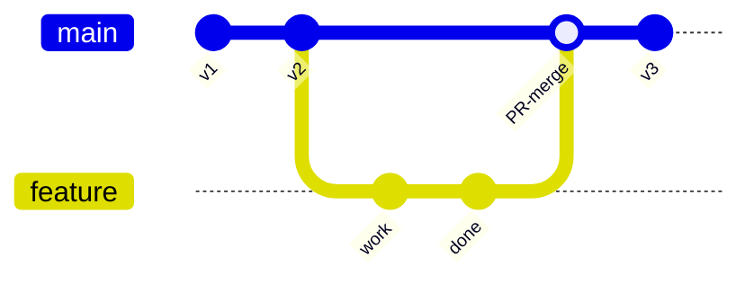

# 🔀 Git & Version Control — Complete Guide

**Navigation**: [Index](00_INDEX.md) | [Next: Linux CLI >](02_Linux_CLI_Shell.md)

---

## Section 0 — Git Disasters That Actually Happen in Production Teams

> These happened at real companies. They're not warnings about obvious things — they're the exact situations that bite experienced developers who know git well enough to be dangerous.

---

### Story 1 — The `git push --force` That Wiped Three Days of Team Work

A senior engineer on a 6-person team had their local `main` branch diverge from remote (they'd been on a flight, working offline). They ran `git push --force origin main` to "fix the divergence." That command rewrote the remote `main` with their local version — which was 3 days behind. Everyone else's commits from the last 3 days vanished from the remote. Three developers lost a day re-doing work. The engineer who pushed didn't realize `--force` doesn't ask for confirmation.

Root cause: `git push --force` replaces the remote ref unconditionally. It's designed for rebased feature branches, not `main`.

```bash
# What they ran (dangerous — no confirmation, no mercy):
git push --force origin main

# What they should have used:
git push --force-with-lease origin main
# --force-with-lease fails if the remote has commits your local doesn't know about
# It's a lease: "only force if I'm the last one who changed this"

# Recovery: git reflog on anyone who had the lost commits
git reflog --all | grep "the lost commit message"
git checkout -b recovery-branch <commit-hash>
# Then cherry-pick or merge into main
```

**Rule**: Never `git push --force` to `main` or any shared branch. `--force-with-lease` is always safer and provides the same result when you're the only writer.

---

### Story 2 — The Committed Secret That Lived in History Forever

A developer added a database password directly to `config.js` to test something quickly, then added a `.gitignore` entry and deleted the file — assuming that cleaned it up. Three months later, a security audit tool (running `trufflehog` on the full git history) flagged the password. The commit was still in `git log`. Because the repo was hosted on GitHub and cloned by 15 developers, the password had to be considered compromised — requiring an emergency rotation of all DB credentials.

```bash
# What went wrong — the file was committed, then deleted
git add config.js      # ← secret in here
git commit -m "temp config"
# Later:
echo "config.js" >> .gitignore
rm config.js
git commit -m "remove config"
# The secret is still in the history — git never forgets committed content

# Prevention: scan before commit
git diff --staged | grep -i "password\|secret\|api_key"  # manual check
# Or use pre-commit hooks with gitleaks / detect-secrets

# If it already happened — nuclear option (rewrites history):
git filter-branch --force --index-filter \
  "git rm --cached --ignore-unmatch config.js" \
  --prune-empty --tag-name-filter cat -- --all
# Force-push ALL branches. Warn all collaborators to re-clone.
# Rotate the secret BEFORE running this — history rewrite isn't instant.
```

**Rule**: A secret that was ever committed, even in a "deleted" commit, must be treated as leaked. Rotate first, clean history second.

---

### Story 3 — The Rebase That Created 47 Duplicate Commits

A developer fetched upstream changes and rebased their 8-commit feature branch onto the latest `main`. They then pushed their branch — but their colleagues had already fetched it and rebased their own branches on top of it. After the rebase, the 8 commits got new hashes. Everyone else's branches still referenced the old hashes. When they merged, git saw the old 8 commits AND the new 8 commits as different commits (same code, different SHA). The PR had 47 commits instead of 8 — and every changed file appeared twice in the diff, with 39 "duplicate" commits creating a noise-filled history that made the code review take 3× as long.

```bash
# Safe rebase flow — only rebase private branches, not shared ones
# Before sharing a branch with anyone:
git rebase origin/main    # ✅ safe — only you have this branch

# AFTER others have based work on your branch:
git merge origin/main     # ✅ use merge instead — creates a merge commit
                          # but preserves everyone's existing commit hashes

# If you must rebase after sharing (coordinate first):
# 1. Tell all collaborators: "I'm force-rebasing this branch"
# 2. They run: git fetch && git checkout main
# 3. You rebase + force-push
# 4. They re-checkout: git checkout feature-branch (gets the new history)

# Identify shared vs private:
git log origin/feature-branch..HEAD  # commits only you have
# If this is empty, everyone is synced — safe to rebase
```

**Rule**: Once a branch is pushed and someone else has fetched it, treat it as shared. Merge instead of rebase. Rebase is for cleaning up your own commits before the first push.

---

# WHY: Why Version Control Exists

## The Problem Before Git

It's 2004. A team of 5 developers is building software. They share code via email... or a shared folder.

_Developer A_: "I'll work on login.java"
_Developer B_: "Me too, I need to fix a bug there"

**Result**: Developer B copies their version over A's work. 3 days of A's work = **gone forever**.

This happened _every day_ in the 1990s–2000s at every company.

### The Three Fundamental Problems

| #   | Problem             | Description                                                              |
| --- | ------------------- | ------------------------------------------------------------------------ |
| 1   | **Collaboration**   | Multiple people editing same files → overwrites                          |
| 2   | **History**         | "The app worked yesterday, what changed?" → nobody knows                 |
| 3   | **Experimentation** | "I want to try a new approach without breaking main code" → make a copy? |

✅ **Git solves all three simultaneously.**

## WHO: The Origin Story

**2005**: Linux kernel development used BitKeeper (proprietary VCS). When BitKeeper revoked its free license, Linus Torvalds said _"I'll build my own in 2 weeks."_

**Design goals**:

1. **Fast** — handle the Linux kernel (25M+ lines)
2. **Distributed** — no central server required
3. **Safe** — cryptographic integrity with SHA-1 hashes
4. **Branching** — cheap, instant branch creation

The name "Git" comes from British slang for "unpleasant person." Linus: _"I name all my projects after myself."_

---

🔬 **Section Challenge — WHO: The Origin Story**

**Challenge 1 (Reasoning):** Linus built Git to be "distributed" — no central server required. Yet every team still pushes to GitHub. What does "distributed" actually mean in practice, and what concrete advantage does it give even when you use a central hub?

<details><summary>Answer</summary>

"Distributed" means every developer has a **complete copy** of the repository — full history, all branches, all objects. GitHub is just a _convenient synchronization point_, not a single point of truth. Concrete advantages: you can commit, branch, merge, view history, and bisect bugs **completely offline**. When GitHub goes down, your team doesn't stop working. If GitHub deleted your repo, any developer's clone is a perfect full backup. This also enables the **fork + pull request** workflow — contributing to open source without needing write access to the original. Contrast with SVN: if the central server dies, nobody can commit anything.

</details>

**Challenge 2 (Reasoning):** Git uses SHA-1 hashes to identify every object. SHA-1 was broken for _cryptographic security_ in 2017 (collision attacks exist). But Git's history is still trustworthy. Why? What is Git actually protecting against with SHA-1?

<details><summary>Answer</summary>

Git uses SHA-1 for **data integrity and deduplication**, not adversarial security. The key property: SHA-1 is content-addressed — same content always produces the same hash. Since each commit's hash includes the **parent commit's hash**, any tampering with history cascades into different hashes for all subsequent commits — immediately visible to anyone with a clone. Git protects against **accidental corruption** (disk errors, bit-flips, network corruption), not sophisticated attackers. Git is now migrating to SHA-256 (`extensions.objectFormat sha256`) for stronger collision resistance.

</details>

# WHAT: Core Mental Models

## Mental Model 1: Git is a SNAPSHOT Timeline

**Most VCS**: Store _differences_ (deltas) between versions — `v1 → [+5 lines] → v2 → [-2 lines, +8 lines] → v3`

**Git**: Store **snapshots** of the entire project state. Each version is a complete picture of every file. Unchanged files just point to the previous copy.

💡 **Why snapshots?** Any version can be reconstructed instantly — no need to replay 500 deltas.

🔬 **Section Challenge — Mental Model 1: Git is a SNAPSHOT Timeline**

**Challenge 1 (Reasoning):** Git stores "full snapshots" of every file at every commit. If your repo has 1,000 files and you change only 1, does Git literally store 1,000 full file copies? What happens internally to prevent storage explosion?

<details><summary>Answer</summary>

Git uses **content-addressed deduplication**. Internally, each file version is a **blob object** — compressed content keyed by SHA-1. If a file hasn't changed, the new commit's tree object simply **points to the same blob** as the previous commit — no new blob is written. Only the 1 changed file needs a new blob. Git also runs `git gc` (garbage collection) periodically, packing loose objects into **packfiles** using delta compression for similar blobs. Result: storage grows proportional to _unique file versions_, not files × commits. Verify with: `git cat-file -p <commit-hash>` to see the tree, then `git cat-file -p <tree-hash>` to see blob references.

</details>

**Challenge 2 (Comparison):** For large, frequently-changing binary files (e.g., a 200MB Photoshop `.psd`), Git's snapshot model is far worse than delta-based SVN. Why? What is the industry solution?

<details><summary>Answer</summary>

Each new version of a binary blob becomes a full blob object — binary files don't compress well with text delta algorithms. A 200MB `.psd` changed 50 times ≈ 10GB of blob storage, even if each edit changed only a few pixels. The solution is **Git LFS (Large File Storage)**: LFS replaces the binary in the repo with a small text pointer, storing the actual binary in a separate LFS server. The Git repo stays fast and small. Enable with `git lfs track "*.psd"` — this adds the pattern to `.gitattributes`, and `git push` sends LFS objects separately. GitHub, GitLab, and Bitbucket all support LFS natively.

</details>

## Mental Model 2: Three Areas



## Mental Model 3: Commits are a Linked List

Each commit contains: **(1)** snapshot of all files, **(2)** author + timestamp, **(3)** message, **(4)** pointer to parent commit(s).



💡 **Hash** = SHA-1 of content + parent hash + metadata. If ANY byte changes → completely different hash → tamper-proof history.

---

🔬 **Section Challenge — Mental Model 3: Commits are a Linked List**

**Challenge 1 (Trace):** You run `git show abc123`. What exact data is Git returning? List every field stored in a commit object, and explain what the `tree` field points to.

<details><summary>Answer</summary>

A **commit object** contains: (1) **tree** — SHA-1 of the root tree object (a directory snapshot mapping filenames to blob and sub-tree hashes); (2) **parent** — SHA-1 of the previous commit (zero for initial commit, two SHA-1s for a merge commit); (3) **author** — name, email, timestamp of who wrote the code; (4) **committer** — name, email, timestamp of who applied it (differs from author after cherry-pick or rebase); (5) **message** — the commit message. Git follows the tree pointer to reconstruct the full file snapshot. Inspect raw: `git cat-file -p abc123`.

</details>

**Challenge 2 (Debug):** A teammate ran `git rebase main` on their feature branch and force-pushed it. You run `git pull` on that branch and Git says "your branch and the remote have diverged, 5 and 3 different commits each." Why does rebase cause this, and what is the correct recovery command?

<details><summary>Answer</summary>

`git rebase` **rewrites commit objects** — it creates entirely new commits (E', F', G') with new SHA-1 hashes because the parent pointer changed to point to the new main tip. Your local branch still has original E, F, G. After force-push, remote has E', F', G'. Git sees two histories that diverged from a common ancestor — hence "diverged." **Correct recovery**: `git fetch origin` then `git reset --hard origin/feature`. This moves your local pointer to match the remote's rewritten history. **Never `git pull` here** — it creates a merge commit mixing old and rewritten commits, permanently polluting history.

</details>

# HOW: Essential Commands (Progressive)

## Level 0: Setup (Do Once)

```bash
# Install: https://git-scm.com/downloads

# Configure identity (used in every commit)
git config --global user.name "Your Name"
git config --global user.email "your@email.com"

# Configure editor
git config --global core.editor "code --wait"  # VS Code

# Verify
git config --list
```

## Level 1: Daily Workflow (Week 1)

```bash
# === START A PROJECT ===
git init                    # Create new repo in current folder
git clone <url>             # Copy existing repo from GitHub

# === DAILY CYCLE ===
git status                  # What changed? (DO THIS CONSTANTLY)
git diff                    # See exact changes line-by-line
git add <file>              # Stage specific file
git add .                   # Stage ALL changed files
git commit -m "message"     # Save snapshot to history

# === VIEW HISTORY ===
git log                     # Full commit history
git log --oneline           # Compact view
git log --graph --oneline   # Visual branch graph

# === SYNC WITH REMOTE ===
git push                    # Upload commits to GitHub
git pull                    # Download latest from GitHub
```

### The Perfect Commit Workflow

```bash
# 1. Check what changed
git status

# 2. Review changes carefully
git diff

# 3. Stage only what's related  (DON'T git add . blindly!)
git add src/login.java
git add src/auth.java

# 4. Commit with DESCRIPTIVE message
git commit -m "feat: add JWT token validation to login flow"

# 5. Push
git push
```

### Commit Message Convention (Industry Standard)

```
Format: <type>: <description>

Types:
  feat:     New feature
  fix:      Bug fix
  docs:     Documentation only
  style:    Formatting (no code change)
  refactor: Code restructuring (no behavior change)
  test:     Adding/fixing tests
  chore:    Build tasks, dependencies

Examples:
  feat: add user registration endpoint
  fix: resolve null pointer in cart calculation
  docs: update API documentation for v2
  refactor: extract payment logic into service class
  test: add unit tests for OrderService
```

## Level 2: Branching (Week 2-3)

### WHY Branches Exist

**Scenario**: Your app is live, users depend on it. You need to add a **new feature** that takes 2 weeks.

**Without branches**: You edit the main code. For 2 weeks it's HALF-FINISHED. If a CRITICAL BUG appears → you can't deploy a fix.

**With branches**:



**Bug fix?** Branch from main → fix → merge → deploy.
**Feature ready?** Merge feature into main.

### Branch Commands

```bash
# === CREATE & SWITCH ===
git branch                      # List all branches
git branch feature/login        # Create new branch
git checkout feature/login      # Switch to it
git checkout -b feature/login   # Create + switch (shortcut)
git switch feature/login        # Modern alternative to checkout

# === WORK ON BRANCH ===
# (just normal git add, commit, push)
git push -u origin feature/login  # First push sets upstream

# === MERGE BACK ===
git checkout main               # Switch to main
git merge feature/login         # Bring feature changes into main
git branch -d feature/login     # Delete merged branch

# === KEEP BRANCH UP TO DATE ===
git checkout feature/login
git merge main                  # Get latest main changes into feature
```

### Git Flow vs GitHub Flow

**Git Flow** _(Complex, Enterprise)_:



**GitHub Flow** _(Simple, Modern)_:



**Recommendation**: Learning/personal → **GitHub Flow**. Enterprise/team → **Git Flow**.

## Level 3: Merge Conflicts (The Hard Part)

### WHY Conflicts Happen

**You**: Edit line 10 of `app.java` → `"Hello World"`
**Friend**: Edit line 10 of `app.java` → `"Hello Universe"`

**Git**: _"Two different changes to the SAME line. I can't decide. Human, you must choose."_

### HOW to Resolve

```bash
# After git merge or git pull shows CONFLICT:
git status   # Shows conflicted files in red

# Open the file — Git marks the conflict:
<<<<<<< HEAD
System.out.println("Hello World");    ← YOUR change
=======
System.out.println("Hello Universe"); ← THEIR change
>>>>>> feature/greeting

# YOU decide — edit the file to keep what's correct:
System.out.println("Hello Universe");

# Then:
git add app.java         # Mark as resolved
git commit               # Complete the merge
```

### Conflict Prevention Strategy

1. **Pull frequently** — `git pull` every morning
2. **Small commits** — commit every 30 minutes of work
3. **Communicate** — "I'm working on X file today"
4. **Short branches** — merge within 1–3 days, not weeks

## Level 4: Advanced Git (Month 3+)

### Rebase (Rewrite History)

```
WHY: Your branch has diverged from main. Merge creates ugly history.

BEFORE rebase:
  main:    A ── B ── C ── D
                 \
  feature:        E ── F ── G

AFTER git rebase main (from feature branch):
  main:    A ── B ── C ── D
                              \
  feature:                     E' ── F' ── G'

  (E', F', G' are COPIES with new parent = D)

Result: Linear, clean history
```

```bash
git checkout feature/login
git rebase main                 # Replay your commits on top of main
# If conflicts → resolve → git rebase --continue

# Interactive rebase (POWERFUL — squash messy commits)
git rebase -i HEAD~3            # Rewrite last 3 commits
# Options: pick, squash, reword, drop, edit
```

### Stash (Temporary Shelf)

```bash
# You're mid-work on feature. Urgent bug needs fixing.
git stash                       # Save changes to shelf
git checkout main               # Fix the bug
# ... fix bug, commit, push ...
git checkout feature/login
git stash pop                   # Restore your saved changes
```

### Cherry-Pick (Selective Merge)

```bash
# You only need ONE specific commit from another branch
git cherry-pick abc1234         # Apply that specific commit here
```

### Bisect (Find Bug Introducer)

```bash
# "The app broke sometime in the last 100 commits. Which one?"
git bisect start
git bisect bad                  # Current commit is broken
git bisect good abc1234         # This old commit worked fine
# Git binary-searches through commits
# Test each one → git bisect good/bad
# Result: "First bad commit is XYZ"
git bisect reset
```

### Reset vs Revert

`git reset`: **Rewrite** history (⚠️ dangerous on shared branches)
`git revert`: **Create new** commit that undoes a previous one (safe)

```bash
# Undo last commit but keep changes staged
git reset --soft HEAD~1

# Undo last commit and unstage changes
git reset --mixed HEAD~1

# Undo last commit and DELETE changes (DANGEROUS)
git reset --hard HEAD~1

# Safe undo (creates new "undo" commit)
git revert abc1234
```

---

# WHERE: Real-World Git Workflows

## Open Source Contribution (Fork Model)

```bash
# 1. Fork the repo on GitHub (creates YOUR copy)
# 2. Clone YOUR fork
git clone https://github.com/YOU/project.git

# 3. Add original as upstream
git remote add upstream https://github.com/ORIGINAL/project.git

# 4. Create feature branch
git checkout -b fix/typo-readme

# 5. Make changes, commit, push to YOUR fork
git push origin fix/typo-readme

# 6. Create Pull Request on GitHub (YOUR fork → original)
# 7. Maintainers review, request changes, merge
```

## Corporate Team Workflow

```bash
# Morning routine
git checkout main
git pull                        # Get latest
git checkout -b feature/JIRA-1234-add-payment

# Work...
git add . && git commit -m "feat: add payment gateway integration"
git push -u origin feature/JIRA-1234-add-payment

# Create PR → Code review → CI/CD runs tests
# Reviewer approves → Merge to main → Auto-deploy
```

## .gitignore (What NOT to Track)

```gitignore
# Compiled files
*.class
*.jar
target/

# IDE files
.idea/
.vscode/
*.iml

# Environment files (NEVER commit secrets!)
.env
application-local.properties

# OS files
.DS_Store
Thumbs.db

# Dependencies
node_modules/
```

---

# WHEN: Decision Guide

| Question                 | Answer                                                                   |
| ------------------------ | ------------------------------------------------------------------------ |
| When to commit?          | Every logical unit of work (30–60 min intervals)                         |
| When to branch?          | Every new feature, bug fix, or experiment                                |
| When to merge vs rebase? | `merge` for shared branches, `rebase` for personal cleanup               |
| When to force push?      | **Only** on your personal branch after rebase. **Never** on main/develop |
| When to use stash?       | Switching tasks mid-work (not for long-term storage)                     |

---

# 🔩 HOW (Internals): Git Object Model

> 📖 _Source: Pro Git, Chapter 10 — Git Internals. Understanding this makes `git reset`, `rebase`, and `reflog` trivially intuitive rather than magical._

## The `.git/` Directory

`git init` creates exactly one directory: `.git/`. Everything Git knows lives here.

```
.git/
├── HEAD              ← "You are here" — ref to current branch or raw commit hash
├── index             ← The staging area (binary file, not human-readable)
├── config            ← Repo-local config (remote URLs, user overrides)
├── refs/
│   ├── heads/        ← One 41-byte file per LOCAL branch
│   ├── remotes/      ← One 41-byte file per REMOTE tracking branch
│   └── tags/         ← One 41-byte file per tag
└── objects/          ← Every blob, tree, and commit ever created
    ├── ab/
    │   └── cdef1234... ← Object: first 2 chars = folder, rest = filename
    └── pack/         ← Packfiles (delta-compressed, created by git gc)
```

## The 3 Types of Git Objects

Git is a **content-addressable filesystem** — every object is stored by SHA-1 of its content.

```
BLOB — A file's content (filename NOT stored inside the blob itself)
┌──────────────────────────────────────────────────────────────┐
│  Content: "public class Main { ... }"                        │
│  Hash:    sha1("blob <size>\0<content>")                     │
│  Stored:  .git/objects/ab/cdef1234...  (zlib-compressed)     │
│                                                              │
│  Key insight: Two files with identical content = ONE blob.   │
│  Renaming a file creates NO new blob — just a new tree.      │
└──────────────────────────────────────────────────────────────┘

TREE — A directory snapshot (maps names → blobs or sub-trees)
┌──────────────────────────────────────────────────────────────┐
│  100644 blob a1b2c3...  README.md                            │
│  100644 blob d4e5f6...  pom.xml                              │
│  040000 tree 789abc...  src/          ← sub-directory        │
│                                                              │
│  TREE stores: filename + permissions + pointer to blob/tree  │
│  BLOB stores: file contents. Clean separation of concerns.   │
└──────────────────────────────────────────────────────────────┘

COMMIT — A snapshot + metadata + parent link
┌──────────────────────────────────────────────────────────────┐
│  tree     f1a2b3...      ← root tree of this snapshot        │
│  parent   d4e5f6...      ← previous commit's hash            │
│  author   Harsha <h@x.com> 1714000000 +0530                  │
│  committer Harsha <h@x.com> 1714000000 +0530                 │
│  message  "feat: add payment gateway"                        │
│                                                              │
│  Merge commits have TWO parent pointers.                     │
│  Initial commit has ZERO parent pointers.                    │
└──────────────────────────────────────────────────────────────┘
```

## How `git add` + `git commit` Work at Object Level

```
STEP 1: git add src/Main.java
  → Compress Main.java content with zlib
  → Compute SHA-1 of "blob <size>\0<content>"
  → Write blob to .git/objects/ab/cdef1234...
  → Update .git/index (staging area) to record:
      "100644 abcdef1234... src/Main.java"

STEP 2: git commit -m "fix: NPE in payment"
  → Build TREE objects for each directory
  → Build COMMIT object:
        tree    = root tree hash
        parent  = current HEAD commit hash
        author  = git config values
        message = "fix: NPE in payment"
  → Compute SHA-1 of commit object = new commit hash
  → Write commit to .git/objects/xx/yyyy...
  → Update .git/refs/heads/main ← new commit hash
  → .git/HEAD still points to refs/heads/main (unchanged)
```

## What `HEAD` Actually Is

```bash
# HEAD is the file .git/HEAD

# On a branch — contains a reference:
cat .git/HEAD
→ ref: refs/heads/main

# In "detached HEAD" state (e.g., after git checkout abc123):
cat .git/HEAD
→ abc1234567890abcdef...   ← raw commit hash

# refs/heads/main is also just a file:
cat .git/refs/heads/main
→ def4567890abcdef...      ← the commit hash main points to
```

## The Reflog — Git's Safety Net

```bash
# git reflog records EVERY movement of HEAD, kept for 90 days
git reflog

# Output:
abc1234 HEAD@{0}: commit: fix: NPE in payment
def5678 HEAD@{1}: rebase: finish — return to refs/heads/main
789abc  HEAD@{2}: commit: feat: add payment gateway
bcd123  HEAD@{3}: checkout: moving from feature to main

# RECOVERY: You did git reset --hard and "lost" a commit.
# 1. Find the lost hash in reflog
git reflog

# 2. Restore it to a new branch
git checkout -b recovery/lost-work abc1234
```

> 🔥 **3+ YOE Insight — Why reflog saves careers**: `git reset --hard HEAD~1` feels permanent but isn't. Git's garbage collector only deletes objects **unreachable from any ref AND older than 90 days** (configurable via `gc.reflogExpire`). Until then, `git reflog` exposes every commit hash Git has ever held — even from deleted branches. **Rule**: if you made a commit, it's recoverable within 90 days.

🔬 **Section Challenge — Git Object Model**

**Challenge 1 (Trace):** You rename a file `Main.java` → `App.java` with no content changes, then commit. How many new objects does Git create? What type are they?\

<details><summary>Answer</summary>

Git creates **zero new blobs** and **two new tree objects** (one for the root directory, one for `src/` if the file is in a subdirectory). The blob for the file content is identical — same content, same SHA-1, same existing blob. Only the tree objects change because they map filenames to blob hashes, and the filename changed. This is why `git mv` is efficient: renaming large files is instant regardless of file size, and Git's `git log --follow` can trace history across renames by detecting blob identity.

</details>

**Challenge 2 (Internals):** A colleague says "Git uses a lot of storage because it stores full file copies in every commit." Correct this misconception precisely, citing the internal mechanism.

<details><summary>Answer</summary>

Git stores **blob objects keyed by content hash** — identical content across commits shares the same blob. When only 1 file changes in a 10,000-file repo, only 1 new blob is created; the new commit's tree objects point to the same blobs as the previous commit for all 9,999 unchanged files. Additionally, `git gc` runs **packfile compression** — it groups similar blobs and applies delta encoding between them. A 1GB repo of text code typically has a `.git` folder of ~50–100MB because of deduplication + delta compression. The misconception conflates "snapshot model" with "no deduplication," which are independent concerns.

</details>

---

# 🧭 Git Command Cheat Sheet

| Category     | Commands                                    |
| ------------ | ------------------------------------------- |
| **Setup**    | `init`, `clone`, `config`                   |
| **Daily**    | `status`, `add`, `commit`, `push`, `pull`   |
| **Branch**   | `branch`, `checkout`, `switch`, `merge`     |
| **Inspect**  | `log`, `diff`, `show`, `blame`              |
| **Undo**     | `reset`, `revert`, `restore`, `stash`       |
| **Advanced** | `rebase`, `cherry-pick`, `bisect`, `reflog` |
| **Remote**   | `remote`, `fetch`, `push`, `pull`           |

---

# 🏋️ Practice Exercises

## Exercise 1: Basic Workflow

```
1. Create a new repo
2. Add 3 files, commit each separately
3. View log with --oneline --graph
4. Push to GitHub
```

## Exercise 2: Branching

```
1. Create feature/login branch
2. Make 3 commits on it
3. Switch to main, make 1 commit
4. Merge feature/login into main
5. Delete the branch
```

🔬 **Section Challenge — Exercise 2: Branching**

**Challenge 1 (Trace):** When you run `git branch feature/login`, what does Git physically do? There is no file copying. Explain the exact mechanism using Git's internal object model.

<details><summary>Answer</summary>

`git branch feature/login` creates **one file**: `.git/refs/heads/feature/login` containing the 40-character SHA-1 hash of the current HEAD commit. That's it — no code is copied, no snapshot is duplicated. A branch in Git is literally a 41-byte text file (40 hex chars + newline) pointing to a commit. When you `git checkout feature/login`, Git updates `.git/HEAD` to `ref: refs/heads/feature/login`, then updates your working directory to match that commit's snapshot. This is why branch creation in Git is instantaneous regardless of repo size — compared to SVN where branching copies the entire directory tree.

</details>

**Challenge 2 (Debug):** You're on `main`. You run `git merge feature/login` and Git says "Already up to date." You _know_ the feature branch has 3 new commits. What went wrong, and how do you diagnose it?

<details><summary>Answer</summary>

"Already up to date" means every commit in `feature/login` is already **reachable from `main`'s history** — the feature is already contained in main. Common causes: (1) You merged in the wrong direction — you're on `feature/login` and accidentally merged `main` into it earlier, or (2) You're on the wrong branch entirely. Diagnose with `git log main..feature/login` — if it shows no output, main already contains all of feature/login's commits. `git log --graph --oneline --all` gives the full visual topology to see where commits actually sit.

</details>

## Exercise 3: Conflict Resolution

```
1. Create two branches from main
2. Edit the SAME line in both
3. Merge one into main
4. Try to merge the second → resolve conflict
```

## Exercise 4: Rebase

```
1. Create a branch with 3 commits
2. Make 2 commits on main
3. Rebase your branch onto main
4. Verify clean linear history
```

---

### Production Reality

**Git workflows fail in production in these named ways:**

- **Force-push outage** — `git push --force origin main` on a shared branch overwrites the remote ref unconditionally. All collaborators whose local branches were based on the overwritten commits now have divergent histories. Their next `git pull` requires manual conflict resolution or creates a polluting merge commit. Fix: use `git push --force-with-lease origin main` — it fails if the remote has commits your local doesn't know about.
- **Lost commits from reflog ignorance** — `git reset --hard HEAD~5` appears to delete 5 commits, but the reflog keeps them reachable for 90 days. Developers who don't know reflog treat `reset --hard` as permanent, spending hours re-implementing work that was never actually deleted. The garbage collector only prunes unreachable objects older than the configured expiry window.
- **Git history rewrite after secret exposure** — a database password committed and pushed, then deleted in a later commit, remains in the full git history forever. Trufflehog and GitGuardian scanners flag it years later. The repo being public or having 15 collaborators means the secret must be treated as compromised and rotated immediately. History rewrite (`git filter-branch` or BFG Repo-Cleaner) is the recovery path, but it requires a force-push that breaks all collaborators' local clones.
- **Merge vs rebase collision on shared branches** — once a developer has fetched and based work on your feature branch, rebasing that branch rewrites all its commits with new SHAs. Their local branch still points to the old SHAs. Merging creates duplicate commits (same code, different hash) creating a confusing 47-commit PR from what should be 8. Rule: rebase only before the first push; merge after sharing.

**Debug workflow:** For force-push recovery: any collaborator with a pre-force clone can recover the history by force-pushing it back. Use `git reflog` to find the lost commit hash, then `git branch recovery <hash>` to create a recovery branch.
**Mitigation discipline:** Enforce branch protection rules: disable force-push on `main`/`develop` in GitHub/GitLab settings. Use pre-commit hooks (Gitleaks, detect-secrets) to block secret commits before they reach the remote. Require `--force-with-lease` in any CI scripts that must push.

**Next Chapter**: [Linux CLI & Shell →](02_Linux_CLI_Shell.md)

---
