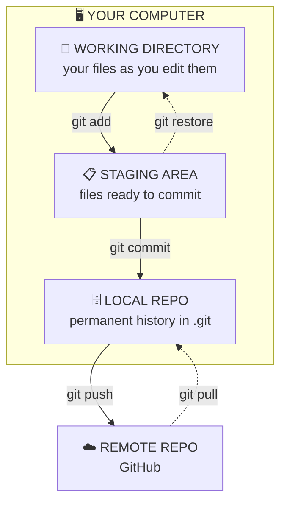
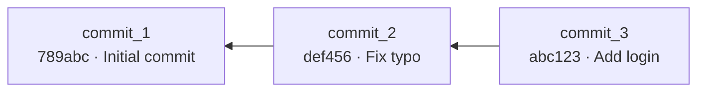
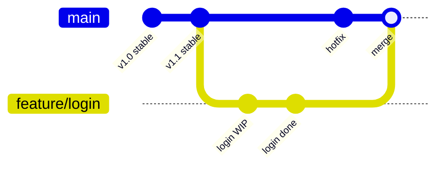
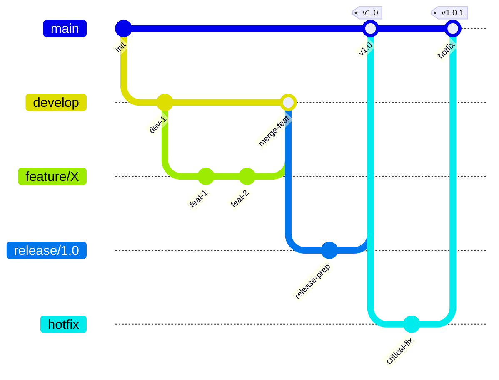
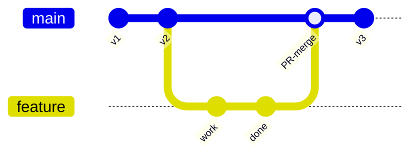

# 🔀 Git & Version Control — Complete Guide

> **Navigation**: [Index](00_INDEX.md) | [Next: Linux CLI >](02_Linux_CLI_Shell.md)

---

# WHY: Why Version Control Exists

## The Problem Before Git

It's 2004. A team of 5 developers is building software. They share code via email... or a shared folder.

> *Developer A*: "I'll work on login.java"
> *Developer B*: "Me too, I need to fix a bug there"
>
> **Result**: Developer B copies their version over A's work. 3 days of A's work = **gone forever**.

This happened *every day* in the 1990s–2000s at every company.

### The Three Fundamental Problems

| # | Problem | Description |
|---|---------|-------------|
| 1 | **Collaboration** | Multiple people editing same files → overwrites |
| 2 | **History** | "The app worked yesterday, what changed?" → nobody knows |
| 3 | **Experimentation** | "I want to try a new approach without breaking main code" → make a copy? |

> ✅ **Git solves all three simultaneously.**

## WHO: The Origin Story

**2005**: Linux kernel development used BitKeeper (proprietary VCS). When BitKeeper revoked its free license, Linus Torvalds said *"I'll build my own in 2 weeks."*

**Design goals**:
1. **Fast** — handle the Linux kernel (25M+ lines)
2. **Distributed** — no central server required
3. **Safe** — cryptographic integrity with SHA-1 hashes
4. **Branching** — cheap, instant branch creation

> The name "Git" comes from British slang for "unpleasant person." Linus: *"I name all my projects after myself."*

---

# WHAT: Core Mental Models

## Mental Model 1: Git is a SNAPSHOT Timeline

**Most VCS**: Store *differences* (deltas) between versions — `v1 → [+5 lines] → v2 → [-2 lines, +8 lines] → v3`

**Git**: Store **snapshots** of the entire project state. Each version is a complete picture of every file. Unchanged files just point to the previous copy.

> 💡 **Why snapshots?** Any version can be reconstructed instantly — no need to replay 500 deltas.

## Mental Model 2: Three Areas



## Mental Model 3: Commits are a Linked List

Each commit contains: **(1)** snapshot of all files, **(2)** author + timestamp, **(3)** message, **(4)** pointer to parent commit(s).



> 💡 **Hash** = SHA-1 of content + parent hash + metadata. If ANY byte changes → completely different hash → tamper-proof history.

---

# HOW: Essential Commands (Progressive)

## Level 0: Setup (Do Once)

```bash
# Install: https://git-scm.com/downloads

# Configure identity (used in every commit)
git config --global user.name "Your Name"
git config --global user.email "your@email.com"

# Configure editor
git config --global core.editor "code --wait"  # VS Code

# Verify
git config --list
```

## Level 1: Daily Workflow (Week 1)

```bash
# === START A PROJECT ===
git init                    # Create new repo in current folder
git clone <url>             # Copy existing repo from GitHub

# === DAILY CYCLE ===
git status                  # What changed? (DO THIS CONSTANTLY)
git diff                    # See exact changes line-by-line
git add <file>              # Stage specific file
git add .                   # Stage ALL changed files
git commit -m "message"     # Save snapshot to history

# === VIEW HISTORY ===
git log                     # Full commit history
git log --oneline           # Compact view
git log --graph --oneline   # Visual branch graph

# === SYNC WITH REMOTE ===
git push                    # Upload commits to GitHub
git pull                    # Download latest from GitHub
```

### The Perfect Commit Workflow

```bash
# 1. Check what changed
git status

# 2. Review changes carefully
git diff

# 3. Stage only what's related  (DON'T git add . blindly!)
git add src/login.java
git add src/auth.java

# 4. Commit with DESCRIPTIVE message
git commit -m "feat: add JWT token validation to login flow"

# 5. Push
git push
```

### Commit Message Convention (Industry Standard)

```
Format: <type>: <description>

Types:
  feat:     New feature
  fix:      Bug fix
  docs:     Documentation only
  style:    Formatting (no code change)
  refactor: Code restructuring (no behavior change)
  test:     Adding/fixing tests
  chore:    Build tasks, dependencies

Examples:
  feat: add user registration endpoint
  fix: resolve null pointer in cart calculation
  docs: update API documentation for v2
  refactor: extract payment logic into service class
  test: add unit tests for OrderService
```

## Level 2: Branching (Week 2-3)

### WHY Branches Exist

**Scenario**: Your app is live, users depend on it. You need to add a **new feature** that takes 2 weeks.

**Without branches**: You edit the main code. For 2 weeks it's HALF-FINISHED. If a CRITICAL BUG appears → you can't deploy a fix.

**With branches**:



> **Bug fix?** Branch from main → fix → merge → deploy.
> **Feature ready?** Merge feature into main.

### Branch Commands

```bash
# === CREATE & SWITCH ===
git branch                      # List all branches
git branch feature/login        # Create new branch
git checkout feature/login      # Switch to it
git checkout -b feature/login   # Create + switch (shortcut)
git switch feature/login        # Modern alternative to checkout

# === WORK ON BRANCH ===
# (just normal git add, commit, push)
git push -u origin feature/login  # First push sets upstream

# === MERGE BACK ===
git checkout main               # Switch to main
git merge feature/login         # Bring feature changes into main
git branch -d feature/login     # Delete merged branch

# === KEEP BRANCH UP TO DATE ===
git checkout feature/login
git merge main                  # Get latest main changes into feature
```

### Git Flow vs GitHub Flow

**Git Flow** *(Complex, Enterprise)*:



**GitHub Flow** *(Simple, Modern)*:



> **Recommendation**: Learning/personal → **GitHub Flow**. Enterprise/team → **Git Flow**.

## Level 3: Merge Conflicts (The Hard Part)

### WHY Conflicts Happen

> **You**: Edit line 10 of `app.java` → `"Hello World"`
> **Friend**: Edit line 10 of `app.java` → `"Hello Universe"`
>
> **Git**: *"Two different changes to the SAME line. I can't decide. Human, you must choose."*

### HOW to Resolve

```bash
# After git merge or git pull shows CONFLICT:
git status   # Shows conflicted files in red

# Open the file — Git marks the conflict:
<<<<<<< HEAD
System.out.println("Hello World");    ← YOUR change
=======
System.out.println("Hello Universe"); ← THEIR change
>>>>>>> feature/greeting

# YOU decide — edit the file to keep what's correct:
System.out.println("Hello Universe");

# Then:
git add app.java         # Mark as resolved
git commit               # Complete the merge
```

### Conflict Prevention Strategy

1. **Pull frequently** — `git pull` every morning
2. **Small commits** — commit every 30 minutes of work
3. **Communicate** — "I'm working on X file today"
4. **Short branches** — merge within 1–3 days, not weeks

## Level 4: Advanced Git (Month 3+)

### Rebase (Rewrite History)

```
WHY: Your branch has diverged from main. Merge creates ugly history.

BEFORE rebase:
  main:    A ── B ── C ── D
                 \
  feature:        E ── F ── G

AFTER git rebase main (from feature branch):
  main:    A ── B ── C ── D
                              \
  feature:                     E' ── F' ── G'
  
  (E', F', G' are COPIES with new parent = D)

Result: Linear, clean history
```

```bash
git checkout feature/login
git rebase main                 # Replay your commits on top of main
# If conflicts → resolve → git rebase --continue

# Interactive rebase (POWERFUL — squash messy commits)
git rebase -i HEAD~3            # Rewrite last 3 commits
# Options: pick, squash, reword, drop, edit
```

### Stash (Temporary Shelf)

```bash
# You're mid-work on feature. Urgent bug needs fixing.
git stash                       # Save changes to shelf
git checkout main               # Fix the bug
# ... fix bug, commit, push ...
git checkout feature/login
git stash pop                   # Restore your saved changes
```

### Cherry-Pick (Selective Merge)

```bash
# You only need ONE specific commit from another branch
git cherry-pick abc1234         # Apply that specific commit here
```

### Bisect (Find Bug Introducer)

```bash
# "The app broke sometime in the last 100 commits. Which one?"
git bisect start
git bisect bad                  # Current commit is broken
git bisect good abc1234         # This old commit worked fine
# Git binary-searches through commits
# Test each one → git bisect good/bad
# Result: "First bad commit is XYZ"
git bisect reset
```

### Reset vs Revert

`git reset`: **Rewrite** history (⚠️ dangerous on shared branches)
`git revert`: **Create new** commit that undoes a previous one (safe)

```bash
# Undo last commit but keep changes staged
git reset --soft HEAD~1

# Undo last commit and unstage changes
git reset --mixed HEAD~1

# Undo last commit and DELETE changes (DANGEROUS)
git reset --hard HEAD~1

# Safe undo (creates new "undo" commit)
git revert abc1234
```

---

# WHERE: Real-World Git Workflows

## Open Source Contribution (Fork Model)

```bash
# 1. Fork the repo on GitHub (creates YOUR copy)
# 2. Clone YOUR fork
git clone https://github.com/YOU/project.git

# 3. Add original as upstream
git remote add upstream https://github.com/ORIGINAL/project.git

# 4. Create feature branch
git checkout -b fix/typo-readme

# 5. Make changes, commit, push to YOUR fork
git push origin fix/typo-readme

# 6. Create Pull Request on GitHub (YOUR fork → original)
# 7. Maintainers review, request changes, merge
```

## Corporate Team Workflow

```bash
# Morning routine
git checkout main
git pull                        # Get latest
git checkout -b feature/JIRA-1234-add-payment

# Work...
git add . && git commit -m "feat: add payment gateway integration"
git push -u origin feature/JIRA-1234-add-payment

# Create PR → Code review → CI/CD runs tests
# Reviewer approves → Merge to main → Auto-deploy
```

## .gitignore (What NOT to Track)

```gitignore
# Compiled files
*.class
*.jar
target/

# IDE files
.idea/
.vscode/
*.iml

# Environment files (NEVER commit secrets!)
.env
application-local.properties

# OS files
.DS_Store
Thumbs.db

# Dependencies
node_modules/
```

---

# WHEN: Decision Guide

| Question | Answer |
|----------|--------|
| When to commit? | Every logical unit of work (30–60 min intervals) |
| When to branch? | Every new feature, bug fix, or experiment |
| When to merge vs rebase? | `merge` for shared branches, `rebase` for personal cleanup |
| When to force push? | **Only** on your personal branch after rebase. **Never** on main/develop |
| When to use stash? | Switching tasks mid-work (not for long-term storage) |

---

# 🧭 Git Command Cheat Sheet

| Category | Commands |
|----------|----------|
| **Setup** | `init`, `clone`, `config` |
| **Daily** | `status`, `add`, `commit`, `push`, `pull` |
| **Branch** | `branch`, `checkout`, `switch`, `merge` |
| **Inspect** | `log`, `diff`, `show`, `blame` |
| **Undo** | `reset`, `revert`, `restore`, `stash` |
| **Advanced** | `rebase`, `cherry-pick`, `bisect`, `reflog` |
| **Remote** | `remote`, `fetch`, `push`, `pull` |

---

# 🏋️ Practice Exercises

## Exercise 1: Basic Workflow
```
1. Create a new repo
2. Add 3 files, commit each separately
3. View log with --oneline --graph
4. Push to GitHub
```

## Exercise 2: Branching
```
1. Create feature/login branch
2. Make 3 commits on it
3. Switch to main, make 1 commit
4. Merge feature/login into main
5. Delete the branch
```

## Exercise 3: Conflict Resolution
```
1. Create two branches from main
2. Edit the SAME line in both
3. Merge one into main
4. Try to merge the second → resolve conflict
```

## Exercise 4: Rebase
```
1. Create a branch with 3 commits
2. Make 2 commits on main
3. Rebase your branch onto main
4. Verify clean linear history
```

---

> **Next Chapter**: [Linux CLI & Shell →](02_Linux_CLI_Shell.md)


---

> **Navigation**: [Back to Index](../00_MASTER_INDEX.md) | [Next >](02_Linux_CLI_Shell.md)