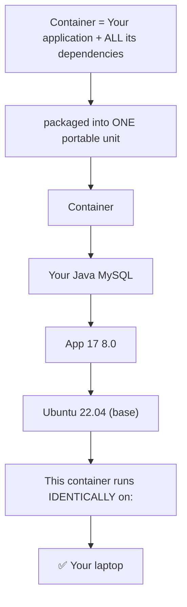
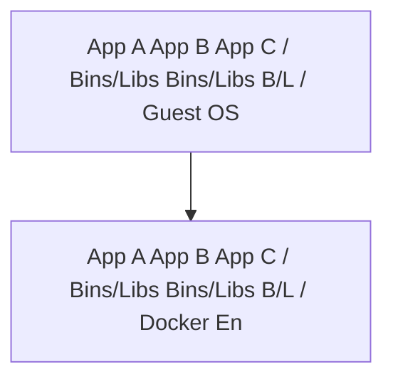
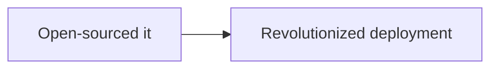
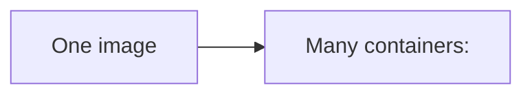
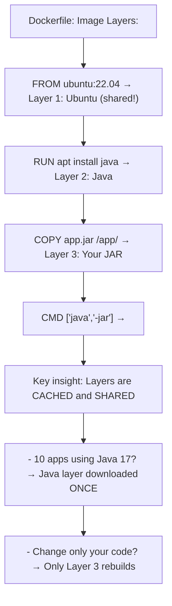
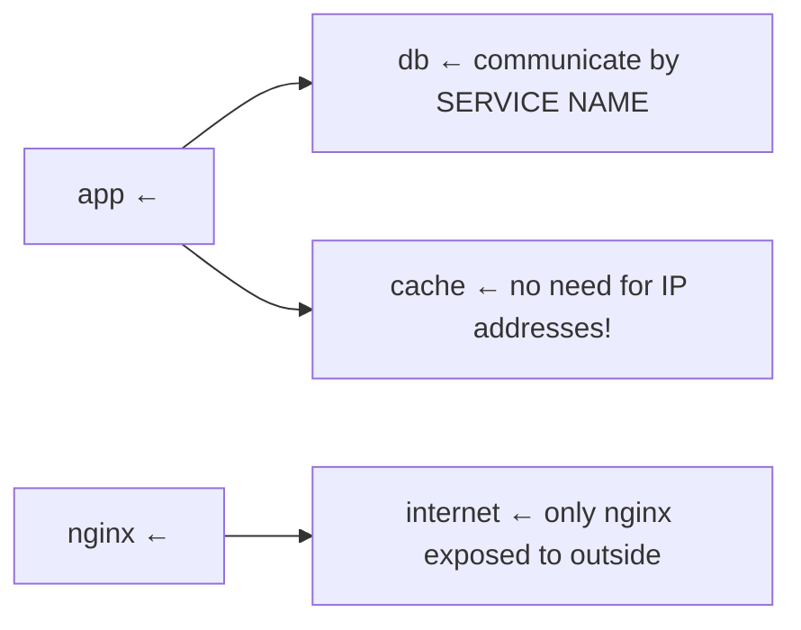

# 🐳 Docker & Containers — Complete Guide

> **Navigation**: [< Linux CLI](02_Linux_CLI_Shell.md) | [Index](00_INDEX.md) | [Next: CI/CD >](04_CICD_Pipelines.md)

---

# WHY: Why Containers Exist

## The Problem

```
Developer: "It works on MY machine!"
Ops Team:  "Well, it DOESN'T work on the server."

WHY? Because your machine has:
  - Java 17, but server has Java 11
  - MySQL 8.0, but server has 5.7
  - Ubuntu 22, but server has CentOS 7
  - 50 environment variables you forgot to document
  
The SAME code behaves differently in different environments.
This is the #1 cause of deployment failures in the industry.
```

## The Solution: Containers

```
Container = Your application + ALL its dependencies
            packaged into ONE portable unit

┌──────────────────────────────┐
│         Container            │
│  ┌──────┐ ┌──────┐ ┌──────┐  │
│  │ Your │ │ Java │ │MySQL │  │
│  │ App  │ │  17  │ │ 8.0  │  │
│  └──────┘ └──────┘ └──────┘  │
│  ┌──────────────────────────┐│
│  │    Ubuntu 22.04 (base)   ││
│  └──────────────────────────┘│
└──────────────────────────────┘

This container runs IDENTICALLY on:
  ✅ Your laptop
  ✅ Your colleague's Mac
  ✅ Testing server
  ✅ Production AWS EC2
  ✅ Kubernetes cluster
```

**Flow:**
- Container = Your application + ALL its dependencies
- ↓
- packaged into ONE portable unit
- ↓
- Container
- ↓
- Your Java MySQL
- ↓
- App 17 8.0
- ↓
- Ubuntu 22.04 (base)
- ↓
- This container runs IDENTICALLY on:




> 🔬 **Section Challenge — The Solution: Containers**
>
> **Challenge 1 (Reasoning):** `ExecutorService.submit(task)` — the task throws a `RuntimeException`. Nobody calls `future.get()`. What happens to the exception?
> <details><summary>Answer</summary>
>
> It's silently swallowed. The exception is stored in the `Future` object. Without `future.get()` or `.whenComplete()`, no one ever sees it. The thread pool thread resets and picks up the next task as if nothing happened. This is one of the most dangerous production bugs. Fix: always attach `future.whenComplete((r,ex) -> { if(ex!=null) log.error("Task failed",ex); })` or use `execute()` + `UncaughtExceptionHandler`.
> </details>
>

## Container vs Virtual Machine

```
┌─── VM ────────────────────┐    ┌─── Container ─────────────┐
│ App A    App B    App C   │    │ App A    App B    App C   │
│ Bins/Libs Bins/Libs B/L   │    │ Bins/Libs Bins/Libs B/L   │
│ Guest OS  Guest OS  G.OS  │    │                           │
│ (Ubuntu)  (CentOS) (Deb)  │    │      Docker Engine        │
│                           │    │                           │
│      Hypervisor           │    │      Host OS (Linux)      │
│      Host OS              │    │      Hardware             │
│      Hardware             │    └────────────────────────────┘
└────────────────────────────────────────────────────────────┘
                                  
VM:        Heavy (GB), 30s startup, full OS per app
Container: Light (MB), 1s startup, shared OS kernel

Analogy:
  VM = Separate HOUSES (each has foundation, walls, roof)
  Container = APARTMENTS (shared building, private units)
```

**Flow:**
- App A App B App C / Bins/Libs Bins/Libs B/L / Guest OS
- ↓
- App A App B App C / Bins/Libs Bins/Libs B/L / Docker En




> 🔬 **Section Challenge — Container vs Virtual Machine**
>
> **Challenge 1 (Reasoning):** `ExecutorService.submit(task)` — the task throws a `RuntimeException`. Nobody calls `future.get()`. What happens to the exception?
> <details><summary>Answer</summary>
>
> It's silently swallowed. The exception is stored in the `Future` object. Without `future.get()` or `.whenComplete()`, no one ever sees it. The thread pool thread resets and picks up the next task as if nothing happened. This is one of the most dangerous production bugs. Fix: always attach `future.whenComplete((r,ex) -> { if(ex!=null) log.error("Task failed",ex); })` or use `execute()` + `UncaughtExceptionHandler`.
> </details>
>

## WHO: Origin

```
2013: Solomon Hykes at dotCloud
      Built Docker as internal tool
      Open-sourced it → Revolutionized deployment

Based on: Linux cgroups + namespaces (existed since 2008)
Docker's genius = Made containers EASY to use
```

**Flow:**
- Open-sourced it
- ↓
- Revolutionized deployment



---


> 🔬 **Section Challenge — WHO: Origin**
>
> **Challenge 1 (Reasoning):** `ExecutorService.submit(task)` — the task throws a `RuntimeException`. Nobody calls `future.get()`. What happens to the exception?
> <details><summary>Answer</summary>
>
> It's silently swallowed. The exception is stored in the `Future` object. Without `future.get()` or `.whenComplete()`, no one ever sees it. The thread pool thread resets and picks up the next task as if nothing happened. This is one of the most dangerous production bugs. Fix: always attach `future.whenComplete((r,ex) -> { if(ex!=null) log.error("Task failed",ex); })` or use `execute()` + `UncaughtExceptionHandler`.
> </details>
>

# WHAT: Core Concepts

## Images vs Containers

```
IMAGE = Blueprint/Template (read-only)
  - Like a Java CLASS
  - Defines what the container will contain
  - Stored in registries (Docker Hub)

CONTAINER = Running instance of an image
  - Like a Java OBJECT
  - Created from an image
  - Has its own state, network, filesystem

One image → Many containers:
  Image: my-spring-app:1.0
    → Container 1 (port 8080)
    → Container 2 (port 8081)
    → Container 3 (port 8082)
```

**Flow:**
- One image
- ↓
- Many containers:




> 🔬 **Section Challenge — Images vs Containers**
>
> **Challenge 1 (Reasoning):** `ExecutorService.submit(task)` — the task throws a `RuntimeException`. Nobody calls `future.get()`. What happens to the exception?
> <details><summary>Answer</summary>
>
> It's silently swallowed. The exception is stored in the `Future` object. Without `future.get()` or `.whenComplete()`, no one ever sees it. The thread pool thread resets and picks up the next task as if nothing happened. This is one of the most dangerous production bugs. Fix: always attach `future.whenComplete((r,ex) -> { if(ex!=null) log.error("Task failed",ex); })` or use `execute()` + `UncaughtExceptionHandler`.
> </details>
>

## Layers (How Images are Efficient)

```
Dockerfile:                    Image Layers:
FROM ubuntu:22.04      →  ┌─────────────────┐ Layer 1: Ubuntu (shared!)
RUN apt install java   →  ├─────────────────┤ Layer 2: Java
COPY app.jar /app/     →  ├─────────────────┤ Layer 3: Your JAR
CMD ["java","-jar"]    →  └─────────────────┘

Key insight: Layers are CACHED and SHARED
  - 10 apps using Java 17? → Java layer downloaded ONCE
  - Change only your code? → Only Layer 3 rebuilds
```

**Flow:**
- Dockerfile: Image Layers:
- ↓
- FROM ubuntu:22.04
- ↓
- Layer 1: Ubuntu (shared!)
- ↓
- FROM ubuntu:22.04
- ↓
- Layer 1: Ubuntu (shared!)
- ↓
- RUN apt install java
- ↓
- Layer 2: Java
- ↓
- RUN apt install java
- ↓
- Layer 2: Java
- ↓
- COPY app.jar /app/
- ↓
- Layer 3: Your JAR
- ↓
- COPY app.jar /app/
- ↓
- Layer 3: Your JAR
- ↓
- CMD ['java','-jar']
- ↓
- Key insight: Layers are CACHED and SHARED
- ↓
- - 10 apps using Java 17?
- ↓
- Java layer downloaded ONCE



---

# HOW: Docker in Practice

## Installation

```bash


> 🔬 **Section Challenge — Installation**
>
> **Challenge 1 (Reasoning):** `ExecutorService.submit(task)` — the task throws a `RuntimeException`. Nobody calls `future.get()`. What happens to the exception?
> <details><summary>Answer</summary>
>
> It's silently swallowed. The exception is stored in the `Future` object. Without `future.get()` or `.whenComplete()`, no one ever sees it. The thread pool thread resets and picks up the next task as if nothing happened. This is one of the most dangerous production bugs. Fix: always attach `future.whenComplete((r,ex) -> { if(ex!=null) log.error("Task failed",ex); })` or use `execute()` + `UncaughtExceptionHandler`.
> </details>
>

# Windows: Install Docker Desktop
# Mac: Install Docker Desktop
# Linux:
curl -fsSL https://get.docker.com | sh
sudo usermod -aG docker $USER
```

## Level 1: Running Containers (Day 1)

```bash
# Run your first container
docker run hello-world

# Run interactive Ubuntu
docker run -it ubuntu bash
# You're now INSIDE an Ubuntu container!
# Try: ls, cat /etc/os-release, exit

# Run Nginx web server
docker run -d -p 8080:80 nginx
# -d = detached (background)
# -p 8080:80 = map host port 8080 → container port 80
# Visit http://localhost:8080 → you'll see Nginx!

# Run MySQL
docker run -d \
  --name my-mysql \
  -e MYSQL_ROOT_PASSWORD=secret \
  -p 3306:3306 \
  mysql:8.0

# Container management
docker ps                  # List RUNNING containers
docker ps -a               # List ALL containers (including stopped)
docker stop <name/id>      # Stop container
docker rm <name/id>        # Remove container
docker logs <name/id>      # View container logs
docker logs -f <name/id>   # Follow logs (real-time)
docker exec -it <name> bash  # Get shell INSIDE running container
```

## Level 2: Building Your Own Image (Week 1)

### Dockerfile for Spring Boot Application

```dockerfile
# === Dockerfile ===

# Stage 1: Build
FROM maven:3.9-eclipse-temurin-17 AS build
WORKDIR /app
COPY pom.xml .
RUN mvn dependency:resolve         # Cache dependencies
COPY src/ ./src/
RUN mvn package -DskipTests

# Stage 2: Run (smaller image)
FROM eclipse-temurin:17-jre-alpine
WORKDIR /app
COPY --from=build /app/target/*.jar app.jar

# Non-root user (security best practice)
RUN addgroup -S spring && adduser -S spring -G spring
USER spring

EXPOSE 8080
ENTRYPOINT ["java", "-jar", "app.jar"]
```

### Building and Running

```bash
# Build the image
docker build -t my-spring-app:1.0 .

# Run it
docker run -d -p 8080:8080 --name myapp my-spring-app:1.0

# Test it
curl http://localhost:8080/api/health
```

### Dockerfile Best Practices

```dockerfile
# BAD: Everything in one layer
FROM ubuntu
RUN apt update && apt install java && apt install maven
COPY . /app
RUN mvn package

# GOOD: Optimized layers, multi-stage, minimal base
FROM eclipse-temurin:17-jre-alpine   # Small base (200MB vs 1GB)
COPY --from=build app.jar /app/      # Only the artifact

# GOOD: .dockerignore (like .gitignore)
# .dockerignore:
.git
target
*.md
.idea
```

## Level 3: Docker Compose (Week 2)

### WHY Compose?

```
Typical app needs:
  - Spring Boot API (port 8080)
  - PostgreSQL database (port 5432)
  - Redis cache (port 6379)
  - Nginx reverse proxy (port 80)

Without Compose: 4 separate docker run commands with 20+ flags
With Compose: ONE yaml file, ONE command
```

### docker-compose.yml Example

```yaml
version: '3.8'

services:
  # Spring Boot Application
  app:
    build: .
    ports:
      - "8080:8080"
    environment:
      - SPRING_DATASOURCE_URL=jdbc:postgresql://db:5432/myapp
      - SPRING_DATASOURCE_USERNAME=admin
      - SPRING_DATASOURCE_PASSWORD=secret
      - SPRING_REDIS_HOST=cache
    depends_on:
      - db
      - cache
    restart: unless-stopped

  # PostgreSQL Database
  db:
    image: postgres:15
    ports:
      - "5432:5432"
    environment:
      - POSTGRES_DB=myapp
      - POSTGRES_USER=admin
      - POSTGRES_PASSWORD=secret
    volumes:
      - pgdata:/var/lib/postgresql/data    # Persistent storage!

  # Redis Cache
  cache:
    image: redis:7-alpine
    ports:
      - "6379:6379"

  # Nginx Reverse Proxy
  nginx:
    image: nginx:alpine
    ports:
      - "80:80"
    volumes:
      - ./nginx.conf:/etc/nginx/nginx.conf
    depends_on:
      - app

volumes:
  pgdata:    # Named volume for database persistence
```

### Compose Commands

```bash
docker-compose up -d              # Start everything
docker-compose down               # Stop everything
docker-compose logs -f app        # Follow app logs
docker-compose ps                 # Status of all services
docker-compose exec app bash      # Shell into app container
docker-compose build              # Rebuild images
docker-compose up -d --build      # Rebuild and restart
```

## Level 4: Volumes & Networking (Month 1)

### Volumes (Persistent Data)

```bash
# Problem: Container dies → ALL data inside dies too
# Solution: Volumes mount external storage into containers

# Named volume (Docker manages location)
docker run -v mydata:/var/lib/mysql mysql:8

# Bind mount (your specific folder)
docker run -v $(pwd)/config:/app/config my-app

# In docker-compose:
volumes:
  - pgdata:/var/lib/postgresql/data     # Named volume
  - ./config:/app/config                # Bind mount
  - ./logs:/app/logs                    # Logs accessible from host
```

### Networking

```
Docker creates internal networks:
  app ←──────→ db       ← communicate by SERVICE NAME
  app ←──────→ cache    ← no need for IP addresses!
  
  nginx ←────→ internet ← only nginx exposed to outside

This is WHY your Spring Boot connects to "db:5432"
instead of "localhost:5432" inside Docker
```

**Flow:**
- app ←
- ↓
- db ← communicate by SERVICE NAME
- ↓
- app ←
- ↓
- cache ← no need for IP addresses!
- ↓
- nginx ←
- ↓
- internet ← only nginx exposed to outside



---

# WHERE: Real-World Docker Usage

## Local Development Environment

```yaml
# docker-compose.dev.yml
# New developer joins → runs ONE command → entire stack works

services:
  app:
    build: .
    volumes:
      - ./src:/app/src      # Hot reload! Edit code → changes instantly
    ports:
      - "8080:8080"
      - "5005:5005"         # Debug port
    environment:
      - SPRING_PROFILES_ACTIVE=dev
```

## Production Deployment

```bash
# Build → Tag → Push → Pull → Run

# On CI/CD server:
docker build -t mycompany/myapp:v2.1.0 .
docker push mycompany/myapp:v2.1.0

# On production server:
docker pull mycompany/myapp:v2.1.0
docker run -d --name myapp mycompany/myapp:v2.1.0
```

---

# WHEN: Decision Guide

```
USE Docker when:
  ✅ Multiple services need to work together
  ✅ "Works on my machine" problems
  ✅ Need consistent dev/test/prod environments
  ✅ Microservices architecture
  ✅ Deploying to cloud

DON'T use Docker when:
  ❌ Simple single-file scripts
  ❌ Learning basic programming (unnecessary complexity)
  ❌ Performance-critical apps needing bare-metal speed
```

---

# 🧭 Docker Cheat Sheet

```
IMAGES:      build | pull | push | images | rmi
CONTAINERS:  run | start | stop | rm | ps | logs | exec
COMPOSE:     up | down | logs | ps | build | exec
VOLUMES:     volume create | volume ls | volume rm
NETWORK:     network create | network ls | network inspect
CLEANUP:     system prune | image prune | container prune
```

---

# 🏋️ Practice Exercises

## Exercise 1: Run & Explore
```
1. Run an nginx container with port mapping
2. Run a MySQL container with environment variables
3. Use docker exec to get inside the MySQL container
4. Run a SQL query from inside the container
```

## Exercise 2: Build Custom Image
```
1. Create a simple Spring Boot app (or any Java app)
2. Write a Dockerfile with multi-stage build
3. Build and run it
4. Push to Docker Hub
```


> 🔬 **Section Challenge — Exercise 2: Build Custom Image**
>
> **Challenge 1 (Design):** Design a custom exception hierarchy for a payment system. What should the base class extend and what fields must it have?
> <details><summary>Answer</summary>
>
> ```java
> public class PaymentException extends RuntimeException { // unchecked!
>     private final String errorCode;
>     private final String transactionId;
>     public PaymentException(String code, String txId, String msg, Throwable cause) {
>         super(msg, cause); this.errorCode=code; this.transactionId=txId;
>     }
> }
> public class InsufficientFundsException extends PaymentException { ... }
> public class PaymentGatewayException extends PaymentException { ... }
> ```
> Always chain the original cause. Include domain-relevant context (errorCode, transactionId) for logging/debugging.
> </details>
>

## Exercise 3: Compose Full Stack
```
1. Create docker-compose.yml with:
   - Spring Boot app
   - PostgreSQL 
   - Adminer (DB web UI)
2. Connect app to PostgreSQL
3. Verify data persistence after container restart
```

---

> **Next Chapter**: [CI/CD Pipelines →](04_CICD_Pipelines.md)


---


---


> 🔬 **Section Challenge — Exercise 3: Compose Full Stack**
>>

## 🏋️ Practice & Interview Questions — DevOps & Networking

### Predict / Trace
**Q1.** What happens when you type `https://google.com` in a browser?
<details><summary>Answer</summary>

1. DNS lookup: resolve `google.com` → IP (recursive resolver → root → TLD → authoritative NS)
2. TCP connection: 3-way handshake (SYN → SYN-ACK → ACK) to port 443
3. TLS handshake: ClientHello → ServerHello → certificate verification → key exchange → session keys
4. HTTP/2 GET request sent
5. Server responds with HTML (GZIP compressed)
6. Browser parses HTML → fetches CSS/JS → CSSOM + DOM → render tree → paint
</details>

**Q2.** `curl -I https://example.com` returns `Connection: keep-alive`. What does this mean?
<details><summary>Answer</summary>

The TCP connection won't be closed after the response — it stays open for reuse. Avoiding TCP+TLS handshake overhead for subsequent requests. HTTP/1.1 default; HTTP/2 always multiplexes on one connection.
</details>

### Coding / Commands
**Q3.** ⭐ Write a Dockerfile for a Java Spring Boot app — multi-stage build.
<details><summary>Solution</summary>

```dockerfile
# Stage 1: Build
FROM eclipse-temurin:21-jdk AS builder
WORKDIR /app
COPY gradlew build.gradle settings.gradle ./
COPY gradle gradle/
RUN ./gradlew dependencies --no-daemon
COPY src src/
RUN ./gradlew bootJar --no-daemon

# Stage 2: Runtime (smaller image)
FROM eclipse-temurin:21-jre
WORKDIR /app
COPY --from=builder /app/build/libs/*.jar app.jar
EXPOSE 8080
ENTRYPOINT ["java", "-XX:+UseContainerSupport", "-XX:MaxRAMPercentage=75", "-jar", "app.jar"]
```
</details>

**Q4.** ⭐ Write a Kubernetes deployment with liveness and readiness probes.
<details><summary>Solution</summary>

```yaml
apiVersion: apps/v1
kind: Deployment
spec:
  replicas: 3
  template:
    spec:
      containers:
      - name: app
        image: myapp:1.0
        resources:
          requests: { memory: "256Mi", cpu: "250m" }
          limits:   { memory: "512Mi", cpu: "500m" }
        livenessProbe:
          httpGet: { path: /actuator/health/liveness, port: 8080 }
          initialDelaySeconds: 30
          periodSeconds: 10
        readinessProbe:
          httpGet: { path: /actuator/health/readiness, port: 8080 }
          initialDelaySeconds: 10
          periodSeconds: 5
```
</details>

**Q5.** ⭐⭐ Design a zero-downtime deployment strategy.
<details><summary>Answer</summary>

**Blue-Green**: run two identical envs, switch load balancer. Instant rollback. Double the infra cost.
**Rolling**: replace pods one-by-one. K8s default. Slower, but no extra infra.
**Canary**: route 5% traffic to new version, monitor errors/latency, gradually increase. Most risk-controlled.
**Feature flags**: deploy code but disable feature — decouple deployment from release.
</details>

### Interview Questions
**Q6.** TCP vs UDP — when to use each?
<details><summary>Answer</summary>

**TCP**: reliable (acknowledgments, retransmission), ordered, connection-based. Use for: HTTP, databases, SSH, email — anywhere correctness matters more than speed.
**UDP**: unreliable, unordered, connectionless. Use for: video streaming, gaming, DNS, VoIP — where speed matters more than perfect delivery, or app handles reliability itself.
</details>

**Q7.** What is a memory limit vs memory request in Kubernetes?
<details><summary>Answer</summary>

`request`: guaranteed allocation — K8s won't schedule pod on node with less available. `limit`: maximum usage — if exceeded, pod is OOM-killed. Set requests for scheduling accuracy; set limits to prevent noisy neighbor problems. Best practice: requests=expected P50 usage, limits=expected P99 surge.
</details>

### MCQ Rapid Fire
| # | Question | Answer |
|---|---|---|
| 1 | HTTP status code 429 | Too Many Requests (rate limited) |
| 2 | HTTP status code 503 | Service Unavailable (server down/overloaded) |
| 3 | DNS record type for IP address | A record (IPv4), AAAA record (IPv6) |
| 4 | Load balancer Layer 4 vs 7 | L4: TCP/UDP level; L7: HTTP/application level (content-aware) |
| 5 | TLS/SSL terminates where | At load balancer (termination), or all the way to pod (passthrough) |
| 6 | `docker exec -it container bash` does | Opens interactive shell in running container |
| 7 | Kubernetes etcd stores | Cluster state (all K8s object definitions) |
| 8 | CI/CD — what triggers a pipeline? | Code push, PR, tag, schedule, or manual trigger |


---

## 🧠 Deep Conceptual Questions — Networking & DevOps Internals

**C1. TCP three-way handshake: WHY three steps? Can it be done in two?**
<details><summary>Deep Answer</summary>

Two-way fails: both sides need to confirm the OTHER side can send AND receive. 
- SYN (client→server): "I want to connect, my sequence starts at X"
- SYN-ACK (server→client): "Got your SYN, my sequence starts at Y, ack=X+1"  
- ACK (client→server): "Got your SYN-ACK, ack=Y+1"

Without the third ACK: client knows server is alive, but server doesn't know the client received the SYN-ACK. If SYN-ACK lost: server has allocated resources (TCB) thinking connection established, client doesn't know. The ACK confirms the server's sequence number was received. This asymmetric confirmation requires 3 messages minimum. Four-way teardown: TCP is full-duplex — each direction closed independently, hence 4 steps.
</details>

**C2. What happens when you run `docker run`? Trace the full execution path.**
<details><summary>Deep Answer</summary>

1. **Docker CLI** parses the command, sends REST API request to Docker daemon (`/run`)
2. **Docker daemon** (dockerd) receives the request
3. If image not local: **pull from registry** (Docker Hub → HTTPS, layer downloads)
4. Daemon calls **containerd** (container runtime interface)
5. containerd calls **runc** (OCI runtime)
6. runc creates **Linux namespaces**: PID, NET, MNT, UTS, IPC, USER — isolates the process
7. runc sets up **cgroups**: limits CPU, memory, I/O
8. runc **pivot_root**: changes the filesystem root to the container's overlay filesystem
9. runc executes the entrypoint process (PID 1 in the container)
10. Container stdout/stderr connected through Docker daemon to your terminal
</details>

**C3. Why does Kubernetes use etcd and what would happen if etcd went down?**
<details><summary>Deep Answer</summary>

etcd = distributed key-value store using the Raft consensus algorithm. Stores ALL cluster state: pod specs, deployments, services, secrets, configmaps, RBAC, CRDs. Raft ensures consistency across a cluster of 3-5 etcd nodes (quorum = (N/2)+1). **If etcd goes down**: API server can't read/write state. kubectl commands fail. Scheduler can't schedule new pods. Controller manager can't reconcile state. EXISTING running pods continue running (they don't constantly check etcd — they're managed by kubelet on each node). New pods can't be scheduled. No updates possible. This is why etcd backup + restore is the most critical K8s operation.
</details>

**C4. TLS handshake: what is forward secrecy and why does it matter?**
<details><summary>Deep Answer</summary>

Without forward secrecy: if attacker records encrypted traffic now, and later compromises the server's private key, they can decrypt ALL past traffic retroactively. The server's private key decrypts the session key which decrypts the data. **Forward secrecy** (TLS 1.3 default): each session uses an **ephemeral key pair** (ECDHE). Session keys derived from ephemeral keys + DH exchange. Session key is never stored. If private key compromised later: past sessions can't be decrypted (the ephemeral keys are gone). This is why TLS 1.3 mandates forward secrecy and deprecated non-FS cipher suites. Practically: enables safer long-term data archival.
</details>

**C5. DNS propagation: why does it take "up to 48 hours"?**
<details><summary>Deep Answer</summary>

DNS uses hierarchical caching. Each DNS record has a TTL (time-to-live). When you update a DNS record, authoritative NS serves the new value immediately. But: resolvers worldwide have cached the OLD value until their cache TTL expires. TTL varies: some ISPs set their resolver cache TTL aggressively (override your TTL), some ignore TTL and cache for hours regardless. "48 hours" = worst-case TTL of most records (common: 3600s=1hr, 86400s=1day). Reduce before migration: lower TTL to 60s a week before planned change → faster propagation. After change: most resolvers pick up the new value within minutes. "48 hours" is a legacy conservative estimate.
</details>

**C6. Load balancer: what is the difference between Layer 4 and Layer 7?**
<details><summary>Deep Answer</summary>

**Layer 4 (Transport)**: routes based on TCP/UDP. Sees: IP address, port. Doesn't read HTTP content. Faster (no packet inspection, can be done in-kernel). Can't do URL-based routing, auth injection, session affinity by cookie. Examples: AWS NLB, HAProxy in TCP mode. **Layer 7 (Application)**: reads HTTP headers, URL, body. Can route `/api` to one backend, `/static` to another. Can inject headers (`X-Real-IP`), handle SSL termination, do health checks on HTTP endpoints, session affinity by cookie. More CPU-intensive (full packet inspection). Examples: NGINX, AWS ALB, Envoy. Modern microservices use L7 (Envoy/Istio) for fine-grained traffic control.
</details>


> **Navigation**: [< Previous](02_Linux_CLI_Shell.md) | [Back to Index](../00_MASTER_INDEX.md) | [Next >](04_CICD_Pipelines.md)