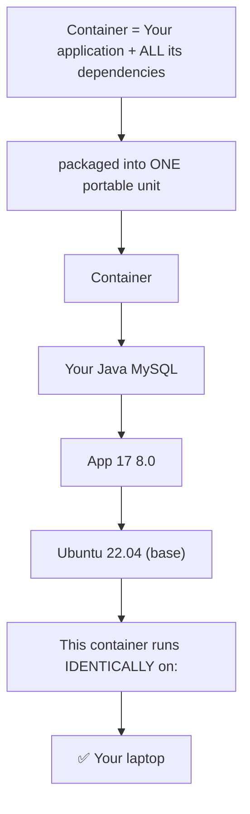
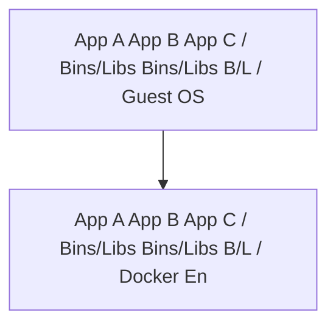
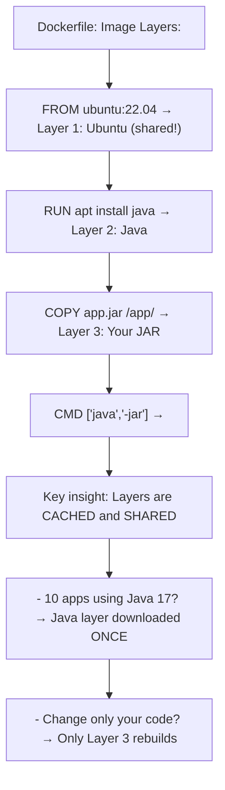
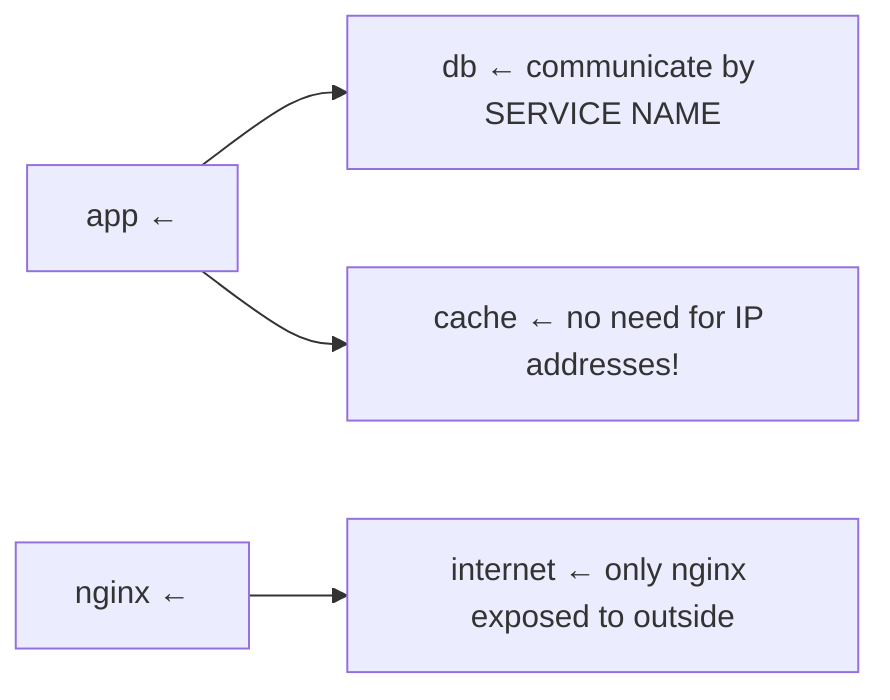

# 🐳 Docker & Containers — Complete Guide

**Navigation**: [< Linux CLI](02_Linux_CLI_Shell.md) | [Index](00_INDEX.md) | [Next: CI/CD >](04_CICD_Pipelines.md)

---

# WHY: Why Containers Exist

## The Problem

```
Developer: "It works on MY machine!"
Ops Team:  "Well, it DOESN'T work on the server."

WHY? Because your machine has:
  - Java 17, but server has Java 11
  - MySQL 8.0, but server has 5.7
  - Ubuntu 22, but server has CentOS 7
  - 50 environment variables you forgot to document
  
The SAME code behaves differently in different environments.
This is the #1 cause of deployment failures in the industry.
```

## The Solution: Containers

```
Container = Your application + ALL its dependencies
            packaged into ONE portable unit

┌──────────────────────────────┐
│         Container            │
│  ┌──────┐ ┌──────┐ ┌──────┐  │
│  │ Your │ │ Java │ │MySQL │  │
│  │ App  │ │  17  │ │ 8.0  │  │
│  └──────┘ └──────┘ └──────┘  │
│  ┌──────────────────────────┐│
│  │    Ubuntu 22.04 (base)   ││
│  └──────────────────────────┘│
└──────────────────────────────┘

This container runs IDENTICALLY on:
  ✅ Your laptop
  ✅ Your colleague's Mac
  ✅ Testing server
  ✅ Production AWS EC2
  ✅ Kubernetes cluster
```

**Flow:**
1. Container = Your application + ALL its dependencies
2. packaged into ONE portable unit
3. Container
4. Your Java MySQL
5. App 17 8.0
6. Ubuntu 22.04 (base)
7. This container runs IDENTICALLY on:




🔬 **Section Challenge — The Solution: Containers**

**Challenge 1 (Reasoning):** The diagram shows a container includes Ubuntu 22.04 as the base. But the host machine is also running Linux. If containers share the host kernel, why do you need a base OS image at all?
<details><summary>Answer</summary>

The base image doesn't provide a kernel — it provides the **userspace**: system libraries (glibc, libssl), package managers (apt, yum), shell utilities (bash, ls, cat), and filesystem layout (/etc, /usr, /var). Your application links against specific versions of these libraries at compile time. If your app was compiled against Ubuntu 22.04's glibc 2.35 but the host has Alpine's musl-libc, it will crash with missing symbol errors. The base image guarantees the correct userspace environment regardless of the host. This is why `alpine` images are so small (~5MB) — they use musl-libc and BusyBox instead of full GNU coreutils, but some applications aren't compatible with musl.
</details>


## Container vs Virtual Machine

```
┌─── VM ────────────────────┐    ┌─── Container ─────────────┐
│ App A    App B    App C   │    │ App A    App B    App C   │
│ Bins/Libs Bins/Libs B/L   │    │ Bins/Libs Bins/Libs B/L   │
│ Guest OS  Guest OS  G.OS  │    │                           │
│ (Ubuntu)  (CentOS) (Deb)  │    │      Docker Engine        │
│                           │    │                           │
│      Hypervisor           │    │      Host OS (Linux)      │
│      Host OS              │    │      Hardware             │
│      Hardware             │    └────────────────────────────┘
└────────────────────────────────────────────────────────────┘
                                  
VM:        Heavy (GB), 30s startup, full OS per app
Container: Light (MB), 1s startup, shared OS kernel

Analogy:
  VM = Separate HOUSES (each has foundation, walls, roof)
  Container = APARTMENTS (shared building, private units)
```

**Flow:**
1. App A App B App C / Bins/Libs Bins/Libs B/L / Guest OS
2. App A App B App C / Bins/Libs Bins/Libs B/L / Docker En




🔬 **Section Challenge — Container vs Virtual Machine**

**Challenge 1 (Reasoning):** The diagram shows containers are "lighter" than VMs. But a container running a compromised application shares the host kernel. If an attacker escapes the container (kernel exploit), they own the entire host and ALL other containers. How do VMs prevent this, and what are "gVisor" and "Kata Containers"?
<details><summary>Answer</summary>

VMs have **hardware-level isolation**: each VM runs its own kernel on virtualized hardware (CPU ring separation via VT-x). A kernel exploit in VM1 only compromises VM1's kernel — the hypervisor is a separate security boundary. Container isolation relies on **software-only** mechanisms (namespaces, cgroups, seccomp) enforced by the SHARED host kernel. **gVisor** (Google) adds a user-space kernel that intercepts syscalls — the container never touches the real kernel, but at ~30% performance overhead. **Kata Containers** run each container inside a lightweight VM (micro-VM), getting VM-level isolation with near-container performance. Production rule: use gVisor/Kata for untrusted workloads (multi-tenant SaaS), standard containers for trusted internal services.
</details>


## WHO: Origin

```
2013: Solomon Hykes at dotCloud
      Built Docker as internal tool
      Open-sourced it → Revolutionized deployment

Based on: Linux cgroups + namespaces (existed since 2008)
Docker's genius = Made containers EASY to use
```

**Flow:**
1. Open-sourced it
2. Revolutionized deployment


---


🔬 **Section Challenge — WHO: Origin**

**Challenge 1 (Reasoning):** Docker is built on Linux namespaces (2002) and cgroups (2008). If these kernel features existed for years before Docker (2013), why didn't containers become mainstream until Docker? What was Docker's actual innovation?
<details><summary>Answer</summary>

Pre-Docker container tools (LXC, OpenVZ) existed but required deep Linux sysadmin knowledge — manually configuring cgroups, writing namespace syscall wrappers, building rootfs from scratch. Docker's innovations were: (1) **The Dockerfile** — a declarative, reproducible build format anyone could read. (2) **Docker Hub** — a public registry of pre-built images (like npm/Maven for OS environments). (3) **Layered image format** — only transfer the diff, not the entire OS. (4) **Simple CLI** — `docker run nginx` vs. paragraphs of LXC config. Docker didn't invent containerization — it made it **accessible**. The same way Git didn't invent version control, but made it practical for everyone.
</details>


# WHAT: Core Concepts

## Images vs Containers

```
IMAGE = Blueprint/Template (read-only)
  - Like a Java CLASS
  - Defines what the container will contain
  - Stored in registries (Docker Hub)

CONTAINER = Running instance of an image
  - Like a Java OBJECT
  - Created from an image
  - Has its own state, network, filesystem

One image → Many containers:
  Image: my-spring-app:1.0
    → Container 1 (port 8080)
    → Container 2 (port 8081)
    → Container 3 (port 8082)
```

**Flow:**
1. One image
2. Many containers:


🔬 **Section Challenge — Images vs Containers**

**Challenge 1 (Reasoning):** The text says "One image → Many containers." If 10 containers run from the same image, do they share the image's filesystem or does each get a copy? What happens when Container 3 writes a file?
<details><summary>Answer</summary>

All 10 containers share the SAME read-only image layers (they are mounted read-only). Each container gets its own thin **writable layer** on top (Copy-on-Write). When Container 3 writes a file, the storage driver (OverlayFS) copies that specific file from the read-only layer into Container 3's writable layer, then modifies the copy. The other 9 containers are unaffected — they still see the original file. This means 10 containers from a 500MB image use ~500MB + (10 × ~5MB writable layers) = ~550MB total, NOT 5GB. When a container is deleted, only its writable layer is removed — the shared image layers remain. This is why `docker commit` captures a container's writable layer as a new image layer.
</details>


## Layers (How Images are Efficient)

```
Dockerfile:                    Image Layers:
FROM ubuntu:22.04      →  ┌─────────────────┐ Layer 1: Ubuntu (shared!)
RUN apt install java   →  ├─────────────────┤ Layer 2: Java
COPY app.jar /app/     →  ├─────────────────┤ Layer 3: Your JAR
CMD ["java","-jar"]    →  └─────────────────┘

Key insight: Layers are CACHED and SHARED
  - 10 apps using Java 17? → Java layer downloaded ONCE
  - Change only your code? → Only Layer 3 rebuilds
```

**Flow:**
1. Dockerfile: Image Layers:
2. FROM ubuntu:22.04
3. Layer 1: Ubuntu (shared!)
4. RUN apt install java
5. Layer 2: Java
6. COPY app.jar /app/
7. Layer 3: Your JAR
8. CMD ['java','-jar']
9. Key insight: Layers are CACHED and SHARED
10. - 10 apps using Java 17?
11. Java layer downloaded ONCE



---

# HOW: Docker in Practice

## Installation

```bash

# Windows: Install Docker Desktop
# Mac: Install Docker Desktop
# Linux:
curl -fsSL https://get.docker.com | sh
sudo usermod -aG docker $USER
```

🔬 **Section Challenge — Installation**

**Challenge 1 (Reasoning):** After installing Docker on Linux, you must run `sudo usermod -aG docker $USER` and then log out/in. Why can't you just use `sudo docker run` instead? What security risk does adding your user to the `docker` group create?
<details><summary>Answer</summary>

The Docker daemon runs as **root** and exposes a Unix socket (`/var/run/docker.sock`). Anyone with access to this socket effectively has root access to the host — they can mount the host filesystem (`docker run -v /:/host`), access the host network, and escalate privileges. Adding your user to the `docker` group grants **unsupervised root-equivalent access** without needing `sudo` (no password prompt, no audit log). Using `sudo docker` is actually MORE secure because it logs the command and requires authentication. In production, use **rootless Docker** (`dockerd-rootless`) which runs the daemon as an unprivileged user, or use Podman (daemonless, rootless by default).
</details>


## Level 1: Running Containers (Day 1)

```bash
# Run your first container
docker run hello-world

# Run interactive Ubuntu
docker run -it ubuntu bash
# You're now INSIDE an Ubuntu container!
# Try: ls, cat /etc/os-release, exit

# Run Nginx web server
docker run -d -p 8080:80 nginx
# -d = detached (background)
# -p 8080:80 = map host port 8080 → container port 80
# Visit http://localhost:8080 → you'll see Nginx!

# Run MySQL
docker run -d \
  --name my-mysql \
  -e MYSQL_ROOT_PASSWORD=secret \
  -p 3306:3306 \
  mysql:8.0

# Container management
docker ps                  # List RUNNING containers
docker ps -a               # List ALL containers (including stopped)
docker stop <name/id>      # Stop container
docker rm <name/id>        # Remove container
docker logs <name/id>      # View container logs
docker logs -f <name/id>   # Follow logs (real-time)
docker exec -it <name> bash  # Get shell INSIDE running container
```

## Level 2: Building Your Own Image (Week 1)

### Dockerfile for Spring Boot Application

```dockerfile
# === Dockerfile ===

# Stage 1: Build
FROM maven:3.9-eclipse-temurin-17 AS build
WORKDIR /app
COPY pom.xml .
RUN mvn dependency:resolve         # Cache dependencies
COPY src/ ./src/
RUN mvn package -DskipTests

# Stage 2: Run (smaller image)
FROM eclipse-temurin:17-jre-alpine
WORKDIR /app
COPY --from=build /app/target/*.jar app.jar

# Non-root user (security best practice)
RUN addgroup -S spring && adduser -S spring -G spring
USER spring

EXPOSE 8080
ENTRYPOINT ["java", "-jar", "app.jar"]
```

### Building and Running

```bash
# Build the image
docker build -t my-spring-app:1.0 .

# Run it
docker run -d -p 8080:8080 --name myapp my-spring-app:1.0

# Test it
curl http://localhost:8080/api/health
```

### Dockerfile Best Practices

```dockerfile
# BAD: Everything in one layer
FROM ubuntu
RUN apt update && apt install java && apt install maven
COPY . /app
RUN mvn package

# GOOD: Optimized layers, multi-stage, minimal base
FROM eclipse-temurin:17-jre-alpine   # Small base (200MB vs 1GB)
COPY --from=build app.jar /app/      # Only the artifact

# GOOD: .dockerignore (like .gitignore)
# .dockerignore:
.git
target
*.md
.idea
```

## Level 3: Docker Compose (Week 2)

### WHY Compose?

```
Typical app needs:
  - Spring Boot API (port 8080)
  - PostgreSQL database (port 5432)
  - Redis cache (port 6379)
  - Nginx reverse proxy (port 80)

Without Compose: 4 separate docker run commands with 20+ flags
With Compose: ONE yaml file, ONE command
```

### docker-compose.yml Example

```yaml
version: '3.8'

services:
  # Spring Boot Application
  app:
    build: .
    ports:
      - "8080:8080"
    environment:
      - SPRING_DATASOURCE_URL=jdbc:postgresql://db:5432/myapp
      - SPRING_DATASOURCE_USERNAME=admin
      - SPRING_DATASOURCE_PASSWORD=secret
      - SPRING_REDIS_HOST=cache
    depends_on:
      - db
      - cache
    restart: unless-stopped

  # PostgreSQL Database
  db:
    image: postgres:15
    ports:
      - "5432:5432"
    environment:
      - POSTGRES_DB=myapp
      - POSTGRES_USER=admin
      - POSTGRES_PASSWORD=secret
    volumes:
      - pgdata:/var/lib/postgresql/data    # Persistent storage!

  # Redis Cache
  cache:
    image: redis:7-alpine
    ports:
      - "6379:6379"

  # Nginx Reverse Proxy
  nginx:
    image: nginx:alpine
    ports:
      - "80:80"
    volumes:
      - ./nginx.conf:/etc/nginx/nginx.conf
    depends_on:
      - app

volumes:
  pgdata:    # Named volume for database persistence
```

### Compose Commands

```bash
docker-compose up -d              # Start everything
docker-compose down               # Stop everything
docker-compose logs -f app        # Follow app logs
docker-compose ps                 # Status of all services
docker-compose exec app bash      # Shell into app container
docker-compose build              # Rebuild images
docker-compose up -d --build      # Rebuild and restart
```

## Level 4: Volumes & Networking (Month 1)

### Volumes (Persistent Data)

```bash
# Problem: Container dies → ALL data inside dies too
# Solution: Volumes mount external storage into containers

# Named volume (Docker manages location)
docker run -v mydata:/var/lib/mysql mysql:8

# Bind mount (your specific folder)
docker run -v $(pwd)/config:/app/config my-app

# In docker-compose:
volumes:
  - pgdata:/var/lib/postgresql/data     # Named volume
  - ./config:/app/config                # Bind mount
  - ./logs:/app/logs                    # Logs accessible from host
```

### Networking

```
Docker creates internal networks:
  app ←──────→ db       ← communicate by SERVICE NAME
  app ←──────→ cache    ← no need for IP addresses!
  
  nginx ←────→ internet ← only nginx exposed to outside

This is WHY your Spring Boot connects to "db:5432"
instead of "localhost:5432" inside Docker
```

**Flow:**
1. app ←
2. db ← communicate by SERVICE NAME
3. app ←
4. cache ← no need for IP addresses!
5. nginx ←
6. internet ← only nginx exposed to outside



---

# WHERE: Real-World Docker Usage

## Local Development Environment

```yaml
# docker-compose.dev.yml
# New developer joins → runs ONE command → entire stack works

services:
  app:
    build: .
    volumes:
      - ./src:/app/src      # Hot reload! Edit code → changes instantly
    ports:
      - "8080:8080"
      - "5005:5005"         # Debug port
    environment:
      - SPRING_PROFILES_ACTIVE=dev
```

## Production Deployment

```bash
# Build → Tag → Push → Pull → Run

# On CI/CD server:
docker build -t mycompany/myapp:v2.1.0 .
docker push mycompany/myapp:v2.1.0

# On production server:
docker pull mycompany/myapp:v2.1.0
docker run -d --name myapp mycompany/myapp:v2.1.0
```

---

# WHEN: Decision Guide

```
USE Docker when:
  ✅ Multiple services need to work together
  ✅ "Works on my machine" problems
  ✅ Need consistent dev/test/prod environments
  ✅ Microservices architecture
  ✅ Deploying to cloud

DON'T use Docker when:
  ❌ Simple single-file scripts
  ❌ Learning basic programming (unnecessary complexity)
  ❌ Performance-critical apps needing bare-metal speed
```

---

# 🧭 Docker Cheat Sheet

```
IMAGES:      build | pull | push | images | rmi
CONTAINERS:  run | start | stop | rm | ps | logs | exec
COMPOSE:     up | down | logs | ps | build | exec
VOLUMES:     volume create | volume ls | volume rm
NETWORK:     network create | network ls | network inspect
CLEANUP:     system prune | image prune | container prune
```

---

# 🏋️ Practice Exercises

## Exercise 1: Run & Explore
```
1. Run an nginx container with port mapping
2. Run a MySQL container with environment variables
3. Use docker exec to get inside the MySQL container
4. Run a SQL query from inside the container
```

## Exercise 2: Build Custom Image
```
1. Create a simple Spring Boot app (or any Java app)
2. Write a Dockerfile with multi-stage build
3. Build and run it
4. Push to Docker Hub
```


🔬 **Section Challenge — Exercise 2: Build Custom Image**

**Challenge 1 (Reasoning):** The multi-stage Dockerfile uses `eclipse-temurin:17-jre-alpine` (JRE) for the run stage, not `eclipse-temurin:17-jdk-alpine` (JDK). The build stage uses the full Maven+JDK image. Why is this separation critical for production, and what specific tools in the JDK become security liabilities in production?
<details><summary>Answer</summary>

The JDK includes: `javac` (compiler), `jdb` (debugger), `jcmd`/`jmap`/`jstack` (diagnostic tools), `jar` (packager), and the entire `tools.jar`. In production, none of these are needed — your app runs from a pre-compiled JAR. But if an attacker gains shell access to the container, these tools become weapons: `jmap` can dump heap memory (containing passwords, tokens, PII), `jdb` can attach to the JVM and modify running code, `javac` can compile malicious code on the spot. The JRE image also drops ~200MB of unnecessary files, reducing: (1) image size (faster pulls, less storage), (2) attack surface (fewer binaries = fewer CVE vectors), (3) startup time. **Alpine** further reduces the base from ~300MB (Debian) to ~5MB by using musl-libc and BusyBox. The multi-stage pattern: build with everything you need, deploy with only what you need.
</details>


## Exercise 3: Compose Full Stack
```
1. Create docker-compose.yml with:
   - Spring Boot app
   - PostgreSQL 
   - Adminer (DB web UI)
2. Connect app to PostgreSQL
3. Verify data persistence after container restart
```

---

**Next Chapter**: [CI/CD Pipelines →](04_CICD_Pipelines.md)


---


---


🔬 **Section Challenge — Exercise 3: Compose Full Stack**

**Challenge 1 (Reasoning):** In the multi-stage Dockerfile, `COPY pom.xml .` and `RUN mvn dependency:resolve` appear BEFORE `COPY src/ ./src/`. Why does this specific ordering matter, and what happens to build times if you reverse them?
<details><summary>Answer</summary>

Docker builds images **layer by layer**, and each layer is **cached**. If a layer's input hasn't changed, Docker reuses the cached result instead of re-executing it. Dependencies (`pom.xml`) change rarely — maybe once a week when you add a new library. Source code (`src/`) changes on every commit. By copying `pom.xml` FIRST and resolving dependencies, Docker creates a cached layer containing all downloaded JARs (~200-500MB). On subsequent builds where only `src/` changed, Docker skips the dependency download entirely (cache hit on layers 1-2) and only rebuilds from `COPY src/` onward. **If reversed** (`COPY . .` then `RUN mvn dependency:resolve`), ANY change to ANY file (even a one-line code fix) invalidates the COPY layer, which invalidates ALL subsequent layers — forcing a full `mvn dependency:resolve` on every build. This turns a 10-second rebuild into a 3-5 minute rebuild. **The general rule:** In Dockerfiles, order instructions from **least frequently changing to most frequently changing**. This is called **layer cache optimization** and is the single most impactful Docker performance technique.
</details>

