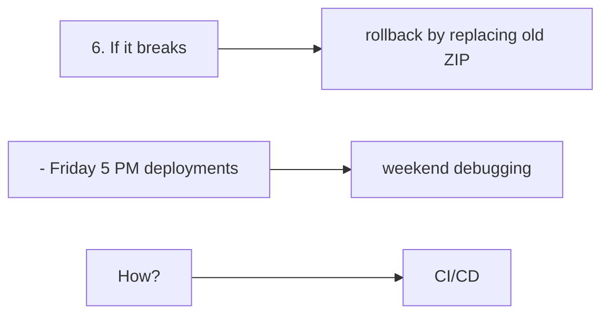
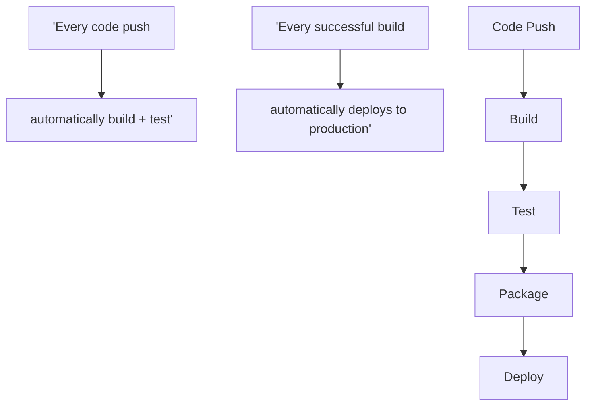
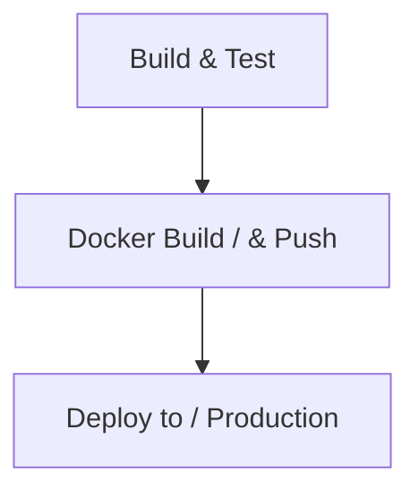
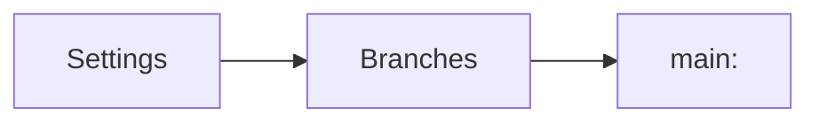
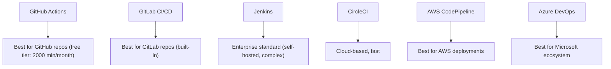
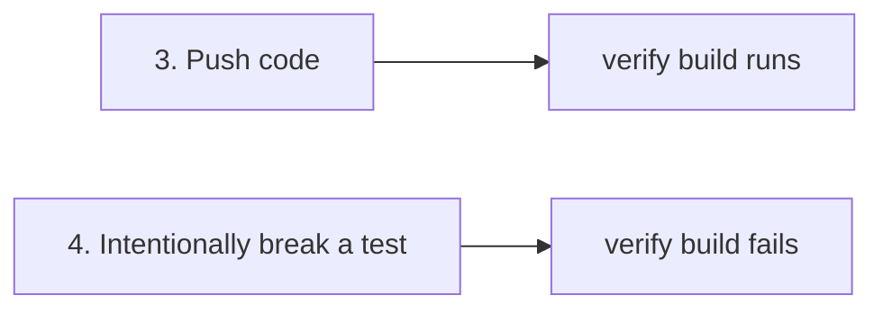

# 🔄 CI/CD Pipelines — Complete Guide

> **Navigation**: [< Docker](03_Docker_Containers.md) | [Index](00_INDEX.md) | [Next: Clean Code >](05_Clean_Code.md)

---

# WHY: Why CI/CD Exists

## The Problem: Manual Deployment

```
Old workflow (still happens in many companies):
1. Developer finishes code
2. Emails ZIP file to "deployment team"
3. Deployment team extracts to server
4. Manually runs build commands
5. Prays it works
6. If it breaks → rollback by replacing old ZIP

Problems:
  - 2-4 weeks between code written and deployed
  - Human errors at every step
  - "It worked when I tested locally"
  - Friday 5 PM deployments → weekend debugging
  
Companies like Google, Netflix, Amazon deploy 100+ TIMES PER DAY.
How? → CI/CD
```

**Flow:**
- 6. If it breaks
- ↓
- rollback by replacing old ZIP
- ↓
- - Friday 5 PM deployments
- ↓
- weekend debugging
- ↓
- How?
- ↓
- CI/CD



## WHAT: CI vs CD vs CD

```
CI = Continuous Integration
     "Every code push → automatically build + test"
     
CD = Continuous Delivery
     "Build artifact is READY to deploy at any time"
     (human clicks button to deploy)
     
CD = Continuous Deployment
     "Every successful build → automatically deploys to production"
     (no human needed)

   Code Push → Build → Test → Package → Deploy
   ├── CI ────────────────────┤
   ├── Continuous Delivery ────────────────┤ (manual deploy)
   ├── Continuous Deployment ──────────────────────┤ (auto deploy)
```

**Flow:**
- 'Every code push
- ↓
- automatically build + test'
- ↓
- 'Every successful build
- ↓
- automatically deploys to production'
- ↓
- Code Push
- ↓
- Build
- ↓
- Test
- ↓
- Package
- ↓
- Deploy



---

# HOW: GitHub Actions (The Standard)

## Basic Pipeline: Build + Test

```yaml


> 🔬 **Section Challenge — Basic Pipeline: Build + Test**
>
> **Challenge 1 (Reasoning):** `ExecutorService.submit(task)` — the task throws a `RuntimeException`. Nobody calls `future.get()`. What happens to the exception?
> <details><summary>Answer</summary>
>
> It's silently swallowed. The exception is stored in the `Future` object. Without `future.get()` or `.whenComplete()`, no one ever sees it. The thread pool thread resets and picks up the next task as if nothing happened. This is one of the most dangerous production bugs. Fix: always attach `future.whenComplete((r,ex) -> { if(ex!=null) log.error("Task failed",ex); })` or use `execute()` + `UncaughtExceptionHandler`.
> </details>
>

# .github/workflows/ci.yml
name: CI Pipeline

on:
  push:
    branches: [ main, develop ]
  pull_request:
    branches: [ main ]

jobs:
  build-and-test:
    runs-on: ubuntu-latest
    
    steps:
      # 1. Get the code
      - name: Checkout code
        uses: actions/checkout@v4
      
      # 2. Setup Java
      - name: Setup JDK 17
        uses: actions/setup-java@v4
        with:
          java-version: '17'
          distribution: 'temurin'
      
      # 3. Cache Maven dependencies (faster builds)
      - name: Cache Maven packages
        uses: actions/cache@v4
        with:
          path: ~/.m2
          key: ${{ runner.os }}-maven-${{ hashFiles('**/pom.xml') }}
      
      # 4. Build
      - name: Build with Maven
        run: mvn clean compile
      
      # 5. Run Tests
      - name: Run Tests
        run: mvn test
      
      # 6. Package
      - name: Package JAR
        run: mvn package -DskipTests
      
      # 7. Upload artifact
      - name: Upload JAR
        uses: actions/upload-artifact@v4
        with:
          name: app-jar
          path: target/*.jar
```

## Full Pipeline: Build → Test → Docker → Deploy

```yaml


> 🔬 **Section Challenge — Full Pipeline: Build → Test → Docker → Deploy**
>
> **Challenge 1 (Reasoning):** Docker image layers — if you modify a file in layer 3, what happens to layers 4 and 5?
> <details><summary>Answer</summary>
>
> In the overlay filesystem, modifying a file in a lower layer creates a COPY in the write layer (copy-on-write). The original lower layer is unchanged. But in image BUILD: if Dockerfile instruction 3 changes, layers 4 and 5 are INVALIDATED — Docker can't reuse cached layers. Rule: put instructions that change most often LAST in Dockerfile. Dependencies (`npm install`, `mvn package`) before source code copies — this maximizes cache reuse.
> </details>
>
> **Challenge 2 (Design):** What's the difference between `COPY` and `ADD` in Dockerfile? When should you use each?
> <details><summary>Answer</summary>
>
> `COPY`: copies files/directories from build context to image. Simple and explicit. `ADD`: everything COPY does PLUS: auto-extracts tar archives (`.tar.gz`), fetches remote URLs (HTTP/HTTPS). Best practice: always use `COPY` unless you specifically need tar extraction. `ADD`'s URL feature is dangerous (no checksum validation, downloads at build time) and breaks reproducibility. Use `RUN curl | tar xz` instead for remote archives.
> </details>
>

# .github/workflows/deploy.yml
name: Build, Test & Deploy

on:
  push:
    branches: [ main ]

jobs:
  # === JOB 1: Build & Test ===
  test:
    runs-on: ubuntu-latest
    steps:
      - uses: actions/checkout@v4
      - uses: actions/setup-java@v4
        with:
          java-version: '17'
          distribution: 'temurin'
      - run: mvn verify   # compile + test + integration tests

  # === JOB 2: Build Docker Image ===
  docker:
    needs: test            # Only runs if tests pass
    runs-on: ubuntu-latest
    steps:
      - uses: actions/checkout@v4
      
      - name: Login to Docker Hub
        uses: docker/login-action@v3
        with:
          username: ${{ secrets.DOCKER_USERNAME }}
          password: ${{ secrets.DOCKER_PASSWORD }}
      
      - name: Build and Push Docker image
        uses: docker/build-push-action@v5
        with:
          push: true
          tags: mycompany/myapp:${{ github.sha }}

  # === JOB 3: Deploy to Production ===
  deploy:
    needs: docker          # Only runs if Docker build succeeds
    runs-on: ubuntu-latest
    steps:
      - name: Deploy to server
        uses: appleboy/ssh-action@v1
        with:
          host: ${{ secrets.PROD_HOST }}
          username: ${{ secrets.PROD_USER }}
          key: ${{ secrets.SSH_KEY }}
          script: |
            docker pull mycompany/myapp:${{ github.sha }}
            docker stop myapp || true
            docker rm myapp || true
            docker run -d --name myapp -p 8080:8080 \
              mycompany/myapp:${{ github.sha }}
```

### Pipeline Visualization

```
Code Push to main
       │
       ▼
┌──────────────┐    ❌ FAIL → Stop, Notify developer
│  Build & Test │────┐
└──────┬───────┘    │
       │ ✅ PASS    │
       ▼            │
┌──────────────┐    │
│ Docker Build  │────┤ ❌ FAIL → Stop, Notify
│ & Push        │    │
└──────┬───────┘    │
       │ ✅ PASS    │
       ▼            │
┌──────────────┐    │
│  Deploy to    │────┘ ❌ FAIL → Auto-rollback
│  Production   │
└──────────────┘
       │ ✅ SUCCESS
       ▼
  🎉 Live in Production
```

**Flow:**
- Build & Test
- ↓
- Docker Build / & Push
- ↓
- Deploy to / Production



---

# WHAT: Key CI/CD Concepts

## Pipeline Triggers

```yaml


> 🔬 **Section Challenge — Pipeline Triggers**
>
> **Challenge 1 (Reasoning):** `ExecutorService.submit(task)` — the task throws a `RuntimeException`. Nobody calls `future.get()`. What happens to the exception?
> <details><summary>Answer</summary>
>
> It's silently swallowed. The exception is stored in the `Future` object. Without `future.get()` or `.whenComplete()`, no one ever sees it. The thread pool thread resets and picks up the next task as if nothing happened. This is one of the most dangerous production bugs. Fix: always attach `future.whenComplete((r,ex) -> { if(ex!=null) log.error("Task failed",ex); })` or use `execute()` + `UncaughtExceptionHandler`.
> </details>
>

# When to run the pipeline:
on:
  push:                    # On every push
    branches: [main]       # Only main branch
  pull_request:            # On PRs
  schedule:                # Cron job
    - cron: '0 6 * * 1'   # Every Monday 6 AM
  workflow_dispatch:       # Manual trigger button
```

## Environment Variables & Secrets

```yaml
# NEVER hardcode passwords/keys in code!
# Store in GitHub Settings → Secrets

env:
  JAVA_VERSION: '17'

jobs:
  deploy:
    steps:
      - name: Connect to DB
        env:
          DB_PASSWORD: ${{ secrets.DB_PASSWORD }}
        run: echo "Connecting with secure password..."
```

## Matrix Strategy (Test Multiple Versions)

```yaml
jobs:
  test:
    strategy:
      matrix:
        java: [11, 17, 21]
        os: [ubuntu-latest, windows-latest]
    runs-on: ${{ matrix.os }}
    steps:
      - uses: actions/setup-java@v4
        with:
          java-version: ${{ matrix.java }}
      - run: mvn test
# This creates 6 parallel jobs: 3 Java versions × 2 OS
```

## Branch Protection Rules

```
Settings → Branches → main:
  ✅ Require pull request reviews (1+ approval)
  ✅ Require status checks to pass (CI must be green)
  ✅ Require branches to be up to date
  ✅ No direct pushes to main
  
Result: NOBODY can push broken code to main
```

**Flow:**
- Settings
- ↓
- Branches
- ↓
- main:



---

# WHERE: CI/CD Tools Comparison

```
GitHub Actions  → Best for GitHub repos (free tier: 2000 min/month)
GitLab CI/CD    → Best for GitLab repos (built-in)
Jenkins         → Enterprise standard (self-hosted, complex)
CircleCI        → Cloud-based, fast
AWS CodePipeline→ Best for AWS deployments
Azure DevOps    → Best for Microsoft ecosystem
```

**Flow:**
- GitHub Actions
- ↓
- Best for GitHub repos (free tier: 2000 min/month)
- ↓
- GitLab CI/CD
- ↓
- Best for GitLab repos (built-in)
- ↓
- Jenkins
- ↓
- Enterprise standard (self-hosted, complex)
- ↓
- CircleCI
- ↓
- Cloud-based, fast
- ↓
- AWS CodePipeline
- ↓
- Best for AWS deployments
- ↓
- Azure DevOps
- ↓
- Best for Microsoft ecosystem



---

# 🏋️ Practice Exercises

## Exercise 1: Basic CI
```
1. Create a Spring Boot project on GitHub
2. Add a GitHub Actions CI workflow
3. Push code → verify build runs
4. Intentionally break a test → verify build fails
```

**Flow:**
- 3. Push code
- ↓
- verify build runs
- ↓
- 4. Intentionally break a test
- ↓
- verify build fails



## Exercise 2: Docker + Deploy
```
1. Add Dockerfile to your project
2. Create workflow that builds Docker image
3. Push to Docker Hub
4. Add deployment step
```

---

> **Next Chapter**: [Clean Code Principles →](05_Clean_Code.md)


---


---


> 🔬 **Section Challenge — Exercise 2: Docker + Deploy**
>
> **Challenge 1 (Reasoning):** Docker image layers — if you modify a file in layer 3, what happens to layers 4 and 5?
> <details><summary>Answer</summary>
>
> In the overlay filesystem, modifying a file in a lower layer creates a COPY in the write layer (copy-on-write). The original lower layer is unchanged. But in image BUILD: if Dockerfile instruction 3 changes, layers 4 and 5 are INVALIDATED — Docker can't reuse cached layers. Rule: put instructions that change most often LAST in Dockerfile. Dependencies (`npm install`, `mvn package`) before source code copies — this maximizes cache reuse.
> </details>
>
> **Challenge 2 (Design):** What's the difference between `COPY` and `ADD` in Dockerfile? When should you use each?
> <details><summary>Answer</summary>
>
> `COPY`: copies files/directories from build context to image. Simple and explicit. `ADD`: everything COPY does PLUS: auto-extracts tar archives (`.tar.gz`), fetches remote URLs (HTTP/HTTPS). Best practice: always use `COPY` unless you specifically need tar extraction. `ADD`'s URL feature is dangerous (no checksum validation, downloads at build time) and breaks reproducibility. Use `RUN curl | tar xz` instead for remote archives.
> </details>
>

## 🏋️ Practice & Interview Questions — DevOps & Networking

### Predict / Trace
**Q1.** What happens when you type `https://google.com` in a browser?
<details><summary>Answer</summary>

1. DNS lookup: resolve `google.com` → IP (recursive resolver → root → TLD → authoritative NS)
2. TCP connection: 3-way handshake (SYN → SYN-ACK → ACK) to port 443
3. TLS handshake: ClientHello → ServerHello → certificate verification → key exchange → session keys
4. HTTP/2 GET request sent
5. Server responds with HTML (GZIP compressed)
6. Browser parses HTML → fetches CSS/JS → CSSOM + DOM → render tree → paint
</details>

**Q2.** `curl -I https://example.com` returns `Connection: keep-alive`. What does this mean?
<details><summary>Answer</summary>

The TCP connection won't be closed after the response — it stays open for reuse. Avoiding TCP+TLS handshake overhead for subsequent requests. HTTP/1.1 default; HTTP/2 always multiplexes on one connection.
</details>

### Coding / Commands
**Q3.** ⭐ Write a Dockerfile for a Java Spring Boot app — multi-stage build.
<details><summary>Solution</summary>

```dockerfile
# Stage 1: Build
FROM eclipse-temurin:21-jdk AS builder
WORKDIR /app
COPY gradlew build.gradle settings.gradle ./
COPY gradle gradle/
RUN ./gradlew dependencies --no-daemon
COPY src src/
RUN ./gradlew bootJar --no-daemon

# Stage 2: Runtime (smaller image)
FROM eclipse-temurin:21-jre
WORKDIR /app
COPY --from=builder /app/build/libs/*.jar app.jar
EXPOSE 8080
ENTRYPOINT ["java", "-XX:+UseContainerSupport", "-XX:MaxRAMPercentage=75", "-jar", "app.jar"]
```
</details>

**Q4.** ⭐ Write a Kubernetes deployment with liveness and readiness probes.
<details><summary>Solution</summary>

```yaml
apiVersion: apps/v1
kind: Deployment
spec:
  replicas: 3
  template:
    spec:
      containers:
      - name: app
        image: myapp:1.0
        resources:
          requests: { memory: "256Mi", cpu: "250m" }
          limits:   { memory: "512Mi", cpu: "500m" }
        livenessProbe:
          httpGet: { path: /actuator/health/liveness, port: 8080 }
          initialDelaySeconds: 30
          periodSeconds: 10
        readinessProbe:
          httpGet: { path: /actuator/health/readiness, port: 8080 }
          initialDelaySeconds: 10
          periodSeconds: 5
```
</details>

**Q5.** ⭐⭐ Design a zero-downtime deployment strategy.
<details><summary>Answer</summary>

**Blue-Green**: run two identical envs, switch load balancer. Instant rollback. Double the infra cost.
**Rolling**: replace pods one-by-one. K8s default. Slower, but no extra infra.
**Canary**: route 5% traffic to new version, monitor errors/latency, gradually increase. Most risk-controlled.
**Feature flags**: deploy code but disable feature — decouple deployment from release.
</details>

### Interview Questions
**Q6.** TCP vs UDP — when to use each?
<details><summary>Answer</summary>

**TCP**: reliable (acknowledgments, retransmission), ordered, connection-based. Use for: HTTP, databases, SSH, email — anywhere correctness matters more than speed.
**UDP**: unreliable, unordered, connectionless. Use for: video streaming, gaming, DNS, VoIP — where speed matters more than perfect delivery, or app handles reliability itself.
</details>

**Q7.** What is a memory limit vs memory request in Kubernetes?
<details><summary>Answer</summary>

`request`: guaranteed allocation — K8s won't schedule pod on node with less available. `limit`: maximum usage — if exceeded, pod is OOM-killed. Set requests for scheduling accuracy; set limits to prevent noisy neighbor problems. Best practice: requests=expected P50 usage, limits=expected P99 surge.
</details>

### MCQ Rapid Fire
| # | Question | Answer |
|---|---|---|
| 1 | HTTP status code 429 | Too Many Requests (rate limited) |
| 2 | HTTP status code 503 | Service Unavailable (server down/overloaded) |
| 3 | DNS record type for IP address | A record (IPv4), AAAA record (IPv6) |
| 4 | Load balancer Layer 4 vs 7 | L4: TCP/UDP level; L7: HTTP/application level (content-aware) |
| 5 | TLS/SSL terminates where | At load balancer (termination), or all the way to pod (passthrough) |
| 6 | `docker exec -it container bash` does | Opens interactive shell in running container |
| 7 | Kubernetes etcd stores | Cluster state (all K8s object definitions) |
| 8 | CI/CD — what triggers a pipeline? | Code push, PR, tag, schedule, or manual trigger |


> **Navigation**: [< Previous](03_Docker_Containers.md) | [Back to Index](../00_MASTER_INDEX.md) | [Next >](05_Clean_Code.md)