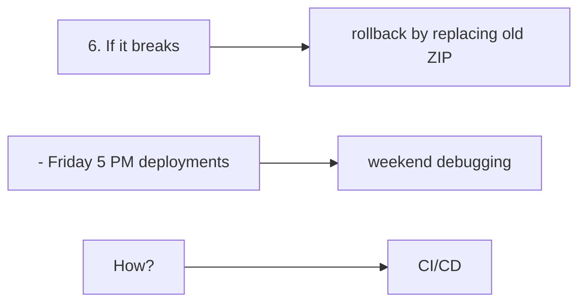
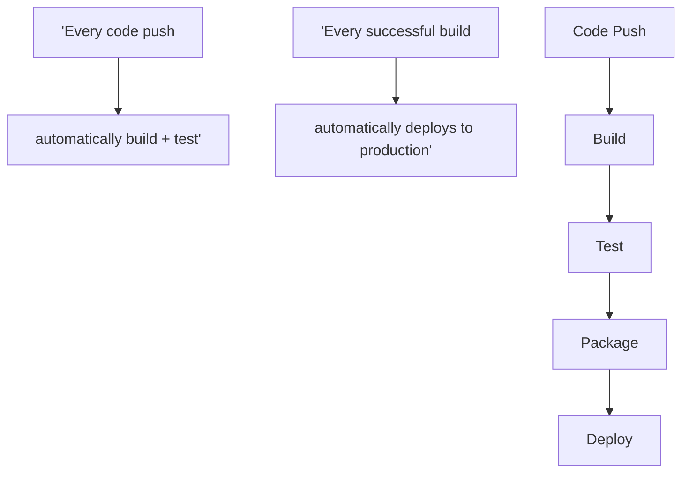
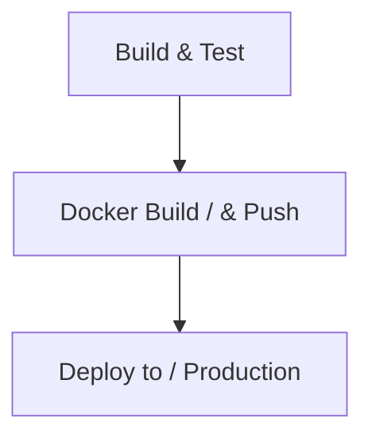
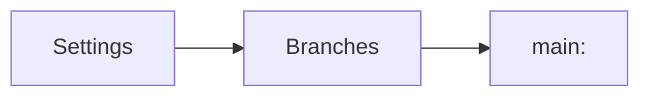
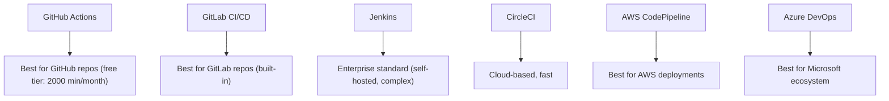
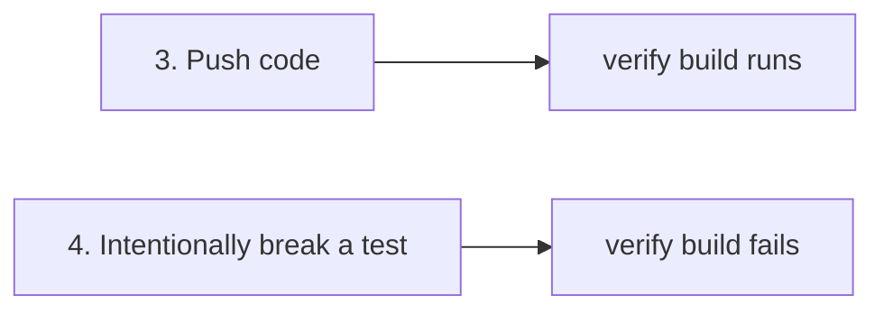

# 🔄 CI/CD Pipelines — Complete Guide

> **Navigation**: [< Docker](03_Docker_Containers.md) | [Index](00_INDEX.md) | [Next: Clean Code >](05_Clean_Code.md)

---

# WHY: Why CI/CD Exists

## The Problem: Manual Deployment

```
Old workflow (still happens in many companies):
1. Developer finishes code
2. Emails ZIP file to "deployment team"
3. Deployment team extracts to server
4. Manually runs build commands
5. Prays it works
6. If it breaks → rollback by replacing old ZIP

Problems:
  - 2-4 weeks between code written and deployed
  - Human errors at every step
  - "It worked when I tested locally"
  - Friday 5 PM deployments → weekend debugging
  
Companies like Google, Netflix, Amazon deploy 100+ TIMES PER DAY.
How? → CI/CD
```

**Flow:**
- 6. If it breaks
- ↓
- rollback by replacing old ZIP
- ↓
- - Friday 5 PM deployments
- ↓
- weekend debugging
- ↓
- How?
- ↓
- CI/CD



## WHAT: CI vs CD vs CD

```
CI = Continuous Integration
     "Every code push → automatically build + test"
     
CD = Continuous Delivery
     "Build artifact is READY to deploy at any time"
     (human clicks button to deploy)
     
CD = Continuous Deployment
     "Every successful build → automatically deploys to production"
     (no human needed)

   Code Push → Build → Test → Package → Deploy
   ├── CI ────────────────────┤
   ├── Continuous Delivery ────────────────┤ (manual deploy)
   ├── Continuous Deployment ──────────────────────┤ (auto deploy)
```

**Flow:**
- 'Every code push
- ↓
- automatically build + test'
- ↓
- 'Every successful build
- ↓
- automatically deploys to production'
- ↓
- Code Push
- ↓
- Build
- ↓
- Test
- ↓
- Package
- ↓
- Deploy



---

# HOW: GitHub Actions (The Standard)

## Basic Pipeline: Build + Test

```yaml
# .github/workflows/ci.yml
name: CI Pipeline

on:
  push:
    branches: [ main, develop ]
  pull_request:
    branches: [ main ]

jobs:
  build-and-test:
    runs-on: ubuntu-latest
    
    steps:
      # 1. Get the code
      - name: Checkout code
        uses: actions/checkout@v4
      
      # 2. Setup Java
      - name: Setup JDK 17
        uses: actions/setup-java@v4
        with:
          java-version: '17'
          distribution: 'temurin'
      
      # 3. Cache Maven dependencies (faster builds)
      - name: Cache Maven packages
        uses: actions/cache@v4
        with:
          path: ~/.m2
          key: ${{ runner.os }}-maven-${{ hashFiles('**/pom.xml') }}
      
      # 4. Build
      - name: Build with Maven
        run: mvn clean compile
      
      # 5. Run Tests
      - name: Run Tests
        run: mvn test
      
      # 6. Package
      - name: Package JAR
        run: mvn package -DskipTests
      
      # 7. Upload artifact
      - name: Upload JAR
        uses: actions/upload-artifact@v4
        with:
          name: app-jar
          path: target/*.jar
```

## Full Pipeline: Build → Test → Docker → Deploy

```yaml
# .github/workflows/deploy.yml
name: Build, Test & Deploy

on:
  push:
    branches: [ main ]

jobs:
  # === JOB 1: Build & Test ===
  test:
    runs-on: ubuntu-latest
    steps:
      - uses: actions/checkout@v4
      - uses: actions/setup-java@v4
        with:
          java-version: '17'
          distribution: 'temurin'
      - run: mvn verify   # compile + test + integration tests

  # === JOB 2: Build Docker Image ===
  docker:
    needs: test            # Only runs if tests pass
    runs-on: ubuntu-latest
    steps:
      - uses: actions/checkout@v4
      
      - name: Login to Docker Hub
        uses: docker/login-action@v3
        with:
          username: ${{ secrets.DOCKER_USERNAME }}
          password: ${{ secrets.DOCKER_PASSWORD }}
      
      - name: Build and Push Docker image
        uses: docker/build-push-action@v5
        with:
          push: true
          tags: mycompany/myapp:${{ github.sha }}

  # === JOB 3: Deploy to Production ===
  deploy:
    needs: docker          # Only runs if Docker build succeeds
    runs-on: ubuntu-latest
    steps:
      - name: Deploy to server
        uses: appleboy/ssh-action@v1
        with:
          host: ${{ secrets.PROD_HOST }}
          username: ${{ secrets.PROD_USER }}
          key: ${{ secrets.SSH_KEY }}
          script: |
            docker pull mycompany/myapp:${{ github.sha }}
            docker stop myapp || true
            docker rm myapp || true
            docker run -d --name myapp -p 8080:8080 \
              mycompany/myapp:${{ github.sha }}
```

### Pipeline Visualization

```
Code Push to main
       │
       ▼
┌──────────────┐    ❌ FAIL → Stop, Notify developer
│  Build & Test │────┐
└──────┬───────┘    │
       │ ✅ PASS    │
       ▼            │
┌──────────────┐    │
│ Docker Build  │────┤ ❌ FAIL → Stop, Notify
│ & Push        │    │
└──────┬───────┘    │
       │ ✅ PASS    │
       ▼            │
┌──────────────┐    │
│  Deploy to    │────┘ ❌ FAIL → Auto-rollback
│  Production   │
└──────────────┘
       │ ✅ SUCCESS
       ▼
  🎉 Live in Production
```

**Flow:**
- Build & Test
- ↓
- Docker Build / & Push
- ↓
- Deploy to / Production



---

# WHAT: Key CI/CD Concepts

## Pipeline Triggers

```yaml
# When to run the pipeline:
on:
  push:                    # On every push
    branches: [main]       # Only main branch
  pull_request:            # On PRs
  schedule:                # Cron job
    - cron: '0 6 * * 1'   # Every Monday 6 AM
  workflow_dispatch:       # Manual trigger button
```

## Environment Variables & Secrets

```yaml
# NEVER hardcode passwords/keys in code!
# Store in GitHub Settings → Secrets

env:
  JAVA_VERSION: '17'

jobs:
  deploy:
    steps:
      - name: Connect to DB
        env:
          DB_PASSWORD: ${{ secrets.DB_PASSWORD }}
        run: echo "Connecting with secure password..."
```

## Matrix Strategy (Test Multiple Versions)

```yaml
jobs:
  test:
    strategy:
      matrix:
        java: [11, 17, 21]
        os: [ubuntu-latest, windows-latest]
    runs-on: ${{ matrix.os }}
    steps:
      - uses: actions/setup-java@v4
        with:
          java-version: ${{ matrix.java }}
      - run: mvn test
# This creates 6 parallel jobs: 3 Java versions × 2 OS
```

## Branch Protection Rules

```
Settings → Branches → main:
  ✅ Require pull request reviews (1+ approval)
  ✅ Require status checks to pass (CI must be green)
  ✅ Require branches to be up to date
  ✅ No direct pushes to main
  
Result: NOBODY can push broken code to main
```

**Flow:**
- Settings
- ↓
- Branches
- ↓
- main:



---

# WHERE: CI/CD Tools Comparison

```
GitHub Actions  → Best for GitHub repos (free tier: 2000 min/month)
GitLab CI/CD    → Best for GitLab repos (built-in)
Jenkins         → Enterprise standard (self-hosted, complex)
CircleCI        → Cloud-based, fast
AWS CodePipeline→ Best for AWS deployments
Azure DevOps    → Best for Microsoft ecosystem
```

**Flow:**
- GitHub Actions
- ↓
- Best for GitHub repos (free tier: 2000 min/month)
- ↓
- GitLab CI/CD
- ↓
- Best for GitLab repos (built-in)
- ↓
- Jenkins
- ↓
- Enterprise standard (self-hosted, complex)
- ↓
- CircleCI
- ↓
- Cloud-based, fast
- ↓
- AWS CodePipeline
- ↓
- Best for AWS deployments
- ↓
- Azure DevOps
- ↓
- Best for Microsoft ecosystem



---

# 🏋️ Practice Exercises

## Exercise 1: Basic CI
```
1. Create a Spring Boot project on GitHub
2. Add a GitHub Actions CI workflow
3. Push code → verify build runs
4. Intentionally break a test → verify build fails
```

**Flow:**
- 3. Push code
- ↓
- verify build runs
- ↓
- 4. Intentionally break a test
- ↓
- verify build fails



## Exercise 2: Docker + Deploy
```
1. Add Dockerfile to your project
2. Create workflow that builds Docker image
3. Push to Docker Hub
4. Add deployment step
```

---

> **Next Chapter**: [Clean Code Principles →](05_Clean_Code.md)


---

> **Navigation**: [< Previous](03_Docker_Containers.md) | [Back to Index](../00_MASTER_INDEX.md) | [Next >](05_Clean_Code.md)