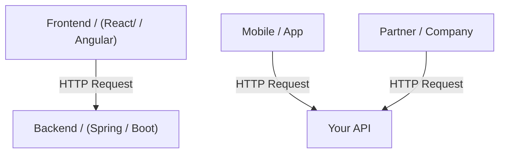
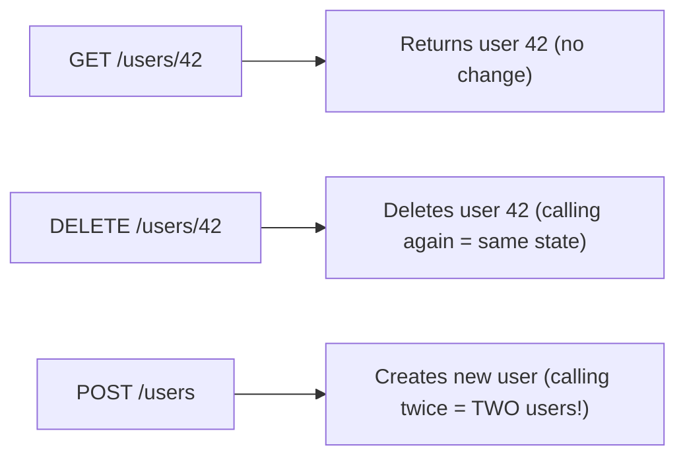
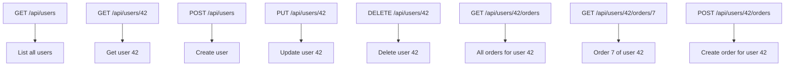
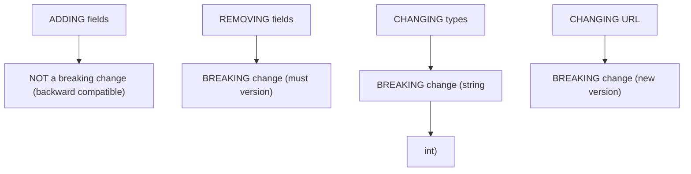

# 🌐 API Design & REST — Complete Guide

> **Navigation**: [< Testing](06_Testing_Fundamentals.md) | [Index](00_INDEX.md) | [Next: Security >](08_Security_Fundamentals.md)

---

# WHY: Why API Design Matters

## The Contract Between Systems

```
┌─────────────┐     HTTP Request      ┌──────────────┐
│   Frontend   │ ──────────────────>   │   Backend   │
│  (React/     │                       │  (Spring    │
│   Angular)   │ <──────────────────   │   Boot)     │
│              │     HTTP Response     │             │
└─────────────┘                        └─────────────┘

┌─────────────┐     HTTP Request      ┌──────────────┐
│   Mobile     │ ──────────────────>   │   Your API  │
│   App        │ <──────────────────   │             │
└─────────────┘     HTTP Response     └──────────────┘

┌─────────────┐     HTTP Request      ┌──────────────┐
│   Partner    │ ──────────────────>   │   Your API  │
│   Company    │ <──────────────────   │             │
└─────────────┘     HTTP Response     └──────────────┘

Your API = a CONTRACT. Once published, breaking changes = TRUST broken.
```

**Flow:**
- Frontend / (React/ / Angular) --(HTTP Request)--> Backend / (Spring / Boot)
- ↓
- Mobile / App --(HTTP Request)--> Your API
- ↓
- Partner / Company --(HTTP Request)--> Your API



---

# WHAT: REST Principles

## REST = REpresentational State Transfer

```
6 Constraints:
  1. CLIENT-SERVER      — Client and server evolve independently
  2. STATELESS          — Each request contains ALL info needed (no server memory)
  3. CACHEABLE          — Responses declare if they can be cached
  4. UNIFORM INTERFACE  — Consistent URL patterns and methods
  5. LAYERED SYSTEM     — Client doesn't know if talking to real server or proxy
  6. CODE ON DEMAND     — (Optional) Server can send executable code
```

## HTTP Methods (Verbs)

```
Method  │ Purpose          │ Idempotent? │ Safe? │ Body?
────────┼──────────────────┼─────────────┼───────┼──────
GET     │ Read resource    │ Yes         │ Yes   │ No
POST    │ Create resource  │ No          │ No    │ Yes
PUT     │ Replace entirely │ Yes         │ No    │ Yes
PATCH   │ Partial update   │ No*         │ No    │ Yes
DELETE  │ Remove resource  │ Yes         │ No    │ No

Idempotent = calling it N times gives same result as calling once
Safe = does NOT modify server state

Example:
  GET  /users/42      → Returns user 42 (no change)
  DELETE /users/42    → Deletes user 42 (calling again = same state)
  POST /users         → Creates new user (calling twice = TWO users!)
```

**Flow:**
- GET /users/42
- ↓
- Returns user 42 (no change)
- ↓
- DELETE /users/42
- ↓
- Deletes user 42 (calling again = same state)
- ↓
- POST /users
- ↓
- Creates new user (calling twice = TWO users!)



## HTTP Status Codes

```
2xx SUCCESS:
  200 OK               → GET/PUT/PATCH succeeded
  201 Created           → POST succeeded, new resource created
  204 No Content        → DELETE succeeded, nothing to return

3xx REDIRECTION:
  301 Moved Permanently → Resource has new URL forever
  304 Not Modified      → Cached version is still valid

4xx CLIENT ERROR:
  400 Bad Request       → Malformed JSON, missing required field
  401 Unauthorized      → Not authenticated (who are you?)
  403 Forbidden         → Authenticated but not authorized (you can't do this)
  404 Not Found         → Resource doesn't exist
  409 Conflict          → Duplicate key, version conflict
  422 Unprocessable     → Valid JSON, but business logic rejects it
  429 Too Many Requests → Rate limited

5xx SERVER ERROR:
  500 Internal Error    → Bug in your code
  502 Bad Gateway       → Upstream service down
  503 Service Unavailable → Server overloaded, try later
```

**Flow:**
- 200 OK
- ↓
- GET/PUT/PATCH succeeded
- ↓
- 201 Created
- ↓
- POST succeeded, new resource created
- ↓
- 204 No Content
- ↓
- DELETE succeeded, nothing to return
- ↓
- 301 Moved Permanently
- ↓
- Resource has new URL forever
- ↓
- 304 Not Modified
- ↓
- Cached version is still valid
- ↓
- 400 Bad Request
- ↓
- Malformed JSON, missing required field

```mermaid
flowchart TD
    N1["200 OK"]
    N2["GET/PUT/PATCH succeeded"]
    N3["201 Created"]
    N4["POST succeeded, new resource created"]
    N5["204 No Content"]
    N6["DELETE succeeded, nothing to return"]
    N7["301 Moved Permanently"]
    N8["Resource has new URL forever"]
    N9["304 Not Modified"]
    N10["Cached version is still valid"]
    N11["400 Bad Request"]
    N12["Malformed JSON, missing required field"]
    N13["401 Unauthorized"]
    N14["Not authenticated (who are you?)"]
    N15["403 Forbidden"]
    N16["Authenticated but not authorized (you can't do thi"]
    N17["404 Not Found"]
    N18["Resource doesn't exist"]
    N19["409 Conflict"]
    N20["Duplicate key, version conflict"]
    N21["422 Unprocessable"]
    N22["Valid JSON, but business logic rejects it"]
    N23["429 Too Many Requests"]
    N24["Rate limited"]
    N25["500 Internal Error"]
    N26["Bug in your code"]
    N27["502 Bad Gateway"]
    N28["Upstream service down"]
    N29["503 Service Unavailable"]
    N30["Server overloaded, try later"]
    N1 --> N2
    N3 --> N4
    N5 --> N6
    N7 --> N8
    N9 --> N10
    N11 --> N12
    N13 --> N14
    N15 --> N16
    N17 --> N18
    N19 --> N20
    N21 --> N22
    N23 --> N24
    N25 --> N26
    N27 --> N28
    N29 --> N30
```



---

# HOW: Designing Good APIs

## Level 1 — URL Structure

```
RULE: Use NOUNS (resources), not VERBS (actions)

✅ GOOD:
  GET    /api/users              → List all users
  GET    /api/users/42           → Get user 42
  POST   /api/users              → Create user
  PUT    /api/users/42           → Update user 42
  DELETE /api/users/42           → Delete user 42

❌ BAD:
  GET    /api/getUsers
  POST   /api/createUser
  POST   /api/deleteUser/42
  GET    /api/getUserByName?name=John

NESTED resources:
  GET    /api/users/42/orders           → All orders for user 42
  GET    /api/users/42/orders/7         → Order 7 of user 42
  POST   /api/users/42/orders           → Create order for user 42

PATH rules:
  - Use kebab-case: /api/user-profiles (NOT /api/userProfiles)
  - Use PLURAL: /api/users (NOT /api/user)
  - Max 3 levels deep: /api/users/42/orders (NOT /api/a/b/c/d/e)
  - Version in URL: /api/v1/users
```

**Flow:**
- GET /api/users
- ↓
- List all users
- ↓
- GET /api/users/42
- ↓
- Get user 42
- ↓
- POST /api/users
- ↓
- Create user
- ↓
- PUT /api/users/42
- ↓
- Update user 42
- ↓
- DELETE /api/users/42
- ↓
- Delete user 42
- ↓
- GET /api/users/42/orders
- ↓
- All orders for user 42



## Level 2 — Request & Response Design

```java
// REQUEST: Create a user
POST /api/v1/users
Content-Type: application/json

{
    "name": "Sai Harsha",
    "email": "harsha@example.com",
    "role": "DEVELOPER"
}

// RESPONSE: 201 Created
{
    "id": 42,
    "name": "Sai Harsha",
    "email": "harsha@example.com",
    "role": "DEVELOPER",
    "createdAt": "2026-03-03T10:30:00Z",
    "links": {
        "self": "/api/v1/users/42",
        "orders": "/api/v1/users/42/orders"
    }
}
```

## Level 3 — Pagination

```java
// REQUEST: Page 2 of users, 20 per page
GET /api/v1/users?page=2&size=20&sort=name,asc

// RESPONSE:
{
    "data": [
        {"id": 21, "name": "Alice"}, 
        {"id": 22, "name": "Bob"}
    ],
    "pagination": {
        "page": 2,
        "size": 20,
        "totalElements": 150,
        "totalPages": 8,
        "hasNext": true,
        "hasPrevious": true
    }
}

// Spring Boot Implementation:
@GetMapping("/users")
public Page<UserDTO> getUsers(
    @RequestParam(defaultValue = "0") int page,
    @RequestParam(defaultValue = "20") int size,
    @RequestParam(defaultValue = "name") String sort
) {
    Pageable pageable = PageRequest.of(page, size, Sort.by(sort));
    return userService.findAll(pageable);
}
```

## Level 4 — Error Handling

```java
// CONSISTENT error response format:
{
    "status": 400,
    "error": "Bad Request",
    "message": "Validation failed",
    "timestamp": "2026-03-03T10:30:00Z",
    "path": "/api/v1/users",
    "details": [
        {"field": "email", "message": "must be a valid email address"},
        {"field": "name", "message": "must not be blank"}
    ]
}

// Spring Boot Global Exception Handler:
@RestControllerAdvice
public class GlobalExceptionHandler {

    @ExceptionHandler(MethodArgumentNotValidException.class)
    @ResponseStatus(HttpStatus.BAD_REQUEST)
    public ErrorResponse handleValidation(MethodArgumentNotValidException ex) {
        List<FieldError> details = ex.getBindingResult()
            .getFieldErrors()
            .stream()
            .map(f -> new FieldError(f.getField(), f.getDefaultMessage()))
            .toList();
        
        return new ErrorResponse(400, "Validation failed", details);
    }

    @ExceptionHandler(ResourceNotFoundException.class)
    @ResponseStatus(HttpStatus.NOT_FOUND)
    public ErrorResponse handleNotFound(ResourceNotFoundException ex) {
        return new ErrorResponse(404, ex.getMessage(), null);
    }
}
```

## Level 5 — Versioning & Evolution

```
Strategy 1: URL versioning (MOST COMMON)
  /api/v1/users
  /api/v2/users

Strategy 2: Header versioning
  GET /api/users
  Accept: application/vnd.myapp.v2+json

Strategy 3: Query param
  GET /api/users?version=2

ADDING fields     → NOT a breaking change (backward compatible)
REMOVING fields   → BREAKING change (must version)
CHANGING types    → BREAKING change (string → int)
CHANGING URL      → BREAKING change (new version)
```

**Flow:**
- ADDING fields
- ↓
- NOT a breaking change (backward compatible)
- ↓
- REMOVING fields
- ↓
- BREAKING change (must version)
- ↓
- CHANGING types
- ↓
- BREAKING change (string
- ↓
- int)
- ↓
- CHANGING URL
- ↓
- BREAKING change (new version)



## Level 6 — Filtering, Sorting, Field Selection

```
FILTERING:
  GET /api/users?role=DEVELOPER&status=active&minAge=25

SORTING (multiple fields):
  GET /api/users?sort=name,asc&sort=createdAt,desc

FIELD SELECTION (reduce payload):
  GET /api/users?fields=id,name,email

SEARCH:
  GET /api/users?search=harsha
```

---

# WHERE: Real-World Patterns

## DTO Pattern

```java
// NEVER expose your Entity directly in API

// Entity (database table)
@Entity
public class User {
    @Id private Long id;
    private String name;
    private String email;
    private String passwordHash;  // NEVER send to client!
    private String ssn;           // NEVER send to client!
    private LocalDateTime createdAt;
}

// Response DTO (what client sees)
public record UserResponse(
    Long id,
    String name,
    String email,
    LocalDateTime createdAt
) {
    public static UserResponse from(User user) {
        return new UserResponse(
            user.getId(), user.getName(),
            user.getEmail(), user.getCreatedAt()
        );
    }
}

// Request DTO (what client sends)
public record CreateUserRequest(
    @NotBlank String name,
    @Email String email,
    @Size(min = 8) String password
) {}
```

## Rate Limiting

```
WHY: Prevent abuse, protect server resources

Implementation (Spring Boot + Bucket4j):
  - 100 requests per minute per user
  - Return 429 Too Many Requests when exceeded
  - Include headers: X-RateLimit-Remaining, X-RateLimit-Reset

Common limits:
  Public API:        60 requests/minute
  Authenticated:     1000 requests/minute  
  Admin:             Unlimited
```

---

# 🧭 API Design Cheat Sheet

```
URL:         /api/v1/{resource-plural}/{id}
Methods:     GET (read), POST (create), PUT (replace), PATCH (update), DELETE (remove)
Status:      2xx (success), 4xx (client error), 5xx (server error)
Pagination:  ?page=0&size=20&sort=field,asc
Errors:      Consistent JSON with status, message, details
Security:    Bearer token in Authorization header
Versioning:  /api/v1/ in URL path
```

---

# 🏋️ Practice

## Exercise 1: Design an API
```
Design RESTful endpoints for an E-Commerce system:
  - Products (CRUD + search + filter by category)
  - Shopping Cart (add/remove/view items)
  - Orders (place order, view history, cancel)
  - Reviews (add review, list reviews for product)
Write the URL, method, request body, response body, and status codes.
```

## Exercise 2: Build It
```
Using Spring Boot, implement a REST API for a TODO app:
  - POST /api/todos (create)
  - GET /api/todos (list with pagination)
  - GET /api/todos/{id} (get one)
  - PUT /api/todos/{id} (update)
  - DELETE /api/todos/{id} (delete)
  - Add validation, error handling, DTO pattern
```

---

> **Next Chapter**: [Security Fundamentals →](08_Security_Fundamentals.md)


---

> **Navigation**: [< Previous](06_Testing_Fundamentals.md) | [Back to Index](../00_MASTER_INDEX.md) | [Next >](08_Security_Fundamentals.md)