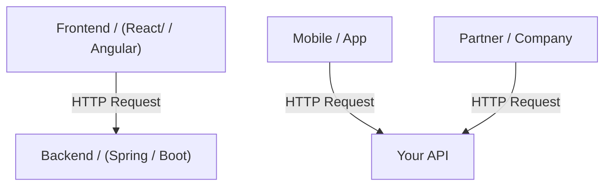
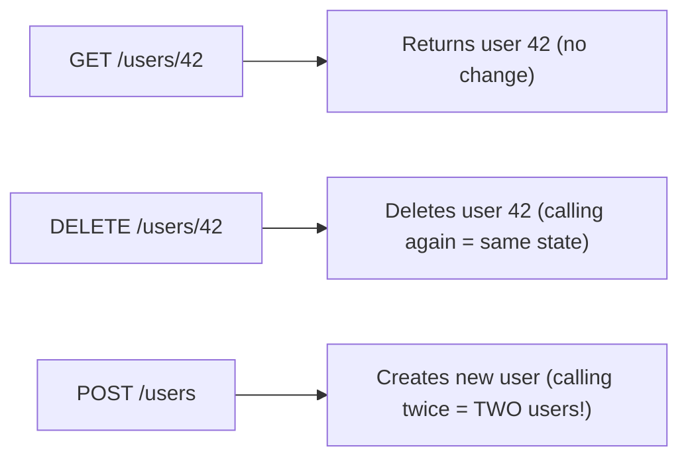
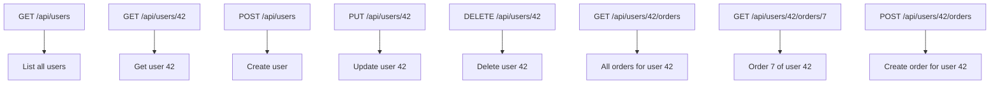
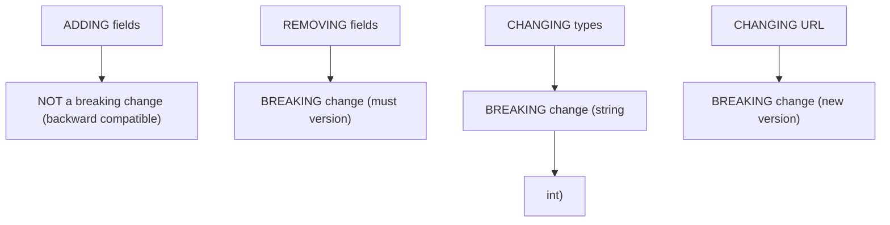

# 🌐 API Design & REST — Complete Guide

> **Navigation**: [< Testing](06_Testing_Fundamentals.md) | [Index](00_INDEX.md) | [Next: Security >](08_Security_Fundamentals.md)

---

# WHY: Why API Design Matters

## The Contract Between Systems

```
┌─────────────┐     HTTP Request      ┌──────────────┐
│   Frontend   │ ──────────────────>   │   Backend   │
│  (React/     │                       │  (Spring    │
│   Angular)   │ <──────────────────   │   Boot)     │
│              │     HTTP Response     │             │
└─────────────┘                        └─────────────┘

┌─────────────┐     HTTP Request      ┌──────────────┐
│   Mobile     │ ──────────────────>   │   Your API  │
│   App        │ <──────────────────   │             │
└─────────────┘     HTTP Response     └──────────────┘

┌─────────────┐     HTTP Request      ┌──────────────┐
│   Partner    │ ──────────────────>   │   Your API  │
│   Company    │ <──────────────────   │             │
└─────────────┘     HTTP Response     └──────────────┘

Your API = a CONTRACT. Once published, breaking changes = TRUST broken.
```

**Flow:**
- Frontend / (React/ / Angular) --(HTTP Request)--> Backend / (Spring / Boot)
- ↓
- Mobile / App --(HTTP Request)--> Your API
- ↓
- Partner / Company --(HTTP Request)--> Your API



---

# WHAT: REST Principles

## REST = REpresentational State Transfer

```
6 Constraints:
  1. CLIENT-SERVER      — Client and server evolve independently
  2. STATELESS          — Each request contains ALL info needed (no server memory)
  3. CACHEABLE          — Responses declare if they can be cached
  4. UNIFORM INTERFACE  — Consistent URL patterns and methods
  5. LAYERED SYSTEM     — Client doesn't know if talking to real server or proxy
  6. CODE ON DEMAND     — (Optional) Server can send executable code
```

## HTTP Methods (Verbs)

```
Method  │ Purpose          │ Idempotent? │ Safe? │ Body?
────────┼──────────────────┼─────────────┼───────┼──────
GET     │ Read resource    │ Yes         │ Yes   │ No
POST    │ Create resource  │ No          │ No    │ Yes
PUT     │ Replace entirely │ Yes         │ No    │ Yes
PATCH   │ Partial update   │ No*         │ No    │ Yes
DELETE  │ Remove resource  │ Yes         │ No    │ No

Idempotent = calling it N times gives same result as calling once
Safe = does NOT modify server state

Example:
  GET  /users/42      → Returns user 42 (no change)
  DELETE /users/42    → Deletes user 42 (calling again = same state)
  POST /users         → Creates new user (calling twice = TWO users!)
```

**Flow:**
- GET /users/42
- ↓
- Returns user 42 (no change)
- ↓
- DELETE /users/42
- ↓
- Deletes user 42 (calling again = same state)
- ↓
- POST /users
- ↓
- Creates new user (calling twice = TWO users!)




> 🔬 **Section Challenge — HTTP Methods (Verbs)**
>
> **Challenge 1 (Reasoning):** `Connection: keep-alive` vs HTTP/2 — what does each one do differently for multiplexing?
> <details><summary>Answer</summary>
>
> HTTP/1.1 keep-alive: reuse ONE TCP connection for sequential requests. Still head-of-line blocking — request 2 waits for response 1. HTTP/2: one TCP connection, but requests are multiplexed as frames with stream IDs. Multiple requests in-flight simultaneously. Response frames for different streams are interleaved. HTTP/2 also has header compression (HPACK) and server push. Still has TCP HOL blocking (one lost packet blocks all streams). HTTP/3 (QUIC): uses UDP, per-stream reliability, eliminates TCP HOL blocking entirely.
> </details>
>

## HTTP Status Codes

```
2xx SUCCESS:
  200 OK               → GET/PUT/PATCH succeeded
  201 Created           → POST succeeded, new resource created
  204 No Content        → DELETE succeeded, nothing to return

3xx REDIRECTION:
  301 Moved Permanently → Resource has new URL forever
  304 Not Modified      → Cached version is still valid

4xx CLIENT ERROR:
  400 Bad Request       → Malformed JSON, missing required field
  401 Unauthorized      → Not authenticated (who are you?)
  403 Forbidden         → Authenticated but not authorized (you can't do this)
  404 Not Found         → Resource doesn't exist
  409 Conflict          → Duplicate key, version conflict
  422 Unprocessable     → Valid JSON, but business logic rejects it
  429 Too Many Requests → Rate limited

5xx SERVER ERROR:
  500 Internal Error    → Bug in your code
  502 Bad Gateway       → Upstream service down
  503 Service Unavailable → Server overloaded, try later
```

**Flow:**
- 200 OK
- ↓
- GET/PUT/PATCH succeeded
- ↓
- 201 Created
- ↓
- POST succeeded, new resource created
- ↓
- 204 No Content
- ↓
- DELETE succeeded, nothing to return
- ↓
- 301 Moved Permanently
- ↓
- Resource has new URL forever
- ↓
- 304 Not Modified
- ↓
- Cached version is still valid
- ↓
- 400 Bad Request
- ↓
- Malformed JSON, missing required field

```mermaid
flowchart TD
    N1["200 OK"]
    N2["GET/PUT/PATCH succeeded"]
    N3["201 Created"]
    N4["POST succeeded, new resource created"]
    N5["204 No Content"]
    N6["DELETE succeeded, nothing to return"]
    N7["301 Moved Permanently"]
    N8["Resource has new URL forever"]
    N9["304 Not Modified"]
    N10["Cached version is still valid"]
    N11["400 Bad Request"]
    N12["Malformed JSON, missing required field"]
    N13["401 Unauthorized"]
    N14["Not authenticated (who are you?)"]
    N15["403 Forbidden"]
    N16["Authenticated but not authorized (you can't do thi"]
    N17["404 Not Found"]
    N18["Resource doesn't exist"]
    N19["409 Conflict"]
    N20["Duplicate key, version conflict"]
    N21["422 Unprocessable"]
    N22["Valid JSON, but business logic rejects it"]
    N23["429 Too Many Requests"]
    N24["Rate limited"]
    N25["500 Internal Error"]
    N26["Bug in your code"]
    N27["502 Bad Gateway"]
    N28["Upstream service down"]
    N29["503 Service Unavailable"]
    N30["Server overloaded, try later"]
    N1 --> N2
    N3 --> N4
    N5 --> N6
    N7 --> N8
    N9 --> N10
    N11 --> N12
    N13 --> N14
    N15 --> N16
    N17 --> N18
    N19 --> N20
    N21 --> N22
    N23 --> N24
    N25 --> N26
    N27 --> N28
    N29 --> N30
```



---


> 🔬 **Section Challenge — HTTP Status Codes**
>
> **Challenge 1 (Reasoning):** `Connection: keep-alive` vs HTTP/2 — what does each one do differently for multiplexing?
> <details><summary>Answer</summary>
>
> HTTP/1.1 keep-alive: reuse ONE TCP connection for sequential requests. Still head-of-line blocking — request 2 waits for response 1. HTTP/2: one TCP connection, but requests are multiplexed as frames with stream IDs. Multiple requests in-flight simultaneously. Response frames for different streams are interleaved. HTTP/2 also has header compression (HPACK) and server push. Still has TCP HOL blocking (one lost packet blocks all streams). HTTP/3 (QUIC): uses UDP, per-stream reliability, eliminates TCP HOL blocking entirely.
> </details>
>

# HOW: Designing Good APIs

## Level 1 — URL Structure

```
RULE: Use NOUNS (resources), not VERBS (actions)

✅ GOOD:
  GET    /api/users              → List all users
  GET    /api/users/42           → Get user 42
  POST   /api/users              → Create user
  PUT    /api/users/42           → Update user 42
  DELETE /api/users/42           → Delete user 42

❌ BAD:
  GET    /api/getUsers
  POST   /api/createUser
  POST   /api/deleteUser/42
  GET    /api/getUserByName?name=John

NESTED resources:
  GET    /api/users/42/orders           → All orders for user 42
  GET    /api/users/42/orders/7         → Order 7 of user 42
  POST   /api/users/42/orders           → Create order for user 42

PATH rules:
  - Use kebab-case: /api/user-profiles (NOT /api/userProfiles)
  - Use PLURAL: /api/users (NOT /api/user)
  - Max 3 levels deep: /api/users/42/orders (NOT /api/a/b/c/d/e)
  - Version in URL: /api/v1/users
```

**Flow:**
- GET /api/users
- ↓
- List all users
- ↓
- GET /api/users/42
- ↓
- Get user 42
- ↓
- POST /api/users
- ↓
- Create user
- ↓
- PUT /api/users/42
- ↓
- Update user 42
- ↓
- DELETE /api/users/42
- ↓
- Delete user 42
- ↓
- GET /api/users/42/orders
- ↓
- All orders for user 42



## Level 2 — Request & Response Design

```java
// REQUEST: Create a user
POST /api/v1/users
Content-Type: application/json

{
    "name": "Sai Harsha",
    "email": "harsha@example.com",
    "role": "DEVELOPER"
}

// RESPONSE: 201 Created
{
    "id": 42,
    "name": "Sai Harsha",
    "email": "harsha@example.com",
    "role": "DEVELOPER",
    "createdAt": "2026-03-03T10:30:00Z",
    "links": {
        "self": "/api/v1/users/42",
        "orders": "/api/v1/users/42/orders"
    }
}
```

## Level 3 — Pagination

```java
// REQUEST: Page 2 of users, 20 per page
GET /api/v1/users?page=2&size=20&sort=name,asc

// RESPONSE:
{
    "data": [
        {"id": 21, "name": "Alice"}, 
        {"id": 22, "name": "Bob"}
    ],
    "pagination": {
        "page": 2,
        "size": 20,
        "totalElements": 150,
        "totalPages": 8,
        "hasNext": true,
        "hasPrevious": true
    }
}

// Spring Boot Implementation:
@GetMapping("/users")
public Page<UserDTO> getUsers(
    @RequestParam(defaultValue = "0") int page,
    @RequestParam(defaultValue = "20") int size,
    @RequestParam(defaultValue = "name") String sort
) {
    Pageable pageable = PageRequest.of(page, size, Sort.by(sort));
    return userService.findAll(pageable);
}
```

## Level 4 — Error Handling

```java
// CONSISTENT error response format:
{
    "status": 400,
    "error": "Bad Request",
    "message": "Validation failed",
    "timestamp": "2026-03-03T10:30:00Z",
    "path": "/api/v1/users",
    "details": [
        {"field": "email", "message": "must be a valid email address"},
        {"field": "name", "message": "must not be blank"}
    ]
}

// Spring Boot Global Exception Handler:
@RestControllerAdvice
public class GlobalExceptionHandler {

    @ExceptionHandler(MethodArgumentNotValidException.class)
    @ResponseStatus(HttpStatus.BAD_REQUEST)
    public ErrorResponse handleValidation(MethodArgumentNotValidException ex) {
        List<FieldError> details = ex.getBindingResult()
            .getFieldErrors()
            .stream()
            .map(f -> new FieldError(f.getField(), f.getDefaultMessage()))
            .toList();
        
        return new ErrorResponse(400, "Validation failed", details);
    }

    @ExceptionHandler(ResourceNotFoundException.class)
    @ResponseStatus(HttpStatus.NOT_FOUND)
    public ErrorResponse handleNotFound(ResourceNotFoundException ex) {
        return new ErrorResponse(404, ex.getMessage(), null);
    }
}
```

## Level 5 — Versioning & Evolution

```
Strategy 1: URL versioning (MOST COMMON)
  /api/v1/users
  /api/v2/users

Strategy 2: Header versioning
  GET /api/users
  Accept: application/vnd.myapp.v2+json

Strategy 3: Query param
  GET /api/users?version=2

ADDING fields     → NOT a breaking change (backward compatible)
REMOVING fields   → BREAKING change (must version)
CHANGING types    → BREAKING change (string → int)
CHANGING URL      → BREAKING change (new version)
```

**Flow:**
- ADDING fields
- ↓
- NOT a breaking change (backward compatible)
- ↓
- REMOVING fields
- ↓
- BREAKING change (must version)
- ↓
- CHANGING types
- ↓
- BREAKING change (string
- ↓
- int)
- ↓
- CHANGING URL
- ↓
- BREAKING change (new version)



## Level 6 — Filtering, Sorting, Field Selection

```
FILTERING:
  GET /api/users?role=DEVELOPER&status=active&minAge=25

SORTING (multiple fields):
  GET /api/users?sort=name,asc&sort=createdAt,desc

FIELD SELECTION (reduce payload):
  GET /api/users?fields=id,name,email

SEARCH:
  GET /api/users?search=harsha
```

---


> 🔬 **Section Challenge — Level 6 — Filtering, Sorting, Field Selection**
>
> **Challenge 1 (Reasoning):** QuickSort average O(N log N) but worst case O(N²). When exactly does the worst case happen and how do you prevent it?
> <details><summary>Answer</summary>
>
> Worst case: pivot always ends up at position 0 or N-1 (completely unbalanced partition). This happens when: (1) always picking first/last element as pivot on already-sorted or reverse-sorted data. (2) Pivot happens to be the minimum or maximum. Prevention: random pivot (randomized quicksort — expected O(N log N) even on adversarial input), or median-of-three (pick median of first/middle/last element as pivot). Java's dual-pivot quicksort uses careful pivot selection to avoid this.
> </details>
>

# WHERE: Real-World Patterns

## DTO Pattern

```java
// NEVER expose your Entity directly in API

// Entity (database table)
@Entity
public class User {
    @Id private Long id;
    private String name;
    private String email;
    private String passwordHash;  // NEVER send to client!
    private String ssn;           // NEVER send to client!
    private LocalDateTime createdAt;
}

// Response DTO (what client sees)
public record UserResponse(
    Long id,
    String name,
    String email,
    LocalDateTime createdAt
) {
    public static UserResponse from(User user) {
        return new UserResponse(
            user.getId(), user.getName(),
            user.getEmail(), user.getCreatedAt()
        );
    }
}

// Request DTO (what client sends)
public record CreateUserRequest(
    @NotBlank String name,
    @Email String email,
    @Size(min = 8) String password
) {}
```


## Rate Limiting

```
WHY: Prevent abuse, protect server resources

Implementation (Spring Boot + Bucket4j):
  - 100 requests per minute per user
  - Return 429 Too Many Requests when exceeded
  - Include headers: X-RateLimit-Remaining, X-RateLimit-Reset

Common limits:
  Public API:        60 requests/minute
  Authenticated:     1000 requests/minute  
  Admin:             Unlimited
```

---


> 🔬 **Section Challenge — Rate Limiting**
>
> **Challenge 1 (Reasoning):** `ExecutorService.submit(task)` — the task throws a `RuntimeException`. Nobody calls `future.get()`. What happens to the exception?
> <details><summary>Answer</summary>
>
> It's silently swallowed. The exception is stored in the `Future` object. Without `future.get()` or `.whenComplete()`, no one ever sees it. The thread pool thread resets and picks up the next task as if nothing happened. This is one of the most dangerous production bugs. Fix: always attach `future.whenComplete((r,ex) -> { if(ex!=null) log.error("Task failed",ex); })` or use `execute()` + `UncaughtExceptionHandler`.
> </details>
>

# 🧭 API Design Cheat Sheet

```
URL:         /api/v1/{resource-plural}/{id}
Methods:     GET (read), POST (create), PUT (replace), PATCH (update), DELETE (remove)
Status:      2xx (success), 4xx (client error), 5xx (server error)
Pagination:  ?page=0&size=20&sort=field,asc
Errors:      Consistent JSON with status, message, details
Security:    Bearer token in Authorization header
Versioning:  /api/v1/ in URL path
```

---

# 🏋️ Practice

## Exercise 1: Design an API
```
Design RESTful endpoints for an E-Commerce system:
  - Products (CRUD + search + filter by category)
  - Shopping Cart (add/remove/view items)
  - Orders (place order, view history, cancel)
  - Reviews (add review, list reviews for product)
Write the URL, method, request body, response body, and status codes.
```


## Exercise 2: Build It
```
Using Spring Boot, implement a REST API for a TODO app:
  - POST /api/todos (create)
  - GET /api/todos (list with pagination)
  - GET /api/todos/{id} (get one)
  - PUT /api/todos/{id} (update)
  - DELETE /api/todos/{id} (delete)
  - Add validation, error handling, DTO pattern
```

---

> **Next Chapter**: [Security Fundamentals →](08_Security_Fundamentals.md)


---


---

## 🏋️ Practice & Interview Questions — OOP & Design Patterns

### Predict / Trace
**Q1.** What design pattern does this code follow?
```java
Logger logger = Logger.getInstance();
```
<details><summary>Answer</summary>

**Singleton** — ensures only one Logger instance exists globally.
</details>

**Q2.** What SOLID principle is violated?
```java
class User {
    void login() { ... }
    void logout() { ... }
    void sendEmail() { ... }  // ← ?
    void generateReport() { ... }  // ← ?
}
```
<details><summary>Answer</summary>

**SRP (Single Responsibility)** — User class has 4 responsibilities: authentication, email, reporting. Should be split into: `AuthService`, `EmailService`, `ReportService`.
</details>

### Design Pattern Problems
**Q3.** ⭐ Implement Strategy pattern for payment processing.
<details><summary>Solution</summary>

```java
interface PaymentStrategy { void pay(int amount); }
class CreditCard implements PaymentStrategy { public void pay(int amount){ /*...*/ } }
class PayPal implements PaymentStrategy { public void pay(int amount){ /*...*/ } }
class UPI implements PaymentStrategy { public void pay(int amount){ /*...*/ } }

class PaymentContext {
    private PaymentStrategy strategy;
    void setStrategy(PaymentStrategy s){ this.strategy=s; }
    void processPayment(int amount){ strategy.pay(amount); }
}
// Switch strategy at runtime — open/closed principle!
```
</details>

**Q4.** ⭐⭐ Implement Observer pattern for event notification.
<details><summary>Solution</summary>

```java
interface Observer { void update(String event); }
interface Observable {
    void subscribe(Observer o); void unsubscribe(Observer o); void notify(String event);
}
class EventBus implements Observable {
    List<Observer> observers = new ArrayList<>();
    public void subscribe(Observer o){ observers.add(o); }
    public void unsubscribe(Observer o){ observers.remove(o); }
    public void notify(String event){ observers.forEach(o -> o.update(event)); }
}
```
</details>

**Q5.** ⭐⭐ Builder pattern for a complex configuration object.
<details><summary>Solution</summary>

```java
class ServerConfig {
    private final String host; private final int port; private final int timeout;
    private ServerConfig(Builder b){ host=b.host; port=b.port; timeout=b.timeout; }

    static class Builder {
        String host="localhost"; int port=8080; int timeout=30;
        Builder host(String h){ host=h; return this; }
        Builder port(int p){ port=p; return this; }
        Builder timeout(int t){ timeout=t; return this; }
        ServerConfig build(){ return new ServerConfig(this); }
    }
}
// ServerConfig config = new ServerConfig.Builder().host("prod.com").port(443).build();
```
</details>

### MCQ Rapid Fire
| # | Question | Answer |
|---|---|---|
| 1 | SOLID: O stands for | Open/Closed Principle |
| 2 | Factory vs Abstract Factory | Factory: one product; Abstract Factory: family of products |
| 3 | Composition over inheritance means | Prefer has-a (field) over is-a (extends) for flexibility |
| 4 | Decorator pattern purpose | Add behavior dynamically without subclassing |
| 5 | Facade pattern purpose | Simplified interface to complex subsystem |
| 6 | Proxy pattern types | Virtual, protective, remote, caching |
| 7 | Command pattern encapsulates | Request as an object (supports undo/redo) |
| 8 | Template Method pattern | Defines algorithm skeleton, subclasses fill in steps |


---

## 🧠 Deep Conceptual Questions — OOP, SOLID & Design Patterns

**C1. What is the difference between an interface and an abstract class — when to use each?**
<details><summary>Deep Answer</summary>

**Abstract class**: can have fields, constructors, concrete method implementations. Models IS-A with shared state and behavior. Use when: you have partial implementation to share (template method pattern). Single inheritance: if you extend an abstract class, you can't extend another. **Interface**: pure contract, no state (Java 8+: default methods allowed). Models CAN-DO / role capability. A class can implement unlimited interfaces. Use when: defining a capability across unrelated classes (`Comparable`, `Serializable`, `Runnable`). Rule: prefer interfaces for type definitions. Use abstract class when you need to share implementation code AND all subtypes share the same "IS-A" relationship. In practice: interfaces + composition > abstract class + inheritance.
</details>

**C2. Liskov Substitution Principle: what does it actually mean and how do you violate it?**
<details><summary>Deep Answer</summary>

LSP: if `S extends P`, anywhere you use `P`, you should be able to use `S` without breaking correctness. Violation example: `Square extends Rectangle`. Rectangle behavior: setWidth and setHeight are independent. Square invariant: width must equal height. `Square s = new Square(5); s.setWidth(10);` — now `s.getHeight() == 10` (Square enforced equality) but Rectangle contract says height should still be 5. Code using Rectangle is surprised. Better: Square and Rectangle as siblings under a Shape hierarchy. Another classic: override a method and throw exception for a case the parent method handled → violates LSP. Test: can you run the parent's test suite against the child and pass?
</details>

**C3. Strategy pattern vs. if-else chains: the OCP argument.**
<details><summary>Deep Answer</summary>

```java
// BAD: add new payment type = modify this method = Open for modification (violates OCP)
if(type == "credit") { } else if(type == "paypal") { } else if(type == "crypto") { }

// GOOD: add new payment = new class, zero modification of existing code
interface PaymentStrategy { void pay(int amount); }
// Add Crypto: new CryptoPayment implements PaymentStrategy — no other file touched
```
Open/Closed Principle: open for extension, closed for modification. Each `else if` = a modification to an existing method = risk of breaking existing behavior, requires re-testing the entire method. Strategy = extension by new class = old code untouched = zero regression risk. When if-else is fine: 2-3 fixed cases that never change. When strategy shines: extensible behaviors that vary at runtime.
</details>

**C4. What is the Dependency Inversion Principle and how does it enable testability?**
<details><summary>Deep Answer</summary>

DIP: high-level modules should not depend on low-level modules — both should depend on abstractions. Without DIP: `OrderService` directly creates `MySQLOrderRepository`. To test OrderService: must have MySQL running. With DIP: `OrderService` depends on `OrderRepository` interface. In production: inject `MySQLOrderRepository`. In tests: inject `MockOrderRepository`. The high-level business logic (OrderService) has zero knowledge of the database layer. This makes: unit testing trivial (mock the interface), swapping implementations easy (SQLite, PostgreSQL, in-memory), layer boundaries clear. Dependency INJECTION (DI framework like Spring) is the mechanism that enables DIP at runtime.
</details>

**C5. Observer pattern vs. Event Bus: when does one become the other?**
<details><summary>Deep Answer</summary>

**Observer**: subject holds direct references to observer objects. Subject explicitly notifies each one. Tightly coupled (subject knows about observers). Fine for: small systems, known observers at compile time. Breaks when: observers span different modules, dynamic subscription needed, observers need to be remote. **Event Bus / Message Queue**: publishers and subscribers decoupled. Publisher sends event with a TYPE to the bus. Subscribers register for event types — publisher doesn't know who's listening. De-facto standard in large systems: Spring ApplicationEventPublisher, Kafka, RabbitMQ are all event buses. Rule: Observer for in-process tightly-coupled notification. Event bus for loose coupling, cross-module, or distributed communication.
</details>


> **Navigation**: [< Previous](06_Testing_Fundamentals.md) | [Back to Index](../00_MASTER_INDEX.md) | [Next >](08_Security_Fundamentals.md)