# 🏗️ System Design — Complete Guide

> **Navigation**: [< Security](08_Security_Fundamentals.md) | [Index](00_INDEX.md) | [Next: Dev Tools >](10_Dev_Tools_Productivity.md)

---

# WHY: Why System Design Matters

## From Single Server to Global Scale

```
Level 0: Laptop
  One app, one database, one user
  
Level 1: Single Server (startup)
  10-100 users → one server handles everything

Level 2: Vertical Scaling
  1,000 users → bigger CPU, more RAM, faster disk

Level 3: Horizontal Scaling  
  100,000 users → multiple servers behind a load balancer

Level 4: Distributed Systems
  1,000,000+ users → microservices, caching, CDN, message queues

Every developer will face these decisions.
System design isn't just for interviews — it's your daily reality.
```

**Flow:**
- 10-100 users
- ↓
- one server handles everything
- ↓
- 1,000 users
- ↓
- bigger CPU, more RAM, faster disk
- ↓
- 100,000 users
- ↓
- multiple servers behind a load balancer
- ↓
- 1,000,000+ users
- ↓
- microservices, caching, CDN, message queues

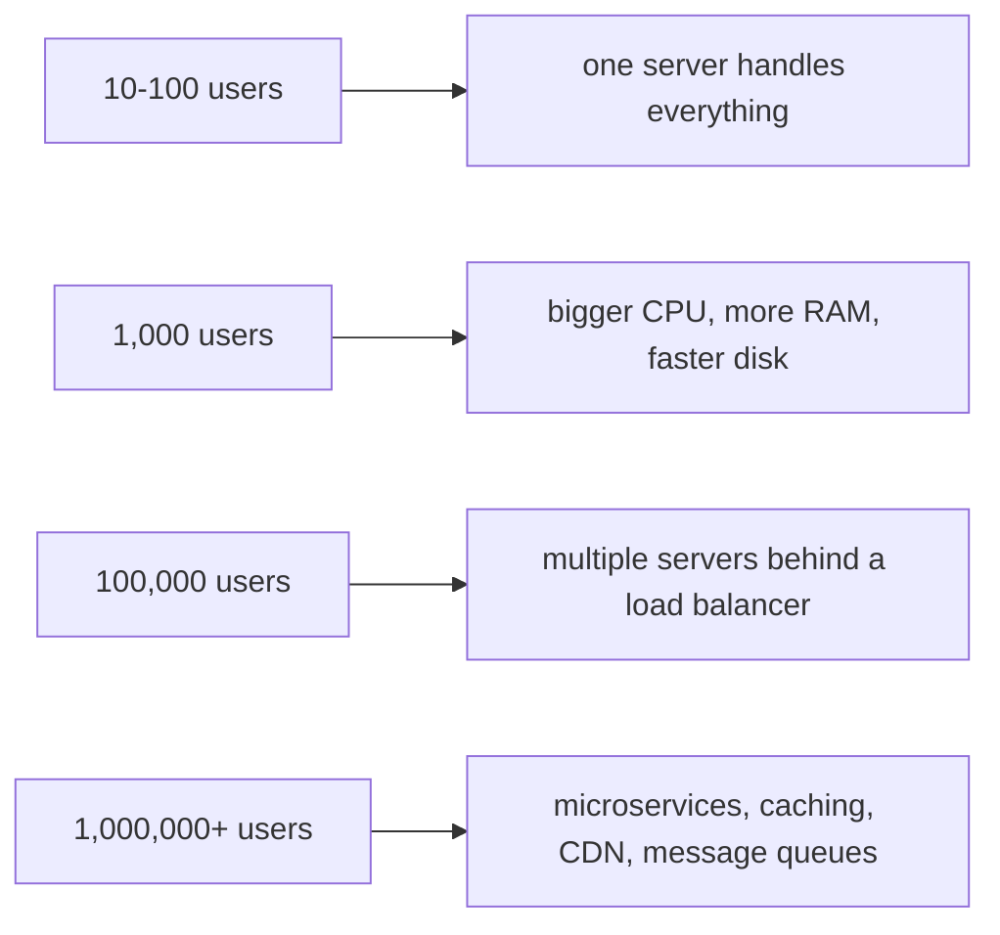

---

# WHAT: Core Building Blocks

## 1. Load Balancer

```
Without Load Balancer:
  All requests → 1 server → server dies → app DOWN

With Load Balancer:
  ┌────────┐     ┌─────────────────┐     ┌──────────┐
  │ Client │ ──> │  Load Balancer  │ ──> │ Server 1 │ ✓
  │        │     │  (distributes)  │ ──> │ Server 2 │ ✓
  │        │     │                 │ ──> │ Server 3 │ ✗ (detected, skipped)
  └────────┘     └─────────────────┘     └──────────┘

Algorithms:
  Round Robin    → Server 1, 2, 3, 1, 2, 3... (simple)
  Least Conn     → Send to server with fewest active connections
  IP Hash        → Same client IP always goes to same server
  Weighted       → Server with 8 CPU gets 4x traffic vs 2 CPU

Tools: NGINX, HAProxy, AWS ALB, Kubernetes Ingress
```

**Flow:**
- Client
- ↓
- Load Balancer / (distributes)
- ↓
- Server 1 / Server 2 / Server 3

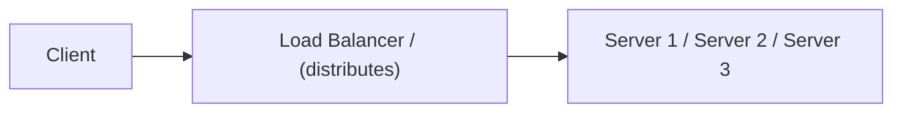

## 2. Caching

```
WITHOUT cache:
  Client → Server → Database (100ms) → Server → Client
  
WITH cache:
  Client → Server → Cache HIT (1ms) → Server → Client
  Client → Server → Cache MISS → Database → Store in Cache → Client

Cache Layers:
  ┌──────────┐    ┌──────────┐    ┌──────────┐    ┌──────────┐
  │ Browser  │ →  │   CDN    │ →  │  App     │ →  │ Database │
  │ Cache    │    │ Cache    │    │  Cache   │    │          │
  │ (local)  │    │ (edge)   │    │ (Redis)  │    │          │
  └──────────┘    └──────────┘    └──────────┘    └──────────┘
  
Cache Strategies:
  CACHE-ASIDE    → App checks cache first, loads from DB on miss, writes to cache
  WRITE-THROUGH  → Write to cache AND DB simultaneously
  WRITE-BEHIND   → Write to cache, async batch write to DB (fast but risky)
  
Eviction Policies:
  LRU  → Least Recently Used (most common)
  LFU  → Least Frequently Used
  TTL  → Time To Live (expire after N seconds)
```

**Flow:**
- Browser / Cache / (local)
- ↓
- CDN / Cache / (edge)
- ↓
- App / Cache / (Redis)
- ↓
- Database

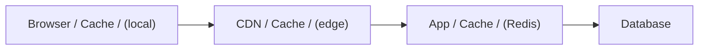

```java
// Spring Boot + Redis Cache Example:
@Service
public class ProductService {

    @Cacheable(value = "products", key = "#id")
    public Product getProduct(Long id) {
        // This only runs on CACHE MISS
        return productRepository.findById(id).orElseThrow();
    }

    @CacheEvict(value = "products", key = "#id")
    public void updateProduct(Long id, ProductDTO dto) {
        // Evict from cache when data changes
        Product product = productRepository.findById(id).orElseThrow();
        product.setName(dto.getName());
        productRepository.save(product);
    }
}
```

## 3. Database Scaling

```
VERTICAL: Bigger machine (limited)
HORIZONTAL: Multiple machines

READ Replicas:
  ┌──────────┐          ┌──────────────┐
  │  Master  │ ──sync── │ Read Replica │  ← All SELECTs go here
  │ (writes) │          │ (reads only) │
  └──────────┘          └──────────────┘

SHARDING (horizontal partitioning):
  Users A-M → Database Shard 1
  Users N-Z → Database Shard 2

  Benefits: Each shard is smaller, faster
  Drawbacks: Cross-shard queries are HARD, rebalancing is painful

SQL vs NoSQL Decision:
  SQL  (PostgreSQL, MySQL)  → Structured data, ACID, joins needed
  NoSQL (MongoDB, DynamoDB) → Flexible schema, high throughput, horizontal scale
```

**Flow:**
- Master / (writes)
- ↓
- Read Replica / (reads only)

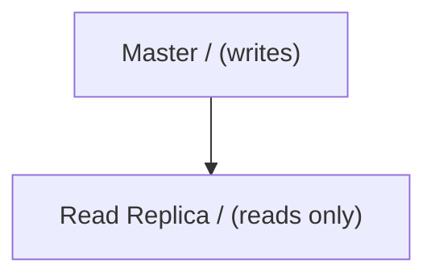

## 4. Message Queues

```
PROBLEM: Service A calls Service B directly
  → If B is slow, A waits → cascading failure

SOLUTION: Asynchronous messaging
  ┌───────┐    ┌─────────┐    ┌───────┐
  │  API  │ →  │  Queue  │ →  │Worker │
  │Server │    │(Kafka/  │    │Process│
  │       │    │ RabbitMQ│    │       │
  └───────┘    └─────────┘    └───────┘
  Returns 202   Stores msg    Processes
  immediately   reliably      when ready

Use Cases:
  - Email sending (don't block HTTP request)
  - Order processing (place in queue → process async)
  - Log aggregation (apps write to Kafka → analytics reads)
  - Microservice communication (decoupled)
  
Tools: Apache Kafka, RabbitMQ, AWS SQS, Redis Streams
```

**Flow:**
- API / Server
- ↓
- Queue / (Kafka/ / RabbitMQ
- ↓
- Worker / Process

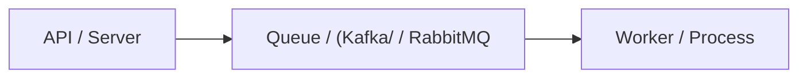

## 5. CDN (Content Delivery Network)

```
WITHOUT CDN (server in US):
  User in India → 15,000 km → US Server → 15,000 km back → 300ms

WITH CDN (edge server in India):
  User in India → 100 km → CDN Edge → 5ms
  
  ┌──────┐          ┌─────────┐
  │ User │ ───>     │ CDN     │   ← Static files cached here
  │ India│          │ Mumbai  │
  └──────┘          └────┬────┘
                         │ (cache miss only)
                    ┌────▼────┐
                    │ Origin  │   ← Your actual server
                    │ US-East │
                    └─────────┘

Cache: HTML, CSS, JS, images, videos, fonts
Tools: Cloudflare, AWS CloudFront, Akamai
```

**Flow:**
- User / India
- ↓
- CDN / Mumbai
- ↓
- Origin / US-East

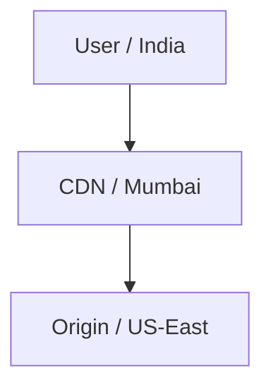

---

# HOW: Design Patterns

## Microservices vs Monolith

```
MONOLITH:
  ┌──────────────────────────┐
  │    ONE BIG APPLICATION   │
  │  Users + Orders + Pay +  │
  │  Inventory + Shipping    │
  │  ALL IN ONE CODEBASE     │
  └──────────────────────────┘
  ✅ Simple to develop, deploy, debug
  ❌ One bug can crash everything
  ❌ Can't scale parts independently

MICROSERVICES:
  ┌────────┐ ┌────────┐ ┌────────┐ ┌──────────┐
  │ Users  │ │ Orders │ │Payment │ │Inventory │
  │Service │ │Service │ │Service │ │ Service  │
  └────────┘ └────────┘ └────────┘ └──────────┘
  ✅ Scale each independently
  ✅ Teams own their services
  ✅ One failure doesn't crash all
  ❌ Network complexity
  ❌ Distributed debugging is HARD
  ❌ Data consistency challenges

RULE: Start with monolith, extract microservices WHEN NEEDED
```

**Flow:**
- ONE BIG APPLICATION / Users + Orders + Pay + / Inventor
- ↓
- Users / Service
- ↓
- Orders / Service
- ↓
- Payment / Service
- ↓
- Inventory / Service

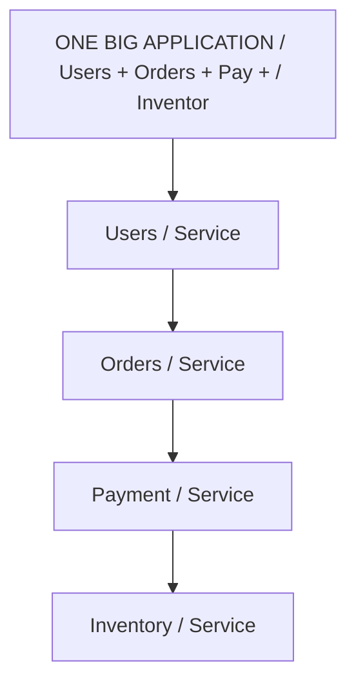

## CAP Theorem

```
You can only have 2 of 3:

  C — Consistency:  Every read gets the most recent write
  A — Availability: Every request gets a response (even if stale)
  P — Partition Tolerance: System works despite network failures

In distributed systems, P is mandatory (networks WILL fail).
So you choose: CP or AP.

  CP (Consistency + Partition Tolerance):
    → Banking: Balance MUST be correct, even if slow
    → Tools: PostgreSQL, MongoDB (default), Redis Cluster

  AP (Availability + Partition Tolerance):
    → Social media: Show stale feed, but ALWAYS respond
    → Tools: Cassandra, DynamoDB, CouchDB
```

**Flow:**
- You can only have 2 of 3:
- ↓
- C — Consistency: Every read gets the most recent write
- ↓
- So you choose: CP or AP.
- ↓
- CP (Consistency + Partition Tolerance):
- ↓
- Banking: Balance MUST be correct, even if slow
- ↓
- Tools: PostgreSQL, MongoDB (default), Redis Cluster
- ↓
- AP (Availability + Partition Tolerance):

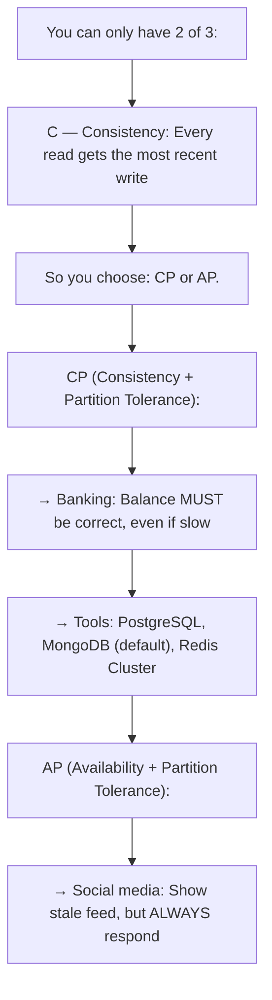

## Rate Limiting Algorithms

```
1. FIXED WINDOW:   100 requests per minute (resets at :00)
   Problem: 100 at :59 + 100 at :00 = 200 in 2 seconds

2. SLIDING WINDOW:  100 requests in any 60-second window
   More accurate, slightly more complex

3. TOKEN BUCKET:    Tokens added at fixed rate, consumed per request
   Allows bursts up to bucket size

4. LEAKY BUCKET:    Requests processed at fixed rate, excess queued
   Smooth output rate
```

---

# WHERE: System Design Template

## Step-by-Step Approach

```
1. REQUIREMENTS (5 min)
   - Functional: What does the system DO?
   - Non-functional: Scale, latency, availability?
   - Back-of-envelope: Users, QPS, storage?

2. HIGH-LEVEL DESIGN (10 min)
   - Draw boxes: Client → LB → API → DB
   - Identify core services
   - Choose SQL vs NoSQL

3. DEEP DIVE (15 min)
   - Database schema
   - API endpoints
   - Caching strategy
   - How to handle failures

4. BOTTLENECKS (5 min)
   - Single points of failure?
   - What if traffic 10x?
   - Monitoring and alerting?
```

**Flow:**
- - Draw boxes: Client
- ↓
- LB
- ↓
- API
- ↓
- DB

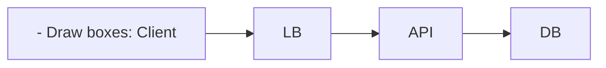

## Back-of-Envelope Calculations

```
Useful numbers to memorize:

  Read from memory:        100 ns
  Read from SSD:           100 μs  (1,000x slower)
  Read from disk:          10 ms   (100,000x slower)
  Network round trip:      1-100 ms
  
  1 server handles:        ~10,000 concurrent connections
  1 day has:               86,400 seconds
  1 million requests/day:  ~12 QPS (queries per second)
  
  1 KB  → a short email
  1 MB  → a photo
  1 GB  → a movie
  1 TB  → 1M photos
  1 PB  → 1B photos
```

**Flow:**
- 1 KB
- ↓
- a short email
- ↓
- 1 MB
- ↓
- a photo
- ↓
- 1 GB
- ↓
- a movie
- ↓
- 1 TB
- ↓
- 1M photos
- ↓
- 1 PB
- ↓
- 1B photos

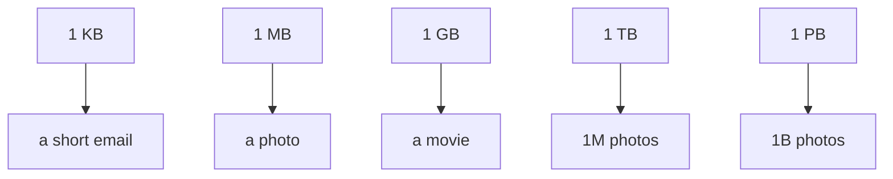

---

# 🧭 System Design Cheat Sheet

```
Scale reads   → Caching (Redis) + Read Replicas + CDN
Scale writes  → Sharding + Message Queues + Async processing
High avail    → Load Balancer + Multiple servers + Health checks
Low latency   → CDN + Cache + Database indexing
Decouple      → Message Queue (Kafka/RabbitMQ)
Search        → Elasticsearch
File storage  → Object Storage (S3)
Rate limit    → Token Bucket / API Gateway
Monitor       → Prometheus + Grafana + ELK Stack
```

**Flow:**
- Scale reads
- ↓
- Caching (Redis) + Read Replicas + CDN
- ↓
- Scale writes
- ↓
- Sharding + Message Queues + Async processing
- ↓
- High avail
- ↓
- Load Balancer + Multiple servers + Health checks
- ↓
- Low latency
- ↓
- CDN + Cache + Database indexing
- ↓
- Decouple
- ↓
- Message Queue (Kafka/RabbitMQ)
- ↓
- Search
- ↓
- Elasticsearch

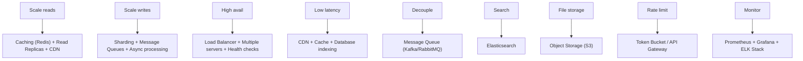

---

# 🏋️ Practice

## Exercise 1: URL Shortener
```
Design a URL shortener (like bit.ly):
  - POST /shorten → returns short URL
  - GET /{shortCode} → redirects to original
  
Think about:
  - How to generate unique short codes?
  - Database schema?
  - How to handle 1 billion URLs?
  - Caching hot URLs?
  - Analytics (click count)?
```

**Flow:**
- - POST /shorten
- ↓
- returns short URL
- ↓
- - GET /{shortCode}
- ↓
- redirects to original

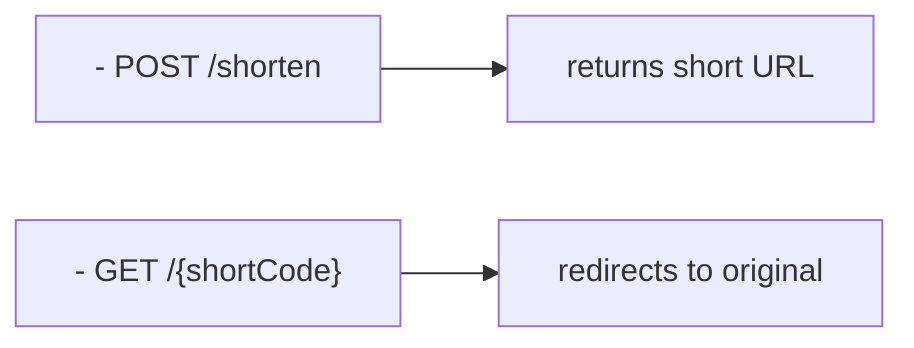

## Exercise 2: Chat Application
```
Design a real-time chat system:
  - One-to-one messages
  - Group chats (up to 500 members)
  - Online/offline status
  - Message history

Think about:
  - WebSocket vs HTTP polling?
  - How to store messages?
  - How to fan out group messages?
  - What if a user is offline?
```

---

> **Next Chapter**: [Dev Tools & Productivity →](10_Dev_Tools_Productivity.md)


---

> **Navigation**: [< Previous](08_Security_Fundamentals.md) | [Back to Index](../00_MASTER_INDEX.md) | [Next >](10_Dev_Tools_Productivity.md)