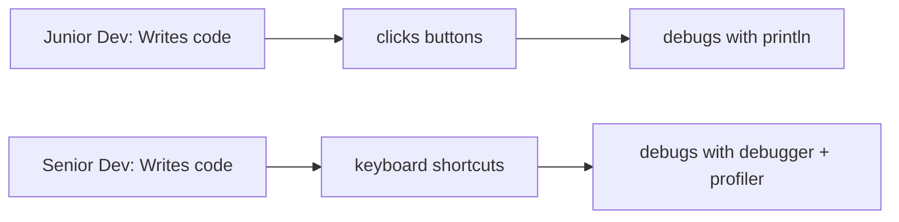
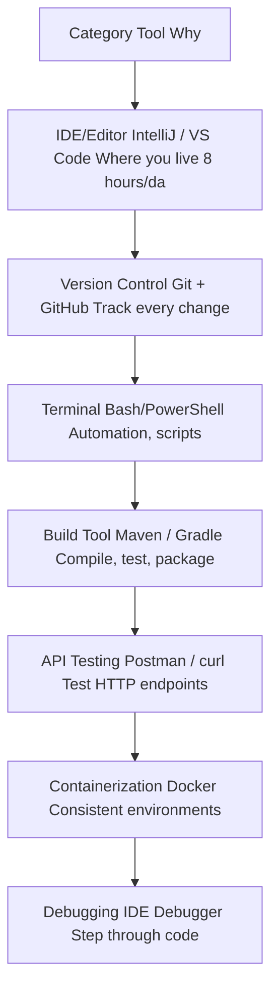
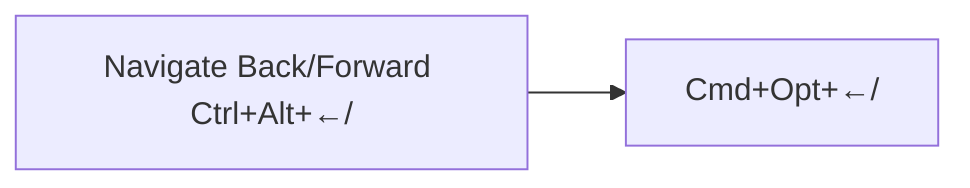
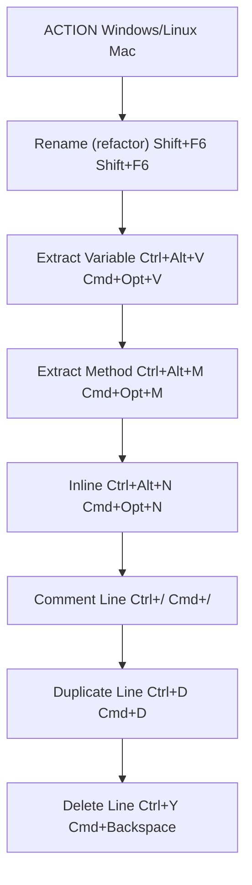
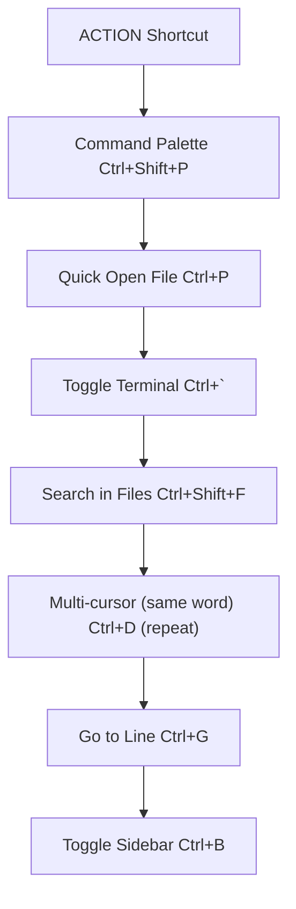
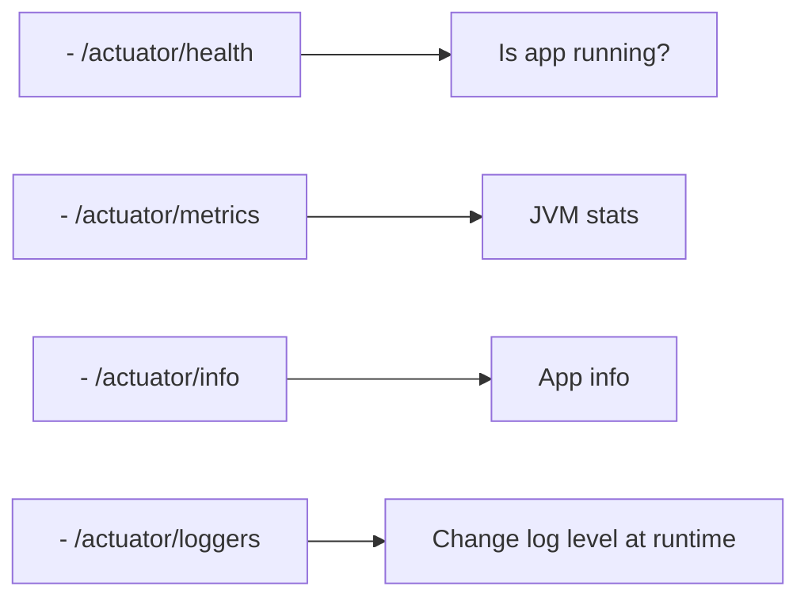
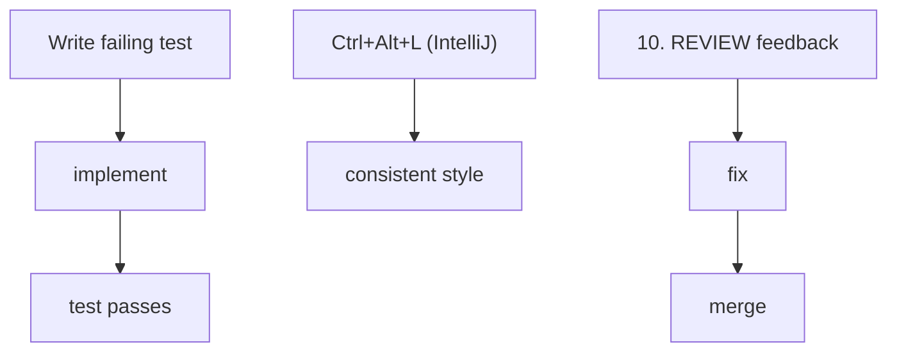

# 🛠️ Dev Tools & Productivity — Complete Guide

> **Navigation**: [< System Design](09_System_Design.md) | [Index](00_INDEX.md) | [Chapter 1: Git >](01_Git_Version_Control.md)

---

# WHY: Tools Define Your Speed

```
Junior Dev:   Writes code → clicks buttons → debugs with println
Senior Dev:   Writes code → keyboard shortcuts → debugs with debugger + profiler

The difference is NOT intelligence. It's TOOLING knowledge.
A developer who masters their tools finishes in 2 hours
what another takes 2 days to do.
```

**Flow:**
- Junior Dev: Writes code
- ↓
- clicks buttons
- ↓
- debugs with println
- ↓
- Senior Dev: Writes code
- ↓
- keyboard shortcuts
- ↓
- debugs with debugger + profiler



---

# WHAT: The Essential Toolkit

```
Category          │ Tool                  │ Why
──────────────────┼───────────────────────┼─────────────────────────────
IDE/Editor        │ IntelliJ / VS Code    │ Where you live 8 hours/day
Version Control   │ Git + GitHub          │ Track every change
Terminal          │ Bash/PowerShell       │ Automation, scripts
Build Tool        │ Maven / Gradle        │ Compile, test, package
API Testing       │ Postman / curl        │ Test HTTP endpoints
Database Client   │ DBeaver / DataGrip    │ Query and explore databases
Containerization  │ Docker                │ Consistent environments
Debugging         │ IDE Debugger          │ Step through code
Profiling         │ VisualVM / JProfiler  │ Find performance bottlenecks
Monitoring        │ Prometheus + Grafana  │ Watch production metrics
```

**Flow:**
- Category Tool Why
- ↓
- IDE/Editor IntelliJ / VS Code Where you live 8 hours/da
- ↓
- Version Control Git + GitHub Track every change
- ↓
- Terminal Bash/PowerShell Automation, scripts
- ↓
- Build Tool Maven / Gradle Compile, test, package
- ↓
- API Testing Postman / curl Test HTTP endpoints
- ↓
- Containerization Docker Consistent environments



---

# HOW: Mastering Each Tool

## Level 1 — IDE Productivity (IntelliJ IDEA)

### Navigation Shortcuts

```
ACTION                      │ Windows/Linux      │ Mac
────────────────────────────┼────────────────────┼──────────────
Search EVERYWHERE           │ Shift Shift        │ Shift Shift
Go to File                  │ Ctrl+Shift+N       │ Cmd+Shift+O
Go to Class                 │ Ctrl+N             │ Cmd+O
Go to Symbol                │ Ctrl+Shift+Alt+N   │ Cmd+Opt+O
Recent Files                │ Ctrl+E             │ Cmd+E
Go to Definition            │ Ctrl+B             │ Cmd+B
Find Usages                 │ Alt+F7             │ Opt+F7
File Structure (methods)    │ Ctrl+F12           │ Cmd+F12
Navigate Back/Forward       │ Ctrl+Alt+←/→       │ Cmd+Opt+←/→
```

**Flow:**
- Navigate Back/Forward Ctrl+Alt+←/
- ↓
- Cmd+Opt+←/



### Editing Shortcuts

```
ACTION                      │ Windows/Linux      │ Mac
────────────────────────────┼────────────────────┼──────────────
Rename (refactor)           │ Shift+F6           │ Shift+F6
Extract Variable            │ Ctrl+Alt+V         │ Cmd+Opt+V
Extract Method              │ Ctrl+Alt+M         │ Cmd+Opt+M
Inline                      │ Ctrl+Alt+N         │ Cmd+Opt+N
Comment Line                │ Ctrl+/             │ Cmd+/
Duplicate Line              │ Ctrl+D             │ Cmd+D
Delete Line                 │ Ctrl+Y             │ Cmd+Backspace
Move Line Up/Down           │ Shift+Alt+↑/↓      │ Opt+Shift+↑/↓
Auto-format Code            │ Ctrl+Alt+L         │ Cmd+Opt+L
Quick Fix (suggestions)     │ Alt+Enter          │ Opt+Enter
Generate (constructor etc)  │ Alt+Insert         │ Cmd+N
Surround With (try/if)      │ Ctrl+Alt+T         │ Cmd+Opt+T
```

**Flow:**
- ACTION Windows/Linux Mac
- ↓
- Rename (refactor) Shift+F6 Shift+F6
- ↓
- Extract Variable Ctrl+Alt+V Cmd+Opt+V
- ↓
- Extract Method Ctrl+Alt+M Cmd+Opt+M
- ↓
- Inline Ctrl+Alt+N Cmd+Opt+N
- ↓
- Comment Line Ctrl+/ Cmd+/
- ↓
- Duplicate Line Ctrl+D Cmd+D



### IntelliJ Power Features

```
LIVE TEMPLATES: Type abbreviation → Tab → expands code
  sout  → System.out.println();
  psvm  → public static void main(String[] args) {}
  fori  → for (int i = 0; i < ; i++) {}
  iter  → for (Type item : collection) {}

POSTFIX COMPLETION: Write expression THEN .keyword
  myList.for    → for (Object o : myList) {}
  myVar.null    → if (myVar == null) {}
  myVar.nn      → if (myVar != null) {}
  myBool.if     → if (myBool) {}
  value.return  → return value;
  text.sout     → System.out.println(text);

MULTI-CURSOR:
  Alt+Click        → Add cursor at click position
  Ctrl+Shift+Alt+J → Select all occurrences
  Ctrl+G           → Select next occurrence
```

**Flow:**
- LIVE TEMPLATES: Type abbreviation
- ↓
- Tab
- ↓
- expands code
- ↓
- sout
- ↓
- System.out.println();
- ↓
- psvm
- ↓
- public static void main(String[] args) {}
- ↓
- fori
- ↓
- for (int i = 0; i < ; i++) {}
- ↓
- iter
- ↓
- for (Type item : collection) {}

```mermaid
flowchart TD
    N1["LIVE TEMPLATES: Type abbreviation"]
    N2["Tab"]
    N3["expands code"]
    N4["sout"]
    N5["System.out.println();"]
    N6["psvm"]
    N7["public static void main(String[] args) {}"]
    N8["fori"]
    N9["for (int i = 0; i &lt; ; i++) {}"]
    N10["iter"]
    N11["for (Type item : collection) {}"]
    N12["myList.for"]
    N13["for (Object o : myList) {}"]
    N14["myVar.null"]
    N15["if (myVar == null) {}"]
    N16["myVar.nn"]
    N17["if (myVar != null) {}"]
    N18["myBool.if"]
    N19["if (myBool) {}"]
    N20["value.return"]
    N21["return value;"]
    N22["text.sout"]
    N23["System.out.println(text);"]
    N24["Alt+Click"]
    N25["Add cursor at click position"]
    N26["Ctrl+Shift+Alt+J"]
    N27["Select all occurrences"]
    N28["Ctrl+G"]
    N29["Select next occurrence"]
    N1 --> N2
    N2 --> N3
    N4 --> N5
    N6 --> N7
    N8 --> N9
    N10 --> N11
    N12 --> N13
    N14 --> N15
    N16 --> N17
    N18 --> N19
    N20 --> N21
    N22 --> N23
    N24 --> N25
    N26 --> N27
    N28 --> N29
```



## Level 2 — VS Code Essentials

```
ACTION                      │ Shortcut
────────────────────────────┼──────────────────
Command Palette             │ Ctrl+Shift+P
Quick Open File             │ Ctrl+P
Toggle Terminal             │ Ctrl+`
Search in Files             │ Ctrl+Shift+F
Multi-cursor (same word)    │ Ctrl+D (repeat)
Go to Line                  │ Ctrl+G
Toggle Sidebar              │ Ctrl+B
Split Editor                │ Ctrl+\
Zen Mode                    │ Ctrl+K Z

MUST-HAVE Extensions:
  - GitLens (git blame inline)
  - Prettier (auto-format)
  - ESLint (JS/TS linting)
  - REST Client (test APIs in editor)
  - Docker (manage containers)
  - Live Share (pair programming)
```

**Flow:**
- ACTION Shortcut
- ↓
- Command Palette Ctrl+Shift+P
- ↓
- Quick Open File Ctrl+P
- ↓
- Toggle Terminal Ctrl+`
- ↓
- Search in Files Ctrl+Shift+F
- ↓
- Multi-cursor (same word) Ctrl+D (repeat)
- ↓
- Go to Line Ctrl+G



## Level 3 — Debugging Like a Pro

```java
// STOP using System.out.println()
// START using the debugger:

// 1. BREAKPOINT — Click left gutter (red dot)
//    Code pauses here and shows all variables

// 2. CONDITIONAL BREAKPOINT — Right-click breakpoint
//    Condition: i == 42
//    Only stops when condition is true

// 3. WATCH EXPRESSION — Monitor specific values
//    Watch: user.getOrders().size()
//    Updates automatically at each step

// 4. STEP CONTROLS:
//    Step Over (F8)  → Execute line, don't enter methods
//    Step Into (F7)  → Enter the method call
//    Step Out  (Shift+F8) → Finish current method, return to caller
//    Resume    (F9)  → Run until next breakpoint

// 5. EVALUATE EXPRESSION (Alt+F8):
//    Type any expression mid-debug:
//    orderList.stream().filter(o -> o.getTotal() > 100).count()
```

## Level 4 — Postman / curl

```bash
# curl — command-line HTTP client

# GET request
curl http://localhost:8080/api/users

# GET with headers
curl -H "Authorization: Bearer eyJhb..." http://localhost:8080/api/users

# POST with JSON body
curl -X POST http://localhost:8080/api/users \
  -H "Content-Type: application/json" \
  -d '{"name": "Harsha", "email": "h@test.com"}'

# PUT (update)
curl -X PUT http://localhost:8080/api/users/42 \
  -H "Content-Type: application/json" \
  -d '{"name": "Updated Name"}'

# DELETE
curl -X DELETE http://localhost:8080/api/users/42

# Verbose (see headers)
curl -v http://localhost:8080/api/users

# Save response to file
curl -o response.json http://localhost:8080/api/users
```

```
POSTMAN Tips:
  - Create COLLECTIONS for each project
  - Use ENVIRONMENTS (dev, staging, prod)
  - Set variables: {{baseUrl}} = http://localhost:8080
  - Write TESTS in Postman:
      pm.test("Status is 200", () => {
          pm.response.to.have.status(200);
      });
  - Generate CODE from any request (Java, Python, curl)
```

## Level 5 — Maven / Gradle

```xml
<!-- Maven (pom.xml) — Java's package manager -->
<dependencies>
    <!-- Spring Boot Web -->
    <dependency>
        <groupId>org.springframework.boot</groupId>
        <artifactId>spring-boot-starter-web</artifactId>
    </dependency>
</dependencies>

<!-- Common Maven commands: -->
<!-- mvn clean install           → Clean, compile, test, package -->
<!-- mvn spring-boot:run         → Run Spring Boot app -->
<!-- mvn test                    → Run all tests -->
<!-- mvn dependency:tree         → Show all dependencies -->
<!-- mvn versions:display-dependency-updates → Check for updates -->
```

```groovy
// Gradle (build.gradle) — Faster alternative to Maven
dependencies {
    implementation 'org.springframework.boot:spring-boot-starter-web'
    testImplementation 'org.springframework.boot:spring-boot-starter-test'
}

// gradle build        → Compile + test + package
// gradle bootRun      → Run Spring Boot app
// gradle test         → Run tests
// gradle dependencies → Show dependency tree
```

## Level 6 — Performance Profiling

```
WHEN to profile:
  - API response > 500ms
  - Memory usage keeps growing (memory leak)
  - CPU at 100% for no reason
  - Out of memory errors

TOOLS:
  1. VisualVM (free, bundled with JDK)
     - Connect to running Java app
     - See heap usage, thread count, CPU
     - Take heap dumps, thread dumps
     
  2. JProfiler / YourKit (commercial)
     - Method-level profiling (which method is slow?)
     - Memory allocation tracking
     - Database query profiling

  3. Spring Boot Actuator (built-in)
     - /actuator/health → Is app running?
     - /actuator/metrics → JVM stats
     - /actuator/info → App info
     - /actuator/loggers → Change log level at runtime

QUICK PROFILING with Spring Boot:
```

**Flow:**
- - /actuator/health
- ↓
- Is app running?
- ↓
- - /actuator/metrics
- ↓
- JVM stats
- ↓
- - /actuator/info
- ↓
- App info
- ↓
- - /actuator/loggers
- ↓
- Change log level at runtime



```java
// Measure method execution time
@Aspect
@Component
public class PerformanceAspect {
    
    @Around("@annotation(Timed)")
    public Object measureTime(ProceedingJoinPoint joinPoint) throws Throwable {
        long start = System.nanoTime();
        Object result = joinPoint.proceed();
        long duration = (System.nanoTime() - start) / 1_000_000;
        
        log.info("{}.{} took {} ms",
            joinPoint.getSignature().getDeclaringTypeName(),
            joinPoint.getSignature().getName(),
            duration);
        
        return result;
    }
}
```

---

# WHERE: Daily Workflow Optimization

## The Ideal Development Loop

```
1. PULL latest code
   git pull --rebase origin main

2. CREATE feature branch
   git checkout -b feature/add-user-api

3. WRITE tests first (TDD)
   Write failing test → implement → test passes

4. CODE with IDE shortcuts
   Alt+Enter for quick fixes, Shift+F6 for rename

5. TEST locally
   mvn test (or gradle test)

6. DEBUG if needed
   Breakpoints, not println

7. FORMAT code
   Ctrl+Alt+L (IntelliJ) → consistent style

8. COMMIT meaningful chunks
   git add -p (stage hunks, not whole files)
   git commit -m "feat: add user registration endpoint"

9. PUSH and create PR
   git push origin feature/add-user-api

10. REVIEW feedback → fix → merge
```

**Flow:**
- Write failing test
- ↓
- implement
- ↓
- test passes
- ↓
- Ctrl+Alt+L (IntelliJ)
- ↓
- consistent style
- ↓
- 10. REVIEW feedback
- ↓
- fix
- ↓
- merge



## Useful Aliases

```bash
# Add to ~/.bashrc or ~/.zshrc:

# Git shortcuts
alias gs='git status'
alias ga='git add'
alias gc='git commit -m'
alias gp='git push'
alias gl='git log --oneline -20'
alias gb='git branch'
alias gco='git checkout'
alias gd='git diff'

# Docker shortcuts
alias dc='docker compose'
alias dps='docker ps'
alias dcu='docker compose up -d'
alias dcd='docker compose down'
alias dlogs='docker compose logs -f'

# Maven shortcuts
alias mci='mvn clean install -DskipTests'
alias mct='mvn clean test'
alias mbr='mvn spring-boot:run'
```

---

# 🧭 Productivity Cheat Sheet

```
NAVIGATE:   Shift+Shift (search everything)
REFACTOR:   Shift+F6 (rename), Ctrl+Alt+M (extract method)
DEBUG:      F8 (step over), F7 (step into), Alt+F8 (evaluate)
FORMAT:     Ctrl+Alt+L (auto-format)
TEST:       mvn test or gradle test
BUILD:      mvn clean install
RUN:        mvn spring-boot:run
PROFILE:    VisualVM + Spring Actuator
API TEST:   Postman or curl
```

---

# 🏋️ Practice

## Exercise 1: Speed Challenge
```
Without using mouse, perform these in IntelliJ:
1. Open a file by name
2. Go to a specific method
3. Rename a variable across the project
4. Extract a method from selected code
5. Run all tests
6. Set a conditional breakpoint
Time yourself. Repeat until under 60 seconds.
```

## Exercise 2: Full Workflow
```
Practice the complete development workflow:
1. Clone a Spring Boot starter project
2. Create branch, write a simple REST endpoint
3. Write unit tests with Mockito
4. Test with Postman
5. Debug with breakpoints
6. Check performance with Actuator
7. Commit, push, (create PR if on GitHub)
```

---

> **Full Circle**: [Back to Git →](01_Git_Version_Control.md) | [Index](00_INDEX.md)
