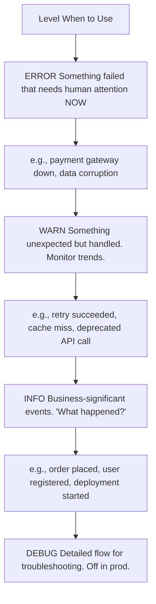
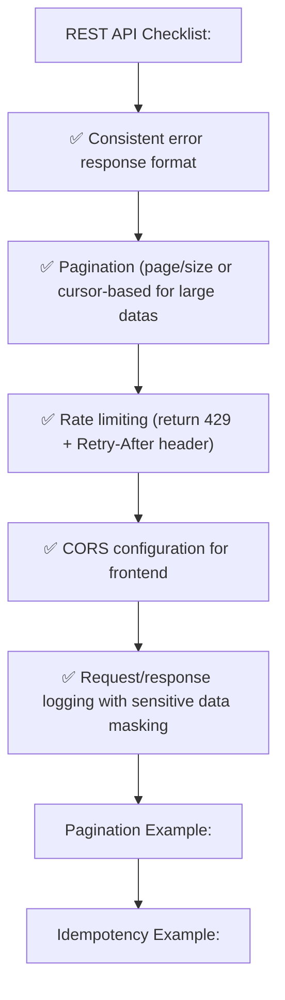

> **Navigation**: [Back to Index](../00_MASTER_INDEX.md) | [Monitoring](12_Monitoring_Observability.md)
> 🧠 **Mental Model**: See [Production Debugging Thinking](../14_Mental_Models/18_Production_Debugging_Thinking.md)

---

# 🏭 Production-Grade Code Practices — 12-Factor, Logging, Error Handling

> What separates hobby code from production-ready software

---

## Part 1: The 12-Factor App


> 12 principles for building cloud-native, production-ready applications
>
> 1. Codebase     │ One codebase in version control, many deploys
> 2. Dependencies │ Explicitly declare and isolate (pom.xml, package.json)
> 3. Config       │ Store in environment variables, NOT in code
> 4. Backing Svcs │ Treat DB, cache, queue as attached resources (swap easily)
> 5. Build/Release│ Strict separation: build → release → run
> 6. Processes     │ Stateless. Store shared state in DB/cache, not memory
> 7. Port Binding │ App is self-contained, exports HTTP via port binding
> 8. Concurrency  │ Scale out via process model (more instances, not threads)
> 9. Disposability│ Fast startup, graceful shutdown (handle SIGTERM)
> 10. Dev/Prod Par.│ Keep dev, staging, prod as similar as possible
> 11. Logs         │ Treat logs as event streams (stdout, not files)
> 12. Admin Procs. │ Run admin tasks as one-off processes (migrations, scripts)


---

## Part 2: Configuration Management

```java
// ❌ BAD: Hardcoded config
String dbUrl = "jdbc:postgresql://localhost:5432/mydb";

// ✅ GOOD: Externalized config
// application.yml
// spring:
//   datasource:
//     url: ${DATABASE_URL}
//     username: ${DB_USER}
//     password: ${DB_PASSWORD}

// ✅ GOOD: Config server for microservices
// Spring Cloud Config Server → central config for all services
// Profiles: application-dev.yml, application-prod.yml

// ✅ GOOD: Secrets management
// Never store secrets in code/git
// Use: AWS Secrets Manager, HashiCorp Vault, K8s Secrets
```

---

## Part 3: Structured Logging

```java
// ❌ BAD: Unstructured log
System.out.println("Order processed for user " + userId);

// ❌ BAD: String concatenation (evaluated even if log level disabled)
log.debug("Processing order " + order.toString());

// ✅ GOOD: Parameterized, structured logging
log.info("Order processed userId={} orderId={} amount={}", userId, orderId, amount);

// ✅ GOOD: MDC (Mapped Diagnostic Context) for request tracing
public class RequestFilter implements Filter {
    public void doFilter(ServletRequest req, ServletResponse resp, FilterChain chain) {
        String correlationId = Optional.ofNullable(
            ((HttpServletRequest) req).getHeader("X-Correlation-ID"))
            .orElse(UUID.randomUUID().toString());
        
        MDC.put("correlationId", correlationId);
        MDC.put("userId", extractUserId(req));
        try {
            chain.doFilter(req, resp);
        } finally {
            MDC.clear(); // ALWAYS clear MDC
        }
    }
}

// logback-spring.xml pattern:
// %d{ISO8601} [%thread] %-5level %logger{36} [%X{correlationId}] - %msg%n
```

### Log Levels Guide
```
┌───────────┬──────────────────────────────────────────────────────────────────┐
│ Level     │ When to Use                                                      │
├───────────┼──────────────────────────────────────────────────────────────────┤
│ ERROR     │ Something failed that needs human attention NOW                  │
│           │ e.g., payment gateway down, data corruption                      │
│ WARN      │ Something unexpected but handled. Monitor trends.                │
│           │ e.g., retry succeeded, cache miss, deprecated API call           │
│ INFO      │ Business-significant events. "What happened?"                    │
│           │ e.g., order placed, user registered, deployment started          │
│ DEBUG     │ Detailed flow for troubleshooting. Off in prod.                  │
│           │ e.g., SQL queries, request/response bodies                       │
│ TRACE     │ Very fine-grained. Almost never in prod.                         │
│           │ e.g., entering/exiting methods, variable values                  │
└───────────┴──────────────────────────────────────────────────────────────────┘
```

**Flow:**
- Level When to Use
- ↓
- ERROR Something failed that needs human attention NOW
- ↓
- e.g., payment gateway down, data corruption
- ↓
- WARN Something unexpected but handled. Monitor trends.
- ↓
- e.g., retry succeeded, cache miss, deprecated API call
- ↓
- INFO Business-significant events. 'What happened?'
- ↓
- e.g., order placed, user registered, deployment started



---


> 🔬 **Section Challenge — Part 3: Structured Logging**
>
> **Challenge 1 (Reasoning):** `ExecutorService.submit(task)` — the task throws a `RuntimeException`. Nobody calls `future.get()`. What happens to the exception?
> <details><summary>Answer</summary>
>
> It's silently swallowed. The exception is stored in the `Future` object. Without `future.get()` or `.whenComplete()`, no one ever sees it. The thread pool thread resets and picks up the next task as if nothing happened. This is one of the most dangerous production bugs. Fix: always attach `future.whenComplete((r,ex) -> { if(ex!=null) log.error("Task failed",ex); })` or use `execute()` + `UncaughtExceptionHandler`.
> </details>
>

## Part 4: Error Handling

```java
// ❌ BAD: Generic catch-all
try {
    processOrder(order);
} catch (Exception e) {
    e.printStackTrace(); // goes to stdout, no context, no alert
}

// ✅ GOOD: Specific exceptions, proper handling
try {
    processOrder(order);
} catch (InsufficientInventoryException e) {
    log.warn("Out of stock orderId={} productId={}", order.getId(), e.getProductId());
    return OrderResult.outOfStock(e.getProductId());
} catch (PaymentDeclinedException e) {
    log.warn("Payment declined orderId={} reason={}", order.getId(), e.getReason());
    return OrderResult.paymentFailed(e.getReason());
} catch (Exception e) {
    log.error("Unexpected error processing orderId={}", order.getId(), e);
    alertService.notifyOnCall("Order processing failed", e);
    throw new OrderProcessingException("Failed to process order", e);
}

// ✅ GOOD: Global exception handler (Spring Boot)
@RestControllerAdvice
public class GlobalExceptionHandler {
    
    @ExceptionHandler(ResourceNotFoundException.class)
    public ResponseEntity<ErrorResponse> handleNotFound(ResourceNotFoundException ex) {
        log.warn("Resource not found: {}", ex.getMessage());
        return ResponseEntity.status(404)
            .body(new ErrorResponse("NOT_FOUND", ex.getMessage()));
    }
    
    @ExceptionHandler(Exception.class)
    public ResponseEntity<ErrorResponse> handleGeneral(Exception ex) {
        log.error("Unhandled exception", ex);
        return ResponseEntity.status(500)
            .body(new ErrorResponse("INTERNAL_ERROR", "Something went wrong"));
        // NEVER leak stack traces to client in production!
    }
}
```

---


> 🔬 **Section Challenge — Part 4: Error Handling**
>
> **Challenge 1 (Reasoning):** `ExecutorService.submit(task)` — the task throws a `RuntimeException`. Nobody calls `future.get()`. What happens to the exception?
> <details><summary>Answer</summary>
>
> It's silently swallowed. The exception is stored in the `Future` object. Without `future.get()` or `.whenComplete()`, no one ever sees it. The thread pool thread resets and picks up the next task as if nothing happened. This is one of the most dangerous production bugs. Fix: always attach `future.whenComplete((r,ex) -> { if(ex!=null) log.error("Task failed",ex); })` or use `execute()` + `UncaughtExceptionHandler`.
> </details>
>

## Part 5: Health Checks & Graceful Shutdown

```java
// Spring Boot Actuator health check
// GET /actuator/health → {"status": "UP"}

// Custom health indicator
@Component
public class DatabaseHealthIndicator implements HealthIndicator {
    @Override
    public Health health() {
        try {
            jdbcTemplate.queryForObject("SELECT 1", Integer.class);
            return Health.up().withDetail("database", "reachable").build();
        } catch (Exception e) {
            return Health.down().withException(e).build();
        }
    }
}

// Readiness vs Liveness (Kubernetes):
// Liveness:  "Is the app alive?" → If no → restart container
// Readiness: "Can it handle traffic?" → If no → remove from load balancer

// Graceful shutdown
@PreDestroy
public void shutdown() {
    log.info("Shutting down — completing in-flight requests...");
    // Stop accepting new requests
    // Wait for current requests to finish (with timeout)
    // Close database connections
    // Flush queues
    log.info("Shutdown complete");
}
// application.yml: server.shutdown=graceful
//                  spring.lifecycle.timeout-per-shutdown-phase=30s
```

---

## Part 6: Retry & Circuit Breaker

```java
// ── Retry with Exponential Backoff ──
@Retryable(
    value = {TransientException.class},
    maxAttempts = 3,
    backoff = @Backoff(delay = 1000, multiplier = 2) // 1s, 2s, 4s
)
public PaymentResult chargeCard(PaymentRequest request) {
    return paymentGateway.charge(request);
}

@Recover
public PaymentResult fallback(TransientException e, PaymentRequest request) {
    log.error("All retries failed for payment={}", request.getId(), e);
    return PaymentResult.failed("Payment gateway unavailable");
}

// ── Circuit Breaker (Resilience4j) ──
// States: CLOSED (normal) → OPEN (failing, reject fast) → HALF_OPEN (test)
@CircuitBreaker(name = "paymentService", fallbackMethod = "paymentFallback")
public PaymentResult processPayment(PaymentRequest req) {
    return paymentGateway.charge(req);
}

// Circuit breaker config:
// failure-rate-threshold: 50%  → open after 50% failures
// wait-duration-in-open-state: 30s → try again after 30s
// sliding-window-size: 10 → evaluate last 10 calls
```

---

## Part 7: API Best Practices

```
╔══════════════════════════════════════════════════════════════════════════════════╗
║  REST API Checklist:                                                             ║
║  ✅ Use proper HTTP methods (GET=read, POST=create, PUT=replace, PATCH=update)    ║
║  ✅ Meaningful status codes (200, 201, 400, 401, 403, 404, 409, 500)              ║
║  ✅ Consistent error response format                                              ║
║  ✅ Versioning (URI: /api/v1/ or Header: Accept: application/vnd.api.v1+json)     ║
║  ✅ Pagination (page/size or cursor-based for large datasets)                     ║
║  ✅ Rate limiting (return 429 + Retry-After header)                               ║
║  ✅ Request validation (Jakarta Bean Validation: @NotNull, @Size, @Email)         ║
║  ✅ CORS configuration for frontend                                               ║
║  ✅ Idempotency keys for POST requests (prevent duplicate processing)             ║
║  ✅ Request/response logging with sensitive data masking                          ║
║                                                                                  ║
║  Pagination Example:                                                             ║
║  GET /api/v1/orders?page=0&size=20&sort=createdAt,desc                           ║
║  → { content: [...], page: 0, size: 20, totalElements: 143, totalPages: 8 }      ║
║                                                                                  ║
║  Idempotency Example:                                                            ║
║  POST /api/v1/payments                                                           ║
║  Header: Idempotency-Key: abc-123-def                                            ║
║  → First call: process payment, store result keyed by "abc-123-def"              ║
║  → Second call: return stored result (no double charge)                          ║
╚══════════════════════════════════════════════════════════════════════════════════╝
```

**Flow:**
- REST API Checklist:
- ↓
- ✅ Consistent error response format
- ↓
- ✅ Pagination (page/size or cursor-based for large datas
- ↓
- ✅ Rate limiting (return 429 + Retry-After header)
- ↓
- ✅ CORS configuration for frontend
- ↓
- ✅ Request/response logging with sensitive data masking
- ↓
- Pagination Example:



---

> **Navigation**: [< Previous](10_Dev_Tools_Productivity.md) | [Back to Index](../00_MASTER_INDEX.md) | [Next >](12_Monitoring_Observability.md)