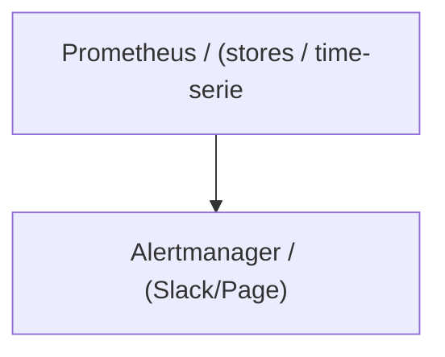
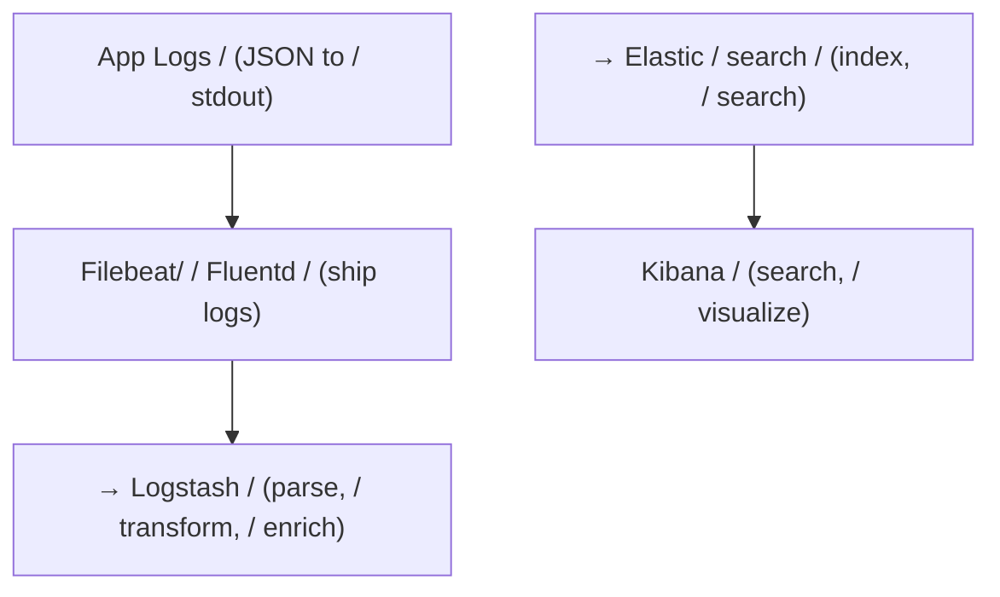
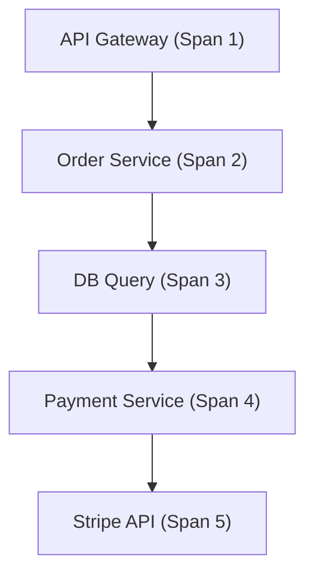
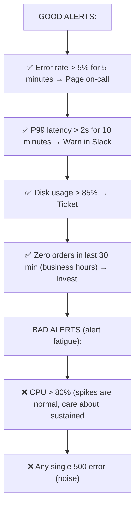

> **Navigation**: [Back to Index](../00_MASTER_INDEX.md) | [Production Practices](11_Production_Code_Practices.md)
> 🧠 **Mental Model**: See [Production Debugging Thinking](../14_Mental_Models/18_Production_Debugging_Thinking.md)

---

# 📊 Monitoring & Observability — Prometheus, Grafana, ELK

> The three pillars: Metrics, Logs, Traces — how to know what your system is doing in production

---

## The Three Pillars


> PILLAR 1: METRICS (What is happening?)
> → Numerical time-series data: CPU 85%, latency 120ms, errors 5/min
> → Tools: Prometheus, Datadog, CloudWatch
> → Dashboards: Grafana
>
> PILLAR 2: LOGS (Why did it happen?)
> → Detailed event records with context
> → Tools: ELK Stack (Elasticsearch + Logstash + Kibana), Loki, Splunk
> → Structured JSON logs with correlation IDs
>
> PILLAR 3: TRACES (Where did it happen?)
> → Follow a request across multiple services
> → Tools: Jaeger, Zipkin, AWS X-Ray, OpenTelemetry
> → Trace ID propagated through headers


---

## Prometheus + Grafana Stack

```
┌────────────┐  scrape /metrics  ┌────────────┐  query  ┌──────────────┐
│ Your App   │◄──────────────────│ Prometheus  │◄───────│ Grafana      │
│ (exposes   │  every 15s         │ (stores     │        │ (visual     │
│  /metrics) │                    │  time-series)│       │  dashboards)│
└────────────┘                   └──────┬─────┘        └───────────────┘
                                        │
                                 ┌──────▼──────┐
                                 │ Alertmanager │
                                 │ (Slack/Page) │
                                 └─────────────┘

4 GOLDEN SIGNALS (Google SRE):
┌──────────────┬──────────────────────────────────────────────────────────┐
│ Latency      │ Time to serve a request (p50, p95, p99)                  │
│ Traffic      │ Requests per second (throughput)                         │
│ Errors       │ Rate of failed requests (5xx, 4xx)                       │
│ Saturation   │ How "full" is your system (CPU, memory, disk, queue)     │
└──────────────┴──────────────────────────────────────────────────────────┘

Spring Boot + Micrometer (auto-exposes Prometheus metrics):
  // pom.xml: spring-boot-starter-actuator + micrometer-registry-prometheus
  // application.yml:
  //   management.endpoints.web.exposure.include: health,prometheus
  //   management.metrics.tags.application: my-service

  // Custom metrics:
  @Component
  public class OrderMetrics {
      private final Counter ordersCreated;
      private final Timer orderProcessingTime;

      public OrderMetrics(MeterRegistry registry) {
          ordersCreated = Counter.builder("orders.created.total")
              .description("Total orders created")
              .tag("service", "order-service")
              .register(registry);
          orderProcessingTime = Timer.builder("orders.processing.duration")
              .description("Order processing time")
              .register(registry);
      }

      public void recordOrder() { ordersCreated.increment(); }
      public Timer.Sample startTimer() { return Timer.start(); }
      public void stopTimer(Timer.Sample sample) { sample.stop(orderProcessingTime); }
  }
```

**Flow:**
- Prometheus / (stores / time-serie
- ↓
- Alertmanager / (Slack/Page)



---

## ELK Stack (Centralized Logging)

```
┌────────────┐     ┌───────────┐     ┌───────────────┐     ┌──────────┐
│ App Logs   │────→│ Filebeat/  │────→│ Logstash       │────→│ Elastic│
│ (JSON to   │     │ Fluentd    │     │ (parse,        │     │ search │
│  stdout)   │     │ (ship logs)│     │  transform,    │     │ (index,│
└────────────┘     └───────────┘     │  enrich)       │     │  search) │
                                      └───────────────┘     └────┬─────┘
                                                                 │
                                                           ┌─────▼─────┐
                                                           │  Kibana    │
                                                           │ (search,   │
                                                           │  visualize)│
                                                           └───────────┘

Modern alternative: Grafana Loki (lighter, labels-based, pairs with Grafana)
```

**Flow:**
- App Logs / (JSON to / stdout)
- ↓
- Filebeat/ / Fluentd / (ship logs)
- ↓
- Logstash / (parse, / transform, / enrich)
- ↓
- Elastic / search / (index, / search)
- ↓
- Kibana / (search, / visualize)



---

## Distributed Tracing

```
Request from browser → API Gateway → Order Service → Payment Service

Trace ID: abc-123 (same across ALL services for this request)

┌─── API Gateway (Span 1) ─────────────────────────────────────────┐
│  ┌─── Order Service (Span 2) ──────────────────────────┐         │
│  │  ┌─── DB Query (Span 3) ──────┐                     │         │
│  │  └─────────── 15ms ───────────┘                     │         │
│  │  ┌─── Payment Service (Span 4) ────────────────┐    │         │
│  │  │  ┌─── Stripe API (Span 5) ──────────┐      │    │          │
│  │  │  └──────────── 200ms ───────────────┘      │    │          │
│  │  └──────────────── 250ms ──────────────────────┘    │         │
│  └───────────────────── 280ms ─────────────────────────┘         │
└────────────────────────── 300ms ─────────────────────────────────┘

→ Immediately see: Payment Service (Stripe API call) is the bottleneck!

OpenTelemetry (standard): auto-instruments Spring Boot, propagates trace IDs
```

**Flow:**
- API Gateway (Span 1)
- ↓
- Order Service (Span 2)
- ↓
- DB Query (Span 3)
- ↓
- Payment Service (Span 4)
- ↓
- Stripe API (Span 5)



---

## Alerting Best Practices

```
┌─────────────────────────────────────────────────────────────────────────────────┐
│  GOOD ALERTS:                                                                   │
│  ✅ Error rate > 5% for 5 minutes → Page on-call                                 │
│  ✅ P99 latency > 2s for 10 minutes → Warn in Slack                              │
│  ✅ Disk usage > 85% → Ticket                                                    │
│  ✅ Zero orders in last 30 min (business hours) → Investigate                    │
│                                                                                 │
│  BAD ALERTS (alert fatigue):                                                    │
│  ❌ CPU > 80% (spikes are normal, care about sustained)                          │
│  ❌ Any single 500 error (noise)                                                 │
│  ❌ Alerts without runbook (what do I DO about this?)                            │
│                                                                                 │
│  EVERY ALERT SHOULD HAVE:                                                       │
│  1. What is broken (symptom)                                                    │
│  2. What is the impact (users can't checkout)                                   │
│  3. Runbook link (how to investigate and fix)                                   │
│  4. Dashboard link (see current state)                                          │
│  5. Severity (P1: everything down, P2: degraded, P3: potential issue)           │
└─────────────────────────────────────────────────────────────────────────────────┘
```

**Flow:**
- GOOD ALERTS:
- ↓
- ✅ Error rate > 5% for 5 minutes
- ↓
- Page on-call
- ↓
- ✅ Error rate > 5% for 5 minutes
- ↓
- Page on-call
- ↓
- ✅ P99 latency > 2s for 10 minutes
- ↓
- Warn in Slack
- ↓
- ✅ P99 latency > 2s for 10 minutes
- ↓
- Warn in Slack
- ↓
- ✅ Disk usage > 85%
- ↓
- Ticket
- ↓
- ✅ Disk usage > 85%
- ↓
- Ticket
- ↓
- ✅ Zero orders in last 30 min (business hours)
- ↓
- Investi
- ↓
- ✅ Zero orders in last 30 min (business hours)
- ↓
- Investi
- ↓
- BAD ALERTS (alert fatigue):
- ↓
- ❌ CPU > 80% (spikes are normal, care about sustained



---

> **Navigation**: [< Previous](11_Production_Code_Practices.md) | [Back to Index](../00_MASTER_INDEX.md) | [Next >](13_Agile_Scrum.md)