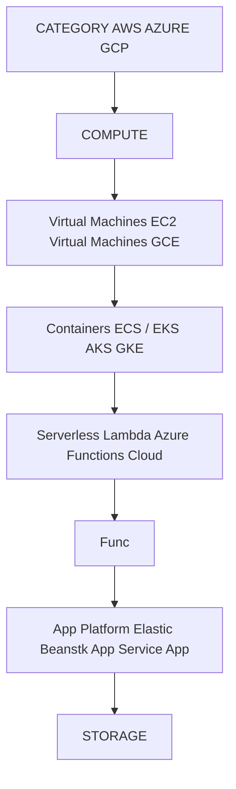
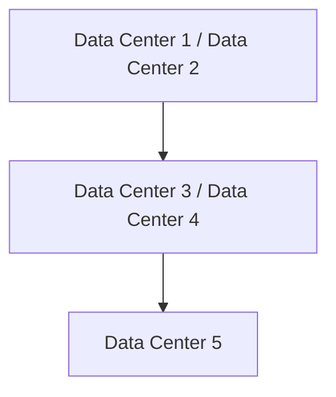
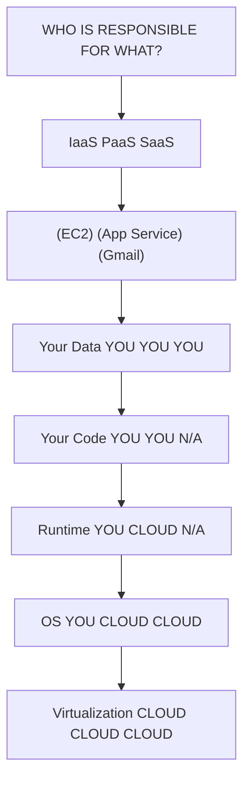
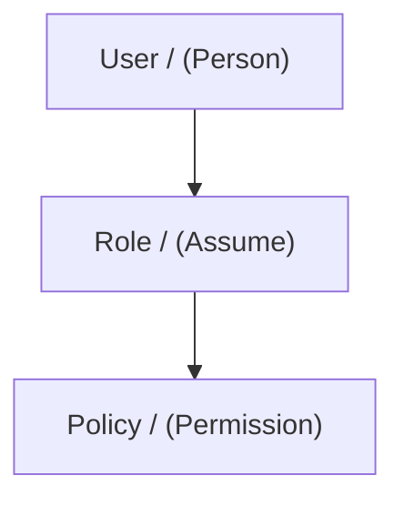
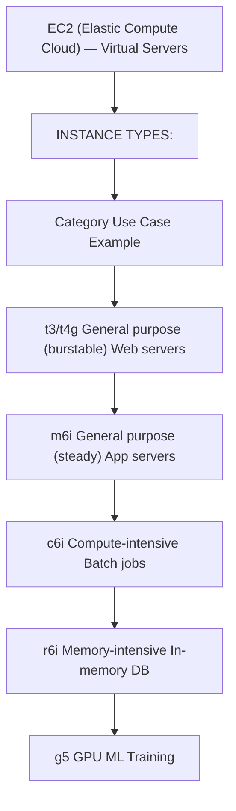
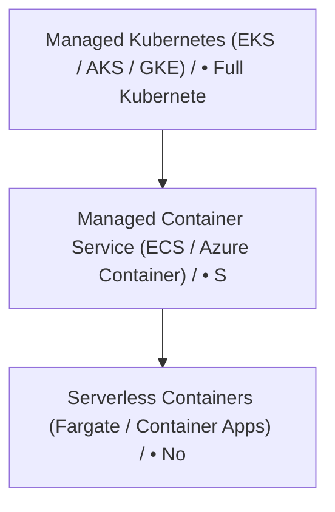
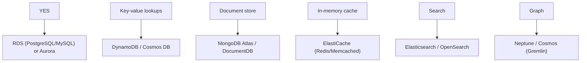
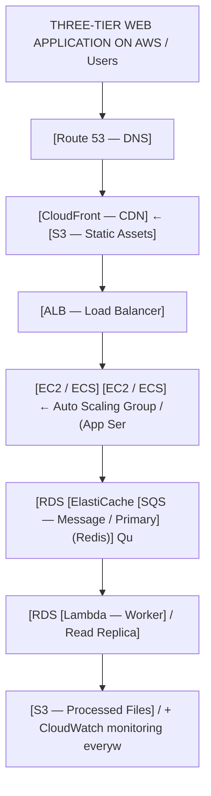
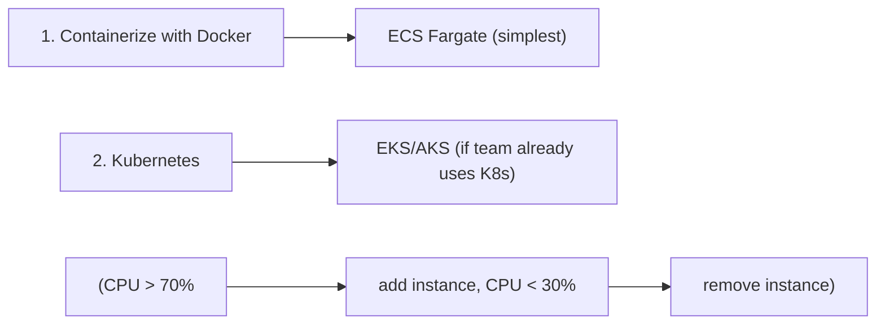

> **Navigation**: [< Previous](14_Code_Review_Practices.md) | [Back to Index](../00_MASTER_INDEX.md) | [Next >](16_IaC_Terraform.md)

# Cloud Services — AWS, Azure & GCP Guide

## Why Cloud Knowledge is Essential


> 95% of companies use at least one cloud provider.
> Even if you're not DevOps, understanding cloud services
> makes you a 10x more effective developer.
>
> You don't need to be a cloud architect —
> but you MUST know what's available and when to use it.


---

## The Big Three — Service Mapping

```
CATEGORY          │  AWS             │  AZURE            │  GCP
──────────────────────────────────────────────────
COMPUTE           │                  │                   │
Virtual Machines  │  EC2             │  Virtual Machines │  GCE
Containers        │  ECS / EKS       │  AKS              │  GKE
Serverless        │  Lambda          │  Azure Functions  │  Cloud
                  │                  │                   │  Func
App Platform      │  Elastic Beanstk │  App Service      │  App
                  │                  │                   │  Eng
────────────────────┼──────────────────┼───────────────────┼───────
STORAGE           │                  │                   │
Object Storage    │  S3              │  Blob Storage     │  GCS
Block Storage     │  EBS             │  Managed Disks    │  PD
File Storage      │  EFS             │  Azure Files      │  FS
────────────────────┼──────────────────┼───────────────────┼───────
DATABASE          │                  │                   │
Relational        │  RDS / Aurora    │  Azure SQL        │  Cloud
                  │                  │                   │  SQL
NoSQL Document    │  DynamoDB        │  Cosmos DB        │  Fire-
                  │                  │                   │  store
In-Memory Cache   │  ElastiCache     │  Azure Cache      │  Mem-
                  │                  │  for Redis        │  store
────────────────────┼──────────────────┼───────────────────┼───────
MESSAGING         │                  │                   │
Message Queue     │  SQS             │  Service Bus      │  Pub/
                  │                  │                   │  Sub
Event Streaming   │  Kinesis / MSK   │  Event Hubs       │  Data-
                  │                  │                   │  flow
Notifications     │  SNS             │  Notification Hub │  FCM
────────────────────┼──────────────────┼───────────────────┼───────
NETWORKING        │                  │                   │
CDN               │  CloudFront      │  Azure CDN / FD   │  Cloud
                  │                  │                   │  CDN
DNS               │  Route 53        │  Azure DNS        │  Cloud
                  │                  │                   │  DNS
Load Balancer     │  ELB / ALB       │  Azure LB / AG    │  Cloud
                  │                  │                   │  LB
API Gateway       │  API Gateway     │  APIM             │  API
                  │                  │                   │  GW
────────────────────┼──────────────────┼───────────────────┼───────
IDENTITY          │                  │                   │
Auth/Identity     │  IAM / Cognito   │  Azure AD / B2C   │  IAM
Secrets           │  Secrets Manager │  Key Vault        │  Sec-
                  │                  │                   │  ret
────────────────────┼──────────────────┼───────────────────┼───────
MONITORING        │                  │                   │
Monitoring        │  CloudWatch      │  Azure Monitor    │  Cloud
                  │                  │                   │  Mon
Logging           │  CloudWatch Logs │  Log Analytics    │  Cloud
                  │                  │                   │  Log
────────────────────┼──────────────────┼───────────────────┼───────
CI/CD             │                  │                   │
Build/Deploy      │  CodePipeline    │  Azure DevOps     │  Cloud
                  │  CodeBuild       │  Pipelines        │  Build
Container Reg.    │  ECR             │  ACR              │  GCR
```

> **Flow**: CATEGORY AWS AZURE GCP → COMPUTE | COMPUTE → Virtual Machines EC2 Virtual Machines GCE | Virtual Machines EC2 Virtual Machines GCE → Containers ECS / EKS AKS GKE | Containers ECS / EKS AKS GKE → Serverless Lambda Azure Functions Cloud | Serverless Lambda Azure Functions Cloud → Func | Func → App Platform Elastic Beanstk App Service App | ...+1 more



---

## Core Concepts Every Developer Should Know

### 1. Regions & Availability Zones

```
REGION = Geographic location (e.g., us-east-1, ap-south-1)

                  ┌─── Region: us-east-1 ───┐
                  │                          │
                  │  ┌─── AZ: us-east-1a ─┐ │
                  │  │  Data Center 1      │ │
                  │  │  Data Center 2      │ │
                  │  └────────────────────┘ │
                  │                          │
                  │  ┌─── AZ: us-east-1b ─┐ │
                  │  │  Data Center 3      │ │
                  │  │  Data Center 4      │ │
                  │  └────────────────────┘ │
                  │                          │
                  │  ┌─── AZ: us-east-1c ─┐ │
                  │  │  Data Center 5      │ │
                  │  └────────────────────┘ │
                  └──────────────────────────┘

Rule: Deploy across 2+ AZs for high availability.
AZs in the same region have low-latency links between them.
```

> **Flow**: Data Center 1 / Data Center 2 → Data Center 3 / Data Center 4 | Data Center 3 / Data Center 4 → Data Center 5



### 2. The Shared Responsibility Model

```
WHO IS RESPONSIBLE FOR WHAT?

                   IaaS        PaaS        SaaS
                  (EC2)    (App Service)  (Gmail)
┌──────────────┐
│ Your Data     │  YOU         YOU         YOU
│ Your Code     │  YOU         YOU         N/A
│ Runtime       │  YOU        CLOUD        N/A
│ OS            │  YOU        CLOUD       CLOUD
│ Virtualization│ CLOUD       CLOUD       CLOUD
│ Hardware      │ CLOUD       CLOUD       CLOUD
│ Network       │ CLOUD       CLOUD       CLOUD
│ Physical      │ CLOUD       CLOUD       CLOUD
└──────────────┘

As a developer, you manage MORE in IaaS, LESS in PaaS.
Most modern apps → PaaS or Containers (good balance).
```

> **Flow**: WHO IS RESPONSIBLE FOR WHAT? → IaaS PaaS SaaS | IaaS PaaS SaaS → (EC2) (App Service) (Gmail) | (EC2) (App Service) (Gmail) → Your Data YOU YOU YOU | Your Data YOU YOU YOU → Your Code YOU YOU N/A | Your Code YOU YOU N/A → Runtime YOU CLOUD N/A | Runtime YOU CLOUD N/A → OS YOU CLOUD CLOUD | ...+1 more



### 3. IAM — Identity & Access Management

```
IAM — The Security Gatekeeper

PRINCIPLE OF LEAST PRIVILEGE:
Give the minimum permissions needed, nothing more.

KEY CONCEPTS:
┌───────────┐  ┌──────────┐  ┌──────────────┐
│  User     │  │  Role    │  │  Policy      │
│  (Person) │  │  (Assume)│  │  (Permission)│
└─────┬─────┘  └────┬─────┘  └──────┬───────┘
      │              │               │
      └──────────────┴───────────────┘
                     │
             Attached to each other

EXAMPLE AWS IAM POLICY (JSON):
{
  "Effect": "Allow",
  "Action": "s3:GetObject",        // Only read
  "Resource": "arn:aws:s3:::my-bucket/*"  // Only this bucket
}

COMMON MISTAKE: Using root account for daily work
FIX: Create individual IAM users with specific roles
```

> **Flow**: User / (Person) → Role / (Assume) | Role / (Assume) → Policy / (Permission)



---

## Deep Dive: The Services You'll Use Most

### Compute: EC2 / VMs

```
EC2 (Elastic Compute Cloud) — Virtual Servers

INSTANCE TYPES:
┌──────────┬────────────────────────────┬────────────────┐
│ Category │ Use Case                   │ Example        │
├──────────┼────────────────────────────┼────────────────┤
│ t3/t4g   │ General purpose (burstable)│ Web servers    │
│ m6i      │ General purpose (steady)   │ App servers    │
│ c6i      │ Compute-intensive          │ Batch jobs     │
│ r6i      │ Memory-intensive           │ In-memory DB   │
│ g5       │ GPU                        │ ML Training    │
└──────────┴────────────────────────────┴────────────────┘

PRICING MODELS:
On-Demand: Pay per hour/second (most expensive, most flexible)
Reserved:  1-3 year commit → up to 72% savings
Spot:      Bid for unused capacity → up to 90% savings
           (can be interrupted with 2-min warning)
Savings:   Commit to $/hour → flexible across instance types
```

> **Flow**: EC2 (Elastic Compute Cloud) — Virtual Servers → INSTANCE TYPES: | INSTANCE TYPES: → Category Use Case Example | Category Use Case Example → t3/t4g General purpose (burstable) Web servers | t3/t4g General purpose (burstable) Web servers → m6i General purpose (steady) App servers | m6i General purpose (steady) App servers → c6i Compute-intensive Batch jobs | c6i Compute-intensive Batch jobs → r6i Memory-intensive In-memory DB | ...+1 more



### Containers: ECS / EKS / AKS / GKE

```
CONTAINER DEPLOYMENT OPTIONS

┌──────────────────────────────────────────────────┐
│ Managed Kubernetes (EKS / AKS / GKE)             │
│ • Full Kubernetes API                            │
│ • Max flexibility, steeper learning curve        │
│ • Good for: large teams, complex microservices   │
└──────────────────────────────────────────────────┘

┌──────────────────────────────────────────────────┐
│ Managed Container Service (ECS / Azure Container)│
│ • Simpler than K8s                               │
│ • Provider-specific (not portable)               │
│ • Good for: small teams, simpler architectures   │
└──────────────────────────────────────────────────┘

┌──────────────────────────────────────────────────┐
│ Serverless Containers (Fargate / Container Apps) │
│ • No server management at all                    │
│ • Pay per vCPU-second                            │
│ • Good for: event-driven, variable load          │
└──────────────────────────────────────────────────┘
```

> **Flow**: Managed Kubernetes (EKS / AKS / GKE) / • Full Kubernete → Managed Container Service (ECS / Azure Container) / • S | Managed Container Service (ECS / Azure Container) / • S → Serverless Containers (Fargate / Container Apps) / • No



### Serverless: Lambda / Azure Functions


> SERVERLESS — No Server to Manage
>
> HOW IT WORKS:
> Event → Function Executes → Returns → Scales to Zero
>
> // AWS Lambda Example (Java)
> public class Handler implements RequestHandler<APIGatewayProxy,
> APIGatewayProxy> {
> public APIGatewayProxyResponseEvent handleRequest(
> APIGatewayProxyRequestEvent input, Context context) {
> String body = input.getBody();
> // process...
> return new APIGatewayProxyResponseEvent()
> .withStatusCode(200)
> .withBody("{\"message\": \"success\"}");
> }
> }
>
> GOOD FOR:                          BAD FOR:
> - API endpoints                   • Long-running tasks (>15 min)
> - Event processing                • WebSockets
> - Scheduled jobs (cron)           • Stateful applications
> - File processing triggers        • High-throughput streaming
> - Low/variable traffic            • Cold-start-sensitive apps
>
> COLD START: First invocation is slow (JVM = 3-10s)
> SOLUTION: SnapStart (AWS), Provisioned Concurrency,
> or use Node.js/Python for latency-sensitive functions


### Storage: S3 / Blob Storage

## Class           │ Use Case             │ Cost

| Standard        | Frequent access      | $$$ |
| Intelligent     | Unknown access       | $$ + fee |
| Standard-IA     | Infrequent access    | $$ |
| Glacier Instant | Archive, instant     | $ |
| Glacier         | Archive, 3-5 hrs     | ¢ |
| Deep Archive    | Archive, 12 hrs      | ¢¢ |

### Database Services

```
DATABASE DECISION TREE

Need ACID + complex queries?
├── YES → RDS (PostgreSQL/MySQL) or Aurora
│         (Aurora = 3-5x faster than RDS, costs more)
│
└── NO → What's the access pattern?
         │
         ├── Key-value lookups → DynamoDB / Cosmos DB
         │   (Single-digit ms at any scale)
         │
         ├── Document store → MongoDB Atlas / DocumentDB
         │
         ├── In-memory cache → ElastiCache (Redis/Memcached)
         │
         ├── Search → Elasticsearch / OpenSearch
         │
         ├── Graph → Neptune / Cosmos (Gremlin)
         │
         └── Time-series → Timestream / InfluxDB

RDS READ SCALING: Read Replicas (up to 15 in Aurora)
RDS WRITE SCALING: Vertical (bigger instance) or sharding
```

> **Flow**: YES → RDS (PostgreSQL/MySQL) or Aurora | Key-value lookups → DynamoDB / Cosmos DB | Document store → MongoDB Atlas / DocumentDB | In-memory cache → ElastiCache (Redis/Memcached) | Search → Elasticsearch / OpenSearch | Graph → Neptune / Cosmos (Gremlin)



---

## Typical Cloud Architecture

```
THREE-TIER WEB APPLICATION ON AWS

Users
  │
  ▼
[Route 53 — DNS]
  │
  ▼
[CloudFront — CDN]  ←── [S3 — Static Assets]
  │
  ▼
[ALB — Load Balancer]
  │
  ├──────────────────────────┐
  ▼                          ▼
[EC2 / ECS]            [EC2 / ECS]    ← Auto Scaling Group
(App Server 1)         (App Server 2)
  │                          │
  └──────────┬───────────────┘
             │
  ┌──────────┼──────────────────────┐
  ▼          ▼                      ▼
[RDS     [ElastiCache       [SQS — Message
 Primary] (Redis)]           Queue]
  │                                 │
  ▼                                 ▼
[RDS                        [Lambda — Worker]
 Read Replica]                      │
                                    ▼
                            [S3 — Processed Files]

+ CloudWatch monitoring everywhere
+ IAM roles for service-to-service auth
+ VPC with public/private subnets
```

> **Flow**: THREE-TIER WEB APPLICATION ON AWS / Users → [Route 53 — DNS] | [Route 53 — DNS] → [CloudFront — CDN] ← [S3 — Static Assets] | [CloudFront — CDN] ← [S3 — Static Assets] → [ALB — Load Balancer] | [ALB — Load Balancer] → [EC2 / ECS] [EC2 / ECS] ← Auto Scaling Group / (App Ser | [EC2 / ECS] [EC2 / ECS] ← Auto Scaling Group / (App Ser → [RDS [ElastiCache [SQS — Message / Primary] (Redis)] Qu | [RDS [ElastiCache [SQS — Message / Primary] (Redis)] Qu → [RDS [Lambda — Worker] / Read Replica] | ...+1 more



---

## Cost Optimization Tips


> COST MISTAKES DEVELOPERS MAKE
>
> 1. Leaving resources running
> → Use auto-shutdown for dev/test environments
> → Tag everything: Environment=dev, Owner=your-name
>
> 2. Over-provisioning
> → Start small (t3.small), scale up when needed
> → Use auto-scaling (scale OUT not UP)
>
> 3. Not using the right storage tier
> → Old logs in S3 Standard? Move to Glacier
> → Use lifecycle policies for automatic transitions
>
> 4. Data transfer costs
> → Data INTO cloud = free, data OUT = expensive
> → Keep processing close to data (same region)
> → Use VPC endpoints for AWS service calls
>
> 5. Not using Reserved/Savings Plans
> → If you know you'll run 24/7 for a year → Reserve it


---

## Cloud for Spring Boot Developers


> SPRING BOOT → CLOUD MAPPING
>
> LOCAL                      │  CLOUD EQUIVALENT
> ──────────────────────────┼──────────────────────────────
> application.properties     │  AWS Parameter Store / K8s ConfigMap
> Secrets in .env            │  AWS Secrets Manager / Key Vault
> Local file uploads         │  S3 / Blob Storage
> In-memory H2 database      │  RDS PostgreSQL / Azure SQL
> @Cacheable (in-memory)     │  ElastiCache Redis
> @Async with ThreadPool     │  SQS + Lambda workers
> @Scheduled cron jobs       │  EventBridge / CloudWatch Events
> Logback console output     │  CloudWatch Logs / ELK
> Actuator /health           │  ALB health checks
> localhost:8080             │  Route 53 → ALB → ECS/EC2
>
> SPRING CLOUD AWS:
> <dependency>
> <groupId>io.awspring.cloud</groupId>
> <artifactId>spring-cloud-aws-starter</artifactId>
> </dependency>
> → Auto-configures S3, SQS, SNS, Parameter Store, etc.


---

## Interview Questions

```
Q: What's the difference between IaaS, PaaS, and SaaS?
A: IaaS = infrastructure (VMs, storage) — you manage OS + app
   PaaS = platform (App Service, Heroku) — you manage app only
   SaaS = software (Gmail, Slack) — you manage nothing

Q: How would you deploy a Spring Boot app to the cloud?
A: Multiple options depending on requirements:
   1. Containerize with Docker → ECS Fargate (simplest)
   2. Kubernetes → EKS/AKS (if team already uses K8s)
   3. Elastic Beanstalk / App Service (PaaS, quickest start)
   4. EC2 with Auto Scaling (if need full control)

Q: How do you handle secrets in cloud environments?
A: Never hardcode or commit secrets.
   Use: AWS Secrets Manager, Azure Key Vault, or GCP Secret Manager
   Access: Via IAM roles (not API keys in code)
   Rotate: Automatically with managed rotation

Q: Explain horizontal vs vertical scaling.
A: Vertical = bigger machine (limited, downtime to change)
   Horizontal = more machines behind load balancer (preferred)
   Auto-scaling = automatically add/remove based on metrics
   (CPU > 70% → add instance, CPU < 30% → remove instance)
```

> **Flow**: 1. Containerize with Docker → ECS Fargate (simplest) | 2. Kubernetes → EKS/AKS (if team already uses K8s) | (CPU &gt; 70% → add instance, CPU &lt; 30% | add instance, CPU &lt; 30% → remove instance)



---

## Mental Model: Cloud as Building Blocks


> Think of cloud services like LEGO blocks:
>
> You don't build a database from scratch.
> You pick the RIGHT block (RDS, DynamoDB, Redis)
> and snap it into your architecture.
>
> Your job as a developer:
> 1. Know what blocks exist
> 2. Know when to use each one
> 3. Know how to connect them
> 4. Know the trade-offs (cost, latency, complexity)
>
> You DON'T need to:
> - Memorize every service (there are 200+ on AWS alone)
> - Know the exact CLI commands
> - Be a networking expert
>
> You DO need to:
> - Design solutions using the right services
> - Understand pricing implications of your choices
> - Write code that works with cloud services (SDKs)


---

*Start with ONE cloud provider (the one your target company uses). Master 10 core services deeply. The rest transfers.*


---

> **Navigation**: [< Previous](14_Code_Review_Practices.md) | [Back to Index](../00_MASTER_INDEX.md) | [Next >](16_IaC_Terraform.md)