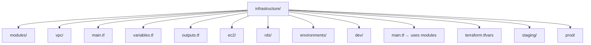
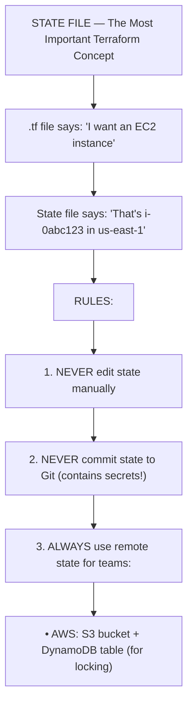
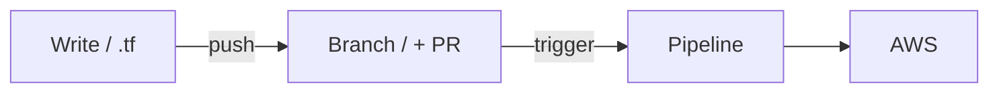
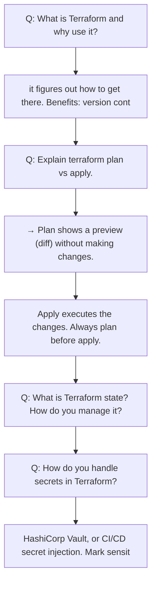
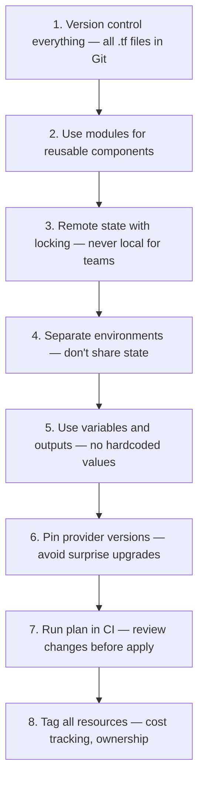

> **Navigation**: [< Previous](15_Cloud_Services_Guide.md) | [Back to Index](../00_MASTER_INDEX.md) | [Next >](17_Servers_Ports_Networking.md)

# Infrastructure as Code — Terraform & DevOps

## What is Infrastructure as Code (IaC)?


> BEFORE IaC:
> "Hey admin, can you create a server? 2 CPU, 8 GB RAM, Ubuntu"
> → Email/ticket → wait 3 days → manual setup → no consistency
> → "But it works on MY server!" (configuration drift)
>
> AFTER IaC:
> Write code → commit to Git → CI/CD creates infrastructure
> → reproducible, versioned, reviewable, testable
> → identical environments every time
>
> IaC = Treat infrastructure the same way you treat application
> code: version it, test it, review it, automate it.


---

## IaC Tool Landscape


> PROVISIONING (create infrastructure):
> - Terraform — multi-cloud, declarative, HCL language
> - Pulumi — multi-cloud, use real languages (Java/Python/TS)
> - AWS CloudFormation — AWS only, JSON/YAML
> - Azure ARM/Bicep — Azure only
> - Google Cloud Deployment Manager — GCP only
>
> CONFIGURATION MANAGEMENT (configure existing servers):
> - Ansible — agentless, YAML playbooks, push-based
> - Chef — Ruby DSL, pull-based, agent on servers
> - Puppet — declarative, pull-based, agent on servers
>
> CONTAINERS & ORCHESTRATION:
> - Docker / Dockerfile — build container images
> - Docker Compose — multi-container local development
> - Kubernetes manifests — container orchestration
> - Helm — Kubernetes package manager (templated manifests)
>
> Most common combo: Terraform + Ansible + Docker + Kubernetes
> For interviews: Know Terraform basics + Docker + K8s concepts


---

## Terraform — Core Concepts

### Declarative vs Imperative


> IMPERATIVE (scripting):
> "Create a VPC, then create a subnet, then create an EC2..."
> → You describe the STEPS
> → Bash scripts, AWS CLI commands
>
> DECLARATIVE (Terraform):
> "I want 3 EC2 instances, a VPC, and an RDS database"
> → You describe the DESIRED STATE
> → Terraform figures out the steps to get there
>
> KEY BENEFIT: Terraform knows current state vs desired state.
> It only changes what's DIFFERENT (idempotent).


### The Terraform Workflow


>
> Write (.tf files)
> │
> ▼
> terraform init        ← Download providers (AWS, Azure, etc.)
> │
> ▼
> terraform plan        ← Preview changes (diff: + add, - remove)
> │                    NEVER skip this step!
> ▼
> terraform apply       ← Execute changes (creates/updates)
> │
> ▼
> terraform destroy     ← Tear down everything (cleanup)
>
> State file (terraform.tfstate) tracks what exists.
> NEVER edit this file manually. NEVER commit it to Git.
> Store it remotely (S3 + DynamoDB lock, Terraform Cloud).


---

## Terraform — HCL Language Basics

### Provider Configuration

```hcl
# main.tf — Configure the AWS provider
terraform {
  required_version = ">= 1.0"

  required_providers {
    aws = {
      source  = "hashicorp/aws"
      version = "~> 5.0"
    }
  }

  # Remote state storage (team collaboration)
  backend "s3" {
    bucket         = "my-terraform-state"
    key            = "prod/terraform.tfstate"
    region         = "us-east-1"
    dynamodb_table = "terraform-locks"
    encrypt        = true
  }
}

provider "aws" {
  region = var.aws_region
}
```

### Resources — The Building Blocks

```hcl
# Create a VPC
resource "aws_vpc" "main" {
  cidr_block           = "10.0.0.0/16"
  enable_dns_hostnames = true

  tags = {
    Name        = "main-vpc"
    Environment = var.environment
  }
}

# Create a subnet inside the VPC
resource "aws_subnet" "public" {
  vpc_id                  = aws_vpc.main.id    # Reference another resource
  cidr_block              = "10.0.1.0/24"
  availability_zone       = "us-east-1a"
  map_public_ip_on_launch = true

  tags = {
    Name = "public-subnet"
  }
}

# Create an EC2 instance
resource "aws_instance" "web" {
  ami           = "ami-0c55b159cbfafe1f0"  # Amazon Linux 2
  instance_type = var.instance_type
  subnet_id     = aws_subnet.public.id

  tags = {
    Name = "web-server"
  }
}
```

### Variables & Outputs

```hcl
# variables.tf
variable "aws_region" {
  description = "AWS region to deploy to"
  type        = string
  default     = "us-east-1"
}

variable "instance_type" {
  description = "EC2 instance type"
  type        = string
  default     = "t3.micro"

  validation {
    condition     = contains(["t3.micro", "t3.small", "t3.medium"], var.instance_type)
    error_message = "Instance type must be t3.micro, t3.small, or t3.medium."
  }
}

variable "environment" {
  description = "Environment name"
  type        = string
  # No default — must be provided
}

# outputs.tf
output "instance_public_ip" {
  description = "Public IP of the web server"
  value       = aws_instance.web.public_ip
}

output "vpc_id" {
  value = aws_vpc.main.id
}
```

### Data Sources — Read Existing Resources

```hcl
# Look up the latest Amazon Linux 2 AMI (don't hardcode!)
data "aws_ami" "amazon_linux" {
  most_recent = true
  owners      = ["amazon"]

  filter {
    name   = "name"
    values = ["amzn2-ami-hvm-*-x86_64-gp2"]
  }
}

resource "aws_instance" "web" {
  ami           = data.aws_ami.amazon_linux.id  # Always latest
  instance_type = var.instance_type
}
```

---

## Terraform — Intermediate Patterns

### Modules — Reusable Components

```
Project Structure:

infrastructure/
├── modules/
│   ├── vpc/
│   │   ├── main.tf
│   │   ├── variables.tf
│   │   └── outputs.tf
│   ├── ec2/
│   │   ├── main.tf
│   │   ├── variables.tf
│   │   └── outputs.tf
│   └── rds/
│       ├── main.tf
│       ├── variables.tf
│       └── outputs.tf
├── environments/
│   ├── dev/
│   │   ├── main.tf          ← uses modules
│   │   └── terraform.tfvars
│   ├── staging/
│   └── prod/
└── terraform.tfvars
```

**Flow:**
- infrastructure/
- ↓
- modules/
- ↓
- infrastructure/
- ↓
- vpc/
- ↓
- infrastructure/
- ↓
- main.tf
- ↓
- infrastructure/
- ↓
- variables.tf
- ↓
- infrastructure/
- ↓
- outputs.tf
- ↓
- infrastructure/
- ↓
- ec2/



```hcl
# modules/vpc/main.tf
resource "aws_vpc" "this" {
  cidr_block = var.cidr_block
  tags       = { Name = "${var.name}-vpc" }
}

resource "aws_subnet" "public" {
  count      = length(var.public_subnets)
  vpc_id     = aws_vpc.this.id
  cidr_block = var.public_subnets[count.index]
}

# modules/vpc/variables.tf
variable "cidr_block" { type = string }
variable "name"       { type = string }
variable "public_subnets" { type = list(string) }

# modules/vpc/outputs.tf
output "vpc_id"     { value = aws_vpc.this.id }
output "subnet_ids" { value = aws_subnet.public[*].id }
```

```hcl
# environments/prod/main.tf — Use the module
module "vpc" {
  source         = "../../modules/vpc"
  name           = "production"
  cidr_block     = "10.0.0.0/16"
  public_subnets = ["10.0.1.0/24", "10.0.2.0/24"]
}

module "web_servers" {
  source        = "../../modules/ec2"
  instance_type = "t3.medium"
  subnet_ids    = module.vpc.subnet_ids    # Connect modules
  instance_count = 3
}
```

### Loops & Conditionals

```hcl
# count — create multiple identical resources
resource "aws_instance" "web" {
  count         = var.instance_count
  ami           = data.aws_ami.amazon_linux.id
  instance_type = var.instance_type

  tags = { Name = "web-${count.index + 1}" }
}

# for_each — create named resources (better than count)
variable "instances" {
  default = {
    web   = "t3.small"
    api   = "t3.medium"
    worker = "t3.large"
  }
}

resource "aws_instance" "app" {
  for_each      = var.instances
  ami           = data.aws_ami.amazon_linux.id
  instance_type = each.value

  tags = { Name = each.key }
}
# Creates: aws_instance.app["web"], aws_instance.app["api"], aws_instance.app["worker"]

# conditional — ternary
resource "aws_instance" "bastion" {
  count         = var.environment == "prod" ? 1 : 0  # Only in prod
  ami           = data.aws_ami.amazon_linux.id
  instance_type = "t3.micro"
}
```

### Lifecycle Rules

```hcl
resource "aws_instance" "web" {
  ami           = data.aws_ami.amazon_linux.id
  instance_type = var.instance_type

  lifecycle {
    create_before_destroy = true    # Blue-green: new first, then delete old
    prevent_destroy       = true    # Safety net: can't destroy accidentally
    ignore_changes        = [tags]  # Don't update if only tags changed
  }
}
```

---

## Terraform — Real-World Example

### 3-Tier AWS Architecture

```hcl
# Complete example: VPC + ALB + EC2 + RDS

# --- VPC ---
resource "aws_vpc" "main" {
  cidr_block           = "10.0.0.0/16"
  enable_dns_hostnames = true
}

resource "aws_subnet" "public_a" {
  vpc_id            = aws_vpc.main.id
  cidr_block        = "10.0.1.0/24"
  availability_zone = "us-east-1a"
}

resource "aws_subnet" "public_b" {
  vpc_id            = aws_vpc.main.id
  cidr_block        = "10.0.2.0/24"
  availability_zone = "us-east-1b"
}

resource "aws_subnet" "private_a" {
  vpc_id            = aws_vpc.main.id
  cidr_block        = "10.0.10.0/24"
  availability_zone = "us-east-1a"
}

# --- Security Groups ---
resource "aws_security_group" "alb" {
  vpc_id = aws_vpc.main.id

  ingress {
    from_port   = 443
    to_port     = 443
    protocol    = "tcp"
    cidr_blocks = ["0.0.0.0/0"]
  }

  egress {
    from_port   = 0
    to_port     = 0
    protocol    = "-1"
    cidr_blocks = ["0.0.0.0/0"]
  }
}

resource "aws_security_group" "app" {
  vpc_id = aws_vpc.main.id

  ingress {
    from_port       = 8080
    to_port         = 8080
    protocol        = "tcp"
    security_groups = [aws_security_group.alb.id]  # Only from ALB
  }
}

resource "aws_security_group" "db" {
  vpc_id = aws_vpc.main.id

  ingress {
    from_port       = 5432
    to_port         = 5432
    protocol        = "tcp"
    security_groups = [aws_security_group.app.id]  # Only from app servers
  }
}

# --- ALB ---
resource "aws_lb" "main" {
  name               = "app-alb"
  internal           = false
  load_balancer_type = "application"
  security_groups    = [aws_security_group.alb.id]
  subnets            = [aws_subnet.public_a.id, aws_subnet.public_b.id]
}

# --- RDS ---
resource "aws_db_instance" "main" {
  identifier        = "app-database"
  engine            = "postgres"
  engine_version    = "15"
  instance_class    = "db.t3.medium"
  allocated_storage = 20

  db_name  = "appdb"
  username = var.db_username
  password = var.db_password  # Use secrets manager in real life!

  vpc_security_group_ids = [aws_security_group.db.id]
  db_subnet_group_name   = aws_db_subnet_group.main.name

  backup_retention_period = 7
  multi_az               = var.environment == "prod" ? true : false
  skip_final_snapshot    = var.environment != "prod"
}
```

---

## Terraform State Management

```
╔══════════════════════════════════════════════════════════════════════╗
║  STATE FILE — The Most Important Terraform Concept                   ║
║                                                                      ║
║  terraform.tfstate maps your .tf code to real infrastructure.        ║
║                                                                      ║
║  .tf file says: "I want an EC2 instance"                             ║
║  State file says: "That's i-0abc123 in us-east-1"                    ║
║                                                                      ║
║  RULES:                                                              ║
║  1. NEVER edit state manually                                        ║
║  2. NEVER commit state to Git (contains secrets!)                    ║
║  3. ALWAYS use remote state for teams:                               ║
║     • AWS: S3 bucket + DynamoDB table (for locking)                  ║
║     • Azure: Azure Blob Storage                                      ║
║     • Terraform Cloud: built-in                                      ║
║  4. Use terraform state commands for state operations:               ║
║     • terraform state list    — see all resources                    ║
║     • terraform state show    — inspect a resource                   ║
║     • terraform state mv      — rename/move                          ║
║     • terraform state rm      — remove from state (not destroy)      ║
║     • terraform import        — bring existing resource into state   ║
╚══════════════════════════════════════════════════════════════════════╝
```

**Flow:**
- STATE FILE — The Most Important Terraform Concept
- ↓
- .tf file says: 'I want an EC2 instance'
- ↓
- State file says: 'That's i-0abc123 in us-east-1'
- ↓
- RULES:
- ↓
- 1. NEVER edit state manually
- ↓
- 2. NEVER commit state to Git (contains secrets!)
- ↓
- 3. ALWAYS use remote state for teams:



---

## CI/CD for Infrastructure

```
GitOps Workflow for Terraform:

Developer             Git               CI/CD             Cloud
┌────────┐   push    ┌────────┐  trigger  ┌────────┐    ┌──────┐
│ Write  │──────────▶│ Branch │──────────▶│Pipeline│───▶│ AWS  │
│ .tf    │           │ + PR   │           │        │    │      │
└────────┘           └────────┘           └────────┘    └──────┘

Pipeline Steps:
1. terraform fmt -check     (formatting)
2. terraform validate       (syntax check)
3. terraform plan           (preview) → comment on PR
4. (PR approved) terraform apply -auto-approve

RULE: Only CI/CD applies. Humans don't run apply.
```

**Flow:**
- Write / .tf --(push)--> Branch / + PR
- ↓
- Branch / + PR --(trigger)--> Pipeline
- ↓
- Pipeline
- ↓
- AWS



### GitHub Actions Example

```yaml
# .github/workflows/terraform.yml
name: Terraform

on:
  push:
    branches: [main]
    paths: ['infrastructure/**']
  pull_request:
    branches: [main]
    paths: ['infrastructure/**']

jobs:
  terraform:
    runs-on: ubuntu-latest
    defaults:
      run:
        working-directory: infrastructure/

    steps:
      - uses: actions/checkout@v4
      - uses: hashicorp/setup-terraform@v3

      - name: Terraform Init
        run: terraform init

      - name: Terraform Format Check
        run: terraform fmt -check

      - name: Terraform Validate
        run: terraform validate

      - name: Terraform Plan
        run: terraform plan -out=tfplan
        env:
          AWS_ACCESS_KEY_ID: ${{ secrets.AWS_ACCESS_KEY_ID }}
          AWS_SECRET_ACCESS_KEY: ${{ secrets.AWS_SECRET_ACCESS_KEY }}

      - name: Terraform Apply
        if: github.ref == 'refs/heads/main' && github.event_name == 'push'
        run: terraform apply -auto-approve tfplan
```

---

## Common Interview Questions

```
Q: What is Terraform and why use it?
→ Terraform is a declarative IaC tool. You define desired state,
  it figures out how to get there. Benefits: version control,
  reproducibility, multi-cloud support, collaboration, automation.

Q: Explain terraform plan vs apply.
→ Plan shows a preview (diff) without making changes.
  Apply executes the changes. Always plan before apply.

Q: What is Terraform state? How do you manage it?
→ State maps code to real resources. Store remotely (S3 + DynamoDB)
  for team collaboration with locking to prevent conflicts.

Q: How do you handle secrets in Terraform?
→ Never hardcode. Use: environment variables, AWS Secrets Manager,
  HashiCorp Vault, or CI/CD secret injection. Mark sensitive
  variables with `sensitive = true`.

Q: What's the difference between count and for_each?
→ count creates numbered resources (0, 1, 2...) — removing middle
  causes shifts. for_each creates named resources — more stable.

Q: How do you manage multiple environments (dev/staging/prod)?
→ Terraform workspaces, or separate directories per env sharing
  modules. Separate directories is more explicit and preferred.

Q: What happens if you delete a resource from .tf without destroy?
→ terraform apply will destroy it. If you want to keep it but
  stop managing it, use terraform state rm first.
```

**Flow:**
- Q: What is Terraform and why use it?
- ↓
- it figures out how to get there. Benefits: version cont
- ↓
- Q: Explain terraform plan vs apply.
- ↓
- Plan shows a preview (diff) without making changes.
- ↓
- Apply executes the changes. Always plan before apply.
- ↓
- Q: What is Terraform state? How do you manage it?
- ↓
- Q: How do you handle secrets in Terraform?



---

## IaC Best Practices Summary

```
╔══════════════════════════════════════════════════════════════════════╗
║  1. Version control everything — all .tf files in Git                ║
║  2. Use modules for reusable components                              ║
║  3. Remote state with locking — never local for teams                ║
║  4. Separate environments — don't share state                        ║
║  5. Use variables and outputs — no hardcoded values                  ║
║  6. Pin provider versions — avoid surprise upgrades                  ║
║  7. Run plan in CI — review changes before apply                     ║
║  8. Tag all resources — cost tracking, ownership                     ║
║  9. Use data sources — don't hardcode AMI IDs or ARNs                ║
║  10. Secrets in Vault/SSM — never in .tf files or state              ║
║  11. Small, focused changes — easier to review and debug             ║
║  12. Destroy unused resources — cost awareness                       ║
╚══════════════════════════════════════════════════════════════════════╝
```

**Flow:**
- 1. Version control everything — all .tf files in Git
- ↓
- 2. Use modules for reusable components
- ↓
- 3. Remote state with locking — never local for teams
- ↓
- 4. Separate environments — don't share state
- ↓
- 5. Use variables and outputs — no hardcoded values
- ↓
- 6. Pin provider versions — avoid surprise upgrades
- ↓
- 7. Run plan in CI — review changes before apply



---

*Infrastructure as Code isn't optional for modern engineers — it's the standard. Learn Terraform and you can deploy to any cloud.*


---

> **Navigation**: [< Previous](15_Cloud_Services_Guide.md) | [Back to Index](../00_MASTER_INDEX.md) | [Next >](17_Servers_Ports_Networking.md)