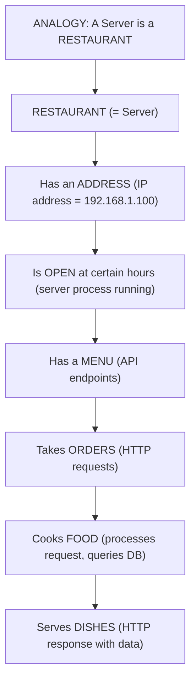
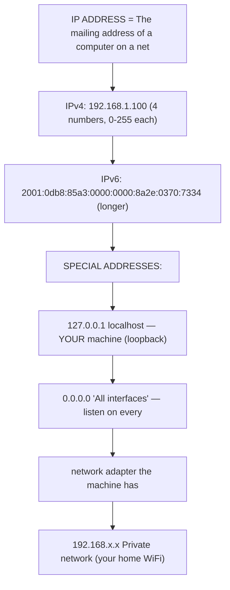
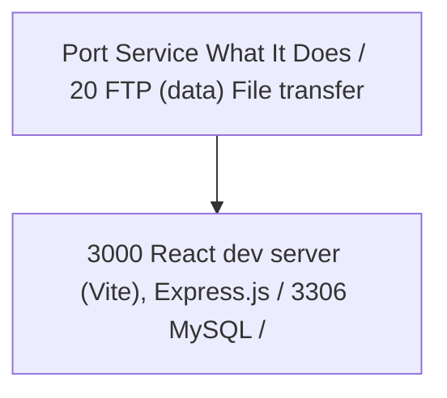
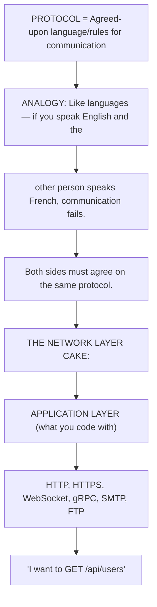
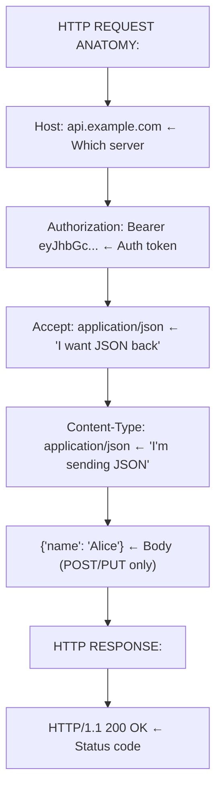
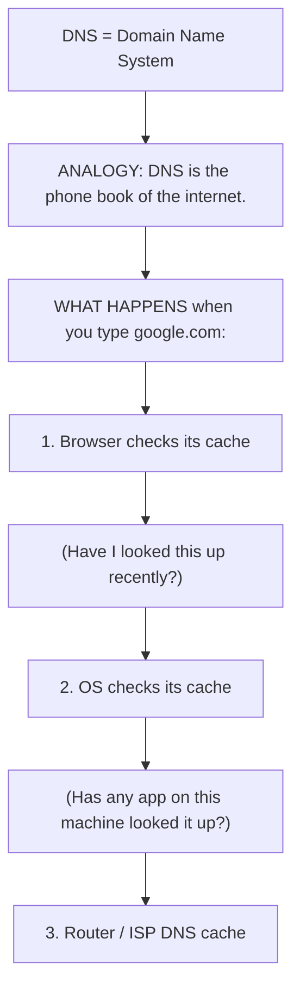
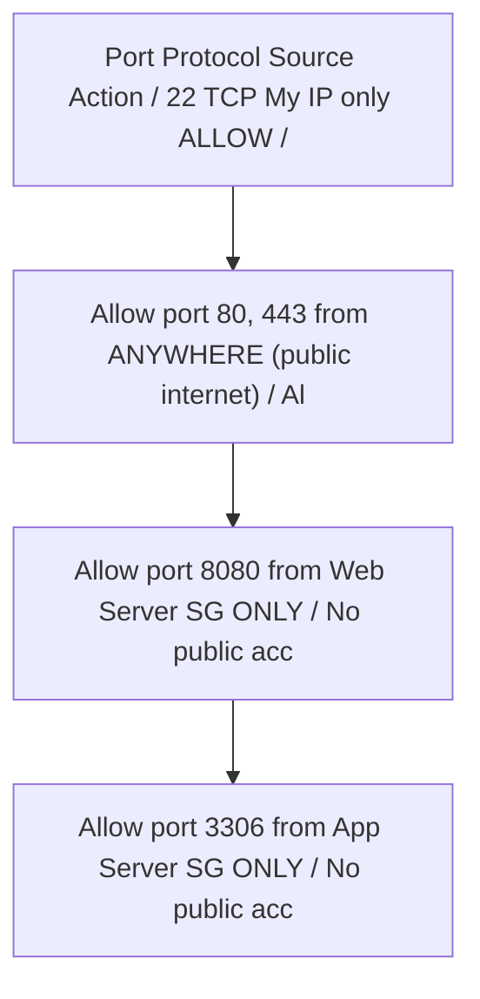
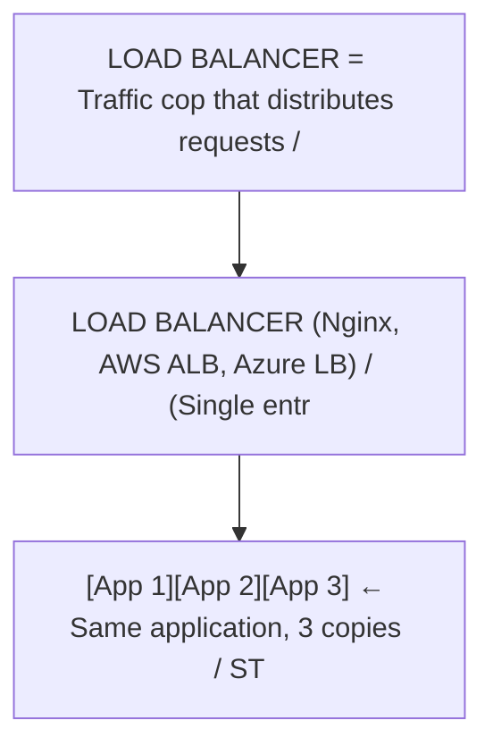
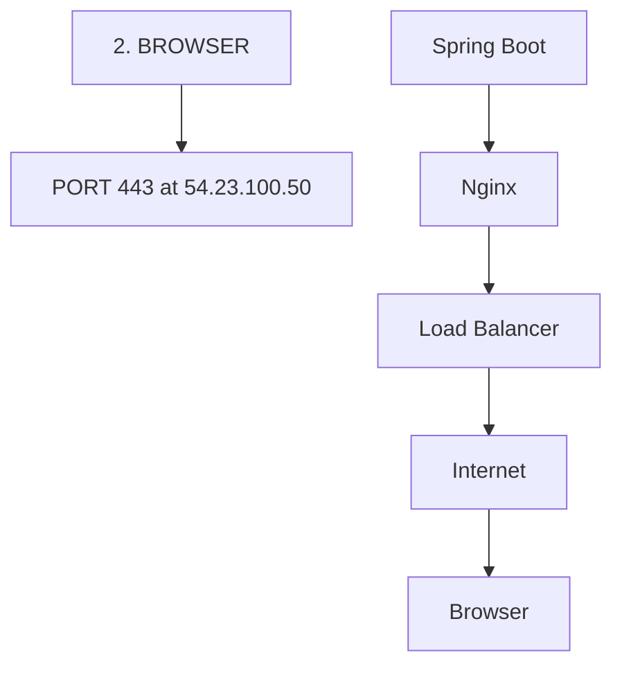
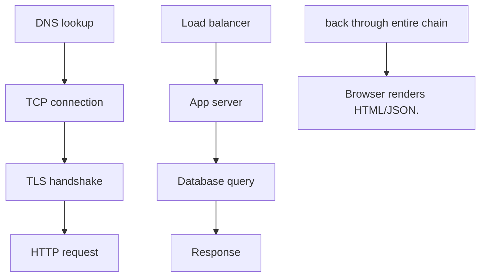

> **Navigation**: [< Previous](16_IaC_Terraform.md) | [Back to Index](../00_MASTER_INDEX.md) | [Next >](18_Backend_Cloud_Integration.md)

> **Developer Essentials Chapter 17** | [← IaC Terraform](16_IaC_Terraform.md) | [Index](../00_MASTER_INDEX.md) | [Next → Backend + Cloud](18_Backend_Cloud_Integration.md)

# Servers, Ports & Networking — The Complete Theory

## 5W1H — Why This Chapter?


> WHAT: How computers communicate over networks — servers,
> ports, protocols, DNS, firewalls, security groups.
>
> WHY:  Every application you build runs ON a server,
> communicates THROUGH ports, uses PROTOCOLS to talk.
> If you don't understand this, you can't:
> - Debug "connection refused" errors
> - Configure deployment correctly
> - Understand CORS, firewalls, load balancers
> - Pass any infrastructure interview question
>
> WHO:  Backend and full-stack developers.
>
> WHEN: Before deploying anything. Before interviews.
>
> HOW:  Through real-world analogies that make it stick.


---

## 1. What Is a Server?

```
ANALOGY: A Server is a RESTAURANT

┌──────────────────────────────────────────────────────────┐
│                                                          │
│  RESTAURANT (= Server)                                   │
│  ├── Has an ADDRESS (IP address = 192.168.1.100)         │
│  ├── Is OPEN at certain hours (server process running)   │
│  ├── Has a MENU (API endpoints)                          │
│  ├── Takes ORDERS (HTTP requests)                        │
│  ├── Cooks FOOD (processes request, queries DB)          │
│  ├── Serves DISHES (HTTP response with data)             │
│  └── Has multiple COUNTERS (ports)                       │
│      ├── Counter 80  → regular food (HTTP)               │
│      ├── Counter 443 → premium food (HTTPS)              │
│      └── Counter 22  → staff-only entrance (SSH)         │
│                                                          │
└──────────────────────────────────────────────────────────┘

TECHNICALLY:
• A server is just a computer running a program that
  LISTENS for incoming connections.
• Your laptop can be a server (localhost).
• AWS EC2, Azure VM = servers in the cloud.
• "Server" = the software (Tomcat, Nginx), not the hardware.
```

**Flow:**
- ANALOGY: A Server is a RESTAURANT
- ↓
- RESTAURANT (= Server)
- ↓
- Has an ADDRESS (IP address = 192.168.1.100)
- ↓
- Is OPEN at certain hours (server process running)
- ↓
- Has a MENU (API endpoints)
- ↓
- Takes ORDERS (HTTP requests)
- ↓
- Cooks FOOD (processes request, queries DB)



---

## 2. IP Addresses — The Complete Picture

```
IP ADDRESS = The mailing address of a computer on a network

IPv4:  192.168.1.100  (4 numbers, 0-255 each)
IPv6:  2001:0db8:85a3:0000:0000:8a2e:0370:7334 (longer)

SPECIAL ADDRESSES:
┌─────────────────┬────────────────────────────────────────┐
│ 127.0.0.1       │ localhost — YOUR machine (loopback)    │
│ 0.0.0.0         │ "All interfaces" — listen on every     │
│                  │ network adapter the machine has       │
│ 192.168.x.x     │ Private network (your home WiFi)       │
│ 10.x.x.x        │ Private network (corporate/cloud)      │
│ 172.16-31.x.x   │ Private network (alternative range)    │
│ Public IPs       │ Unique, routable on the internet      │
└─────────────────┴────────────────────────────────────────┘

ANALOGY:
• 127.0.0.1 = "my house" (always refers to yourself)
• 192.168.x.x = "street addresses in a gated community"
•   (only reachable WITHIN the community)
• Public IP = "full postal address reachable by anyone"
```

**Flow:**
- IP ADDRESS = The mailing address of a computer on a net
- ↓
- IPv4: 192.168.1.100 (4 numbers, 0-255 each)
- ↓
- IPv6: 2001:0db8:85a3:0000:0000:8a2e:0370:7334 (longer)
- ↓
- SPECIAL ADDRESSES:
- ↓
- 127.0.0.1 localhost — YOUR machine (loopback)
- ↓
- 0.0.0.0 'All interfaces' — listen on every
- ↓
- network adapter the machine has



---

## 3. Ports — Deep Dive

```
PORT = Which DOOR on the server to knock on (0-65535)

ANALOGY: An office building has ONE address (IP),
but MANY office rooms (ports).
├── Room 80  → Web server (HTTP)
├── Room 443 → Secure web server (HTTPS)
├── Room 22  → SSH (remote login)
├── Room 3306 → MySQL database
└── Room 8080 → Your Spring Boot app

WELL-KNOWN PORTS (0-1023):
┌──────┬──────────────────────────────────────────────────┐
│ Port │ Service          │ What It Does                  │
├──────┼──────────────────┼───────────────────────────────┤
│ 20   │ FTP (data)       │ File transfer                 │
│ 21   │ FTP (control)    │ File transfer commands        │
│ 22   │ SSH              │ Secure remote login           │
│ 25   │ SMTP             │ Send email                    │
│ 53   │ DNS              │ Domain name resolution        │
│ 80   │ HTTP             │ Web traffic (unencrypted)     │
│ 443  │ HTTPS            │ Web traffic (encrypted/TLS)   │
└──────┴──────────────────┴───────────────────────────────┘

DEVELOPER PORTS (commonly used):
┌──────┬──────────────────────────────────────────────────┐
│ 3000 │ React dev server (Vite), Express.js              │
│ 3306 │ MySQL                                            │
│ 5432 │ PostgreSQL                                       │
│ 5173 │ Vite dev server (default)                        │
│ 6379 │ Redis                                            │
│ 8080 │ Spring Boot / Tomcat                             │
│ 8443 │ Spring Boot HTTPS                                │
│ 9092 │ Apache Kafka                                     │
│ 27017│ MongoDB                                          │
└──────┴──────────────────────────────────────────────────┘

WHY "Port already in use"?
→ Another program is already listening on that port.
→ Fix: kill the other process, or change your port.
→ Spring Boot: server.port=8081 in application.properties
```

**Flow:**
- Port Service What It Does / 20 FTP (data) File transfer
- ↓
- 3000 React dev server (Vite), Express.js / 3306 MySQL /



---

## 4. Protocols — How Computers Talk

```
PROTOCOL = Agreed-upon language/rules for communication

ANALOGY: Like languages — if you speak English and the
other person speaks French, communication fails.
Both sides must agree on the same protocol.

THE NETWORK LAYER CAKE:

┌────────────────────────────────────────────────────────┐
│  APPLICATION LAYER (what you code with)                │
│  HTTP, HTTPS, WebSocket, gRPC, SMTP, FTP               │
│  "I want to GET /api/users"                            │
├────────────────────────────────────────────────────────┤
│  TRANSPORT LAYER                                       │
│  TCP (reliable, ordered) or UDP (fast, unreliable)     │
│  "Break into packets, ensure delivery"                 │
├────────────────────────────────────────────────────────┤
│  NETWORK LAYER                                         │
│  IP (Internet Protocol)                                │
│  "Route packets from source IP to destination IP"      │
├────────────────────────────────────────────────────────┤
│  PHYSICAL LAYER                                        │
│  Ethernet, WiFi, Fiber                                 │
│  "Actual electrical/light signals on wire"             │
└────────────────────────────────────────────────────────┘

TCP vs UDP:
┌─────────────┬───────────────────────────────────────────┐
│ TCP         │ Reliable, ordered. Like certified mail.   │
│             │ Used for: HTTP, email, file transfer      │
│             │ "Guarantees every packet arrives"         │
├─────────────┼───────────────────────────────────────────┤
│ UDP         │ Fast, no guarantee. Like shouting.        │
│             │ Used for: Video calls, gaming, DNS        │
│             │ "Some packets lost? That's okay"          │
└─────────────┴───────────────────────────────────────────┘
```

**Flow:**
- PROTOCOL = Agreed-upon language/rules for communication
- ↓
- ANALOGY: Like languages — if you speak English and the
- ↓
- other person speaks French, communication fails.
- ↓
- Both sides must agree on the same protocol.
- ↓
- THE NETWORK LAYER CAKE:
- ↓
- APPLICATION LAYER (what you code with)
- ↓
- HTTP, HTTPS, WebSocket, gRPC, SMTP, FTP



---

## 5. HTTP / HTTPS — What Developers Use Most

```
HTTP REQUEST ANATOMY:

GET /api/users?role=admin HTTP/1.1     ← Method + Path + Version
Host: api.example.com                   ← Which server
Authorization: Bearer eyJhbGc...        ← Auth token
Accept: application/json                ← "I want JSON back"
Content-Type: application/json          ← "I'm sending JSON"

{"name": "Alice"}                       ← Body (POST/PUT only)

HTTP RESPONSE:

HTTP/1.1 200 OK                         ← Status code
Content-Type: application/json
Set-Cookie: session=abc123

[{"id": 1, "name": "Alice"}]            ← Response body

STATUS CODES (memorize these):
┌──────┬──────────────────────────────────────────────────┐
│ 200  │ OK — success                                     │
│ 201  │ Created — new resource made (POST success)       │
│ 204  │ No Content — success, nothing to return (DELETE) │
│ 301  │ Moved Permanently — URL changed forever          │
│ 302  │ Found — temporary redirect                       │
│ 400  │ Bad Request — your input is wrong                │
│ 401  │ Unauthorized — not logged in                     │
│ 403  │ Forbidden — logged in but no permission          │
│ 404  │ Not Found — resource doesn't exist               │
│ 409  │ Conflict — duplicate entry, state mismatch       │
│ 429  │ Too Many Requests — rate limited                 │
│ 500  │ Internal Server Error — server crashed           │
│ 502  │ Bad Gateway — proxy can't reach backend          │
│ 503  │ Service Unavailable — server overloaded          │
│ 504  │ Gateway Timeout — backend took too long          │
└──────┴──────────────────────────────────────────────────┘

HTTPS = HTTP + TLS/SSL encryption
→ All data encrypted in transit
→ Browser shows padlock icon
→ Requires SSL certificate (Let's Encrypt = free)
→ MANDATORY for any production site
```

**Flow:**
- HTTP REQUEST ANATOMY:
- ↓
- Host: api.example.com ← Which server
- ↓
- Authorization: Bearer eyJhbGc... ← Auth token
- ↓
- Accept: application/json ← 'I want JSON back'
- ↓
- Content-Type: application/json ← 'I'm sending JSON'
- ↓
- {'name': 'Alice'} ← Body (POST/PUT only)
- ↓
- HTTP RESPONSE:



---

## 6. DNS — How Names Become IP Addresses

```
DNS = Domain Name System

ANALOGY: DNS is the phone book of the internet.
You know the NAME (google.com) but need the NUMBER (142.x.x.x)

WHAT HAPPENS when you type google.com:

1. Browser checks its cache
   (Have I looked this up recently?)
2. OS checks its cache
   (Has any app on this machine looked it up?)
3. Router / ISP DNS cache
4. If not cached → RECURSIVE DNS QUERY:

Your Computer
  │
  ├──→ Root DNS Server         "Who handles .com?"
  │    └──→ .com TLD Server    "Who handles google.com?"
  │         └──→ Google's NS   "google.com = 142.250.80.46"
  │
  ← ─── IP address returned (and cached for next time)

DNS RECORDS:
┌─────────┬────────────────────────────────────────────────┐
│ A       │ Maps domain → IPv4 address                     │
│ AAAA    │ Maps domain → IPv6 address                     │
│ CNAME   │ Alias: app.example.com → example.com           │
│ MX      │ Mail server for the domain                     │
│ TXT     │ Verification records (SPF, DKIM for email)     │
│ NS      │ Which DNS server is authoritative              │
└─────────┴────────────────────────────────────────────────┘

TTL (Time To Live): How long to cache the record.
Low TTL (60s) = changes propagate fast but more DNS queries.
High TTL (86400s) = fewer queries but changes are slow.
```

**Flow:**
- DNS = Domain Name System
- ↓
- ANALOGY: DNS is the phone book of the internet.
- ↓
- WHAT HAPPENS when you type google.com:
- ↓
- 1. Browser checks its cache
- ↓
- (Have I looked this up recently?)
- ↓
- 2. OS checks its cache
- ↓
- (Has any app on this machine looked it up?)



---

## 7. Firewalls & Security Groups

```
FIREWALL = The bouncer at the door

ANALOGY: Your server is a building.
The firewall is the security guard who checks:
• "Are you on the guest list?" (allowed IP?)
• "Which room are you visiting?" (allowed port?)
• "Are you entering or leaving?" (inbound vs outbound?)

┌──────────────────────────────────────────────────────────┐
│                     FIREWALL RULES                       │
│                                                          │
│  INBOUND (traffic coming IN to your server):             │
│  ┌────────┬──────────┬───────────────┬──────────┐        │
│  │ Port   │ Protocol │ Source        │ Action   │        │
│  ├────────┼──────────┼───────────────┼──────────┤        │
│  │ 22     │ TCP      │ My IP only    │ ALLOW    │        │
│  │ 80     │ TCP      │ 0.0.0.0/0    │ ALLOW    │         │
│  │ 443    │ TCP      │ 0.0.0.0/0    │ ALLOW    │         │
│  │ 3306   │ TCP      │ App server IP │ ALLOW    │        │
│  │ *      │ *        │ *             │ DENY     │        │
│  └────────┴──────────┴───────────────┴──────────┘        │
│                                                          │
│  MEANING:                                                │
│  • SSH: Only I can connect (my IP)                       │
│  • HTTP/HTTPS: Anyone on internet can access             │
│  • MySQL: Only the app server can connect                │
│  • Everything else: BLOCKED                              │
└──────────────────────────────────────────────────────────┘

CLOUD SECURITY GROUPS (AWS/Azure):

Security Group = Virtual firewall for cloud resources
ANALOGY: Like a gated community with rules:

┌── Web Server SG ───────────────────────────────────────┐
│ Allow port 80, 443 from ANYWHERE (public internet)     │
│ Allow port 22 from MY IP only                          │
└────────────────────────────────────────────────────────┘
                     │ Can talk to ↓
┌── App Server SG ───────────────────────────────────────┐
│ Allow port 8080 from Web Server SG ONLY                │
│ No public access!                                      │
└────────────────────────────────────────────────────────┘
                     │ Can talk to ↓
┌── Database SG ─────────────────────────────────────────┐
│ Allow port 3306 from App Server SG ONLY                │
│ No public access! No direct web access!                │
└────────────────────────────────────────────────────────┘

This is the PRINCIPLE OF LEAST PRIVILEGE:
Each layer can ONLY talk to the layer it needs.
Database is NEVER directly accessible from the internet.
```

**Flow:**
- Port Protocol Source Action / 22 TCP My IP only ALLOW /
- ↓
- Allow port 80, 443 from ANYWHERE (public internet) / Al
- ↓
- Allow port 8080 from Web Server SG ONLY / No public acc
- ↓
- Allow port 3306 from App Server SG ONLY / No public acc



---

## 8. Load Balancers & Reverse Proxies

```
LOAD BALANCER = Traffic cop that distributes requests

WHY: One server can handle ~1000 requests/second.
What if you get 10,000? You need MULTIPLE servers.
Load balancer distributes traffic across them.

ANALOGY: Like a restaurant host who seats customers
at different tables to balance the load on waiters.

Internet Users
    │ │ │ │ │
    ▼ ▼ ▼ ▼ ▼
┌──────────────────┐
│  LOAD BALANCER   │  (Nginx, AWS ALB, Azure LB)
│  (Single entry)  │
└───┬───┬───┬──────┘
    │   │   │
    ▼   ▼   ▼
[App 1][App 2][App 3]   ← Same application, 3 copies

STRATEGIES:
• Round Robin: 1→2→3→1→2→3 (rotate equally)
• Least Connections: send to server with fewest active requests
• IP Hash: same client always goes to same server (sessions)
• Weighted: server with more CPU gets more traffic

REVERSE PROXY (Nginx):
Sits in front of your app server. Handles:
• SSL termination (HTTPS → HTTP internally)
• Static file serving (faster than app server)
• Caching responses
• Rate limiting
• Compression (gzip/brotli)
```

**Flow:**
- LOAD BALANCER = Traffic cop that distributes requests /
- ↓
- LOAD BALANCER (Nginx, AWS ALB, Azure LB) / (Single entr
- ↓
- [App 1][App 2][App 3] ← Same application, 3 copies / ST



---

## 9. The Full Request Journey

```
What happens when you type "https://myapp.com/api/users":

1. BROWSER: "I need the IP for myapp.com"
   └→ DNS lookup → 54.23.100.50

2. BROWSER → PORT 443 at 54.23.100.50
   └→ TCP handshake (SYN → SYN-ACK → ACK)
   └→ TLS handshake (negotiate encryption)

3. REQUEST hits LOAD BALANCER
   └→ Chooses Server 2 (least connections)

4. REQUEST hits REVERSE PROXY (Nginx on Server 2)
   └→ Strips SSL, forwards to localhost:8080

5. REQUEST hits SPRING BOOT (port 8080)
   └→ DispatcherServlet → Controller → Service → Repository
   └→ Repository queries DATABASE (port 3306)
   └→ Database returns rows
   └→ Service applies business logic
   └→ Controller returns ResponseEntity<List<User>>

6. RESPONSE travels back:
   Spring Boot → Nginx → Load Balancer → Internet → Browser

7. BROWSER: Receives JSON, React updates the UI.

Total time: 100-500ms for a typical API call.
```

**Flow:**
- 2. BROWSER
- ↓
- PORT 443 at 54.23.100.50
- ↓
- Spring Boot
- ↓
- Nginx
- ↓
- Load Balancer
- ↓
- Internet
- ↓
- Browser



---

## 10. Common Networking Errors (What They Mean)


> Error                          │ Cause → Fix
> ───────────────────────────────┼────────────────────────────────
> Connection refused             │ Nothing running on that port.
> │ Start the server! Check port.
> │
> Connection timed out           │ Firewall blocking, wrong IP,
> │ server unreachable. Check SG.
> │
> Port already in use            │ Another process has the port.
> │ Kill it or use different port.
> │
> ECONNRESET                     │ Other side closed connection.
> │ Server crashed mid-request.
> │
> DNS resolution failed          │ Domain doesn't exist or DNS
> │ server down. Check domain name.
> │
> CORS error (browser only)      │ Server doesn't allow your
> │ origin. Add CORS headers.
> │
> SSL handshake failed           │ Certificate expired or invalid.
> │ Renew cert. Check date/domain.
> │
> 502 Bad Gateway                │ Load balancer can't reach
> │ backend. Backend is down.


---

## Interview Quick-Fire

```
Q: What's the difference between HTTP and HTTPS?
→ HTTPS = HTTP + TLS encryption. All data encrypted in transit.
  HTTP sends data as plain text (anyone can intercept).
  HTTPS uses SSL/TLS certificates. Mandatory for production.

Q: What is a port and why does it matter?
→ A port is a number (0-65535) that identifies which SERVICE
  on a machine should handle the request. Like a room number
  in a building. Port 80 = HTTP, 443 = HTTPS, 8080 = Spring Boot.

Q: What is a security group?
→ Virtual firewall in the cloud. Rules that say "allow traffic
  on port X from source Y." You create separate groups for
  web tier, app tier, database tier — each with minimal access.

Q: What's the difference between a load balancer and reverse proxy?
→ Load balancer: distributes traffic across multiple server copies.
  Reverse proxy: sits in front of ONE server, handles SSL, caching,
  static files, rate limiting. Nginx can do BOTH.

Q: Explain what happens when I visit a URL.
→ DNS lookup → TCP connection → TLS handshake → HTTP request
  → Load balancer → App server → Database query → Response
  back through entire chain → Browser renders HTML/JSON.
```

**Flow:**
- DNS lookup
- ↓
- TCP connection
- ↓
- TLS handshake
- ↓
- HTTP request
- ↓
- Load balancer
- ↓
- App server
- ↓
- Database query
- ↓
- Response



---

> [← IaC Terraform](16_IaC_Terraform.md) | [Index](../00_MASTER_INDEX.md) | [Next → Backend + Cloud](18_Backend_Cloud_Integration.md)


---

> **Navigation**: [< Previous](16_IaC_Terraform.md) | [Back to Index](../00_MASTER_INDEX.md) | [Next >](18_Backend_Cloud_Integration.md)