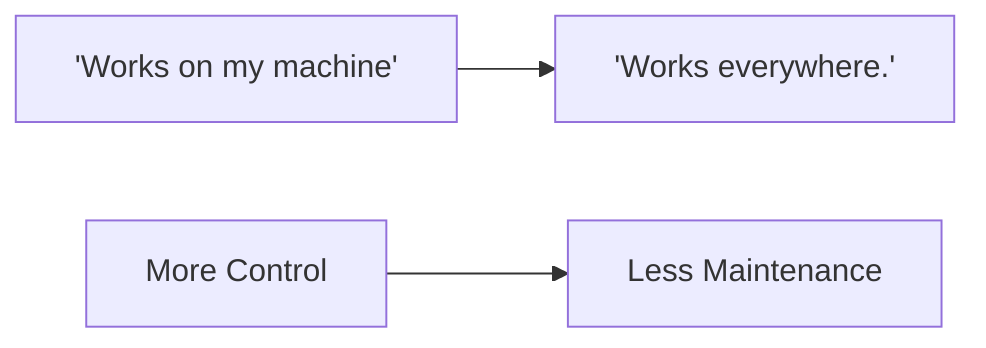
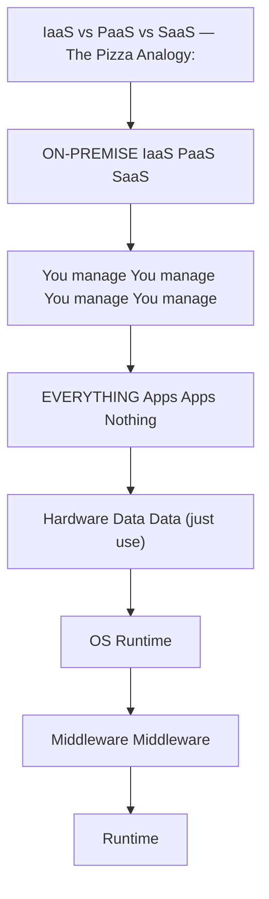
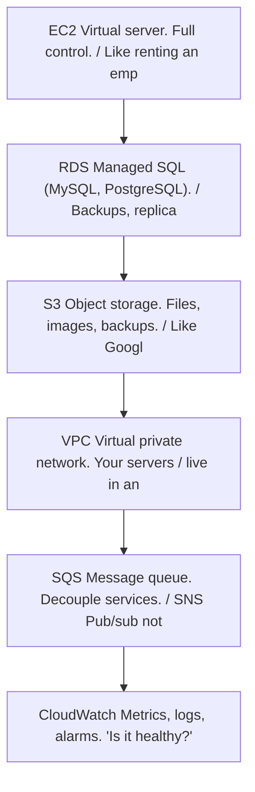
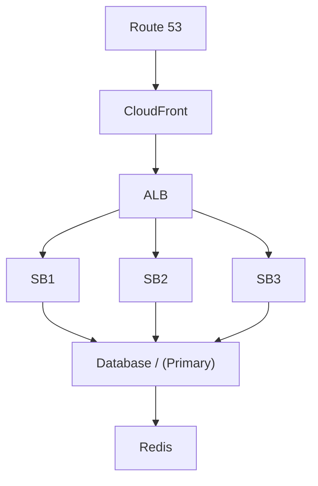
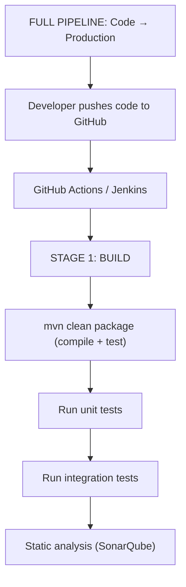
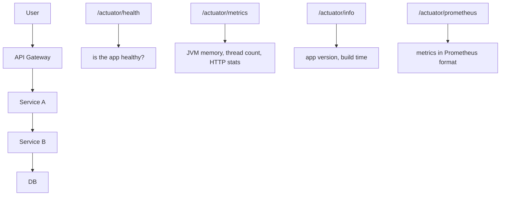
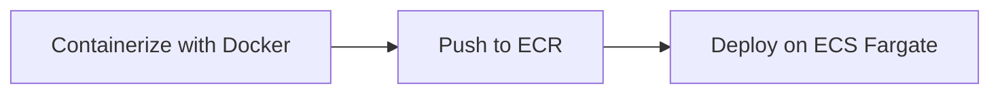

> **Navigation**: [< Previous](17_Servers_Ports_Networking.md) | [Back to Index](../00_MASTER_INDEX.md) | [Next >](19_Concurrency_Models_Coroutines.md)

> **Developer Essentials Chapter 18** | [← Servers & Networking](17_Servers_Ports_Networking.md) | [Index](../00_MASTER_INDEX.md) | [Next Series → Spring Boot Deps Map](../07_Modern_Java/Ch30_Dependencies_Annotations_Map.md)

# Backend + Cloud Integration — From Local to Production

## 5W1H — Why This Chapter?


> WHAT: How backend applications are deployed, scaled, and
> operated in cloud environments (AWS, Azure, GCP).
>
> WHY:  Writing code is 30% of the job. The other 70% is:
> deploying, monitoring, scaling, securing, and
> troubleshooting it in production.
>
> ANALOGY: Building a car (coding) vs driving it on highways
> (cloud deployment). You need both skills.
>
> WHO:  Backend and full-stack developers in 2024+.
>
> HOW:  Local → Container → Cloud Service → Production


---

## 1. The Deployment Evolution

```
ERA 1: PHYSICAL SERVER (2000s)
├── Buy a server rack. Put it in a data center.
├── Install OS, Java, database manually.
├── Deploy WAR file to Tomcat.
└── Problem: Takes weeks. Expensive. Can't scale easily.

ERA 2: VIRTUAL MACHINES (2010s)
├── Cloud provider gives you a "virtual server" in minutes.
├── AWS EC2, Azure VM, GCP Compute Engine.
├── You manage: OS updates, security patches, scaling.
└── Better, but still lots of maintenance.

ERA 3: CONTAINERS (2015+)
├── Docker: package your app + all dependencies.
├── "Works on my machine" → "Works everywhere."
├── Kubernetes: orchestrate 100s of containers.
└── You manage: container orchestration, networking.

ERA 4: SERVERLESS / PLATFORM (2020+)
├── Just deploy your code. Cloud handles everything else.
├── AWS Lambda, Azure Functions, AWS App Runner.
├── Auto-scaling, zero maintenance, pay-per-use.
└── You manage: just the code.

 More Control ◄──────────────────────────► Less Maintenance
 VM > Container > Platform > Serverless
```

**Flow:**
- 'Works on my machine'
- ↓
- 'Works everywhere.'
- ↓
- More Control
- ↓
- Less Maintenance



---

## 2. Cloud Service Models

```
IaaS vs PaaS vs SaaS — The Pizza Analogy:

┌────────────┬────────────┬────────────┬────────────┐
│ ON-PREMISE │  IaaS      │  PaaS      │  SaaS      │
│ (home cook)│ (grocery)  │ (delivery) │ (dine out) │
├────────────┼────────────┼────────────┼────────────┤
│ You manage │ You manage │ You manage │ You manage │
│ EVERYTHING │ Apps       │ Apps       │ Nothing    │
│ Hardware   │ Data       │ Data       │ (just use) │
│ OS         │ Runtime    │            │            │
│ Middleware │ Middleware │            │            │
│ Runtime    │            │            │            │
│ Apps       │ Cloud gives│ Cloud gives│ Cloud gives│
│ Data       │ Hardware   │ Hardware   │ Everything │
│            │ Storage    │ OS         │            │
│            │ Networking │ Runtime    │            │
│            │ OS         │ Middleware │            │
├────────────┼────────────┼────────────┼────────────┤
│ Example:   │ AWS EC2    │ Heroku     │ Gmail      │
│ Your rack  │ Azure VM   │ AWS EBS    │ Salesforce │
│            │ GCP CE     │ Azure App  │ GitHub     │
└────────────┴────────────┴────────────┴────────────┘
```

**Flow:**
- IaaS vs PaaS vs SaaS — The Pizza Analogy:
- ↓
- ON-PREMISE IaaS PaaS SaaS
- ↓
- You manage You manage You manage You manage
- ↓
- EVERYTHING Apps Apps Nothing
- ↓
- Hardware Data Data (just use)
- ↓
- OS Runtime
- ↓
- Middleware Middleware



---

## 3. AWS Services Map (What Developers Need)

```
AWS SERVICES — Developer's Guide (The Important Ones)

COMPUTE (Run your code):
┌───────────────────┬────────────────────────────────────────┐
│ EC2               │ Virtual server. Full control.          │
│                    │ Like renting an empty apartment.      │
│ ECS / Fargate      │ Run Docker containers. Fargate =      │
│                    │ serverless containers (no server mgmt)│
│ Lambda            │ Run functions. Pay per execution.      │
│                    │ No server at all. Event-driven.       │
│ Elastic Beanstalk │ PaaS. Upload code, AWS does rest.      │
│                    │ Good for Spring Boot quick deploy.    │
└───────────────────┴────────────────────────────────────────┘

DATABASE:
┌───────────────────┬───────────────────────────────────────┐
│ RDS               │ Managed SQL (MySQL, PostgreSQL).      │
│                    │ Backups, replicas handled by AWS.    │
│ DynamoDB           │ NoSQL key-value. Infinitely scalable.│
│ ElastiCache       │ Managed Redis/Memcached. Caching.     │
└───────────────────┴───────────────────────────────────────┘

STORAGE:
┌───────────────────┬────────────────────────────────────────┐
│ S3                │ Object storage. Files, images, backups.│
│                    │ Like Google Drive for your app.       │
└───────────────────┴────────────────────────────────────────┘

NETWORKING:
┌───────────────────┬───────────────────────────────────────┐
│ VPC               │ Virtual private network. Your servers │
│                    │ live in an isolated network bubble.  │
│ ALB (Load Balancer)│ Distributes traffic across servers.  │
│ Route 53          │ DNS service. Maps domain → servers.   │
│ CloudFront        │ CDN. Cache static content worldwide.  │
└───────────────────┴───────────────────────────────────────┘

MESSAGING:
┌───────────────────┬───────────────────────────────────────┐
│ SQS               │ Message queue. Decouple services.     │
│ SNS               │ Pub/sub notifications.                │
│ MSK               │ Managed Kafka. Event streaming.       │
└───────────────────┴───────────────────────────────────────┘

MONITORING:
┌───────────────────┬────────────────────────────────────────┐
│ CloudWatch        │ Metrics, logs, alarms. "Is it healthy?"│
└───────────────────┴────────────────────────────────────────┘
```

**Flow:**
- EC2 Virtual server. Full control. / Like renting an emp
- ↓
- RDS Managed SQL (MySQL, PostgreSQL). / Backups, replica
- ↓
- S3 Object storage. Files, images, backups. / Like Googl
- ↓
- VPC Virtual private network. Your servers / live in an
- ↓
- SQS Message queue. Decouple services. / SNS Pub/sub not
- ↓
- CloudWatch Metrics, logs, alarms. 'Is it healthy?'



---

## 4. Typical Spring Boot Cloud Architecture

```
PRODUCTION ARCHITECTURE for a Spring Boot Application:

Internet
   │
   ▼
┌──────────────┐     DNS: myapp.com → ALB IP
│   Route 53   │
└──────┬───────┘
       ▼
┌──────────────┐     CDN: Cache static assets (React build)
│  CloudFront  │──→  S3 Bucket (React SPA / static files)
└──────┬───────┘
       ▼
┌──────────────┐     SSL termination, routes /api/* to backend
│     ALB      │
└──┬───┬───┬───┘
   │   │   │
   ▼   ▼   ▼
┌───┐┌───┐┌───┐   ECS Fargate (or EC2 instances)
│SB1││SB2││SB3│   Spring Boot containers (auto-scaled)
└─┬─┘└─┬─┘└─┬─┘
  │     │     │
  ▼     ▼     ▼
┌──────────────┐   RDS (PostgreSQL) with read replicas
│   Database   │
│  (Primary)   │──→  [Read Replica 1]  [Read Replica 2]
└──────┬───────┘
       │
       ▼
┌──────────────┐   ElastiCache (Redis) for sessions + cache
│    Redis     │
└──────────────┘

Also connected:
├── SQS: async job processing (email sending, reports)
├── S3: file uploads (user avatars, documents)
└── CloudWatch: logs, metrics, alerts
```

**Flow:**
- Route 53
- ↓
- CloudFront
- ↓
- ALB
- ↓
- SB1
- ↓
- ALB
- ↓
- SB2
- ↓
- ALB
- ↓
- SB3
- ↓
- SB1
- ↓
- Database / (Primary)



---

## 5. Environment Configuration

```
ENVIRONMENTS — Same Code, Different Config:

LOCAL (developer laptop):
├── Database: localhost:3306 / H2 in-memory
├── Redis: localhost:6379
├── API URL: http://localhost:8080
└── Logs: DEBUG level

DEV (shared development server):
├── Database: dev-db.internal:3306
├── Redis: dev-redis.internal:6379
├── API URL: https://dev-api.myapp.com
└── Logs: DEBUG level

STAGING (pre-production, mirrors prod):
├── Database: staging-db.internal:3306
├── Redis: staging-redis.internal:6379
├── API URL: https://staging-api.myapp.com
└── Logs: INFO level

PRODUCTION:
├── Database: prod-db.internal:3306 (RDS, encrypted)
├── Redis: prod-cache.internal:6379 (ElastiCache)
├── API URL: https://api.myapp.com
└── Logs: WARN level

Spring Boot: application-{profile}.properties
├── application-local.properties
├── application-dev.properties
├── application-staging.properties
└── application-prod.properties

SECRETS (passwords, API keys):
NEVER in code or properties files!
├── AWS Secrets Manager
├── Azure Key Vault
├── Environment variables (passed at deploy time)
└── Spring Cloud Config Server
```

**Flow:**
- LOCAL (developer laptop):
- ↓
- Database: localhost:3306 / H2 in-memory
- ↓
- LOCAL (developer laptop):
- ↓
- Redis: localhost:6379
- ↓
- LOCAL (developer laptop):
- ↓
- API URL: http://localhost:8080
- ↓
- LOCAL (developer laptop):
- ↓
- Logs: DEBUG level
- ↓
- DEV (shared development server):
- ↓
- Database: dev-db.internal:3306
- ↓
- DEV (shared development server):
- ↓
- Redis: dev-redis.internal:6379

```mermaid
flowchart TD
    N1["LOCAL (developer laptop):"]
    N2["Database: localhost:3306 / H2 in-memory"]
    N3["Redis: localhost:6379"]
    N4["API URL: http://localhost:8080"]
    N5["Logs: DEBUG level"]
    N6["DEV (shared development server):"]
    N7["Database: dev-db.internal:3306"]
    N8["Redis: dev-redis.internal:6379"]
    N9["API URL: https://dev-api.myapp.com"]
    N10["STAGING (pre-production, mirrors prod):"]
    N11["Database: staging-db.internal:3306"]
    N12["Redis: staging-redis.internal:6379"]
    N13["API URL: https://staging-api.myapp.com"]
    N14["Logs: INFO level"]
    N15["PRODUCTION:"]
    N16["Database: prod-db.internal:3306 (RDS, encrypted)"]
    N17["Redis: prod-cache.internal:6379 (ElastiCache)"]
    N18["API URL: https://api.myapp.com"]
    N19["Logs: WARN level"]
    N20["Spring Boot: application-{profile}.properties"]
    N21["application-local.properties"]
    N22["application-dev.properties"]
    N23["application-staging.properties"]
    N24["application-prod.properties"]
    N25["NEVER in code or properties files!"]
    N26["AWS Secrets Manager"]
    N27["Azure Key Vault"]
    N28["Environment variables (passed at deploy time)"]
    N29["Spring Cloud Config Server"]
    N1 --> N2
    N1 --> N3
    N1 --> N4
    N1 --> N5
    N6 --> N7
    N6 --> N8
    N6 --> N9
    N6 --> N5
    N10 --> N11
    N10 --> N12
    N10 --> N13
    N10 --> N14
    N15 --> N16
    N15 --> N17
    N15 --> N18
    N15 --> N19
    N20 --> N21
    N20 --> N22
    N20 --> N23
    N20 --> N24
    N25 --> N26
    N25 --> N27
    N25 --> N28
    N25 --> N29
```



---

## 6. CI/CD Pipeline for Spring Boot

```
FULL PIPELINE: Code → Production

Developer pushes code to GitHub
     │
     ▼
┌─── GitHub Actions / Jenkins ───────────────────────────────┐
│                                                            │
│  STAGE 1: BUILD                                            │
│  ├── mvn clean package (compile + test)                    │
│  ├── Run unit tests                                        │
│  ├── Run integration tests                                 │
│  └── Static analysis (SonarQube)                           │
│                                                            │
│  STAGE 2: CONTAINERIZE                                     │
│  ├── docker build -t myapp:v1.2.3 .                        │
│  └── docker push to ECR (container registry)               │
│                                                            │
│  STAGE 3: DEPLOY TO STAGING                                │
│  ├── Update ECS task definition with new image             │
│  ├── Run smoke tests against staging                       │
│  └── Run end-to-end tests                                  │
│                                                            │
│  STAGE 4: DEPLOY TO PRODUCTION (manual approval)           │
│  ├── Rolling update (one container at a time)              │
│  ├── Health check passes → continue                        │
│  ├── Health check fails → automatic rollback               │
│  └── Monitor metrics for 15 minutes                        │
│                                                            │
└────────────────────────────────────────────────────────────┘

Dockerfile for Spring Boot:
FROM eclipse-temurin:21-jre-alpine
WORKDIR /app
COPY target/myapp.jar app.jar
EXPOSE 8080
ENTRYPOINT ["java", "-jar", "app.jar"]
```

**Flow:**
- FULL PIPELINE: Code
- ↓
- Production
- ↓
- Developer pushes code to GitHub
- ↓
- GitHub Actions / Jenkins
- ↓
- STAGE 1: BUILD
- ↓
- mvn clean package (compile + test)
- ↓
- Run unit tests
- ↓
- Run integration tests



---

## 7. Monitoring in Production

```
THE 3 PILLARS OF OBSERVABILITY:

1. METRICS — Numbers over time:
   ├── CPU usage, memory usage, request count
   ├── Response time (p50, p95, p99)
   ├── Error rate (% of 5xx responses)
   ├── Database connection pool usage
   └── Tools: Prometheus + Grafana, CloudWatch

2. LOGS — Text records of events:
   ├── Application logs (what happened, when, why)
   ├── Structured JSON logs (machine-parseable)
   ├── Correlation ID (trace a request across services)
   └── Tools: ELK Stack (Elasticsearch, Logstash, Kibana)

3. TRACES — Follow a request across services:
   ├── User → API Gateway → Service A → Service B → DB
   ├── See WHERE the time was spent
   ├── Find the bottleneck in a chain of 10 microservices
   └── Tools: Jaeger, Zipkin, AWS X-Ray

Spring Boot Actuator endpoints for monitoring:
/actuator/health  → is the app healthy?
/actuator/metrics → JVM memory, thread count, HTTP stats
/actuator/info    → app version, build time
/actuator/prometheus → metrics in Prometheus format
```

**Flow:**
- User
- ↓
- API Gateway
- ↓
- Service A
- ↓
- Service B
- ↓
- DB
- ↓
- /actuator/health
- ↓
- is the app healthy?
- ↓
- /actuator/metrics
- ↓
- JVM memory, thread count, HTTP stats



---

## Interview Quick-Fire

```
Q: How would you deploy a Spring Boot app to AWS?
→ Containerize with Docker → Push to ECR → Deploy on ECS Fargate
  (or Elastic Beanstalk for simpler setup). Database on RDS.
  Load balancer (ALB) in front. CloudWatch for monitoring.

Q: What's the difference between EC2, ECS, and Lambda?
→ EC2: full virtual server (you manage everything).
  ECS: run Docker containers (you manage containers).
  Lambda: run individual functions (you manage nothing).
  More abstraction = less control but less maintenance.

Q: How do you handle secrets in production?
→ NEVER in code or config files. Use AWS Secrets Manager or
  environment variables injected at deployment time.
  Spring Boot: @Value("${DB_PASSWORD}") reads from env.

Q: What is a VPC?
→ Virtual Private Cloud. An isolated network in the cloud.
  Your servers live inside it. You control who can enter (security
  groups) and how traffic flows (subnets, route tables).

Q: How do you handle database migrations in production?
→ Flyway or Liquibase. Version-controlled SQL scripts that run
  automatically on app startup. Forward-only. Never edit
  a migration that's been deployed.
```

**Flow:**
- Containerize with Docker
- ↓
- Push to ECR
- ↓
- Deploy on ECS Fargate



---

> [← Servers & Networking](17_Servers_Ports_Networking.md) | [Index](../00_MASTER_INDEX.md) | [Next Series → Spring Boot Deps Map](../07_Modern_Java/Ch30_Dependencies_Annotations_Map.md)


---

> **Navigation**: [< Previous](17_Servers_Ports_Networking.md) | [Back to Index](../00_MASTER_INDEX.md) | [Next >](19_Concurrency_Models_Coroutines.md)