**Navigation**: [< Previous](18_Backend_Cloud_Integration.md) | [Back to Index](../00_MASTER_INDEX.md)

# Chapter 19 — Concurrency Models, Coroutines & Continuations: Deep Reasoning

**"Anyone can say 'threads run in parallel.' The senior engineer explains WHY coroutines aren't threads, WHAT a continuation actually is, and HOW async/await works differently in Java, Kotlin, JavaScript, and Go."**

---

## Table of Contents

1. [Process vs Thread vs Coroutine: The Complete Picture](#1-process-vs-thread-vs-coroutine-the-complete-picture)
2. [Coroutines: What They Actually Are](#2-coroutines-what-they-actually-are)
3. [Continuations: The Foundation Under Everything](#3-continuations-the-foundation-under-everything)
4. [Coroutines vs Continuations: The Precise Difference](#4-coroutines-vs-continuations-the-precise-difference)
5. [How async/await Works In Different Languages](#5-how-asyncawait-works-in-different-languages)
6. [Java Virtual Threads (Project Loom): The Game Changer](#6-java-virtual-threads-project-loom-the-game-changer)
7. [Green Threads vs OS Threads vs Virtual Threads](#7-green-threads-vs-os-threads-vs-virtual-threads)
8. [The Event Loop Model: JavaScript & Node.js](#8-the-event-loop-model-javascript--nodejs)
9. [Go Goroutines: The CSP Model](#9-go-goroutines-the-csp-model)
10. [Concurrency vs Parallelism: The Definition That Matters](#10-concurrency-vs-parallelism-the-definition-that-matters)
11. [Deadlock, Livelock, Starvation: The Three Concurrency Diseases](#11-deadlock-livelock-starvation-the-three-concurrency-diseases)
12. [Which Model For Which Problem?](#12-which-model-for-which-problem)

---

## 1. Process vs Thread vs Coroutine: The Complete Picture

### The Freeze Question
"What's the difference between a process, thread, and coroutine?"


THE RESTAURANT ANALOGY

PROCESS = A separate restaurant
→ Own building (memory space), own kitchen, own staff
→ Can't share ingredients directly (IPC needed)
→ One restaurant crash doesn't affect others
→ EXPENSIVE to open (fork/exec = heavy)

THREAD = A chef in the same restaurant
→ Shares kitchen (memory space) with other chefs
→ Can grab same ingredients (shared state → race conditions!)
→ One chef dropping a knife → whole kitchen affected
→ MEDIUM cost to hire (create thread ~1MB stack per thread)
→ Scheduled by the OS (preemptive — OS decides who cooks when)

COROUTINE = A recipe step a chef can pause and resume
→ Chef says "pasta is boiling, I'll do the sauce meanwhile"
→ Chef VOLUNTARILY pauses pasta, switches to sauce
→ NO OS involvement — the program decides when to switch
→ EXTREMELY cheap (~few KB, no OS thread needed)
→ Runs on top of threads (many coroutines per thread)

NUMBERS:
Processes: ~10-100 (expensive)
OS Threads: ~1000-10000 (each needs ~1MB stack)
Coroutines: ~100,000-1,000,000+ (each needs ~few KB)


```
Memory Layout Comparison:

PROCESS A                    PROCESS B
┌──────────────────┐         ┌──────────────────┐
│ Code             │         │ Code             │
│ Data/Heap        │         │ Data/Heap        │
│ ┌──────┐ ┌────┐ │         │ ┌──────┐          │
│ │Thread│ │Thrd│ │         │ │Thread│          │
│ │Stack │ │Stck│ │         │ │Stack │          │
│ └──────┘ └────┘ │         │ └──────┘          │
└──────────────────┘         └──────────────────┘
↑ Separate address spaces    ↑ Separate address space
  Threads share heap

WITHIN A THREAD:
┌─────────────────────────────────────────┐
│  Thread (OS-managed, ~1MB stack)        │
│  ┌──────────┐ ┌──────────┐ ┌────────┐   │
│  │Coroutine1│ │Coroutine2│ │Corou3  │   │
│  │ ~2KB     │ │ ~2KB     │ │~2KB    │   │
│  │(paused)  │ │(running) │ │(paused)│   │
│  └──────────┘ └──────────┘ └────────┘   │
└─────────────────────────────────────────┘
```

**Flow:**
1. Code / Data/Heap / Thread Thrd / Stack Stck
2. Code / Data/Heap / Thread / Stack
3. Thread (OS-managed, ~1MB stack) / Coroutine1 Coroutine2

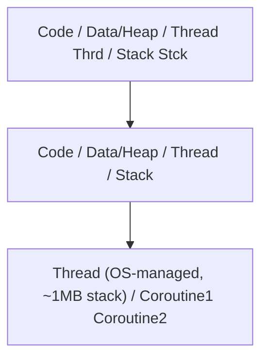

---


🔬 **Section Challenge — 1. Process vs Thread vs Coroutine: The Complete Picture**

**Challenge 1 (Reasoning):** `ExecutorService.submit(task)` — the task throws a `RuntimeException`. Nobody calls `future.get()`. What happens to the exception?
<details><summary>Answer</summary>

It's silently swallowed. The exception is stored in the `Future` object. Without `future.get()` or `.whenComplete()`, no one ever sees it. The thread pool thread resets and picks up the next task as if nothing happened. This is one of the most dangerous production bugs. Fix: always attach `future.whenComplete((r,ex) -> { if(ex!=null) log.error("Task failed",ex); })` or use `execute()` + `UncaughtExceptionHandler`.
</details>


## 2. Coroutines: What They Actually Are

### The Freeze Question
"What is a coroutine? Is it a lightweight thread?"

### Deep Reasoning

```
A coroutine is a FUNCTION that can SUSPEND and RESUME.

Normal function:
┌────────┐
│ start  │ → runs to completion → returns
└────────┘
Can only: CALL other functions and RETURN

Coroutine:
┌────────┐        ┌──────────┐        ┌──────────┐
│ start  │ → runs → SUSPEND  │ → ... → RESUME   │ → runs → end
└────────┘        └──────────┘        └──────────┘
Can: CALL, RETURN, and also SUSPEND (yield control)
When suspended, state is saved. When resumed, continues exactly.

KEY DISTINCTION from threads:
Thread: OS PREEMPTS it (involuntary switch — OS decides)
Coroutine: CODE SUSPENDS itself (voluntary — programmer decides)

This is called COOPERATIVE multitasking (coroutines cooperate)
vs PREEMPTIVE multitasking (OS preempts threads).
```

**Flow:**
1. start --( runs )-->
2. SUSPEND
3. SUSPEND --( ... )--> RESUME

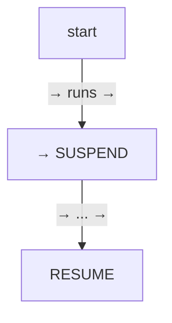

```kotlin
// Kotlin coroutine example:
suspend fun fetchUserData(): User {
    val profile = fetchProfile()     // SUSPENDS here (non-blocking IO)
    // ...thread is free to do other work...
    // ...when fetchProfile completes, coroutine RESUMES...
    val posts = fetchPosts(profile)  // SUSPENDS again
    return User(profile, posts)
}

// Under the hood, the compiler transforms this into a STATE MACHINE:
// State 0: Call fetchProfile(), suspend
// State 1: Receive profile, call fetchPosts(), suspend
// State 2: Receive posts, return User
// Each state is a label in a switch/when block.
// The coroutine object stores which state it's in + local variables.
```

---


🔬 **Section Challenge — 2. Coroutines: What They Actually Are**

**Challenge 1 (Reasoning):** `ExecutorService.submit(task)` — the task throws a `RuntimeException`. Nobody calls `future.get()`. What happens to the exception?
<details><summary>Answer</summary>

It's silently swallowed. The exception is stored in the `Future` object. Without `future.get()` or `.whenComplete()`, no one ever sees it. The thread pool thread resets and picks up the next task as if nothing happened. This is one of the most dangerous production bugs. Fix: always attach `future.whenComplete((r,ex) -> { if(ex!=null) log.error("Task failed",ex); })` or use `execute()` + `UncaughtExceptionHandler`.
</details>


## 3. Continuations: The Foundation Under Everything

### The Freeze Question
"What is a continuation?"

```
╔══════════════════════════════════════════════════════════════════════╗
║  A CONTINUATION = "The rest of the computation"                      ║
║                                                                      ║
║  THE BOOKMARK ANALOGY                                                ║
║                                                                      ║
║  You're reading a book. At page 50, you place a bookmark.            ║
║  The bookmark captures: which page you're on, what you've read,      ║
║  what's left to read.                                                ║
║                                                                      ║
║  The CONTINUATION is "everything from the bookmark forward."         ║
║  It's a snapshot of "what remains to be done" in a computation.      ║
║                                                                      ║
║  In code:                                                            ║
║  int x = 5;           ← Already done                                 ║
║  int y = x + 3;       ← CONTINUATION starts here                     ║
║  print(y * 2);        ←   and includes this                          ║
║                                                                      ║
║  A continuation object CAPTURES this "rest of computation"           ║
║  as a first-class value — you can store it, pass it around,          ║
║  call it later, or even call it MULTIPLE TIMES.                      ║
║                                                                      ║
║  This is the theoretical foundation for:                             ║
║  → Coroutines (suspend = capture continuation, resume = call it)     ║
║  → async/await (await = capture continuation of what's after)        ║
║  → Exceptions (throw = abort current, continuation is catch block)   ║
║  → Callbacks (the callback IS the continuation)                      ║
╚══════════════════════════════════════════════════════════════════════╝
```

**Flow:**
1. A CONTINUATION = 'The rest of the computation'
2. THE BOOKMARK ANALOGY
3. You're reading a book. At page 50, you place a bookmark what's left to read.
4. The CONTINUATION is 'everything from the bookmark forwa In code: int x = 5; ← Already done

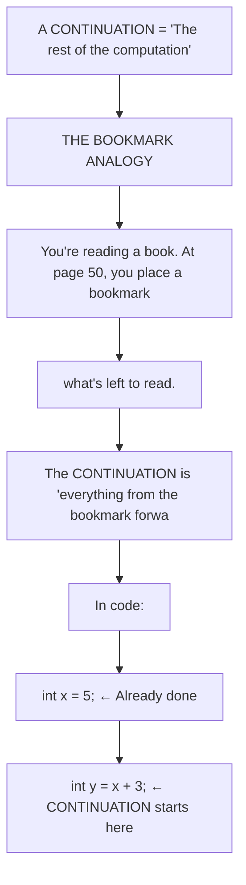

```
CONTINUATION PASSING STYLE (CPS):

// Direct style (what you write):
function add(a, b) {
  return a + b;
}
let result = add(3, 4);
console.log(result);

// CPS (what compilers transform it to):
function add(a, b, continuation) {
  continuation(a + b);  // Instead of returning, call the "rest"
}
add(3, 4, function(result) {
  console.log(result);  // The continuation (rest of the program)
});

// LOOK FAMILIAR? This is exactly like callbacks in Node.js!
// Callbacks = manual continuation passing.
// async/await = compiler does CPS transformation for you.
```

---


🔬 **Section Challenge — 3. Continuations: The Foundation Under Everything**

**Challenge 1 (Reasoning):** `ExecutorService.submit(task)` — the task throws a `RuntimeException`. Nobody calls `future.get()`. What happens to the exception?
<details><summary>Answer</summary>

It's silently swallowed. The exception is stored in the `Future` object. Without `future.get()` or `.whenComplete()`, no one ever sees it. The thread pool thread resets and picks up the next task as if nothing happened. This is one of the most dangerous production bugs. Fix: always attach `future.whenComplete((r,ex) -> { if(ex!=null) log.error("Task failed",ex); })` or use `execute()` + `UncaughtExceptionHandler`.
</details>


## 4. Coroutines vs Continuations: The Precise Difference

### The Freeze Question
"What's the difference between a coroutine and a continuation?"

```
╔══════════════════════════════════════════════════════════════════════╗
║  CONTINUATION = The concept (a snapshot of "the rest")               ║
║  COROUTINE = A mechanism that USES continuations                     ║
║                                                                      ║
║  Analogy:                                                            ║
║  Continuation = A saved game state                                   ║
║  Coroutine = A game that can save and load                           ║
║                                                                      ║
║  When a coroutine SUSPENDS:                                          ║
║  → It captures a CONTINUATION (saves its state)                      ║
║                                                                      ║
║  When a coroutine RESUMES:                                           ║
║  → It invokes the saved CONTINUATION (loads state, continues)        ║
║                                                                      ║
║  TYPES OF CONTINUATIONS:                                             ║
║                                                                      ║
║  Delimited (one-shot):                                               ║
║  → Captures only up to a certain boundary                            ║
║  → Used once. Kotlin, Java Loom, most async/await.                   ║
║  → Practical, efficient.                                             ║
║                                                                      ║
║  Undelimited (full, call/cc):                                        ║
║  → Captures the ENTIRE rest of the program                           ║
║  → Can be called multiple times (time travel!)                       ║
║  → Scheme's call/cc. Powerful but confusing.                         ║
║                                                                      ║
║  TYPES OF COROUTINES:                                                ║
║                                                                      ║
║  Stackless: Only suspends at TOP level (can't suspend inside         ║
║  nested function calls). Python generators, JavaScript generators.   ║
║  → Simpler, less memory.                                             ║
║                                                                      ║
║  Stackful: Can suspend at ANY depth in the call stack.               ║
║  Kotlin coroutines, Go goroutines, Java virtual threads.             ║
║  → More powerful, more memory.                                       ║
╚══════════════════════════════════════════════════════════════════════╝
```

**Flow:**
1. CONTINUATION = The concept (a snapshot of 'the rest')
2. COROUTINE = A mechanism that USES continuations
3. Analogy:
4. Continuation = A saved game state
5. Coroutine = A game that can save and load
6. When a coroutine SUSPENDS:
7. It captures a CONTINUATION (saves its state)

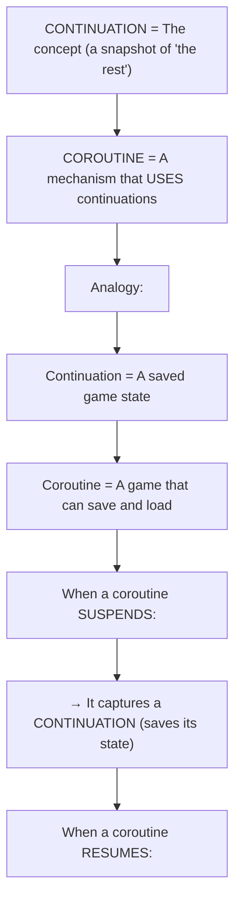

---


🔬 **Section Challenge — 4. Coroutines vs Continuations: The Precise Difference**

**Challenge 1 (Reasoning):** `ExecutorService.submit(task)` — the task throws a `RuntimeException`. Nobody calls `future.get()`. What happens to the exception?
<details><summary>Answer</summary>

It's silently swallowed. The exception is stored in the `Future` object. Without `future.get()` or `.whenComplete()`, no one ever sees it. The thread pool thread resets and picks up the next task as if nothing happened. This is one of the most dangerous production bugs. Fix: always attach `future.whenComplete((r,ex) -> { if(ex!=null) log.error("Task failed",ex); })` or use `execute()` + `UncaughtExceptionHandler`.
</details>


## 5. How async/await Works In Different Languages

### The Freeze Question
"How does async/await actually work? Is it the same everywhere?"

```
╔══════════════════════════════════════════════════════════════════════╗
║  async/await = SYNTACTIC SUGAR for continuation-based concurrency    ║
║  But the UNDERLYING MODEL varies dramatically:                       ║
║                                                                      ║
║  JAVASCRIPT:                                                         ║
║  → Single-threaded event loop                                        ║
║  → async function returns a Promise                                  ║
║  → await pauses the function, adds continuation to microtask queue   ║
║  → Event loop runs other code, then resumes when Promise resolves    ║
║  → NO parallelism (one thread), just concurrency                     ║
║                                                                      ║
║  KOTLIN:                                                             ║
║  → Compiler transforms suspend functions into state machines         ║
║  → Coroutines run on a dispatcher (thread pool)                      ║
║  → suspend = save state + free the thread                            ║
║  → Thread can run OTHER coroutines while waiting                     ║
║  → TRUE parallelism when using Dispatchers.Default (multi-thread)    ║
║                                                                      ║
║  C#:                                                                 ║
║  → async method returns Task<T>                                      ║
║  → Compiler generates IAsyncStateMachine                             ║
║  → SynchronizationContext captures where to resume                   ║
║  → Can cause deadlocks in UI apps (ConfigureAwait(false))            ║
║                                                                      ║
║  PYTHON:                                                             ║
║  → asyncio event loop (single-threaded like JS)                      ║
║  → async def returns a coroutine object                              ║
║  → await suspends until awaitable completes                          ║
║  → GIL prevents true parallelism even with threads                   ║
║                                                                      ║
║  RUST:                                                               ║
║  → async fn returns impl Future                                      ║
║  → Zero-cost abstraction: futures are state machines, no allocation  ║
║  → Must be driven by an executor (tokio, async-std)                  ║
║  → Futures are LAZY — do nothing until polled                        ║
╚══════════════════════════════════════════════════════════════════════╝
```

**Flow:**
1. But the UNDERLYING MODEL varies dramatically:
2. JAVASCRIPT:
3. Single-threaded event loop
4. async function returns a Promise
5. NO parallelism (one thread), just concurrency
6. KOTLIN:
7. Compiler transforms suspend functions into state mach

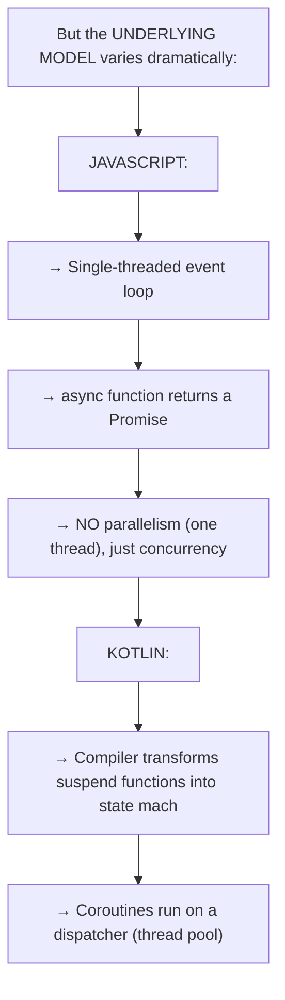

---


🔬 **Section Challenge — 5. How async/await Works In Different Languages**

**Challenge 1 (Reasoning):** `await Promise.all([fetch(a), fetch(b)])` vs `await fetch(a); await fetch(b)`. What's the performance difference?
<details><summary>Answer</summary>

`Promise.all`: both fetches START simultaneously (concurrent). Total time = max(timeA, timeB). Sequential awaits: fetch B doesn't start until fetch A completes. Total time = timeA + timeB. For independent requests, ALWAYS use `Promise.all`. Sequential await is only appropriate when B depends on A's result.
</details>

**Challenge 2 (Bug Hunt):** An `async` function has `try { await doWork(); } catch(e) {}`. `doWork()` rejects. Is the rejection handled?
<details><summary>Answer</summary>

Yes — `await` unwraps the rejected promise and throws the rejection value as a synchronous error, which is caught by the `catch` block. Without `try/catch` around `await`: unhandled rejection. Without `await` (just `doWork()`): the rejection is a separate promise — the `try/catch` CANNOT catch it (it's asynchronous). Always `await` async calls if you want to catch their rejections synchronously.
</details>


## 6. Java Virtual Threads (Project Loom): The Game Changer

### The Freeze Question
"What are virtual threads? How are they different from regular threads?"

```
╔══════════════════════════════════════════════════════════════════════╗
║  THE POSTAL SERVICE ANALOGY                                          ║
║                                                                      ║
║  Platform Thread (OS Thread) = A dedicated postal truck              ║
║  → Expensive (each needs a driver, fuel, maintenance = ~1MB stack)   ║
║  → Limited (can only have so many trucks)                            ║
║  → When waiting at a house, truck sits idle (blocking = waste)       ║
║                                                                      ║
║  Virtual Thread = A package (letter)                                 ║
║  → Extremely cheap (just a piece of paper = ~few KB)                 ║
║  → Millions possible                                                 ║
║  → When "waiting" (IO), the package is set aside and the truck       ║
║    delivers other packages. When the house opens the door,           ║
║    any available truck picks up the package and continues.           ║
║                                                                      ║
║  KEY INSIGHT: Virtual threads make BLOCKING code non-blocking        ║
║  without changing the code.                                          ║
║                                                                      ║
║  Old way: Thread per request, blocking IO → 10,000 threads max       ║
║  New way: Virtual thread per request, same blocking code →           ║
║           1,000,000 concurrent requests!                             ║
╚══════════════════════════════════════════════════════════════════════╝
```

**Flow:**
1. THE POSTAL SERVICE ANALOGY
2. Platform Thread (OS Thread) = A dedicated postal truck
3. Limited (can only have so many trucks)
4. Virtual Thread = A package (letter)
5. Extremely cheap (just a piece of paper = ~few KB)
6. Millions possible
7. delivers other packages. When the house opens the door,

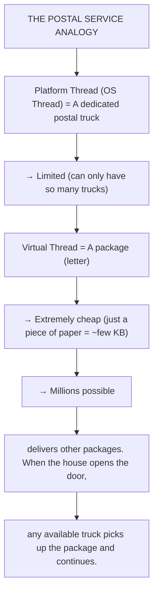

```java
// Platform threads (traditional):
ExecutorService executor = Executors.newFixedThreadPool(200); // MAX 200
executor.submit(() -> {
    var result = httpClient.send(request);  // Thread BLOCKED during IO
    // 200 threads = 200 concurrent requests max
});

// Virtual threads (Java 21+):
ExecutorService executor = Executors.newVirtualThreadPerTaskExecutor();
executor.submit(() -> {
    var result = httpClient.send(request);  // Virtual thread UNMOUNTS
    // Carrier thread is free → runs other virtual threads
    // 1,000,000 virtual threads = 1,000,000 concurrent requests
});

// THE CODE IS IDENTICAL! You write blocking code.
// The JVM transparently handles the suspension/resumption.
// This is the magic: familiar blocking style + async performance.
```

---

## 7. Green Threads vs OS Threads vs Virtual Threads

### The Freeze Question
"What are green threads?"

```
╔══════════════════════════════════════════════════════════════════════╗
║  OS THREAD (Platform Thread):                                        ║
║  → Managed by the operating system                                   ║
║  → ~1MB stack, expensive context switch                              ║
║  → OS scheduler decides when to run (preemptive)                     ║
║  → Used by: Java (traditional), C, C++, Rust                         ║
║                                                                      ║
║  GREEN THREAD:                                                       ║
║  → Managed by the RUNTIME/VM, not the OS                             ║
║  → Scheduled in user space (OS sees one thread)                      ║
║  → PROBLEM: Can't use multiple CPU cores (M:1 mapping)               ║
║  → History: Java 1.0 used green threads, then switched to OS threads ║
║                                                                      ║
║  VIRTUAL THREAD (Java 21) / GOROUTINE (Go):                          ║
║  → Best of both: user-space scheduling + multi-core                  ║
║  → M:N mapping: M virtual threads on N OS threads                    ║
║  → Runtime multiplexes virtual threads across thread pool            ║
║  → Gets multi-core parallelism WITHOUT per-request OS thread cost    ║
║                                                                      ║
║  EVOLUTION:                                                          ║
║  Green threads (M:1) → OS threads (1:1) → Virtual threads (M:N)      ║
║  Problems of past  →  Current standard →  Future standard            ║
╚══════════════════════════════════════════════════════════════════════╝
```

**Flow:**
1. OS THREAD (Platform Thread):
2. Managed by the operating system
3. ~1MB stack, expensive context switch
4. OS scheduler decides when to run (preemptive)
5. Used by: Java (traditional), C, C++, Rust
6. GREEN THREAD:
7. Managed by the RUNTIME/VM, not the OS

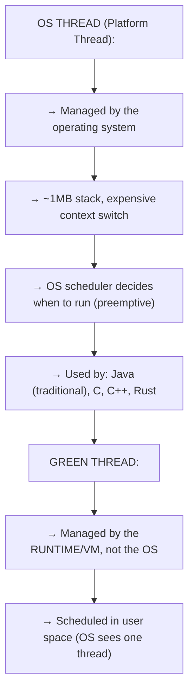

---

## 8. The Event Loop Model: JavaScript & Node.js

### Deep Explanation

```
THE SINGLE-THREADED EVENT LOOP
(Covered in JS Deep Reasoning — expanded here for concurrency
 model comparison)

JavaScript = ONE chef, ONE kitchen, BUT with timers and helpers.

┌───────────────────────────────────────────────────────────┐
│  Call Stack (single thread — runs JS code)                │
│  ┌────────────────────────────────────┐                   │
│  │ Currently executing function       │                   │
│  └────────────────────────────────────┘                   │
│              ↓ when stack is empty ↓                      │
│  ┌────────────────────────────────────┐                   │
│  │ Microtask Queue (Promises, queueM) │ ← checked FIRST   │
│  └────────────────────────────────────┘                   │
│  ┌────────────────────────────────────┐                   │
│  │ Macrotask Queue (setTimeout, IO)   │ ← checked AFTER   │
│  └────────────────────────────────────┘                   │
└───────────────────────────────────────────────────────────┘

IO operations (file read, HTTP) are delegated to the OS/libuv
thread pool. When complete, callbacks are queued.
The event loop picks them up when the call stack is empty.

LIMITATION: CPU-heavy work BLOCKS the single thread.
Solution: Worker Threads, or offload to microservices.
```

**Flow:**
1. THE SINGLE-THREADED EVENT LOOP
2. model comparison)
3. Call Stack (single thread — runs JS code)
4. Currently executing function
5. ↓ when stack is empty ↓
6. Microtask Queue (Promises, queueM) ← checked FIRST
7. Macrotask Queue (setTimeout, IO) ← checked AFTER

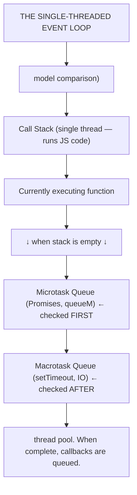

---

## 9. Go Goroutines: The CSP Model

### Deep Explanation

```
╔══════════════════════════════════════════════════════════════════════╗
║  Go's approach: "Don't communicate by sharing memory.                ║
║                  Share memory by communicating." — Go proverb        ║
║                                                                      ║
║  GOROUTINE = Lightweight coroutine (starts at ~2KB stack)            ║
║  → M:N scheduling: M goroutines on N OS threads                      ║
║  → go func() { ... } — that's it, it's running                       ║
║  → Millions possible (vs thousands of OS threads)                    ║
║                                                                      ║
║  CHANNEL = Typed pipe for goroutine communication                    ║
║  → ch := make(chan int) — create a channel                           ║
║  → ch <- 42 — send (blocks until receiver ready)                     ║
║  → val := <-ch — receive (blocks until sender ready)                 ║
║  → Synchronization built in — no explicit locks!                     ║
║                                                                      ║
║  CSP (Communicating Sequential Processes):                           ║
║  → Each goroutine is a sequential process                            ║
║  → They COMMUNICATE through channels (not shared memory)             ║
║  → Channel send/receive acts as synchronization point                ║
║                                                                      ║
║  vs SHARED MEMORY (Java's model):                                    ║
║  → Threads share heap → need locks, synchronized, volatile           ║
║  → Easy to get wrong (race conditions, deadlocks)                    ║
║  → CSP avoids most of these problems by design                       ║
╚══════════════════════════════════════════════════════════════════════╝
```

**Flow:**
1. Go's approach: 'Don't communicate by sharing memory. Share memory by communicating.' — Go proverb
2. GOROUTINE = Lightweight coroutine (starts at ~2KB stack M:N scheduling: M goroutines on N OS threads go func() { ... } — that's it, it's running Millions possible (vs thousands of OS threads) CHANNEL = Typed pipe for goroutine communication

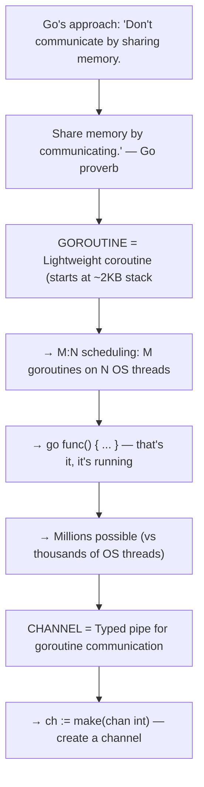

---


🔬 **Section Challenge — 9. Go Goroutines: The CSP Model**

**Challenge 1 (Reasoning):** `ExecutorService.submit(task)` — the task throws a `RuntimeException`. Nobody calls `future.get()`. What happens to the exception?
<details><summary>Answer</summary>

It's silently swallowed. The exception is stored in the `Future` object. Without `future.get()` or `.whenComplete()`, no one ever sees it. The thread pool thread resets and picks up the next task as if nothing happened. This is one of the most dangerous production bugs. Fix: always attach `future.whenComplete((r,ex) -> { if(ex!=null) log.error("Task failed",ex); })` or use `execute()` + `UncaughtExceptionHandler`.
</details>


## 10. Concurrency vs Parallelism: The Definition That Matters

### The Freeze Question
"Are concurrency and parallelism the same thing?"

```
╔══════════════════════════════════════════════════════════════════════╗
║  THE JUGGLING ANALOGY (Rob Pike's definition):                       ║
║                                                                      ║
║  CONCURRENCY = Dealing with multiple things at once.                 ║
║  → One juggler with 3 balls — only holds ONE at a time               ║
║  → Switches rapidly between them (interleaving)                      ║
║  → STRUCTURE of the program                                          ║
║  → Example: Single-core CPU running multiple threads via switching   ║
║                                                                      ║
║  PARALLELISM = Doing multiple things at once.                        ║
║  → THREE jugglers, each with 1 ball — truly simultaneous             ║
║  → Multiple CPUs executing instructions at the same time             ║
║  → EXECUTION of the program                                          ║
║                                                                      ║
║  CONCURRENCY: "I handle multiple tasks (may not be simultaneous)"    ║
║  PARALLELISM: "I execute multiple tasks at the same physical time"   ║
║                                                                      ║
║  You can have:                                                       ║
║  → Concurrent but not parallel (1 core, multiple threads/tasks)      ║
║  → Parallel but not concurrent (SIMD: same operation on many data)   ║
║  → Both (multi-core with multiple tasks)                             ║
║  → Neither (sequential single task)                                  ║
║                                                                      ║
║  JavaScript: Concurrent (event loop) but NOT parallel (1 thread)     ║
║  Java threads: Can be BOTH if multiple cores available               ║
║  Go goroutines: BOTH (M:N scheduling across cores)                   ║
╚══════════════════════════════════════════════════════════════════════╝
```

**Flow:**
1. THE JUGGLING ANALOGY (Rob Pike's definition): CONCURRENCY = Dealing with multiple things at once. One juggler with 3 balls — only holds ONE at a time Switches rapidly between them (interleaving) STRUCTURE of the program PARALLELISM = Doing multiple things at once. THREE jugglers, each with 1 ball — truly simultaneous

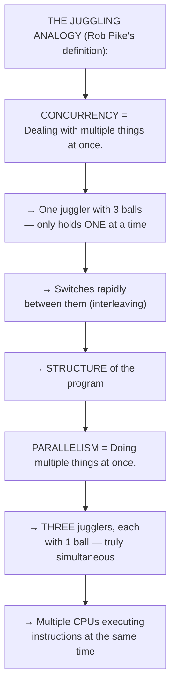

---


🔬 **Section Challenge — 10. Concurrency vs Parallelism: The Definition That Matters**

**Challenge 1 (Reasoning):** `ExecutorService.submit(task)` — the task throws a `RuntimeException`. Nobody calls `future.get()`. What happens to the exception?
<details><summary>Answer</summary>

It's silently swallowed. The exception is stored in the `Future` object. Without `future.get()` or `.whenComplete()`, no one ever sees it. The thread pool thread resets and picks up the next task as if nothing happened. This is one of the most dangerous production bugs. Fix: always attach `future.whenComplete((r,ex) -> { if(ex!=null) log.error("Task failed",ex); })` or use `execute()` + `UncaughtExceptionHandler`.
</details>


## 11. Deadlock, Livelock, Starvation: The Three Concurrency Diseases

### Deep Reasoning

```
╔══════════════════════════════════════════════════════════════════════╗
║  DEADLOCK: Two people each holding one chopstick, each needs the     ║
║  other's to eat. Neither releases. Both starve forever.              ║
║  → Both STOPPED. No progress.                                        ║
║  → Fix: Lock ordering, timeout, lock-free algorithms                 ║
║                                                                      ║
║  LIVELOCK: Two people in a hallway, both stepping aside to let the   ║
║  other pass. They keep stepping the SAME direction. Neither passes.  ║
║  → Both MOVING but still no progress.                                ║
║  → Fix: Add randomness to retry (like Ethernet collision backoff)    ║
║                                                                      ║
║  STARVATION: One person at a buffet keeps getting cut in line by     ║
║  "priority" guests. They never get food despite being in line.       ║
║  → Others make progress, but ONE thread never gets resources.        ║
║  → Fix: Fair locks, priority aging, FIFO scheduling                  ║
╚══════════════════════════════════════════════════════════════════════╝
```

**Flow:**
1. other's to eat. Neither releases. Both starve forever. Both STOPPED. No progress. Fix: Lock ordering, timeout, lock-free algorithms Both MOVING but still no progress. Fix: Fair locks, priority aging, FIFO scheduling

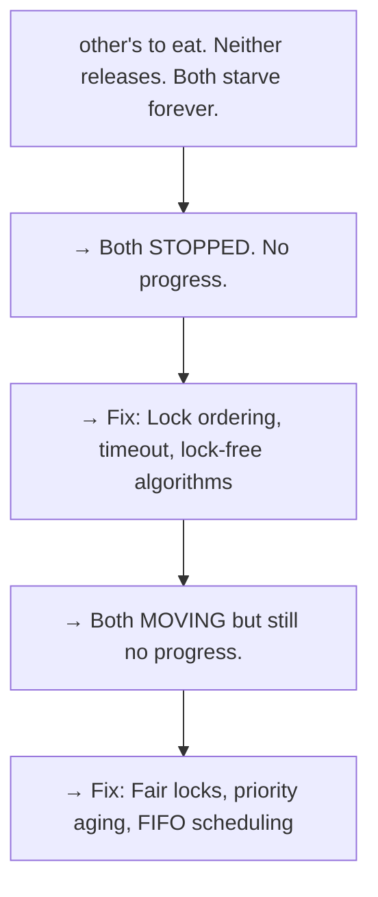

---

## 12. Which Model For Which Problem?

```
╔══════════════════════════════════════════════════════════════════════╗
║  DECISION MATRIX                                                     ║
║                                                                      ║
║  Problem                    Best Model                               ║
║  ──────────────────────────────────────────────────────              ║
║  High-concurrency web       Virtual threads (Java 21) or             ║
║  server (IO-bound)          Go goroutines or Node.js event loop      ║
║                                                                      ║
║  CPU-intensive computation  OS threads / parallel streams /          ║
║  (number crunching)         Rust rayon / Java ForkJoinPool           ║
║                                                                      ║
║  UI responsiveness          Event loop (JS) / Main thread +          ║
║  (don't block UI)           background threads (Android/iOS)         ║
║                                                                      ║
║  Stream processing          Reactive Streams (Project Reactor) /     ║
║  (backpressure needed)      RxJava / Kotlin Flow                     ║
║                                                                      ║
║  Microservices messaging    Async message queues (Kafka, RabbitMQ)   ║
║                             + event-driven architecture              ║
║                                                                      ║
║  Simple parallelism         Java parallelStream() /                  ║
║  (embarrassingly parallel)  Arrays.parallelSort()                    ║
║                                                                      ║
║  RULE OF THUMB:                                                      ║
║  IO-bound → More threads/coroutines, less CPU (async shines)         ║
║  CPU-bound → More cores, not more threads (parallelism shines)       ║
╚══════════════════════════════════════════════════════════════════════╝
```

**Flow:**
1. DECISION MATRIX
2. Problem Best Model
3. High-concurrency web Virtual threads (Java 21) or
4. server (IO-bound) Go goroutines or Node.js event loop
5. CPU-intensive computation OS threads / parallel streams
6. (number crunching) Rust rayon / Java ForkJoinPool
7. UI responsiveness Event loop (JS) / Main thread +

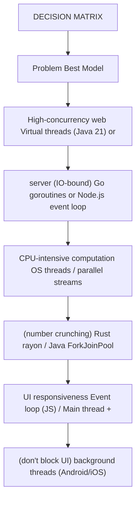

---

## Summary Comparison Table

| Feature | OS Thread | Green Thread | Coroutine | Virtual Thread | Goroutine |
|---------|-----------|-------------|-----------|---------------|-----------|
| **Managed by** | OS | Runtime | Runtime | JVM | Go runtime |
| **Stack size** | ~1MB | ~KB | ~KB | ~KB (grows) | ~2KB (grows) |
| **Scheduling** | Preemptive | Cooperative | Cooperative | Cooperative* | Cooperative* |
| **Parallelism** | Yes | No (M:1) | No** | Yes (M:N) | Yes (M:N) |
| **Max count** | ~10K | ~1M | ~1M | ~1M | ~1M |
| **Language** | Java, C | Erlang (BEAM) | Kotlin, Python | Java 21+ | Go |
| **Syntax** | Thread API | spawn | suspend/await | Thread.ofVirtual() | go func() |

\*With preemption points added by the runtime  
\*\*Unless dispatched to multi-thread pool (Kotlin)

---


🔬 **Section Challenge — Summary Comparison Table**
>

## Interview Quick-Fire: Concurrency Freeze Busters

| Freeze Question | Senior-Level Answer |
|----------------|-------------------|
| "Is async always faster?" | No. Async shines for IO-bound work (waiting). For CPU-bound work, async adds overhead without benefit. Use parallelism (multiple cores) for CPU-heavy, async for IO-heavy. |
| "What's a race condition?" | When program correctness depends on the timing/order of thread execution. Two threads read-modify-write the same variable → result depends on who runs first. Fix: locks, atomic operations, or avoid shared state. |
| "What's the difference between concurrent and thread-safe?" | Concurrent: designed for multi-threaded access (ConcurrentHashMap). Thread-safe: won't corrupt if accessed from multiple threads (may use locks). All concurrent structures are thread-safe, but thread-safe doesn't mean optimized for concurrency. |
| "What's a Future/Promise?" | A placeholder for a value that doesn't exist YET. Future is read-only (consumer). Promise is writable (producer). `future.get()` blocks until the value is ready. `CompletableFuture` allows chaining without blocking. |

---

← Previous: [Chapter 18 — Backend Cloud Integration](18_Backend_Cloud_Integration.md)
| [📚 Index](../00_MASTER_INDEX.md)


