**Navigation**: [Back to Index](../00_MASTER_INDEX.md) | [Next >](02_DP_State_Thinking.md)

# 🌳 Recursion & Tree Thinking — Mental Model

**The #1 reason people struggle with recursion**: they try to trace every call in their head. Stop doing that. This guide teaches you the **Leap of Faith** method and how to draw recursion trees like a whiteboard pro.

---

## Part 1: The Leap of Faith Method

### The Problem with "Tracing"

```
fibonacci(5) calls fibonacci(4) which calls fibonacci(3) which calls...
→ Your brain runs out of stack space, just like the computer would.
```

### The Solution: Trust the Recursion

**Leap of Faith** = Assume your function already works for smaller inputs. Only think about:
1. **Base case**: What's the simplest input I can answer immediately?
2. **Recursive step**: If my function magically works for smaller inputs, how do I use that to solve the current input?
3. **Combine**: How do I combine the sub-answers?

### Example: Sum of a Linked List

```
WRONG thinking: "sum(1→2→3→4) calls sum(2→3→4) which calls sum(3→4)..."
                 (tracing every call = brain overflow)

RIGHT thinking: "Assume sum() works for smaller lists.
                 sum(1→2→3→4) = 1 + sum(2→3→4)
                                    ↑ I trust this gives 9
                 Answer = 1 + 9 = 10 ✅"
```

**Flow:**
1. Wrong tracing mindset: "sum(1→2→3→4) calls sum(2→3→4) calls sum(3→4)..."
2. Tracing every nested call causes mental stack overflow.

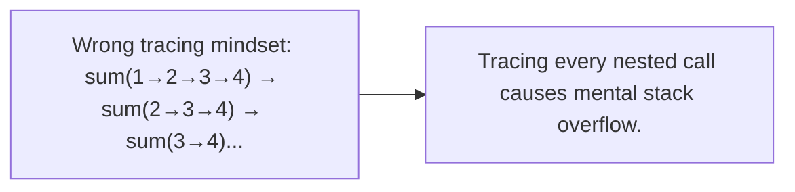

### The 3-Question Framework

For EVERY recursive problem, ask yourself:
```
Q1: What is the SMALLEST INPUT I can answer directly?
    → That's your base case.

Q2: If my function MAGICALLY WORKS for smaller inputs,
    how do I use that?
    → That's your recursive call.

Q3: How do I COMBINE the sub-result with current data?
    → That's your return statement.
```

**Flow:**
1. Q1: What is the SMALLEST INPUT I can answer directly?
2. That's your base case.
3. Q2: If my function MAGICALLY WORKS for smaller inputs, how do I use that?
4. That's your recursive call.
5. Q3: How do I COMBINE the sub-result with current data?
6. That's your return statement.

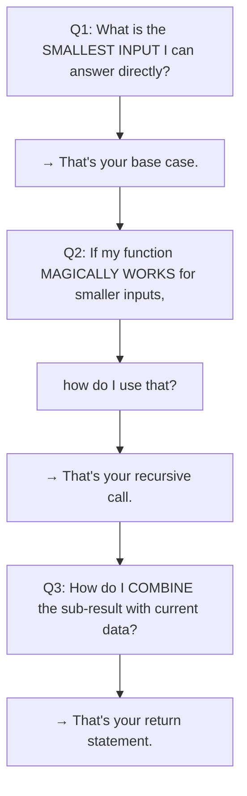

### Applied Example: Reverse a String

```java
// Q1: Smallest input? → empty string or single char → return it
// Q2: If reverse() works for smaller string?
//     reverse("hello") = reverse("ello") + "h"
//                         ↑ trust this returns "olle"
// Q3: Combine? → "olle" + "h" = "olleh" ✅

String reverse(String s) {
    if (s.length() <= 1) return s;              // Q1: base case
    return reverse(s.substring(1)) + s.charAt(0); // Q2+Q3: trust + combine
}
```

---

## Part 2: How to Draw Recursion Trees (Step by Step)

### Why Draw Them?

- **See overlapping subproblems** → decide if DP is needed
- **Count total work** → determine time complexity
- **Debug wrong answers** → trace where logic breaks
- **Impress interviewers** → shows deep understanding

### Step-by-Step: Drawing a Recursion Tree

#### Step 1: Write the function signature as the root

```
                    fib(5)
```

#### Step 2: Draw the recursive calls as children

```
                    fib(5)
                   /      \
               fib(4)    fib(3)
```

#### Step 3: Keep expanding until you hit base cases

```
                         fib(5)
                        /      \
                   fib(4)      fib(3)
                  /     \      /     \
              fib(3)  fib(2) fib(2)  fib(1)
              /    \   /  \   /  \      |
          fib(2) fib(1) 1  0  1   0     1
          /   \    |
         1     0   1
```

#### Step 4: Annotate the return values (bottom-up)

```
                         fib(5) = 5
                        /          \
                   fib(4)=3      fib(3)=2
                  /       \       /      \
              fib(3)=2  fib(2)=1 fib(2)=1 fib(1)=1
              /    \     /  \     /  \
          fib(2)=1 fib(1)=1 1  0  1   0
          /   \
         1     0
```

#### Step 5: Identify the pattern

```
OBSERVATION: fib(3) is calculated 2 times! fib(2) is calculated 3 times!
→ OVERLAPPING SUBPROBLEMS → Use Memoization!

Node count ≈ 2^n → Time: O(2^n) without memo
Unique subproblems = n → Time: O(n) WITH memo
```

**Flow:**
1. OVERLAPPING SUBPROBLEMS
2. Use Memoization!
3. Node count ≈ 2^n
4. Time: O(2^n) without memo
5. Unique subproblems = n
6. Time: O(n) WITH memo

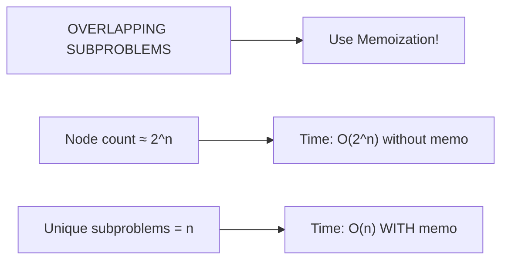

### Recursion Tree Templates for Common Patterns

#### Pattern A: Linear Recursion (Path = straight line)

```
factorial(4) → factorial(3) → factorial(2) → factorial(1)
    ↓ 24          ↓ 6           ↓ 2            ↓ 1

Total calls: n → O(n) time and O(n) space (call stack)
```

**Flow:**
1. factorial(4)
2. factorial(3)
3. factorial(2)
4. factorial(1)
5. Total calls: n
6. O(n) time and O(n) space (call stack)

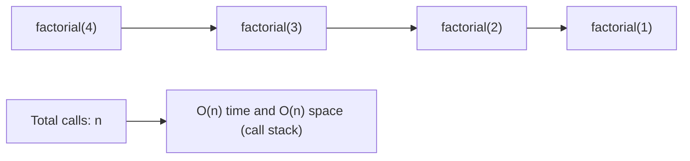

#### Pattern B: Binary Recursion (Tree splits in two)

```
           f(n)
          /    \
       f(n-1)  f(n-2)    → Fibonacci, Tower of Hanoi

Height: n, Branching: 2 → O(2^n) total calls
```

**Flow:**
1. f(n-1) f(n-2)
2. Fibonacci, Tower of Hanoi
3. Height: n, Branching: 2
4. O(2^n) total calls

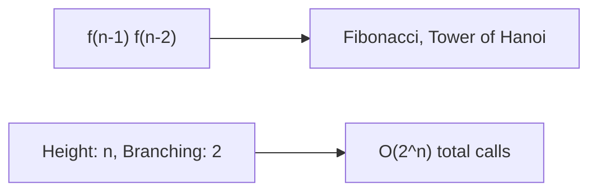

#### Pattern C: Branching Recursion (Multiple choices)

```
           f(n, choices=[a,b,c])
          /       |       \
     f(n-1,a)  f(n-1,b)  f(n-1,c)   → Permutations, Combinations

Height: n, Branching: k → O(k^n) total calls
```

**Flow:**
1. f(n-1,a) f(n-1,b) f(n-1,c)
2. Permutations, Combinations
3. Height: n, Branching: k
4. O(k^n) total calls

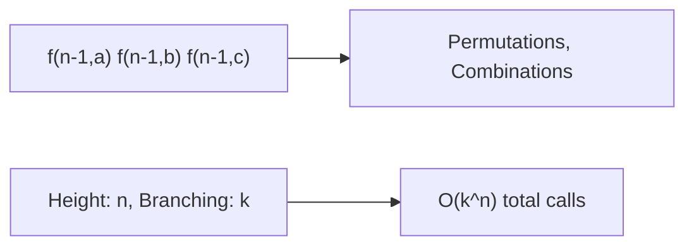

#### Pattern D: Divide & Conquer (Split in half)

```
        mergeSort(0,7)
        /            \
   sort(0,3)      sort(4,7)
   /     \         /     \
 s(0,1) s(2,3)  s(4,5)  s(6,7)

Height: log(n), Work per level: O(n) → Total: O(n log n)
```

**Flow:**
1. Height: log(n), Work per level: O(n)
2. Total: O(n log n)

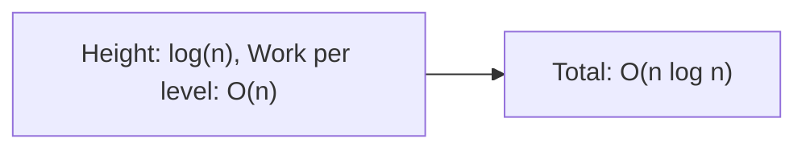

---

🔬 **Section Challenge — Part 2: How to Draw Recursion Trees (Step by Step)**
>
**Challenge 2 (Bug Hunt):** ```java
void fib(int n) { return n<=1 ? n : fib(n-1) + fib(n-2); }
fib(50) // takes forever
```
Why and what are the 3 fixes?
<details><summary>Answer</summary>

Exponential time O(2^N) — `fib(n-1)` and `fib(n-2)` each recursively recompute the same subproblems billions of times. Fix 1: Memoization — `Map<Integer,Long> memo`, return early if computed. O(N) time, O(N) space. Fix 2: Bottom-up DP — array `dp[i] = dp[i-1] + dp[i-2]`. O(N) time, O(N) space. Fix 3: O(1) space — just track last two values with two variables. O(N) time, O(1) space.
</details>


## Part 3: The Recursion → Memoization → Tabulation Pipeline

### This is the most important transformation in DSA:
```
Step 1: Write naive recursion (correct but slow)
Step 2: Add memoization (top-down DP, still recursive)
Step 3: Convert to tabulation (bottom-up DP, iterative)
Step 4: Optimize space (if only looking at previous row/values)
```

### Live Example: Climbing Stairs

#### Step 1: Naive Recursion
```java
// "Trust": ways(n-1) gives correct count for n-1 steps
int ways(int n) {
    if (n <= 1) return 1;                    // Base: 0 or 1 step = 1 way
    return ways(n - 1) + ways(n - 2);       // Take 1 step + take 2 steps
}
// Time: O(2^n) — way too slow!
```

Draw the tree:
```
              ways(5)
             /       \
         ways(4)     ways(3)        ← overlapping!
        /     \       /     \
    ways(3) ways(2) ways(2) ways(1)  ← ways(3) computed twice!
     ...     ...
```

**Flow:**
1. ways(5)
2. ways(4) ways(3) ← overlapping!

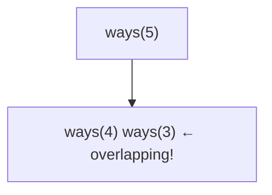

#### Step 2: Add Memoization (Top-Down DP)

```java
int[] memo = new int[n + 1];
Arrays.fill(memo, -1);

int ways(int n) {
    if (n <= 1) return 1;
    if (memo[n] != -1) return memo[n];       // Already computed? Return it!
    memo[n] = ways(n - 1) + ways(n - 2);    // Compute and STORE
    return memo[n];
}
// Time: O(n) — each subproblem solved once!
```

**Mental model**: "Put a sticky note on each computed answer. Before computing, check if sticky note exists."

#### Step 3: Convert to Tabulation (Bottom-Up DP)

```java
int ways(int n) {
    int[] dp = new int[n + 1];
    dp[0] = 1; dp[1] = 1;                    // Base cases
    for (int i = 2; i <= n; i++) {
        dp[i] = dp[i - 1] + dp[i - 2];      // Fill table left → right
    }
    return dp[n];
}
// Time: O(n), Space: O(n)
```

**Mental model**: "Instead of going top-down and caching, fill the table bottom-up like filling a spreadsheet."

#### Step 4: Space Optimization

```java
int ways(int n) {
    int prev2 = 1, prev1 = 1;
    for (int i = 2; i <= n; i++) {
        int curr = prev1 + prev2;
        prev2 = prev1;
        prev1 = curr;
    }
    return prev1;
}
// Time: O(n), Space: O(1) ← optimal!
```

**Mental model**: "Only need last 2 values? Don't keep the whole table — use 2 variables."

---

🔬 **Section Challenge — Part 3: The Recursion → Memoization → Tabulation Pipeline**
>
**Challenge 2 (Bug Hunt):** ```java
void fib(int n) { return n<=1 ? n : fib(n-1) + fib(n-2); }
fib(50) // takes forever
```
Why and what are the 3 fixes?
<details><summary>Answer</summary>

Exponential time O(2^N) — `fib(n-1)` and `fib(n-2)` each recursively recompute the same subproblems billions of times. Fix 1: Memoization — `Map<Integer,Long> memo`, return early if computed. O(N) time, O(N) space. Fix 2: Bottom-up DP — array `dp[i] = dp[i-1] + dp[i-2]`. O(N) time, O(N) space. Fix 3: O(1) space — just track last two values with two variables. O(N) time, O(1) space.
</details>


## Part 4: Recursion + Backtracking — How to Think

### What IS Backtracking?
```
Recursion  = explore ONE path to the end
Backtracking = explore a path, then UNDO your choice and try the next path

Recursion is the engine.
Backtracking is the steering wheel.
```

### The Choose-Explore-Unchoose Framework
```
for each choice at current step:
    1. CHOOSE: Make the choice (modify state)
    2. EXPLORE: Recurse to the next step
    3. UNCHOOSE: Undo the choice (restore state)
```

### Example: Generate All Subsets of [1, 2, 3]
```java
void subsets(int[] nums, int start, List<Integer> current, List<List<Integer>> result) {
    result.add(new ArrayList<>(current));     // Every state is a valid subset

    for (int i = start; i < nums.length; i++) {
        current.add(nums[i]);                 // CHOOSE: include nums[i]
        subsets(nums, i + 1, current, result); // EXPLORE: recurse
        current.remove(current.size() - 1);   // UNCHOOSE: exclude nums[i]
    }
}
```

### The Backtracking Decision Tree

```
                        []
                    /   |   \
                 [1]   [2]   [3]      ← choose 1, 2, or 3
                / \     |
           [1,2] [1,3] [2,3]         ← choose next
            |
         [1,2,3]                      ← choose next

When a branch ends, we BACKTRACK (remove last choice) and try the next branch.
```

**Flow:**
1. [1] [2] [3] ← choose 1, 2, or 3
2. [1,2] [1,3] [2,3] ← choose next
3. [1,2,3] ← choose next

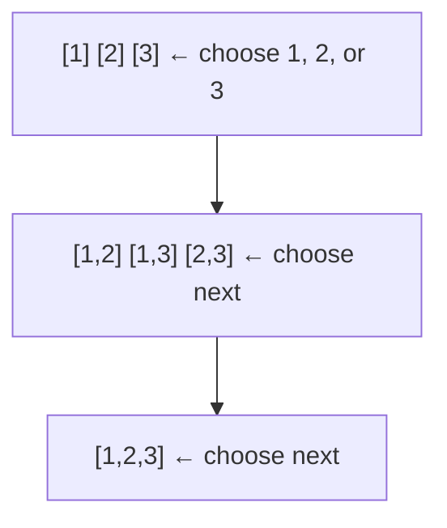

### When to PRUNE (Skip Branches Early)

```
PRUNE when you KNOW a branch won't lead to a valid answer:

1. Sum exceeds target? → Don't explore further
   if (currentSum > target) return;

2. Duplicate element at same level? → Skip it
   if (i > start && nums[i] == nums[i-1]) continue;

3. Constraint violated? → Abort path
   if (!isValid(board, row, col)) continue;  // N-Queens
```

**Flow:**
1. Sum exceeds target.
2. Do not explore that branch further.
3. Duplicate element at the same level.
4. Skip that duplicate branch.
5. Constraint violated.
6. Abort the current path.

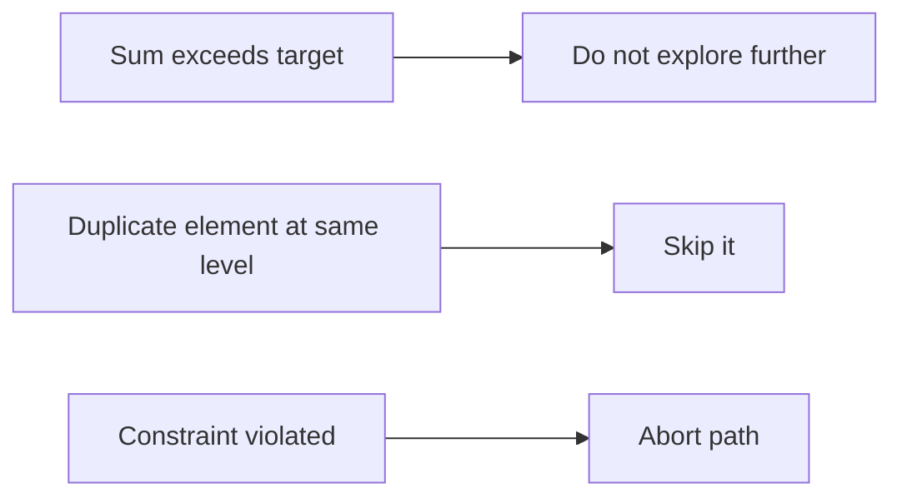

### Visual: Pruning saves MASSIVE work

```
Without pruning:        With pruning:
    O                       O
   /|\                     /|\
  O O O                   O O ✂
 /|\ ...                 /|
O O O ...               O ✂
                        → 10x fewer calls!
```

**Flow:**
1. Without pruning, many unnecessary branches are explored.
2. With pruning, invalid branches are cut early.
3. Result: around 10x fewer recursive calls.

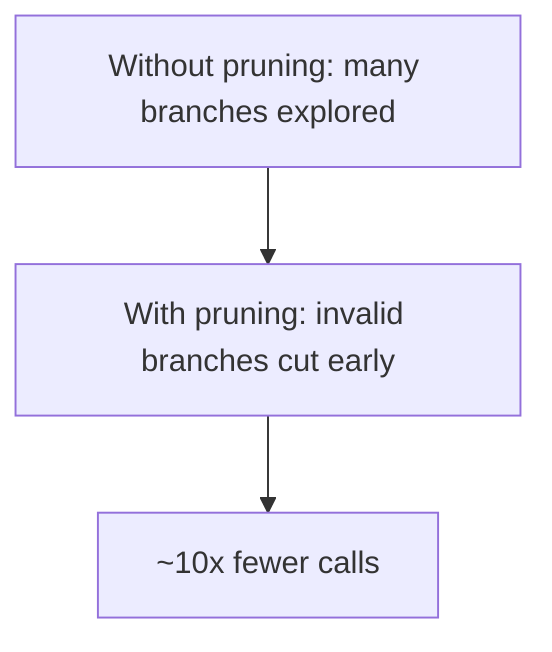

---

🔬 **Section Challenge — Part 4: Recursion + Backtracking — How to Think**
>
**Challenge 2 (Bug Hunt):** ```java
void fib(int n) { return n<=1 ? n : fib(n-1) + fib(n-2); }
fib(50) // takes forever
```
Why and what are the 3 fixes?
<details><summary>Answer</summary>

Exponential time O(2^N) — `fib(n-1)` and `fib(n-2)` each recursively recompute the same subproblems billions of times. Fix 1: Memoization — `Map<Integer,Long> memo`, return early if computed. O(N) time, O(N) space. Fix 2: Bottom-up DP — array `dp[i] = dp[i-1] + dp[i-2]`. O(N) time, O(N) space. Fix 3: O(1) space — just track last two values with two variables. O(N) time, O(1) space.
</details>


## Part 5: Recursion Mental Checklist

Before writing ANY recursive function, answer these:

```
□ What is my base case? (smallest input, direct answer)
□ What is my recursive relation? (how smaller → current)
□ Am I making the problem smaller? (n → n-1 or n → n/2?)
□ Do I trust the recursion? (Leap of Faith applied?)
□ Do I need to CHOOSE-EXPLORE-UNCHOOSE? (Backtracking?)
□ Are there overlapping subproblems? (Draw tree → check for repeats)
□ If overlapping → Add memo array/map
□ Can I convert to bottom-up? (Tabulation)
□ Can I reduce space? (Only need last row/variable?)
```

**Flow:**
1. What is the recursive relation (how smaller subproblems build the current answer)?
2. Is the problem size shrinking each call (`n -> n-1` or `n -> n/2`)?
3. Are there overlapping subproblems (draw the tree and check repeats)?
4. If overlap exists, add memoization (array or map).

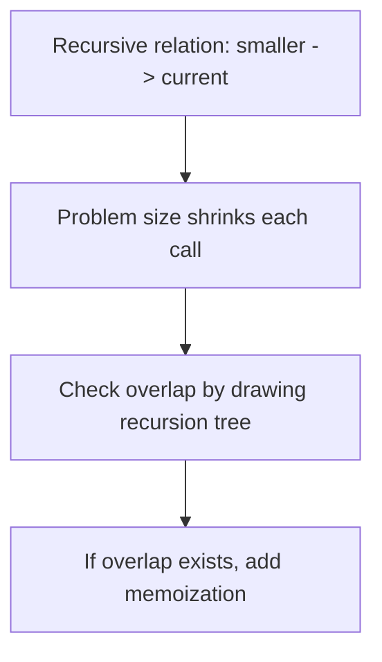

---

🔬 **Section Challenge — Part 5: Recursion Mental Checklist**
>
**Challenge 2 (Bug Hunt):** ```java
void fib(int n) { return n<=1 ? n : fib(n-1) + fib(n-2); }
fib(50) // takes forever
```
Why and what are the 3 fixes?
<details><summary>Answer</summary>

Exponential time O(2^N) — `fib(n-1)` and `fib(n-2)` each recursively recompute the same subproblems billions of times. Fix 1: Memoization — `Map<Integer,Long> memo`, return early if computed. O(N) time, O(N) space. Fix 2: Bottom-up DP — array `dp[i] = dp[i-1] + dp[i-2]`. O(N) time, O(N) space. Fix 3: O(1) space — just track last two values with two variables. O(N) time, O(1) space.
</details>


## Part 6: Common Recursion Patterns Cheat Sheet

| Pattern | Base Case | Recursive Case | Example |
|---------|-----------|---------------|---------|
| Linear | n=0 or n=1 | f(n-1) | Factorial, Sum |
| Binary | n=0 or n=1 | f(n-1) + f(n-2) | Fibonacci, Stairs |
| Divide & Conquer | len ≤ 1 | f(left) + f(right) | MergeSort, QuickSort |
| Subsets | index = n | include/exclude | Subset generation |
| Permutations | all used | try each unused | Arrangement problems |
| Graph DFS | visited/no neighbors | recurse each neighbor | Connected components |
| Tree DFS | null node | recurse left + right | Max depth, path sum |
| Backtracking | valid complete solution | choose-explore-unchoose | N-Queens, Sudoku |

---


🔬 **Section Challenge — Part 6: Common Recursion Patterns Cheat Sheet**
>
**Challenge 2 (Bug Hunt):** ```java
void fib(int n) { return n<=1 ? n : fib(n-1) + fib(n-2); }
fib(50) // takes forever
```
Why and what are the 3 fixes?
<details><summary>Answer</summary>

Exponential time O(2^N) — `fib(n-1)` and `fib(n-2)` each recursively recompute the same subproblems billions of times. Fix 1: Memoization — `Map<Integer,Long> memo`, return early if computed. O(N) time, O(N) space. Fix 2: Bottom-up DP — array `dp[i] = dp[i-1] + dp[i-2]`. O(N) time, O(N) space. Fix 3: O(1) space — just track last two values with two variables. O(N) time, O(1) space.
</details>

## Part 7: Complexity from Recursion Trees

### Formula: Total work = (number of nodes) × (work per node)

```
Pattern              | Nodes | Work/Node | Total
─────────────────────┼───────┼───────────┼──────
Linear (factorial)   | n     | O(1)      | O(n)
Binary (fibonacci)   | 2^n   | O(1)      | O(2^n)
MergeSort            | 2n-1  | O(n/level)| O(n log n)
Subsets              | 2^n   | O(n) copy | O(n · 2^n)
Permutations         | n!    | O(n) copy | O(n · n!)
Binary Search        | log n | O(1)      | O(log n)
```

**Flow:**
1. Pattern | Nodes | Work/Node | Total.
2. Linear (factorial): `n | O(1) | O(n)`.
3. Binary (fibonacci): `2^n | O(1) | O(2^n)`.
4. MergeSort: `2n-1 | O(n/level) | O(n log n)`.
5. Subsets: `2^n | O(n) copy | O(n · 2^n)`.
6. Permutations: `n! | O(n) copy | O(n · n!)`.
7. Binary Search: `log n | O(1) | O(log n)`.

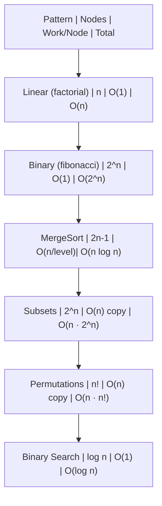

### Quick Rule: Height × Branching

```
Tree height = h (how many levels)
Branching factor = b (how many children per node)
Total nodes ≈ b^h

MergeSort: h=log n, b=2 → 2^(log n) = n nodes per level, log n levels → O(n log n)
Fibonacci: h=n, b=2 → 2^n nodes → O(2^n)
Subsets:   h=n, b=2 → 2^n leaves → O(2^n)
```

**Flow:**
1. MergeSort: h=log n, b=2
2. 2^(log n) = n nodes per level, log n levels
3. O(n log n)
4. Fibonacci: h=n, b=2
5. 2^n nodes
6. O(2^n)
7. Subsets: h=n, b=2
8. 2^n leaves
9. O(2^n)

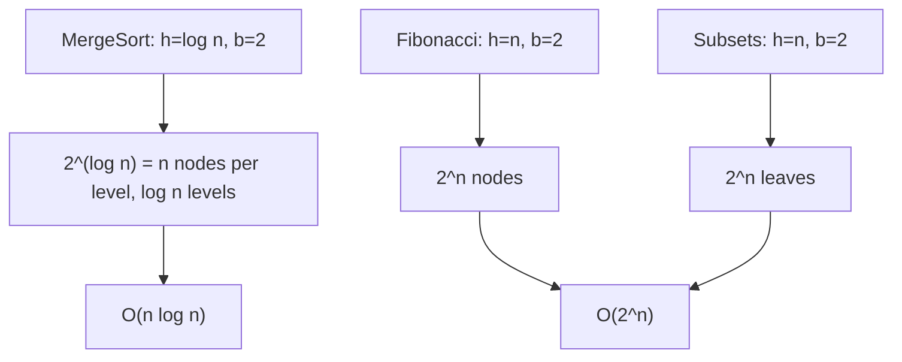

---

📖 **Related Files:**
- [03_Algorithms/03a_Recursion_Internals.md](../03_Algorithms/03a_Recursion_Internals.md) — How recursion works in memory
- [03_Algorithms/03b_Recursion_Fundamentals.md](../03_Algorithms/03b_Recursion_Fundamentals.md) — Core recursion patterns
- [04_Patterns_Templates/17_Backtracking_Plus_Pruning.md](../04_Patterns_Templates/17_Backtracking_Plus_Pruning.md) — Backtracking problems

---
[← Index](00_INDEX.md) | [02 DP State Thinking →](02_DP_State_Thinking.md)

---

---

🔬 **Section Challenge — Part 7: Complexity from Recursion Trees**
>
**Challenge 2 (Bug Hunt):** ```java
void fib(int n) { return n<=1 ? n : fib(n-1) + fib(n-2); }
fib(50) // takes forever
```
Why and what are the 3 fixes?
<details><summary>Answer</summary>

Exponential time O(2^N) — `fib(n-1)` and `fib(n-2)` each recursively recompute the same subproblems billions of times. Fix 1: Memoization — `Map<Integer,Long> memo`, return early if computed. O(N) time, O(N) space. Fix 2: Bottom-up DP — array `dp[i] = dp[i-1] + dp[i-2]`. O(N) time, O(N) space. Fix 3: O(1) space — just track last two values with two variables. O(N) time, O(1) space.
</details>


## 🏋️ Practice & Interview Questions — Trees & Heaps

### Predict / Trace
**Q1.** BST insert 5,3,7,1,4. Draw the tree. What is inorder traversal?
<details><summary>Answer</summary>

```
      5
     / \
    3   7
   / \
  1   4
```
Inorder: 1, 3, 4, 5, 7 (always sorted for BST!)
</details>

**Q2.** PriorityQueue in Java — is it a min-heap or max-heap by default?
<details><summary>Answer</summary>

**Min-heap** by default (`poll()` returns the minimum). For max-heap: `new PriorityQueue<>(Comparator.reverseOrder())`.
</details>

### LeetCode / Coding
**Q3.** ⭐ Maximum Depth of Binary Tree.
<details><summary>Solution</summary>

```java
int maxDepth(TreeNode root){
    if(root==null) return 0;
    return 1 + Math.max(maxDepth(root.left), maxDepth(root.right));
}
```
</details>

**Q4.** ⭐ Invert Binary Tree.
<details><summary>Solution</summary>

```java
TreeNode invertTree(TreeNode root){
    if(root==null) return null;
    TreeNode tmp=root.left; root.left=root.right; root.right=tmp;
    invertTree(root.left); invertTree(root.right);
    return root;
}
```
</details>

**Q5.** ⭐ Validate Binary Search Tree.
<details><summary>Solution</summary>

```java
boolean validate(TreeNode node, long min, long max){
    if(node==null) return true;
    if(node.val<=min||node.val>=max) return false;
    return validate(node.left,min,node.val)&&validate(node.right,node.val,max);
}
// call: validate(root, Long.MIN_VALUE, Long.MAX_VALUE)
```
</details>

**Q6.** ⭐ Level Order Traversal (BFS with Queue).
<details><summary>Solution</summary>

```java
Queue<TreeNode> q=new LinkedList<>(); q.offer(root);
while(!q.isEmpty()){
    int size=q.size();
    for(int i=0;i<size;i++){
        TreeNode n=q.poll(); process(n);
        if(n.left!=null) q.offer(n.left);
        if(n.right!=null) q.offer(n.right);
    }
}
```
</details>

**Q7.** ⭐ Lowest Common Ancestor of BST.
<details><summary>Solution</summary>

```java
TreeNode lca(TreeNode root, TreeNode p, TreeNode q){
    if(p.val<root.val&&q.val<root.val) return lca(root.left,p,q);
    if(p.val>root.val&&q.val>root.val) return lca(root.right,p,q);
    return root; // split point = LCA
}
```
</details>

**Q8.** ⭐⭐ Binary Tree Right Side View.
<details><summary>Solution</summary>

```java
// BFS, take last element of each level
// or DFS: track level, add to result only when level==result.size()
void dfs(TreeNode node, int level){
    if(node==null) return;
    if(level==res.size()) res.add(node.val);
    dfs(node.right,level+1); dfs(node.left,level+1);
}
```
</details>

**Q9.** ⭐⭐ Kth Smallest Element in BST.
<details><summary>Solution</summary>

```java
// Inorder traversal is sorted — take kth element
int k, result;
void inorder(TreeNode node){
    if(node==null) return;
    inorder(node.left);
    if(--k==0){ result=node.val; return; }
    inorder(node.right);
}
```
</details>

**Q10.** ⭐⭐ Serialize and Deserialize Binary Tree.
<details><summary>Key approach</summary>

BFS level-order with null markers. Serialize: `1,2,3,null,null,4,5`. Deserialize: queue-based reconstruction level by level.
</details>

**Q11.** ⭐⭐⭐ Binary Tree Maximum Path Sum.
<details><summary>Solution</summary>

```java
int maxSum = Integer.MIN_VALUE;
int dfs(TreeNode node){
    if(node==null) return 0;
    int left=Math.max(0,dfs(node.left)), right=Math.max(0,dfs(node.right));
    maxSum=Math.max(maxSum, node.val+left+right); // path through this node
    return node.val+Math.max(left,right); // return single path
}
```
</details>

### Heap / Priority Queue Problems

**Q12.** ⭐ Kth Largest Element in Array.
<details><summary>Solution</summary>

```java
PriorityQueue<Integer> minHeap=new PriorityQueue<>();
for(int n:nums){ minHeap.offer(n); if(minHeap.size()>k) minHeap.poll(); }
return minHeap.peek(); // kth largest
```
</details>

**Q13.** ⭐⭐ Median from Data Stream (two heaps).
<details><summary>Solution</summary>

```java
PriorityQueue<Integer> lo=new PriorityQueue<>(Comparator.reverseOrder()); // max-heap
PriorityQueue<Integer> hi=new PriorityQueue<>(); // min-heap
void addNum(int n){
    lo.offer(n);
    hi.offer(lo.poll());
    if(lo.size()<hi.size()) lo.offer(hi.poll());
}
double findMedian(){ return lo.size()>hi.size()?lo.peek():(lo.peek()+hi.peek())/2.0; }
```
</details>

### MCQ Rapid Fire

| # | Question | Answer |
|---|---|---|
| 1 | BST search avg/worst | O(log N) avg, O(N) worst (degenerate) |
| 2 | Complete binary tree with N nodes height | O(log N) |
| 3 | Heap insertHeapify direction | Bubble up |
| 4 | Heap extractMin direction | Bubble down (sift down) |
| 5 | Java PriorityQueue poll() time | O(log N) |
| 6 | Tree DFS pre/in/post order uses | Stack (or recursion) |
| 7 | Tree BFS uses | Queue |
| 8 | Red-Black Tree guarantee | O(log N) worst case for search/insert/delete |

---

## 🧠 Deep Conceptual Questions — Trees & Heaps

**C1. Why is the inorder traversal of a BST always sorted?**
<details><summary>Deep Answer</summary>

BST invariant: every node's left subtree contains ONLY values less than the node, right subtree ONLY values greater. Inorder traversal visits: left subtree (all smaller) → root → right subtree (all larger). Applied recursively at every node, this produces values in ascending order. This is the defining property that makes BST useful: O(log N) search because at each step, half the tree is eliminated. Broken BST (invariant violated) → inorder not sorted → BST operations return wrong results. That's why "Validate BST" is a fundamental problem.
</details>

**C2. Why does heap not support O(log N) arbitrary deletion (only min/max removal)?**
<details><summary>Deep Answer</summary>

Heap invariant: parent ≤ children (min-heap). When you remove the minimum (root): replace with last element, sift down — O(log N). But for an arbitrary element: you'd need to FIND it first (O(N) scan — heap has no lookup index), then restore the heap property. Without indexing, you can't efficiently locate an element. **d-ary heaps** exist, and indexed heaps (priority queues with decrease-key, like Fibonacci heap) support O(log N) arbitrary deletion — but Java's PriorityQueue doesn't. Dijkstra's with "lazy deletion" (add stale entries, skip when popped) works around this.
</details>

**C3. Why is tree height critical for BST operations?**
<details><summary>Deep Answer</summary>

BST search = walk from root to target, one comparison per level. Operations: O(height). **Balanced BST** (AVL, Red-Black): height = O(log N) → operations O(log N). **Degenerate BST** (insert sorted data: 1,2,3,4,5): each node has only right child → height = N → operations O(N) = linked list performance! This is why TreeMap uses Red-Black Tree (self-balancing): guarantees height ≤ 2*log(N) regardless of insertion order. Red-Black Tree balance condition is weaker than AVL (allows "approximately balanced") but cheaper to maintain: at most 3 rotations per insert (AVL: potentially O(log N)).
</details>

**C4. Why does BFS on a tree need a Queue but DFS needs a Stack (or recursion)?**
<details><summary>Deep Answer</summary>

BFS explores level by level: all children of current nodes must be processed before their children. Queue's FIFO ensures: nodes added to queue at level L are processed before level L+1 nodes (which are added during L's processing). DFS explores as deep as possible before backtracking. Stack's LIFO ensures: the most recently discovered (deepest) node is explored next. Recursive DFS implicitly uses the call stack — each recursive call IS a stack frame push. Iterative DFS when chosen over recursive: avoids stack overflow for very deep trees (N deep right-skewed tree → N recursion levels → StackOverflowError).
</details>

**C5. Lowest Common Ancestor — why does the recursive approach work in O(N)?**
<details><summary>Deep Answer</summary>

The recursive logic: `lca(node, p, q)` returns the LCA if it exists in the subtree of `node`, or p/q if one is found but not the other, or null if neither found. At each node: check left subtree and right subtree results. If BOTH return non-null: this node is the LCA (p is in one subtree, q in another — this is the split point). If only one: that subtree contains both (one is ancestor of the other). The algorithm visits each node once → O(N). For BST: we can do O(log N) by comparing values (if both < node: go left; both > node: go right; one each side: node is LCA).
</details>

**C6. Why is heap built in O(N) time but inserting N elements one-by-one takes O(N log N)?**
<details><summary>Deep Answer</summary>

**Bottom-up `heapify`**: Only nodes with children need sifting-down. Bottom half are leaves (no children) — zero work. Next level: height-1 sift-down each. Total work = Σ(height * nodes at that height) = O(N) (geometric series). **N individual inserts**: each can trigger O(log N) sift-up. Total = O(N log N). The bottom-up approach is 2x faster in practice. Java's `PriorityQueue(Collection)` constructor uses O(N) heapify. `Arrays.stream().forEach(pq::add)` is O(N log N). When converting an array to a heap, always prefer the constructor form.
</details>

**C7. Binary Tree Maximum Path Sum — why can a node contribute ONE branch to its parent but TWO internally?**
<details><summary>Deep Answer</summary>

A path cannot branch twice — if you go left and right from a node, the path "bends" at that node and can't continue upward (a path is a sequence of nodes with edges between them, no branching). So: **to a parent**: this node contributes max(left_gain, right_gain, 0) + node.val — choose the better single branch. **For the global answer**: the path could USE this node as the "bend" — include left_gain + node.val + right_gain. This might be the overall maximum even if it can't be passed upward. The DFS returns the single-branch value to parent but updates the global max with the bend value at each node.
</details>

**C8. Two-heap approach for median — why one max-heap and one min-heap?**
<details><summary>Deep Answer</summary>

Maintain two properties: (1) bottom half of numbers in a max-heap (quick access to max of lower half), (2) top half in a min-heap (quick access to min of upper half). Median = either the top of one heap (odd total) or average of both tops (even total). Invariant: max-heap size ≥ min-heap size, and max-heap.top ≤ min-heap.top. Adding a number: if > min-heap.top → it's in the top half → add to min-heap; else bottom half → add to max-heap. Then rebalance if sizes differ by 2. Both heaps stay O(log N) operations per insert. This pattern generalizes: ANY running statistic that needs the "boundary" between two halves uses this two-heap technique.
</details>

> **Navigation**: [Back to Index](../00_MASTER_INDEX.md) | [Next >](02_DP_State_Thinking.md)
