> **Navigation**: [Back to Index](../00_MASTER_INDEX.md) | [Next >](02_DP_State_Thinking.md)

# 🌳 Recursion & Tree Thinking — Mental Model

> **The #1 reason people struggle with recursion**: they try to trace every call in their head. Stop doing that. This guide teaches you the **Leap of Faith** method and how to draw recursion trees like a whiteboard pro.

---

## Part 1: The Leap of Faith Method

### The Problem with "Tracing"
```
fibonacci(5) calls fibonacci(4) which calls fibonacci(3) which calls...
→ Your brain runs out of stack space, just like the computer would.
```

### The Solution: Trust the Recursion
**Leap of Faith** = Assume your function already works for smaller inputs. Only think about:
1. **Base case**: What's the simplest input I can answer immediately?
2. **Recursive step**: If my function magically works for smaller inputs, how do I use that to solve the current input?
3. **Combine**: How do I combine the sub-answers?

### Example: Sum of a Linked List
```
WRONG thinking: "sum(1→2→3→4) calls sum(2→3→4) which calls sum(3→4)..."
                 (tracing every call = brain overflow)

RIGHT thinking: "Assume sum() works for smaller lists.
                 sum(1→2→3→4) = 1 + sum(2→3→4)
                                    ↑ I trust this gives 9
                 Answer = 1 + 9 = 10 ✅"
```

> **Flow**: 4) which calls sum(3 → 4)...'

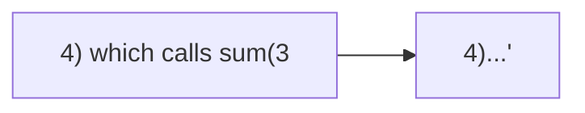

### The 3-Question Framework
For EVERY recursive problem, ask yourself:
```
Q1: What is the SMALLEST INPUT I can answer directly?
    → That's your base case.

Q2: If my function MAGICALLY WORKS for smaller inputs,
    how do I use that?
    → That's your recursive call.

Q3: How do I COMBINE the sub-result with current data?
    → That's your return statement.
```

> **Flow**: Q1: What is the SMALLEST INPUT I can answer directly? → → That's your base case. | → That's your base case. → Q2: If my function MAGICALLY WORKS for smaller inputs, | Q2: If my function MAGICALLY WORKS for smaller inputs, → how do I use that? | how do I use that? → → That's your recursive call. | → That's your recursive call. → Q3: How do I COMBINE the sub-result with current data? | Q3: How do I COMBINE the sub-result with current data? → → That's your return statement.

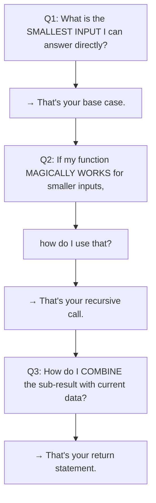

### Applied Example: Reverse a String
```java
// Q1: Smallest input? → empty string or single char → return it
// Q2: If reverse() works for smaller string?
//     reverse("hello") = reverse("ello") + "h"
//                         ↑ trust this returns "olle"
// Q3: Combine? → "olle" + "h" = "olleh" ✅

String reverse(String s) {
    if (s.length() <= 1) return s;              // Q1: base case
    return reverse(s.substring(1)) + s.charAt(0); // Q2+Q3: trust + combine
}
```

---

## Part 2: How to Draw Recursion Trees (Step by Step)

### Why Draw Them?
- **See overlapping subproblems** → decide if DP is needed
- **Count total work** → determine time complexity
- **Debug wrong answers** → trace where logic breaks
- **Impress interviewers** → shows deep understanding

### Step-by-Step: Drawing a Recursion Tree

#### Step 1: Write the function signature as the root
```
                    fib(5)
```

#### Step 2: Draw the recursive calls as children
```
                    fib(5)
                   /      \
               fib(4)    fib(3)
```

#### Step 3: Keep expanding until you hit base cases
```
                         fib(5)
                        /      \
                   fib(4)      fib(3)
                  /     \      /     \
              fib(3)  fib(2) fib(2)  fib(1)
              /    \   /  \   /  \      |
          fib(2) fib(1) 1  0  1   0     1
          /   \    |
         1     0   1
```

#### Step 4: Annotate the return values (bottom-up)
```
                         fib(5) = 5
                        /          \
                   fib(4)=3      fib(3)=2
                  /       \       /      \
              fib(3)=2  fib(2)=1 fib(2)=1 fib(1)=1
              /    \     /  \     /  \
          fib(2)=1 fib(1)=1 1  0  1   0
          /   \
         1     0
```

#### Step 5: Identify the pattern
```
OBSERVATION: fib(3) is calculated 2 times! fib(2) is calculated 3 times!
→ OVERLAPPING SUBPROBLEMS → Use Memoization!

Node count ≈ 2^n → Time: O(2^n) without memo
Unique subproblems = n → Time: O(n) WITH memo
```

> **Flow**: OVERLAPPING SUBPROBLEMS → Use Memoization! | Node count ≈ 2^n → Time: O(2^n) without memo | Unique subproblems = n → Time: O(n) WITH memo

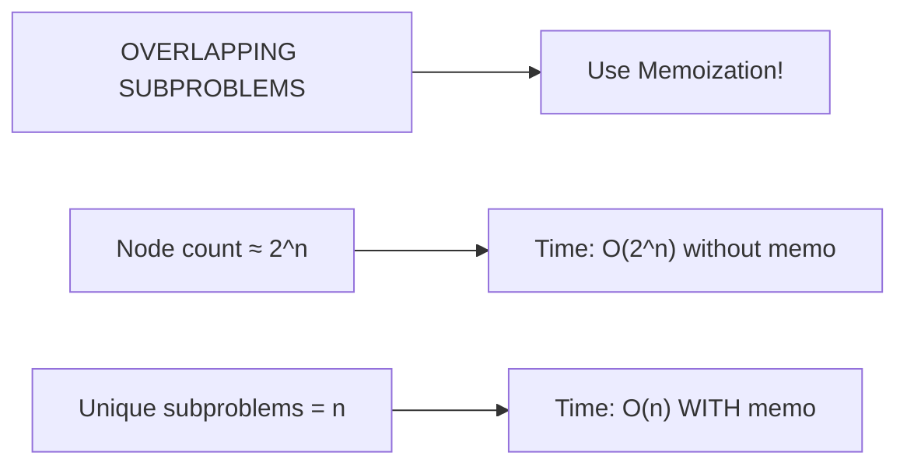

### Recursion Tree Templates for Common Patterns

#### Pattern A: Linear Recursion (Path = straight line)
```
factorial(4) → factorial(3) → factorial(2) → factorial(1)
    ↓ 24          ↓ 6           ↓ 2            ↓ 1

Total calls: n → O(n) time and O(n) space (call stack)
```

> **Flow**: factorial(4) → factorial(3) | factorial(3) → factorial(2) | factorial(2) → factorial(1) | Total calls: n → O(n) time and O(n) space (call stack)

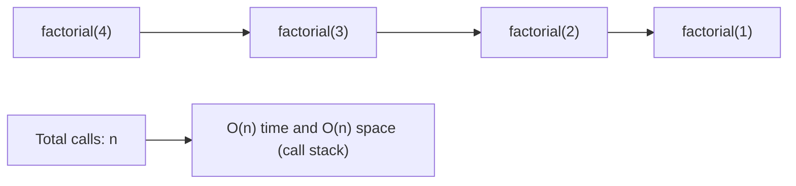

#### Pattern B: Binary Recursion (Tree splits in two)
```
           f(n)
          /    \
       f(n-1)  f(n-2)    → Fibonacci, Tower of Hanoi

Height: n, Branching: 2 → O(2^n) total calls
```

> **Flow**: f(n-1) f(n-2) → Fibonacci, Tower of Hanoi | Height: n, Branching: 2 → O(2^n) total calls

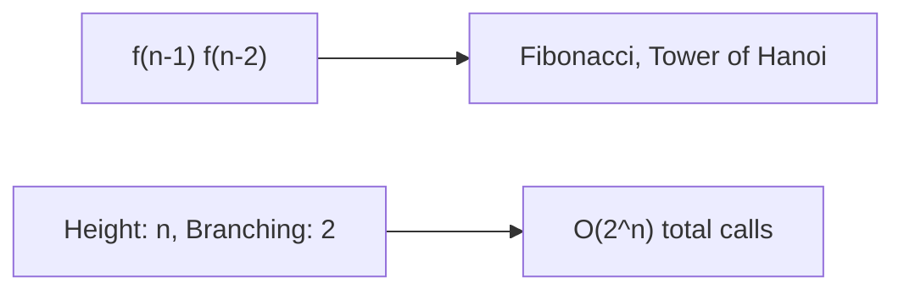

#### Pattern C: Branching Recursion (Multiple choices)
```
           f(n, choices=[a,b,c])
          /       |       \
     f(n-1,a)  f(n-1,b)  f(n-1,c)   → Permutations, Combinations

Height: n, Branching: k → O(k^n) total calls
```

> **Flow**: f(n-1,a) f(n-1,b) f(n-1,c) → Permutations, Combinations | Height: n, Branching: k → O(k^n) total calls

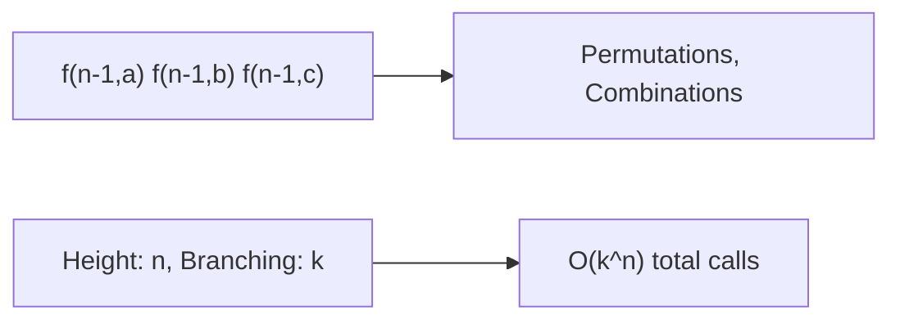

#### Pattern D: Divide & Conquer (Split in half)
```
        mergeSort(0,7)
        /            \
   sort(0,3)      sort(4,7)
   /     \         /     \
 s(0,1) s(2,3)  s(4,5)  s(6,7)

Height: log(n), Work per level: O(n) → Total: O(n log n)
```

> **Flow**: Height: log(n), Work per level: O(n) → Total: O(n log n)

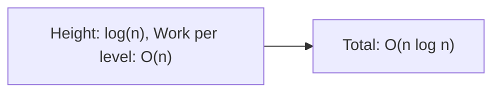

---

## Part 3: The Recursion → Memoization → Tabulation Pipeline

### This is the most important transformation in DSA:
```
Step 1: Write naive recursion (correct but slow)
Step 2: Add memoization (top-down DP, still recursive)
Step 3: Convert to tabulation (bottom-up DP, iterative)
Step 4: Optimize space (if only looking at previous row/values)
```

### Live Example: Climbing Stairs

#### Step 1: Naive Recursion
```java
// "Trust": ways(n-1) gives correct count for n-1 steps
int ways(int n) {
    if (n <= 1) return 1;                    // Base: 0 or 1 step = 1 way
    return ways(n - 1) + ways(n - 2);       // Take 1 step + take 2 steps
}
// Time: O(2^n) — way too slow!
```

Draw the tree:
```
              ways(5)
             /       \
         ways(4)     ways(3)        ← overlapping!
        /     \       /     \
    ways(3) ways(2) ways(2) ways(1)  ← ways(3) computed twice!
     ...     ...
```

> **Flow**: ways(5) → ways(4) ways(3) ← overlapping!

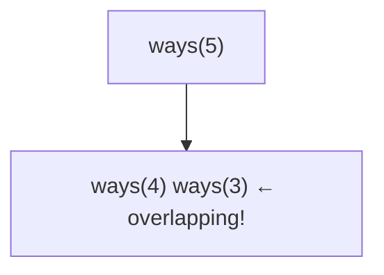

#### Step 2: Add Memoization (Top-Down DP)
```java
int[] memo = new int[n + 1];
Arrays.fill(memo, -1);

int ways(int n) {
    if (n <= 1) return 1;
    if (memo[n] != -1) return memo[n];       // Already computed? Return it!
    memo[n] = ways(n - 1) + ways(n - 2);    // Compute and STORE
    return memo[n];
}
// Time: O(n) — each subproblem solved once!
```

**Mental model**: "Put a sticky note on each computed answer. Before computing, check if sticky note exists."

#### Step 3: Convert to Tabulation (Bottom-Up DP)
```java
int ways(int n) {
    int[] dp = new int[n + 1];
    dp[0] = 1; dp[1] = 1;                    // Base cases
    for (int i = 2; i <= n; i++) {
        dp[i] = dp[i - 1] + dp[i - 2];      // Fill table left → right
    }
    return dp[n];
}
// Time: O(n), Space: O(n)
```

**Mental model**: "Instead of going top-down and caching, fill the table bottom-up like filling a spreadsheet."

#### Step 4: Space Optimization
```java
int ways(int n) {
    int prev2 = 1, prev1 = 1;
    for (int i = 2; i <= n; i++) {
        int curr = prev1 + prev2;
        prev2 = prev1;
        prev1 = curr;
    }
    return prev1;
}
// Time: O(n), Space: O(1) ← optimal!
```

**Mental model**: "Only need last 2 values? Don't keep the whole table — use 2 variables."

---

## Part 4: Recursion + Backtracking — How to Think

### What IS Backtracking?
```
Recursion  = explore ONE path to the end
Backtracking = explore a path, then UNDO your choice and try the next path

Recursion is the engine.
Backtracking is the steering wheel.
```

### The Choose-Explore-Unchoose Framework
```
for each choice at current step:
    1. CHOOSE: Make the choice (modify state)
    2. EXPLORE: Recurse to the next step
    3. UNCHOOSE: Undo the choice (restore state)
```

### Example: Generate All Subsets of [1, 2, 3]
```java
void subsets(int[] nums, int start, List<Integer> current, List<List<Integer>> result) {
    result.add(new ArrayList<>(current));     // Every state is a valid subset

    for (int i = start; i < nums.length; i++) {
        current.add(nums[i]);                 // CHOOSE: include nums[i]
        subsets(nums, i + 1, current, result); // EXPLORE: recurse
        current.remove(current.size() - 1);   // UNCHOOSE: exclude nums[i]
    }
}
```

### The Backtracking Decision Tree
```
                        []
                    /   |   \
                 [1]   [2]   [3]      ← choose 1, 2, or 3
                / \     |
           [1,2] [1,3] [2,3]         ← choose next
            |
         [1,2,3]                      ← choose next

When a branch ends, we BACKTRACK (remove last choice) and try the next branch.
```

> **Flow**: [1] [2] [3] ← choose 1, 2, or 3 → [1,2] [1,3] [2,3] ← choose next | [1,2] [1,3] [2,3] ← choose next → [1,2,3] ← choose next

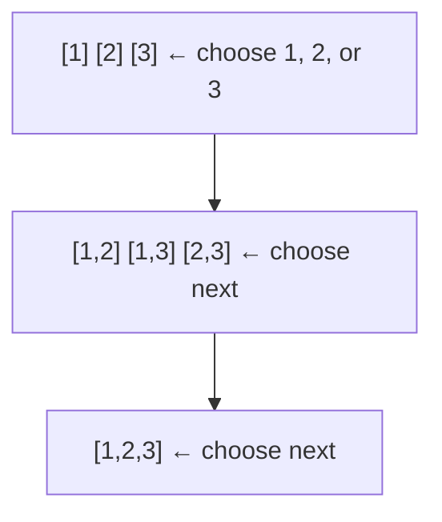

### When to PRUNE (Skip Branches Early)
```
PRUNE when you KNOW a branch won't lead to a valid answer:

1. Sum exceeds target? → Don't explore further
   if (currentSum > target) return;

2. Duplicate element at same level? → Skip it
   if (i > start && nums[i] == nums[i-1]) continue;

3. Constraint violated? → Abort path
   if (!isValid(board, row, col)) continue;  // N-Queens
```

> **Flow**: 1. Sum exceeds target? → Don't explore further | 2. Duplicate element at same level? → Skip it | 3. Constraint violated? → Abort path

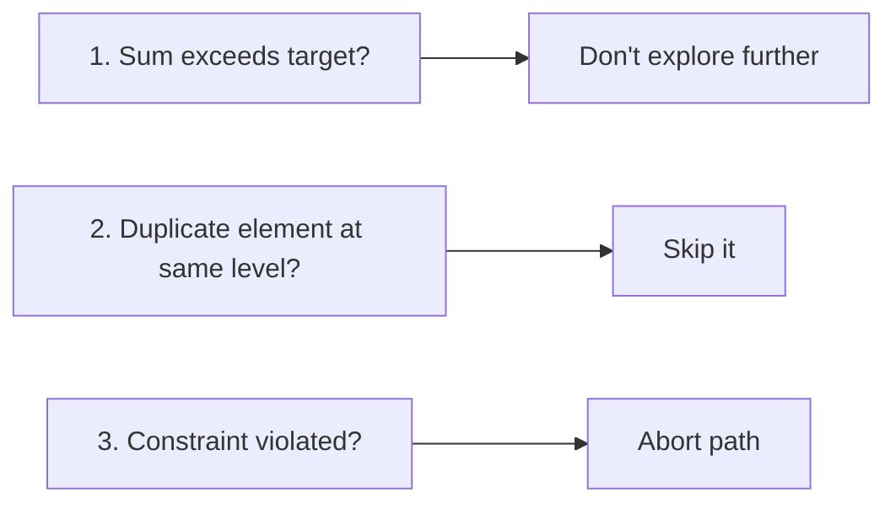

### Visual: Pruning saves MASSIVE work
```
Without pruning:        With pruning:
    O                       O
   /|\                     /|\
  O O O                   O O ✂
 /|\ ...                 /|
O O O ...               O ✂
                        → 10x fewer calls!
```

> **Flow**: Without pruning: With pruning: → → 10x fewer calls!

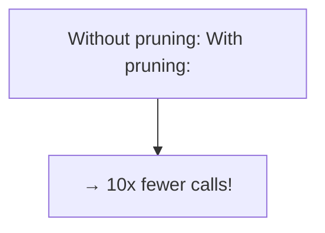

---

## Part 5: Recursion Mental Checklist

Before writing ANY recursive function, answer these:

```
□ What is my base case? (smallest input, direct answer)
□ What is my recursive relation? (how smaller → current)
□ Am I making the problem smaller? (n → n-1 or n → n/2?)
□ Do I trust the recursion? (Leap of Faith applied?)
□ Do I need to CHOOSE-EXPLORE-UNCHOOSE? (Backtracking?)
□ Are there overlapping subproblems? (Draw tree → check for repeats)
□ If overlapping → Add memo array/map
□ Can I convert to bottom-up? (Tabulation)
□ Can I reduce space? (Only need last row/variable?)
```

> **Flow**: □ What is my recursive relation? (how smaller → current) | □ Am I making the problem smaller? (n → n-1 or n | n-1 or n → n/2?) | □ Are there overlapping subproblems? (Draw tree → check for repeats) | □ If overlapping → Add memo array/map

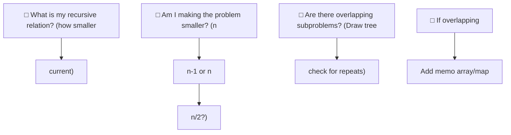

---

## Part 6: Common Recursion Patterns Cheat Sheet

| Pattern | Base Case | Recursive Case | Example |
|---------|-----------|---------------|---------|
| Linear | n=0 or n=1 | f(n-1) | Factorial, Sum |
| Binary | n=0 or n=1 | f(n-1) + f(n-2) | Fibonacci, Stairs |
| Divide & Conquer | len ≤ 1 | f(left) + f(right) | MergeSort, QuickSort |
| Subsets | index = n | include/exclude | Subset generation |
| Permutations | all used | try each unused | Arrangement problems |
| Graph DFS | visited/no neighbors | recurse each neighbor | Connected components |
| Tree DFS | null node | recurse left + right | Max depth, path sum |
| Backtracking | valid complete solution | choose-explore-unchoose | N-Queens, Sudoku |

---

## Part 7: Complexity from Recursion Trees

### Formula: Total work = (number of nodes) × (work per node)

```
Pattern              | Nodes | Work/Node | Total
─────────────────────┼───────┼───────────┼──────
Linear (factorial)   | n     | O(1)      | O(n)
Binary (fibonacci)   | 2^n   | O(1)      | O(2^n)
MergeSort            | 2n-1  | O(n/level)| O(n log n)
Subsets              | 2^n   | O(n) copy | O(n · 2^n)
Permutations         | n!    | O(n) copy | O(n · n!)
Binary Search        | log n | O(1)      | O(log n)
```

> **Flow**: Pattern | Nodes | Work/Node | Total → Linear (factorial) | n | O(1) | O(n) | Linear (factorial) | n | O(1) | O(n) → Binary (fibonacci) | 2^n | O(1) | O(2^n) | Binary (fibonacci) | 2^n | O(1) | O(2^n) → MergeSort | 2n-1 | O(n/level)| O(n log n) | MergeSort | 2n-1 | O(n/level)| O(n log n) → Subsets | 2^n | O(n) copy | O(n · 2^n) | Subsets | 2^n | O(n) copy | O(n · 2^n) → Permutations | n! | O(n) copy | O(n · n!) | Permutations | n! | O(n) copy | O(n · n!) → Binary Search | log n | O(1) | O(log n)

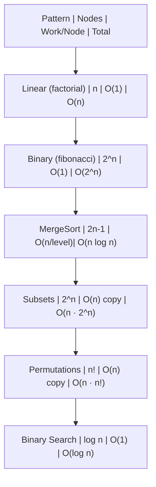

### Quick Rule: Height × Branching
```
Tree height = h (how many levels)
Branching factor = b (how many children per node)
Total nodes ≈ b^h

MergeSort: h=log n, b=2 → 2^(log n) = n nodes per level, log n levels → O(n log n)
Fibonacci: h=n, b=2 → 2^n nodes → O(2^n)
Subsets:   h=n, b=2 → 2^n leaves → O(2^n)
```

> **Flow**: MergeSort: h=log n, b=2 → 2^(log n) = n nodes per level, log n levels | 2^(log n) = n nodes per level, log n levels → O(n log n) | Fibonacci: h=n, b=2 → 2^n nodes | 2^n nodes → O(2^n) | Subsets: h=n, b=2 → 2^n leaves | 2^n leaves → O(2^n)

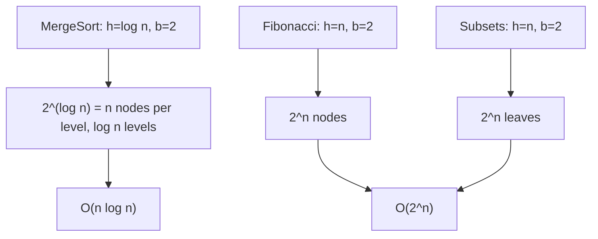

---

📖 **Related Files:**
- [03_Algorithms/03a_Recursion_Internals.md](../03_Algorithms/03a_Recursion_Internals.md) — How recursion works in memory
- [03_Algorithms/03b_Recursion_Fundamentals.md](../03_Algorithms/03b_Recursion_Fundamentals.md) — Core recursion patterns
- [04_Patterns_Templates/17_Backtracking_Plus_Pruning.md](../04_Patterns_Templates/17_Backtracking_Plus_Pruning.md) — Backtracking problems

---
[← Index](00_INDEX.md) | [02 DP State Thinking →](02_DP_State_Thinking.md)


---

> **Navigation**: [Back to Index](../00_MASTER_INDEX.md) | [Next >](02_DP_State_Thinking.md)