> **Navigation**: [< Previous](01_Recursion_Tree_Thinking.md) | [Back to Index](../00_MASTER_INDEX.md) | [Next >](03_Graph_Tree_Thinking.md)

# 🎯 DP: State & Transition Thinking — Mental Model

> **The #1 mistake in DP**: jumping straight to the recurrence relation. This guide teaches you to think about DP as **defining states**, then **defining transitions between them** — like designing a spreadsheet before filling it.

---

## Part 1: What IS a DP State?

### The Spreadsheet Analogy
```
Think of DP as filling a spreadsheet:
- Each CELL is a STATE (a unique subproblem)
- Each FORMULA is a TRANSITION (how one cell depends on others)
- The ANSWER is one specific cell

Your job:
1. Define WHAT each cell represents
2. Define HOW each cell is computed from other cells
3. Figure out the ORDER to fill cells (base cases first)
```

### Example: Longest Common Subsequence
```
         ""  A  C  E
    ""  [ 0  0  0  0 ]    ← base case: empty string
    A   [ 0  1  1  1 ]    dp[1][1] = they match! → dp[0][0] + 1
    B   [ 0  1  1  1 ]    dp[2][1] = don't match → max(left, top)
    C   [ 0  1  2  2 ]    dp[3][2] = match! → dp[2][1] + 1
    E   [ 0  1  2  3 ]    ← answer: dp[4][3] = 3
```

**Flow:**
1. A [ 0 1 1 1 ] dp[1][1] = they match!
2. dp[0][0] + 1
3. B [ 0 1 1 1 ] dp[2][1] = don't match max(left, top) C [ 0 1 2 2 ] dp[3][2] = match! dp[2][1] + 1

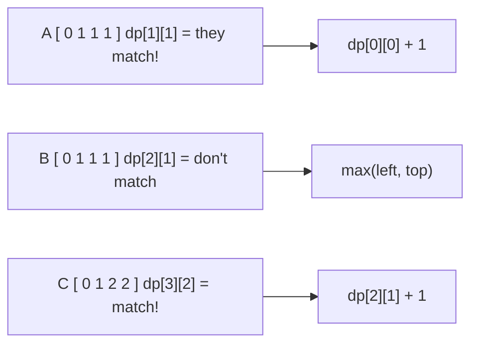

---

## Part 2: The 5-Step DP Process

### Step 1: Define the State (WHAT does dp[i] or dp[i][j] mean?)
```
Ask: "What's the MINIMUM information I need to describe a subproblem?"

Common state definitions:
- dp[i] = answer for first i elements
- dp[i][j] = answer for substring s[i..j]
- dp[i][w] = answer using first i items with capacity w
- dp[i][j] = answer for s1[0..i-1] and s2[0..j-1]
- dp[mask] = answer with visited set encoded as bitmask
```

**Mental trick**: "If I'm at position i, what else do I need to know to make a decision?"
- Just position? → 1D DP: `dp[i]`
- Position + remaining capacity? → 2D DP: `dp[i][w]`
- Position + last choice? → 2D DP: `dp[i][prev]`
- Position + set of visited nodes? → Bitmask DP: `dp[i][mask]`

### Step 2: Define the Transition (HOW does one state relate to others?)
```
Ask: "What CHOICES do I have at this state?"

For each choice, the state changes:
- Include item i → dp[i][w] depends on dp[i-1][w - weight[i]]
- Exclude item i → dp[i][w] depends on dp[i-1][w]
- Match chars → dp[i][j] depends on dp[i-1][j-1]
- Don't match → dp[i][j] depends on dp[i-1][j] or dp[i][j-1]
```

**Flow:**
1. - Include item i
2. dp[i][w] depends on dp[i-1][w - weight[i]]
3. - Exclude item i
4. dp[i][w] depends on dp[i-1][w]
5. - Match chars
6. dp[i][j] depends on dp[i-1][j-1]
7. - Don't match dp[i][j] depends on dp[i-1][j] or dp[i][j-1]

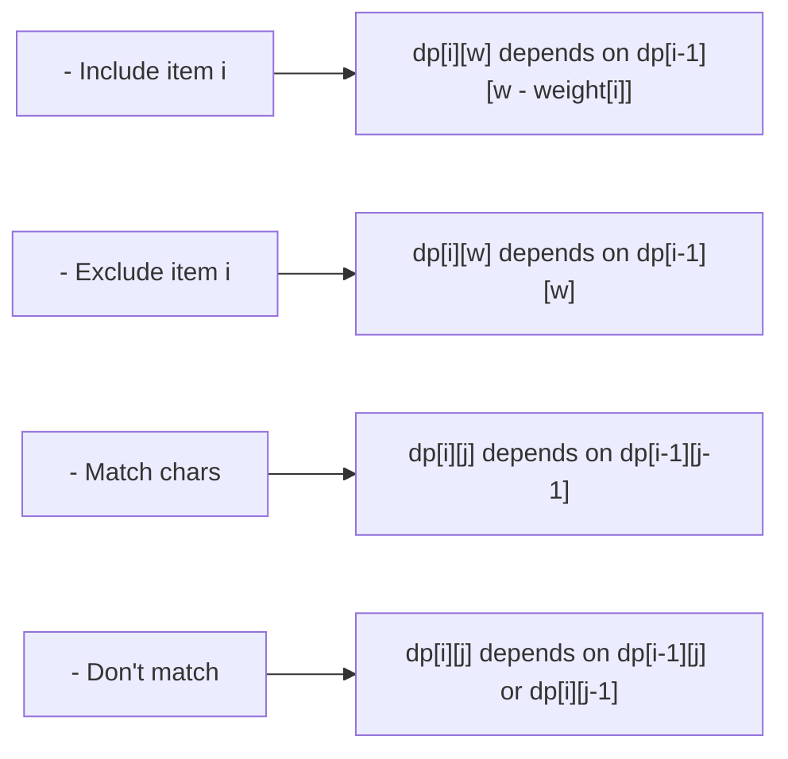

### Step 3: Identify Base Cases (WHERE does the spreadsheet start?)
```
Ask: "What states can I answer WITHOUT any computation?"

Common bases:
- dp[0] = ... (empty input)
- dp[0][j] = ..., dp[i][0] = ... (first row/column)
- dp[i][i] = ... (single element ranges)
```

### Step 4: Determine Fill Order (WHICH direction to fill?)
```
Ask: "Does dp[i] need dp[i-1] (fill left→right) or dp[i+1] (fill right→left)?"

Common orders:
- Linear: left to right (most problems)
- Interval: by increasing length (interval DP)
- Grid: top-left to bottom-right
- Tree: post-order (children before parent)
```

**Flow:**
1. Ask: 'Does dp[i] need dp[i-1] (fill left right) or dp[i+1] (fill right left)?'

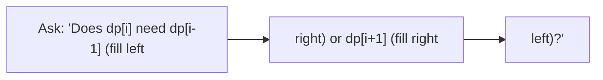

### Step 5: Extract the Answer (WHERE is the final answer?)
```
- dp[n] or dp[n-1] (last element)
- dp[n][target] (specific cell)
- max(dp[i]) for all i (scan entire array)
- dp[0][n-1] (entire range)
```

---

## Part 3: The DP Pattern Recognition Decision Tree

```
What are you optimizing?
│
├── "How many ways?" → COUNTING
│   ├── Linear choices → dp[i] = dp[i-1] + dp[i-2]     (Climbing Stairs)
│   └── 2D choices → dp[i][j] = dp[i-1][j-1] + ...     (Unique Paths)
│
├── "Min/Max cost?" → OPTIMIZATION
│   ├── Take or skip → dp[i] = max(dp[i-1], dp[i-2]+v)  (House Robber)
│   ├── With capacity → dp[i][w] = max(skip, take)       (Knapsack)
│   └── Interval → dp[i][j] = min over k of dp[i][k]+dp[k+1][j]  (MCM)
│
├── "Is it possible?" → FEASIBILITY
│   └── dp[i] = dp[i-coin1] || dp[i-coin2] || ...       (Coin change possible?)
│
├── Two sequences → TWO-SEQUENCE
│   ├── Match chars → LCS, Edit Distance
│   └── dp[i][j] uses dp[i-1][j-1], dp[i-1][j], dp[i][j-1]
│
├── Single sequence → SINGLE-SEQUENCE
│   ├── Subsequence → LIS (dp[i] = max involving j < i)
│   └── Subarray → Kadane's (dp[i] = max(arr[i], dp[i-1]+arr[i]))
│
└── Choices with states → STATE MACHINE
    └── Multiple states per position (Buy/Sell Stock with cooldown)
```

**Flow:**
1. 'How many ways?'
2. COUNTING
3. 'Min/Max cost?'
4. OPTIMIZATION
5. 'Is it possible?'
6. FEASIBILITY
7. Two sequences
8. TWO-SEQUENCE
9. Single sequence
10. SINGLE-SEQUENCE

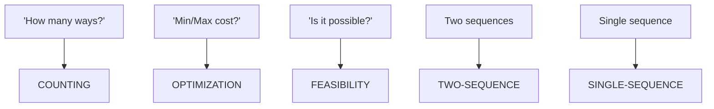

---


## Part 4: State Identification — Hard Examples

### Example 1: Egg Drop
```
"What do I need to know to make a decision?"
- How many eggs I have (e)
- How many floors to test (f)
→ State: dp[e][f] = min trials to find critical floor

Transition:
  Drop egg at floor x:
    If egg breaks → test below: dp[e-1][x-1]
    If survives → test above: dp[e][f-x]
  Worst case: max(breaks, survives)
  Best choice: min over all x

dp[e][f] = 1 + min over x of max(dp[e-1][x-1], dp[e][f-x])
```

**Flow:**
1. If egg breaks test below: dp[e-1][x-1]
2. If survives test above: dp[e][f-x]

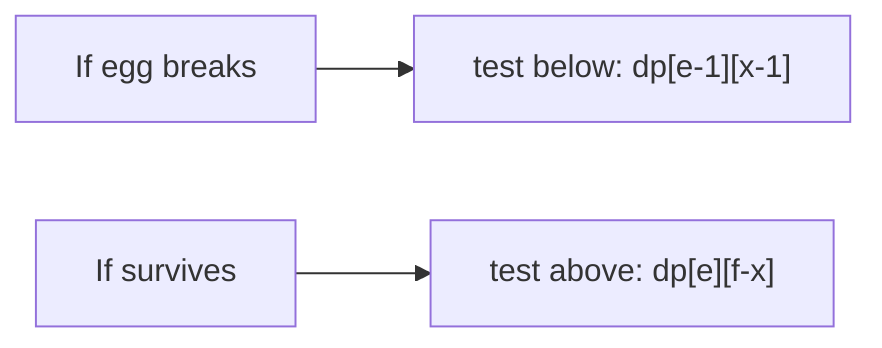

### Example 2: Buy/Sell Stock with Cooldown
```
"What do I need to know at day i?"
- Am I holding a stock or not?
- Am I in cooldown or not?
→ THREE states at each day:

hold[i]    = max profit on day i if I'm holding stock
notHold[i] = max profit on day i if I'm NOT holding (and not in cooldown)
cool[i]    = max profit on day i if I'm in cooldown (just sold)

Transitions:
hold[i]    = max(hold[i-1], notHold[i-1] - price[i])  // keep holding or buy
notHold[i] = max(notHold[i-1], cool[i-1])              // stay or finish cooldown
cool[i]    = hold[i-1] + price[i]                       // sell today
```

**Flow:**
1. 'What do I need to know at day i?'
2. - Am I holding a stock or not?
3. - Am I in cooldown or not?
4. THREE states at each day:
5. hold[i] = max profit on day i if I'm holding stock Transitions: cool[i] = hold[i-1] + price[i] // sell today

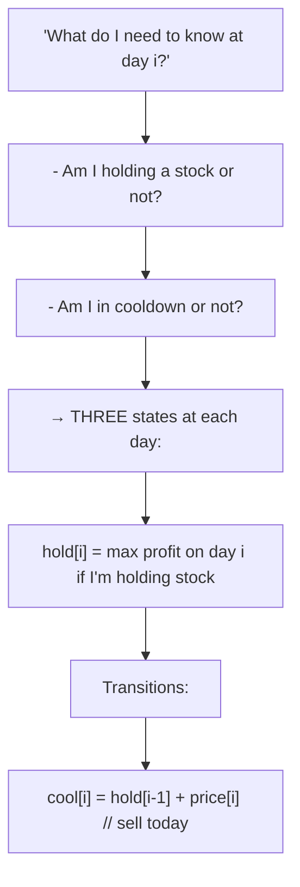

### Example 3: Knapsack — Adding a Dimension
```
"I have items and a weight capacity."
State v1: dp[w] = max value with capacity w
→ But which items have I used? Can I reuse?

If each item used ONCE (0/1 Knapsack):
  dp[i][w] = max(dp[i-1][w], dp[i-1][w-wt[i]] + val[i])
  ↑ need to track which item we're considering → add dimension i

If items unlimited (Unbounded):
  dp[w] = max(dp[w], dp[w-wt[i]] + val[i])  for each item i
  ↑ no need for item dimension, just process in right order
```

**Flow:**
1. ↑ need to track which item we're considering add dimension i

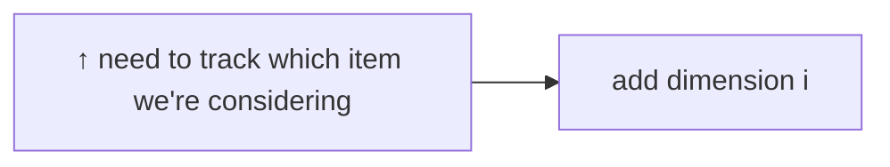

---

## Part 5: Common DP Transition Patterns

### Pattern 1: Take or Skip (O(n))
```
dp[i] = max(dp[i-1], dp[i-2] + value[i])
         ↑ skip i    ↑ take i (can't take i-1)
Examples: House Robber, Sticker Collection
```

**Flow:**
1. dp[i] = max(dp[i-1], dp[i-2] + value[i])
2. ↑ skip i ↑ take i (can't take i-1) Examples: House Robber, Sticker Collection

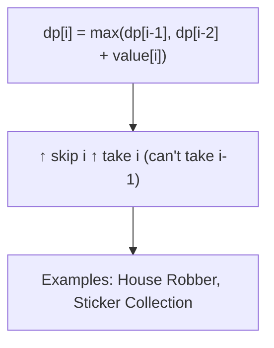

### Pattern 2: Best from All Previous (O(n²))
```
dp[i] = max/min(dp[j] + cost) for all valid j < i
Examples: LIS, Jump Game variants
```

### Pattern 3: Two Pointer into State (O(n²))
```
dp[i][j] = f(dp[i+1][j], dp[i][j-1], dp[i+1][j-1])
Examples: LCS, Edit Distance, Palindrome DP
```

### Pattern 4: Interval DP (O(n³))
```
for len 2..n:
  for i..j where j-i+1 = len:
    for k in i..j:
      dp[i][j] = best of dp[i][k] + dp[k+1][j] + merge_cost
Examples: Matrix Chain, Burst Balloons, Optimal BST
```

### Pattern 5: Bitmask DP (O(2^n × n))
```
dp[mask][i] = best answer with visited set = mask, currently at i
for each unvisited j:
  dp[mask | (1<<j)][j] = dp[mask][i] + cost[i][j]
Examples: TSP, Assignment Problem
```

---


## Part 6: Space Optimization Mental Model

### When Can You Optimize?
```
If dp[i] only depends on dp[i-1] (previous row):
   → Use two arrays: prev[] and curr[]
   → Or single array processed in right direction

If dp[i] only depends on dp[i-1] and dp[i-2]:
   → Use 2-3 variables

Direction matters:
   0/1 Knapsack: process weights RIGHT TO LEFT (avoid using same item twice)
   Unbounded Knapsack: process LEFT TO RIGHT (allow reuse)
```

**Flow:**
1. If dp[i] only depends on dp[i-1] (previous row):
2. Use two arrays: prev[] and curr[]
3. Or single array processed in right direction
4. If dp[i] only depends on dp[i-1] and dp[i-2]:
5. Use 2-3 variables
6. Direction matters:
7. Unbounded Knapsack: process LEFT TO RIGHT (allow reuse)

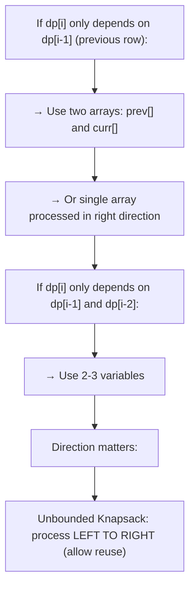

### Visual: Rolling Array
```
Full table:          Optimized:
dp[0]: [...]         prev: [...]
dp[1]: [...]    →    curr: [...]   (swap after each row)
dp[2]: [...]
dp[3]: [...]
```

**Flow:**
1. dp[1]: [...]
2. curr: [...] (swap after each row)

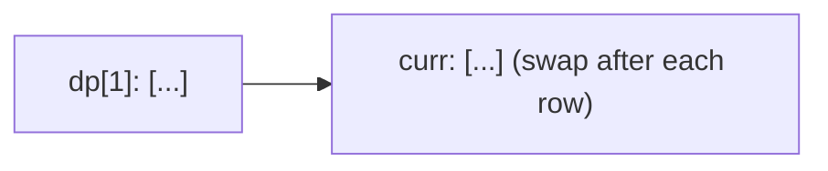

---

## Part 7: DP Debugging Checklist

```
□ Is my state definition correct? (Does it capture ALL needed info?)
□ Are base cases correct? (Test with smallest inputs manually)
□ Is my transition hitting the right cells? (Draw arrows on table)
□ Am I filling in the right order? (Dependencies satisfied before use?)
□ Off-by-one: dp[n] or dp[n-1]? (Check indexing)
□ Is the answer at the right cell? (dp[n][target]? max of row?)
□ Edge cases: empty input? single element? all same values?
```

**Flow:**
1. □ Off-by-one: dp[n] or dp[n-1]? (Check indexing)
2. □ Edge cases: empty input? single element? all same val

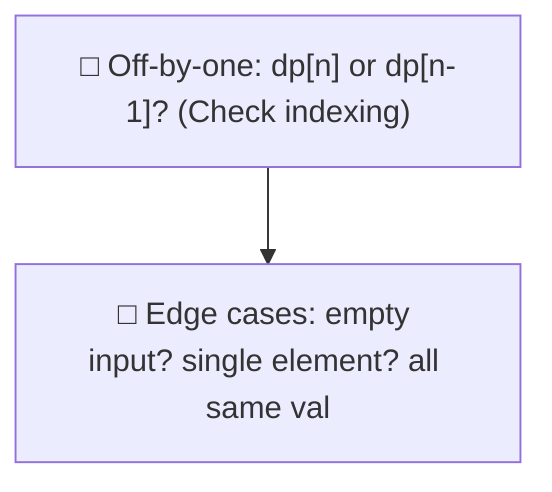

---

📖 **Related Files:**
- [03_Algorithms/04a_DP_Internals.md](../03_Algorithms/04a_DP_Internals.md) — DP theory
- [04_Patterns_Templates/16_DP_Pattern_Recognition.md](../04_Patterns_Templates/16_DP_Pattern_Recognition.md) — DP pattern families + problems

---
[← 01 Recursion](01_Recursion_Tree_Thinking.md) | [03 Graph & Tree Thinking →](03_Graph_Tree_Thinking.md)


---


---


## 🏋️ Practice & Interview Questions — Algorithms

### Sorting
**Q1.** Which sorting algorithm does Java use for `Arrays.sort(int[])`? Why not MergeSort?
<details><summary>Answer</summary>

**Dual-Pivot QuickSort** — for primitives. MergeSort requires O(N) extra space. QuickSort is in-place and cache-friendly. Stability doesn't matter for primitives (equal ints are indistinguishable). For objects (`Arrays.sort(Object[])`), Java uses **TimSort** (stable, O(N log N) worst).
</details>

**Q2.** Trace Merge Sort on `[4,2,7,1]`.
<details><summary>Answer</summary>

Split: `[4,2]` `[7,1]` → Split: `[4]` `[2]` `[7]` `[1]` → Merge: `[2,4]` `[1,7]` → Merge: `[1,2,4,7]`
</details>

**Q3.** ⭐⭐ Sort Colors (Dutch National Flag — 3-way partition).
<details><summary>Solution</summary>

```java
int lo=0, mid=0, hi=n-1;
while(mid<=hi){
    if(nums[mid]==0) swap(nums,lo++,mid++);
    else if(nums[mid]==1) mid++;
    else swap(nums,mid,hi--);
}
```
</details>

### Binary Search
**Q4.** ⭐ Search in Rotated Sorted Array.
<details><summary>Solution</summary>

```java
int lo=0, hi=n-1;
while(lo<=hi){
    int mid=(lo+hi)/2;
    if(nums[mid]==target) return mid;
    if(nums[lo]<=nums[mid]){ // left half sorted
        if(nums[lo]<=target&&target<nums[mid]) hi=mid-1; else lo=mid+1;
    } else { // right half sorted
        if(nums[mid]<target&&target<=nums[hi]) lo=mid+1; else hi=mid-1;
    }
}
return -1;
```
</details>

**Q5.** ⭐ Find First and Last Position (binary search twice).
<details><summary>Solution</summary>

```java
// First: find leftmost with while(lo<hi){ if arr[mid]>=target hi=mid else lo=mid+1 }
// Last: find rightmost with while(lo<hi){ if arr[mid]<=target lo=mid+1 else hi=mid } return lo-1
```
</details>

**Q6.** ⭐⭐ Koko Eating Bananas — binary search on answer.
<details><summary>Key insight</summary>

Binary search the eating speed k in range [1, max(piles)]. For each k, calculate hours needed. Find minimum k where hours ≤ H.
</details>

### Dynamic Programming
**Q7.** ⭐ Climbing Stairs — n steps, 1 or 2 at a time. How many ways?
<details><summary>Solution</summary>

```java
// Fibonacci sequence! dp[i] = dp[i-1] + dp[i-2]
int a=1, b=1;
for(int i=2;i<=n;i++){ int c=a+b; a=b; b=c; }
return b;
```
</details>

**Q8.** ⭐ Coin Change — minimum coins for amount.
<details><summary>Solution</summary>

```java
int[] dp = new int[amount+1]; Arrays.fill(dp, amount+1);
dp[0]=0;
for(int i=1;i<=amount;i++)
    for(int c:coins) if(c<=i) dp[i]=Math.min(dp[i],dp[i-c]+1);
return dp[amount]>amount?-1:dp[amount];
```
</details>

**Q9.** ⭐⭐ Longest Common Subsequence.
<details><summary>Solution</summary>

```java
int[][] dp=new int[m+1][n+1];
for(int i=1;i<=m;i++) for(int j=1;j<=n;j++){
    if(text1.charAt(i-1)==text2.charAt(j-1)) dp[i][j]=dp[i-1][j-1]+1;
    else dp[i][j]=Math.max(dp[i-1][j],dp[i][j-1]);
}
return dp[m][n];
```
</details>

**Q10.** ⭐⭐ Word Break — can string be segmented using dictionary words?
<details><summary>Solution</summary>

```java
boolean[] dp=new boolean[n+1]; dp[0]=true;
for(int i=1;i<=n;i++) for(String w:wordDict)
    if(i>=w.length()&&dp[i-w.length()]&&s.substring(i-w.length(),i).equals(w)) dp[i]=true;
return dp[n];
```
</details>

**Q11.** ⭐⭐⭐ Edit Distance (Levenshtein).
<details><summary>Solution</summary>

```java
int[][] dp=new int[m+1][n+1];
for(int i=0;i<=m;i++) dp[i][0]=i;
for(int j=0;j<=n;j++) dp[0][j]=j;
for(int i=1;i<=m;i++) for(int j=1;j<=n;j++){
    if(word1.charAt(i-1)==word2.charAt(j-1)) dp[i][j]=dp[i-1][j-1];
    else dp[i][j]=1+Math.min(dp[i-1][j-1],Math.min(dp[i-1][j],dp[i][j-1]));
}
```
</details>

### Graph Algorithms
**Q12.** ⭐ Number of Islands (BFS/DFS grid traversal).
<details><summary>Solution</summary>

```java
for each cell (i,j) if grid[i][j]=='1': count++; BFS/DFS to mark all connected land as visited
```
</details>

**Q13.** ⭐⭐ Course Schedule — detect cycle in directed graph (Topological sort).
<details><summary>Solution</summary>

```java
// Kahn's algorithm: indegree array + BFS queue
// If result size == numCourses → no cycle → can finish
```
</details>

**Q14.** ⭐⭐ Dijkstra's Shortest Path.
<details><summary>Solution</summary>

```java
PriorityQueue<int[]> pq=new PriorityQueue<>((a,b)->a[1]-b[1]); // [node, dist]
pq.offer(new int[]{src,0}); dist[src]=0;
while(!pq.isEmpty()){
    int[] curr=pq.poll(); int u=curr[0],d=curr[1];
    if(d>dist[u]) continue; // stale
    for(int[] neighbor:graph[u]) if(dist[u]+neighbor[1]<dist[neighbor[0]]){
        dist[neighbor[0]]=dist[u]+neighbor[1]; pq.offer(new int[]{neighbor[0],dist[neighbor[0]]});
    }
}
```
</details>

### MCQ Rapid Fire
| # | Question | Answer |
|---|---|---|
| 1 | QuickSort avg/worst | O(N log N) avg, O(N²) worst |
| 2 | MergeSort space complexity | O(N) |
| 3 | HeapSort space complexity | O(1) (in-place) |
| 4 | Binary search precondition | Sorted array |
| 5 | BFS time complexity on graph | O(V+E) |
| 6 | DFS space complexity | O(V) (recursion stack) |
| 7 | Dijkstra fails on | Negative weight edges |
| 8 | Bellman-Ford handles | Negative weights, detects negative cycles |
| 9 | Floyd-Warshall use case | All-pairs shortest path, O(V³) |
| 10 | Topological sort requires | Directed Acyclic Graph (DAG) |


---

## 🧠 Deep Conceptual Questions — Algorithm Design & Analysis

**C1. What does O(N log N) "feel like" and why is it the complexity barrier for comparison-based sorting?**
<details><summary>Deep Answer</summary>

O(N log N) for N=1M ≈ 20M operations. O(N²) ≈ 1 trillion. The difference is 50,000x. **Comparison sort lower bound**: any comparison-based sort must distinguish between N! possible orderings. Each comparison has 2 outcomes. A decision tree with N! leaves needs ≥ log₂(N!) height ≈ N log N (Stirling's approximation). Therefore NO comparison sort can beat O(N log N) in the worst case. Non-comparison sorts (counting sort, radix sort, bucket sort) break this bound by using non-comparison operations — but require constraints on input (e.g., integer range bounded by N).
</details>

**C2. Greedy algorithms: when do they work and what must be proven?**
<details><summary>Deep Answer</summary>

A greedy algorithm makes the locally optimal choice at each step. Works when problem has: (1) **Greedy choice property**: local optimal leads to global optimal — the choice never needs to be revised. (2) **Optimal substructure**: optimal solution to the problem contains optimal solutions to subproblems. To PROVE greedy is correct: use "exchange argument" — assume optimal solution differs from greedy, show you can swap greedy's choice in without making it worse, contradiction. Greedy FAILS when: future choices depend on current choice in complex ways (use DP instead). Classic works: interval scheduling, Huffman coding, Dijkstra. Classic fails: 0-1 knapsack (use DP).
</details>

**C3. Dynamic Programming: what is "overlapping subproblems" and why does it matter?**
<details><summary>Deep Answer</summary>

Overlapping subproblems: the same sub-computation appears multiple times. Fibonacci: `fib(5)` calls `fib(4)` and `fib(3)`. `fib(4)` also calls `fib(3)`. Without memoization: `fib(3)` computed exponentially many times → O(2^N). With memoization: each sub-result computed once and stored → O(N). DP is valuable SPECIFICALLY when: (1) problem has optimal substructure AND (2) subproblems overlap. If no overlap: just use divide-and-conquer (merge sort's subproblems don't overlap → no DP needed). DP = "smart recursion" = avoid recomputing.
</details>

**C4. Top-down (memoization) vs Bottom-up (tabulation) DP — when to choose each?**
<details><summary>Deep Answer</summary>

**Top-down (memoization)**: Write natural recursion + cache results. Easy to implement, only computes needed subproblems (sparse computation). Cons: recursion overhead and stack depth risk. Use when: problem is naturally recursive, only a fraction of subproblems needed. **Bottom-up (tabulation)**: Fill DP table iteratively from base cases. No recursion overhead, better cache performance, easier space optimization. Use when: need all subproblems (or most of them), want to optimize space (can often reduce to 1D from 2D). Rule: start with top-down for correctness verification, optimize to bottom-up for performance.
</details>

**C5. Dijkstra's Algorithm: why does it fail on negative weights?**
<details><summary>Deep Answer</summary>

Dijkstra assumes: once a node is "settled" (extracted from the priority queue with its final shortest distance), that distance is optimal. With negative weights: settling node A at distance 5 might not be final — a path through B (distance 7) → C (edge -10) → A gives distance -3. But A was already settled! Dijkstra doesn't revisit settled nodes. Bellman-Ford handles negatives by relaxing ALL edges N-1 times — no "settled" assumption. For graphs with negative cycles: Bellman-Ford detects them (if distances still decrease after N-1 rounds, there's a negative cycle).
</details>

**C6. Union-Find: why is path compression + union by rank/size nearly O(1)?**
<details><summary>Deep Answer</summary>

**Path compression**: when finding the root of element x, make every node on the path point directly to the root. Flattens the tree. Future finds on those paths: O(1). **Union by rank**: always attach the smaller tree under the larger → limits tree height to O(log N). Combined: inverse Ackermann function α(N) amortized — so slow-growing it's practically constant (α(10^80) = 4). Neither alone is optimal: path compression without union by rank → O(log N) amortized. Union by rank without path compression → O(log N). Together → α(N) ≈ O(1) amortized. Used in: Kruskal's MST, cycle detection, connected components.
</details>

**C7. Binary Search on the Answer — what types of problems does it apply to?**
<details><summary>Deep Answer</summary>

When the answer space is **monotone**: "if X is achievable, then all values less extreme than X are also achievable." Problems: minimize the maximum (aggressive cows, split array), find minimum valid threshold (Koko bananas, minimum days to bloom), divide-and-conquer feasibility. Template: binary search on the answer range [lo, hi], for each mid check `isFeasible(mid)` in O(N) or O(N log N). Total: O(N log(answer_range)). Key insight: reframe "find optimal value" as "find smallest X where condition holds" → enables binary search on a non-array space.
</details>

**C8. Why does merge sort guarantee stability while quicksort doesn't?**
<details><summary>Deep Answer</summary>

**Merge sort stability**: during merge, when two elements are equal, we always take from the LEFT array first → preserves original relative order. **QuickSort instability**: the partition step swaps elements across the pivot without regard to original order. Two equal elements may be placed on opposite sides of the pivot, reversing their order. QuickSort CAN be made stable (Lomuto partition with careful implementation) but loses performance. Java uses TimSort for objects (stable), dual-pivot quicksort for primitives (stability irrelevant since primitives without fields).
</details>

**C9. Backtracking: what's the difference from plain DFS and when to use vs DP?**
<details><summary>Deep Answer</summary>

**Backtracking vs DFS**: DFS visits every path. Backtracking prunes paths early when a constraint is violated — avoids exploring infeasible branches. Same asymptotic but drastically different practical performance with good pruning. **Backtracking vs DP**: backtracking for **combinatorial/enumeration** problems (find all solutions, permutations, subsets). DP for **optimization** problems (find optimal single solution). Backtracking produces exponential solutions in worst case but is necessary when you need ALL solutions. DP finds the optimal in polynomial time when overlapping subproblems exist.
</details>

**C10. What is amortized analysis and how does it differ from average-case analysis?**
<details><summary>Deep Answer</summary>

**Amortized**: analyzes the average cost per operation over a SEQUENCE of operations — in the worst case. No probability involved. Guarantees: N operations ALWAYS take O(N·T) total, even if some individual operations are O(N·T). Example: ArrayList append is O(N) when resizing, but amortized O(1) because resizing is rare. **Average-case**: analyzes expected cost of a SINGLE operation assuming random input. QuickSort is O(N log N) average-case (random pivot). Amortized is a stronger guarantee — it holds even for adversarial input sequences.
</details>


> **Navigation**: [< Previous](01_Recursion_Tree_Thinking.md) | [Back to Index](../00_MASTER_INDEX.md) | [Next >](03_Graph_Tree_Thinking.md)