> **Navigation**: [< Previous](02_DP_State_Thinking.md) | [Back to Index](../00_MASTER_INDEX.md) | [Next >](04_Array_String_Thinking.md)

# 🗺️ Graph & Tree Problem Thinking — Mental Model

> **The key insight**: Most graph/tree problems are just asking "how do I explore this structure?" The answer is almost always BFS, DFS, or Union-Find. The skill is knowing WHICH one and WHY.

---

## Part 1: "Is This a Graph Problem?" — Recognition

### Many problems are HIDDEN graph problems:
```
Problem says:                          → Model as:
"Dependencies between tasks"           → Directed graph (topological sort)
"Can person A reach person B?"         → Undirected graph (BFS/DFS)
"Convert word A to word B"            → Graph where words are nodes
"2D grid with obstacles"              → Grid graph (4-directional)
"Network of computers"                → Undirected graph
"Course prerequisites"                → DAG (directed acyclic)
"Binary/N-ary tree"                   → Special case of graph (no cycles)
"Social network friends"              → Undirected graph
"State machine transitions"           → Directed graph
"Maze from start to end"             → Grid graph (BFS = shortest)
```

**Flow:**
- Problem says:
- ↓
- Model as:
- ↓
- 'Dependencies between tasks'
- ↓
- Directed graph (topological sort)
- ↓
- 'Can person A reach person B?'
- ↓
- Undirected graph (BFS/DFS)
- ↓
- 'Convert word A to word B'
- ↓
- Graph where words are nodes
- ↓
- '2D grid with obstacles'
- ↓
- Grid graph (4-directional)
- ↓
- 'Network of computers'
- ↓
- Undirected graph

```mermaid
flowchart TD
    N1["Problem says:"]
    N2["Model as:"]
    N3["'Dependencies between tasks'"]
    N4["Directed graph (topological sort)"]
    N5["'Can person A reach person B?'"]
    N6["Undirected graph (BFS/DFS)"]
    N7["'Convert word A to word B'"]
    N8["Graph where words are nodes"]
    N9["'2D grid with obstacles'"]
    N10["Grid graph (4-directional)"]
    N11["'Network of computers'"]
    N12["Undirected graph"]
    N13["'Course prerequisites'"]
    N14["DAG (directed acyclic)"]
    N15["'Binary/N-ary tree'"]
    N16["Special case of graph (no cycles)"]
    N17["'Social network friends'"]
    N18["'State machine transitions'"]
    N19["Directed graph"]
    N20["'Maze from start to end'"]
    N21["Grid graph (BFS = shortest)"]
    N1 --> N2
    N3 --> N4
    N5 --> N6
    N7 --> N8
    N9 --> N10
    N11 --> N12
    N13 --> N14
    N15 --> N16
    N17 --> N12
    N18 --> N19
    N20 --> N21
```

---


> 🔬 **Section Challenge — Part 1: "Is This a Graph Problem?" — Recognition**
>>>

## Part 2: BFS vs DFS — The Decision Framework

### When to use BFS (Queue):
```
✅ SHORTEST PATH (unweighted) — BFS guarantees level-by-level
✅ Level-order anything — "closest", "minimum steps"
✅ All nodes at distance K
✅ Multi-source flood fill — "from all 1s simultaneously"
✅ Tree level-order traversal

Mental model: BFS = "Ripple in a pond"
Drop a stone → it expands in CIRCLES → nearest first
```

**Flow:**
- Drop a stone
- ↓
- it expands in CIRCLES
- ↓
- nearest first

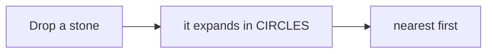

### When to use DFS (Stack/Recursion):
```
✅ Path finding — "does any path exist?"
✅ Cycle detection — track visiting state
✅ Topological sort — "ordering with dependencies"
✅ Connected components — "how many islands?"
✅ Something about ALL paths / exhaustive search
✅ Tree problems — max depth, path sum, LCA

Mental model: DFS = "Exploring a maze"
Go as DEEP as possible → hit dead end → BACKTRACK → try next path
```

**Flow:**
- Go as DEEP as possible
- ↓
- hit dead end
- ↓
- BACKTRACK
- ↓
- try next path

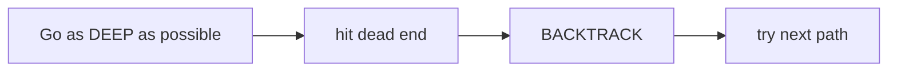

### When to use Dijkstra (Priority Queue):
```
✅ SHORTEST PATH (weighted, no negative edges)
✅ "Minimum cost" to reach a node

Mental model: Dijkstra = "Greedy BFS with costs"
Always expand the CHEAPEST unexplored node
```

### When to use Union-Find:
```
✅ "Are A and B connected?" (dynamic connectivity)
✅ "How many connected components?"
✅ "Adding edges, when do two components merge?"
✅ Cycle detection in undirected graph (if union returns false → cycle)

Mental model: Union-Find = "Clubs merging"
Each person belongs to a club → when two people connect, their clubs merge
```

**Flow:**
- ✅ Cycle detection in undirected graph (if union re
- ↓
- cycle)
- ↓
- Each person belongs to a club
- ↓
- when two people connect, their clubs merge

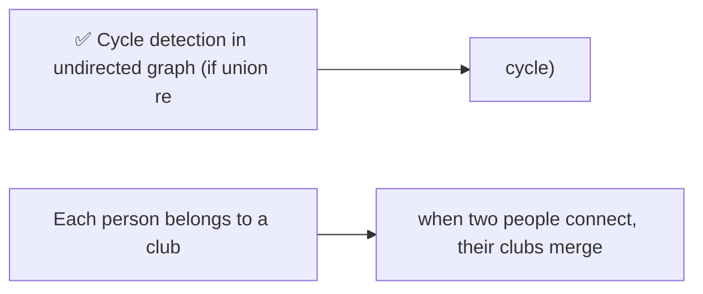

### Decision Tree
```
Graph problem?
├── Need SHORTEST path?
│   ├── Unweighted? → BFS
│   ├── Weighted (no negative)? → Dijkstra
│   └── Negative edges? → Bellman-Ford
├── Need to visit ALL nodes/paths?
│   └── DFS (possibly with backtracking)
├── Need ordering with dependencies?
│   └── Topological Sort (Kahn's BFS or DFS)
├── Connected components?
│   ├── Static graph? → DFS/BFS
│   └── Dynamic (adding edges)? → Union-Find
├── Cycle detection?
│   ├── Undirected? → Union-Find or DFS
│   └── Directed? → DFS with 3-color marking
├── Minimum spanning tree?
│   └── Kruskal's (sort edges + Union-Find) or Prim's (PQ)
└── Tree problem?
    ├── Root-to-leaf? → DFS
    ├── Level-order? → BFS
    └── LCA? → DFS with parent tracking
```

**Flow:**
- Root-to-leaf?
- ↓
- DFS
- ↓
- Level-order?
- ↓
- BFS

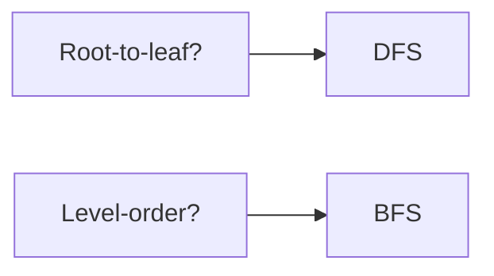

---

## Part 3: Tree Thinking Specifically

### The Tree DFS Template (Memorize This)
```java
ReturnType solve(TreeNode node) {
    // 1. BASE CASE
    if (node == null) return baseValue;

    // 2. RECURSE on children
    ReturnType leftResult = solve(node.left);
    ReturnType rightResult = solve(node.right);

    // 3. PROCESS current node using children's results
    // → This is where the problem-specific logic goes

    // 4. RETURN answer for this subtree
    return combinedResult;
}
```

### Tree Problem Categories
```
Category 1: "RETURN something about the tree"
→ DFS that returns a value (height, sum, boolean)
→ Example: max depth = 1 + max(leftDepth, rightDepth)

Category 2: "UPDATE a global answer during traversal"
→ DFS with a class variable
→ Example: diameter = max(diameter, leftH + rightH) at each node

Category 3: "BUILD or TRANSFORM the tree"
→ DFS that returns new nodes
→ Example: invert tree = swap left and right, recurse both

Category 4: "FIND something in the tree"
→ DFS with early termination
→ Example: LCA = if both sides return non-null, current is LCA
```

**Flow:**
- Category 1: 'RETURN something about the tree'
- ↓
- DFS that returns a value (height, sum, boolean)
- ↓
- Example: max depth = 1 + max(leftDepth, rightDepth)
- ↓
- Category 2: 'UPDATE a global answer during traversal'
- ↓
- DFS with a class variable
- ↓
- Category 3: 'BUILD or TRANSFORM the tree'
- ↓
- DFS that returns new nodes

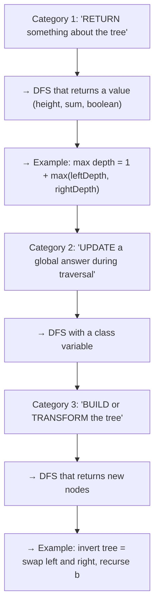

### BST-Specific Thinking
```
BST = sorted structure → INORDER traversal gives sorted array

"Kth smallest?" → Inorder, count to k
"Validate BST?" → Every node has a valid range [min, max]
"Search?" → Go left if smaller, right if larger → O(log n)
"Insert?" → Find the right spot like binary search
"Delete?" → Three cases: leaf, one child, two children (find successor)
```

**Flow:**
- BST = sorted structure
- ↓
- INORDER traversal gives sorted array
- ↓
- 'Kth smallest?'
- ↓
- Inorder, count to k
- ↓
- 'Validate BST?'
- ↓
- Every node has a valid range [min, max]
- ↓
- 'Search?'
- ↓
- Go left if smaller, right if larger
- ↓
- O(log n)
- ↓
- 'Insert?'
- ↓
- Find the right spot like binary search

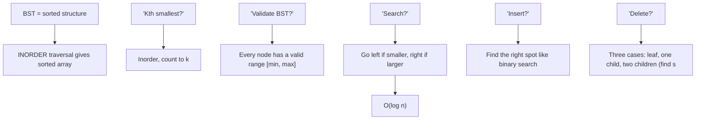

---


## Part 4: Grid/Matrix as Graph — Mental Model

### The Grid-to-Graph Translation
```
Grid:                    Graph:
[1, 0, 1]              node(0,0) connects to node(0,1), node(1,0)
[1, 1, 0]              node(0,1) connects to node(0,0), node(1,1)
[0, 1, 0]              ... (4-directional neighbors)

Cell = Node
Adjacent cell = Edge
Obstacle = No edge
```

### Grid BFS/DFS Boilerplate
```java
int[][] dirs = {{0,1},{0,-1},{1,0},{-1,0}};  // Right, Left, Down, Up

// Check bounds:
boolean inBounds(int r, int c, int m, int n) {
    return r >= 0 && r < m && c >= 0 && c < n;
}

// Mark visited:
grid[r][c] = '#';  // In-place (mutate grid) → no extra visited array
// OR
boolean[][] visited;  // When you can't mutate the grid
```

### Grid Problem Categories
```
"How many islands?" → Count DFS/BFS starts on unvisited land
"Shortest path to exit?" → BFS from start
"Distance from all 1s?" → MULTI-SOURCE BFS (enqueue ALL 1s first)
"Can we escape?" → DFS/BFS to check connectivity
"Surrounded regions?" → DFS from BORDERS first, then fill rest
"Rotting oranges?" → Multi-source BFS with time tracking
```

**Flow:**
- 'How many islands?'
- ↓
- Count DFS/BFS starts on unvisited land
- ↓
- 'Shortest path to exit?'
- ↓
- BFS from start
- ↓
- 'Distance from all 1s?'
- ↓
- MULTI-SOURCE BFS (enqueue ALL 1s first)
- ↓
- 'Can we escape?'
- ↓
- DFS/BFS to check connectivity
- ↓
- 'Surrounded regions?'
- ↓
- DFS from BORDERS first, then fill rest
- ↓
- 'Rotting oranges?'
- ↓
- Multi-source BFS with time tracking

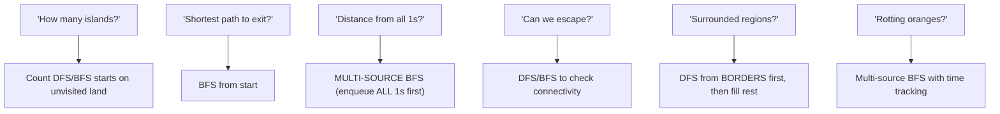

---


> 🔬 **Section Challenge — Part 4: Grid/Matrix as Graph — Mental Model**
>>>

## Part 5: Common Graph Patterns & When They Appear

### Topological Sort — "What order to take courses?"
```
When: Directed graph, need valid ordering where A comes before B
How: Kahn's algorithm (BFS with indegree counting)
     OR DFS with post-order reversal

Mental model: "Peel off nodes with no dependencies first"
```

### Bipartite Check — "Can we 2-color?"
```
When: "Divide into two groups with no conflicts"
How: BFS/DFS with 2-coloring (alternate colors)
If conflict found → not bipartite

Mental model: "Color neighbors with opposite color. Contradiction = not bipartite."
```

**Flow:**
- If conflict found
- ↓
- not bipartite

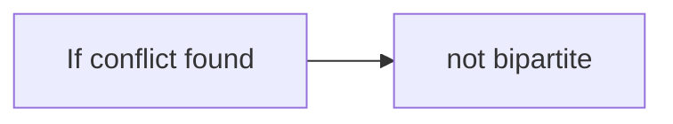

### Tarjan's / Bridges — "What if this edge is removed?"
```
When: "Critical connections", "bridges", "articulation points"
How: DFS with discovery time and low-link values
If low[child] > disc[parent] → bridge edge

Mental model: "Can child reach higher than parent without this edge?"
```

**Flow:**
- If low[child] > disc[parent]
- ↓
- bridge edge

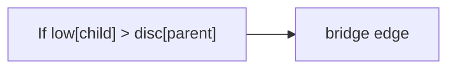

---


> 🔬 **Section Challenge — Part 5: Common Graph Patterns & When They Appear**
>>>

## Part 6: Graph/Tree Debugging Checklist

```
□ Am I tracking visited correctly? (Avoid infinite loops!)
□ BFS: Am I marking visited WHEN ENQUEUING, not when dequeuing?
   → Wrong: mark when poll → may enqueue duplicates
   → Right: mark when offer → each node enqueued once
□ DFS: Am I using 3 states for cycle detection? (0=white, 1=gray, 2=black)
□ Am I handling disconnected components? (Run BFS/DFS from ALL unvisited)
□ Grid: Am I checking bounds BEFORE accessing array?
□ Tree: Am I handling null nodes in base case?
□ Weighted graph: Am I using PQ correctly? (skip outdated entries in Dijkstra)
```

**Flow:**
- Wrong: mark when poll
- ↓
- may enqueue duplicates
- ↓
- Right: mark when offer
- ↓
- each node enqueued once

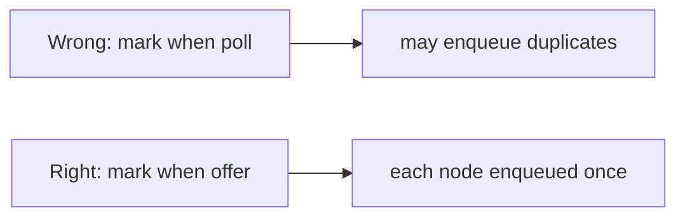

---

📖 **Related Files:**
- [03_Algorithms/05c_Graphs_Fundamentals.md](../03_Algorithms/05c_Graphs_Fundamentals.md) — Graph algorithms
- [04_Patterns_Templates/13_Tree_Plus_DFS_BFS.md](../04_Patterns_Templates/13_Tree_Plus_DFS_BFS.md) — Tree+DFS/BFS problems
- [04_Patterns_Templates/14_Graph_Plus_Traversal.md](../04_Patterns_Templates/14_Graph_Plus_Traversal.md) — Graph+Traversal problems

---
[← 02 DP State](02_DP_State_Thinking.md) | [04 Array & String →](04_Array_String_Thinking.md)


---


---


> 🔬 **Section Challenge — Part 6: Graph/Tree Debugging Checklist**
>>>

## 🏋️ Practice & Interview Questions — Trees & Heaps

### Predict / Trace
**Q1.** BST insert 5,3,7,1,4. Draw the tree. What is inorder traversal?
<details><summary>Answer</summary>

```
      5
     / \
    3   7
   / \
  1   4
```
Inorder: 1, 3, 4, 5, 7 (always sorted for BST!)
</details>

**Q2.** PriorityQueue in Java — is it a min-heap or max-heap by default?
<details><summary>Answer</summary>

**Min-heap** by default (`poll()` returns the minimum). For max-heap: `new PriorityQueue<>(Comparator.reverseOrder())`.
</details>

### LeetCode / Coding
**Q3.** ⭐ Maximum Depth of Binary Tree.
<details><summary>Solution</summary>

```java
int maxDepth(TreeNode root){
    if(root==null) return 0;
    return 1 + Math.max(maxDepth(root.left), maxDepth(root.right));
}
```
</details>

**Q4.** ⭐ Invert Binary Tree.
<details><summary>Solution</summary>

```java
TreeNode invertTree(TreeNode root){
    if(root==null) return null;
    TreeNode tmp=root.left; root.left=root.right; root.right=tmp;
    invertTree(root.left); invertTree(root.right);
    return root;
}
```
</details>

**Q5.** ⭐ Validate Binary Search Tree.
<details><summary>Solution</summary>

```java
boolean validate(TreeNode node, long min, long max){
    if(node==null) return true;
    if(node.val<=min||node.val>=max) return false;
    return validate(node.left,min,node.val)&&validate(node.right,node.val,max);
}
// call: validate(root, Long.MIN_VALUE, Long.MAX_VALUE)
```
</details>

**Q6.** ⭐ Level Order Traversal (BFS with Queue).
<details><summary>Solution</summary>

```java
Queue<TreeNode> q=new LinkedList<>(); q.offer(root);
while(!q.isEmpty()){
    int size=q.size();
    for(int i=0;i<size;i++){
        TreeNode n=q.poll(); process(n);
        if(n.left!=null) q.offer(n.left);
        if(n.right!=null) q.offer(n.right);
    }
}
```
</details>

**Q7.** ⭐ Lowest Common Ancestor of BST.
<details><summary>Solution</summary>

```java
TreeNode lca(TreeNode root, TreeNode p, TreeNode q){
    if(p.val<root.val&&q.val<root.val) return lca(root.left,p,q);
    if(p.val>root.val&&q.val>root.val) return lca(root.right,p,q);
    return root; // split point = LCA
}
```
</details>

**Q8.** ⭐⭐ Binary Tree Right Side View.
<details><summary>Solution</summary>

```java
// BFS, take last element of each level
// or DFS: track level, add to result only when level==result.size()
void dfs(TreeNode node, int level){
    if(node==null) return;
    if(level==res.size()) res.add(node.val);
    dfs(node.right,level+1); dfs(node.left,level+1);
}
```
</details>

**Q9.** ⭐⭐ Kth Smallest Element in BST.
<details><summary>Solution</summary>

```java
// Inorder traversal is sorted — take kth element
int k, result;
void inorder(TreeNode node){
    if(node==null) return;
    inorder(node.left);
    if(--k==0){ result=node.val; return; }
    inorder(node.right);
}
```
</details>

**Q10.** ⭐⭐ Serialize and Deserialize Binary Tree.
<details><summary>Key approach</summary>

BFS level-order with null markers. Serialize: `1,2,3,null,null,4,5`. Deserialize: queue-based reconstruction level by level.
</details>

**Q11.** ⭐⭐⭐ Binary Tree Maximum Path Sum.
<details><summary>Solution</summary>

```java
int maxSum = Integer.MIN_VALUE;
int dfs(TreeNode node){
    if(node==null) return 0;
    int left=Math.max(0,dfs(node.left)), right=Math.max(0,dfs(node.right));
    maxSum=Math.max(maxSum, node.val+left+right); // path through this node
    return node.val+Math.max(left,right); // return single path
}
```
</details>

### Heap / Priority Queue Problems
**Q12.** ⭐ Kth Largest Element in Array.
<details><summary>Solution</summary>

```java
PriorityQueue<Integer> minHeap=new PriorityQueue<>();
for(int n:nums){ minHeap.offer(n); if(minHeap.size()>k) minHeap.poll(); }
return minHeap.peek(); // kth largest
```
</details>

**Q13.** ⭐⭐ Median from Data Stream (two heaps).
<details><summary>Solution</summary>

```java
PriorityQueue<Integer> lo=new PriorityQueue<>(Comparator.reverseOrder()); // max-heap
PriorityQueue<Integer> hi=new PriorityQueue<>(); // min-heap
void addNum(int n){
    lo.offer(n);
    hi.offer(lo.poll());
    if(lo.size()<hi.size()) lo.offer(hi.poll());
}
double findMedian(){ return lo.size()>hi.size()?lo.peek():(lo.peek()+hi.peek())/2.0; }
```
</details>

### MCQ Rapid Fire
| # | Question | Answer |
|---|---|---|
| 1 | BST search avg/worst | O(log N) avg, O(N) worst (degenerate) |
| 2 | Complete binary tree with N nodes height | O(log N) |
| 3 | Heap insertHeapify direction | Bubble up |
| 4 | Heap extractMin direction | Bubble down (sift down) |
| 5 | Java PriorityQueue poll() time | O(log N) |
| 6 | Tree DFS pre/in/post order uses | Stack (or recursion) |
| 7 | Tree BFS uses | Queue |
| 8 | Red-Black Tree guarantee | O(log N) worst case for search/insert/delete |


---

## 🧠 Deep Conceptual Questions — Trees & Heaps

**C1. Why is the inorder traversal of a BST always sorted?**
<details><summary>Deep Answer</summary>

BST invariant: every node's left subtree contains ONLY values less than the node, right subtree ONLY values greater. Inorder traversal visits: left subtree (all smaller) → root → right subtree (all larger). Applied recursively at every node, this produces values in ascending order. This is the defining property that makes BST useful: O(log N) search because at each step, half the tree is eliminated. Broken BST (invariant violated) → inorder not sorted → BST operations return wrong results. That's why "Validate BST" is a fundamental problem.
</details>

**C2. Why does heap not support O(log N) arbitrary deletion (only min/max removal)?**
<details><summary>Deep Answer</summary>

Heap invariant: parent ≤ children (min-heap). When you remove the minimum (root): replace with last element, sift down — O(log N). But for an arbitrary element: you'd need to FIND it first (O(N) scan — heap has no lookup index), then restore the heap property. Without indexing, you can't efficiently locate an element. **d-ary heaps** exist, and indexed heaps (priority queues with decrease-key, like Fibonacci heap) support O(log N) arbitrary deletion — but Java's PriorityQueue doesn't. Dijkstra's with "lazy deletion" (add stale entries, skip when popped) works around this.
</details>

**C3. Why is tree height critical for BST operations?**
<details><summary>Deep Answer</summary>

BST search = walk from root to target, one comparison per level. Operations: O(height). **Balanced BST** (AVL, Red-Black): height = O(log N) → operations O(log N). **Degenerate BST** (insert sorted data: 1,2,3,4,5): each node has only right child → height = N → operations O(N) = linked list performance! This is why TreeMap uses Red-Black Tree (self-balancing): guarantees height ≤ 2*log(N) regardless of insertion order. Red-Black Tree balance condition is weaker than AVL (allows "approximately balanced") but cheaper to maintain: at most 3 rotations per insert (AVL: potentially O(log N)).
</details>

**C4. Why does BFS on a tree need a Queue but DFS needs a Stack (or recursion)?**
<details><summary>Deep Answer</summary>

BFS explores level by level: all children of current nodes must be processed before their children. Queue's FIFO ensures: nodes added to queue at level L are processed before level L+1 nodes (which are added during L's processing). DFS explores as deep as possible before backtracking. Stack's LIFO ensures: the most recently discovered (deepest) node is explored next. Recursive DFS implicitly uses the call stack — each recursive call IS a stack frame push. Iterative DFS when chosen over recursive: avoids stack overflow for very deep trees (N deep right-skewed tree → N recursion levels → StackOverflowError).
</details>

**C5. Lowest Common Ancestor — why does the recursive approach work in O(N)?**
<details><summary>Deep Answer</summary>

The recursive logic: `lca(node, p, q)` returns the LCA if it exists in the subtree of `node`, or p/q if one is found but not the other, or null if neither found. At each node: check left subtree and right subtree results. If BOTH return non-null: this node is the LCA (p is in one subtree, q in another — this is the split point). If only one: that subtree contains both (one is ancestor of the other). The algorithm visits each node once → O(N). For BST: we can do O(log N) by comparing values (if both < node: go left; both > node: go right; one each side: node is LCA).
</details>

**C6. Why is heap built in O(N) time but inserting N elements one-by-one takes O(N log N)?**
<details><summary>Deep Answer</summary>

**Bottom-up `heapify`**: Only nodes with children need sifting-down. Bottom half are leaves (no children) — zero work. Next level: height-1 sift-down each. Total work = Σ(height * nodes at that height) = O(N) (geometric series). **N individual inserts**: each can trigger O(log N) sift-up. Total = O(N log N). The bottom-up approach is 2x faster in practice. Java's `PriorityQueue(Collection)` constructor uses O(N) heapify. `Arrays.stream().forEach(pq::add)` is O(N log N). When converting an array to a heap, always prefer the constructor form.
</details>

**C7. Binary Tree Maximum Path Sum — why can a node contribute ONE branch to its parent but TWO internally?**
<details><summary>Deep Answer</summary>

A path cannot branch twice — if you go left and right from a node, the path "bends" at that node and can't continue upward (a path is a sequence of nodes with edges between them, no branching). So: **to a parent**: this node contributes max(left_gain, right_gain, 0) + node.val — choose the better single branch. **For the global answer**: the path could USE this node as the "bend" — include left_gain + node.val + right_gain. This might be the overall maximum even if it can't be passed upward. The DFS returns the single-branch value to parent but updates the global max with the bend value at each node.
</details>

**C8. Two-heap approach for median — why one max-heap and one min-heap?**
<details><summary>Deep Answer</summary>

Maintain two properties: (1) bottom half of numbers in a max-heap (quick access to max of lower half), (2) top half in a min-heap (quick access to min of upper half). Median = either the top of one heap (odd total) or average of both tops (even total). Invariant: max-heap size ≥ min-heap size, and max-heap.top ≤ min-heap.top. Adding a number: if > min-heap.top → it's in the top half → add to min-heap; else bottom half → add to max-heap. Then rebalance if sizes differ by 2. Both heaps stay O(log N) operations per insert. This pattern generalizes: ANY running statistic that needs the "boundary" between two halves uses this two-heap technique.
</details>


> **Navigation**: [< Previous](02_DP_State_Thinking.md) | [Back to Index](../00_MASTER_INDEX.md) | [Next >](04_Array_String_Thinking.md)