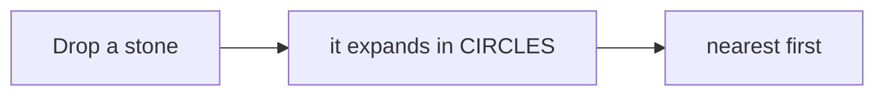
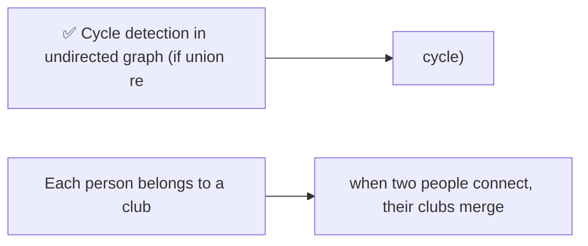
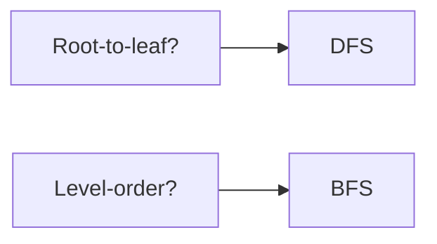
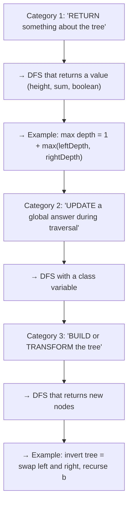
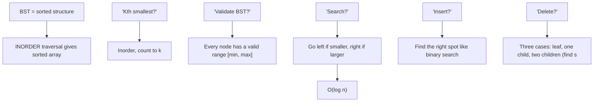
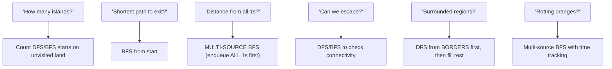
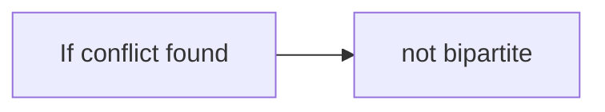
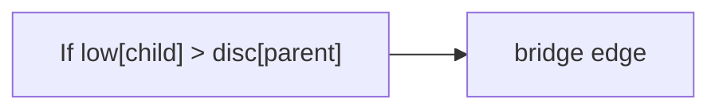
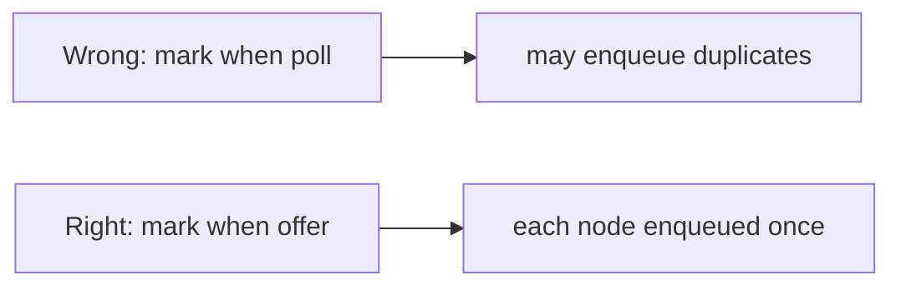

> **Navigation**: [< Previous](02_DP_State_Thinking.md) | [Back to Index](../00_MASTER_INDEX.md) | [Next >](04_Array_String_Thinking.md)

# 🗺️ Graph & Tree Problem Thinking — Mental Model

> **The key insight**: Most graph/tree problems are just asking "how do I explore this structure?" The answer is almost always BFS, DFS, or Union-Find. The skill is knowing WHICH one and WHY.

---

## Part 1: "Is This a Graph Problem?" — Recognition

### Many problems are HIDDEN graph problems:
```
Problem says:                          → Model as:
"Dependencies between tasks"           → Directed graph (topological sort)
"Can person A reach person B?"         → Undirected graph (BFS/DFS)
"Convert word A to word B"            → Graph where words are nodes
"2D grid with obstacles"              → Grid graph (4-directional)
"Network of computers"                → Undirected graph
"Course prerequisites"                → DAG (directed acyclic)
"Binary/N-ary tree"                   → Special case of graph (no cycles)
"Social network friends"              → Undirected graph
"State machine transitions"           → Directed graph
"Maze from start to end"             → Grid graph (BFS = shortest)
```

**Flow:**
- Problem says:
- ↓
- Model as:
- ↓
- 'Dependencies between tasks'
- ↓
- Directed graph (topological sort)
- ↓
- 'Can person A reach person B?'
- ↓
- Undirected graph (BFS/DFS)
- ↓
- 'Convert word A to word B'
- ↓
- Graph where words are nodes
- ↓
- '2D grid with obstacles'
- ↓
- Grid graph (4-directional)
- ↓
- 'Network of computers'
- ↓
- Undirected graph

```mermaid
flowchart TD
    N1["Problem says:"]
    N2["Model as:"]
    N3["'Dependencies between tasks'"]
    N4["Directed graph (topological sort)"]
    N5["'Can person A reach person B?'"]
    N6["Undirected graph (BFS/DFS)"]
    N7["'Convert word A to word B'"]
    N8["Graph where words are nodes"]
    N9["'2D grid with obstacles'"]
    N10["Grid graph (4-directional)"]
    N11["'Network of computers'"]
    N12["Undirected graph"]
    N13["'Course prerequisites'"]
    N14["DAG (directed acyclic)"]
    N15["'Binary/N-ary tree'"]
    N16["Special case of graph (no cycles)"]
    N17["'Social network friends'"]
    N18["'State machine transitions'"]
    N19["Directed graph"]
    N20["'Maze from start to end'"]
    N21["Grid graph (BFS = shortest)"]
    N1 --> N2
    N3 --> N4
    N5 --> N6
    N7 --> N8
    N9 --> N10
    N11 --> N12
    N13 --> N14
    N15 --> N16
    N17 --> N12
    N18 --> N19
    N20 --> N21
```



---

## Part 2: BFS vs DFS — The Decision Framework

### When to use BFS (Queue):
```
✅ SHORTEST PATH (unweighted) — BFS guarantees level-by-level
✅ Level-order anything — "closest", "minimum steps"
✅ All nodes at distance K
✅ Multi-source flood fill — "from all 1s simultaneously"
✅ Tree level-order traversal

Mental model: BFS = "Ripple in a pond"
Drop a stone → it expands in CIRCLES → nearest first
```

**Flow:**
- Drop a stone
- ↓
- it expands in CIRCLES
- ↓
- nearest first



### When to use DFS (Stack/Recursion):
```
✅ Path finding — "does any path exist?"
✅ Cycle detection — track visiting state
✅ Topological sort — "ordering with dependencies"
✅ Connected components — "how many islands?"
✅ Something about ALL paths / exhaustive search
✅ Tree problems — max depth, path sum, LCA

Mental model: DFS = "Exploring a maze"
Go as DEEP as possible → hit dead end → BACKTRACK → try next path
```

**Flow:**
- Go as DEEP as possible
- ↓
- hit dead end
- ↓
- BACKTRACK
- ↓
- try next path


### When to use Dijkstra (Priority Queue):
```
✅ SHORTEST PATH (weighted, no negative edges)
✅ "Minimum cost" to reach a node

Mental model: Dijkstra = "Greedy BFS with costs"
Always expand the CHEAPEST unexplored node
```

### When to use Union-Find:
```
✅ "Are A and B connected?" (dynamic connectivity)
✅ "How many connected components?"
✅ "Adding edges, when do two components merge?"
✅ Cycle detection in undirected graph (if union returns false → cycle)

Mental model: Union-Find = "Clubs merging"
Each person belongs to a club → when two people connect, their clubs merge
```

**Flow:**
- ✅ Cycle detection in undirected graph (if union re
- ↓
- cycle)
- ↓
- Each person belongs to a club
- ↓
- when two people connect, their clubs merge



### Decision Tree
```
Graph problem?
├── Need SHORTEST path?
│   ├── Unweighted? → BFS
│   ├── Weighted (no negative)? → Dijkstra
│   └── Negative edges? → Bellman-Ford
├── Need to visit ALL nodes/paths?
│   └── DFS (possibly with backtracking)
├── Need ordering with dependencies?
│   └── Topological Sort (Kahn's BFS or DFS)
├── Connected components?
│   ├── Static graph? → DFS/BFS
│   └── Dynamic (adding edges)? → Union-Find
├── Cycle detection?
│   ├── Undirected? → Union-Find or DFS
│   └── Directed? → DFS with 3-color marking
├── Minimum spanning tree?
│   └── Kruskal's (sort edges + Union-Find) or Prim's (PQ)
└── Tree problem?
    ├── Root-to-leaf? → DFS
    ├── Level-order? → BFS
    └── LCA? → DFS with parent tracking
```

**Flow:**
- Root-to-leaf?
- ↓
- DFS
- ↓
- Level-order?
- ↓
- BFS



---

## Part 3: Tree Thinking Specifically

### The Tree DFS Template (Memorize This)
```java
ReturnType solve(TreeNode node) {
    // 1. BASE CASE
    if (node == null) return baseValue;

    // 2. RECURSE on children
    ReturnType leftResult = solve(node.left);
    ReturnType rightResult = solve(node.right);

    // 3. PROCESS current node using children's results
    // → This is where the problem-specific logic goes

    // 4. RETURN answer for this subtree
    return combinedResult;
}
```

### Tree Problem Categories
```
Category 1: "RETURN something about the tree"
→ DFS that returns a value (height, sum, boolean)
→ Example: max depth = 1 + max(leftDepth, rightDepth)

Category 2: "UPDATE a global answer during traversal"
→ DFS with a class variable
→ Example: diameter = max(diameter, leftH + rightH) at each node

Category 3: "BUILD or TRANSFORM the tree"
→ DFS that returns new nodes
→ Example: invert tree = swap left and right, recurse both

Category 4: "FIND something in the tree"
→ DFS with early termination
→ Example: LCA = if both sides return non-null, current is LCA
```

**Flow:**
- Category 1: 'RETURN something about the tree'
- ↓
- DFS that returns a value (height, sum, boolean)
- ↓
- Example: max depth = 1 + max(leftDepth, rightDepth)
- ↓
- Category 2: 'UPDATE a global answer during traversal'
- ↓
- DFS with a class variable
- ↓
- Category 3: 'BUILD or TRANSFORM the tree'
- ↓
- DFS that returns new nodes



### BST-Specific Thinking
```
BST = sorted structure → INORDER traversal gives sorted array

"Kth smallest?" → Inorder, count to k
"Validate BST?" → Every node has a valid range [min, max]
"Search?" → Go left if smaller, right if larger → O(log n)
"Insert?" → Find the right spot like binary search
"Delete?" → Three cases: leaf, one child, two children (find successor)
```

**Flow:**
- BST = sorted structure
- ↓
- INORDER traversal gives sorted array
- ↓
- 'Kth smallest?'
- ↓
- Inorder, count to k
- ↓
- 'Validate BST?'
- ↓
- Every node has a valid range [min, max]
- ↓
- 'Search?'
- ↓
- Go left if smaller, right if larger
- ↓
- O(log n)
- ↓
- 'Insert?'
- ↓
- Find the right spot like binary search



---

## Part 4: Grid/Matrix as Graph — Mental Model

### The Grid-to-Graph Translation
```
Grid:                    Graph:
[1, 0, 1]              node(0,0) connects to node(0,1), node(1,0)
[1, 1, 0]              node(0,1) connects to node(0,0), node(1,1)
[0, 1, 0]              ... (4-directional neighbors)

Cell = Node
Adjacent cell = Edge
Obstacle = No edge
```

### Grid BFS/DFS Boilerplate
```java
int[][] dirs = {{0,1},{0,-1},{1,0},{-1,0}};  // Right, Left, Down, Up

// Check bounds:
boolean inBounds(int r, int c, int m, int n) {
    return r >= 0 && r < m && c >= 0 && c < n;
}

// Mark visited:
grid[r][c] = '#';  // In-place (mutate grid) → no extra visited array
// OR
boolean[][] visited;  // When you can't mutate the grid
```

### Grid Problem Categories
```
"How many islands?" → Count DFS/BFS starts on unvisited land
"Shortest path to exit?" → BFS from start
"Distance from all 1s?" → MULTI-SOURCE BFS (enqueue ALL 1s first)
"Can we escape?" → DFS/BFS to check connectivity
"Surrounded regions?" → DFS from BORDERS first, then fill rest
"Rotting oranges?" → Multi-source BFS with time tracking
```

**Flow:**
- 'How many islands?'
- ↓
- Count DFS/BFS starts on unvisited land
- ↓
- 'Shortest path to exit?'
- ↓
- BFS from start
- ↓
- 'Distance from all 1s?'
- ↓
- MULTI-SOURCE BFS (enqueue ALL 1s first)
- ↓
- 'Can we escape?'
- ↓
- DFS/BFS to check connectivity
- ↓
- 'Surrounded regions?'
- ↓
- DFS from BORDERS first, then fill rest
- ↓
- 'Rotting oranges?'
- ↓
- Multi-source BFS with time tracking



---

## Part 5: Common Graph Patterns & When They Appear

### Topological Sort — "What order to take courses?"
```
When: Directed graph, need valid ordering where A comes before B
How: Kahn's algorithm (BFS with indegree counting)
     OR DFS with post-order reversal

Mental model: "Peel off nodes with no dependencies first"
```

### Bipartite Check — "Can we 2-color?"
```
When: "Divide into two groups with no conflicts"
How: BFS/DFS with 2-coloring (alternate colors)
If conflict found → not bipartite

Mental model: "Color neighbors with opposite color. Contradiction = not bipartite."
```

**Flow:**
- If conflict found
- ↓
- not bipartite



### Tarjan's / Bridges — "What if this edge is removed?"
```
When: "Critical connections", "bridges", "articulation points"
How: DFS with discovery time and low-link values
If low[child] > disc[parent] → bridge edge

Mental model: "Can child reach higher than parent without this edge?"
```

**Flow:**
- If low[child] > disc[parent]
- ↓
- bridge edge



---

## Part 6: Graph/Tree Debugging Checklist

```
□ Am I tracking visited correctly? (Avoid infinite loops!)
□ BFS: Am I marking visited WHEN ENQUEUING, not when dequeuing?
   → Wrong: mark when poll → may enqueue duplicates
   → Right: mark when offer → each node enqueued once
□ DFS: Am I using 3 states for cycle detection? (0=white, 1=gray, 2=black)
□ Am I handling disconnected components? (Run BFS/DFS from ALL unvisited)
□ Grid: Am I checking bounds BEFORE accessing array?
□ Tree: Am I handling null nodes in base case?
□ Weighted graph: Am I using PQ correctly? (skip outdated entries in Dijkstra)
```

**Flow:**
- Wrong: mark when poll
- ↓
- may enqueue duplicates
- ↓
- Right: mark when offer
- ↓
- each node enqueued once



---

📖 **Related Files:**
- [03_Algorithms/05c_Graphs_Fundamentals.md](../03_Algorithms/05c_Graphs_Fundamentals.md) — Graph algorithms
- [04_Patterns_Templates/13_Tree_Plus_DFS_BFS.md](../04_Patterns_Templates/13_Tree_Plus_DFS_BFS.md) — Tree+DFS/BFS problems
- [04_Patterns_Templates/14_Graph_Plus_Traversal.md](../04_Patterns_Templates/14_Graph_Plus_Traversal.md) — Graph+Traversal problems

---
[← 02 DP State](02_DP_State_Thinking.md) | [04 Array & String →](04_Array_String_Thinking.md)


---

> **Navigation**: [< Previous](02_DP_State_Thinking.md) | [Back to Index](../00_MASTER_INDEX.md) | [Next >](04_Array_String_Thinking.md)