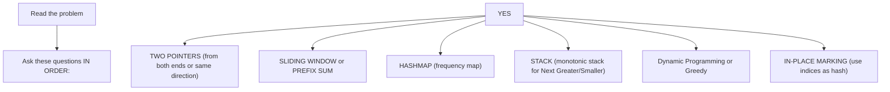
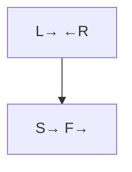
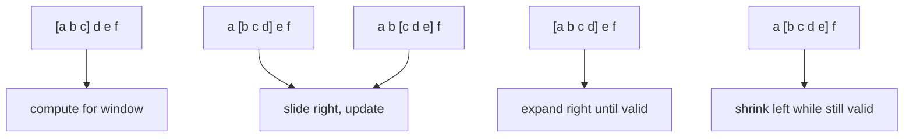
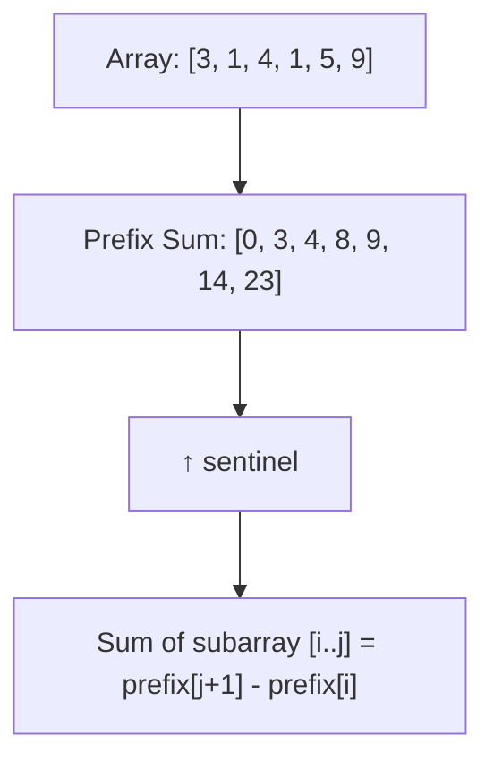
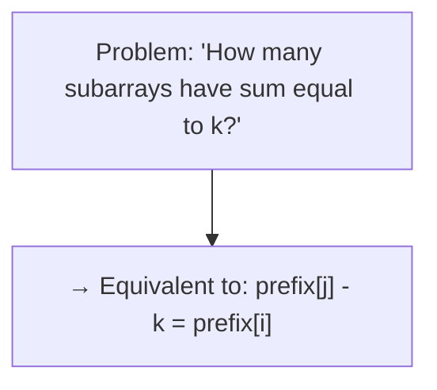
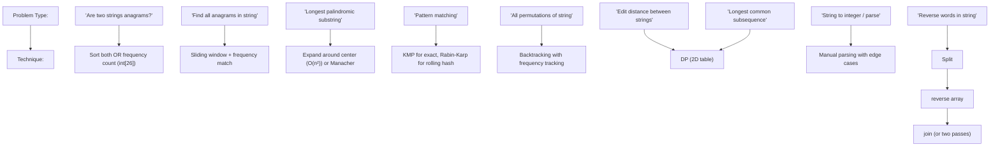
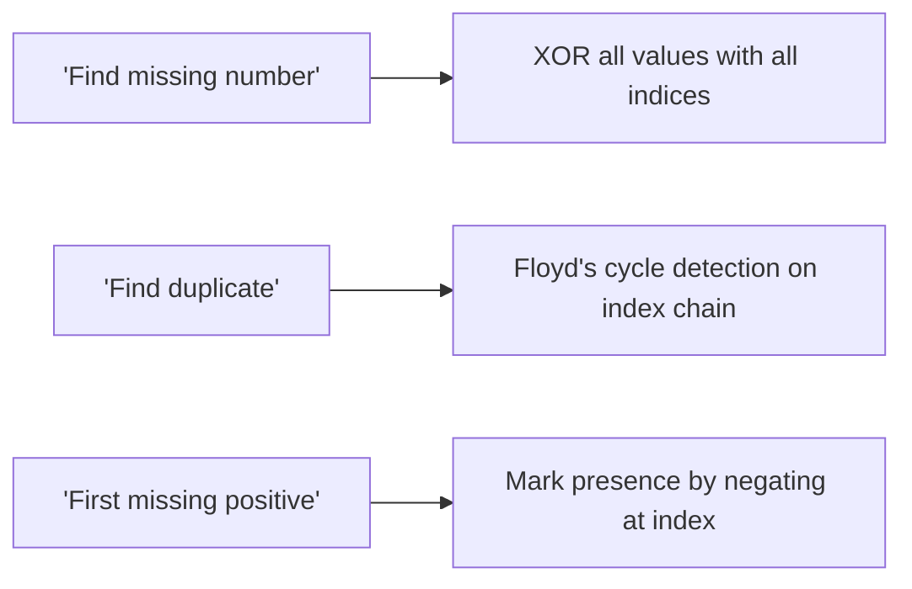
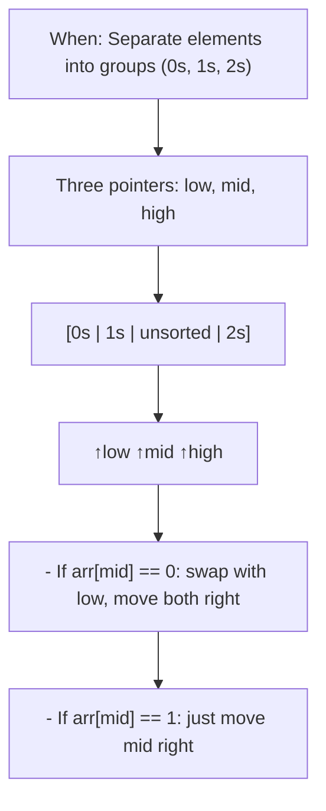
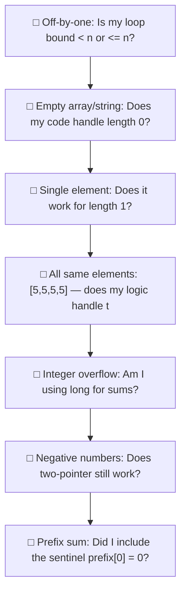

**Navigation**: [< Previous](03_Graph_Tree_Thinking.md) | [Back to Index](../00_MASTER_INDEX.md) | [Next >](05_Universal_Problem_Framework.md)

# 🔍 Array & String Problem Thinking — Mental Model

**The key insight**: Arrays and strings have a SMALL set of core techniques. The skill is recognizing WHICH technique applies based on problem constraints. This decision tree will guide you.

---

## Part 1: The Master Decision Tree

```
Read the problem → Ask these questions IN ORDER:

Q1: Is the array SORTED (or can sorting help)?
├── YES → TWO POINTERS (from both ends or same direction)
│   Examples: Two Sum II, 3Sum, Container With Most Water
│   Also consider: Binary Search
└── NO → Continue...

Q2: Does the problem ask about CONTIGUOUS subarray?
├── YES → SLIDING WINDOW or PREFIX SUM
│   ├── "Maximum/minimum of fixed size window" → Fixed Sliding Window
│   ├── "Smallest subarray with sum ≥ k" → Variable Sliding Window
│   └── "Subarray sum equals k" → Prefix Sum + HashMap
└── NO → Continue...

Q3: Does the problem involve COUNTING or FREQUENCY?
├── YES → HASHMAP (frequency map)
│   Examples: Two Sum, Anagram check, Group Anagrams
└── NO → Continue...

Q4: Does the problem need specific ORDER (stack-like)?
├── YES → STACK (monotonic stack for Next Greater/Smaller)
│   Examples: Next Greater Element, Daily Temperatures, Largest Rectangle
└── NO → Continue...

Q5: Does the problem involve SUBSEQUENCE or SELECTION?
├── YES → Dynamic Programming or Greedy
│   ├── "Optimal" → DP (LIS, LCS)
│   └── "Greedy works (exchange argument)" → Greedy
└── NO → Continue...

Q6: Limitation says O(n) and array has range [0, n-1]?
├── YES → IN-PLACE MARKING (use indices as hash)
│   Examples: Find Missing Number, Find Duplicate, First Missing Positive
└── NO → Brute force, then optimize
```

**Flow:**
1. Read the problem
2. Ask these questions IN ORDER:
3. YES
4. TWO POINTERS (from both ends or same direction)
5. YES
6. SLIDING WINDOW or PREFIX SUM
7. YES
8. HASHMAP (frequency map)
9. YES
10. STACK (monotonic stack for Next Greater/Smaller)
11. YES
12. Dynamic Programming or Greedy



---

## Part 2: Two Pointers — When and How

### Two Pointer Variants
```
Variant 1: OPPOSITE ends (sorted array)
┌─────────────────────────┐
│ L→               ←R     │  Move L or R based on comparison
└─────────────────────────┘
When: Sorted array, find pair with target sum, three sum, water container
Logic: If sum < target → move L right; if sum > target → move R left

Variant 2: SAME direction (fast/slow)
┌─────────────────────────┐
│ S→  F→                  │  Fast explores, Slow tracks "good" position
└─────────────────────────┘
When: Remove duplicates, partition array, merge sorted arrays
Logic: Fast scans every element; Slow marks where to write

Variant 3: MERGE (two arrays)
Array1: [1, 3, 5]    p1→
Array2: [2, 4, 6]    p2→
Result: [1, 2, 3, 4, 5, 6]
When: Merge two sorted arrays/lists, intersection of sorted arrays
```

**Flow:**
1. L
2. ←R
3. S
4. F



### Template: Two Sum on Sorted Array
```java
int left = 0, right = arr.length - 1;
while (left < right) {
    int sum = arr[left] + arr[right];
    if (sum == target) return new int[]{left, right};
    else if (sum < target) left++;
    else right--;
}
```

---


🔬 **Section Challenge — Part 2: Two Pointers — When and How**
>

## Part 3: Sliding Window — When and How

### Fixed vs Variable Window
```
FIXED Window (size = k):
[a b c] d e f     → compute for window
 a [b c d] e f    → slide right, update
  a b [c d e] f   → slide right, update

When: "Maximum sum of k consecutive elements", "Average of subarrays of size k"
Template: Add right edge, remove left edge when window > k

VARIABLE Window (find smallest/largest valid window):
[a b c d] e f     → expand right until valid
 a [b c d e] f    → shrink left while still valid

When: "Smallest subarray with sum ≥ target", "Longest substring without repeating"
Template: Expand right always, shrink left while condition met
```

**Flow:**
1. [a b c] d e f compute for window
2. a [b c d] e f slide right, update
3. a b [c d e] f slide right, update
4. [a b c d] e f expand right until valid
5. a [b c d e] f
6. shrink left while still valid



### Variable Window Template
```java
int left = 0;
int bestAnswer = initial;
// Whatever state you need (sum, HashMap, etc.)

for (int right = 0; right < n; right++) {
    // 1. ADD arr[right] to window state

    // 2. SHRINK from left while window is INVALID
    while (windowIsInvalid()) {
        // Remove arr[left] from window state
        left++;
    }

    // 3. UPDATE answer (window [left..right] is valid)
    bestAnswer = Math.max(bestAnswer, right - left + 1);
}
```

### Key Insight: "At Most K" Trick
```
"Exactly K distinct" = "At Most K distinct" − "At Most (K−1) distinct"

This converts a hard "exactly K" problem into two easier "at most K" problems.
Works for: Subarrays with Exactly K Distinct Integers (LC 992)
```

---


🔬 **Section Challenge — Part 3: Sliding Window — When and How**

**Challenge 1 (Reasoning):** Sliding window guarantees O(N). How? Each element is added and removed exactly how many times?
<details><summary>Answer</summary>

Each element enters the window exactly ONCE (right pointer advances past it) and leaves exactly ONCE (left pointer advances past it). Total operations: 2N regardless of window size changes. Compare to brute force: for each ending position, scan back to find optimal start = O(N²). The window's state (sum, freq map, etc.) is maintained INCREMENTALLY — O(1) per pointer move.
</details>

**Challenge 2 (Bug Hunt):** Minimum Window Substring: the while loop to shrink the window runs `while(valid) { shrink; }`. What's wrong with this logic?
<details><summary>Answer</summary>

Should shrink `while(valid)` to find the minimum window — this is correct! But the common bug: not updating `left++` BEFORE rechecking validity, or forgetting to update the answer BEFORE shrinking. The answer should be captured at the moment the window first becomes valid, then kept updated as we shrink to find smaller valid windows.
</details>


## Part 4: Prefix Sum — When and How

### Mental Model: Running Total
```
Array:      [3,  1,  4,  1,  5,  9]
Prefix Sum: [0,  3,  4,  8,  9, 14, 23]
             ↑ sentinel

Sum of subarray [i..j] = prefix[j+1] - prefix[i]
Sum of [1..3] = prefix[4] - prefix[1] = 9 - 3 = 6  ✓ (1+4+1=6)
```

**Flow:**
1. Array: [3, 1, 4, 1, 5, 9]
2. Prefix Sum: [0, 3, 4, 8, 9, 14, 23]
3. ↑ sentinel
4. Sum of subarray [i..j] = prefix[j+1] - prefix[i]



### Prefix Sum + HashMap Pattern
```
Problem: "How many subarrays have sum equal to k?"

Key insight: If prefix[j] - prefix[i] = k, then subarray [i+1..j] sums to k
→ Equivalent to: prefix[j] - k = prefix[i]
→ For each j, count how many previous prefix sums equal (prefix[j] - k)
→ Use HashMap to store frequency of prefix sums seen so far!
```

**Flow:**
1. Problem: 'How many subarrays have sum equal to k?'
2. Equivalent to: prefix[j] - k = prefix[i]



```java
int count = 0, sum = 0;
Map<Integer, Integer> map = new HashMap<>();
map.put(0, 1);  // Empty prefix

for (int num : arr) {
    sum += num;
    count += map.getOrDefault(sum - k, 0);
    map.merge(sum, 1, Integer::sum);
}
return count;
```

---


🔬 **Section Challenge — Part 4: Prefix Sum — When and How**
>

## Part 5: String-Specific Patterns

### String Comparison Table
```
Problem Type:                         → Technique:
"Are two strings anagrams?"           → Sort both OR frequency count (int[26])
"Find all anagrams in string"         → Sliding window + frequency match
"Longest palindromic substring"       → Expand around center (O(n²)) or Manacher
"Pattern matching"                    → KMP for exact, Rabin-Karp for rolling hash
"All permutations of string"          → Backtracking with frequency tracking
"Edit distance between strings"       → DP (2D table)
"Longest common subsequence"          → DP (2D table)
"String to integer / parse"           → Manual parsing with edge cases
"Reverse words in string"             → Split → reverse array → join (or two passes)
```

**Flow:**
1. Problem Type:
2. Technique:
3. 'Are two strings anagrams?'
4. Sort both OR frequency count (int[26])
5. 'Find all anagrams in string'
6. Sliding window + frequency match
7. 'Longest palindromic substring'
8. Expand around center (O(n²)) or Manacher
9. 'Pattern matching'
10. KMP for exact, Rabin-Karp for rolling hash
11. 'All permutations of string'
12. Backtracking with frequency tracking



### Character Frequency Trick (int[26])
```java
// Instead of HashMap<Character, Integer>, use:
int[] freq = new int[26];
for (char c : s.toCharArray()) freq[c - 'a']++;

// Compare anagrams:
Arrays.equals(freq1, freq2);  // O(26) = O(1)

// WHY? Faster than HashMap, no boxing, cache-friendly
```

### StringBuilder vs String Concatenation
```
// WRONG (O(n²) — creates new string each time):
String result = "";
for (int i = 0; i < n; i++) result += "x";

// CORRECT (O(n) — mutable buffer):
StringBuilder sb = new StringBuilder();
for (int i = 0; i < n; i++) sb.append("x");
String result = sb.toString();
```

---


## Part 6: In-Place Array Techniques

### Index-as-Hash (O(1) space tricks)
```
When array has values in range [1, n] or [0, n-1]:

"Find missing number" → XOR all values with all indices
"Find duplicate" → Floyd's cycle detection on index chain
"First missing positive" → Mark presence by negating at index

Example: Find all duplicates (values 1 to n, some appear twice)
for (int num : nums) {
    int idx = Math.abs(num) - 1;
    if (nums[idx] < 0) result.add(idx + 1);  // Already seen!
    else nums[idx] = -nums[idx];              // Mark as seen
}
```

**Flow:**
1. 'Find missing number'
2. XOR all values with all indices
3. 'Find duplicate'
4. Floyd's cycle detection on index chain 'First missing positive' Mark presence by negating at index



### Partition / Dutch National Flag
```
When: Separate elements into groups (0s, 1s, 2s)
Three pointers: low, mid, high
[0s | 1s | unsorted | 2s]
 ↑low  ↑mid         ↑high

- If arr[mid] == 0: swap with low, move both right
- If arr[mid] == 1: just move mid right
- If arr[mid] == 2: swap with high, move high left (don't move mid!)
```

**Flow:**
1. When: Separate elements into groups (0s, 1s, 2s)
2. Three pointers: low, mid, high
3. [0s 1s unsorted 2s]
4. ↑low ↑mid ↑high
5. - If arr[mid] == 0: swap with low, move both right
6. - If arr[mid] == 1: just move mid right



---


## Part 7: Array & String Debugging Checklist

```
□ Off-by-one: Is my loop bound < n or <= n?
□ Empty array/string: Does my code handle length 0?
□ Single element: Does it work for length 1?
□ All same elements: [5,5,5,5] — does my logic handle this?
□ Integer overflow: Am I using long for sums?
□ Negative numbers: Does two-pointer still work?
□ Sliding window: Am I updating state when both adding AND removing?
□ Prefix sum: Did I include the sentinel prefix[0] = 0?
□ String immutability: Am I using StringBuilder for building?
□ Character encoding: 'a' to 'z' = 26 letters, '0' to '9' = 10 digits
```

**Flow:**
1. □ Off-by-one: Is my loop bound < n or <= n?
2. □ Empty array/string: Does my code handle length 0?
3. □ Single element: Does it work for length 1?
4. □ All same elements: [5,5,5,5] — does my logic handle t
5. □ Integer overflow: Am I using long for sums?
6. □ Negative numbers: Does two-pointer still work?
7. □ Prefix sum: Did I include the sentinel prefix[0] = 0?



---

📖 **Related Files:**
- [04_Patterns_Templates/08_Array_Plus_TwoPointers.md](../04_Patterns_Templates/08_Array_Plus_TwoPointers.md) — Array + Two Pointer problems
- [04_Patterns_Templates/09_Array_Plus_SlidingWindow.md](../04_Patterns_Templates/09_Array_Plus_SlidingWindow.md) — Array + Sliding Window problems
- [04_Patterns_Templates/18_String_Plus_Advanced.md](../04_Patterns_Templates/18_String_Plus_Advanced.md) — String problems

---
[← 03 Graph & Tree](03_Graph_Tree_Thinking.md) | [05 Universal Framework →](05_Universal_Problem_Framework.md)


