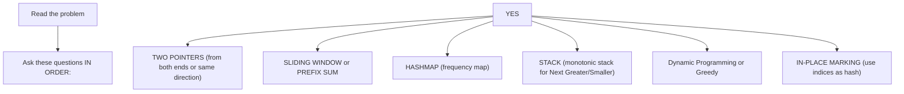
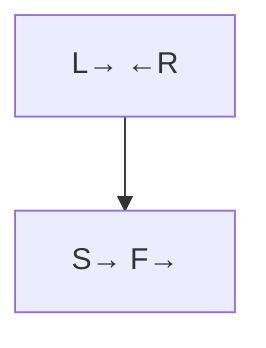
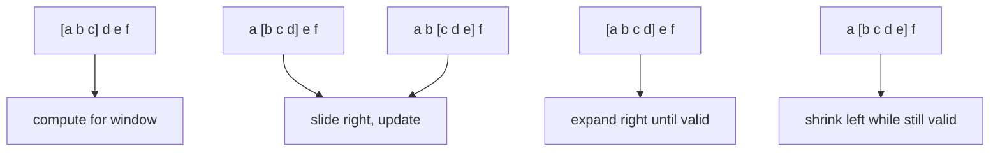
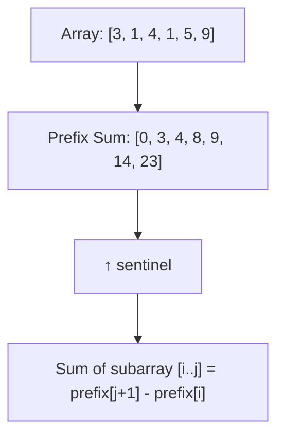
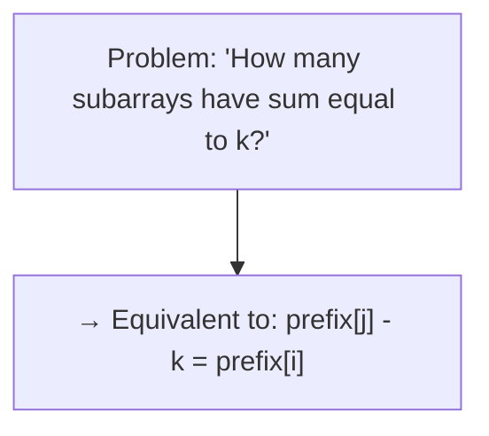
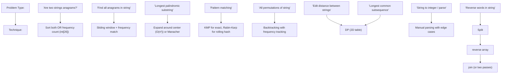
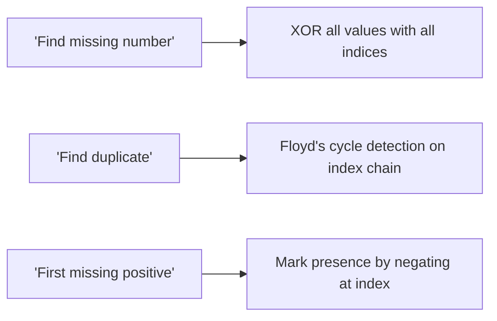
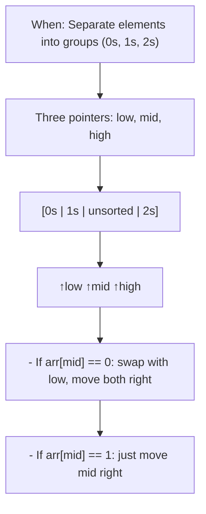
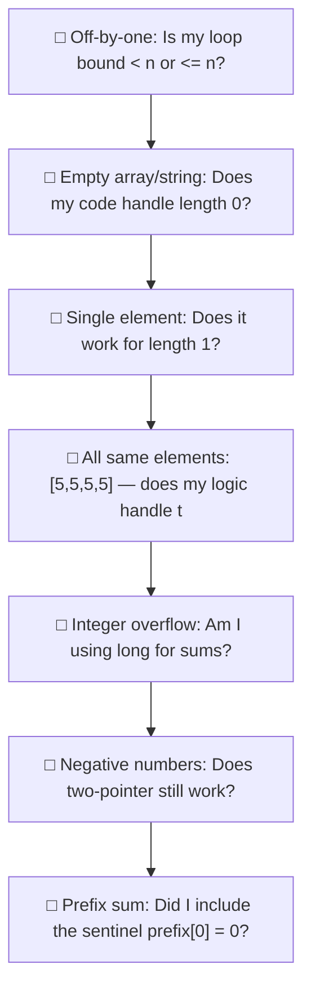

**Navigation**: [< Previous](03_Graph_Tree_Thinking.md) | [Back to Index](../00_MASTER_INDEX.md) | [Next >](05_Universal_Problem_Framework.md)

# 🔍 Array & String Problem Thinking — Mental Model

**The key insight**: Arrays and strings have a SMALL set of core techniques. The skill is recognizing WHICH technique applies based on problem constraints. This decision tree will guide you.

---

## Part 1: The Master Decision Tree

```
Read the problem → Ask these questions IN ORDER:

Q1: Is the array SORTED (or can sorting help)?
├── YES → TWO POINTERS (from both ends or same direction)
│   Examples: Two Sum II, 3Sum, Container With Most Water
│   Also consider: Binary Search
└── NO → Continue...

Q2: Does the problem ask about CONTIGUOUS subarray?
├── YES → SLIDING WINDOW or PREFIX SUM
│   ├── "Maximum/minimum of fixed size window" → Fixed Sliding Window
│   ├── "Smallest subarray with sum ≥ k" → Variable Sliding Window
│   └── "Subarray sum equals k" → Prefix Sum + HashMap
└── NO → Continue...

Q3: Does the problem involve COUNTING or FREQUENCY?
├── YES → HASHMAP (frequency map)
│   Examples: Two Sum, Anagram check, Group Anagrams
└── NO → Continue...

Q4: Does the problem need specific ORDER (stack-like)?
├── YES → STACK (monotonic stack for Next Greater/Smaller)
│   Examples: Next Greater Element, Daily Temperatures, Largest Rectangle
└── NO → Continue...

Q5: Does the problem involve SUBSEQUENCE or SELECTION?
├── YES → Dynamic Programming or Greedy
│   ├── "Optimal" → DP (LIS, LCS)
│   └── "Greedy works (exchange argument)" → Greedy
└── NO → Continue...

Q6: Limitation says O(n) and array has range [0, n-1]?
├── YES → IN-PLACE MARKING (use indices as hash)
│   Examples: Find Missing Number, Find Duplicate, First Missing Positive
└── NO → Brute force, then optimize
```

**Flow:**
1. Read the problem
2. Ask these questions IN ORDER:
3. YES
4. TWO POINTERS (from both ends or same direction)
5. YES
6. SLIDING WINDOW or PREFIX SUM
7. YES
8. HASHMAP (frequency map)
9. YES
10. STACK (monotonic stack for Next Greater/Smaller)
11. YES
12. Dynamic Programming or Greedy



---

## Part 2: Two Pointers — When and How

### Two Pointer Variants
```
Variant 1: OPPOSITE ends (sorted array)
┌─────────────────────────┐
│ L→               ←R     │  Move L or R based on comparison
└─────────────────────────┘
When: Sorted array, find pair with target sum, three sum, water container
Logic: If sum < target → move L right; if sum > target → move R left

Variant 2: SAME direction (fast/slow)
┌─────────────────────────┐
│ S→  F→                  │  Fast explores, Slow tracks "good" position
└─────────────────────────┘
When: Remove duplicates, partition array, merge sorted arrays
Logic: Fast scans every element; Slow marks where to write

Variant 3: MERGE (two arrays)
Array1: [1, 3, 5]    p1→
Array2: [2, 4, 6]    p2→
Result: [1, 2, 3, 4, 5, 6]
When: Merge two sorted arrays/lists, intersection of sorted arrays
```

**Flow:**
1. L
2. ←R
3. S
4. F



### Template: Two Sum on Sorted Array
```java
int left = 0, right = arr.length - 1;
while (left < right) {
    int sum = arr[left] + arr[right];
    if (sum == target) return new int[]{left, right};
    else if (sum < target) left++;
    else right--;
}
```

---


🔬 **Section Challenge — Part 2: Two Pointers — When and How**
>

## Part 3: Sliding Window — When and How

### Fixed vs Variable Window
```
FIXED Window (size = k):
[a b c] d e f     → compute for window
 a [b c d] e f    → slide right, update
  a b [c d e] f   → slide right, update

When: "Maximum sum of k consecutive elements", "Average of subarrays of size k"
Template: Add right edge, remove left edge when window > k

VARIABLE Window (find smallest/largest valid window):
[a b c d] e f     → expand right until valid
 a [b c d e] f    → shrink left while still valid

When: "Smallest subarray with sum ≥ target", "Longest substring without repeating"
Template: Expand right always, shrink left while condition met
```

**Flow:**
1. [a b c] d e f compute for window
2. a [b c d] e f slide right, update
3. a b [c d e] f slide right, update
4. [a b c d] e f expand right until valid
5. a [b c d e] f
6. shrink left while still valid



### Variable Window Template
```java
int left = 0;
int bestAnswer = initial;
// Whatever state you need (sum, HashMap, etc.)

for (int right = 0; right < n; right++) {
    // 1. ADD arr[right] to window state

    // 2. SHRINK from left while window is INVALID
    while (windowIsInvalid()) {
        // Remove arr[left] from window state
        left++;
    }

    // 3. UPDATE answer (window [left..right] is valid)
    bestAnswer = Math.max(bestAnswer, right - left + 1);
}
```

### Key Insight: "At Most K" Trick
```
"Exactly K distinct" = "At Most K distinct" − "At Most (K−1) distinct"

This converts a hard "exactly K" problem into two easier "at most K" problems.
Works for: Subarrays with Exactly K Distinct Integers (LC 992)
```

---


🔬 **Section Challenge — Part 3: Sliding Window — When and How**

**Challenge 1 (Reasoning):** Sliding window guarantees O(N). How? Each element is added and removed exactly how many times?
<details><summary>Answer</summary>

Each element enters the window exactly ONCE (right pointer advances past it) and leaves exactly ONCE (left pointer advances past it). Total operations: 2N regardless of window size changes. Compare to brute force: for each ending position, scan back to find optimal start = O(N²). The window's state (sum, freq map, etc.) is maintained INCREMENTALLY — O(1) per pointer move.
</details>

**Challenge 2 (Bug Hunt):** Minimum Window Substring: the while loop to shrink the window runs `while(valid) { shrink; }`. What's wrong with this logic?
<details><summary>Answer</summary>

Should shrink `while(valid)` to find the minimum window — this is correct! But the common bug: not updating `left++` BEFORE rechecking validity, or forgetting to update the answer BEFORE shrinking. The answer should be captured at the moment the window first becomes valid, then kept updated as we shrink to find smaller valid windows.
</details>


## Part 4: Prefix Sum — When and How

### Mental Model: Running Total
```
Array:      [3,  1,  4,  1,  5,  9]
Prefix Sum: [0,  3,  4,  8,  9, 14, 23]
             ↑ sentinel

Sum of subarray [i..j] = prefix[j+1] - prefix[i]
Sum of [1..3] = prefix[4] - prefix[1] = 9 - 3 = 6  ✓ (1+4+1=6)
```

**Flow:**
1. Array: [3, 1, 4, 1, 5, 9]
2. Prefix Sum: [0, 3, 4, 8, 9, 14, 23]
3. ↑ sentinel
4. Sum of subarray [i..j] = prefix[j+1] - prefix[i]



### Prefix Sum + HashMap Pattern
```
Problem: "How many subarrays have sum equal to k?"

Key insight: If prefix[j] - prefix[i] = k, then subarray [i+1..j] sums to k
→ Equivalent to: prefix[j] - k = prefix[i]
→ For each j, count how many previous prefix sums equal (prefix[j] - k)
→ Use HashMap to store frequency of prefix sums seen so far!
```

**Flow:**
1. Problem: 'How many subarrays have sum equal to k?'
2. Equivalent to: prefix[j] - k = prefix[i]



```java
int count = 0, sum = 0;
Map<Integer, Integer> map = new HashMap<>();
map.put(0, 1);  // Empty prefix

for (int num : arr) {
    sum += num;
    count += map.getOrDefault(sum - k, 0);
    map.merge(sum, 1, Integer::sum);
}
return count;
```

---


🔬 **Section Challenge — Part 4: Prefix Sum — When and How**
>

## Part 5: String-Specific Patterns

### String Comparison Table
```
Problem Type:                         → Technique:
"Are two strings anagrams?"           → Sort both OR frequency count (int[26])
"Find all anagrams in string"         → Sliding window + frequency match
"Longest palindromic substring"       → Expand around center (O(n²)) or Manacher
"Pattern matching"                    → KMP for exact, Rabin-Karp for rolling hash
"All permutations of string"          → Backtracking with frequency tracking
"Edit distance between strings"       → DP (2D table)
"Longest common subsequence"          → DP (2D table)
"String to integer / parse"           → Manual parsing with edge cases
"Reverse words in string"             → Split → reverse array → join (or two passes)
```

**Flow:**
1. Problem Type:
2. Technique:
3. 'Are two strings anagrams?'
4. Sort both OR frequency count (int[26])
5. 'Find all anagrams in string'
6. Sliding window + frequency match
7. 'Longest palindromic substring'
8. Expand around center (O(n²)) or Manacher
9. 'Pattern matching'
10. KMP for exact, Rabin-Karp for rolling hash
11. 'All permutations of string'
12. Backtracking with frequency tracking



### Character Frequency Trick (int[26])
```java
// Instead of HashMap<Character, Integer>, use:
int[] freq = new int[26];
for (char c : s.toCharArray()) freq[c - 'a']++;

// Compare anagrams:
Arrays.equals(freq1, freq2);  // O(26) = O(1)

// WHY? Faster than HashMap, no boxing, cache-friendly
```

### StringBuilder vs String Concatenation
```
// WRONG (O(n²) — creates new string each time):
String result = "";
for (int i = 0; i < n; i++) result += "x";

// CORRECT (O(n) — mutable buffer):
StringBuilder sb = new StringBuilder();
for (int i = 0; i < n; i++) sb.append("x");
String result = sb.toString();
```

---


## Part 6: In-Place Array Techniques

### Index-as-Hash (O(1) space tricks)
```
When array has values in range [1, n] or [0, n-1]:

"Find missing number" → XOR all values with all indices
"Find duplicate" → Floyd's cycle detection on index chain
"First missing positive" → Mark presence by negating at index

Example: Find all duplicates (values 1 to n, some appear twice)
for (int num : nums) {
    int idx = Math.abs(num) - 1;
    if (nums[idx] < 0) result.add(idx + 1);  // Already seen!
    else nums[idx] = -nums[idx];              // Mark as seen
}
```

**Flow:**
1. 'Find missing number'
2. XOR all values with all indices
3. 'Find duplicate'
4. Floyd's cycle detection on index chain 'First missing positive' Mark presence by negating at index



### Partition / Dutch National Flag
```
When: Separate elements into groups (0s, 1s, 2s)
Three pointers: low, mid, high
[0s | 1s | unsorted | 2s]
 ↑low  ↑mid         ↑high

- If arr[mid] == 0: swap with low, move both right
- If arr[mid] == 1: just move mid right
- If arr[mid] == 2: swap with high, move high left (don't move mid!)
```

**Flow:**
1. When: Separate elements into groups (0s, 1s, 2s)
2. Three pointers: low, mid, high
3. [0s 1s unsorted 2s]
4. ↑low ↑mid ↑high
5. - If arr[mid] == 0: swap with low, move both right
6. - If arr[mid] == 1: just move mid right



---


## Part 7: Array & String Debugging Checklist

```
□ Off-by-one: Is my loop bound < n or <= n?
□ Empty array/string: Does my code handle length 0?
□ Single element: Does it work for length 1?
□ All same elements: [5,5,5,5] — does my logic handle this?
□ Integer overflow: Am I using long for sums?
□ Negative numbers: Does two-pointer still work?
□ Sliding window: Am I updating state when both adding AND removing?
□ Prefix sum: Did I include the sentinel prefix[0] = 0?
□ String immutability: Am I using StringBuilder for building?
□ Character encoding: 'a' to 'z' = 26 letters, '0' to '9' = 10 digits
```

**Flow:**
1. □ Off-by-one: Is my loop bound < n or <= n?
2. □ Empty array/string: Does my code handle length 0?
3. □ Single element: Does it work for length 1?
4. □ All same elements: [5,5,5,5] — does my logic handle t
5. □ Integer overflow: Am I using long for sums?
6. □ Negative numbers: Does two-pointer still work?
7. □ Prefix sum: Did I include the sentinel prefix[0] = 0?



---

📖 **Related Files:**
- [04_Patterns_Templates/08_Array_Plus_TwoPointers.md](../04_Patterns_Templates/08_Array_Plus_TwoPointers.md) — Array + Two Pointer problems
- [04_Patterns_Templates/09_Array_Plus_SlidingWindow.md](../04_Patterns_Templates/09_Array_Plus_SlidingWindow.md) — Array + Sliding Window problems
- [04_Patterns_Templates/18_String_Plus_Advanced.md](../04_Patterns_Templates/18_String_Plus_Advanced.md) — String problems

---
[← 03 Graph & Tree](03_Graph_Tree_Thinking.md) | [05 Universal Framework →](05_Universal_Problem_Framework.md)


---


---


## 🏋️ Practice & Interview Questions — Arrays

Attempt each before looking at the answer. Time yourself.

### Predict / Trace
**Q1.** What is the output? `int[] a = {1,2,3}; int[] b = a; b[0] = 99; System.out.println(a[0]);`
<details><summary>Answer</summary>

`99` — arrays are objects; `b = a` copies the **reference**, not the data. Both point to the same array.
</details>

**Q2.** What is the time complexity of inserting at index 0 of an array of size N?
<details><summary>Answer</summary>

O(N) — every element must shift right by one position.
</details>

**Q3.** Given sorted array `[1,3,5,7,9]`, binary search for 6 — trace the mid values.
<details><summary>Answer</summary>

lo=0,hi=4 → mid=2 (value=5) → lo=3,hi=4 → mid=3 (value=7) → lo=3,hi=2 → NOT FOUND
</details>

### LeetCode / Coding
**Q4.** ⭐ Two Sum — find indices of two numbers that add to target. O(N) solution.
<details><summary>Solution</summary>

```java
Map<Integer,Integer> map = new HashMap<>();
for(int i=0;i<nums.length;i++){
    int comp = target - nums[i];
    if(map.containsKey(comp)) return new int[]{map.get(comp), i};
    map.put(nums[i], i);
}
```
</details>

**Q5.** ⭐ Maximum Subarray (Kadane's Algorithm). Write the O(N) solution.
<details><summary>Solution</summary>

```java
int maxSum = nums[0], curr = nums[0];
for(int i=1;i<nums.length;i++){
    curr = Math.max(nums[i], curr + nums[i]);
    maxSum = Math.max(maxSum, curr);
}
return maxSum;
```
</details>

**Q6.** ⭐ Best Time to Buy and Sell Stock — single pass O(N).
<details><summary>Solution</summary>

```java
int minPrice = Integer.MAX_VALUE, maxProfit = 0;
for(int p : prices){
    minPrice = Math.min(minPrice, p);
    maxProfit = Math.max(maxProfit, p - minPrice);
}
return maxProfit;
```
</details>

**Q7.** ⭐ Product of Array Except Self — without division, O(N).
<details><summary>Solution</summary>

```java
int[] res = new int[n];
res[0] = 1;
for(int i=1;i<n;i++) res[i] = res[i-1] * nums[i-1];
int right = 1;
for(int i=n-1;i>=0;i--){ res[i] *= right; right *= nums[i]; }
return res;
```
</details>

**Q8.** ⭐⭐ Container With Most Water (Two Pointers).
<details><summary>Solution</summary>

```java
int l=0, r=nums.length-1, max=0;
while(l<r){
    max = Math.max(max, Math.min(height[l],height[r])*(r-l));
    if(height[l]<height[r]) l++; else r--;
}
```
</details>

**Q9.** ⭐⭐ 3Sum — find all unique triplets summing to 0. O(N²).
<details><summary>Solution</summary>

```java
Arrays.sort(nums);
for(int i=0;i<n-2;i++){
    if(i>0 && nums[i]==nums[i-1]) continue;
    int l=i+1, r=n-1;
    while(l<r){
        int s=nums[i]+nums[l]+nums[r];
        if(s==0){ result.add(List.of(nums[i],nums[l++],nums[r--])); 
            while(l<r&&nums[l]==nums[l-1])l++; while(l<r&&nums[r]==nums[r+1])r--; }
        else if(s<0) l++; else r--;
    }
}
```
</details>

**Q10.** ⭐⭐ Rotate Array by k positions in-place O(1) space.
<details><summary>Solution</summary>

```java
// Reverse full array, then reverse first k, then reverse rest
k %= n;
reverse(nums, 0, n-1);
reverse(nums, 0, k-1);
reverse(nums, k, n-1);
```
</details>

**Q11.** ⭐⭐ Find the duplicate number in array [1..n] — O(N) time, O(1) space (Floyd's cycle).
<details><summary>Solution</summary>

```java
int slow=nums[0], fast=nums[0];
do{ slow=nums[slow]; fast=nums[nums[fast]]; } while(slow!=fast);
slow=nums[0];
while(slow!=fast){ slow=nums[slow]; fast=nums[fast]; }
return slow;
```
</details>

**Q12.** ⭐⭐⭐ Trapping Rain Water — O(N) two-pointer solution.
<details><summary>Solution</summary>

```java
int l=0,r=n-1,lMax=0,rMax=0,water=0;
while(l<r){
    if(height[l]<=height[r]){
        if(height[l]>=lMax) lMax=height[l]; else water+=lMax-height[l];
        l++;
    } else {
        if(height[r]>=rMax) rMax=height[r]; else water+=rMax-height[r];
        r--;
    }
}
```
</details>

### Interview Questions
**Q13.** What's the difference between `ArrayList` and `LinkedList` for index access?
<details><summary>Answer</summary>

ArrayList: O(1) random access (array backing). LinkedList: O(N) — must traverse from head. Use ArrayList for most cases; LinkedList only when frequent insertions/deletions at head/tail.
</details>

**Q14.** When would you use `int[]` over `ArrayList<Integer>`?
<details><summary>Answer</summary>

`int[]`: primitive, no boxing overhead, fixed-size, cache-friendly. `ArrayList<Integer>`: dynamic resizing, collection API, but 4-16x memory overhead per element due to Integer boxing.
</details>

**Q15.** What is cache locality and why do arrays benefit from it?
<details><summary>Answer</summary>

CPU loads data in cache lines (~64 bytes). Arrays store elements contiguously → sequential access loads entire cache line at once → very fast. LinkedList nodes are scattered in heap → each node access = potential cache miss.
</details>

### MCQ Rapid Fire
| # | Question | Answer |
|---|---|---|
| 1 | Array access a[i] time complexity | O(1) |
| 2 | Array insertion at middle time complexity | O(N) |
| 3 | Default value of int[] in Java | 0 |
| 4 | Arrays.sort() algorithm for primitives | Dual-pivot QuickSort |
| 5 | Arrays.sort() algorithm for objects | TimSort (stable) |
| 6 | Arrays.copyOfRange(a,2,5) — how many elements? | 3 (indices 2,3,4) |
| 7 | Can arrays store null? | Yes (reference arrays only) |
| 8 | Arrays.fill(a, 7) — what does it do? | Sets every element to 7 |
| 9 | Multi-dim array a[3][4] — total elements? | 12 |
| 10 | Arrays.binarySearch requires? | Sorted array |


---

## 🧠 Deep Conceptual Questions — Arrays & Memory

These questions test your REASONING, not just recall. Think before expanding.

**C1. Why is array access O(1)?**
<details><summary>Deep Answer</summary>

Arrays store elements at **contiguous memory addresses**. Given base address B and element size S:
`address(i) = B + (i × S)` — this is a single multiplication and addition (constant time regardless of N).
The CPU can compute this directly without any traversal. This is why arrays are the fastest data structure for indexed access.
</details>

**C2. Why does cache performance matter for algorithms, and why do arrays win?**
<details><summary>Deep Answer</summary>

Modern CPUs fetch memory in **cache lines** (~64 bytes). When you access `array[i]`, the CPU also loads `array[i+1]` through `array[i+7]` into L1 cache automatically (spatial locality). Sequential array access hits cache nearly 100% of the time (~1ns). LinkedList traversal: each node is at a random heap address → each step is a potential **cache miss** (~100ns). For 1M elements: array traversal ≈ 1ms; linked list ≈ 100ms. Same O(N), 100x different in practice.
</details>

**C3. Why does `Arrays.sort()` use different algorithms for primitives vs objects?**
<details><summary>Deep Answer</summary>

**Primitives (`int[]`)**: Uses Dual-Pivot QuickSort. No stability needed (equal ints are indistinguishable). QuickSort is in-place (O(1) extra space), cache-friendly (sequential access), fastest in practice. **Objects (`Integer[]`)**: Uses TimSort (hybrid MergeSort + InsertionSort). MUST be stable — equal objects may have different fields that should preserve original order (think: sort by name, then by age — equal names must stay age-ordered). TimSort guarantees O(N log N) worst case; QuickSort can degrade to O(N²) if not careful.
</details>

**C4. Why is inserting at the beginning of an array O(N) but appending at end is O(1) amortized?**
<details><summary>Deep Answer</summary>

**Insert at index 0**: must shift every element right → N operations always.
**Append**: if capacity exists, write at `arr[size]` → O(1). If full, resize (double capacity) → copy all N elements. But resizing happens only after 1, 2, 4, 8... N elements. Total copies over N appends = N/2 + N/4 + ... = N. Average per operation = N/N = O(1) — this is **amortized analysis**. ArrayList uses this strategy.
</details>

**C5. What is the REAL cost of `ArrayList.remove(0)` in a 1M element list? Why?**
<details><summary>Deep Answer</summary>

~1 million array element shifts. Java calls `System.arraycopy()` — a native bulk memory move. Even though it's one instruction, it copies 1M references = 4MB-8MB of memory movement. At memory bandwidth ~20GB/s: ~200-400 microseconds actual cost. Not "slow" but definitely O(N) — avoid repeatedly removing from the front of a large ArrayList. Use `ArrayDeque` for front-removal O(1).
</details>

**C6. Two Sum: why does the HashMap approach work, and what's its actual space tradeoff?**
<details><summary>Deep Answer</summary>

HashMap approach: as you iterate, store `{value → index}`. For each element, check if `target - current` already seen. This is the **complement pattern**: instead of "find two that sum to target", reframe as "have I seen what I need?". Space: O(N) worst case (all elements unique, no match until last pair). But we trade space for a reduction from O(N²) to O(N) time — classic space-time tradeoff. The 1-pass variant finds the answer in one scan without a second loop.
</details>

**C7. Sliding Window: what is the INVARIANT being maintained?**
<details><summary>Deep Answer</summary>

A sliding window maintains a **window [left, right]** where some property (max sum, no duplicates, valid substring) holds. The invariant: the window always satisfies the constraint. When violated: shrink from left until valid again. This avoids re-examining elements already processed — each element enters and leaves the window exactly once → O(N). Mental model: two pointers chasing each other, never crossing, each moving forward-only.
</details>

**C8. Prefix Sum: why does it reduce range-sum queries from O(N) to O(1)?**
<details><summary>Deep Answer</summary>

`prefix[i] = arr[0] + arr[1] + ... + arr[i]`. Sum of range [l,r] = `prefix[r] - prefix[l-1]`. Precomputation: O(N). Each query: O(1) subtraction. Without prefix sum: each query scans the range = O(N) per query → O(N×Q) total for Q queries. With prefix sum: O(N) build + O(Q) queries = O(N+Q). Break-even at Q=1; better for Q>1. Classic **precomputation tradeoff**: pay once, query forever.
</details>

**C9. Why does Kadane's Algorithm work for Maximum Subarray?**
<details><summary>Deep Answer</summary>

The key insight: at each position i, the maximum subarray ending at i is either:
1. `arr[i]` alone (start fresh — previous subarray was negative, drags us down)
2. `arr[i] + best_ending_at[i-1]` (extend the previous best)

`curr = max(arr[i], curr + arr[i])` captures this exactly. If curr becomes negative, it's better to start fresh at next element. We track global max throughout. This is a 1D DP where the "state" is "maximum subarray sum ending here". The recurrence is the key reasoning step.
</details>

**C10. Binary Search: why does `mid = lo + (hi - lo) / 2` instead of `(lo + hi) / 2`?**
<details><summary>Deep Answer</summary>

**Integer overflow!** If `lo + hi` exceeds `Integer.MAX_VALUE` (2,147,483,647), the sum wraps to a negative number. For huge arrays (lo=1B, hi=2B), `lo + hi = 3B > 2.1B`. This bug brought down a famous JDK implementation of binary search in 2006 (Joshua Bloch's blog post). `lo + (hi - lo) / 2` can never overflow since `hi - lo` is always positive and smaller than either value alone.
</details>


> **Navigation**: [< Previous](03_Graph_Tree_Thinking.md) | [Back to Index](../00_MASTER_INDEX.md) | [Next >](05_Universal_Problem_Framework.md)