> **Navigation**: [< Previous](04_Array_String_Thinking.md) | [Back to Index](../00_MASTER_INDEX.md) | [Next >](06_Implementation_Checklist.md)

# 🧭 Universal Problem-Solving Framework — 6-Step Method for ANY Problem

> **The key insight**: Every problem — DSA, SQL, system design — follows the same thinking process. Master this 6-step framework and you'll never freeze in front of a problem again.

---

## The 6 Steps

```
┌──────────────────────────────────────────────────────────────┐
│  1. READ    → Understand what's asked (not what you assume)  │
│  2. CLASSIFY → What type of problem is this?                 │
│  3. PLAN    → Choose strategy, design approach               │
│  4. CODE    → Translate plan to code                         │
│  5. TEST    → Verify with examples and edge cases            │
│  6. OPTIMIZE → Can we do better?                             │
└──────────────────────────────────────────────────────────────┘
```

**Flow:**
- 1. READ
- ↓
- Understand what's asked (not what you assume)
- ↓
- 2. CLASSIFY
- ↓
- What type of problem is this?
- ↓
- 2. CLASSIFY
- ↓
- What type of problem is this?
- ↓
- 3. PLAN
- ↓
- Choose strategy, design approach
- ↓
- 3. PLAN
- ↓
- Choose strategy, design approach
- ↓
- 4. CODE
- ↓
- Translate plan to code
- ↓
- 4. CODE
- ↓
- Translate plan to code
- ↓
- 5. TEST
- ↓
- Verify with examples and edge cases
- ↓
- 5. TEST
- ↓
- Verify with examples and edge cases
- ↓
- 6. OPTIMIZE
- ↓
- Can we do better?

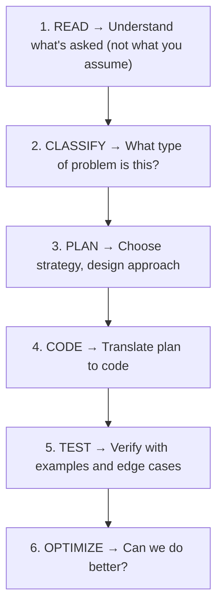

---

## Step 1: READ — Actually Understand the Problem

### The 5 Questions to Ask
```
1. What is the INPUT? (type, size, constraints, range)
2. What is the OUTPUT? (type, format, what exactly to return)
3. What are the CONSTRAINTS? (time limit, space limit, n ≤ ?)
4. What are the EDGE CASES? (empty, single element, all same, negative)
5. Can I REPHRASE this in my own words?
```

### Constraint-to-Complexity Mapping (CRITICAL)
```
n ≤ 10        → O(n!) or O(2ⁿ) — Brute force, backtracking OK
n ≤ 20        → O(2ⁿ) — Bitmask DP, meet-in-the-middle
n ≤ 100       → O(n³) — Floyd-Warshall, 3D DP
n ≤ 1,000     → O(n²) — Simple DP, Nested loops
n ≤ 10,000    → O(n²) — Might barely pass
n ≤ 100,000   → O(n log n) — Sorting, Binary search, Segment tree
n ≤ 1,000,000 → O(n) — Linear scan, HashMap, Two pointers
n ≤ 10⁸       → O(n) — Must be single pass
n > 10⁸       → O(log n) or O(1) — Math, Binary search on answer
```

**Flow:**
- n ≤ 10
- ↓
- O(n!) or O(2ⁿ) — Brute force, backtracking OK
- ↓
- n ≤ 20
- ↓
- O(2ⁿ) — Bitmask DP, meet-in-the-middle
- ↓
- n ≤ 100
- ↓
- O(n³) — Floyd-Warshall, 3D DP
- ↓
- n ≤ 1,000
- ↓
- O(n²) — Simple DP, Nested loops
- ↓
- n ≤ 10,000
- ↓
- O(n²) — Might barely pass
- ↓
- n ≤ 100,000
- ↓
- O(n log n) — Sorting, Binary search, Segment tree

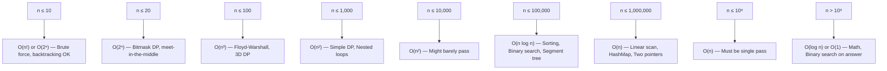

---

## Step 2: CLASSIFY — What Type of Problem Is This?

### The Classification Decision Tree
```
Does the problem ask about...

OPTIMIZATION (min/max/best)?
├── Can previous choices be reused? → Dynamic Programming
├── Does greedy choice lead to global optimum? → Greedy
└── Need to try all combinations? → Backtracking

COUNTING (how many ways/paths/subsets)?
└── → Dynamic Programming (almost always)

SEARCHING/EXISTENCE (is there a...? can we...?)?
├── Sorted data? → Binary Search
├── Graph/tree? → BFS/DFS
└── State space? → BFS (shortest) or DFS (any path)

ORDERING (sequence, schedule, dependency)?
├── Dependencies? → Topological Sort
└── Optimal order? → DP or Greedy

GROUPING (partition, cluster, components)?
├── Graph connected components? → Union-Find or DFS
└── k-groups optimization? → DP or Greedy

DATA RETRIEVAL (query, lookup)?
├── Range queries? → Segment Tree / Prefix Sum
├── Key-value? → HashMap
└── Top-K? → Heap / QuickSelect

STRING MANIPULATION?
├── Pattern matching? → KMP / Rabin-Karp
├── Palindrome? → Two pointers / DP
└── Subsequence comparison? → DP (LCS, Edit Distance)
```

**Flow:**
- Can previous choices be reused?
- ↓
- Dynamic Programming
- ↓
- Does greedy choice lead to global optimum?
- ↓
- Greedy
- ↓
- Sorted data?
- ↓
- Binary Search
- ↓
- Graph/tree?
- ↓
- BFS/DFS
- ↓
- Dependencies?
- ↓
- Topological Sort
- ↓
- Graph connected components?
- ↓
- Union-Find or DFS

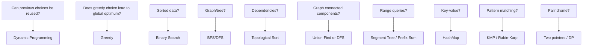

---


> 🔬 **Section Challenge — Step 2: CLASSIFY — What Type of Problem Is This?**
>>

## Step 3: PLAN — Design Your Approach

### Planning Template
```
Write this down (mentally or on paper):

1. Data structure(s) I'll use: _______________
2. Algorithm/pattern: _______________
3. Key variables I need: _______________
4. Walk through Example 1 with my approach:
   Input: ___  → Step 1: ___ → Step 2: ___ → Output: ___
5. Walk through Example 2:
   Input: ___  → Step 1: ___ → Step 2: ___ → Output: ___
6. Does it handle edge cases? ___

If your plan doesn't work on examples → GO BACK to Step 2 and reclassify
```

**Flow:**
- Input: ___
- ↓
- Step 1: ___
- ↓
- Step 2: ___
- ↓
- Output: ___
- ↓
- Input: ___
- ↓
- Step 1: ___
- ↓
- Step 2: ___
- ↓
- Output: ___

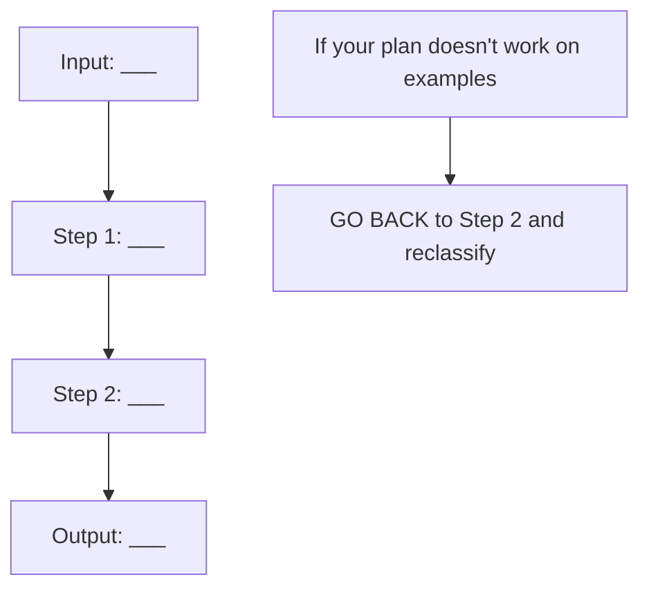

### The "Brute Force First" Principle
```
ALWAYS think of brute force first:
1. What's the simplest way to solve this? (even if O(n³))
2. Where is the repeated work?
3. Can I cache/skip the repeated work? → That's your optimization!

Brute Force → Identify bottleneck → Optimize that specific part

Example: Two Sum
- Brute force: Check all pairs O(n²)
- Bottleneck: "Does complement exist?" is O(n) search each time
- Optimize: HashMap makes search O(1) → Total O(n)
```

**Flow:**
- 3. Can I cache/skip the repeated work?
- ↓
- That's your optimization!
- ↓
- Brute Force
- ↓
- Identify bottleneck
- ↓
- Optimize that specific part
- ↓
- - Optimize: HashMap makes search O(1)
- ↓
- Total O(n)

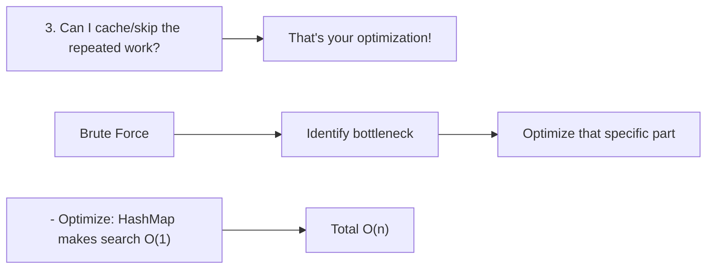

---


## Step 4: CODE — Translation Rules

### Code Structure Template
```java
public ReturnType solve(InputType input) {
    // 1. HANDLE EDGE CASES (empty, null, size 0/1)
    if (input == null || input.length == 0) return defaultValue;

    // 2. INITIALIZE data structures and variables
    // (declare what you planned in Step 3)

    // 3. CORE LOGIC (the algorithm)
    // (the main loop/recursion)

    // 4. RETURN the answer
    return answer;
}
```

### Common Pitfalls While Coding
```
❌ Starting to code before having a plan → Write plan first
❌ Trying to optimize while writing → Get correct solution first
❌ Not handling edge cases → Always check empty/null/single
❌ Copy-pasting without understanding → Build from template
❌ Variables named i,j,k,x,y → Use descriptive names: left, right, count
```

**Flow:**
- ❌ Starting to code before having a plan
- ↓
- Write plan first
- ↓
- ❌ Trying to optimize while writing
- ↓
- Get correct solution first
- ↓
- ❌ Not handling edge cases
- ↓
- Always check empty/null/single
- ↓
- ❌ Copy-pasting without understanding
- ↓
- Build from template
- ↓
- ❌ Variables named i,j,k,x,y
- ↓
- Use descriptive names: left, right, count

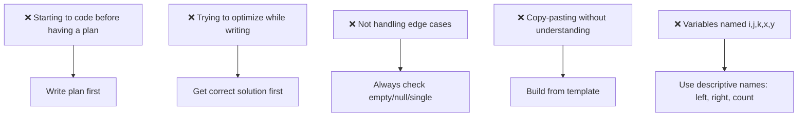

---

## Step 5: TEST — Verify Correctness

### Testing Strategy (in order)
```
1. PROVIDED examples — Must pass these first
2. MINIMAL cases — Empty input, single element
3. BOUNDARY cases — n=0, n=1, n=max_value
4. TRICKY cases — All same elements, sorted/reverse-sorted, negatives
5. LARGE cases — Mental check: will this pass within time limit?
```

### Dry Run Template
```
Input: [2, 7, 11, 15], target = 9

Step | Variable States                | Action
-----|-------------------------------|---------------------------
  0  | map={}, i=0                   | Check: 9-2=7 in map? No
  1  | map={2:0}, i=1                | Check: 9-7=2 in map? Yes!
  →  | Return [0, 1]                 | Found pair

✅ Matches expected output [0, 1]
```

**Flow:**
- Input: [2, 7, 11, 15], target = 9
- ↓
- Step
- ↓
- Variable States
- ↓
- Action
- ↓
- Step
- ↓
- Variable States
- ↓
- Action
- ↓
- Return [0, 1]
- ↓
- Found pair
- ↓
- Return [0, 1]
- ↓
- Found pair
- ↓
- ✅ Matches expected output [0, 1]

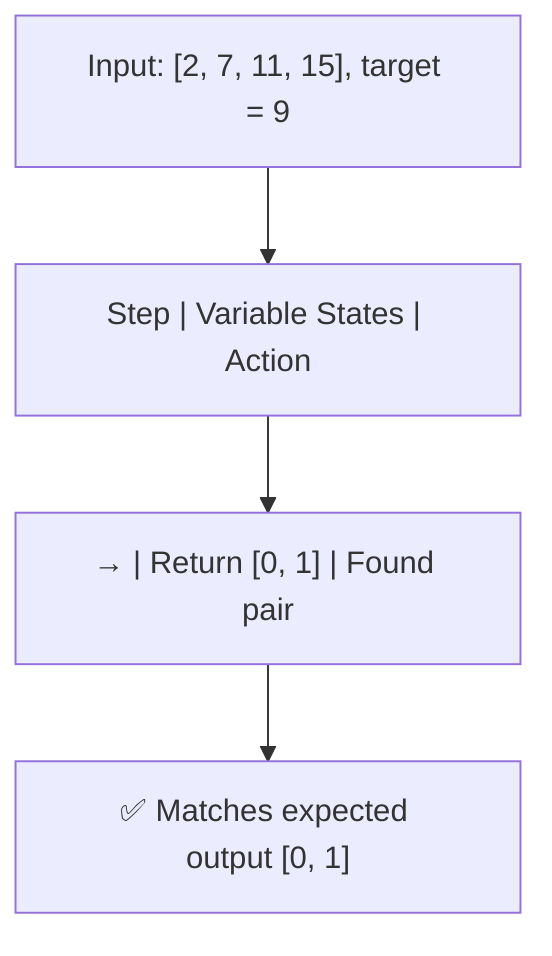

---

## Step 6: OPTIMIZE — Can We Do Better?

### Optimization Strategies
```
Strategy 1: REDUCE time complexity
- O(n²) → O(n log n): Sort + binary search / two pointers
- O(n²) → O(n): HashMap for O(1) lookup
- O(2ⁿ) → O(n·2^(n/2)): Meet in the middle

Strategy 2: REDUCE space complexity
- HashMap → Two pointers (if sorted)
- 2D DP table → Two rows → Two variables
- Recursion → Iteration (eliminate call stack)

Strategy 3: PRECOMPUTE
- Prefix sums for range queries
- Sort for binary search
- Build adjacency list once for multiple graph queries
```

**Flow:**
- - O(n²)
- ↓
- O(n log n): Sort + binary search / two pointers
- ↓
- - O(n²)
- ↓
- O(n): HashMap for O(1) lookup
- ↓
- - O(2ⁿ)
- ↓
- O(n·2^(n/2)): Meet in the middle
- ↓
- - HashMap
- ↓
- Two pointers (if sorted)
- ↓
- - 2D DP table
- ↓
- Two rows
- ↓
- Two variables

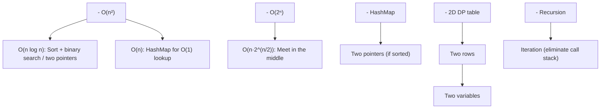

### The "Can We Do Better?" Checklist
```
□ Am I doing any repeated computation? → Cache it (DP, memoization)
□ Am I searching linearly? → Can I sort + binary search?
□ Am I using nested loops? → Can HashMap eliminate inner loop?
□ Am I storing more than needed? → Can I use rolling variables?
□ Am I visiting nodes multiple times? → Track visited
□ Am I sorting when I don't need full sort? → Partial sort (QuickSelect for k-th)
```

**Flow:**
- □ Am I doing any repeated computation?
- ↓
- Cache it (DP, memoization)
- ↓
- □ Am I searching linearly?
- ↓
- Can I sort + binary search?
- ↓
- □ Am I using nested loops?
- ↓
- Can HashMap eliminate inner loop?
- ↓
- □ Am I storing more than needed?
- ↓
- Can I use rolling variables?
- ↓
- □ Am I visiting nodes multiple times?
- ↓
- Track visited
- ↓
- □ Am I sorting when I don't need full sort?
- ↓
- Partial sort (QuickSelect for k-th)

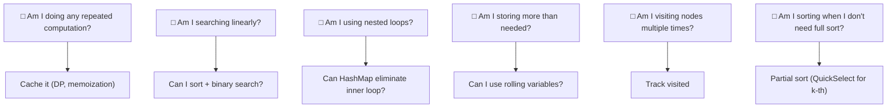

---

## Applying This to SQL Problems

```
Step 1: READ → What tables? What columns? What's the expected output?
Step 2: CLASSIFY → Is this a JOIN/GROUP BY/SUBQUERY/WINDOW problem?
Step 3: PLAN → Build query mentally: FROM → JOIN → WHERE → GROUP → SELECT
Step 4: CODE → Write the SQL
Step 5: TEST → Run against example data mentally
Step 6: OPTIMIZE → Indexes? Avoid subqueries? Use CTEs?
```

**Flow:**
- Step 1: READ
- ↓
- What tables? What columns? What's the expected out
- ↓
- Step 2: CLASSIFY
- ↓
- Is this a JOIN/GROUP BY/SUBQUERY/WINDOW problem?
- ↓
- Step 3: PLAN
- ↓
- Build query mentally: FROM
- ↓
- JOIN
- ↓
- WHERE
- ↓
- GROUP

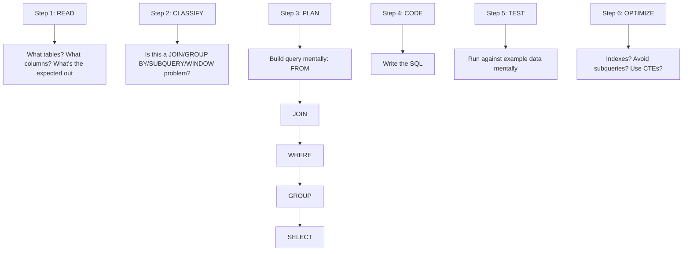


## Applying This to System Design

```
Step 1: READ → What are the requirements? Functional + Non-functional
Step 2: CLASSIFY → Read-heavy? Write-heavy? Real-time? Batch?
Step 3: PLAN → High-level architecture, data model, API design
Step 4: CODE → Draw the architecture diagram
Step 5: TEST → Walk through user scenarios
Step 6: OPTIMIZE → Scaling bottlenecks, caching, CDN, sharding
```

**Flow:**
- Step 1: READ
- ↓
- What are the requirements? Functional + Non-functi
- ↓
- Step 2: CLASSIFY
- ↓
- Read-heavy? Write-heavy? Real-time? Batch?
- ↓
- Step 3: PLAN
- ↓
- High-level architecture, data model, API design
- ↓
- Step 4: CODE
- ↓
- Draw the architecture diagram
- ↓
- Step 5: TEST
- ↓
- Walk through user scenarios
- ↓
- Step 6: OPTIMIZE
- ↓
- Scaling bottlenecks, caching, CDN, sharding

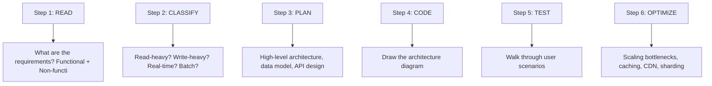

---

📖 **Related Files:**
- [06_Implementation_Checklist.md](06_Implementation_Checklist.md) — Detailed coding checklist
- [08_Debugging_DryRun.md](08_Debugging_DryRun.md) — How to trace and debug
- [10_Interview_Thinking.md](10_Interview_Thinking.md) — Interview-specific framework

---
[← 04 Array & String](04_Array_String_Thinking.md) | [06 Implementation Checklist →](06_Implementation_Checklist.md)


---

> **Navigation**: [< Previous](04_Array_String_Thinking.md) | [Back to Index](../00_MASTER_INDEX.md) | [Next >](06_Implementation_Checklist.md)


