**Navigation**: [< Previous](06_Implementation_Checklist.md) | [Back to Index](../00_MASTER_INDEX.md) | [Next >](08_Debugging_DryRun.md)

# 🗃️ SQL Mental Pipeline — Think in Sets, Build Queries Step-by-Step

**The key insight**: SQL doesn't work like Java. In Java, you think in LOOPS (process one row at a time). In SQL, you think in SETS (operate on entire tables at once). This shift is the #1 barrier for programmers learning SQL.

---

## Part 1: The Mindset Shift — Loops vs Sets

### Java Thinking (WRONG for SQL)
```
"For each employee, check if their salary > 50000, then get their name"
→ Loop through employees, if salary > 50000, add to result list
```

### SQL Thinking (CORRECT)
```
"From the employees TABLE, FILTER rows where salary > 50000, PICK the name column"
→ SELECT name FROM employees WHERE salary > 50000;

You're describing WHAT you want, not HOW to get it.
SQL is declarative — you describe the result, the engine figures out the steps.
```

**Flow:**
1. SELECT name FROM employees WHERE salary > 50000;
2. You're describing WHAT you want, not HOW to get it.

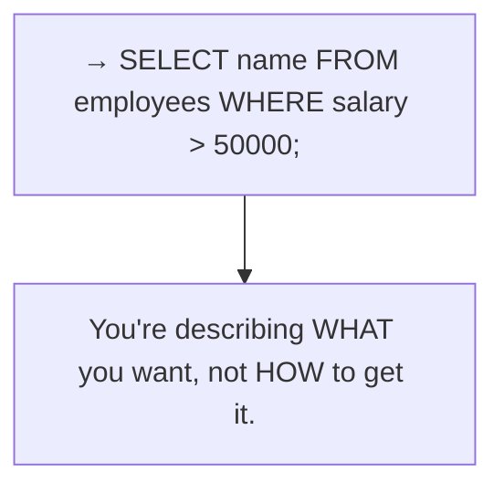

### Mental Model: Think of Tables as Spreadsheets
```
employees table = a spreadsheet
Each row = one employee
Each column = one attribute (name, salary, dept_id)
Your query = a formula that produces a NEW spreadsheet from existing ones
```

---


## Part 2: The SQL Execution Order — MEMORIZE THIS

### What You Write vs What Runs
```
WRITING ORDER:          EXECUTION ORDER (how SQL actually processes):
SELECT    ─── 5th ───→  1. FROM / JOIN    (which tables?)
FROM      ─── 1st ───→  2. WHERE          (filter rows)
JOIN      ─── 1st ───→  3. GROUP BY       (make groups)
WHERE     ─── 2nd ───→  4. HAVING         (filter groups)
GROUP BY  ─── 3rd ───→  5. SELECT         (pick columns)
HAVING    ─── 4th ───→  6. DISTINCT       (remove duplicates)
ORDER BY  ─── 6th ───→  7. ORDER BY       (sort)
LIMIT     ─── 7th ───→  8. LIMIT/OFFSET   (paginate)
```

**Flow:**
1. SELECT --(5th)--> 1. FROM / JOIN (which tables?)
2. FROM --(1st)--> 2. WHERE (filter rows)
3. JOIN --(1st)--> 3. GROUP BY (make groups)
4. WHERE --(2nd)--> 4. HAVING (filter groups)
5. GROUP BY --(3rd)--> 5. SELECT (pick columns)
6. HAVING --(4th)--> 6. DISTINCT (remove duplicates)

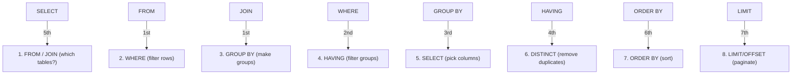

### Why Execution Order Matters
```sql
-- This WORKS:
SELECT dept, COUNT(*) AS cnt
FROM employees
GROUP BY dept
HAVING cnt > 5;     -- "cnt" is available because SELECT runs before HAVING? 
                     -- Actually, HAVING runs before SELECT!
                     -- MySQL allows alias here as exception, but standard SQL doesn't.

-- Standard SQL way:
HAVING COUNT(*) > 5;  -- Use the expression, not the alias
```

### Memory Trick: "**F**rogs **W**ill **G**ladly **H**elp **S**olve **O**ur **L**essons"
```
FROM → WHERE → GROUP BY → HAVING → SELECT → ORDER BY → LIMIT
```

---

## Part 3: The Query Building Pipeline

### Step-by-Step Building Method
For ANY SQL question, build your query in this order:

```
Step 1: FROM — "What tables do I need?"
Step 2: JOIN — "How are the tables connected?"
Step 3: WHERE — "What rows do I want to filter OUT?"
Step 4: GROUP BY — "Do I need to aggregate?"
Step 5: HAVING — "Filter AFTER grouping?"
Step 6: SELECT — "What columns/expressions do I want to see?"
Step 7: ORDER BY — "What order?"
Step 8: LIMIT — "How many rows?"
```

### Worked Example: "Find departments with more than 5 employees earning above 50K"

```sql
-- Step 1: FROM — I need employees table
FROM employees e

-- Step 2: JOIN — I might need departments table for dept name
JOIN departments d ON e.dept_id = d.id

-- Step 3: WHERE — Filter to salaries above 50K
WHERE e.salary > 50000

-- Step 4: GROUP BY — Group by department
GROUP BY d.name

-- Step 5: HAVING — Only departments with count > 5
HAVING COUNT(*) > 5

-- Step 6: SELECT — I want dept name and count
SELECT d.name, COUNT(*) AS employee_count

-- FINAL assembled query:
SELECT d.name, COUNT(*) AS employee_count
FROM employees e
JOIN departments d ON e.dept_id = d.id
WHERE e.salary > 50000
GROUP BY d.name
HAVING COUNT(*) > 5
ORDER BY employee_count DESC;
```

---


## Part 4: JOIN Mental Models

### The Venn Diagram Approach
```
Table A       Table B
┌─────┐      ┌─────┐
│  A  │      │  B  │
│  ┌──┼──────┼──┐  │
│  │ A∩B     │  │  │
│  └──┼──────┼──┘  │
└─────┘      └─────┘

INNER JOIN:      A ∩ B         (only matching rows)
LEFT JOIN:       All A + matching B (null if no match)
RIGHT JOIN:      matching A + All B 
FULL OUTER JOIN: All A + All B (nulls where no match)
CROSS JOIN:      A × B         (every combo — rarely wanted)
```

**Flow:**
1. A / A∩
2. A∩B

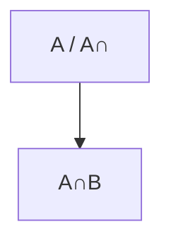

### When to Use Each JOIN
```
"Get employees WITH their department name"    → INNER JOIN (skip employees with no dept)
"Get ALL employees, even without department"  → LEFT JOIN (keep all employees)
"Find employees WITHOUT a department"         → LEFT JOIN + WHERE b.id IS NULL
"Find all possible team pairings"             → CROSS JOIN (or self-join)
"Find matching records in both tables"        → INNER JOIN
```

**Flow:**
1. 'Get employees WITH their department name'
2. INNER JOIN (skip employees with no dept)
3. 'Get ALL employees, even without department'
4. LEFT JOIN (keep all employees)
5. 'Find employees WITHOUT a department'
6. LEFT JOIN + WHERE b.id IS NULL
7. 'Find all possible team pairings'
8. CROSS JOIN (or self-join)
9. 'Find matching records in both tables'
10. INNER JOIN

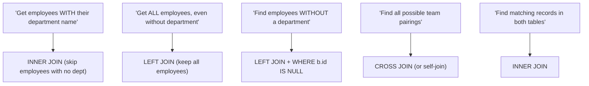

### The Self-Join Pattern
```sql
-- "Find employees who earn more than their manager"
-- Same table, two roles → self-join with aliases

SELECT e.name AS employee, m.name AS manager
FROM employees e
JOIN employees m ON e.manager_id = m.id
WHERE e.salary > m.salary;

-- Mental model: Imagine two COPIES of the same spreadsheet side by side
-- One copy = "as employee", other copy = "as manager"
```

---


🔬 **Section Challenge — Part 4: JOIN Mental Models**

**Challenge 1 (Reasoning):** `LEFT JOIN` returns all rows from the left table. When does it return MORE rows than the left table?
<details><summary>Answer</summary>

When the right table has MULTIPLE matching rows for one left-table row. Example: Orders LEFT JOIN OrderItems — one order with 5 items = 5 result rows for that one order. Analogy: `1 order × 5 items = 5 rows`. Always check your join multiplicity. Use `SELECT COUNT(*) vs COUNT(DISTINCT left.id)` to detect row explosion.
</details>

**Challenge 2 (Bug Hunt):** `SELECT * FROM A, B WHERE A.id = B.a_id` — what join type is this and is it equivalent to `A JOIN B ON A.id = B.a_id`?
<details><summary>Answer</summary>

It's an old-style INNER JOIN. Functionally equivalent to `A INNER JOIN B ON A.id = B.a_id` — only returns rows where both sides match. BUT: the comma syntax is dangerous. Forgetting the WHERE clause on a multi-table comma join → CROSS JOIN (cartesian product). Explicit JOIN syntax with ON makes intent clear and prevents the accidental cross join.
</details>


## Part 5: Subquery vs JOIN — Decision Framework

### When to Use Subquery
```
1. "Find employees whose salary > AVERAGE salary"
   → The inner query computes ONE value
   SELECT * FROM employees WHERE salary > (SELECT AVG(salary) FROM employees);

2. "Find employees in departments located in NYC"
   → The inner query computes a LIST
   SELECT * FROM employees WHERE dept_id IN (SELECT id FROM departments WHERE city = 'NYC');

3. Correlated subquery — when inner query DEPENDS on outer query
   "Find employees who earn max in their department"
   SELECT * FROM employees e
   WHERE salary = (SELECT MAX(salary) FROM employees WHERE dept_id = e.dept_id);
```

**Flow:**
1. 'Find employees whose salary > AVERAGE salary'
2. The inner query computes ONE value
3. 'Find employees in departments located in NYC'
4. The inner query computes a LIST
5. 'Find employees who earn max in their department'
6. SELECT * FROM employees e

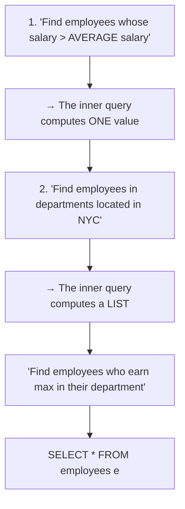

### When to Use JOIN Instead
```
1. When you need columns from BOTH tables → JOIN
2. When subquery would be executed for EACH row (correlated) → Consider JOIN
3. When you need to combine/match data → JOIN

Rule of thumb: If you need columns from multiple tables in SELECT → use JOIN
               If you need a value for filtering (WHERE/HAVING) → subquery is fine
```

**Flow:**
1. When you need columns from BOTH tables
2. JOIN
3. When subquery would be executed for EACH row (c Consider JOIN When you need to combine/match data JOIN Rule of thumb: If you need columns from multiple t use JOIN If you need a value for filtering (WHERE/HAVING) subquery is fine

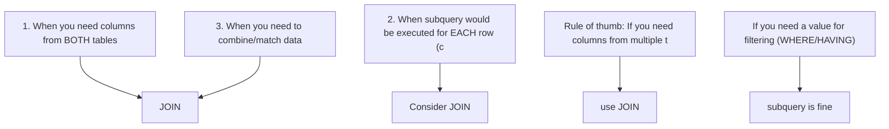

---


🔬 **Section Challenge — Part 5: Subquery vs JOIN — Decision Framework**

**Challenge 1 (Reasoning):** `LEFT JOIN` returns all rows from the left table. When does it return MORE rows than the left table?
<details><summary>Answer</summary>

When the right table has MULTIPLE matching rows for one left-table row. Example: Orders LEFT JOIN OrderItems — one order with 5 items = 5 result rows for that one order. Analogy: `1 order × 5 items = 5 rows`. Always check your join multiplicity. Use `SELECT COUNT(*) vs COUNT(DISTINCT left.id)` to detect row explosion.
</details>

**Challenge 2 (Bug Hunt):** `SELECT * FROM A, B WHERE A.id = B.a_id` — what join type is this and is it equivalent to `A JOIN B ON A.id = B.a_id`?
<details><summary>Answer</summary>

It's an old-style INNER JOIN. Functionally equivalent to `A INNER JOIN B ON A.id = B.a_id` — only returns rows where both sides match. BUT: the comma syntax is dangerous. Forgetting the WHERE clause on a multi-table comma join → CROSS JOIN (cartesian product). Explicit JOIN syntax with ON makes intent clear and prevents the accidental cross join.
</details>


## Part 6: GROUP BY + Aggregation — Mental Model

### Think of GROUP BY as "Making Piles"
```
Before GROUP BY (individual rows):
| name   | dept | salary |
|--------|------|--------|
| Alice  | HR   | 60000  |
| Bob    | IT   | 75000  |
| Carol  | HR   | 55000  |
| Dave   | IT   | 80000  |

After GROUP BY dept (piles):
┌────────────┐  ┌────────────┐
│ HR pile    │  │ IT pile    │
│ Alice 60K  │  │ Bob 75K    │
│ Carol 55K  │  │ Dave 80K   │
└────────────┘  └────────────┘

Now you can only SELECT:
✅ The pile label (dept)          → SELECT dept
✅ Aggregate of pile (COUNT, SUM) → SELECT COUNT(*), AVG(salary)
❌ Individual row values (name)   → ERROR! Which name from the pile?
```

**Flow:**
1. HR pile / Alice 60K / Carol 55K
2. IT pile / Bob 75K / Dave 80K

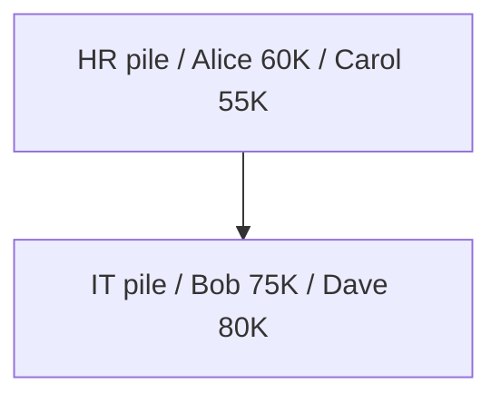

### Common Aggregations
```sql
COUNT(*)         — Number of rows (including NULLs)
COUNT(column)    — Number of NON-NULL values
SUM(column)      — Total
AVG(column)      — Average
MIN(column)      — Smallest
MAX(column)      — Largest
GROUP_CONCAT()   — Combine strings (MySQL)
STRING_AGG()     — Combine strings (PostgreSQL)
```

### WHERE vs HAVING
```
WHERE:  Filters ROWS before grouping    → Cannot use aggregates
HAVING: Filters GROUPS after grouping   → CAN use aggregates

-- "Departments with average salary > 60K (exclude interns first)"
SELECT dept, AVG(salary)
FROM employees
WHERE role != 'Intern'      -- Filter ROWS first (before grouping)
GROUP BY dept
HAVING AVG(salary) > 60000  -- Filter GROUPS (after grouping)
```

**Flow:**
1. WHERE: Filters ROWS before grouping
2. Cannot use aggregates
3. HAVING: Filters GROUPS after grouping
4. CAN use aggregates

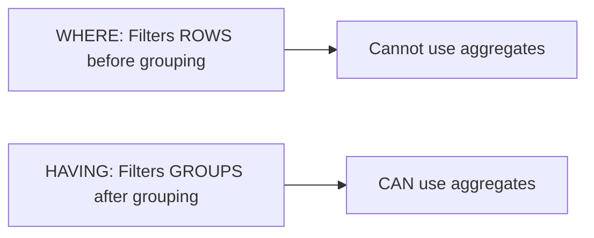

---

## Part 7: Window Functions — "Aggregation Without Losing Rows"

### The Problem Window Functions Solve
```
GROUP BY collapses rows → you lose individual row data
Window functions compute aggregates BUT keep every row!

| name  | dept | salary | dept_avg | dept_rank |
|-------|------|--------|----------|-----------|
| Alice | HR   | 60000  | 57500    | 1         |  ← Each row kept!
| Carol | HR   | 55000  | 57500    | 2         |
| Dave  | IT   | 80000  | 77500    | 1         |
| Bob   | IT   | 75000  | 77500    | 2         |
```

**Flow:**
1. GROUP BY collapses rows you lose individual row data

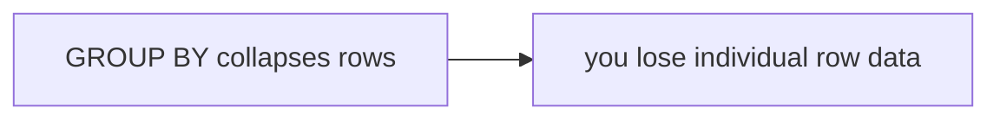

### Window Function Template
```sql
function_name() OVER (
    PARTITION BY column    -- Like GROUP BY, but keeps rows
    ORDER BY column        -- Ordering within each partition
    ROWS BETWEEN ...       -- Optional: frame specification
)
```

### The 3 Most Important Window Functions
```sql
-- 1. ROW_NUMBER(): Unique rank (1, 2, 3, 4)
ROW_NUMBER() OVER (PARTITION BY dept ORDER BY salary DESC)

-- 2. RANK(): Same rank for ties, skip next (1, 1, 3, 4)
RANK() OVER (PARTITION BY dept ORDER BY salary DESC)

-- 3. DENSE_RANK(): Same rank for ties, no skip (1, 1, 2, 3)
DENSE_RANK() OVER (PARTITION BY dept ORDER BY salary DESC)

-- Common use: "Top N per group"
SELECT * FROM (
    SELECT *, ROW_NUMBER() OVER (PARTITION BY dept ORDER BY salary DESC) AS rn
    FROM employees
) ranked
WHERE rn <= 3;  -- Top 3 earners per department
```

---


🔬 **Section Challenge — Part 7: Window Functions — "Aggregation Without Losing Rows"**

**Challenge 1 (Reasoning):** Why can't you use a window function in a WHERE clause? How do you filter on window function results?
<details><summary>Answer</summary>

Window functions run in a logical step AFTER WHERE filtering. The WHERE clause operates on base rows; window functions are computed on the result set. Solution: wrap in a subquery/CTE. `WITH ranked AS (SELECT *, ROW_NUMBER() OVER(...) rn FROM t) SELECT * FROM ranked WHERE rn = 1`. This is 'standard' pattern for top-N-per-group.
</details>

**Challenge 2 (Design):** `ROW_NUMBER()` vs `RANK()` vs `DENSE_RANK()` — show with an example where they produce different results.
<details><summary>Answer</summary>

Scores: [100, 90, 90, 80]. ROW_NUMBER: 1,2,3,4 (always unique, arbitrary for ties). RANK: 1,2,2,4 (gives same rank to ties, SKIPS the next rank). DENSE_RANK: 1,2,2,3 (same rank to ties, NO skipping). Use: ROW_NUMBER for pagination (must be unique). RANK when you want 'no 3rd place if two tied for 2nd'. DENSE_RANK when you want consecutive ranks despite ties.
</details>


## Part 8: SQL Problem Classification

```
See these keywords in the problem? → Use this approach:

"For each department/category..."    → GROUP BY
"Top N per group"                    → Window function + ROW_NUMBER()
"Running total / cumulative sum"     → Window function + SUM() OVER
"Compare with previous row"          → LAG() / LEAD() window functions
"Employees not in any project"       → LEFT JOIN + IS NULL (or NOT IN)
"Second highest salary"              → DENSE_RANK() or LIMIT/OFFSET or subquery
"Find duplicates"                    → GROUP BY + HAVING COUNT(*) > 1
"Consecutive dates/numbers"          → ROW_NUMBER trick (value - row_num = constant for consecutive)
"Pivot/Unpivot data"                 → CASE WHEN + GROUP BY (or PIVOT keyword)
"Hierarchical data (manager chain)"  → Self-join or recursive CTE
```

**Flow:**
1. See these keywords in the problem?
2. Use this approach:
3. 'For each department/category...'
4. GROUP BY
5. 'Top N per group'
6. Window function + ROW_NUMBER()
7. 'Running total / cumulative sum'
8. Window function + SUM() OVER
9. 'Compare with previous row'
10. LAG() / LEAD() window functions
11. 'Employees not in any project'
12. LEFT JOIN + IS NULL (or NOT IN)

```mermaid
flowchart TD
    N1["See these keywords in the problem?"]
    N2["Use this approach:"]
    N3["'For each department/category...'"]
    N4["GROUP BY"]
    N5["'Top N per group'"]
    N6["Window function + ROW_NUMBER()"]
    N7["'Running total / cumulative sum'"]
    N8["Window function + SUM() OVER"]
    N9["'Compare with previous row'"]
    N10["LAG() / LEAD() window functions"]
    N11["'Employees not in any project'"]
    N12["LEFT JOIN + IS NULL (or NOT IN)"]
    N13["'Second highest salary'"]
    N14["DENSE_RANK() or LIMIT/OFFSET or subquery"]
    N15["'Find duplicates'"]
    N16["GROUP BY + HAVING COUNT(*) &gt; 1"]
    N17["'Consecutive dates/numbers'"]
    N18["ROW_NUMBER trick (value - row_num = constant for c"]
    N19["'Pivot/Unpivot data'"]
    N20["CASE WHEN + GROUP BY (or PIVOT keyword)"]
    N21["'Hierarchical data (manager chain)'"]
    N22["Self-join or recursive CTE"]
    N1 --> N2
    N3 --> N4
    N5 --> N6
    N7 --> N8
    N9 --> N10
    N11 --> N12
    N13 --> N14
    N15 --> N16
    N17 --> N18
    N19 --> N20
    N21 --> N22
```

---

## Part 9: SQL Debugging Checklist

```
□ Does my JOIN produce duplicates? (Check if join keys are unique)
□ NULL handling: IS NULL not = NULL (NULL = NULL is false!)
□ Am I selecting non-grouped columns without aggregate? → SQL error
□ HAVING vs WHERE: aggregate functions only in HAVING
□ String comparison: 'abc' (single quotes), not "abc" in standard SQL
□ Date comparison: Use proper date functions, don't compare strings
□ ORDER BY: Is my sort correct? ASC (default) vs DESC
□ LIMIT without ORDER BY: Results are non-deterministic
□ COUNT(*) vs COUNT(column): * counts NULLs, column doesn't
□ Subquery returns multiple rows but used with = instead of IN?
```

**Flow:**
1. □ Am I selecting non-grouped columns without aggre SQL error

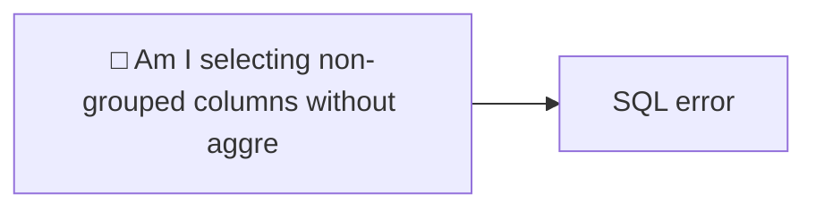

---

📖 **Related Files:**
- [08_SQL/01_Foundations_Database_Basics.md](../08_SQL/01_Foundations_Database_Basics.md) — SQL foundations
- [08_SQL/](../08_SQL/) — Full SQL topic files
- [05_Universal_Problem_Framework.md](05_Universal_Problem_Framework.md) — General problem-solving

---
[← 06 Implementation Checklist](06_Implementation_Checklist.md) | [08 Debugging & Dry Run →](08_Debugging_DryRun.md)


---


---


## 🏋️ Practice & Interview Questions — SQL

### Predict / Trace
**Q1.** What's the difference between WHERE and HAVING?
<details><summary>Answer</summary>

`WHERE` filters rows **before** grouping. `HAVING` filters groups **after** `GROUP BY`. You can't use aggregate functions in WHERE. `HAVING COUNT(*) > 5` works, `WHERE COUNT(*) > 5` does not.
</details>

**Q2.** What does this return? `SELECT 1 FROM dual WHERE NULL = NULL`
<details><summary>Answer</summary>

**No rows returned.** NULL is not equal to NULL — use `IS NULL` or `IS NOT NULL`. `NULL = NULL` evaluates to UNKNOWN, not TRUE.
</details>

### Coding Problems
**Q3.** ⭐ Second highest salary — handle the case where it doesn't exist (return NULL).
<details><summary>Solution</summary>

```sql
SELECT MAX(salary) AS SecondHighestSalary
FROM Employee
WHERE salary < (SELECT MAX(salary) FROM Employee);
-- or
SELECT IFNULL((SELECT DISTINCT salary FROM Employee ORDER BY salary DESC LIMIT 1 OFFSET 1), NULL)
```
</details>

**Q4.** ⭐ Find employees earning more than their manager.
<details><summary>Solution</summary>

```sql
SELECT e.name FROM Employee e
JOIN Employee m ON e.managerId = m.id
WHERE e.salary > m.salary;
```
</details>

**Q5.** ⭐ Find duplicate emails.
<details><summary>Solution</summary>

```sql
SELECT email FROM Person GROUP BY email HAVING COUNT(*) > 1;
```
</details>

**Q6.** ⭐⭐ Rank scores without RANK() function.
<details><summary>Solution</summary>

```sql
SELECT s.score,
  (SELECT COUNT(DISTINCT s2.score) FROM Scores s2 WHERE s2.score >= s.score) AS rank
FROM Scores s ORDER BY score DESC;
```
</details>

**Q7.** ⭐⭐ Consecutive numbers — find numbers that appear 3+ times consecutively.
<details><summary>Solution</summary>

```sql
SELECT DISTINCT l1.Num AS ConsecutiveNums
FROM Logs l1, Logs l2, Logs l3
WHERE l1.Id=l2.Id-1 AND l2.Id=l3.Id-1
AND l1.Num=l2.Num AND l2.Num=l3.Num;
-- or use LAG/LEAD window functions
```
</details>

**Q8.** ⭐⭐ Department top 3 salaries (dense rank).
<details><summary>Solution</summary>

```sql
SELECT d.name AS Department, e.name AS Employee, e.salary AS Salary
FROM Employee e JOIN Department d ON e.departmentId = d.id
WHERE (SELECT COUNT(DISTINCT e2.salary) FROM Employee e2
       WHERE e2.departmentId=e.departmentId AND e2.salary>e.salary) < 3;
```
</details>

**Q9.** ⭐⭐ Running total with window function.
<details><summary>Solution</summary>

```sql
SELECT date, amount,
  SUM(amount) OVER (ORDER BY date ROWS BETWEEN UNBOUNDED PRECEDING AND CURRENT ROW) AS running_total
FROM transactions;
```
</details>

**Q10.** ⭐⭐ Pivot rows to columns (conditional aggregation).
<details><summary>Solution</summary>

```sql
SELECT year,
  SUM(CASE WHEN quarter=1 THEN revenue END) AS Q1,
  SUM(CASE WHEN quarter=2 THEN revenue END) AS Q2,
  SUM(CASE WHEN quarter=3 THEN revenue END) AS Q3,
  SUM(CASE WHEN quarter=4 THEN revenue END) AS Q4
FROM sales GROUP BY year;
```
</details>

**Q11.** ⭐⭐⭐ Find the median salary — without MEDIAN() function.
<details><summary>Solution</summary>

```sql
SELECT AVG(salary) AS median
FROM (SELECT salary, ROW_NUMBER() OVER(ORDER BY salary) AS rn, COUNT(*) OVER() AS cnt FROM Employee) t
WHERE rn IN (FLOOR((cnt+1)/2), CEIL((cnt+1)/2));
```
</details>

### Interview Questions
**Q12.** INNER JOIN vs LEFT JOIN — when does LEFT produce more rows?
<details><summary>Answer</summary>

LEFT JOIN includes ALL rows from the left table even if no match in right table (fills NULLs). INNER JOIN only includes rows where both sides have a match. If left table has rows with no match in right: LEFT produces more rows.
</details>

**Q13.** What is a covering index?
<details><summary>Answer</summary>

An index that contains ALL columns needed by a query — the DB can answer from the index alone without touching the table ("index-only scan"). Faster because it avoids the extra heap fetch.
</details>

**Q14.** EXPLAIN shows "Full Table Scan" — how do you fix it?
<details><summary>Answer</summary>

Add an index on the WHERE/JOIN/ORDER BY column. Check if the column has low cardinality (boolean — index may not help). Ensure the query isn't wrapping the column in a function (`WHERE YEAR(date) = 2024` prevents index use — rewrite as `WHERE date BETWEEN '2024-01-01' AND '2024-12-31'`).
</details>

### MCQ Rapid Fire
| # | Question | Answer |
|---|---|---|
| 1 | NULL = NULL evaluates to? | UNKNOWN (use IS NULL) |
| 2 | COUNT(*) vs COUNT(col) | COUNT(*) counts all rows, COUNT(col) skips NULLs |
| 3 | RANK() vs DENSE_RANK() | RANK() skips numbers after ties, DENSE_RANK() doesn't |
| 4 | CROSS JOIN produces | Cartesian product (m × n rows) |
| 5 | Can you ORDER BY in a subquery? | Only when using TOP/LIMIT |
| 6 | TRUNCATE vs DELETE | TRUNCATE: no WHERE, no undo, faster. DELETE: filterable, transactional |
| 7 | What does COALESCE do? | Returns first non-NULL value from its arguments |
| 8 | Index on VARCHAR — what to watch out for? | Case sensitivity, collation, function-based searches bypass index |


---

## 🧠 Deep Conceptual Questions — SQL Internals & Reasoning

**C1. How does a SQL database execute a SELECT query internally?**
<details><summary>Deep Answer</summary>

1. **Parse**: SQL text → AST (syntax tree)
2. **Bind**: resolve table names, column names, types
3. **Optimize**: query planner generates candidate execution plans, estimates costs (based on statistics: row counts, column cardinality, index existence), picks cheapest
4. **Execute**: follow the plan — scan tables, apply filters, join, sort, project

The optimizer transforms: `SELECT ... WHERE ... JOIN ... ORDER BY` into an operator tree (Volcano model): TableScan → Filter → HashJoin → Sort → Project. Each operator is an iterator: `next()` pulls one row from its child. This pull-based model (lazy evaluation) avoids materializing intermediate results.
</details>

**C2. B-Tree index: why is it the default index structure in databases?**
<details><summary>Deep Answer</summary>

B-Tree (not binary tree — B stands for Balanced, not Binary): a self-balancing tree where each node can hold many keys. Properties: (1) height O(log_m N) where m=fan-out (typically 100-1000) → very short tree for millions of rows, (2) all leaf nodes at same depth → guaranteed O(log N) worst case, (3) range scans efficient — leaves linked in sequence, (4) supports equality AND range queries. Hash index: only equality (no range). Sequential scan: no index at all. B+Tree (variant): internal nodes only store keys (no values), leaves store data. All row pointers in leaves → better range scan (follow linked list of leaves).
</details>

**C3. Why does adding an index sometimes SLOW DOWN a query?**
<details><summary>Deep Answer</summary>

1. **Low cardinality**: index on a boolean column — if 50% rows have `active=true`, index gives you 50% of rows. Database may choose full table scan (cheaper: sequential I/O) over index (random I/O for 50% of rows). 
2. **Function on column**: `WHERE YEAR(created_at) = 2024` — index on `created_at` unused. Rewrite: `WHERE created_at >= '2024-01-01' AND created_at < '2025-01-01'`.
3. **Write overhead**: every INSERT/UPDATE/DELETE must update ALL indexes. 5 indexes × N rows = 5× write amplification.
4. **Index not covering**: index exists but the SELECT columns aren't in the index → each index match → separate heap fetch → many random I/O. Solution: covering index (include all needed columns in index).
</details>

**C4. EXPLAIN / query execution plan: what are the key things to look for?**
<details><summary>Deep Answer</summary>

Red flags: (1) **"Full Table Scan" / "Seq Scan"** on a large table → missing index, (2) **high "rows" estimate** in join conditions → cartesian product risk, (3) **"Using filesort"** → ORDER BY can't use index, (4) **"Using temporary"** → intermediate table materialization, (5) **nested loops on large tables** → should be hash join or merge join. Green flags: "Using index" (covering index), "ref" or "eq_ref" access type (index used). Start fixing: add or fix index on WHERE/JOIN/ORDER BY columns, rewrite function-wrapped columns.
</details>

**C5. Window functions vs GROUP BY — when must you use window functions?**
<details><summary>Deep Answer</summary>

`GROUP BY` collapses rows to one per group — individual row data is lost. Window functions compute aggregates but **keep all rows**. Use window when: (1) you need both the aggregate AND the individual row (rank each employee and show their salary), (2) running totals (each row needs sum of all prior rows — GROUP BY can't do this), (3) lag/lead access (compare each row to previous/next — GROUP BY has no row ordering concept), (4) top-N per group (ROW_NUMBER partition — classic GROUP BY can't do this cleanly). Window functions = aggregation without collapsing.
</details>

**C6. Transaction isolation levels — what anomaly does each prevent?**
<details><summary>Deep Answer</summary>

| Level | Dirty Read | Non-repeatable Read | Phantom Read |
|---|---|---|---|
| READ UNCOMMITTED | Possible | Possible | Possible |
| READ COMMITTED | ✅ Prevented | Possible | Possible |
| REPEATABLE READ | ✅ | ✅ | Possible (MySQL InnoDB: prevented!) |
| SERIALIZABLE | ✅ | ✅ | ✅ |

**Dirty read**: read uncommitted data from another transaction (which may rollback). **Non-repeatable**: same query in same transaction returns different row values (another transaction committed update). **Phantom**: same query returns different row COUNT (another transaction inserted/deleted rows). Higher isolation = fewer anomalies but more lock contention. Most production databases use READ COMMITTED or REPEATABLE READ.
</details>

**C7. N+1 query problem: what is it, why does it happen, and how to fix?**
<details><summary>Deep Answer</summary>

**What**: fetching N orders, then for each order making a separate query for the customer = 1 + N queries total. Scales terribly: 1000 orders = 1001 queries. **Why**: ORMs (Hibernate, JPA) with lazy loading — accessing a relationship triggers a new query. **Fix 1**: Eager loading — `JOIN FETCH` or `.fetch()` — load everything in one query. **Fix 2**: Batch loading — fetch all order IDs, then `WHERE customer_id IN (id1, id2, ...)` — 2 queries. **Fix 3**: Projection/DTO query — `SELECT o.id, c.name FROM orders o JOIN customers c` — 1 query. **Detection**: count DB queries in tests (Spring: `@QueryCount`), log slow query warnings.
</details>


> **Navigation**: [< Previous](06_Implementation_Checklist.md) | [Back to Index](../00_MASTER_INDEX.md) | [Next >](08_Debugging_DryRun.md)