> **Navigation**: [< Previous](06_Implementation_Checklist.md) | [Back to Index](../00_MASTER_INDEX.md) | [Next >](08_Debugging_DryRun.md)

# 🗃️ SQL Mental Pipeline — Think in Sets, Build Queries Step-by-Step

> **The key insight**: SQL doesn't work like Java. In Java, you think in LOOPS (process one row at a time). In SQL, you think in SETS (operate on entire tables at once). This shift is the #1 barrier for programmers learning SQL.

---

## Part 1: The Mindset Shift — Loops vs Sets

### Java Thinking (WRONG for SQL)
```
"For each employee, check if their salary > 50000, then get their name"
→ Loop through employees, if salary > 50000, add to result list
```

### SQL Thinking (CORRECT)
```
"From the employees TABLE, FILTER rows where salary > 50000, PICK the name column"
→ SELECT name FROM employees WHERE salary > 50000;

You're describing WHAT you want, not HOW to get it.
SQL is declarative — you describe the result, the engine figures out the steps.
```

> **Flow**: → SELECT name FROM employees WHERE salary &gt; 50000; → You're describing WHAT you want, not HOW to get it.

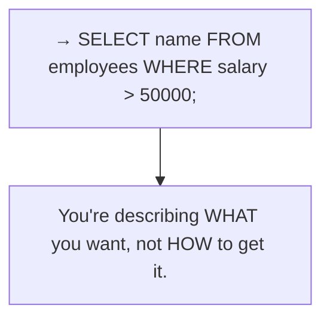

### Mental Model: Think of Tables as Spreadsheets
```
employees table = a spreadsheet
Each row = one employee
Each column = one attribute (name, salary, dept_id)
Your query = a formula that produces a NEW spreadsheet from existing ones
```

---

## Part 2: The SQL Execution Order — MEMORIZE THIS

### What You Write vs What Runs
```
WRITING ORDER:          EXECUTION ORDER (how SQL actually processes):
SELECT    ─── 5th ───→  1. FROM / JOIN    (which tables?)
FROM      ─── 1st ───→  2. WHERE          (filter rows)
JOIN      ─── 1st ───→  3. GROUP BY       (make groups)
WHERE     ─── 2nd ───→  4. HAVING         (filter groups)
GROUP BY  ─── 3rd ───→  5. SELECT         (pick columns)
HAVING    ─── 4th ───→  6. DISTINCT       (remove duplicates)
ORDER BY  ─── 6th ───→  7. ORDER BY       (sort)
LIMIT     ─── 7th ───→  8. LIMIT/OFFSET   (paginate)
```

> **Flow**: SELECT --(5th)--> 1. FROM / JOIN (which tables?) | FROM --(1st)--> 2. WHERE (filter rows) | JOIN --(1st)--> 3. GROUP BY (make groups) | WHERE --(2nd)--> 4. HAVING (filter groups) | GROUP BY --(3rd)--> 5. SELECT (pick columns) | HAVING --(4th)--> 6. DISTINCT (remove duplicates) | ...+2 more

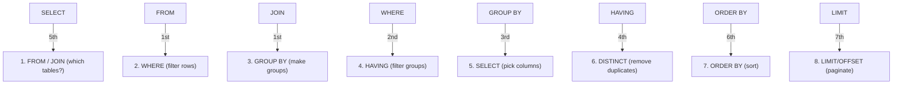

### Why Execution Order Matters
```sql
-- This WORKS:
SELECT dept, COUNT(*) AS cnt
FROM employees
GROUP BY dept
HAVING cnt > 5;     -- "cnt" is available because SELECT runs before HAVING? 
                     -- Actually, HAVING runs before SELECT!
                     -- MySQL allows alias here as exception, but standard SQL doesn't.

-- Standard SQL way:
HAVING COUNT(*) > 5;  -- Use the expression, not the alias
```

### Memory Trick: "**F**rogs **W**ill **G**ladly **H**elp **S**olve **O**ur **L**essons"
```
FROM → WHERE → GROUP BY → HAVING → SELECT → ORDER BY → LIMIT
```

---

## Part 3: The Query Building Pipeline

### Step-by-Step Building Method
For ANY SQL question, build your query in this order:

```
Step 1: FROM — "What tables do I need?"
Step 2: JOIN — "How are the tables connected?"
Step 3: WHERE — "What rows do I want to filter OUT?"
Step 4: GROUP BY — "Do I need to aggregate?"
Step 5: HAVING — "Filter AFTER grouping?"
Step 6: SELECT — "What columns/expressions do I want to see?"
Step 7: ORDER BY — "What order?"
Step 8: LIMIT — "How many rows?"
```

### Worked Example: "Find departments with more than 5 employees earning above 50K"

```sql
-- Step 1: FROM — I need employees table
FROM employees e

-- Step 2: JOIN — I might need departments table for dept name
JOIN departments d ON e.dept_id = d.id

-- Step 3: WHERE — Filter to salaries above 50K
WHERE e.salary > 50000

-- Step 4: GROUP BY — Group by department
GROUP BY d.name

-- Step 5: HAVING — Only departments with count > 5
HAVING COUNT(*) > 5

-- Step 6: SELECT — I want dept name and count
SELECT d.name, COUNT(*) AS employee_count

-- FINAL assembled query:
SELECT d.name, COUNT(*) AS employee_count
FROM employees e
JOIN departments d ON e.dept_id = d.id
WHERE e.salary > 50000
GROUP BY d.name
HAVING COUNT(*) > 5
ORDER BY employee_count DESC;
```

---

## Part 4: JOIN Mental Models

### The Venn Diagram Approach
```
Table A       Table B
┌─────┐      ┌─────┐
│  A  │      │  B  │
│  ┌──┼──────┼──┐  │
│  │ A∩B     │  │  │
│  └──┼──────┼──┘  │
└─────┘      └─────┘

INNER JOIN:      A ∩ B         (only matching rows)
LEFT JOIN:       All A + matching B (null if no match)
RIGHT JOIN:      matching A + All B 
FULL OUTER JOIN: All A + All B (nulls where no match)
CROSS JOIN:      A × B         (every combo — rarely wanted)
```

> **Flow**: A / A∩ → A∩B

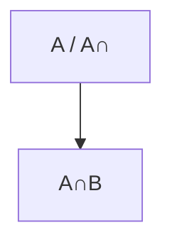

### When to Use Each JOIN
```
"Get employees WITH their department name"    → INNER JOIN (skip employees with no dept)
"Get ALL employees, even without department"  → LEFT JOIN (keep all employees)
"Find employees WITHOUT a department"         → LEFT JOIN + WHERE b.id IS NULL
"Find all possible team pairings"             → CROSS JOIN (or self-join)
"Find matching records in both tables"        → INNER JOIN
```

> **Flow**: 'Get employees WITH their department name' → INNER JOIN (skip employees with no dept) | 'Get ALL employees, even without department' → LEFT JOIN (keep all employees) | 'Find employees WITHOUT a department' → LEFT JOIN + WHERE b.id IS NULL | 'Find all possible team pairings' → CROSS JOIN (or self-join) | 'Find matching records in both tables' → INNER JOIN

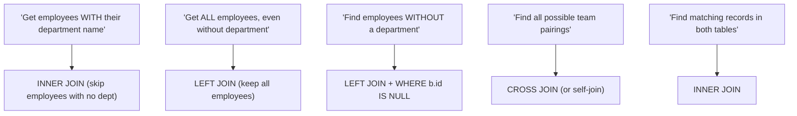

### The Self-Join Pattern
```sql
-- "Find employees who earn more than their manager"
-- Same table, two roles → self-join with aliases

SELECT e.name AS employee, m.name AS manager
FROM employees e
JOIN employees m ON e.manager_id = m.id
WHERE e.salary > m.salary;

-- Mental model: Imagine two COPIES of the same spreadsheet side by side
-- One copy = "as employee", other copy = "as manager"
```

---

## Part 5: Subquery vs JOIN — Decision Framework

### When to Use Subquery
```
1. "Find employees whose salary > AVERAGE salary"
   → The inner query computes ONE value
   SELECT * FROM employees WHERE salary > (SELECT AVG(salary) FROM employees);

2. "Find employees in departments located in NYC"
   → The inner query computes a LIST
   SELECT * FROM employees WHERE dept_id IN (SELECT id FROM departments WHERE city = 'NYC');

3. Correlated subquery — when inner query DEPENDS on outer query
   "Find employees who earn max in their department"
   SELECT * FROM employees e
   WHERE salary = (SELECT MAX(salary) FROM employees WHERE dept_id = e.dept_id);
```

> **Flow**: 1. 'Find employees whose salary &gt; AVERAGE salary' → → The inner query computes ONE value | → The inner query computes ONE value → 2. 'Find employees in departments located in NYC' | 2. 'Find employees in departments located in NYC' → → The inner query computes a LIST | → The inner query computes a LIST → 'Find employees who earn max in their department' | 'Find employees who earn max in their department' → SELECT * FROM employees e

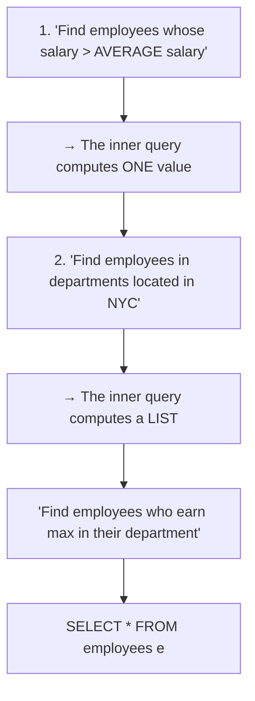

### When to Use JOIN Instead
```
1. When you need columns from BOTH tables → JOIN
2. When subquery would be executed for EACH row (correlated) → Consider JOIN
3. When you need to combine/match data → JOIN

Rule of thumb: If you need columns from multiple tables in SELECT → use JOIN
               If you need a value for filtering (WHERE/HAVING) → subquery is fine
```

> **Flow**: 1. When you need columns from BOTH tables → JOIN | 2. When subquery would be executed for EACH row (c → Consider JOIN | 3. When you need to combine/match data → JOIN | Rule of thumb: If you need columns from multiple t → use JOIN | If you need a value for filtering (WHERE/HAVING) → subquery is fine

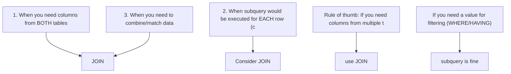

---

## Part 6: GROUP BY + Aggregation — Mental Model

### Think of GROUP BY as "Making Piles"
```
Before GROUP BY (individual rows):
| name   | dept | salary |
|--------|------|--------|
| Alice  | HR   | 60000  |
| Bob    | IT   | 75000  |
| Carol  | HR   | 55000  |
| Dave   | IT   | 80000  |

After GROUP BY dept (piles):
┌────────────┐  ┌────────────┐
│ HR pile    │  │ IT pile    │
│ Alice 60K  │  │ Bob 75K    │
│ Carol 55K  │  │ Dave 80K   │
└────────────┘  └────────────┘

Now you can only SELECT:
✅ The pile label (dept)          → SELECT dept
✅ Aggregate of pile (COUNT, SUM) → SELECT COUNT(*), AVG(salary)
❌ Individual row values (name)   → ERROR! Which name from the pile?
```

> **Flow**: HR pile / Alice 60K / Carol 55K → IT pile / Bob 75K / Dave 80K

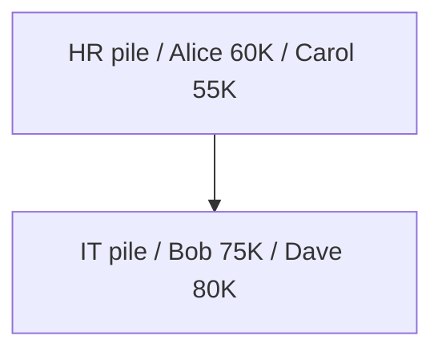

### Common Aggregations
```sql
COUNT(*)         — Number of rows (including NULLs)
COUNT(column)    — Number of NON-NULL values
SUM(column)      — Total
AVG(column)      — Average
MIN(column)      — Smallest
MAX(column)      — Largest
GROUP_CONCAT()   — Combine strings (MySQL)
STRING_AGG()     — Combine strings (PostgreSQL)
```

### WHERE vs HAVING
```
WHERE:  Filters ROWS before grouping    → Cannot use aggregates
HAVING: Filters GROUPS after grouping   → CAN use aggregates

-- "Departments with average salary > 60K (exclude interns first)"
SELECT dept, AVG(salary)
FROM employees
WHERE role != 'Intern'      -- Filter ROWS first (before grouping)
GROUP BY dept
HAVING AVG(salary) > 60000  -- Filter GROUPS (after grouping)
```

> **Flow**: WHERE: Filters ROWS before grouping → Cannot use aggregates | HAVING: Filters GROUPS after grouping → CAN use aggregates

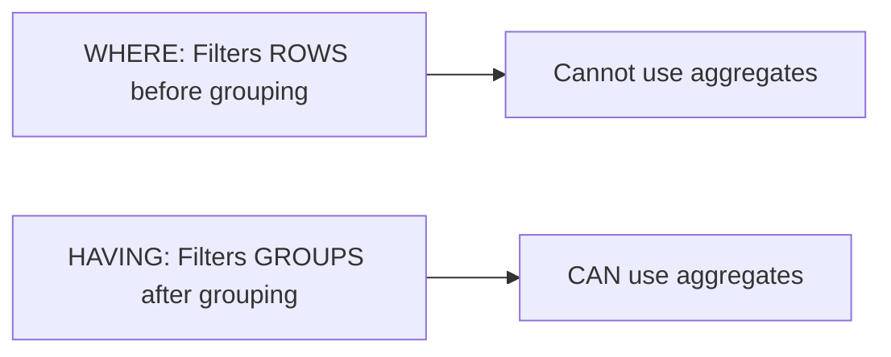

---

## Part 7: Window Functions — "Aggregation Without Losing Rows"

### The Problem Window Functions Solve
```
GROUP BY collapses rows → you lose individual row data
Window functions compute aggregates BUT keep every row!

| name  | dept | salary | dept_avg | dept_rank |
|-------|------|--------|----------|-----------|
| Alice | HR   | 60000  | 57500    | 1         |  ← Each row kept!
| Carol | HR   | 55000  | 57500    | 2         |
| Dave  | IT   | 80000  | 77500    | 1         |
| Bob   | IT   | 75000  | 77500    | 2         |
```

> **Flow**: GROUP BY collapses rows → you lose individual row data

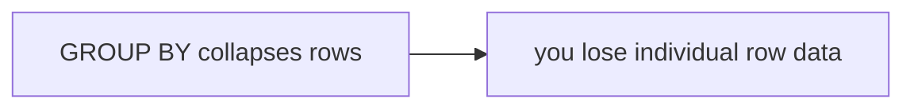

### Window Function Template
```sql
function_name() OVER (
    PARTITION BY column    -- Like GROUP BY, but keeps rows
    ORDER BY column        -- Ordering within each partition
    ROWS BETWEEN ...       -- Optional: frame specification
)
```

### The 3 Most Important Window Functions
```sql
-- 1. ROW_NUMBER(): Unique rank (1, 2, 3, 4)
ROW_NUMBER() OVER (PARTITION BY dept ORDER BY salary DESC)

-- 2. RANK(): Same rank for ties, skip next (1, 1, 3, 4)
RANK() OVER (PARTITION BY dept ORDER BY salary DESC)

-- 3. DENSE_RANK(): Same rank for ties, no skip (1, 1, 2, 3)
DENSE_RANK() OVER (PARTITION BY dept ORDER BY salary DESC)

-- Common use: "Top N per group"
SELECT * FROM (
    SELECT *, ROW_NUMBER() OVER (PARTITION BY dept ORDER BY salary DESC) AS rn
    FROM employees
) ranked
WHERE rn <= 3;  -- Top 3 earners per department
```

---

## Part 8: SQL Problem Classification

```
See these keywords in the problem? → Use this approach:

"For each department/category..."    → GROUP BY
"Top N per group"                    → Window function + ROW_NUMBER()
"Running total / cumulative sum"     → Window function + SUM() OVER
"Compare with previous row"          → LAG() / LEAD() window functions
"Employees not in any project"       → LEFT JOIN + IS NULL (or NOT IN)
"Second highest salary"              → DENSE_RANK() or LIMIT/OFFSET or subquery
"Find duplicates"                    → GROUP BY + HAVING COUNT(*) > 1
"Consecutive dates/numbers"          → ROW_NUMBER trick (value - row_num = constant for consecutive)
"Pivot/Unpivot data"                 → CASE WHEN + GROUP BY (or PIVOT keyword)
"Hierarchical data (manager chain)"  → Self-join or recursive CTE
```

> **Flow**: See these keywords in the problem? → Use this approach: | 'For each department/category...' → GROUP BY | 'Top N per group' → Window function + ROW_NUMBER() | 'Running total / cumulative sum' → Window function + SUM() OVER | 'Compare with previous row' → LAG() / LEAD() window functions | 'Employees not in any project' → LEFT JOIN + IS NULL (or NOT IN) | ...+5 more

```mermaid
flowchart TD
    N1["See these keywords in the problem?"]
    N2["Use this approach:"]
    N3["'For each department/category...'"]
    N4["GROUP BY"]
    N5["'Top N per group'"]
    N6["Window function + ROW_NUMBER()"]
    N7["'Running total / cumulative sum'"]
    N8["Window function + SUM() OVER"]
    N9["'Compare with previous row'"]
    N10["LAG() / LEAD() window functions"]
    N11["'Employees not in any project'"]
    N12["LEFT JOIN + IS NULL (or NOT IN)"]
    N13["'Second highest salary'"]
    N14["DENSE_RANK() or LIMIT/OFFSET or subquery"]
    N15["'Find duplicates'"]
    N16["GROUP BY + HAVING COUNT(*) &gt; 1"]
    N17["'Consecutive dates/numbers'"]
    N18["ROW_NUMBER trick (value - row_num = constant for c"]
    N19["'Pivot/Unpivot data'"]
    N20["CASE WHEN + GROUP BY (or PIVOT keyword)"]
    N21["'Hierarchical data (manager chain)'"]
    N22["Self-join or recursive CTE"]
    N1 --> N2
    N3 --> N4
    N5 --> N6
    N7 --> N8
    N9 --> N10
    N11 --> N12
    N13 --> N14
    N15 --> N16
    N17 --> N18
    N19 --> N20
    N21 --> N22
```

---

## Part 9: SQL Debugging Checklist

```
□ Does my JOIN produce duplicates? (Check if join keys are unique)
□ NULL handling: IS NULL not = NULL (NULL = NULL is false!)
□ Am I selecting non-grouped columns without aggregate? → SQL error
□ HAVING vs WHERE: aggregate functions only in HAVING
□ String comparison: 'abc' (single quotes), not "abc" in standard SQL
□ Date comparison: Use proper date functions, don't compare strings
□ ORDER BY: Is my sort correct? ASC (default) vs DESC
□ LIMIT without ORDER BY: Results are non-deterministic
□ COUNT(*) vs COUNT(column): * counts NULLs, column doesn't
□ Subquery returns multiple rows but used with = instead of IN?
```

> **Flow**: □ Am I selecting non-grouped columns without aggre → SQL error

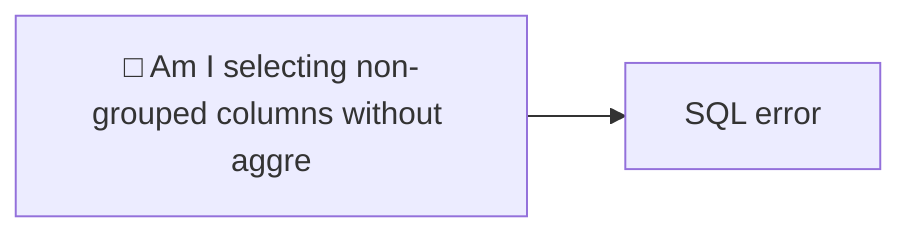

---

📖 **Related Files:**
- [08_SQL/01_Foundations_Database_Basics.md](../08_SQL/01_Foundations_Database_Basics.md) — SQL foundations
- [11_SQL_Complete/](../11_SQL_Complete/) — Full SQL topic files
- [05_Universal_Problem_Framework.md](05_Universal_Problem_Framework.md) — General problem-solving

---
[← 06 Implementation Checklist](06_Implementation_Checklist.md) | [08 Debugging & Dry Run →](08_Debugging_DryRun.md)


---

> **Navigation**: [< Previous](06_Implementation_Checklist.md) | [Back to Index](../00_MASTER_INDEX.md) | [Next >](08_Debugging_DryRun.md)