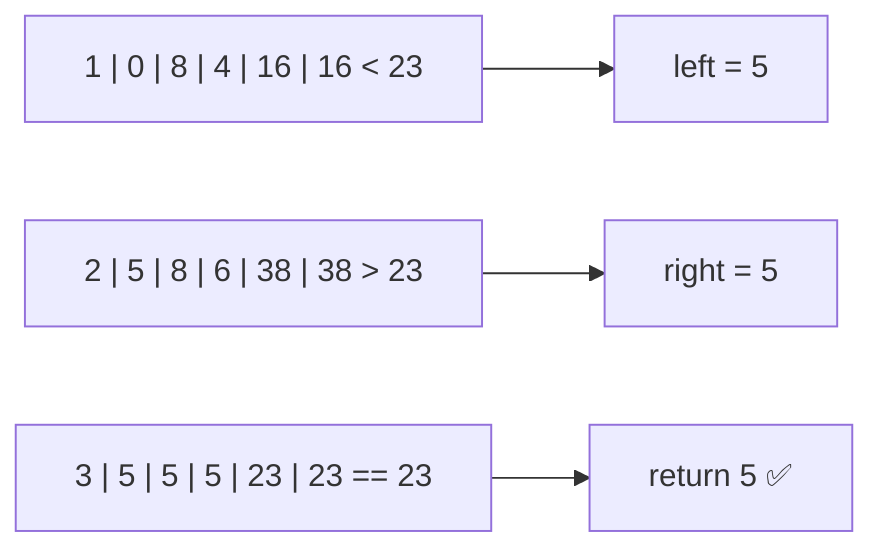
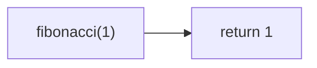
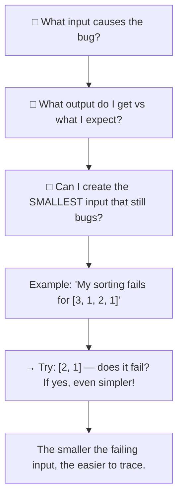
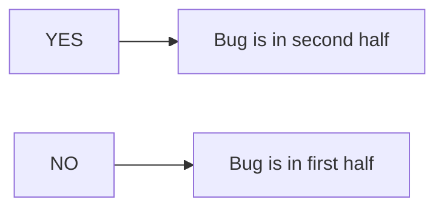
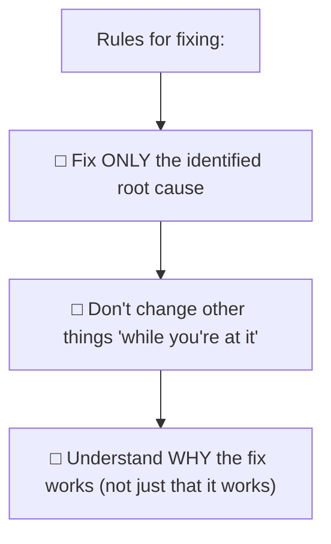
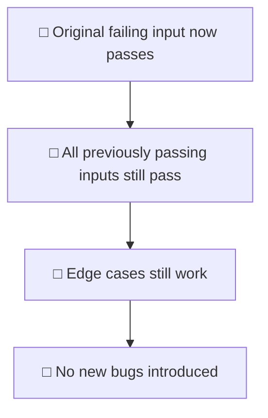
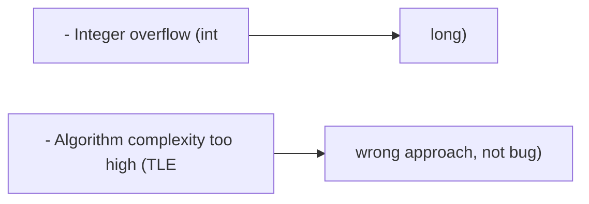
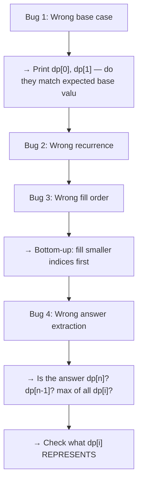
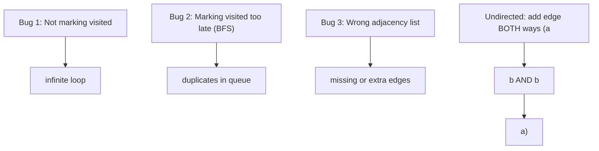
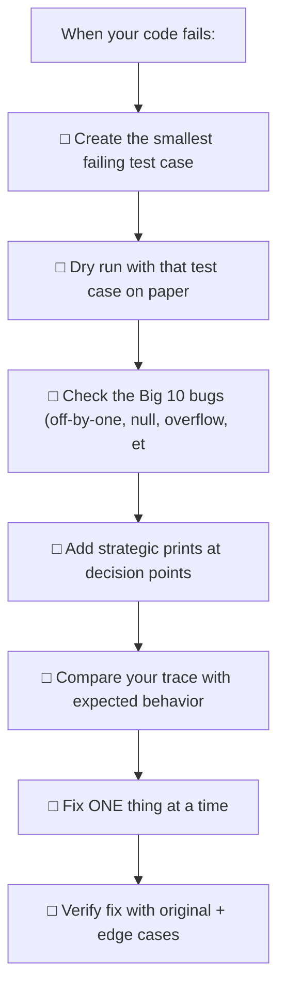

> **Navigation**: [< Previous](07_SQL_Mental_Pipeline.md) | [Back to Index](../00_MASTER_INDEX.md) | [Next >](09_Complexity_Intuition.md)

# 🔬 Debugging & Dry Run — How to Find Bugs Systematically

> **The key insight**: Debugging is NOT random. It's a systematic process: reproduce → isolate → identify → fix → verify. The best debuggers aren't smarter — they have a PROCESS.

---

## Part 1: The Dry Run Method — Trace Code Like a Computer

### How to Dry Run (Step-by-Step)

```
1. Draw a TABLE with columns for each variable
2. Execute ONE line at a time
3. Update the variable table after each line
4. For loops: write each iteration as a row
5. For recursion: draw the call stack or tree
```

### Dry Run Example: Binary Search
```java
int binarySearch(int[] arr, int target) {
    int left = 0, right = arr.length - 1;
    while (left <= right) {
        int mid = left + (right - left) / 2;
        if (arr[mid] == target) return mid;
        else if (arr[mid] < target) left = mid + 1;
        else right = mid - 1;
    }
    return -1;
}
```

```
Input: arr = [2, 5, 8, 12, 16, 23, 38, 56, 72], target = 23

Iteration | left | right | mid | arr[mid] | Action
----------|------|-------|-----|----------|------------------
  Init    |  0   |   8   |  -  |    -     | Start
  1       |  0   |   8   |  4  |   16     | 16 < 23 → left = 5
  2       |  5   |   8   |  6  |   38     | 38 > 23 → right = 5
  3       |  5   |   5   |  5  |   23     | 23 == 23 → return 5 ✅
```

> **Flow**: 1 | 0 | 8 | 4 | 16 | 16 &lt; 23 → left = 5 | 2 | 5 | 8 | 6 | 38 | 38 &gt; 23 → right = 5 | 3 | 5 | 5 | 5 | 23 | 23 == 23 → return 5 ✅



### Dry Run for Recursion — Use Call Stack Notation
```
fibonacci(4)
├── fibonacci(3)
│   ├── fibonacci(2)
│   │   ├── fibonacci(1) → return 1
│   │   └── fibonacci(0) → return 0
│   │   return 1 + 0 = 1
│   └── fibonacci(1) → return 1
│   return 1 + 1 = 2
└── fibonacci(2)
    ├── fibonacci(1) → return 1
    └── fibonacci(0) → return 0
    return 1 + 0 = 1
return 2 + 1 = 3 ✅
```

> **Flow**: fibonacci(1) → return 1



---

## Part 2: The Debugging Process — 5 Steps

### Step 1: REPRODUCE the Bug
```
□ What input causes the bug?
□ What output do I get vs what I expect?
□ Can I create the SMALLEST input that still bugs?

Example: "My sorting fails for [3, 1, 2, 1]"
→ Try: [1, 1] — does it fail? If yes, that's simpler to debug!
→ Try: [2, 1] — does it fail? If yes, even simpler!

The smaller the failing input, the easier to trace.
```

> **Flow**: □ What input causes the bug? → □ What output do I get vs what I expect? | □ What output do I get vs what I expect? → □ Can I create the SMALLEST input that still bugs? | □ Can I create the SMALLEST input that still bugs? → Example: 'My sorting fails for [3, 1, 2, 1]' | Example: 'My sorting fails for [3, 1, 2, 1]' → → Try: [2, 1] — does it fail? If yes, even simpler! | → Try: [2, 1] — does it fail? If yes, even simpler! → The smaller the failing input, the easier to trace.



### Step 2: ISOLATE Where the Bug Is
```
Strategy A: "Halfway check"
  → Print/check the state at HALFWAY point of your algorithm
  → Is the state correct at halfway?
  → YES → Bug is in second half
  → NO → Bug is in first half
  → Repeat (like binary search on your code!)

Strategy B: "Check invariants"
  → What should be TRUE at each step?
  → Add assertions/prints to verify
  
Strategy C: "Simplest failing case"
  → Reduce input until bug disappears
  → The last input that bugs = exact trigger
```

> **Flow**: YES → Bug is in second half | NO → Bug is in first half



### Step 3: IDENTIFY the Root Cause
```
Common root causes (check these FIRST):
1. Off-by-one error (wrong loop bound)
2. Wrong comparison (< vs <=, > vs >=)
3. Wrong variable used (i instead of j)
4. Missing initialization
5. Not handling edge case (empty, null, single)
6. Logic error in if/else branches
7. Integer overflow
8. Using = instead of == (or vice versa in Java: .equals())
9. Modifying collection while iterating
10. Wrong base case in recursion
```

### Step 4: FIX the Bug
```
Rules for fixing:
□ Fix ONLY the identified root cause
□ Don't change other things "while you're at it"
□ Understand WHY the fix works (not just that it works)
```

> **Flow**: Rules for fixing: → □ Fix ONLY the identified root cause | □ Fix ONLY the identified root cause → □ Don't change other things 'while you're at it' | □ Don't change other things 'while you're at it' → □ Understand WHY the fix works (not just that it works)



### Step 5: VERIFY the Fix
```
□ Original failing input now passes
□ All previously passing inputs still pass
□ Edge cases still work
□ No new bugs introduced
```

> **Flow**: □ Original failing input now passes → □ All previously passing inputs still pass | □ All previously passing inputs still pass → □ Edge cases still work | □ Edge cases still work → □ No new bugs introduced



---

## Part 3: Common Bug Patterns & How to Spot Them

### Pattern 1: "Works on examples, fails on edge cases"
```
Typical causes:
- Empty array/string not handled
- Single element not handled
- All same elements
- Negative numbers
- Very large numbers (overflow)

Fix: Add explicit edge case handling at the START of your function
```

### Pattern 2: "Almost correct answer, off by 1"
```
Typical causes:
- Loop runs one too many or one too few times
- Array index shifted
- Substring/subarray boundary wrong
- Fence-post error (counting posts vs gaps)

Fix: Check loop bounds with smallest input (n=1, n=2)
     Draw the indices on paper: [0, 1, 2, 3, 4] for n=5
```

### Pattern 3: "Works for small input, wrong for large"
```
Typical causes:
- Integer overflow (int → long)
- Algorithm complexity too high (TLE → wrong approach, not bug)
- Floating point precision

Fix: Use long for large sums/products
     Check if n * n > Integer.MAX_VALUE
```

> **Flow**: - Integer overflow (int → long) | - Algorithm complexity too high (TLE → wrong approach, not bug)



### Pattern 4: "Works sometimes, fails randomly"
```
Typical causes:
- Uninitialized variables
- HashMap ordering assumptions (HashMap is NOT ordered!)
- Static variables not reset between test cases
- Modifying shared state

Fix: Initialize everything explicitly
     Use LinkedHashMap if order matters
     Reset static variables in each test
```

### Pattern 5: "Infinite loop or stack overflow"
```
Typical causes:
- Loop condition never becomes false
- Recursion base case missing or unreachable
- BFS/DFS not marking visited
- Pointer not advancing in linked list

Fix: Verify loop variable changes each iteration
     Verify recursion argument gets closer to base case
     Always mark visited BEFORE exploring neighbors
```

---

## Part 4: Strategic Print Debugging

### What to Print and Where
```java
// Print LOOP STATE at start of each iteration:
for (int i = 0; i < n; i++) {
    System.out.printf("i=%d, current=%d, sum=%d%n", i, arr[i], sum);
    // ... logic ...
}

// Print FUNCTION ENTRY with arguments:
int solve(int n, int target) {
    System.out.printf("solve(n=%d, target=%d)%n", n, target);
    // ... logic ...
}

// Print DECISION POINTS:
if (arr[mid] < target) {
    System.out.printf("Going RIGHT: mid=%d, arr[mid]=%d < target=%d%n", mid, arr[mid], target);
    left = mid + 1;
} else {
    System.out.printf("Going LEFT: mid=%d, arr[mid]=%d >= target=%d%n", mid, arr[mid], target);
    right = mid - 1;
}

// Print BEFORE RETURN:
System.out.printf("Returning %d for input (%d, %d)%n", result, n, target);
return result;
```

### Print Formatting Tips
```
// For arrays:
System.out.println(Arrays.toString(arr));
// Output: [1, 3, 5, 7, 9]

// For 2D arrays:
System.out.println(Arrays.deepToString(grid));
// Output: [[1, 2], [3, 4]]

// For lists:
System.out.println(list);
// Output: [1, 2, 3]

// For maps:
System.out.println(map);
// Output: {a=1, b=2}
```

---

## Part 5: Debugging DP Problems

### Common DP Bugs
```
Bug 1: Wrong base case
→ Print dp[0], dp[1] — do they match expected base values?

Bug 2: Wrong recurrence
→ Print dp table row by row, compare with hand-calculated values

Bug 3: Wrong fill order
→ Are you accessing dp values that haven't been computed yet?
→ Bottom-up: fill smaller indices first
→ Check: when computing dp[i], are dp[j] (j < i) already filled?

Bug 4: Wrong answer extraction
→ Is the answer dp[n]? dp[n-1]? max of all dp[i]?
→ Check what dp[i] REPRESENTS
```

> **Flow**: Bug 1: Wrong base case → → Print dp[0], dp[1] — do they match expected base valu | → Print dp[0], dp[1] — do they match expected base valu → Bug 2: Wrong recurrence | Bug 2: Wrong recurrence → Bug 3: Wrong fill order | Bug 3: Wrong fill order → → Bottom-up: fill smaller indices first | → Bottom-up: fill smaller indices first → Bug 4: Wrong answer extraction | Bug 4: Wrong answer extraction → → Is the answer dp[n]? dp[n-1]? max of all dp[i]? | ...+1 more



### DP Table Visualization
```
Problem: Climbing Stairs (ways to reach step n, can take 1 or 2 steps)

Step:  0   1   2   3   4   5
dp:   [1] [1] [2] [3] [5] [8]
       ↑   ↑   ↑
      base base dp[2] = dp[1] + dp[0] = 1 + 1 = 2
                dp[3] = dp[2] + dp[1] = 2 + 1 = 3
                dp[4] = dp[3] + dp[2] = 3 + 2 = 5
                dp[5] = dp[4] + dp[3] = 5 + 3 = 8 ✅
```

---

## Part 6: Debugging Graph/Tree Problems

### Common Graph Bugs
```
Bug 1: Not marking visited → infinite loop
→ Symptom: Program hangs or stack overflow
→ Fix: Always use visited set/array

Bug 2: Marking visited too late (BFS) → duplicates in queue
→ Symptom: Correct answer but TLE
→ Fix: Mark visited when ENQUEUING, not dequeuing

Bug 3: Wrong adjacency list → missing or extra edges
→ Fix: Print adjacency list before running algorithm

Bug 4: Directed vs undirected confusion
→ Undirected: add edge BOTH ways (a→b AND b→a)
→ Directed: add edge ONE way only
```

> **Flow**: Bug 1: Not marking visited → infinite loop | Bug 2: Marking visited too late (BFS) → duplicates in queue | Bug 3: Wrong adjacency list → missing or extra edges | Undirected: add edge BOTH ways (a → b AND b | b AND b → a)



### Tree Debugging: Print Traversals
```java
// Inorder (for BST, should be sorted):
void inorder(TreeNode node) {
    if (node == null) return;
    inorder(node.left);
    System.out.print(node.val + " ");
    inorder(node.right);
}

// Level-order (see tree structure):
void levelOrder(TreeNode root) {
    Queue<TreeNode> q = new LinkedList<>();
    q.offer(root);
    while (!q.isEmpty()) {
        int size = q.size();
        for (int i = 0; i < size; i++) {
            TreeNode node = q.poll();
            System.out.print(node == null ? "null " : node.val + " ");
            if (node != null) { q.offer(node.left); q.offer(node.right); }
        }
        System.out.println();  // New line per level
    }
}
```

---

## Part 7: Debugging Checklist (Quick Reference)

```
When your code fails:
□ Read the error message carefully (line number, exception type)
□ Create the smallest failing test case
□ Dry run with that test case on paper
□ Check the Big 10 bugs (off-by-one, null, overflow, etc.)
□ Add strategic prints at decision points
□ Compare your trace with expected behavior
□ Fix ONE thing at a time
□ Verify fix with original + edge cases
□ Remove debug prints before submitting
```

> **Flow**: When your code fails: → □ Create the smallest failing test case | □ Create the smallest failing test case → □ Dry run with that test case on paper | □ Dry run with that test case on paper → □ Check the Big 10 bugs (off-by-one, null, overflow, et | □ Check the Big 10 bugs (off-by-one, null, overflow, et → □ Add strategic prints at decision points | □ Add strategic prints at decision points → □ Compare your trace with expected behavior | □ Compare your trace with expected behavior → □ Fix ONE thing at a time | ...+1 more



---

📖 **Related Files:**
- [06_Implementation_Checklist.md](06_Implementation_Checklist.md) — Avoid bugs in the first place
- [05_Problem_Solving/23_Edge_Cases.md](../05_Problem_Solving/23_Edge_Cases.md) — Edge case catalog
- [05_Problem_Solving/24_Common_Mistakes.md](../05_Problem_Solving/24_Common_Mistakes.md) — Common mistakes

---
[← 07 SQL Mental Pipeline](07_SQL_Mental_Pipeline.md) | [09 Complexity Intuition →](09_Complexity_Intuition.md)


---

> **Navigation**: [< Previous](07_SQL_Mental_Pipeline.md) | [Back to Index](../00_MASTER_INDEX.md) | [Next >](09_Complexity_Intuition.md)