> **Navigation**: [< Previous](08_Debugging_DryRun.md) | [Back to Index](../00_MASTER_INDEX.md) | [Next >](10_Interview_Thinking.md)

# ⏱️ Complexity Intuition — Reason About Time & Space Without Formulas

> **The key insight**: You don't need to do math to estimate complexity. You need to count HOW MANY TIMES the core operation runs. This guide teaches you to "see" complexity at a glance.

---

## Part 1: The Core Principle — Count the Work

### Complexity = "How many times does the MAIN operation execute?"
```
Single loop 0 to n:          → n times → O(n)
Nested loop n × n:            → n² times → O(n²)
Loop that halves each time:   → log n times → O(log n)
Loop for each + sort first:   → n log n + n → O(n log n)
Try all subsets:              → 2ⁿ subsets → O(2ⁿ)
Try all permutations:         → n! orderings → O(n!)
```

**Flow:**
- Single loop 0 to n:
- ↓
- n times
- ↓
- O(n)
- ↓
- Nested loop n × n:
- ↓
- n² times
- ↓
- O(n²)
- ↓
- Loop that halves each time:
- ↓
- log n times
- ↓
- O(log n)

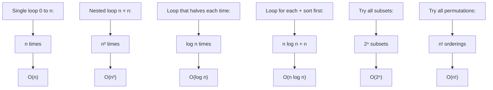

### Visual Intuition
```
O(1)       →  Constant: same work regardless of input size
               ●

O(log n)   →  Binary search: halving each step
               ●●●●  (only ~20 steps for n = 1,000,000)

O(n)       →  Single pass: touch each element once
               ●●●●●●●●●●●●●●●●

O(n log n) →  Sort + process: sorting dominates
               ●●●●●●●●●●●●●●●● × ~20

O(n²)      →  Nested loops: each pair
               ██████████████████
               ██████████████████  (n rows × n cols)
               ██████████████████

O(2ⁿ)      →  Exponential: doubles each step
               ●→●●→●●●●→●●●●●●●●  (explodes!)

O(n!)      →  Factorial: even worse
               Everything × everything × everything...
```

**Flow:**
- O(1)
- ↓
- Constant: same work regardless of input size
- ↓
- O(log n)
- ↓
- Binary search: halving each step
- ↓
- O(n)
- ↓
- Single pass: touch each element once
- ↓
- O(n log n)
- ↓
- Sort + process: sorting dominates
- ↓
- O(n²)
- ↓
- Nested loops: each pair
- ↓
- O(2ⁿ)
- ↓
- Exponential: doubles each step

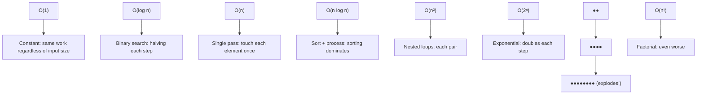

---


## Part 2: Pattern Recognition — See Complexity at a Glance

### Pattern → Complexity Mapping
```
CODE PATTERN                                    COMPLEXITY
──────────────────────────────────────────────  ──────────
Single for loop (0 to n)                        O(n)
Two separate for loops (not nested)             O(n) + O(n) = O(n)
Nested for loops (both 0 to n)                  O(n²)
Three nested loops                              O(n³)
for loop + binary search inside                 O(n log n)
Sort array + single pass                        O(n log n)
Loop that halves (i /= 2 or i *= 2)           O(log n)
Recursion with 2 branches, depth n              O(2ⁿ)
Recursion with 2 branches, depth log n          O(n)  (like merge sort)
HashMap lookup inside loop                      O(n) × O(1) = O(n)
BFS/DFS on graph                                O(V + E)
DP with 1D table                                O(n)
DP with 2D table                                O(n × m) or O(n²)
```

**Flow:**
- CODE PATTERN COMPLEXITY
- ↓
- Single for loop (0 to n) O(n)
- ↓
- Nested for loops (both 0 to n) O(n²)
- ↓
- Three nested loops O(n³)
- ↓
- Sort array + single pass O(n log n)
- ↓
- Loop that halves (i /= 2 or i *= 2) O(log n)
- ↓
- Recursion with 2 branches, depth n O(2ⁿ)

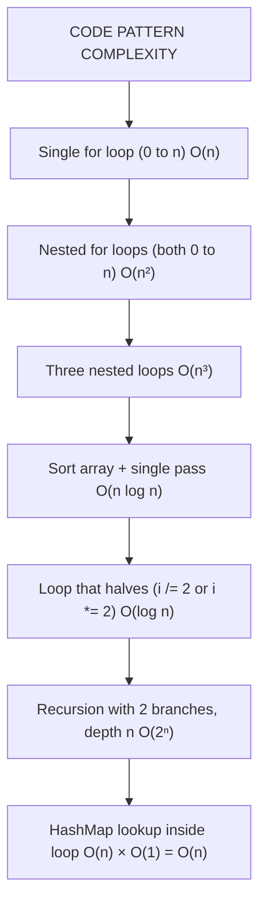

### The "How Many Times Does Each Line Run?" Method
```java
// Example 1:
for (int i = 0; i < n; i++) {           // Runs n times
    for (int j = i; j < n; j++) {        //   Runs n-i times
        doSomething();                    //     Total: n + (n-1) + ... + 1 = n(n+1)/2
    }
}
// → O(n²)  (even though inner loop shrinks, it's still n²/2 → O(n²))

// Example 2:
for (int i = 1; i < n; i *= 2) {        // i = 1, 2, 4, 8, ..., n → log₂(n) times
    for (int j = 0; j < n; j++) {        //   Runs n times each
        doSomething();
    }
}
// → O(n log n)

// Example 3:
for (int i = 0; i < n; i++) {           // n times
    for (int j = 0; j < m; j++) {        //   m times
        doSomething();
    }
}
// → O(n × m)  (NOT O(n²) unless n == m)
```

---


## Part 3: Recursion Complexity — Use the Tree Method

### Step 1: Draw the Recursion Tree
### Step 2: Count Total Nodes (= total function calls)
### Step 3: Multiply by work per call

```
Example: Merge Sort
                    mergeSort(n)                → merge work: n
                   /            \
          mergeSort(n/2)    mergeSort(n/2)      → merge work: n/2 + n/2 = n
           /      \          /      \
      ms(n/4)  ms(n/4)  ms(n/4)  ms(n/4)       → merge work: 4 × n/4 = n
      ...                                       → each level does O(n) total work

Depth of tree: log₂(n)
Work per level: O(n)
TOTAL: O(n) × log₂(n) = O(n log n)  ✅
```

**Flow:**
- mergeSort(n)
- ↓
- merge work: n
- ↓
- mergeSort(n/2) mergeSort(n/2)
- ↓
- merge work: n/2 + n/2 = n
- ↓
- ms(n/4) ms(n/4) ms(n/4) ms(n/4)
- ↓
- merge work: 4 × n/4 = n
- ↓
- ...
- ↓
- each level does O(n) total work

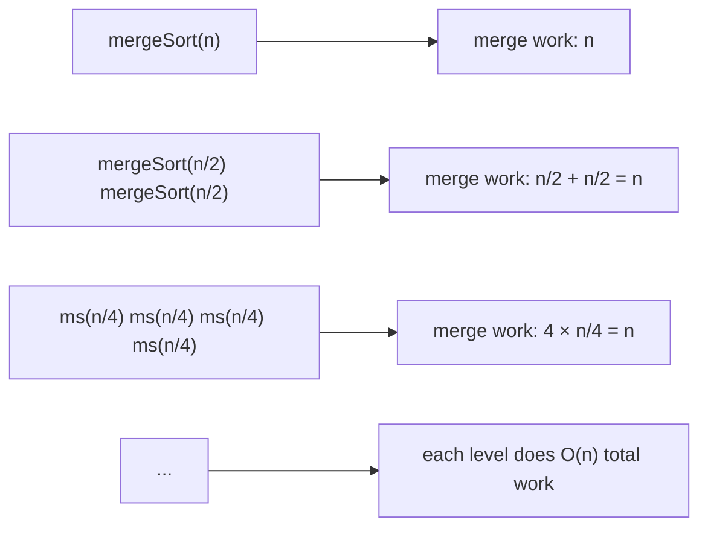

```
Example: Fibonacci(n) — naive recursion
                    fib(5)
                   /       \
              fib(4)       fib(3)
             /    \        /    \
          fib(3) fib(2) fib(2) fib(1)
          /  \
       fib(2) fib(1)

Branching factor: 2
Depth: n
Total nodes: ~2ⁿ  (each level doubles)
Work per call: O(1)
TOTAL: O(2ⁿ)  ← This is why memoization matters!

With memoization: Each unique state computed ONCE
Unique states: n
Work per state: O(1)
TOTAL: O(n)  ✅ Huge improvement!
```

**Flow:**
- Example: Fibonacci(n) — naive recursion
- ↓
- fib(5)
- ↓
- fib(4) fib(3)
- ↓
- fib(2) fib(1)
- ↓
- Branching factor: 2
- ↓
- Depth: n
- ↓
- Total nodes: ~2ⁿ (each level doubles)

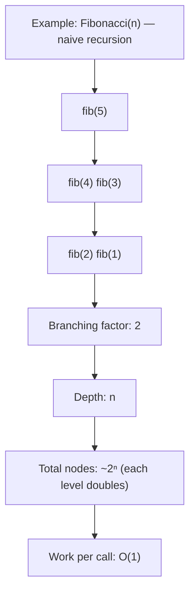

### The Master Theorem (Intuitive Version)
```
For divide-and-conquer: T(n) = a · T(n/b) + O(nᶜ)
  a = number of subproblems
  b = how much smaller each subproblem is
  c = cost of dividing + combining

Intuitive rules:
- If splitting work is cheap → O(n^(log_b(a)))       [leaves dominate]
- If splitting work matches → O(nᶜ · log n)          [balanced]
- If splitting work is expensive → O(nᶜ)              [root dominates]

Examples:
  Binary Search: T(n) = 1·T(n/2) + O(1) → O(log n)
  Merge Sort:    T(n) = 2·T(n/2) + O(n) → O(n log n)
  Karatsuba:     T(n) = 3·T(n/2) + O(n) → O(n^1.58)
```

**Flow:**
- - If splitting work is cheap
- ↓
- O(n^(log_b(a))) [leaves dominate]
- ↓
- - If splitting work matches
- ↓
- O(nᶜ · log n) [balanced]
- ↓
- - If splitting work is expensive
- ↓
- O(nᶜ) [root dominates]
- ↓
- Binary Search: T(n) = 1·T(n/2) + O(1)
- ↓
- O(log n)
- ↓
- Merge Sort: T(n) = 2·T(n/2) + O(n)
- ↓
- O(n log n)
- ↓
- Karatsuba: T(n) = 3·T(n/2) + O(n)
- ↓
- O(n^1.58)

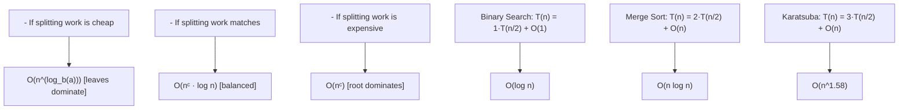

---


> 🔬 **Section Challenge — Part 3: Recursion Complexity — Use the Tree Method**
>>
> **Challenge 2 (Bug Hunt):** ```java
void fib(int n) { return n<=1 ? n : fib(n-1) + fib(n-2); }
fib(50) // takes forever
```
Why and what are the 3 fixes?
> <details><summary>Answer</summary>
>
> Exponential time O(2^N) — `fib(n-1)` and `fib(n-2)` each recursively recompute the same subproblems billions of times. Fix 1: Memoization — `Map<Integer,Long> memo`, return early if computed. O(N) time, O(N) space. Fix 2: Bottom-up DP — array `dp[i] = dp[i-1] + dp[i-2]`. O(N) time, O(N) space. Fix 3: O(1) space — just track last two values with two variables. O(N) time, O(1) space.
> </details>
>

## Part 4: Space Complexity — What Counts?

### What Uses Space
```
1. Variables:           O(1) — int, long, boolean
2. Arrays/Lists:        O(n) — size n
3. 2D Arrays:           O(n²) or O(n×m)
4. HashMap:             O(n) — up to n entries
5. Recursion stack:     O(depth) — hidden space!
6. Queue (BFS):         O(width) — max nodes at one level
7. String concatenation: O(n) per new string created
```

### Common Space Complexities
```
APPROACH                          SPACE
────────────────────────────      ──────
In-place swap/pointer             O(1)
Single extra array                O(n)
HashMap/HashSet                   O(n)
2D DP table                       O(n²) → can often reduce to O(n)
Recursive DFS                     O(height) — O(log n) balanced, O(n) worst
BFS queue                         O(width) — O(n) worst (complete binary tree last level)
Adjacency list                    O(V + E)
Sorting (merge sort)              O(n) extra; quicksort O(log n) stack
```

**Flow:**
- 2D DP table O(n²)
- ↓
- can often reduce to O(n)

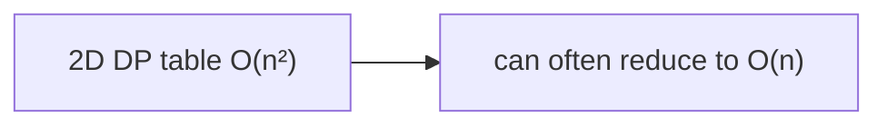

### The "Rolling Array" Optimization
```
When DP row i only depends on row i-1:
  Original: dp[n][m] → O(n × m) space
  Optimized: dp[2][m] → O(m) space (alternate between rows)
  Even better: dp[m] → O(m) (overwrite in-place if direction allows)
```

**Flow:**
- Original: dp[n][m]
- ↓
- O(n × m) space
- ↓
- Optimized: dp[2][m]
- ↓
- O(m) space (alternate between rows)
- ↓
- Even better: dp[m]
- ↓
- O(m) (overwrite in-place if direction allows)

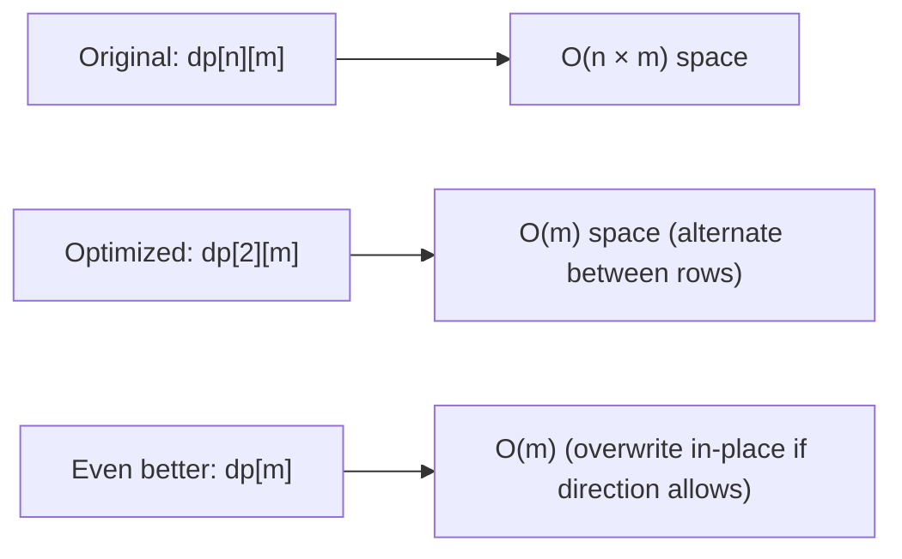

---

## Part 5: Amortized Complexity — "Average Over Time"

### The Bank Account Analogy
```
ArrayList.add():
  Usually O(1) — just append
  Sometimes O(n) — array full, must copy to larger array

But after n additions:
  Total work = n (appending) + n (one copy at end) = 2n
  Average per operation = 2n / n = O(1) amortized

It's like saving coins daily (O(1)) and occasionally paying a big bill (O(n)),
but the savings always cover the bill. On AVERAGE, each day costs O(1).
```

### Dynamic Array – Cost Table (The Foundation Example)
```
╔══════════╦══════════╦═══════════╦══════════════════════════════╗
║ Insert # ║ Capacity ║ Cost      ║ What Happens                 ║
╠══════════╬══════════╬═══════════╬══════════════════════════════╣
║    1     ║  1       ║  1        ║ Insert                       ║
║    2     ║  1→2     ║  1+1 = 2  ║ Resize (copy 1) + Insert     ║
║    3     ║  2→4     ║  2+1 = 3  ║ Resize (copy 2) + Insert     ║
║    4     ║  4       ║  1        ║ Insert (still room)          ║
║    5     ║  4→8     ║  4+1 = 5  ║ Resize (copy 4) + Insert     ║
║   6–8    ║  8       ║  1 each   ║ Insert (still room)          ║
║    9     ║  8→16    ║  8+1 = 9  ║ Resize (copy 8) + Insert     ║
╚══════════╩══════════╩═══════════╩══════════════════════════════╝

Total cost for n inserts:
  Regular inserts = n
  Resize copies   = 1 + 2 + 4 + 8 + ... + n/2 = n - 1  (geometric sum)
  Grand total     = n + (n - 1) < 2n

  Amortized cost per insert = 2n / n = O(1) ✓
```

**Flow:**
- Insert # Capacity Cost What Happens
- ↓
- 1 1 1 Insert
- ↓
- 2 1
- ↓
- 2 1+1 = 2 Resize (copy 1) + Insert
- ↓
- 2 1
- ↓
- 2 1+1 = 2 Resize (copy 1) + Insert
- ↓
- 3 2
- ↓
- 4 2+1 = 3 Resize (copy 2) + Insert
- ↓
- 3 2
- ↓
- 4 2+1 = 3 Resize (copy 2) + Insert
- ↓
- 4 4 1 Insert (still room)
- ↓
- 5 4
- ↓
- 8 4+1 = 5 Resize (copy 4) + Insert
- ↓
- 5 4
- ↓
- 8 4+1 = 5 Resize (copy 4) + Insert
- ↓
- 6–8 8 1 each Insert (still room)

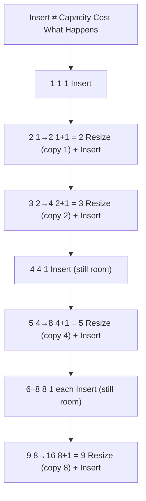

### Three Formal Methods of Amortized Analysis

> **Why three methods?** Different problems are easier to analyze with different
> methods. All three give the SAME answer. Pick the one that "clicks."

#### Method 1: Aggregate (Simplest)
```
╔════════════════════════════════════════════════════════────╗
║  AGGREGATE METHOD: Count total work, divide by n           ║
╠═══════════════════════════════════════════════════════════ ╣
║                                                            ║
║  Total cost of n operations = T(n)                         ║
║  Amortized cost per op      = T(n) / n                     ║
║                                                            ║
║  Dynamic Array Example:                                    ║
║    T(n) = n + (1+2+4+...+n/2) < 2n + 1 < 3n                ║
║    Amortized = 3n / n = O(1)                               ║
║                                                            ║
║  Stack with multipop(k) Example:                           ║
║    Each element pushed at most once, popped at most once   ║
║    Total pushes + pops over n operations ≤ 2n              ║
║    Amortized = 2n / n = O(1)                               ║
╚═══════════════════════════════════════════════════════════ ╝
```

**Flow:**
- AGGREGATE METHOD: Count total work, divide by n
- ↓
- Total cost of n operations = T(n)
- ↓
- Amortized cost per op = T(n) / n
- ↓
- Dynamic Array Example:
- ↓
- Amortized = 3n / n = O(1)
- ↓
- Stack with multipop(k) Example:
- ↓
- Each element pushed at most once, popped at most once

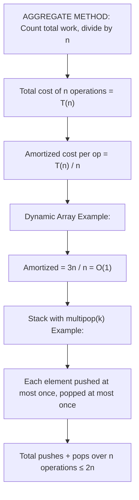

#### Method 2: Accounting (The Coin Method)
```
ACCOUNTING: Charge EXTRA on cheap ops, save for expensive
──────────────────────────────────────────────────

Rule: Credit balance must NEVER go negative

Dynamic Array — Charge 3 per insert:
  $1 → pays for the insert itself
  $2 → saved as credit (stored on the element)

When resize happens (double from m to 2m):
  Need to copy m elements
  Each of the m/2 NEW elements since last resize saved $2
  Total credit = m/2 × $2 = $m → exactly pays for copy!

We charged $3 per operation → amortized cost = O(3) = O(1)

┌─────────────────────────────────────┐
│  $1   $1   $1   $1   $1   $1  $1    │
│  [a]  [b]  [c]  [d]  [e]  [f] [g]  │ ← each has $2
│  $2   $2   $2   $2   $2   $2  $2   │    credit attached
└─────────────────────────────────────┘
```

**Flow:**
- ACCOUNTING: Charge EXTRA on cheap ops, save for expensi
- ↓
- Rule: Credit balance must NEVER go negative
- ↓
- Dynamic Array — Charge 3 per insert:
- ↓
- $1
- ↓
- pays for the insert itself
- ↓
- $1
- ↓
- pays for the insert itself
- ↓
- $2
- ↓
- saved as credit (stored on the element)
- ↓
- $2
- ↓
- saved as credit (stored on the element)
- ↓
- When resize happens (double from m to 2m):
- ↓
- Need to copy m elements

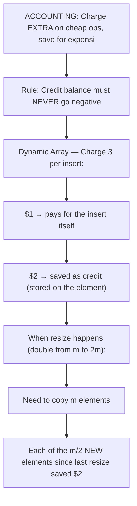

#### Method 3: Potential (The Physics Method)
```
╔══════════════════════════════════════════════════════════════╗
║  POTENTIAL: Define Φ (potential energy of data structure)    ║
╠══════════════════════════════════════════════════════════════╣
║                                                              ║
║  Amortized cost ĉᵢ = cᵢ + Φ(Dᵢ) − Φ(Dᵢ₋₁)                    ║
║                     = actual cost + change in potential      ║
║                                                              ║
║  Requirement: Φ(Dₙ) ≥ Φ(D₀) (potential doesn't drop below    ║
║               starting value over entire sequence)           ║
║                                                              ║
║  Dynamic Array — Choose Φ = 2·size − capacity                ║
║                                                              ║
║  Normal insert (no resize):                                  ║
║    cᵢ = 1                                                    ║
║    ΔΦ = 2(size+1) − cap − (2·size − cap)  = +2               ║
║    ĉᵢ = 1 + 2 = 3                                            ║
║                                                              ║
║  Insert + resize (cap doubles: m → 2m):                      ║
║    cᵢ = m + 1            (copy m elements + insert 1)        ║
║    ΔΦ = [2(m+1) − 2m] − [2m − m]  = 2 − m                    ║
║    ĉᵢ = (m+1) + (2−m) = 3                                    ║
║                                                              ║
║  Both cases: amortized = 3 = O(1) ✓                          ║
╚══════════════════════════════════════════════════════════════╝
```

**Flow:**
- POTENTIAL: Define Φ (potential energy of data structure
- ↓
- Amortized cost ĉᵢ = cᵢ + Φ(Dᵢ) − Φ(Dᵢ₋₁)
- ↓
- = actual cost + change in potential
- ↓
- Requirement: Φ(Dₙ) ≥ Φ(D₀) (potential doesn't drop belo
- ↓
- starting value over entire sequence)
- ↓
- Dynamic Array — Choose Φ = 2·size − capacity
- ↓
- Normal insert (no resize):

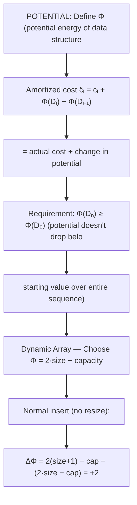

### When to Use Which Method
```
╔═══════════════════╦══════════════════════════════════════════╗
║ Method            ║ Best When                                ║
╠═══════════════════╬══════════════════════════════════════════╣
║ Aggregate         ║ Simple count — all ops cost the same     ║
║ Accounting        ║ Different ops cost differently, want     ║
║                   ║ intuitive "prepay" explanation           ║
║ Potential         ║ Need a formal proof, complex structure   ║
║                   ║ (e.g., splay trees, Fibonacci heaps)     ║
╚═══════════════════╩══════════════════════════════════════════╝
```

**Flow:**
- Method Best When
- ↓
- Aggregate Simple count — all ops cost the same
- ↓
- Accounting Different ops cost differently, want
- ↓
- intuitive 'prepay' explanation
- ↓
- Potential Need a formal proof, complex structure
- ↓
- (e.g., splay trees, Fibonacci heaps)

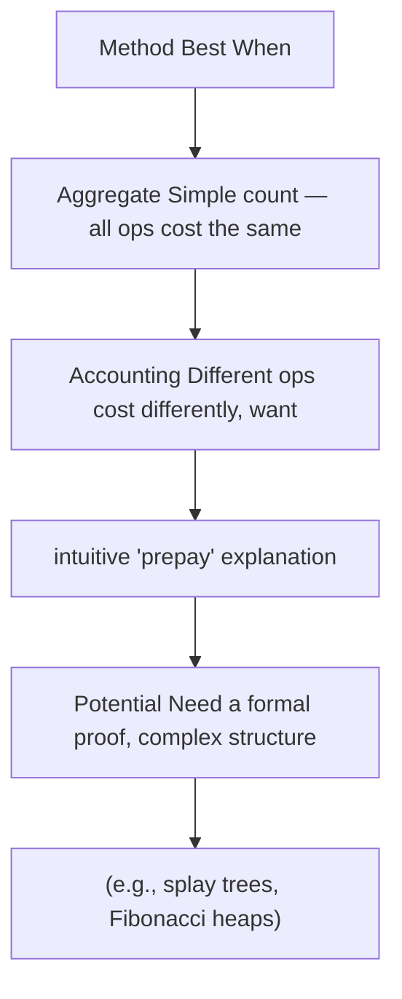

### Common Amortized O(1) Operations
```
╔══════════════════════════╦═══════════════════╦═══════════════════════════╗
║ Operation                ║ Worst Case Single ║ Amortized                 ║
╠══════════════════════════╬═══════════════════╬═══════════════════════════╣
║ ArrayList.add()          ║ O(n) (resize)     ║ O(1)                      ║
║ HashMap.put()            ║ O(n) (rehash)     ║ O(1)                      ║
║ Stack multipop           ║ O(n)              ║ O(1) per op               ║
║ Monotonic stack (total)  ║ O(n) per push     ║ O(1) per element          ║
║ Union-Find (path comp.)  ║ O(log n)          ║ O(α(n)) ≈ O(1)            ║
║ Splay tree operations    ║ O(n)              ║ O(log n)                  ║
║ Fibonacci heap decrease  ║ O(1)              ║ O(1) (with cascading cut) ║
╚══════════════════════════╩═══════════════════╩═══════════════════════════╝
```

**Flow:**
- Operation Worst Case Single Amortized
- ↓
- Stack multipop O(n) O(1) per op
- ↓
- Monotonic stack (total) O(n) per push O(1) per element
- ↓
- Splay tree operations O(n) O(log n)
- ↓
- Fibonacci heap decrease O(1) O(1) (with cascading cut)

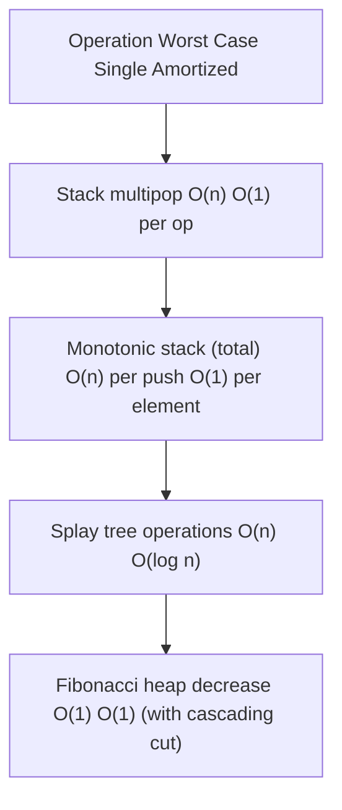

### Common Mistake: Amortized ≠ Average Case
```
⚠️  Amortized: GUARANTEED over any sequence of n operations
    Average:   Expected over RANDOM input (probabilistic)

Example:
  QuickSort average = O(n log n) → bad luck gives O(n²)
  ArrayList.add() amortized O(1) → ALWAYS O(1) per op over n ops

  Amortized is STRONGER than average — no randomness needed!
```

**Flow:**
- QuickSort average = O(n log n)
- ↓
- bad luck gives O(n²)
- ↓
- ArrayList.add() amortized O(1)
- ↓
- ALWAYS O(1) per op over n ops

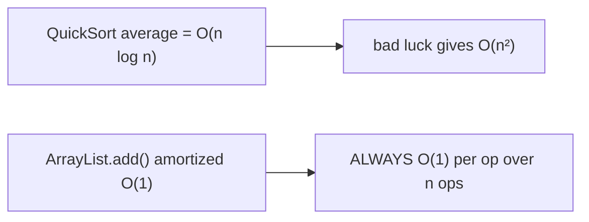

---

## Part 6: Constraint → Complexity Quick Reference

### Given n, What Complexity Do I Need?
```
n ≤ 10      → Anything goes: O(n!), O(2ⁿ), O(n⁴)
n ≤ 20      → O(2ⁿ), O(n² · 2ⁿ)
n ≤ 100     → O(n³)
n ≤ 500     → O(n³) with small constant
n ≤ 1,000   → O(n²)
n ≤ 5,000   → O(n²) comfortably
n ≤ 10,000  → O(n²) barely, prefer O(n log n)
n ≤ 100,000 → O(n log n) or O(n)
n ≤ 500,000 → O(n log n)
n ≤ 10⁶     → O(n) or O(n log n) with small constant
n ≤ 10⁸     → O(n) only
n > 10⁸     → O(log n), O(√n), or O(1)
```

**Flow:**
- n ≤ 10
- ↓
- Anything goes: O(n!), O(2ⁿ), O(n⁴)
- ↓
- n ≤ 20
- ↓
- O(2ⁿ), O(n² · 2ⁿ)
- ↓
- n ≤ 100
- ↓
- O(n³)
- ↓
- n ≤ 500
- ↓
- O(n³) with small constant
- ↓
- n ≤ 1,000
- ↓
- O(n²)
- ↓
- n ≤ 5,000
- ↓
- O(n²) comfortably

```mermaid
flowchart TD
    N1["n ≤ 10"]
    N2["Anything goes: O(n!), O(2ⁿ), O(n⁴)"]
    N3["n ≤ 20"]
    N4["O(2ⁿ), O(n² · 2ⁿ)"]
    N5["n ≤ 100"]
    N6["O(n³)"]
    N7["n ≤ 500"]
    N8["O(n³) with small constant"]
    N9["n ≤ 1,000"]
    N10["O(n²)"]
    N11["n ≤ 5,000"]
    N12["O(n²) comfortably"]
    N13["n ≤ 10,000"]
    N14["O(n²) barely, prefer O(n log n)"]
    N15["n ≤ 100,000"]
    N16["O(n log n) or O(n)"]
    N17["n ≤ 500,000"]
    N18["O(n log n)"]
    N19["n ≤ 10⁶"]
    N20["O(n) or O(n log n) with small constant"]
    N21["n ≤ 10⁸"]
    N22["O(n) only"]
    N23["n &gt; 10⁸"]
    N24["O(log n), O(√n), or O(1)"]
    N1 --> N2
    N3 --> N4
    N5 --> N6
    N7 --> N8
    N9 --> N10
    N11 --> N12
    N13 --> N14
    N15 --> N16
    N17 --> N18
    N19 --> N20
    N21 --> N22
    N23 --> N24
```

### Given Complexity, How Fast In Practice?
```
Assume ~10⁸ operations per second (rough estimate):

O(n)       with n = 10⁸  → ~1 second
O(n log n) with n = 10⁶  → ~20 million ops → ~0.2 seconds
O(n²)      with n = 10⁴  → 10⁸ → ~1 second
O(n³)      with n = 500   → 1.25 × 10⁸ → ~1.2 seconds
O(2ⁿ)      with n = 25    → ~33 million → ~0.3 seconds
O(n!)      with n = 11    → ~40 million → ~0.4 seconds
```

**Flow:**
- O(n) with n = 10⁸
- ↓
- ~1 second
- ↓
- O(n log n) with n = 10⁶
- ↓
- ~20 million ops
- ↓
- ~0.2 seconds
- ↓
- O(n²) with n = 10⁴
- ↓
- 10⁸
- ↓
- ~1 second
- ↓
- O(n³) with n = 500
- ↓
- 1.25 × 10⁸

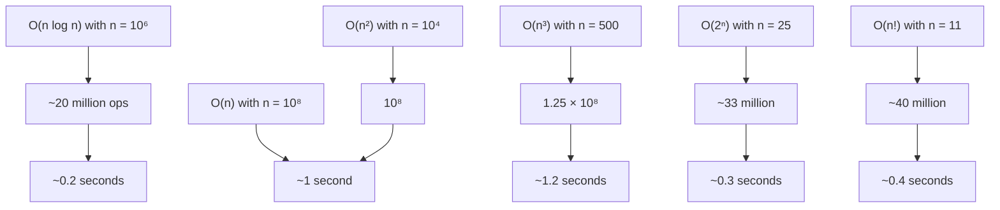

---


## Part 7: Quick Complexity Checklist

```
After writing code, for TIME complexity:
□ Count nested loop depth → O(n^depth)
□ Does any loop halve? → Multiply by log n
□ Recursion? → Draw tree, count total calls
□ Using sorting? → At least O(n log n)
□ HashMap operations → O(1) each
□ Does my complexity fit the constraint?

For SPACE complexity:
□ What data structures did I create? What size?
□ Recursion? → Stack depth = O(depth)
□ Am I creating strings in a loop? → O(n) per iteration!
□ Can I reduce 2D DP to 1D?
□ Can I do it in-place?
```

**Flow:**
- □ Count nested loop depth
- ↓
- O(n^depth)
- ↓
- □ Does any loop halve?
- ↓
- Multiply by log n
- ↓
- □ Recursion?
- ↓
- Draw tree, count total calls
- ↓
- □ Using sorting?
- ↓
- At least O(n log n)
- ↓
- □ HashMap operations
- ↓
- O(1) each
- ↓
- □ Recursion?
- ↓
- Stack depth = O(depth)

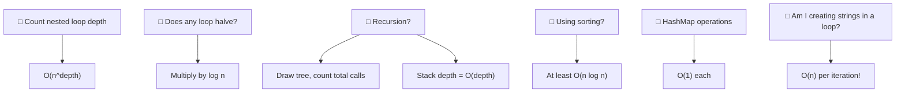

---

📖 **Related Files:**
- [01_Recursion_Tree_Thinking.md](01_Recursion_Tree_Thinking.md) — Recursion tree complexity
- [02_DP_State_Thinking.md](02_DP_State_Thinking.md) — DP complexity analysis
- [05_Universal_Problem_Framework.md](05_Universal_Problem_Framework.md) — Constraint-to-complexity mapping

---
[← 08 Debugging & Dry Run](08_Debugging_DryRun.md) | [10 Interview Thinking →](10_Interview_Thinking.md)


---

> **Navigation**: [< Previous](08_Debugging_DryRun.md) | [Back to Index](../00_MASTER_INDEX.md) | [Next >](10_Interview_Thinking.md)