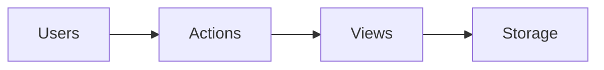
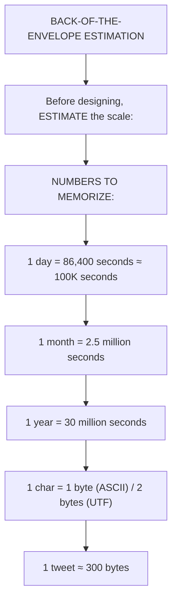
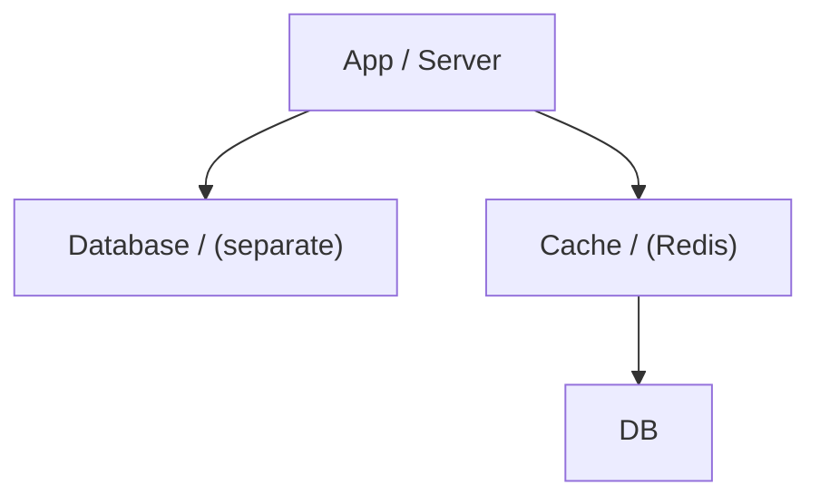

> **Navigation**: [< Previous](14_Optimization_Pipeline.md) | [Back to Index](../00_MASTER_INDEX.md) | [Next >](16_Distributed_Systems_Thinking.md)

# Mental Models — System Design Thinking

## How to THINK About System Design


> System design isn't about memorizing architectures.
> It's about developing THINKING FRAMEWORKS that help you
> navigate ANY design problem you've never seen before.
>
> This guide gives you the MENTAL TOOLBOX — not the answers,
> but the way to ARRIVE at answers.


---


## Mental Model 1: Start With the User, Not the Database

```
THE TOP-DOWN APPROACH

Most beginners: "Let me design the database schema first"
Experienced:    "Let me understand what the USER does first"

STEP 1: Who are the users? What do they DO?
        → List the core actions (verbs)
        "Users post tweets, follow people, see a feed"

STEP 2: What does the system SHOW them?
        → List the core views (pages/screens)
        "Home feed, profile page, search results"

STEP 3: What data do those views NEED?
        → This tells you what to store and how to query

STEP 4: NOW design the storage to support those queries.

┌──────────┐    ┌──────────┐    ┌──────────┐    ┌──────────┐
│  Users   │ →  │  Actions │ →  │  Views   │ →  │  Storage │
└──────────┘    └──────────┘    └──────────┘    └──────────┘
```

**Flow:**
1. Users
2. Actions
3. Views
4. Storage



---

## Mental Model 2: The Napkin Math Framework

```
BACK-OF-THE-ENVELOPE ESTIMATION

Before designing, ESTIMATE the scale:

NUMBERS TO MEMORIZE:
┌──────────────────────────────────────────────┐
│  1 day     = 86,400 seconds ≈ 100K seconds   │
│  1 month   = 2.5 million seconds             │
│  1 year    = 30 million seconds              │
│  1 char    = 1 byte (ASCII) / 2 bytes (UTF)  │
│  1 tweet   ≈ 300 bytes                       │
│  1 image   ≈ 300 KB                          │
│  1 video   ≈ 5 MB/min (compressed)           │
│  1 GB      = 1 billion bytes                 │
│  1 TB      = 1,000 GB                        │
└──────────────────────────────────────────────┘

EXAMPLE: Twitter-like system, 100M daily active users

Tweets/day:    100M × 0.1 (10% tweet) = 10M tweets/day
Tweets/second: 10M / 86,400 ≈ 115 TPS (write)
Reads/second:  100M × 10 reads / 86,400 ≈ 11,500 TPS (read)
Storage/day:   10M × 300B = 3 GB/day
Storage/year:  3 GB × 365 ≈ 1 TB

Insight: Read-heavy (100:1 ratio) → need caching + CDN
```

**Flow:**
1. BACK-OF-THE-ENVELOPE ESTIMATION
2. Before designing, ESTIMATE the scale:
3. NUMBERS TO MEMORIZE:
4. 1 day = 86,400 seconds ≈ 100K seconds
5. 1 month = 2.5 million seconds
6. 1 year = 30 million seconds
7. 1 char = 1 byte (ASCII) / 2 bytes (UTF)



---


## Mental Model 3: The Trade-Off Triangle

## Choice               │  Trade-Off

SQL vs NoSQL         │  Consistency vs Flexibility
Cache vs No Cache    │  Speed vs Freshness
Monolith vs Micro    │  Simplicity vs Scalability
Sync vs Async        │  Simplicity vs Throughput
Normalize vs Denorm  │  Write speed vs Read speed
Push vs Pull         │  Latency vs Resource usage

---

## Mental Model 4: Scale in Stages

```
DON'T JUMP TO DISTRIBUTED SYSTEMS — SCALE PROGRESSIVELY

Stage 1: Single Server (0 → 1K users)
┌──────────────────────────────────────┐
│  App Server + Database on ONE box    │
└──────────────────────────────────────┘

Stage 2: Separate DB (1K → 10K users)
┌───────────┐    ┌───────────────┐
│  App      │ →  │  Database     │
│  Server   │    │  (separate)   │
└───────────┘    └───────────────┘

Stage 3: Add Cache + CDN (10K → 100K users)
┌───────────┐    ┌───────┐    ┌────────┐
│  App      │ →  │ Cache │ →  │  DB    │
│  Server   │    │(Redis)│    │        │
└───────────┘    └───────┘    └────────┘
     + CDN for static assets

Stage 4: Load Balancer + Replicas (100K → 1M users)
          ┌────────┐    ┌────────┐
[LB] →   │ App 1  │    │  DB    │ ← writes
     →   │ App 2  │    │ Primary│
     →   │ App 3  │    └────┬───┘
          └────────┘    ┌───▼────┐
                        │  DB    │ ← reads
                        │ Replica│
                        └────────┘

Stage 5: Microservices + Sharding (1M+ users)
Only NOW consider breaking into services + horizontal sharding

KEY INSIGHT: Over-engineering at Stage 1 is worse than
under-engineering. Build for 10x your current scale, not 1000x.
```

**Flow:**
1. App / Server
2. Database / (separate)
3. App / Server
4. Cache / (Redis)
5. DB



---


## Mental Model 5: The Read/Write Split


> FIRST QUESTION FOR ANY SYSTEM: Is it READ-heavy or WRITE-heavy?
>
> READ-HEAVY (100:1)              WRITE-HEAVY (1:1 or more)
> ─────────────────              ──────────────────────
> Social media feeds              Chat messages
> E-commerce product pages        IoT sensor data
> News/blog sites                 Financial transactions
> Search results                  Logging/analytics
>
> READ-HEAVY OPTIMIZATIONS:       WRITE-HEAVY OPTIMIZATIONS:
> - Caching (Redis, CDN)         • Write-ahead log
> - Read replicas                • Async processing (queues)
> - Denormalization              • Batch writes
> - Materialized views           • LSM-Tree stores (Cassandra)
> - Pre-computed feeds           • Partitioning/sharding
>
> MIXED? Use CQRS:
> Command (write) → one model
> Query (read)    → different, optimized model


---

## Mental Model 6: Failure Will Happen — Design For It


## If This Fails...      │  We Should...

Database goes down    │  Failover to replica
Cache goes down       │  Fall through to DB
Service times out     │  Circuit breaker + fallback
Queue is full         │  Backpressure + dead letter
Region goes down      │  Multi-region failover
Deployment is buggy   │  Canary + quick rollback
Data is corrupted     │  Backup + point-in-time
Traffic spikes 10x    │  Auto-scaling + rate limit

---

## Mental Model 7: The Funnel Pattern


> WEB REQUEST FLOW — Think of It as a Funnel
>
> Each layer FILTERS and OPTIMIZES before hitting the next:
>
> DNS (Route 53)         → Resolve to IP
> │
> CDN (CloudFront)       → Serve cached static content (90% done)
> │
> Load Balancer          → Distribute remaining requests
> │
> Rate Limiter           → Block abusive traffic
> │
> API Gateway            → Auth, throttle, route
> │
> Application Cache      → Return cached API responses
> │
> Application Server     → Business logic (only ~5% of original)
> │
> Database               → Only queries that MUST hit storage
>
> INSIGHT: 95% of requests should NEVER reach your database.
> Each layer is a chance to serve the response earlier.


---


## Mental Model 8: The Interview Navigation Map


> 45-MINUTE SYSTEM DESIGN INTERVIEW — TIME ALLOCATION
>
> [0-5 min]   CLARIFY
> - Ask about scale (users, data, requests/second)
> - Ask about constraints (latency, availability, consistency)
> - Ask about features (MVP vs full-featured)
> → "Are we designing for 1K users or 100M?"
>
> [5-10 min]  HIGH-LEVEL DESIGN
> - Draw the main components (client, server, database, cache)
> - Define the API (2-3 core endpoints)
> - Identify the data model (key entities + relationships)
>
> [10-30 min] DEEP DIVE
> - Most complex component in detail
> - Data flow for core use case
> - Handle scale: sharding, caching, replication
> → This is where you show DEPTH. Pick the hard part.
>
> [30-40 min] TRADE-OFFS & EDGE CASES
> - What happens during failures?
> - Alternative approaches you considered
> - Bottlenecks and how to address them
>
> [40-45 min] WRAP UP
> - Summarize key decisions
> - Mention what you'd add with more time
> - Open for interviewer questions


---

## Quick Decision Framework


> WHEN STUCK, ASK THESE 5 QUESTIONS:
>
> 1. What's the READ:WRITE ratio?
> → Drives caching and replication strategy
>
> 2. What's the CONSISTENCY requirement?
> → Drives database choice and replication mode
>
> 3. What's the LATENCY requirement?
> → Drives where to put caches and how to pre-compute
>
> 4. What's the DATA SIZE and GROWTH rate?
> → Drives partitioning and storage tier decisions
>
> 5. What FAILS gracefully and what CAN'T fail?
> → Drives redundancy, replication, and backup strategy


---

*System design is a conversation, not a test. Show your thinking process — that matters more than the final diagram.*


---


---

## 🏋️ Practice & Interview Questions — OOP & Design Patterns

### Predict / Trace
**Q1.** What design pattern does this code follow?
```java
Logger logger = Logger.getInstance();
```
<details><summary>Answer</summary>

**Singleton** — ensures only one Logger instance exists globally.
</details>

**Q2.** What SOLID principle is violated?
```java
class User {
    void login() { ... }
    void logout() { ... }
    void sendEmail() { ... }  // ← ?
    void generateReport() { ... }  // ← ?
}
```
<details><summary>Answer</summary>

**SRP (Single Responsibility)** — User class has 4 responsibilities: authentication, email, reporting. Should be split into: `AuthService`, `EmailService`, `ReportService`.
</details>

### Design Pattern Problems
**Q3.** ⭐ Implement Strategy pattern for payment processing.
<details><summary>Solution</summary>

```java
interface PaymentStrategy { void pay(int amount); }
class CreditCard implements PaymentStrategy { public void pay(int amount){ /*...*/ } }
class PayPal implements PaymentStrategy { public void pay(int amount){ /*...*/ } }
class UPI implements PaymentStrategy { public void pay(int amount){ /*...*/ } }

class PaymentContext {
    private PaymentStrategy strategy;
    void setStrategy(PaymentStrategy s){ this.strategy=s; }
    void processPayment(int amount){ strategy.pay(amount); }
}
// Switch strategy at runtime — open/closed principle!
```
</details>

**Q4.** ⭐⭐ Implement Observer pattern for event notification.
<details><summary>Solution</summary>

```java
interface Observer { void update(String event); }
interface Observable {
    void subscribe(Observer o); void unsubscribe(Observer o); void notify(String event);
}
class EventBus implements Observable {
    List<Observer> observers = new ArrayList<>();
    public void subscribe(Observer o){ observers.add(o); }
    public void unsubscribe(Observer o){ observers.remove(o); }
    public void notify(String event){ observers.forEach(o -> o.update(event)); }
}
```
</details>

**Q5.** ⭐⭐ Builder pattern for a complex configuration object.
<details><summary>Solution</summary>

```java
class ServerConfig {
    private final String host; private final int port; private final int timeout;
    private ServerConfig(Builder b){ host=b.host; port=b.port; timeout=b.timeout; }

    static class Builder {
        String host="localhost"; int port=8080; int timeout=30;
        Builder host(String h){ host=h; return this; }
        Builder port(int p){ port=p; return this; }
        Builder timeout(int t){ timeout=t; return this; }
        ServerConfig build(){ return new ServerConfig(this); }
    }
}
// ServerConfig config = new ServerConfig.Builder().host("prod.com").port(443).build();
```
</details>

### MCQ Rapid Fire
| # | Question | Answer |
|---|---|---|
| 1 | SOLID: O stands for | Open/Closed Principle |
| 2 | Factory vs Abstract Factory | Factory: one product; Abstract Factory: family of products |
| 3 | Composition over inheritance means | Prefer has-a (field) over is-a (extends) for flexibility |
| 4 | Decorator pattern purpose | Add behavior dynamically without subclassing |
| 5 | Facade pattern purpose | Simplified interface to complex subsystem |
| 6 | Proxy pattern types | Virtual, protective, remote, caching |
| 7 | Command pattern encapsulates | Request as an object (supports undo/redo) |
| 8 | Template Method pattern | Defines algorithm skeleton, subclasses fill in steps |


---

## 🧠 Deep Conceptual Questions — OOP, SOLID & Design Patterns

**C1. What is the difference between an interface and an abstract class — when to use each?**
<details><summary>Deep Answer</summary>

**Abstract class**: can have fields, constructors, concrete method implementations. Models IS-A with shared state and behavior. Use when: you have partial implementation to share (template method pattern). Single inheritance: if you extend an abstract class, you can't extend another. **Interface**: pure contract, no state (Java 8+: default methods allowed). Models CAN-DO / role capability. A class can implement unlimited interfaces. Use when: defining a capability across unrelated classes (`Comparable`, `Serializable`, `Runnable`). Rule: prefer interfaces for type definitions. Use abstract class when you need to share implementation code AND all subtypes share the same "IS-A" relationship. In practice: interfaces + composition > abstract class + inheritance.
</details>

**C2. Liskov Substitution Principle: what does it actually mean and how do you violate it?**
<details><summary>Deep Answer</summary>

LSP: if `S extends P`, anywhere you use `P`, you should be able to use `S` without breaking correctness. Violation example: `Square extends Rectangle`. Rectangle behavior: setWidth and setHeight are independent. Square invariant: width must equal height. `Square s = new Square(5); s.setWidth(10);` — now `s.getHeight() == 10` (Square enforced equality) but Rectangle contract says height should still be 5. Code using Rectangle is surprised. Better: Square and Rectangle as siblings under a Shape hierarchy. Another classic: override a method and throw exception for a case the parent method handled → violates LSP. Test: can you run the parent's test suite against the child and pass?
</details>

**C3. Strategy pattern vs. if-else chains: the OCP argument.**
<details><summary>Deep Answer</summary>

```java
// BAD: add new payment type = modify this method = Open for modification (violates OCP)
if(type == "credit") { } else if(type == "paypal") { } else if(type == "crypto") { }

// GOOD: add new payment = new class, zero modification of existing code
interface PaymentStrategy { void pay(int amount); }
// Add Crypto: new CryptoPayment implements PaymentStrategy — no other file touched
```
Open/Closed Principle: open for extension, closed for modification. Each `else if` = a modification to an existing method = risk of breaking existing behavior, requires re-testing the entire method. Strategy = extension by new class = old code untouched = zero regression risk. When if-else is fine: 2-3 fixed cases that never change. When strategy shines: extensible behaviors that vary at runtime.
</details>

**C4. What is the Dependency Inversion Principle and how does it enable testability?**
<details><summary>Deep Answer</summary>

DIP: high-level modules should not depend on low-level modules — both should depend on abstractions. Without DIP: `OrderService` directly creates `MySQLOrderRepository`. To test OrderService: must have MySQL running. With DIP: `OrderService` depends on `OrderRepository` interface. In production: inject `MySQLOrderRepository`. In tests: inject `MockOrderRepository`. The high-level business logic (OrderService) has zero knowledge of the database layer. This makes: unit testing trivial (mock the interface), swapping implementations easy (SQLite, PostgreSQL, in-memory), layer boundaries clear. Dependency INJECTION (DI framework like Spring) is the mechanism that enables DIP at runtime.
</details>

**C5. Observer pattern vs. Event Bus: when does one become the other?**
<details><summary>Deep Answer</summary>

**Observer**: subject holds direct references to observer objects. Subject explicitly notifies each one. Tightly coupled (subject knows about observers). Fine for: small systems, known observers at compile time. Breaks when: observers span different modules, dynamic subscription needed, observers need to be remote. **Event Bus / Message Queue**: publishers and subscribers decoupled. Publisher sends event with a TYPE to the bus. Subscribers register for event types — publisher doesn't know who's listening. De-facto standard in large systems: Spring ApplicationEventPublisher, Kafka, RabbitMQ are all event buses. Rule: Observer for in-process tightly-coupled notification. Event bus for loose coupling, cross-module, or distributed communication.
</details>


> **Navigation**: [< Previous](14_Optimization_Pipeline.md) | [Back to Index](../00_MASTER_INDEX.md) | [Next >](16_Distributed_Systems_Thinking.md)