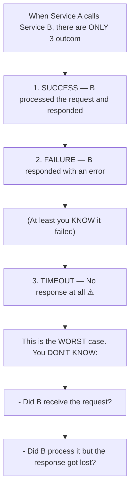
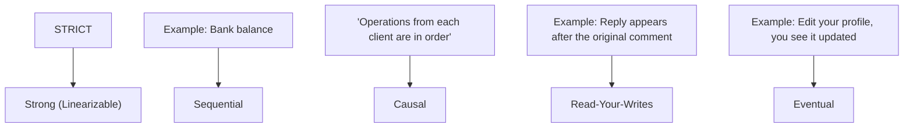
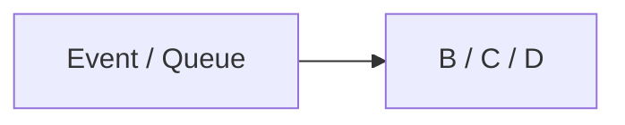
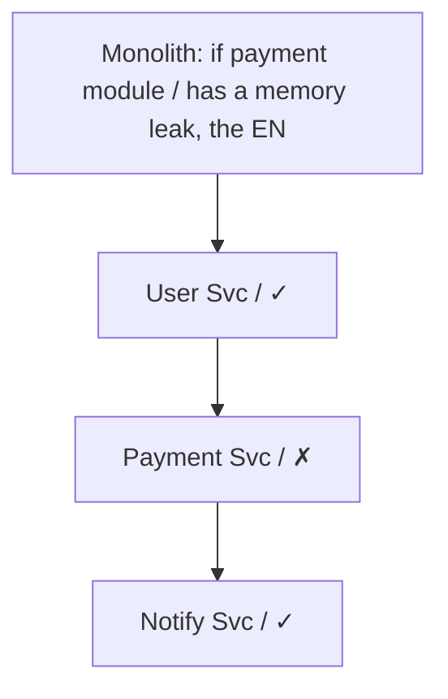

> **Navigation**: [< Previous](15_System_Design_Thinking.md) | [Back to Index](../00_MASTER_INDEX.md) | [Next >](17_Frontend_Architecture_Thinking.md)

# Mental Models — Distributed Systems Thinking

## How to Think About Distributed Systems


> A distributed system is a collection of independent computers
> that APPEARS to the user as a single coherent system.
>
> The challenge: these computers can FAIL INDEPENDENTLY,
> COMMUNICATE SLOWLY, and DISAGREE on what happened.
>
> This guide gives you mental frameworks for reasoning about
> these challenges — not memorizing solutions.


---

## Mental Model 1: The Network Is NOT Reliable


> THE 8 FALLACIES OF DISTRIBUTED COMPUTING (Peter Deutsch, 1994)
>
> Things developers WRONGLY ASSUME:
>
> 1. The network is reliable          → Packets get LOST
> 2. Latency is zero                  → It's NEVER instant
> 3. Bandwidth is infinite            → There ARE limits
> 4. The network is secure            → Always ASSUME it's not
> 5. Topology doesn't change          → Servers come and GO
> 6. There is one administrator       → Multiple TEAMS manage it
> 7. Transport cost is zero           → Data transfer COSTS money
> 8. The network is homogeneous       → Different HARDWARE exists
>
> PRACTICAL IMPLICATION:
> Every network call CAN fail. Every response CAN be delayed.
> Design every remote interaction with timeout + retry + fallback.


---

## Mental Model 2: The Three Possible Outcomes

```
When Service A calls Service B, there are ONLY 3 outcomes:

1. SUCCESS — B processed the request and responded

2. FAILURE — B responded with an error
   (At least you KNOW it failed)

3. TIMEOUT — No response at all ⚠️
   This is the WORST case. You DON'T KNOW:
   - Did B receive the request?
   - Did B process it but the response got lost?
   - Is B still processing?
   - Is B dead?

┌──────────────────────────────────────────────┐
│  A ──[request]──→ B                          │
│  A ←──[???]──── B  ← What happened?          │
└──────────────────────────────────────────────┘

DESIGN RULE: Make operations IDEMPOTENT so retrying is safe.
If the same request is processed twice, the result is the same.

Idempotent: GET /user/123         (safe to retry)
Idempotent: PUT /user/123 {name}  (safe to retry)
NOT Idem:   POST /payments         (might charge twice!)
FIX:        POST /payments + idempotency_key=abc123
```

**Flow:**
- When Service A calls Service B, there are ONLY 3 outcom
- ↓
- 1. SUCCESS — B processed the request and responded
- ↓
- 2. FAILURE — B responded with an error
- ↓
- (At least you KNOW it failed)
- ↓
- 3. TIMEOUT — No response at all ⚠️
- ↓
- This is the WORST case. You DON'T KNOW:
- ↓
- - Did B receive the request?



---

## Mental Model 3: Consistency Is a Spectrum

```
CONSISTENCY SLIDER — Not Just "Consistent" or "Inconsistent"

STRICT
├─── Strong (Linearizable)
│    "Everyone always sees the latest write"
│    Cost: SLOW (wait for all replicas)
│    Example: Bank balance
│
├─── Sequential
│    "Operations from each client are in order"
│
├─── Causal
│    "If A caused B, everyone sees A before B"
│    Example: Reply appears after the original comment
│
├─── Read-Your-Writes
│    "You see your own updates immediately"
│    Others might see a stale version temporarily
│    Example: Edit your profile, you see it updated
│
├─── Eventual
│    "All replicas converge... eventually"
│    Cost: FAST (respond from any replica)
│    Example: Social media like counts
RELAXED

KEY INSIGHT: Pick the weakest consistency that's ACCEPTABLE
for each feature. Not everything needs strong consistency.
Post likes? Eventual is fine.
Money transfer? Strong consistency is mandatory.
```

**Flow:**
- STRICT
- ↓
- Strong (Linearizable)
- ↓
- Example: Bank balance
- ↓
- Sequential
- ↓
- 'Operations from each client are in order'
- ↓
- Causal
- ↓
- Example: Reply appears after the original comment
- ↓
- Read-Your-Writes
- ↓
- Example: Edit your profile, you see it updated
- ↓
- Eventual



---

## Mental Model 4: The Clock Problem


> CLOCKS IN DISTRIBUTED SYSTEMS ARE UNRELIABLE
>
> Server A's clock: 10:00:00.000
> Server B's clock: 10:00:00.150  ← 150ms ahead!
>
> If both process a "write" at the same time, which came first?
> Using wall clocks: B appears to be later (but it wasn't!)
>
> SOLUTIONS:
>
> 1. Logical Clocks (Lamport Clocks)
> - Counter that increments on each event
> - "Event A happened before Event B" (causal ordering)
> - CANNOT tell if events are concurrent
>
> 2. Vector Clocks
> - Each node maintains a vector [A:1, B:2, C:0]
> - CAN detect concurrent events (potential conflicts)
> - Used in DynamoDB, Riak
>
> 3. Hybrid Logical Clocks (HLC)
> - Combines physical time + logical counter
> - Best of both worlds
> - Used in CockroachDB, YugabyteDB
>
> PRACTICAL RULE: Never use System.currentTimeMillis() for
> ordering events across multiple servers.


---

## Mental Model 5: Split-Brain and Consensus


> THE SPLIT-BRAIN PROBLEM
>
> What happens when the network PARTITIONS?
>
> BEFORE PARTITION:
> [Node A] ←──→ [Node B] ←──→ [Node C]  (all connected)
> Leader
>
> AFTER PARTITION:
> [Node A] ←──→ [Node B]    |    [Node C]  (C is isolated)
> Leader                  |
>
> Node C thinks A is dead → elects itself as leader!
> Now TWO leaders accepting writes = DATA CORRUPTION
>
> SOLUTION: Quorum-based consensus
> - Need MAJORITY (N/2 + 1) to agree on anything
> - 3 nodes → need 2 to agree
> - 5 nodes → need 3 to agree
> - Node C alone CANNOT form a quorum → refuses writes
>
> This is why you always run ODD numbers of nodes: 3, 5, 7
> (With 4 nodes, a 2-2 split means NO side has majority)


---

## Mental Model 6: Eventual Consistency Is Not Chaos


> Many developers fear "eventual consistency" because it sounds
> unpredictable. But it's VERY well-defined:
>
> DEFINITION: If no new updates are made, eventually ALL replicas
> will converge to the SAME value.
>
> "Eventually" in practice:
> - Same data center: milliseconds to seconds
> - Cross-region: seconds to a few minutes
>
> TECHNIQUES TO MAKE IT WORK:
>
> 1. CRDTs (Conflict-Free Replicated Data Types)
> - Mathematically guaranteed to converge
> - Example: G-Counter (grow-only counter)
> Each node has its own counter. Total = sum of all.
> Never conflicts because additions are commutative.
>
> 2. Last-Writer-Wins (LWW)
> - Latest timestamp wins
> - Simple but can lose data
>
> 3. Application-level conflict resolution
> - Let the user decide
> - Example: Google Docs shows both versions for you to merge
>
> INSIGHT: Choose the right conflict strategy per data type.
> Counter → CRDT. User profile → LWW. Document → user merge.


---

## Mental Model 7: Think in Data Flow, Not API Calls

```
Synchronous (request/response) thinking:
A calls B calls C calls D → if any fails, everything fails

┌───┐    ┌───┐    ┌───┐    ┌───┐
│ A │ →  │ B │ →  │ C │ →  │ D │    If C is slow, A is slow.
└───┘    └───┘    └───┘    └───┘    If D dies, A gets an error.

─────────────────────────────────────────────────

Data flow (event-driven) thinking:
Each service processes events independently

┌───┐    ┌────────┐    ┌───┐
│ A │ →  │ Event  │ →  │ B │
└───┘    │ Queue  │ →  │ C │    If C is slow, A doesn't care.
         └────────┘ →  │ D │    If D dies, events wait.
                       └───┘    Each processes at own pace.

WHEN TO USE WHICH:
Sync: User needs immediate response (login, payment)
Async: User doesn't need immediate response (email, analytics)
Hybrid: Acknowledge immediately, process in background
```

**Flow:**
- Event / Queue
- ↓
- B / C / D



---

## Mental Model 8: The Blast Radius

```
BLAST RADIUS: How much of the system is affected when
one component fails?

LARGE BLAST RADIUS (BAD):
┌────────────────────────────────┐
│  Monolith: if payment module   │
│  has a memory leak, the ENTIRE │
│  application crashes           │
└────────────────────────────────┘

SMALL BLAST RADIUS (GOOD):
┌────────────┐  ┌────────────┐  ┌────────────┐
│  User Svc  │  │ Payment Svc│  │ Notify Svc │
│     ✓      │  │     ✗      │  │     ✓      │
└────────────┘  └────────────┘  └────────────┘
Payment is down but users can still browse and get notifications

TECHNIQUES TO REDUCE BLAST RADIUS:
• Bulkhead: Separate thread pools per dependency
• Circuit Breaker: Stop calling a failing service
• Feature Flags: Disable features without deploying
• Canary Deploys: Roll out to 5% of traffic first
• Cell Architecture: Independent copies serving different users
```

**Flow:**
- Monolith: if payment module / has a memory leak, the EN
- ↓
- User Svc / ✓
- ↓
- Payment Svc / ✗
- ↓
- Notify Svc / ✓



---

## Mental Model 9: Exactly-Once Is a Lie


> DELIVERY SEMANTICS IN DISTRIBUTED SYSTEMS
>
> At-most-once:  Send and forget. Might lose messages.
> → Good for: analytics, non-critical notifications
>
> At-least-once: Retry until acknowledged. Might duplicate.
> → Most systems use this + IDEMPOTENCY
>
> Exactly-once:  Each message processed exactly once.
> → IMPOSSIBLE in theory (FLP impossibility)
> → In practice: "effectively once" via
> deduplication + idempotent processing
>
> HOW TO ACHIEVE "EFFECTIVELY ONCE":
>
> 1. Assign unique ID to each message
> 2. Before processing, check: "Have I seen this ID?"
> 3. If yes → skip (already processed)
> 4. If no → process + record the ID atomically
>
> -- PostgreSQL example
> INSERT INTO processed_events (event_id, result)
> VALUES ('evt_123', 'success')
> ON CONFLICT (event_id) DO NOTHING;


---

## The Distributed Systems Decision Cheat Sheet


> SITUATION                  │  THINK ABOUT
> Need low latency worldwide │  CDN + read replicas in regions
> Need data safety           │  WAL + synchronous replication
> Hot partition (one key     │  Better partition key or scatter
> gets all traffic)          │
> Cascading failure          │  Circuit breaker + bulkhead
> Stale data in cache        │  TTL + cache invalidation events
> Two services need to       │  Saga pattern (not distributed
> agree on outcome           │  transactions)
> Need ordering guarantee    │  Single partition in Kafka
> Service discovery          │  Consul, Eureka, K8s DNS
> Config across services     │  Central config (Spring Cloud)


---

*Distributed systems thinking is about accepting uncertainty and building systems that work DESPITE it, not pretending it doesn't exist.*


---

> **Navigation**: [< Previous](15_System_Design_Thinking.md) | [Back to Index](../00_MASTER_INDEX.md) | [Next >](17_Frontend_Architecture_Thinking.md)