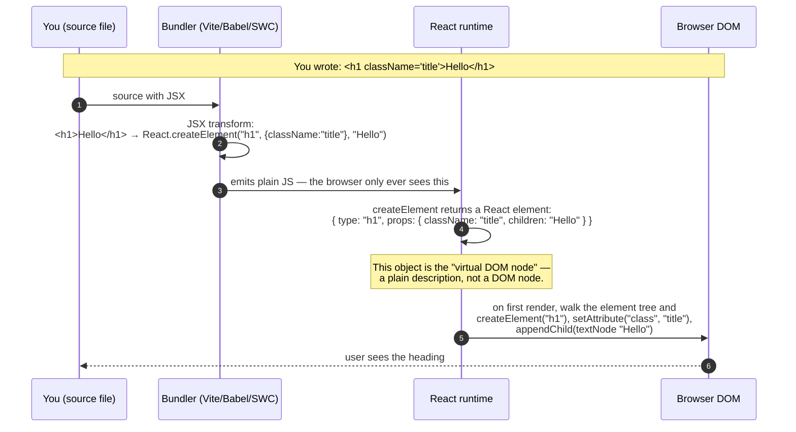
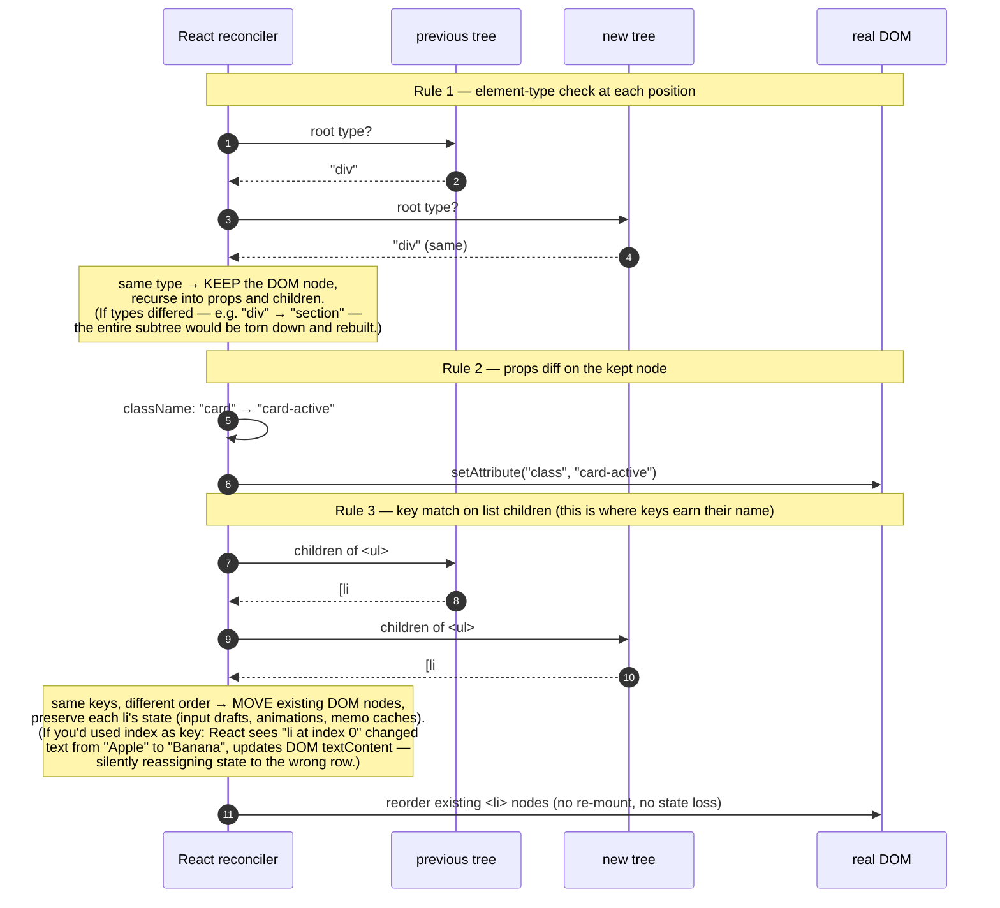
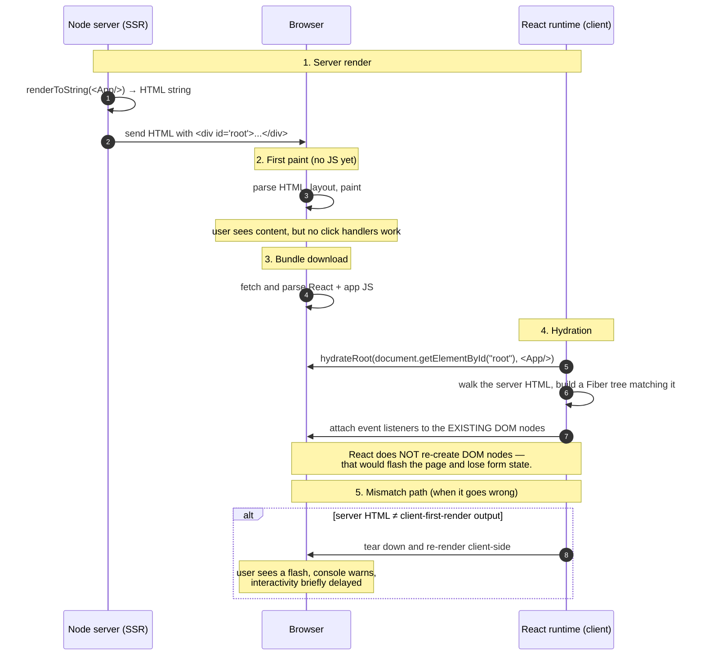
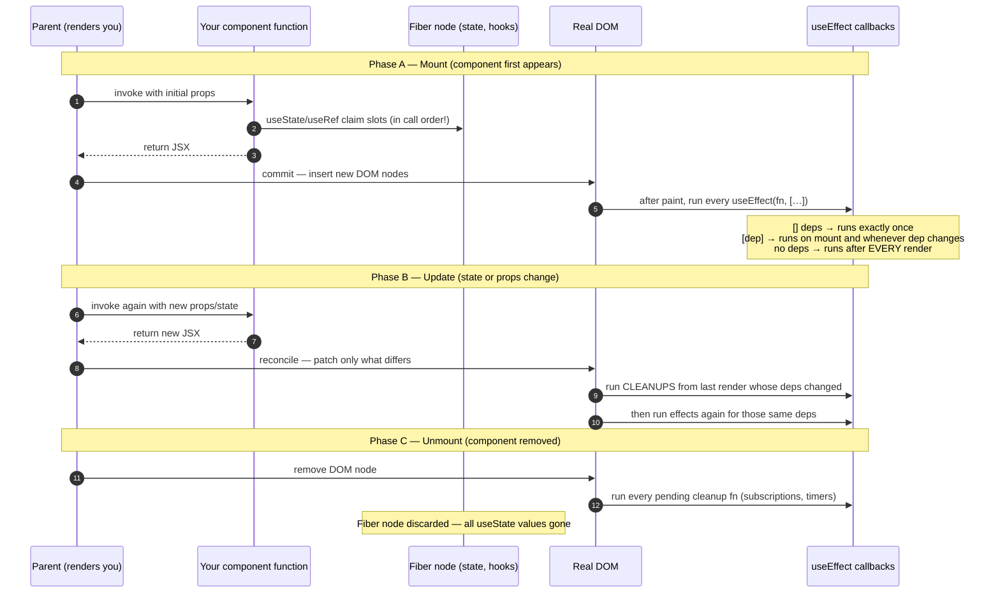
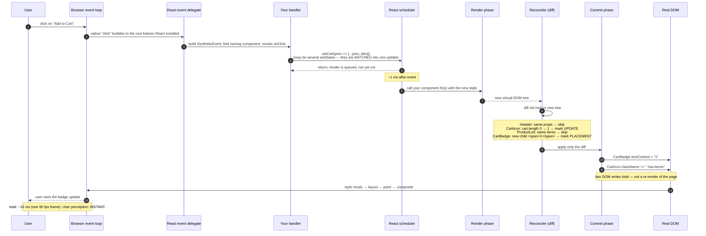

**Navigation**: [Back to Index](../00_MASTER_INDEX.md) | [Next: Hooks Deep Dive →](03_Hooks_Deep_Dive.md)
🧠 **Mental Model**: See [Frontend Architecture Thinking](../14_Mental_Models/17_Frontend_Architecture_Thinking.md)

> [!IMPORTANT]
> **📌 Prerequisite:** This guide assumes JavaScript ES6+ knowledge.
>
> If you haven't studied JavaScript yet, start with **[16_JavaScript/01_JS_Foundations.md](../16_JavaScript/01_JS_Foundations.md)** first.
>
> Key concepts you need: Arrow functions, Destructuring, Array methods (map/filter/reduce), Modules (import/export), Closures, Promises.

---

# ⚛️ React Fundamentals — Core Concepts from Scratch

Everything you need to understand before writing production React — Components, JSX, Props, State

---

### Historical Evolution

React's declarative component model evolved from Facebook's XHP framework into the dominant frontend paradigm, displacing imperative DOM libraries like jQuery.

| Year | Milestone |
|------|-----------|
| 2006 | jQuery released — imperative DOM manipulation becomes the standard |
| 2010 | XHP: Facebook's PHP component framework proves component-based UI scales |
| 2011 | JSX created alongside the FaxJS prototype at Facebook |
| 2013 | React open-sourced at JSConf US — virtual DOM and unidirectional data flow |
| 2014 | Vue.js released, confirming the component model's cross-framework viability |

Before React, jQuery developers manually traversed and mutated the DOM, which produced code that was hard to test and impossible to reason about at scale. XHP showed that composing UI from reusable components worked in production, and React brought that idea to JavaScript with an efficient virtual DOM diffing layer.

**Predecessor:** XHP (2010) — Facebook's PHP component framework that introduced reusable UI components and XML-like syntax
**Modern anchor:** Today every major framework — React, Vue, Angular, Svelte, Solid.js — uses the component model React popularized

### Production Reality

| Failure Mode | Where It Bites | Mitigation |
|--------------|---------------|------------|
| **Hydration mismatch** | SSR app renders different HTML on server vs client; forms or counters show then disappear | Use `<ClientOnly>` wrapper or `suppressHydrationWarning` for deterministic content |
| **Infinite render loop** | `useEffect` updates state it also reads, missing from deps array; page freezes | Audit every `setState` inside `useEffect`, use functional updates, lint with exhaustive-deps |
| **Key prop misuse** | Using array index as `key` in sortable/filterable lists; state "jumps" between rows | Always use stable IDs from data; only use index for static, never-reordered lists |

These failures cluster around React's fundamentals because juniors often learn JSX syntax before understanding React's reconciler contract (keys, state references, and SSR/client boundaries).

---

### Variant Trade-offs: React vs Vue vs Svelte vs Solid

| Framework | Bundle Size | Mental Model | Best For | Trade-off |
|-----------|------------|--------------|----------|-----------|
| **React** | ~40 KB (react+react-dom) | Component tree with unidirectional flow | Large teams, complex SPAs, huge ecosystem | Boilerplate for state management; no built-in router/forms |
| **Vue** | ~34 KB (vue.runtime) | Template-based with options/composition API | Rapid prototyping, small-to-medium apps, gradual adoption | JSX less natural; smaller enterprise ecosystem |
| **Svelte** | ~5 KB compiler output | Compile-time reactivity, no virtual DOM | Performance-critical apps, embedded widgets | Smaller ecosystem; hiring pool is thinner |
| **Solid** | ~7 KB | Fine-grained reactivity (signals), no VDOM | Maximum performance, real-time dashboards | Very new; tooling and ecosystem immature |

**Selection rule:** Choose **React** when you need hiring velocity, massive ecosystem, and long-term maintainability. Choose **Vue** when you want gentler learning curve and fast prototyping. Choose **Svelte** for performance-constrained environments (low-end devices). Choose **Solid** only if you have a specialized performance need and can absorb ecosystem risk.

---

## Section 0: War Stories — When React Basics Caused Production Bugs

> Three incidents caused by misunderstanding React's fundamentals — not advanced hooks or performance, just the basics in this chapter.

### Story 1: Direct State Mutation — Cart Showed Wrong Item Count for 4 Months

A junior developer built a shopping cart. The item count in the nav bar never updated after adding items:

```jsx
// ❌ Direct mutation — React never knows state changed
function addItem(newItem) {
  cart.items.push(newItem);  // mutating the existing array
  setCart(cart);             // passing the SAME object reference
}
```

`setCart(cart)` passes the same object reference that was already in state. React compares old state to new state by reference (`===`). Since it's the same object, React sees "nothing changed" and skips the re-render. The cart internally updated (the `push` worked), but the UI was stale.

The fix: always create new objects/arrays for state updates:

```jsx
// ✅ New array reference — React knows state changed
function addItem(newItem) {
  setCart(prev => ({
    ...prev,
    items: [...prev.items, newItem]  // spread = new array
  }));
}
```

**The lesson:** React uses **immutable state updates** — state must be replaced, not mutated. This chapter's "State Updates" section explains exactly why.

---

### Story 2: Props Passed the Wrong Type — Form Silently Submitted Empty

A form component expected `onSubmit` as a function prop:

```jsx
// Child component
function LoginForm({ onSubmit }) {
  return <button onClick={onSubmit}>Login</button>;
}

// Parent — accidentally passed a string instead of a function
<LoginForm onSubmit="handleLogin" />
//                  ^^^^^^^^^^ string, not the function reference
```

In JSX, `onSubmit="handleLogin"` passes the string `"handleLogin"`, not the function `handleLogin`. When the button was clicked, the browser tried to call a string as a function and threw `TypeError: onSubmit is not a function` — swallowed by a try-catch wrapping the form. The form appeared to "submit" (button styling triggered) but nothing happened. Bug lived for 4 months on a rarely-used admin page.

The fix:

```jsx
// ✅ Curly braces = JS expression = the function itself
<LoginForm onSubmit={handleLogin} />
```

**The lesson:** in JSX, `prop="value"` always passes a string. `prop={expression}` passes a JavaScript value. Props are typed — you can enforce this with PropTypes or TypeScript.

---

### Story 3: Missing `key` Prop — List Reorder Corrupted Input Values

A team had a to-do list where items could be reordered by drag-and-drop. After reordering, text inputs inside the items showed wrong values — the text from item 2 appeared in item 1's input after drag:

```jsx
// ❌ Missing key — React can't track which list item is which
{todos.map((todo, index) => (
  <TodoItem todo={todo} />  // no key prop
  // React uses the array index implicitly → wrong after reorder
))}
```

React uses `key` to track which DOM element corresponds to which list item between renders. Without `key`, React matches by array position. After reordering `[A, B, C]` to `[C, A, B]`:
- React sees position 0 changed from A to C → updates the text content but **reuses the DOM node**
- The input element (which React doesn't control if it's uncontrolled) retains its DOM state — the user-typed text from A's input stays, now showing under C

Fix: use the item's unique ID as the key:

```jsx
{todos.map((todo) => (
  <TodoItem key={todo.id} todo={todo} />  // stable unique ID
))}
```

**The lesson:** `key` must be unique and stable. Using array index as key only works when the list never reorders or changes length. This chapter's "Lists and Keys" section explains the reconciliation algorithm.

---

## 5W1H — Why This Chapter?

> **What React is, why it beat what came before, and what it doesn't do.**
>
> **What.** React is a JavaScript *library* (not a framework) whose job
> is one thing: given a description of a UI as a tree of components,
> render it to the DOM and keep it in sync as the underlying data
> changes. It does not do routing, HTTP, forms, or state management —
> those are library choices you assemble around it.
>
> **Why it exists — what the previous approach couldn't handle.**
> jQuery (2006) let you push updates *at* the DOM: `$("#cart").html(newHtml)`.
> That works for one widget; it doesn't scale to an app with fifty
> interconnected pieces of state because *nobody knows what the current
> DOM looks like at any moment*. Two developers touching two widgets
> that share a piece of data will each write imperative code to sync,
> and one of them will forget. React (2013) flipped the model:
> `UI = f(state)`. You describe the target shape given the current
> state, React does the diff-and-patch against whatever the DOM
> currently is. Every render starts from a single source of truth.
>
> **Who and when.** Written by Jordan Walke at Facebook in 2013 to fix
> the newsfeed's cross-component sync problem. Now runs Facebook,
> Instagram, Netflix, Airbnb, Uber, and a large chunk of every
> team-scale web codebase. Learn it *after* HTML/CSS/JS and modern
> JS features (arrow fns, destructuring, modules) because React
> assumes them.
>
> **Where it runs.** Browsers via `react-dom`, native mobile via
> React Native, servers via Next.js (server-rendered HTML), CLIs via
> Ink, native desktop via Electron/Tauri. Same programming model —
> different renderers.
>
> **How, in one sentence.** You write components. React builds a
> tree of plain JS "element" objects (the virtual DOM). When state
> changes it builds a new tree, diffs it against the previous one,
> and applies the minimal set of DOM operations to catch the real
> DOM up. That's the entire model — everything else is
> optimisations on top.

### Where It's Used in Real World

- **Facebook/Instagram**: The original use case — React powers the dynamic newsfeeds, stories, and messaging UIs for billions of users.
- **Netflix**: Uses React for its TV interface and browsing experience, optimized for low-powered smart TV hardware.
- **Airbnb**: Entire booking flow and search interface built with React, with server-side rendering via Next.js for SEO.
- **Shopify**: Admin dashboard and storefront editor use React for complex drag-and-drop UI interactions.
- **Discord**: Real-time chat, voice channels, and server management — all React-powered with custom virtual scrolling.

### 🔗 Cross-References to DSA Concepts

| React Concept                      | Underlying DSA/Algorithm                                                   |
| ---------------------------------- | -------------------------------------------------------------------------- |
| Virtual DOM Diffing                | [Tree Algorithms — DFS/BFS](../03_Algorithms/05_Trees.md)                  |
| Reconciliation (O(n) heuristic)    | [Algorithm Thinking](../03_Algorithms/01_Algorithm_Thinking.md)            |
| useState hooks array               | [Arrays](../02_Data_Structures/01b_Arrays.md)                              |
| Context API (Provider tree)        | [Trees & Heaps](../02_Data_Structures/01f_Trees_Heaps.md)                  |
| Event delegation (single listener) | [Design Patterns — Observer](../06_OOP_Design/02_Design_Patterns.md)       |
| useMemo / React.memo (caching)     | [DP — Memoization](../03_Algorithms/04b_DP_Fundamentals.md)                |
| Component composition              | [OOP — Composition vs Inheritance](../06_OOP_Design/01_OOPS_Principles.md) |

---

## Part 1: What is React and Why?

### The Problem React Solves

```
BEFORE REACT — The DOM Management Problem:
───────────────────────────────────────────

Imagine you're building a chat app. A new message arrives.
You need to:
  1. Find the message list in the DOM
  2. Create a new <li> element
  3. Set its text content
  4. Append it to the list
  5. Scroll to bottom
  6. Update the unread counter
  7. Update the badge on the tab
  8. If the sender is online, update their avatar border

Now imagine 50 such interactions happening simultaneously.
With jQuery/vanilla JS, you're manually tracking and updating
each DOM element. One bug = stale UI or missing update.

ANALOGY: Imperative is like giving turn-by-turn directions.
         "Go left, then right, then straight for 2 miles..."
         Declarative is like giving the destination.
         "Take me to 123 Main St" — the GPS figures out HOW.

React's insight: What if the UI was just a FUNCTION of data?
                 data changes → entire UI re-described → React
                 figures out the minimal DOM updates needed.
```

### React's Core Philosophy

React is a LIBRARY for building user interfaces (not a framework!)

KEY IDEAS:

1. **Component-Based**: UI = tree of reusable components
2. **Declarative**: Describe WHAT to render, React handles HOW
3. **Virtual DOM**: React diffs changes, updates only what changed
4. **One-Way Data Flow**: Data flows Parent → Child via props

MENTAL MODEL:

- Traditional: Manually update DOM when data changes (imperative)
- React: UI = f(state) — UI is a FUNCTION of state (declarative)
- When state changes → React re-renders → diffs → updates DOM

### Library vs Framework — Why This Matters

```
FRAMEWORK (Angular, Vue):             LIBRARY (React):
"I call YOUR code"                    "YOU call MY code"
• Full structure imposed               • Only handles the View layer
• Routing built-in                     • Choose your own router
• HTTP client built-in                 • Choose your own fetching
• Form handling built-in               • Choose your own form lib
• Opinionated                          • Flexible (but more decisions)

REASONING: React only does ONE thing — render UI from data.
Everything else (routing, state, forms) is your choice.
This is why React has such a large ecosystem (Next.js, Redux, etc.)
```

---

## Part 2: JSX — JavaScript + HTML

### 5W1H: What is JSX and Why?

> **JSX = JavaScript XML — a syntax extension that lets you write
> HTML-like element trees inside JavaScript.** It exists because the
> alternative, hand-writing `React.createElement(...)` calls, becomes
> unreadable four elements deep. JSX makes the component tree
> *visually* mirror the DOM tree it will produce, which is the whole
> ergonomic point of React.
>
> **The key mental fix:** *JSX is not HTML*. The browser never sees
> JSX. Your build tool compiles it into function calls, and those
> function calls return plain JavaScript objects that React later
> turns into DOM.

**Trace what happens to a single JSX expression from your source file
to a rendered `<h1>` on screen:**



**How to read this diagram.** Read top to bottom as one JSX expression's journey: you write `<h1 className="title">Hello</h1>`, the bundler's JSX transform turns it into a `React.createElement` call, the React runtime returns a plain element object, and on first render that object is walked to create real DOM nodes. The thing to notice is the note in the middle: the element is just a description (the "virtual DOM node"), not a DOM node.

**Consequences that follow from "JSX compiles to function calls
producing objects":**

- Attributes are *JavaScript-named*, not HTML-named: `className` (not
  `class`), `htmlFor` (not `for`), `onClick` (not `onclick`) —
  because they're keys on a `props` object passed to a function.
- Every render creates *new* element objects. That's why inline
  arrow functions and object literals are new references each render
  and defeat `React.memo` on children (see Reality Check below).
- Conditional rendering follows plain JavaScript truthiness:
  `count && <List/>` renders the literal `0` when `count` is `0`
  because `&&` returns `0`, and React renders numbers as text. Use
  `count > 0 && <List/>` or a ternary.
- JSX children are just an argument passed to `createElement` — so
  you can `map`, `filter`, and forward them as a normal value.

```jsx
// JSX is syntactic sugar for React.createElement()
// ❌ Without JSX:
React.createElement("h1", { className: "title" }, "Hello World");

// ✅ With JSX:
<h1 className="title">Hello World</h1>;

// JSX RULES:
// 1. Return single root element (use <> fragment if needed)
// 2. className instead of class
// 3. htmlFor instead of for
// 4. camelCase for attributes: onClick, onChange, tabIndex
// 5. JavaScript expressions in curly braces: {variable}
// 6. Self-closing tags: , <input />, <br />

function UserCard({ user }) {
  return (
    <>
      <h2>{user.name}</h2>
      <p>{user.age > 18 ? "Adult" : "Minor"}</p>
      {user.isActive && <span className="badge">Active</span>}
      <ul>
        {user.hobbies.map((hobby, i) => (
          <li key={i}>{hobby}</li> // key is REQUIRED in lists
        ))}
      </ul>
    </>
  );
}
```

---

## Part 3: Components — Function Components (Modern React)

### 5W1H: What is a Component?

```
WHAT: A component is a JavaScript FUNCTION that returns React elements
      (JSX). It's a reusable, self-contained piece of UI.

WHY:  The same reason we use functions in programming — REUSABILITY
      and ABSTRACTION. Instead of writing the same login form HTML
      in 5 places, you write <LoginForm /> once.

ANALOGY — LEGO BRICKS:
  Each component is a LEGO brick:
  • Small, self-contained, reusable
  • Has a defined shape (props = inputs)
  • Can be composed into larger structures
  • Can be replaced without rebuilding everything
  • Same brick can be used in different builds

  A webpage is like a LEGO set:
  Header brick + Sidebar brick + Content brick + Footer brick
  Each brick manages its own appearance and behavior.

HOW REACT RENDERS A COMPONENT:
  1. React calls your function: Greeting({ name: "Alice" })
  2. Function returns JSX: <h1>Hello, Alice!</h1>
  3. JSX compiles to: { type: 'h1', props: { children: 'Hello, Alice!' } }
  4. React uses this object to create/update the actual DOM node
  5. If called again with same props → React can SKIP the DOM update

CLASS vs FUNCTION COMPONENTS:
  Class components (2013-2018): stateful with lifecycle methods
  Function components (2019+): stateful with Hooks ← MODERN STANDARD
  React Hooks (2019) made class components obsolete for new code.
  99% of new React code uses function components.
```

```jsx
// ── Simple Component ──
function Greeting({ name }) {
  return <h1>Hello, {name}!</h1>;
}

// Arrow function variant
const Greeting = ({ name }) => <h1>Hello, {name}!</h1>;

// ── Component Composition ──
function App() {
  return (
    <div>
      <Header />
      <main>
        <Greeting name="Alice" />
        <Greeting name="Bob" />
      </main>
      <Footer />
    </div>
  );
}

// COMPONENT TREE:
//       App
//      / | \
//  Header Main Footer
//         |
//      Greeting (×2)
```

---

🔬 **Section Challenge — Part 3: Components — Function Components**

**Challenge 1 (Reasoning):** React says "component render must be a pure function". What does PURE mean and what breaks if it's impure?

<details><summary>Answer</summary>

Pure = same inputs (props + state) always return same output (JSX). No side effects during render. Impure examples: writing to a global variable, calling fetch(), reading mutable globals. Why it breaks: React may call your render function multiple times in development (StrictMode) or abort renders mid-way (Concurrent Mode). If render has side effects, those effects run multiple times with unpredictable results. Rule: ALL side effects must go inside `useEffect`, not in the render body.

</details>

**Challenge 2 (Structural):** Parent has `useState`. Parent re-renders. Child receives the SAME props as before. Does Child re-render?

<details><summary>Answer</summary>

YES — by default, when a parent re-renders, ALL children re-render too, even if their props didn't change. React re-calls the child function. This is why `React.memo()` exists: it wraps a component to skip re-render if props are shallowly equal. Key insight: re-rendering ≠ DOM update. React re-renders (calls the function), then reconciles — only changed DOM nodes are actually updated. Unnecessary re-renders waste CPU time but don't always cause visible issues.

</details>

## Part 4: Props — Data Flows Down

### 5W1H: What are Props?

```
WHAT: Props ("properties") are the INPUTS to a component.
      They are READ-ONLY data passed from parent to child.

WHY:  Components need data to render. But if every component
      fetched its own data, you'd have chaos. Props enforce a
      clear, predictable data flow: Parent → Child.

ANALOGY — FUNCTION ARGUMENTS:
  Props are EXACTLY like function arguments.
  function greet(name) {}  →  function Greeting({ name }) {}
  greet("Alice")           →  <Greeting name="Alice" />

  Just as you can't modify function arguments (immutable),
  you can't modify props. They are READ-ONLY.

ANALOGY — RESTAURANT ORDER:
  Parent = customer placing an order (passes props)
  Child = kitchen receiving the order (reads props)
  The kitchen can't change what the customer ordered.
  It can only COOK based on what it received.

ONE-WAY DATA FLOW — WHY IT MATTERS:
  Data flows DOWN: Parent → Child → Grandchild
  Events flow UP: Grandchild → Child → Parent (via callbacks)

  This makes debugging EASY:
  "Where did this data come from?" → Follow props UP the tree.
  "Why did this component re-render?" → A prop changed.

  Angular uses TWO-WAY binding: data flows both ways.
  React chose ONE-WAY because it's more predictable at scale.
  Facebook found two-way binding caused cascading updates
  that were impossible to debug in large applications.
```

```jsx
// Props = read-only data passed from parent to child
// NEVER modify props directly!

function ProductCard({ title, price, onAddToCart }) {
  return (
    <div className="card">
      <h3>{title}</h3>
      <p>${price.toFixed(2)}</p>
      <button onClick={() => onAddToCart(title)}>Add to Cart</button>
    </div>
  );
}

// Parent passes data + callbacks
function ProductList() {
  const handleAdd = (title) => console.log(`Added: ${title}`);

  return (
    <div>
      <ProductCard title="Laptop" price={999.99} onAddToCart={handleAdd} />
      <ProductCard title="Mouse" price={29.99} onAddToCart={handleAdd} />
    </div>
  );
}

// COMMON PATTERNS:
// Children prop (composition):
function Card({ children, title }) {
  return (
    <div className="card">
      <h3>{title}</h3>
      <div className="card-body">{children}</div>
    </div>
  );
}
// Usage: <Card title="Info"><p>Any content here</p></Card>

// Default props:
function Button({ variant = "primary", size = "md", children }) {
  return (
    <button className={`btn btn-${variant} btn-${size}`}>{children}</button>
  );
}
```

---

## Part 5: State — useState Hook

### 5W1H: What is State?

```
WHAT: State is DATA that a component OWNS and can CHANGE.
      When state changes, React RE-RENDERS the component.

WHY:  Props come from outside (read-only). But components need
      their OWN data that changes over time — user input, API
      responses, toggle states, form fields, counters.
```

**Props vs state — the difference that matters, with mechanism, not analogy:**

| Aspect                | Props                                                                   | State                                                                    |
|-----------------------|-------------------------------------------------------------------------|--------------------------------------------------------------------------|
| Who owns the value    | The **parent** component                                                | **This** component                                                       |
| Can this component write it? | **No** — read-only inside the receiver                          | **Yes**, via the setter returned by `useState`                            |
| What triggers a re-render? | Parent renders with a new value                                    | You call the setter with a not-`Object.is`-equal value                    |
| Where it lives at runtime | Argument to your component function                                  | React stores it in the component's Fiber node (see next section)         |
| Purpose               | *Configure* what this component should look like from outside            | *Track* data that changes over this component's lifetime                  |

**The rule that follows from ownership.** A component may *read* props
and state, but may only *write* state. If you find yourself wanting
to write to a prop, the value belongs to the parent — lift the
setter up (parent owns state, passes both value and setter down) or
push state down (move ownership to the smallest component that
actually needs it).

```
HOW useState WORKS INTERNALLY:
  React stores state values in an ARRAY on the component's Fiber node.
  Each useState() call corresponds to an INDEX in this array.

  First render:   hooks = [0]           ← useState(0) stores at index 0
  setCount(5):    hooks = [5]           ← state updated, re-render scheduled
  Second render:  hooks = [5]           ← useState(0) returns hooks[0] = 5

  THIS IS WHY hooks must be called in the same order every render!
  If you put useState inside an if-block, the indices shift and ReactIf you put useState inside an if-block, the indices shift and React
  returns the wrong state to the wrong hook.
```

```jsx
import { useState } from "react";

function Counter() {
  // state variable, setter function = useState(initialValue)
  const [count, setCount] = useState(0);

  return (
    <div>
      <p>Count: {count}</p>
      <button onClick={() => setCount(count + 1)}>+1</button>
      <button onClick={() => setCount((prev) => prev - 1)}>-1</button>
      {/*                     ↑ functional update for safety */}
      <button onClick={() => setCount(0)}>Reset</button>
    </div>
  );
}

// STATE RULES:
// 1. Always use setter, never mutate directly: count++ ❌  setCount(count+1) ✅
// 2. State updates are ASYNCHRONOUS (batched)
// 3. Use functional update when new state depends on old: prev => prev + 1
// 4. useState with objects: ALWAYS spread + create new object

// 🎓 MIT/KTH SYSTEMS DEEP DIVE: Stack vs. Heap Memory
// Why does mutating an object directly (e.g., `form.name = 'Bob'`) fail to trigger a re-render?
// JavaScript stores objects on the HEAP and their memory address (pointer) on the STACK.
// React's Fiber engine uses `Object.is(oldState, newState)` to decide whether to re-render.
// If you mutate the object, the Heap data changes, but the Stack pointer remains EXACTLY THE SAME.
// Object.is(0x123, 0x123) === true, so React assumes nothing changed!
// The spread operator (`...prev`) creates a shallow copy with a BRAND NEW Heap address,
// which forces React to recognize the change and trigger a render.

// ❌ THE BUG (Pointer Copy)
// const oldForm = form;
// oldForm.name = 'Bob';
// setForm(oldForm); // React does nothing!

// ✅ THE SYSTEMS FIX (Brand New Memory Address)
function Form() {
  const [form, setForm] = useState({ name: "", email: "" });

  const handleChange = (field, value) => {
    // The spread operator creates a new object in the Heap.
    // WARNING: Spread is a SHALLOW copy. For deeply nested objects,
    // you must use structuredClone() or nested spreads.
    setForm((prev) => ({ ...prev, [field]: value }));
  };

  return (
    <>
      <input
        value={form.name}
        onChange={(e) => handleChange("name", e.target.value)}
      />
      <input
        value={form.email}
        onChange={(e) => handleChange("email", e.target.value)}
      />
    </>
  );
}
```

---

## Part 6: Event Handling

### 5W1H: How Does React Handle Events?

```
WHAT: React uses SYNTHETIC EVENTS — a cross-browser wrapper around
      native DOM events. onClick, onChange, onSubmit are all synthetic.

WHY:  Different browsers handle events differently. React normalizes
      them into a consistent API so you don't write browser-specific code.

HOW IT WORKS INTERNALLY (Event Delegation):
  React does NOT attach event listeners to individual DOM elements!

  Old approach (React v16-):  Listeners attached to document root
  Modern approach (React v17+): Listeners attached to React root container

  When you write: <button onClick={handleClick}>Click</button>
  React does NOT do: button.addEventListener('click', handleClick)

  Instead:
  1. React attaches ONE click listener to the root <div id="root">
  2. When ANY click happens, it bubbles up to root
  3. React determines WHICH component the click belonged to
  4. React creates a SyntheticEvent wrapping the native event
  5. React calls YOUR handler with the SyntheticEvent

  WHY: One listener for thousands of buttons = much less memory.
  This is the EVENT DELEGATION pattern.

  ANALOGY: A receptionist (root) handles all incoming calls,
  then routes each call to the right department (component).
  Better than giving every employee their own phone line.
```

```jsx
function EventExamples() {
  // Click
  const handleClick = (e) => {
    e.preventDefault(); // prevent default behavior
    e.stopPropagation(); // stop event bubbling
    console.log("Clicked!");
  };

  // 🎓 MIT/KTH SYSTEMS DEEP DIVE: The C++ Browser Reality
  // Why is `e.preventDefault()` necessary?
  // Browsers (1993) natively submit `<form>` data via HTTP `GET`/`POST`
  // which PHYSICALLY destroys the current HTML document and fetches a new one.
  // JavaScript loses control of the Heap and single-page execution is annihilated.
  // We use `e.preventDefault()` to violently hijack the 1993 C++ behavior.

  // Form submit
  const handleSubmit = (e) => {
    e.preventDefault(); // Hijack network destruction & retain JS control
    // process form data safely in JS Memory
  };

  return (
    <form onSubmit={handleSubmit}>
      <button onClick={handleClick}>Click Me</button>
      <input onChange={(e) => console.log(e.target.value)} />
      <input onFocus={() => {}} onBlur={() => {}} />
      <div onMouseEnter={() => {}} onMouseLeave={() => {}} />
    </form>
  );
}

// PASSING ARGUMENTS TO HANDLERS:
// ❌ BAD: <button onClick={handleDelete(id)}>  ← calls immediately!
// ✅ GOOD: <button onClick={() => handleDelete(id)}>  ← arrow wrapper
```

---

## Part 7: Conditional Rendering & Lists

### Why Keys Matter — The Reconciliation Connection

```
WHEN React re-renders a list, it needs to match OLD items with NEW items.
Without keys, React compares by POSITION:
  Old: [Apple, Banana, Cherry]
  New: [Banana, Cherry]       ← React thinks Apple became Banana, Banana became Cherry
                                 and Cherry was deleted. Wrong! Apple was deleted.

With keys, React compares by IDENTITY:
  Old: [key:1→Apple, key:2→Banana, key:3→Cherry]
  New: [key:2→Banana, key:3→Cherry]
  React: "Key 1 is gone → remove Apple. Keys 2,3 unchanged → keep DOM nodes."

WHY NOT use array index as key?
  If you delete the first item, ALL remaining items get new indices.
  React thinks every item changed → re-renders entire list.
  Plus: form inputs lose their values because React destroys/recreates nodes.

RULE: Use a STABLE, UNIQUE identifier from your data (database ID, UUID).
```

```jsx
function Dashboard({ user, notifications }) {
  // Pattern 1: Ternary
  return (
    <div>
      {user ? <UserProfile user={user} /> : <LoginPrompt />}

      {/* Pattern 2: Short-circuit (show only if true) */}
      {notifications.length > 0 && (
        <NotificationBadge count={notifications.length} />
      )}

      {/* Pattern 3: Early return */}
      {!user && <Navigate to="/login" />}

      {/* Lists with unique keys */}
      <ul>
        {notifications.map((notif) => (
          <li key={notif.id}>
            {" "}
            {/* key = unique, stable identifier */}
            {notif.message}
          </li>
        ))}
      </ul>
    </div>
  );
}

// KEY RULES:
// ✅ Use unique IDs from data: key={item.id}
// ❌ Don't use array index as key (breaks on reorder/delete)
// ❌ Don't use random values: key={Math.random()} (re-renders everything)
```

---

## Part 8: Virtual DOM & Reconciliation — How React Actually Updates the Screen

### The Virtual DOM — React's Core Innovation

```
5W1H: WHY does the Virtual DOM exist?
─────────────────────────────────────

PROBLEM: The real DOM is SLOW.
  document.createElement() → creates a full DOM node with 200+ properties
  Each property change can trigger: style recalculation → layout → paint → composite
  This is called a REFLOW and it's EXPENSIVE.

  If you change 100 elements individually, the browser does 100 reflows.
  If you batch them into one change, the browser does 1 reflow.

  React's Virtual DOM is the BATCHING mechanism.

HOW THE VIRTUAL DOM WORKS:
─────────────────────────

  Step 1: RENDER PHASE (Pure, no side effects)
  Your component function runs and returns JSX.
  JSX compiles to React.createElement() calls.
  These return plain JS objects (Virtual DOM nodes):

  { type: 'div', props: { className: 'card', children: [
      { type: 'h1', props: { children: 'Hello' } },
      { type: 'p',  props: { children: 'World' } }
  ]}}                     ↑ This is the Virtual DOM tree

  Step 2: RECONCILIATION (Diffing)
  React compares the NEW Virtual DOM with the PREVIOUS one.
  It uses a heuristic O(n) algorithm (not O(n³) full tree diff):

  HEURISTIC 1: Different type? → Destroy old tree, build new.
    Old: <div><Counter /></div>
    New: <span><Counter /></span>
    React: Types differ (div vs span) → tear down entire subtree,
           rebuild from scratch. Counter's state is LOST.

  HEURISTIC 2: Same type? → Keep DOM node, update changed attributes.
    Old: <div className="old" style={{color: 'red'}}>Hello</div>
    New: <div className="new" style={{color: 'blue'}}>Hello</div>
    React: Same type (div) → update className and style only.
           Text didn't change → skip it.

  HEURISTIC 3: Lists with keys → Match by key, not position.
    (See keys explanation above)

  Step 3: COMMIT PHASE (Actual DOM updates)
  React applies ONLY the diff to the real DOM.
  All updates are batched into a single browser reflow.


THE FIBER ARCHITECTURE (React 16+):
────────────────────────────────────
  Before Fiber: Reconciliation was SYNCHRONOUS. A large tree diff
  could block the main thread for 100ms+ → janky animations.

  Fiber: Reconciliation is INTERRUPTIBLE. React breaks work
  into small units (fibers) and can PAUSE to let the browser
  handle user input, then RESUME the diff.

  Each Fiber node holds:
  ┌────────────────────────────────────┐
  │ type: 'div' or MyComponent        │
  │ props: { className: 'card' }      │
  │ state: [count: 0]  (hooks array)  │
  │ child: → first child fiber        │
  │ sibling: → next sibling fiber     │
  │ return: → parent fiber            │
  │ effectTag: PLACEMENT | UPDATE     │
  └────────────────────────────────────┘

  ANALOGY: Old React = reading a book in one sitting (can't stop).
           Fiber React = reading a book with bookmarks (can pause,
           do something else, come back).

  This is how React 18's concurrent features work:
  startTransition(), Suspense, useDeferredValue — all powered by Fiber.
```

---

### Reconciliation Algorithm (Diffing)

**Trace the diff on a tiny before/after tree so the three heuristics
show their teeth:**

```jsx
// Before render:
<div className="card">
  <ul>
    <li key="a">Apple</li>
    <li key="b">Banana</li>
  </ul>
</div>

// After render (user swapped Apple and Banana, then changed div class):
<div className="card-active">
  <ul>
    <li key="b">Banana</li>
    <li key="a">Apple</li>
  </ul>
</div>
```



**How to read this diagram.** The diagram walks the reconciler's three rules in order: compare the element type at each position (same `div`, so keep the node), diff the props on the kept node (`className` changes, so one `setAttribute`), then match list children by key. The thing to notice is the last rule: the keys `a` and `b` are the same but swapped, so React moves the existing `<li>` nodes and keeps their state instead of rebuilding them.

### Hydration: Server HTML → Interactive React

**Trace what happens between "server got the request" and "the user
can click things" for an SSR page like Next.js:**



**How to read this diagram.** The numbered notes are the five stages of server-side rendering: the server renders an HTML string, the browser paints it with no JS yet, the bundle downloads, React hydrates by attaching listeners to the existing DOM, and a mismatch path handles the failure case. The thing to notice is that hydration reuses the server's DOM nodes; only on a mismatch does React tear down and re-render client-side.

**The invariant that keeps hydration cheap:** *server-rendered HTML
must exactly equal the client's first render*. Any divergence and
React discards the server DOM and re-renders from scratch — the
worst of both worlds (slow SSR + slow CSR). The usual culprits:
`Date.now()`, `Math.random()`, and `localStorage` reads inside the
render body — all three return different values on server vs
client. Fix: read them in `useEffect` after mount, or feed them in as
props/context computed once on the server.

---

## Part 9: Component Lifecycle Cheat Sheet

**Function-component lifecycle traced through Mount → Update → Unmount
— what React runs when, and where your effects and cleanups land:**



```jsx
useEffect(() => {
  const timer = setInterval(tick, 1000);
  return () => clearInterval(timer); // ← cleanup: runs on next dep-change AND on unmount
}, []);
```

**Two facts that fix most useEffect bugs:**

1. **Cleanup runs BEFORE the next effect, not after it.** If you
   subscribe to a socket in one render and the URL prop changes,
   React runs the OLD cleanup (unsubscribe from old URL), then runs
   the NEW effect (subscribe to new URL). This ordering is why you
   never see overlapping subscriptions.
2. **The dependency array is a *comparison list*, not a scheduler.**
   React re-runs the effect when any dep changes by
   `Object.is`. Inline objects/functions in deps change every render
   (new reference), so an effect with `[options]` where `options` is
   an inline literal will run forever. Fix: `useMemo` / `useCallback`
   or lift the value out.

---

## Part 10: Real-World Simulation — How a Click Updates the Screen

**End-to-end trace of a single "Add to cart" click. Notice how many
distinct participants — event system, scheduler, reconciler, commit
phase, browser — conspire to produce one 16 ms frame:**



**How to read this diagram.** Follow the arrows through one "Add to cart" click: the browser's click bubbles to React's root listener, your handler calls `setCart`, the scheduler queues the render, the render phase produces a new tree, the reconciler diffs it, and the commit phase applies only the differences to the DOM. The thing to notice is that only two DOM writes happen, which is why the whole thing fits in about one 16 ms frame.

**What the sequence reveals about performance:** the six phases in
the middle (scheduler through commit) are React's job and are
usually the fast part. The scary numbers when React feels slow live
in *Render* (large component tree → slow function calls) and *Commit*
(many DOM writes → slow browser reflow). Which is why the
performance chapter's two knobs are memoisation (skip the render
phase where nothing changed) and virtualisation (shrink the commit
phase to a viewport-sized slice). Everything else is downstream of
those two.

---

## 🎓 MIT/KTH SYSTEMS DEEP DIVE: The Asynchronous Batching Illusion

A fundamental flaw in junior mental models is treating React `setState` like a synchronous `x = x + 1` assignment. State changes in React are **requests, not mutations**.

### Trap 1: The Stolen State Update (State Batching)

React groups multiple state updates into a single render pass to prevent micro-render thrashing. If you try to read state immediately after setting it, you will get the old value.

### Trap 2: The Double-Invocation Trap (React 18 Strict Mode)

In development, React 18 mounts, unmounts, and remounts your components instantly to shake out hidden bugs. If your API calls or logic aren't idempotent (meaning they can run twice safely), your application will break in Strict Mode.

### 💻 System Challenge (VSCode / Real World): The Batching Disaster

_VSCode Pro-Tip: Drop a `console.log("Rendered!")` in your component body. Watch how many times it logs during multiple sequential `setCount` calls. React batches them to only log once!_

```jsx
// ❌ THE BUG: User clicks the "+3" button, but the counter only goes up by 1!
function Counter() {
  const [count, setCount] = useState(0);

  const handleAddThree = () => {
    setCount(count + 1); // React says: "Queue an update to turn 0 into 1"
    setCount(count + 1); // React says: "Queue an update to turn 0 into 1"
    setCount(count + 1); // React says: "Queue an update to turn 0 into 1"
    // Result: Render Phase triggers -> `count` becomes 1. 2 clicks were LOST.
  };

  return <button onClick={handleAddThree}>+3 (Count: {count})</button>;
}
```

```jsx
// ✅ THE FIX: The Updater Function (Functional State Updates)
function Counter() {
  const [count, setCount] = useState(0);

  const handleAddThree = () => {
    // When next state depends on previous state, you MUST use a callback.
    // React passes the "most recently queued" state to the callback.
    setCount((prev) => prev + 1); // turns 0 into 1
    setCount((prev) => prev + 1); // turns 1 into 2
    setCount((prev) => prev + 1); // turns 2 into 3
  };

  return <button onClick={handleAddThree}>+3 (Count: {count})</button>;
}
```

---


---

## Reality Check

**"React re-renders when state changes"** → React re-renders when state is REPLACED with a not-Object.is-equal value — mutation is invisible (push into the array, set on the object: same reference, no render, the single most common React bug), and the render then cascades to ALL children by default regardless of whether their props changed (memo is the opt-out, not the default). The two-clause model — replacement triggers, cascade propagates — explains both the missing update (you mutated) and the mystery updates (parent rendered, you rode along).

**"JSX is HTML in JavaScript"** → JSX compiles to FUNCTION CALLS producing element objects — plain descriptions, not DOM — and every JSX gotcha falls out of that: attributes are JS-named (className, htmlFor), inline objects/functions are NEW references per render (why they defeat memo children), conditional rendering follows JS semantics (the number 0 short-circuiting && renders a literal 0 — the count && <List/> classic), and children are just an argument (which is why you can map, filter, and pass them around). The element tree is data; the DOM is a downstream effect. Everything confusing about JSX is JavaScript being JavaScript.

**"Keys stop the list-key warning"** → Keys are IDENTITY declarations that decide state survival across renders: React matches this render's children to last render's by key, so index-keys on a reorderable/filterable list attach the OLD item's state (input drafts, animations, memo caches) to the NEW item at that position — the wrong-row-edited bug that only appears after a delete. Stable data-derived keys fix it; and the same mechanism used deliberately (changing a key) is the idiomatic full-reset of a component's state. Keys are not a lint appeasement; they are the reconciler's join column.

**"Props flow down, so lifting state up is the scaling strategy"** → Lifting state is correct until it becomes the RENDER-CASCADE problem (the app-root state that re-renders everything per keystroke) and the PROP-DRILLING problem (six layers of pass-through) — and the remedies are compositional before they are architectural: push state DOWN to the narrowest owner that needs it, use children/slots so intermediate layers never see the data (composition beats drilling — the most under-taught React technique), and only then reach for context (which trades drilling for re-render-every-consumer semantics) or a store. "Lift state up" is lesson three; "push state down and compose" is the lesson that makes large apps fast.

**"Controlled components are the React way for forms"** → Controlled inputs buy per-keystroke state (live validation, transformation, dependent fields) at per-keystroke RENDER cost and ceremony; uncontrolled inputs with refs or plain FormData buy simplicity at the cost of momentary reads only — and the modern ecosystem quietly agrees with the second position for most fields (form libraries register uncontrolled inputs and subscribe narrowly; React 19's form actions read FormData). The professional default: uncontrolled until a field genuinely needs live logic, controlled exactly where it does — "everything controlled" is 2018 idiom that survives in tutorials and interview answers, not in performant form code.
