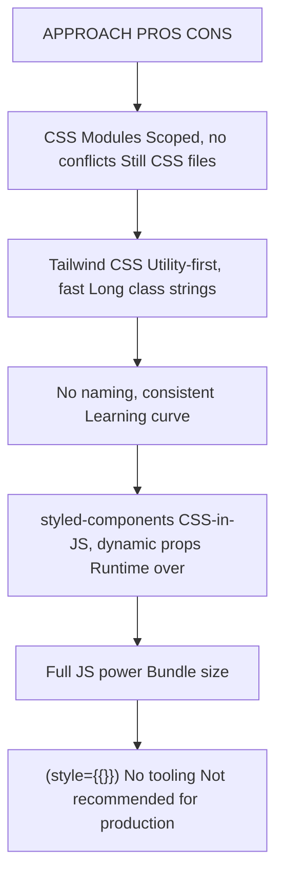

> **Navigation**: [Back to Index](../00_MASTER_INDEX.md) | [← Fundamentals](01_React_Fundamentals.md) | [Next: Hooks →](03_Hooks_Deep_Dive.md)
> 🧠 **Mental Model**: See [Frontend Architecture Thinking](../14_Mental_Models/17_Frontend_Architecture_Thinking.md)

---

# 🧩 React Component Patterns & Styling

> Reusable, composable, testable component architecture

---

## Pattern 1: Container + Presentational

```jsx
// PRESENTATIONAL (dumb): Only renders UI, receives data via props
function UserList({ users, onSelectUser }) {
  return (
    <ul>
      {users.map(u => (
        <li key={u.id} onClick={() => onSelectUser(u.id)}>
          {u.name} — {u.email}
        </li>
      ))}
    </ul>
  );
}

// CONTAINER (smart): Handles data fetching & logic
function UserListContainer() {
  const [users, setUsers] = useState([]);
  const [loading, setLoading] = useState(true);

  useEffect(() => {
    fetch('/api/users')
      .then(res => res.json())
      .then(data => { setUsers(data); setLoading(false); });
  }, []);

  if (loading) return <Spinner />;
  return <UserList users={users} onSelectUser={id => navigate(`/users/${id}`)} />;
}
```

---


## Pattern 2: Compound Components

```jsx
// Like <select> + <option> — components that work together
function Tabs({ children, defaultTab }) {
  const [activeTab, setActiveTab] = useState(defaultTab);
  return (
    <TabsContext.Provider value={{ activeTab, setActiveTab }}>
      <div className="tabs">{children}</div>
    </TabsContext.Provider>
  );
}

Tabs.TabList = ({ children }) => <div className="tab-list">{children}</div>;
Tabs.Tab = ({ id, children }) => {
  const { activeTab, setActiveTab } = useContext(TabsContext);
  return (
    <button className={activeTab === id ? 'active' : ''} onClick={() => setActiveTab(id)}>
      {children}
    </button>
  );
};
Tabs.Panel = ({ id, children }) => {
  const { activeTab } = useContext(TabsContext);
  return activeTab === id ? <div className="panel">{children}</div> : null;
};

// Usage — clean, readable API:
<Tabs defaultTab="profile">
  <Tabs.TabList>
    <Tabs.Tab id="profile">Profile</Tabs.Tab>
    <Tabs.Tab id="settings">Settings</Tabs.Tab>
  </Tabs.TabList>
  <Tabs.Panel id="profile"><ProfileForm /></Tabs.Panel>
  <Tabs.Panel id="settings"><SettingsForm /></Tabs.Panel>
</Tabs>
```

---


## Pattern 3: Render Props & Higher-Order Components

```jsx
// RENDER PROPS: Pass a function as children/prop that renders UI
function MouseTracker({ render }) {
  const [position, setPosition] = useState({ x: 0, y: 0 });

  useEffect(() => {
    const handler = (e) => setPosition({ x: e.clientX, y: e.clientY });
    window.addEventListener('mousemove', handler);
    return () => window.removeEventListener('mousemove', handler);
  }, []);

  return render(position); // delegate rendering to caller
}

// Usage:
<MouseTracker render={({ x, y }) => <p>Mouse: {x}, {y}</p>} />

// HOC (Higher-Order Component): Wraps component with extra behavior
function withAuth(WrappedComponent) {
  return function WithAuth(props) {
    const { user } = useAuth();
    if (!user) return <Navigate to="/login" />;
    return <WrappedComponent {...props} user={user} />;
  };
}
const ProtectedDashboard = withAuth(Dashboard);

// NOTE: Custom hooks have largely replaced render props and HOCs
// Prefer: const position = useMousePosition(); ← cleaner!
```

---


## Pattern 4: Styling Approaches

```
APPROACH          │ PROS                     │ CONS
────────────────────┼──────────────────────────┼───────────────────────────────
CSS Modules       │ Scoped, no conflicts     │ Still CSS files
(.module.css)     │ Works with any tooling   │ Dynamic styles = awkward
────────────────────┼──────────────────────────┼───────────────────────────────
Tailwind CSS      │ Utility-first, fast      │ Long class strings
                  │ No naming, consistent    │ Learning curve
────────────────────┼──────────────────────────┼───────────────────────────────
styled-components │ CSS-in-JS, dynamic props │ Runtime overhead
                  │ Full JS power             │ Bundle size
────────────────────┼──────────────────────────┼───────────────────────────────
Inline styles     │ Simple, dynamic          │ No pseudo-classes, media query
(style={{}})      │ No tooling               │ Not recommended for production
```

**Flow:**
- APPROACH PROS CONS
- ↓
- CSS Modules Scoped, no conflicts Still CSS files
- ↓
- Tailwind CSS Utility-first, fast Long class strings
- ↓
- No naming, consistent Learning curve
- ↓
- styled-components CSS-in-JS, dynamic props Runtime over
- ↓
- Full JS power Bundle size
- ↓
- (style={{}}) No tooling Not recommended for production



```jsx
// CSS MODULES:
import styles from './Button.module.css';
function Button({ children }) {
  return <button className={styles.primary}>{children}</button>;
}

// TAILWIND CSS:
function Button({ children }) {
  return (
    <button className="bg-blue-500 hover:bg-blue-700 text-white font-bold py-2 px-4 rounded">
      {children}
    </button>
  );
}

// STYLED-COMPONENTS:
import styled from 'styled-components';
const StyledButton = styled.button`
  background: ${props => props.primary ? '#0070f3' : '#eee'};
  color: ${props => props.primary ? '#fff' : '#333'};
  padding: 8px 16px;
  border-radius: 4px;
  &:hover { opacity: 0.8; }
`;
// Usage: <StyledButton primary>Click</StyledButton>
```

---


## Pattern 5: Error Boundaries

```jsx
// Class component (only way to do error boundaries in React)
class ErrorBoundary extends React.Component {
  state = { hasError: false, error: null };

  static getDerivedStateFromError(error) {
    return { hasError: true, error };
  }

  componentDidCatch(error, errorInfo) {
    logErrorToService(error, errorInfo); // send to Sentry/DataDog
  }

  render() {
    if (this.state.hasError) {
      return (
        <div className="error-fallback">
          <h2>Something went wrong</h2>
          <button onClick={() => this.setState({ hasError: false })}>
            Try Again
          </button>
        </div>
      );
    }
    return this.props.children;
  }
}

// Usage: Wrap around any tree that might throw
<ErrorBoundary>
  <UserProfile />
</ErrorBoundary>
```

---


## Pattern 6: Polymorphic Components

```tsx
// The `as` prop pattern — render as ANY HTML element or component
// Used by Chakra UI, MUI, Headless UI

interface BoxProps<T extends React.ElementType> {
  as?: T;
  children: React.ReactNode;
}

function Box<T extends React.ElementType = 'div'>({
  as, children, ...props
}: BoxProps<T> & React.ComponentPropsWithoutRef<T>) {
  const Component = as || 'div';
  return <Component {...props}>{children}</Component>;
}

// Usage — same component, different HTML elements:
<Box>Default div</Box>
<Box as="section">Renders as section</Box>
<Box as="a" href="/about">Renders as anchor tag</Box>
<Box as={NavLink} to="/home">Renders as React Router NavLink</Box>
```

---


## Pattern 7: Controlled vs Uncontrolled

```tsx
// UNCONTROLLED: DOM holds the state (simple forms)
function UncontrolledSearch() {
  const inputRef = useRef<HTMLInputElement>(null);
  const handleSubmit = () => console.log(inputRef.current?.value);
  return <input ref={inputRef} defaultValue="" />;
}

// CONTROLLED: React holds the state (complex forms, validation)
function ControlledSearch({ onSearch }) {
  const [query, setQuery] = useState('');
  const [error, setError] = useState('');
  
  const handleChange = (e) => {
    const value = e.target.value;
    setQuery(value);
    setError(value.length < 3 ? 'Min 3 characters' : '');
  };
  
  return (
    <>
      <input value={query} onChange={handleChange} />
      {error && <span className="error">{error}</span>}
      <button onClick={() => onSearch(query)} disabled={!!error}>Search</button>
    </>
  );
}

// WHEN TO USE:
// Uncontrolled: simple forms, no validation, no dynamic behavior
// Controlled: validation, conditional UI, dynamic defaults, form libraries
```

---


## Pattern 8: Provider + Composition

```tsx
// ── Problem: Prop Drilling ──
// App → Layout → Sidebar → UserMenu → Avatar (needs user data!)
// Passing `user` through 4 components that don't use it = prop drilling.

// ── Solution: Context Provider ──
const ThemeContext = createContext({ theme: 'light', toggle: () => {} });

function ThemeProvider({ children }) {
  const [theme, setTheme] = useState('light');
  const toggle = () => setTheme(t => t === 'light' ? 'dark' : 'light');
  
  return (
    <ThemeContext.Provider value={{ theme, toggle }}>
      {children}
    </ThemeContext.Provider>
  );
}

// Any deeply nested component can access theme directly:
function ThemeToggle() {
  const { theme, toggle } = useContext(ThemeContext);
  return <button onClick={toggle}>Current: {theme}</button>;
}

// ── Composition: children as a slot ──
// Instead of passing data down, compose at the top level
function App() {
  const user = useAuth();
  return (
    <Layout>
      <Sidebar>
        <UserMenu>
          <Avatar user={user} />  {/* user passed here, not drilled */}
        </UserMenu>
      </Sidebar>
    </Layout>
  );
}
```

---


## 🔗 Cross-References

| Topic | Related Content |
|---|---|
| **Hooks Deep Dive** | [Hooks](03_Hooks_Deep_Dive.md) — useState, useContext, useRef |
| **State Management** | [State](04_State_Management.md) — Redux, Zustand, Context |
| **Testing components** | [Testing](07_React_Testing.md) — RTL, MSW |
| **React Performance** | [Performance](08_React_Performance.md) — memoization, lazy loading |
| **CSS styling** | [CSS Architecture](../18_CSS_Complete/04_CSS_Modern_Architecture.md) |
| **TypeScript (generic components)** | [React TypeScript](05_React_TypeScript.md) |

---


---

## 🏋️ Practice & Interview Questions — OOP & Design Patterns

### Predict / Trace
**Q1.** What design pattern does this code follow?
```java
Logger logger = Logger.getInstance();
```
<details><summary>Answer</summary>

**Singleton** — ensures only one Logger instance exists globally.
</details>

**Q2.** What SOLID principle is violated?
```java
class User {
    void login() { ... }
    void logout() { ... }
    void sendEmail() { ... }  // ← ?
    void generateReport() { ... }  // ← ?
}
```
<details><summary>Answer</summary>

**SRP (Single Responsibility)** — User class has 4 responsibilities: authentication, email, reporting. Should be split into: `AuthService`, `EmailService`, `ReportService`.
</details>

### Design Pattern Problems
**Q3.** ⭐ Implement Strategy pattern for payment processing.
<details><summary>Solution</summary>

```java
interface PaymentStrategy { void pay(int amount); }
class CreditCard implements PaymentStrategy { public void pay(int amount){ /*...*/ } }
class PayPal implements PaymentStrategy { public void pay(int amount){ /*...*/ } }
class UPI implements PaymentStrategy { public void pay(int amount){ /*...*/ } }

class PaymentContext {
    private PaymentStrategy strategy;
    void setStrategy(PaymentStrategy s){ this.strategy=s; }
    void processPayment(int amount){ strategy.pay(amount); }
}
// Switch strategy at runtime — open/closed principle!
```
</details>

**Q4.** ⭐⭐ Implement Observer pattern for event notification.
<details><summary>Solution</summary>

```java
interface Observer { void update(String event); }
interface Observable {
    void subscribe(Observer o); void unsubscribe(Observer o); void notify(String event);
}
class EventBus implements Observable {
    List<Observer> observers = new ArrayList<>();
    public void subscribe(Observer o){ observers.add(o); }
    public void unsubscribe(Observer o){ observers.remove(o); }
    public void notify(String event){ observers.forEach(o -> o.update(event)); }
}
```
</details>

**Q5.** ⭐⭐ Builder pattern for a complex configuration object.
<details><summary>Solution</summary>

```java
class ServerConfig {
    private final String host; private final int port; private final int timeout;
    private ServerConfig(Builder b){ host=b.host; port=b.port; timeout=b.timeout; }

    static class Builder {
        String host="localhost"; int port=8080; int timeout=30;
        Builder host(String h){ host=h; return this; }
        Builder port(int p){ port=p; return this; }
        Builder timeout(int t){ timeout=t; return this; }
        ServerConfig build(){ return new ServerConfig(this); }
    }
}
// ServerConfig config = new ServerConfig.Builder().host("prod.com").port(443).build();
```
</details>

### MCQ Rapid Fire
| # | Question | Answer |
|---|---|---|
| 1 | SOLID: O stands for | Open/Closed Principle |
| 2 | Factory vs Abstract Factory | Factory: one product; Abstract Factory: family of products |
| 3 | Composition over inheritance means | Prefer has-a (field) over is-a (extends) for flexibility |
| 4 | Decorator pattern purpose | Add behavior dynamically without subclassing |
| 5 | Facade pattern purpose | Simplified interface to complex subsystem |
| 6 | Proxy pattern types | Virtual, protective, remote, caching |
| 7 | Command pattern encapsulates | Request as an object (supports undo/redo) |
| 8 | Template Method pattern | Defines algorithm skeleton, subclasses fill in steps |


---

## 🧠 Deep Conceptual Questions — React Internals & Mental Models

**C1. What is the React reconciliation algorithm and why does the `key` prop matter?**
<details><summary>Deep Answer</summary>

React maintains a virtual DOM (VNode tree). On state change: React creates a new VNode tree, diffs it against the previous tree (diffing = reconciliation), applies minimal real DOM mutations. Naive tree diff: O(N³). React's heuristics: O(N). Heuristic 1: different element types → destroy and rebuild subtree. Heuristic 2: same type → update props, recurse into children. **`key` prop**: tells React the element's identity across renders. Without keys in lists: React diffs by position — inserting at beginning is O(N) DOM mutations. With stable keys: React identifies which item moved/added/removed → O(1) per change. Keys must be stable+unique per list — using index as key breaks this when list is reordered.
</details>

**C2. Why does React use a virtual DOM? What performance problem does it solve?**
<details><summary>Deep Answer</summary>

Direct DOM manipulation is expensive: each `div.style.color = 'red'` forces layout recalculation, style recalculation, repaint — potentially 3-17ms per operation. Doing 50 direct DOM changes = 50 potential reflows. Virtual DOM batches all changes: compute the full desired state in JS (fast, ~ms), diff against current state, apply only the MINIMUM necessary DOM mutations in one batch (one reflow). Net effect: many state changes → few DOM mutations → fewer reflows. In React 18: concurrent rendering further batches setState calls across async boundaries. **Note**: React's VirtualDOM is a means to an end (batching + diffing), not inherently "fast" — SolidJS/Svelte skip it entirely with fine-grained reactivity and are faster for some use cases.
</details>

**C3. What is React's fiber architecture and how does it enable concurrent features?**
<details><summary>Deep Answer</summary>

Before Fiber (React 15): reconciliation = synchronous, non-interruptible tree walk. A complex update > 16ms → UI janks (dropped frames). **Fiber** (React 16+): reconciliation reimplemented as a linked list of "fiber nodes." Each fiber = a unit of work that can be paused, resumed, or abandoned. The render phase (building the fiber tree) is **interruptible**: React can pause after any fiber, yield to the browser for frames/user input, then resume. The commit phase (applying DOM changes) remains synchronous (can't be interrupted — DOM must be consistent). This enables: concurrent mode, `useTransition` (lower priority updates), `Suspense`, `useDeferredValue`. The fundamental shift: from "one big synchronous render" to "cooperative multitasking renderer."
</details>

**C4. useEffect dependency array: what is "stale closure" and how to fix it?**
<details><summary>Deep Answer</summary>

```jsx
const [count, setCount] = useState(0);
useEffect(() => {
  const id = setInterval(() => console.log(count), 1000); // stale closure!
  return () => clearInterval(id);
}, []); // count not in deps
```
The interval callback captures `count` from the initial render (= 0). Even after count updates, the closure still sees 0 — it's "stale." **Fix 1**: include count in deps — effect re-runs, interval recreated (wasteful). **Fix 2**: use `useRef` to store latest count. **Fix 3**: functional update `setCount(c => c + 1)` doesn't read stale count. Root cause: JavaScript closures capture variables at creation time. React's fn components close over state at render time. With stale deps, the closure never refreshes. `eslint-plugin-react-hooks` detects missing deps.
</details>

**C5. When does React batch state updates, and when does it NOT?**
<details><summary>Deep Answer</summary>

**React 17 and below**: batches only inside React event handlers. `setTimeout`, `Promise.then`, native event listeners → NOT batched (each setState triggers a re-render). **React 18**: **Automatic Batching** — batches all setState calls everywhere (timeouts, Promises, native events). Each React event handler still flushes at end. Opt-out (rare): `flushSync(() => setX(1))` → forces synchronous re-render.

Rule: in React 18, multiple setStates in ANY context = one re-render per batch. No more worrying about whether you're in a React event or not.
</details>

**C6. What is the purpose of `useReducer` and when is it better than multiple `useState`?**
<details><summary>Deep Answer</summary>

`useReducer` is `useState` for complex state transitions. Better than multiple `useState` when: (1) next state depends on multiple state values together (reducer receives full state), (2) multiple actions lead to similar state updates (consolidate logic in one place), (3) complex state objects where partial updates have side effects, (4) testing — reducer is a pure function, easily unit-testable in isolation. Think: `useState` = `useReducer(reducer, initialState)` where reducer is `(state, newValue) => newValue`. `useReducer` makes state transitions explicit and traceable (Redux-like). Redux IS just `useReducer` + Context for global sharing.
</details>


> **Navigation**: [< Previous](01_React_Fundamentals.md) | [Back to Index](../00_MASTER_INDEX.md) | [Next >](03_Hooks_Deep_Dive.md)