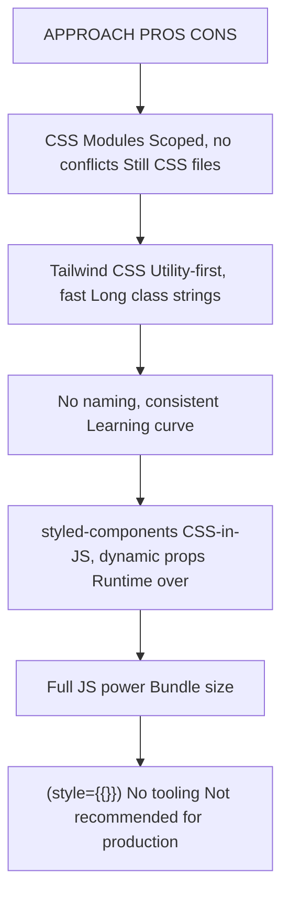

> **Navigation**: [Back to Index](../00_MASTER_INDEX.md) | [← Fundamentals](01_React_Fundamentals.md) | [Next: Hooks →](03_Hooks_Deep_Dive.md)
> 🧠 **Mental Model**: See [Frontend Architecture Thinking](../14_Mental_Models/17_Frontend_Architecture_Thinking.md)

---

# 🧩 React Component Patterns & Styling

> Reusable, composable, testable component architecture

---

## Pattern 1: Container + Presentational

```jsx
// PRESENTATIONAL (dumb): Only renders UI, receives data via props
function UserList({ users, onSelectUser }) {
  return (
    <ul>
      {users.map(u => (
        <li key={u.id} onClick={() => onSelectUser(u.id)}>
          {u.name} — {u.email}
        </li>
      ))}
    </ul>
  );
}

// CONTAINER (smart): Handles data fetching & logic
function UserListContainer() {
  const [users, setUsers] = useState([]);
  const [loading, setLoading] = useState(true);

  useEffect(() => {
    fetch('/api/users')
      .then(res => res.json())
      .then(data => { setUsers(data); setLoading(false); });
  }, []);

  if (loading) return <Spinner />;
  return <UserList users={users} onSelectUser={id => navigate(`/users/${id}`)} />;
}
```

---

## Pattern 2: Compound Components

```jsx
// Like <select> + <option> — components that work together
function Tabs({ children, defaultTab }) {
  const [activeTab, setActiveTab] = useState(defaultTab);
  return (
    <TabsContext.Provider value={{ activeTab, setActiveTab }}>
      <div className="tabs">{children}</div>
    </TabsContext.Provider>
  );
}

Tabs.TabList = ({ children }) => <div className="tab-list">{children}</div>;
Tabs.Tab = ({ id, children }) => {
  const { activeTab, setActiveTab } = useContext(TabsContext);
  return (
    <button className={activeTab === id ? 'active' : ''} onClick={() => setActiveTab(id)}>
      {children}
    </button>
  );
};
Tabs.Panel = ({ id, children }) => {
  const { activeTab } = useContext(TabsContext);
  return activeTab === id ? <div className="panel">{children}</div> : null;
};

// Usage — clean, readable API:
<Tabs defaultTab="profile">
  <Tabs.TabList>
    <Tabs.Tab id="profile">Profile</Tabs.Tab>
    <Tabs.Tab id="settings">Settings</Tabs.Tab>
  </Tabs.TabList>
  <Tabs.Panel id="profile"><ProfileForm /></Tabs.Panel>
  <Tabs.Panel id="settings"><SettingsForm /></Tabs.Panel>
</Tabs>
```

---

## Pattern 3: Render Props & Higher-Order Components

```jsx
// RENDER PROPS: Pass a function as children/prop that renders UI
function MouseTracker({ render }) {
  const [position, setPosition] = useState({ x: 0, y: 0 });

  useEffect(() => {
    const handler = (e) => setPosition({ x: e.clientX, y: e.clientY });
    window.addEventListener('mousemove', handler);
    return () => window.removeEventListener('mousemove', handler);
  }, []);

  return render(position); // delegate rendering to caller
}

// Usage:
<MouseTracker render={({ x, y }) => <p>Mouse: {x}, {y}</p>} />

// HOC (Higher-Order Component): Wraps component with extra behavior
function withAuth(WrappedComponent) {
  return function WithAuth(props) {
    const { user } = useAuth();
    if (!user) return <Navigate to="/login" />;
    return <WrappedComponent {...props} user={user} />;
  };
}
const ProtectedDashboard = withAuth(Dashboard);

// NOTE: Custom hooks have largely replaced render props and HOCs
// Prefer: const position = useMousePosition(); ← cleaner!
```

---

## Pattern 4: Styling Approaches

```
APPROACH          │ PROS                     │ CONS
────────────────────┼──────────────────────────┼───────────────────────────────
CSS Modules       │ Scoped, no conflicts     │ Still CSS files
(.module.css)     │ Works with any tooling   │ Dynamic styles = awkward
────────────────────┼──────────────────────────┼───────────────────────────────
Tailwind CSS      │ Utility-first, fast      │ Long class strings
                  │ No naming, consistent    │ Learning curve
────────────────────┼──────────────────────────┼───────────────────────────────
styled-components │ CSS-in-JS, dynamic props │ Runtime overhead
                  │ Full JS power             │ Bundle size
────────────────────┼──────────────────────────┼───────────────────────────────
Inline styles     │ Simple, dynamic          │ No pseudo-classes, media query
(style={{}})      │ No tooling               │ Not recommended for production
```

**Flow:**
- APPROACH PROS CONS
- ↓
- CSS Modules Scoped, no conflicts Still CSS files
- ↓
- Tailwind CSS Utility-first, fast Long class strings
- ↓
- No naming, consistent Learning curve
- ↓
- styled-components CSS-in-JS, dynamic props Runtime over
- ↓
- Full JS power Bundle size
- ↓
- (style={{}}) No tooling Not recommended for production



```jsx
// CSS MODULES:
import styles from './Button.module.css';
function Button({ children }) {
  return <button className={styles.primary}>{children}</button>;
}

// TAILWIND CSS:
function Button({ children }) {
  return (
    <button className="bg-blue-500 hover:bg-blue-700 text-white font-bold py-2 px-4 rounded">
      {children}
    </button>
  );
}

// STYLED-COMPONENTS:
import styled from 'styled-components';
const StyledButton = styled.button`
  background: ${props => props.primary ? '#0070f3' : '#eee'};
  color: ${props => props.primary ? '#fff' : '#333'};
  padding: 8px 16px;
  border-radius: 4px;
  &:hover { opacity: 0.8; }
`;
// Usage: <StyledButton primary>Click</StyledButton>
```

---

## Pattern 5: Error Boundaries

```jsx
// Class component (only way to do error boundaries in React)
class ErrorBoundary extends React.Component {
  state = { hasError: false, error: null };

  static getDerivedStateFromError(error) {
    return { hasError: true, error };
  }

  componentDidCatch(error, errorInfo) {
    logErrorToService(error, errorInfo); // send to Sentry/DataDog
  }

  render() {
    if (this.state.hasError) {
      return (
        <div className="error-fallback">
          <h2>Something went wrong</h2>
          <button onClick={() => this.setState({ hasError: false })}>
            Try Again
          </button>
        </div>
      );
    }
    return this.props.children;
  }
}

// Usage: Wrap around any tree that might throw
<ErrorBoundary>
  <UserProfile />
</ErrorBoundary>
```

---

## Pattern 6: Polymorphic Components

```tsx
// The `as` prop pattern — render as ANY HTML element or component
// Used by Chakra UI, MUI, Headless UI

interface BoxProps<T extends React.ElementType> {
  as?: T;
  children: React.ReactNode;
}

function Box<T extends React.ElementType = 'div'>({
  as, children, ...props
}: BoxProps<T> & React.ComponentPropsWithoutRef<T>) {
  const Component = as || 'div';
  return <Component {...props}>{children}</Component>;
}

// Usage — same component, different HTML elements:
<Box>Default div</Box>
<Box as="section">Renders as section</Box>
<Box as="a" href="/about">Renders as anchor tag</Box>
<Box as={NavLink} to="/home">Renders as React Router NavLink</Box>
```

---

## Pattern 7: Controlled vs Uncontrolled

```tsx
// UNCONTROLLED: DOM holds the state (simple forms)
function UncontrolledSearch() {
  const inputRef = useRef<HTMLInputElement>(null);
  const handleSubmit = () => console.log(inputRef.current?.value);
  return <input ref={inputRef} defaultValue="" />;
}

// CONTROLLED: React holds the state (complex forms, validation)
function ControlledSearch({ onSearch }) {
  const [query, setQuery] = useState('');
  const [error, setError] = useState('');
  
  const handleChange = (e) => {
    const value = e.target.value;
    setQuery(value);
    setError(value.length < 3 ? 'Min 3 characters' : '');
  };
  
  return (
    <>
      <input value={query} onChange={handleChange} />
      {error && <span className="error">{error}</span>}
      <button onClick={() => onSearch(query)} disabled={!!error}>Search</button>
    </>
  );
}

// WHEN TO USE:
// Uncontrolled: simple forms, no validation, no dynamic behavior
// Controlled: validation, conditional UI, dynamic defaults, form libraries
```

---

## Pattern 8: Provider + Composition

```tsx
// ── Problem: Prop Drilling ──
// App → Layout → Sidebar → UserMenu → Avatar (needs user data!)
// Passing `user` through 4 components that don't use it = prop drilling.

// ── Solution: Context Provider ──
const ThemeContext = createContext({ theme: 'light', toggle: () => {} });

function ThemeProvider({ children }) {
  const [theme, setTheme] = useState('light');
  const toggle = () => setTheme(t => t === 'light' ? 'dark' : 'light');
  
  return (
    <ThemeContext.Provider value={{ theme, toggle }}>
      {children}
    </ThemeContext.Provider>
  );
}

// Any deeply nested component can access theme directly:
function ThemeToggle() {
  const { theme, toggle } = useContext(ThemeContext);
  return <button onClick={toggle}>Current: {theme}</button>;
}

// ── Composition: children as a slot ──
// Instead of passing data down, compose at the top level
function App() {
  const user = useAuth();
  return (
    <Layout>
      <Sidebar>
        <UserMenu>
          <Avatar user={user} />  {/* user passed here, not drilled */}
        </UserMenu>
      </Sidebar>
    </Layout>
  );
}
```

---

## 🔗 Cross-References

| Topic | Related Content |
|---|---|
| **Hooks Deep Dive** | [Hooks](03_Hooks_Deep_Dive.md) — useState, useContext, useRef |
| **State Management** | [State](04_State_Management.md) — Redux, Zustand, Context |
| **Testing components** | [Testing](07_React_Testing.md) — RTL, MSW |
| **React Performance** | [Performance](08_React_Performance.md) — memoization, lazy loading |
| **CSS styling** | [CSS Architecture](../18_CSS_Complete/04_CSS_Modern_Architecture.md) |
| **TypeScript (generic components)** | [React TypeScript](05_React_TypeScript.md) |

---

> **Navigation**: [< Previous](01_React_Fundamentals.md) | [Back to Index](../00_MASTER_INDEX.md) | [Next >](03_Hooks_Deep_Dive.md)