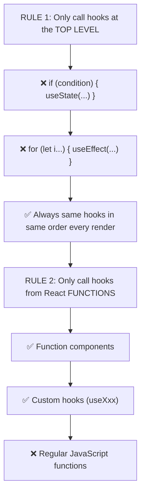

> **Navigation**: [Back to Index](../00_MASTER_INDEX.md) | [← Component Patterns](02_Component_Patterns.md) | [Next: State Management →](04_State_Management.md)

---

# 🪝 React Hooks Deep Dive — Every Hook You Need

---

## useState (Already covered in Fundamentals)

Quick reminder: `const [state, setState] = useState(initialValue);`

---

## useEffect — Side Effects

```jsx
import { useState, useEffect } from 'react';

// Pattern 1: Run on EVERY render (rarely needed)
useEffect(() => { console.log('rendered'); });

// Pattern 2: Run ONCE on mount (fetch data, setup subscription)
useEffect(() => {
  fetchData();
  return () => cleanup(); // runs on unmount
}, []);                    // ← empty dependency array

// Pattern 3: Run when specific values change
useEffect(() => {
  fetchUser(userId);
}, [userId]);              // ← runs when userId changes

// COMMON MISTAKE: Infinite loop!
// ❌ BAD:
useEffect(() => {
  setCount(count + 1);  // triggers re-render → triggers effect → infinite!
}, [count]);

// FETCH DATA PATTERN:
function UserProfile({ userId }) {
  const [user, setUser] = useState(null);
  const [loading, setLoading] = useState(true);
  const [error, setError] = useState(null);

  useEffect(() => {
    let cancelled = false;               // ← handle race conditions!
    
    setLoading(true);
    fetch(`/api/users/${userId}`)
      .then(res => res.json())
      .then(data => { if (!cancelled) { setUser(data); setLoading(false); }})
      .catch(err => { if (!cancelled) { setError(err); setLoading(false); }});
    
    return () => { cancelled = true; };  // cleanup: ignore stale responses
  }, [userId]);

  if (loading) return <Spinner />;
  if (error) return <ErrorMessage error={error} />;
  return <UserCard user={user} />;
}
```

---

## useRef — Persist Values Without Re-render

```jsx
import { useRef, useEffect } from 'react';

// USE CASE 1: Access DOM elements
function TextInput() {
  const inputRef = useRef(null);
  
  useEffect(() => {
    inputRef.current.focus(); // focus on mount
  }, []);
  
  return <input ref={inputRef} placeholder="Auto-focused!" />;
}

// USE CASE 2: Store mutable value that survives re-renders (no re-render on change)
function Timer() {
  const intervalRef = useRef(null);
  const [count, setCount] = useState(0);
  
  const start = () => {
    intervalRef.current = setInterval(() => setCount(c => c + 1), 1000);
  };
  const stop = () => clearInterval(intervalRef.current);
  
  return (
    <div>
      <p>{count}</p>
      <button onClick={start}>Start</button>
      <button onClick={stop}>Stop</button>
    </div>
  );
}

// USE CASE 3: Track previous value
function usePrevious(value) {
  const ref = useRef();
  useEffect(() => { ref.current = value; });
  return ref.current;
}
```

---

## useMemo & useCallback — Performance Optimization

```jsx
import { useMemo, useCallback } from 'react';

// useMemo: Memoize COMPUTED VALUE (skip expensive recalculation)
function ExpensiveList({ items, filter }) {
  const filteredItems = useMemo(() => {
    return items.filter(item => item.name.includes(filter)); // expensive
  }, [items, filter]); // only recalculate when items or filter change
  
  return <ul>{filteredItems.map(i => <li key={i.id}>{i.name}</li>)}</ul>;
}

// useCallback: Memoize FUNCTION REFERENCE (prevent child re-renders)
function Parent() {
  const [count, setCount] = useState(0);
  
  // Without useCallback: new function on every render → Child re-renders!
  // With useCallback: same function reference → Child skips re-render
  const handleClick = useCallback(() => {
    console.log('clicked');
  }, []); // dependencies: [] = never changes
  
  return (
    <div>
      <p>{count}</p>
      <button onClick={() => setCount(c => c + 1)}>Increment</button>
      <ExpensiveChild onClick={handleClick} /> {/* won't re-render */}
    </div>
  );
}

const ExpensiveChild = React.memo(({ onClick }) => {
  console.log('Child rendered'); // only when onClick reference changes
  return <button onClick={onClick}>Child Button</button>;
});

// RULE: Don't use useMemo/useCallback everywhere!
// → Only for expensive computations or preventing child re-renders
// → Premature optimization = code complexity for no gain
```

---

## useContext — Global State Without Prop Drilling

```jsx
import { createContext, useContext, useState } from 'react';

// 1. Create context
const ThemeContext = createContext('light');

// 2. Provider wraps tree
function App() {
  const [theme, setTheme] = useState('light');
  return (
    <ThemeContext.Provider value={{ theme, setTheme }}>
      <Header />
      <Main />
    </ThemeContext.Provider>
  );
}

// 3. Any child can consume (no matter how deep)
function ThemeToggle() {
  const { theme, setTheme } = useContext(ThemeContext);
  return (
    <button onClick={() => setTheme(theme === 'light' ? 'dark' : 'light')}>
      Current: {theme}
    </button>
  );
}
```

---

## useReducer — Complex State Logic

```jsx
import { useReducer } from 'react';

// Like Redux but local — great for related state transitions
const initialState = { items: [], loading: false, error: null };

function cartReducer(state, action) {
  switch (action.type) {
    case 'ADD_ITEM':
      return { ...state, items: [...state.items, action.payload] };
    case 'REMOVE_ITEM':
      return { ...state, items: state.items.filter(i => i.id !== action.payload) };
    case 'CLEAR':
      return { ...state, items: [] };
    case 'SET_LOADING':
      return { ...state, loading: action.payload };
    case 'SET_ERROR':
      return { ...state, error: action.payload, loading: false };
    default:
      throw new Error(`Unknown action: ${action.type}`);
  }
}

function ShoppingCart() {
  const [state, dispatch] = useReducer(cartReducer, initialState);
  
  return (
    <div>
      <button onClick={() => dispatch({ type: 'ADD_ITEM', payload: { id: 1, name: 'Laptop' } })}>
        Add Laptop
      </button>
      <button onClick={() => dispatch({ type: 'CLEAR' })}>Clear Cart</button>
      {state.items.map(item => <p key={item.id}>{item.name}</p>)}
    </div>
  );
}
```

---

## Custom Hooks — Reuse Logic

```jsx
// RULE: Start with "use", can call other hooks

// ── useFetch: Reusable data fetching ──
function useFetch(url) {
  const [data, setData] = useState(null);
  const [loading, setLoading] = useState(true);
  const [error, setError] = useState(null);

  useEffect(() => {
    let cancelled = false;
    setLoading(true);

    fetch(url)
      .then(res => { if (!res.ok) throw new Error(res.statusText); return res.json(); })
      .then(json => { if (!cancelled) { setData(json); setLoading(false); }})
      .catch(err => { if (!cancelled) { setError(err.message); setLoading(false); }});

    return () => { cancelled = true; };
  }, [url]);

  return { data, loading, error };
}

// Usage: const { data: users, loading, error } = useFetch('/api/users');

// ── useLocalStorage: Persist state in localStorage ──
function useLocalStorage(key, initialValue) {
  const [value, setValue] = useState(() => {
    const stored = localStorage.getItem(key);
    return stored ? JSON.parse(stored) : initialValue;
  });

  useEffect(() => {
    localStorage.setItem(key, JSON.stringify(value));
  }, [key, value]);

  return [value, setValue];
}

// ── useDebounce: Debounce a value (for search input) ──
function useDebounce(value, delay = 300) {
  const [debounced, setDebounced] = useState(value);
  useEffect(() => {
    const timer = setTimeout(() => setDebounced(value), delay);
    return () => clearTimeout(timer);
  }, [value, delay]);
  return debounced;
}
```

---

## Hook Rules (MUST FOLLOW)

```
╔══════════════════════════════════════════════════════════════════════════════════╗
║  RULE 1: Only call hooks at the TOP LEVEL                                        ║
║    ❌ if (condition) { useState(...) }                                            ║
║    ❌ for (let i...) { useEffect(...) }                                           ║
║    ✅ Always same hooks in same order every render                                ║
║                                                                                  ║
║  RULE 2: Only call hooks from React FUNCTIONS                                    ║
║    ✅ Function components                                                         ║
║    ✅ Custom hooks (useXxx)                                                       ║
║    ❌ Regular JavaScript functions                                                ║
║    ❌ Class components                                                            ║
╚══════════════════════════════════════════════════════════════════════════════════╝
```

> **Flow**: RULE 1: Only call hooks at the TOP LEVEL → ❌ if (condition) { useState(...) } | ❌ if (condition) { useState(...) } → ❌ for (let i...) { useEffect(...) } | ❌ for (let i...) { useEffect(...) } → ✅ Always same hooks in same order every render | ✅ Always same hooks in same order every render → RULE 2: Only call hooks from React FUNCTIONS | RULE 2: Only call hooks from React FUNCTIONS → ✅ Function components | ✅ Function components → ✅ Custom hooks (useXxx) | ...+1 more



---

> **Navigation**: [< Previous](02_Component_Patterns.md) | [Back to Index](../00_MASTER_INDEX.md) | [Next >](04_State_Management.md)