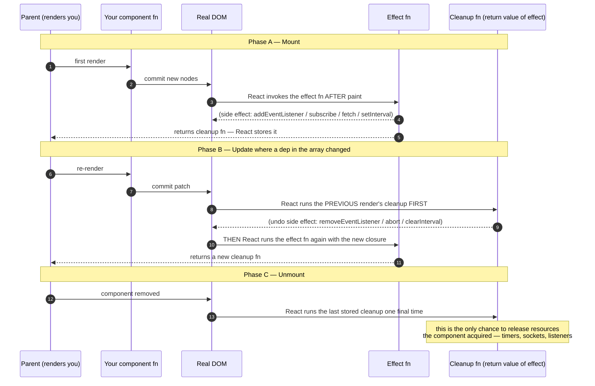

**Navigation**: [Back to Index](../00_MASTER_INDEX.md) | [← Component Patterns](02_Component_Patterns.md) | [Next: State Management →](04_State_Management.md)

---

# 🪝 React Hooks Deep Dive — Every Hook You Need

## 5W1H — Why Hooks Exist

> **What hooks are and why they exist.**
>
> **What.** A hook is a plain function whose name starts with `use`
> and whose sole capability is to touch React state or lifecycle
> from inside a function component. `useState`, `useEffect`,
> `useRef`, `useMemo`, `useContext`, and custom `useXxx` functions
> you write yourself are all hooks. That's it — no class boilerplate,
> no `this`, no lifecycle method names to memorise.
>
> **Why they exist.** Before hooks (before Feb 2019), only class
> components could hold state or run lifecycle code. That created
> three concrete problems that each cost real teams real productivity:
>
> 1. **Wrapper hell.** Sharing logic across components meant HOCs
>    (`withRouter(withAuth(withTheme(MyComponent)))`) or render
>    props — both stacked as extra tree levels. React DevTools
>    would show five wrappers before the actual component you cared
>    about.
> 2. **Related logic split across lifecycle methods.** A single
>    feature (e.g. "subscribe to socket, teardown on unmount") had
>    to be threaded through `componentDidMount` +
>    `componentDidUpdate` + `componentWillUnmount`. Related code
>    lived in three different methods; unrelated concerns lived
>    together.
> 3. **`this` binding was a footgun.** Class methods lose `this`
>    when passed as callbacks unless you bind them in the constructor
>    or use class-field arrows. Every React team debugged the same
>    `this.setState is not a function` at least once.
>
> **How they work internally.** Each rendered component has a Fiber
> node in React's tree. Each Fiber holds a *linked list* of hook
> objects:
>
> ```
> ComponentFiber.memoizedState → Hook₁ → Hook₂ → Hook₃ → null
>
> useState(0)   reads Hook₁ = { value, setter }
> useEffect(fn) reads Hook₂ = { deps, fn, cleanup }
> useRef(v)     reads Hook₃ = { current: v }
> ```
>
> **Hooks are identified by *position*, not by name.** On every
> render, React walks the list from the head and hands back
> whichever hook slot each call site reaches. That's why the two
> rules below — *only at the top level*, *only from React functions*
> — are not stylistic preferences: they are the invariant that keeps
> the position ↔ hook mapping stable across renders.

---

### Historical Evolution

Hooks represent the single largest API shift in React's history, replacing class lifecycle methods with composable functions and enabling function components to hold state.

| Year | Milestone |
|------|-----------|
| 2016 | React Fiber announced — the new reconciler that makes Hooks possible |
| 2018 | Hooks RFC introduced at React Conf by Dan Abramov and Sophie Alpert |
| 2019 | React 16.8 releases Hooks (useState, useEffect, useContext) to stable |
| 2022 | React 18 adds useId, useTransition, useDeferredValue for concurrent features |

Fiber's linked-list hook architecture, introduced as the reconciler in 2017, is what enables Hooks to work. Each component's Fiber node stores hooks as a linked list, and React walks this list in order on every render. This design decision is why hooks must be called in the same order on every render.

**Predecessor:** Class lifecycle methods (componentDidMount, componentDidUpdate) — state and side effects were tied to class components exclusively
**Modern anchor:** Every new React codebase today uses function components with Hooks; class components are considered legacy

### Production Reality

| Failure Mode | Where It Bites | Mitigation |
|--------------|---------------|------------|
| **Infinite render loop** | Empty or shallow `useEffect` deps (`[]` or missing dep) that sets state read in the effect | Use exhaustive-deps ESLint rule; for derived state, compute in render, not effect |
| **Stale closure** | Callback in `setTimeout` or event listener reads old state because closure captured initial render | Use refs for latest values (`useRef`) or functional state updates (`setState(prev => ...)`) |
| **Memory leak on unmounted component** | Async fetch resolves after component unmounts; `setState` on unmounted component triggers warning | Use AbortController in `useEffect` cleanup; track mounted state with a ref or use `react-use` `useMountedState` |
| **Hook rule violation** | Conditional `useEffect` inside `if (condition)` or loop; React crashes with "Rendered fewer hooks than expected" | Never conditionally call hooks; push conditions inside the hook body or extract to early-return wrapper |

Hooks lifecycle pitfalls dominate production incident reports because `useEffect`'s dependency model is deceptively simple but silently breaks when closures capture stale values or cleanup is skipped during rapid mount/unmount cycles.

---

### Invariant: Hooks Order

> **Invariant:** Hooks must be called in the same order on every render of a component.

**Why this must hold:** React tracks hooks via a linked list keyed by call order. Each hook call corresponds to an index in the component's Fiber node hook array. If the order changes (e.g., a hook is called inside a conditional), React associates state with the wrong hook slot — corrupting state across renders and triggering "Rendered fewer hooks than expected" errors.

**If violated:** State appears to "leak" between unrelated hooks, or components crash with cryptic hook count mismatches. The Rules of Hooks lint rule (`eslint-plugin-react-hooks`) catches this statically in most cases.

---

## useState (Already covered in Fundamentals)

Quick reminder: `const [state, setState] = useState(initialValue);`

---

🔬 **Section Challenge — useState (Already covered in Fundamentals)**

**Challenge 1 (Bug Hunt):** You initialize state as `useState(expensiveComputation())`. The function runs on EVERY render. How do you fix it?

<details><summary>Answer</summary>

`useState(expensiveComputation)` (pass the function, don't call it). This is 'lazy initialization' — React calls the function once during initial render only. The difference: `useState(fn())` calls `fn` every render but ignores the result after mount. `useState(fn)` calls `fn` only once. Same pattern: `useReducer(reducer, undefined, expensiveInit)`.

</details>

## useEffect — Side Effects

### 5W1H: What is useEffect?

```
WHAT: useEffect lets you perform SIDE EFFECTS in function components.
      Side effects = anything outside the render: API calls, timers,
      DOM manipulation, subscriptions, logging.

WHY:  React components are supposed to be PURE FUNCTIONS:
      same props + state → same JSX output, no side effects.
      But real apps NEED side effects (fetching data, setting up
      WebSocket connections). useEffect is the "escape hatch"
      for side effects — it runs AFTER render, not during.

ANALOGY — COOKING:
  Rendering = following the recipe (pure, predictable)
  useEffect = cleaning up after cooking (side effect)
  You don't clean WHILE cooking — you clean AFTER.
  Similarly, useEffect runs AFTER React updates the DOM.

HOW IT WORKS INTERNALLY:
  1. React renders your component (creates Virtual DOM)
  2. React commits changes to real DOM
  3. Browser paints the screen
  4. THEN React runs your useEffect callback
     (this is why useEffect doesn't block the paint!)

  The DEPENDENCY ARRAY tells React WHEN to re-run:
  • No array:     runs after EVERY render (rarely wanted)
  • Empty []:     runs ONCE on mount (like componentDidMount)
  • [dep1, dep2]: runs when dep1 or dep2 changes

  React compares deps using Object.is() (shallow comparison).
  { a: 1 } !== { a: 1 } — objects are compared by REFERENCE.
  This is why you get infinite loops with object dependencies!

  CLEANUP FUNCTION:
  Return a function from useEffect → React calls it before:
  1. Running the effect again (on re-render with changed deps)
  2. Unmounting the component
  This prevents memory leaks (dangling subscriptions, timers).
```

```jsx
import { useState, useEffect } from "react";

// Pattern 1: Run on EVERY render (rarely needed)
useEffect(() => {
  console.log("rendered");
});

// Pattern 2: Run ONCE on mount (fetch data, setup subscription)
useEffect(() => {
  fetchData();
  return () => cleanup(); // runs on unmount
}, []); // ← empty dependency array

// Pattern 3: Run when specific values change
useEffect(() => {
  fetchUser(userId);
}, [userId]); // ← runs when userId changes

// COMMON MISTAKE: Infinite loop!
// ❌ BAD:
useEffect(() => {
  setCount(count + 1); // triggers re-render → triggers effect → infinite!
}, [count]);

// 🎓 MIT/KTH SYSTEMS DEEP DIVE: The Race Condition & The Network Boundary
// The browser's network layer operates outside of JavaScript (in C++ Web APIs).
// The Event Loop pushes HTTP responses back onto the JS queue whenever they finish,
// in NO GUARANTEED ORDER. If User 1 fetch takes 500ms, and User 2 takes 100ms,
// the user clicking fast (1 -> 2) will see User 2 briefly, then User 1 permanently overwrites it!

// FETCH DATA PATTERN (The Systems Fix):
function UserProfile({ userId }) {
  const [user, setUser] = useState(null);
  const [loading, setLoading] = useState(true);
  const [error, setError] = useState(null);

  useEffect(() => {
    // We use a native AbortController to physically sever the HTTP TCP connection
    // if the component unmounts or the userId changes before the fetch completes.
    const controller = new AbortController();

    setLoading(true);
    fetch(`/api/users/${userId}`, { signal: controller.signal })
      .then((res) => res.json())
      .then((data) => {
        setUser(data);
        setLoading(false);
      })
      .catch((err) => {
        if (err.name !== "AbortError") {
          // Ignore aborted requests
          setError(err);
          setLoading(false);
        }
      });

    // Cleanup Phase: Cancel the in-flight request
    return () => controller.abort();
  }, [userId]);

  if (loading) return <Spinner />;
  if (error) return <ErrorMessage error={error} />;
  return <UserCard user={user} />;
}
```

---

🔬 **Section Challenge — useEffect — Side Effects**

**Challenge 2 (Design):** When does `useEffect` cleanup run? Give a concrete scenario where missing cleanup causes a bug.

<details><summary>Answer</summary>

Cleanup runs: (1) before the effect runs again (when deps change), (2) when the component unmounts. Bug scenario: effect fetches data and updates state. User navigates away (unmounts) before fetch completes. Fetch completes → tries to `setState` on unmounted component → React warning (memory leak). Fix: `let cancelled = false; return () => { cancelled = true; }` — check `if (!cancelled) setState(data)`.

</details>

## useRef — Persist Values Without Re-render

### 5W1H: What is useRef?

```
WHAT: useRef returns a MUTABLE object { current: value } that
      persists across re-renders WITHOUT causing re-renders.

WHY:  Sometimes you need a value that:
      1. Persists across renders (unlike a local variable)
      2. Doesn't trigger re-render when changed (unlike state)
      Examples: DOM references, timer IDs, previous values.

ANALOGY — STICKY NOTE on your MONITOR:
  state = whiteboard (erased and redrawn each render)
  ref = sticky note (stays there, doesn't affect the whiteboard)

  Changing a ref is like writing on the sticky note —
  it doesn't cause React to redraw the whiteboard.

HOW IT WORKS INTERNALLY:
  useRef(initialValue) creates: { current: initialValue }
  This object is stored on the Fiber node's hook linked list.
  Unlike useState, MUTATING ref.current does NOT schedule
  a re-render. React doesn't even know you changed it.

  For DOM refs: React sets ref.current = domNode after mount.
  When component unmounts, React sets ref.current = null.

KEY INSIGHT: useRef is essentially useState without the re-render.
  const ref = useRef(0) ≈ const [ref] = useState({ current: 0 })
  But mutating ref.current doesn't trigger setState.
```

```jsx
import { useRef, useEffect } from "react";

// USE CASE 1: Access DOM elements
function TextInput() {
  const inputRef = useRef(null);

  useEffect(() => {
    inputRef.current.focus(); // focus on mount
  }, []);

  return <input ref={inputRef} placeholder="Auto-focused!" />;
}

// USE CASE 2: Store mutable value that survives re-renders (no re-render on change)
function Timer() {
  const intervalRef = useRef(null);
  const [count, setCount] = useState(0);

  const start = () => {
    intervalRef.current = setInterval(() => setCount((c) => c + 1), 1000);
  };
  const stop = () => clearInterval(intervalRef.current);

  return (
    <div>
      <p>{count}</p>
      <button onClick={start}>Start</button>
      <button onClick={stop}>Stop</button>
    </div>
  );
}

// USE CASE 3: Track previous value
function usePrevious(value) {
  const ref = useRef();
  useEffect(() => {
    ref.current = value;
  });
  return ref.current;
}
```

---

## useMemo & useCallback — Performance Optimization

### 5W1H: When to Memoize?

```
WHAT: useMemo caches a COMPUTED VALUE.
      useCallback caches a FUNCTION REFERENCE.

WHY:  Every time a component re-renders, ALL code inside runs again.
      This means: expensive computations re-run, new function objects
      are created, child components receive "new" props and re-render.

      useMemo: "Don't re-compute this result unless inputs changed."
      useCallback: "Don't create a new function unless inputs changed."

ANALOGY — HOMEWORK ANSWERS:
  Without memoization: teacher asks "What's 847 × 293?" every class.
  You recalculate every time.
  With memoization: you write the answer in your notebook.
  Next time the teacher asks, you look it up. O(1) vs O(n).

WHEN TO USE (and when NOT to):
  ✘ DON'T memoize simple computations (a + b, string concatenation)
    The overhead of memoization (storing + comparing deps) > recomputing.
  ✔ DO memoize expensive computations (filtering 10,000 items)
  ✔ DO memoize functions passed to React.memo() children
    (otherwise child re-renders because function reference changes)
  ✘ DON'T memoize everything "just in case" — premature optimization.

INTERNAL MECHANISM:
  React stores [deps, value] on the hook's Fiber node.
  On re-render: compare new deps with stored deps (Object.is()).
  If ALL deps are the same → return stored value (skip computation).
  If ANY dep changed → re-compute, store new [deps, value].
```

```jsx
import { useMemo, useCallback } from "react";

// useMemo: Memoize COMPUTED VALUE (skip expensive recalculation)
function ExpensiveList({ items, filter }) {
  const filteredItems = useMemo(() => {
    return items.filter((item) => item.name.includes(filter)); // expensive
  }, [items, filter]); // only recalculate when items or filter change

  return (
    <ul>
      {filteredItems.map((i) => (
        <li key={i.id}>{i.name}</li>
      ))}
    </ul>
  );
}

// useCallback: Memoize FUNCTION REFERENCE (prevent child re-renders)
function Parent() {
  const [count, setCount] = useState(0);

  // Without useCallback: new function on every render → Child re-renders!
  // With useCallback: same function reference → Child skips re-render
  const handleClick = useCallback(() => {
    console.log("clicked");
  }, []); // dependencies: [] = never changes

  return (
    <div>
      <p>{count}</p>
      <button onClick={() => setCount((c) => c + 1)}>Increment</button>
      <ExpensiveChild onClick={handleClick} /> {/* won't re-render */}
    </div>
  );
}

const ExpensiveChild = React.memo(({ onClick }) => {
  console.log("Child rendered"); // only when onClick reference changes
  return <button onClick={onClick}>Child Button</button>;
});

// RULE: Don't use useMemo/useCallback everywhere!
// → Only for expensive computations or preventing child re-renders
// → Premature optimization = code complexity for no gain
```

---

## useContext — Global State Without Prop Drilling

### 5W1H: What is Context?

```
WHAT: Context provides a way to pass data through the component tree
      WITHOUT passing props manually at every level ("prop drilling").

WHY THE PROBLEM EXISTS:
  App → Layout → Sidebar → UserPanel → Avatar
  If Avatar needs the user object, every component in between
  must pass it down as props — even if they don't use it.
  This is PROP DRILLING. It's tedious and fragile.

ANALOGY — PUBLIC ANNOUNCEMENT vs WHISPER CHAIN:
  Props = whisper chain: "Pass this message to the person at the end"
  Each person in between must relay the message.
  Context = public announcement: "Attention everyone, the user is X"
  Anyone who cares can listen. No relay needed.

HOW CONTEXT WORKS INTERNALLY:
  1. createContext() creates a Context object with a default value
  2. <Provider value={...}> stores the value on a Fiber context stack
  3. useContext(MyContext) walks UP the Fiber tree to find the
     nearest Provider and reads its value
  4. When Provider's value changes, React re-renders ALL consumers

  ⚠️ PERFORMANCE WARNING:
  When Provider value changes, EVERY component using useContext()
  for that context re-renders — even if they only use one field.
  Solution: split contexts, or use external state (Zustand, Redux).
```

```jsx
import { createContext, useContext, useState } from "react";

// 1. Create context
const ThemeContext = createContext("light");

// 2. Provider wraps tree
function App() {
  const [theme, setTheme] = useState("light");
  return (
    <ThemeContext.Provider value={{ theme, setTheme }}>
      <Header />
      <Main />
    </ThemeContext.Provider>
  );
}

// 3. Any child can consume (no matter how deep)
function ThemeToggle() {
  const { theme, setTheme } = useContext(ThemeContext);
  return (
    <button onClick={() => setTheme(theme === "light" ? "dark" : "light")}>
      Current: {theme}
    </button>
  );
}
```

---

## useReducer — Complex State Logic

### 5W1H: When to Use useReducer?

```
WHAT: useReducer is an alternative to useState for COMPLEX state logic.
      It uses the REDUCER PATTERN: (state, action) → newState.

WHY:  useState works great for simple values (boolean, number, string).
      But when state has MULTIPLE sub-values that change together,
      or when the next state depends on the previous state in
      complex ways, a reducer is clearer:

      useState: multiple setState calls scattered everywhere
      useReducer: ALL state transitions in ONE function

ANALOGY — VENDING MACHINE:
  Current state: { selectedItem: null, coins: 0, dispensing: false }
  Actions: INSERT_COIN, SELECT_ITEM, DISPENSE, RESET
  Each action causes a SPECIFIC state transition.
  The reducer is the vending machine's internal logic.

WHEN useState vs useReducer:
  • useState: 1-3 independent state values, simple updates
  • useReducer: 3+ related state values, complex transitions,
    or when you want to test state logic separately

INTERNAL: useReducer stores [state, dispatch] on the Fiber's hook.
  dispatch(action) → React calls reducer(currentState, action)
  → gets newState → schedules re-render with newState.
  dispatch is STABLE (never changes) — safe in dependency arrays.
```

```jsx
import { useReducer } from "react";

// Like Redux but local — great for related state transitions
const initialState = { items: [], loading: false, error: null };

function cartReducer(state, action) {
  switch (action.type) {
    case "ADD_ITEM":
      return { ...state, items: [...state.items, action.payload] };
    case "REMOVE_ITEM":
      return {
        ...state,
        items: state.items.filter((i) => i.id !== action.payload),
      };
    case "CLEAR":
      return { ...state, items: [] };
    case "SET_LOADING":
      return { ...state, loading: action.payload };
    case "SET_ERROR":
      return { ...state, error: action.payload, loading: false };
    default:
      throw new Error(`Unknown action: ${action.type}`);
  }
}

function ShoppingCart() {
  const [state, dispatch] = useReducer(cartReducer, initialState);

  return (
    <div>
      <button
        onClick={() =>
          dispatch({ type: "ADD_ITEM", payload: { id: 1, name: "Laptop" } })
        }
      >
        Add Laptop
      </button>
      <button onClick={() => dispatch({ type: "CLEAR" })}>Clear Cart</button>
      {state.items.map((item) => (
        <p key={item.id}>{item.name}</p>
      ))}
    </div>
  );
}
```

---

## Custom Hooks — Reuse Logic

### 5W1H: What are Custom Hooks?

```
WHAT: Custom hooks are YOUR OWN functions that start with "use"
      and can call other hooks. They extract reusable stateful logic.

WHY:  Before Hooks, reusing stateful logic required HOCs or render
      props — both added wrapper components ("wrapper hell").
      Custom hooks share logic WITHOUT adding components to the tree.

ANALOGY — POWER TOOLS:
  Built-in hooks = basic tools (hammer, screwdriver)
  Custom hooks = power tools YOU build from basic tools
  useFetch = a power drill (combines useEffect + useState)
  useDebounce = a level (combines useState + useEffect + setTimeout)

KEY INSIGHT:
  Custom hooks don't share STATE. Each component calling useFetch()
  gets its OWN state. Custom hooks share LOGIC, not data.

  Component A: const { data } = useFetch('/api/users')  → own state
  Component B: const { data } = useFetch('/api/posts')  → own state
  They share the fetching PATTERN but have separate data.

NAMING CONVENTION:
  MUST start with "use" — this tells React's linter to check hook rules.
  Without "use" prefix, React can't warn you about rule violations.
```

```jsx
// RULE: Start with "use", can call other hooks

// ── useFetch: Reusable data fetching ──
function useFetch(url) {
  const [data, setData] = useState(null);
  const [loading, setLoading] = useState(true);
  const [error, setError] = useState(null);

  useEffect(() => {
    let cancelled = false;
    setLoading(true);

    fetch(url)
      .then((res) => {
        if (!res.ok) throw new Error(res.statusText);
        return res.json();
      })
      .then((json) => {
        if (!cancelled) {
          setData(json);
          setLoading(false);
        }
      })
      .catch((err) => {
        if (!cancelled) {
          setError(err.message);
          setLoading(false);
        }
      });

    return () => {
      cancelled = true;
    };
  }, [url]);

  return { data, loading, error };
}

// Usage: const { data: users, loading, error } = useFetch('/api/users');

// ── useLocalStorage: Persist state in localStorage ──
function useLocalStorage(key, initialValue) {
  const [value, setValue] = useState(() => {
    const stored = localStorage.getItem(key);
    return stored ? JSON.parse(stored) : initialValue;
  });

  useEffect(() => {
    localStorage.setItem(key, JSON.stringify(value));
  }, [key, value]);

  return [value, setValue];
}

// ── useDebounce: Debounce a value (for search input) ──
function useDebounce(value, delay = 300) {
  const [debounced, setDebounced] = useState(value);
  useEffect(() => {
    const timer = setTimeout(() => setDebounced(value), delay);
    return () => clearTimeout(timer);
  }, [value, delay]);
  return debounced;
}
```

---

🔬 **Section Challenge — Custom Hooks — Reuse Logic**

**Challenge 3 (Design):** Design a `useAsync(asyncFn)` hook that handles loading, error, and data states. What edge case does every junior miss?

<details><summary>Answer</summary>

```jsx
function useAsync(asyncFn, deps = []) {
  const [state, setState] = useState({
    data: null,
    loading: true,
    error: null,
  });
  useEffect(() => {
    let cancelled = false;
    setState((s) => ({ ...s, loading: true }));
    asyncFn()
      .then((data) => {
        if (!cancelled) setState({ data, loading: false, error: null });
      })
      .catch((error) => {
        if (!cancelled) setState({ data: null, loading: false, error });
      });
    return () => {
      cancelled = true;
    };
  }, deps);
  return state;
}
```

The edge case every junior misses: the **cleanup/cancellation flag**. Without `cancelled = true` in cleanup, if the component unmounts before the async operation completes, `setState` is called on an unmounted component. This causes a memory leak and React warning. The `cancelled` flag (or `AbortController`) prevents stale updates from zombie promises.

</details>

## Hook Rules (MUST FOLLOW)

### 5W1H: WHY These Rules Exist

```
THE INTERNAL REASON:
─────────────────────
  React stores hooks in a LINKED LIST on each Fiber node.
  Hooks are identified by POSITION, not by name.

  Render 1: useState(0) → Hook[0], useEffect() → Hook[1], useRef() → Hook[2]
  Render 2: useState(0) → Hook[0], useEffect() → Hook[1], useRef() → Hook[2]
  ✔ Same order = React knows which hook is which.

  If you put a hook inside an `if` block:
  Render 1 (condition=true):  useState → Hook[0], useEffect → Hook[1], useRef → Hook[2]
  Render 2 (condition=false): useEffect → Hook[0](!), useRef → Hook[1](!)
  ✘ Hooks shifted! React returns useEffect's data to useState. CRASH.

  ANALOGY: Hooks are like assigned seats in a classroom.
  Student 1 = useState, Student 2 = useEffect, Student 3 = useRef.
  If Student 1 doesn't show up, everyone sits in the wrong seat.
  React can't tell them apart because it only knows positions.
```

> **Rule 1 — only call hooks at the top level of a component or
> custom hook.** Not inside `if`, not inside `for`, not inside
> `try/catch`, not after an early `return`. The reason is
> mechanical: React identifies hooks by their call-site *position*
> in the linked list on each render (see the intro above). Skip one
> conditionally and every subsequent hook shifts by one slot — the
> `useEffect` you wrote reads the state from the previous slot and
> your component silently corrupts.
>
> ```jsx
> // ❌ breaks the position invariant
> if (condition) { const [x, setX] = useState(0); }
> for (let i = 0; i < n; i++) { useEffect(...); }
>
> // ✅ same hooks in the same order every render
> const [x, setX] = useState(0);
> useEffect(() => { /* branch INSIDE the effect */ }, [condition]);
> ```
>
> **Rule 2 — only call hooks from React function components or from
> other hooks (`useXxx`).** Not from plain utility functions, not
> from class methods, not from event handlers directly. Hooks
> attach to whatever component is currently rendering; there is no
> "currently rendering" when you're inside a click handler that
> fires later, or a helper function that runs anywhere.
>
> These two rules together are exactly what makes React's Rules-of-Hooks
> lint rule flag the same set of patterns — it's not a style rule,
> it's a correctness rule for the linked-list slot mapping.

### 🔗 Cross-References to DSA Concepts

| Hooks Concept                                    | Underlying DSA/Algorithm                                              |
| ------------------------------------------------ | --------------------------------------------------------------------- |
| Hook linked list (memoizedState → Hook1 → Hook2) | [LinkedList](../02_Data_Structures/01c_LinkedList.md)                 |
| useMemo (caching computed values)                | [DP — Memoization](../03_Algorithms/04b_DP_Fundamentals.md)           |
| useReducer (state machine pattern)               | [Design Patterns — State](../06_OOP_Design/02_Design_Patterns.md)     |
| useCallback (referential equality)               | [HashTable — Object identity](../02_Data_Structures/01e_HashTable.md) |
| useContext (tree traversal to find Provider)     | [Tree Algorithms — DFS](../03_Algorithms/05_Trees.md)                 |
| Custom Hooks (composition)                       | [OOP — Strategy Pattern](../06_OOP_Design/02_Design_Patterns.md)      |

---

## React 18 — Concurrent Features Deep Dive

```
THE HISTORY OF REACT RENDERING:

React 16 (Fiber, 2017): Rewrote the renderer to allow pausing.
  React could pause reconciliation and continue later.
  But it never actually used this capability for users.

React 18 (Concurrent Mode, 2022): Actually ships Concurrent features.
  The BIG IDEA: React can now INTERRUPT rendering to do something
  more urgent, then resume where it left off.

  OLD MODEL (Synchronous):
    User types → React renders → Browser paints
    React rendering BLOCKS everything. If render takes 300ms → frozen UI.

  NEW MODEL (Concurrent):
    User types → React starts rendering → (interrupt!) paint → continue rendering
    React can pause, let the browser paint, then continue.
    Result: UI stays responsive even during expensive renders.
```

### useTransition — Mark Updates as Non-Urgent

```
PROBLEM: User types in search box → filter 10,000 items → UI freezes.
Both "updating the input" and "filtering results" happen synchronously.
The input feels laggy because filtering blocks input updates.

SOLUTION: Tell React: "Updating the filtered results is LOW PRIORITY.
Do it when you have time. But please update the input text IMMEDIATELY."

useTransition marks state updates as "non-urgent" (transitions).
Urgent updates (like typing) can INTERRUPT non-urgent ones.
```

```jsx
import { useState, useTransition } from "react";

function SearchPage() {
  const [query, setQuery] = useState("");
  const [results, setResults] = useState([]);
  const [isPending, startTransition] = useTransition();

  function handleChange(e) {
    // URGENT: Update input immediately (always responsive)
    setQuery(e.target.value);

    // NON-URGENT: Can be interrupted if user types faster
    startTransition(() => {
      const filtered = expensiveFilter(items, e.target.value);
      setResults(filtered); // deferred — can be interrupted!
    });
  }

  return (
    <div>
      <input value={query} onChange={handleChange} />
      {isPending && <Spinner />} {/* Shows while transition runs */}
      <ResultsList results={results} /> {/* Stale while transitioning */}
    </div>
  );
}
// Input is ALWAYS responsive. Results may lag behind — that's OK.
```

### useDeferredValue — Defer Specific Values

```
Similar to useTransition but for RECEIVED values (props/context),
not dispatched updates. The component "lags behind" intentionally.
```

```jsx
import { useDeferredValue, Suspense, memo } from "react";

function SearchResults({ query }) {
  // Deferred version of query — updates AFTER urgent updates settle
  const deferredQuery = useDeferredValue(query);

  // This component renders TWICE during transition:
  // 1. With old deferredQuery (stale but visible — not spinners)
  // 2. With new deferredQuery (fresh results)
  const isStale = query !== deferredQuery; // detect stale render

  return (
    <div style={{ opacity: isStale ? 0.7 : 1 }}>
      {" "}
      {/* dim stale results */}
      <Suspense fallback={<Spinner />}>
        <ExpensiveResultsList query={deferredQuery} />
      </Suspense>
    </div>
  );
}
// ExpensiveResultsList only re-renders when deferredQuery changes.
// If user types 5 chars quickly, only renders for the LAST char!
```

### Suspense — Declarative Loading States

```
THE EVOLUTION OF LOADING STATES:
  v1 (class era): componentDidMount → setState({loading, data, error})
  v2 (hooks era): useEffect → useState for loading/data/error
  v3 (Suspense):  Declare WHAT to show while waiting — React handles rest.

ANALOGY: Suspense is like a LOADING DOCK.
  You place your order (render a component that needs async data).
  A fallback goes up ("Shipment incoming, please wait...").
  When the data arrives, React swaps the fallback for the real component.
  You don't manage loading state at all — React does it.

HOW SUSPENSE WORKS INTERNALLY:
  When a component is loading data, it THROWS A PROMISE.
  (This is not an error — React catches it before it propagates.)
  React sees the thrown promise → suspends the component.
  Shows the nearest Suspense fallback.
  When the promise resolves → React retries rendering the component.
```

```jsx
// Modern data fetching with React Query (integrates with Suspense)
import { Suspense } from "react";
import { useSuspenseQuery } from "@tanstack/react-query";

// With Suspense-aware data fetching (React Query v5, SWR, etc.)
function UserProfile({ userId }) {
  // useSuspenseQuery THROWS a promise while loading!
  // No loading/error state needed — Suspense handles it.
  const { data: user } = useSuspenseQuery({
    queryKey: ["user", userId],
    queryFn: () => fetch(`/api/users/${userId}`).then((r) => r.json()),
  });
  // If we get here, data is GUARANTEED to exist (no loading check needed)
  return (
    <div>
      {user.name} — {user.email}
    </div>
  );
}

// Wrap with Suspense to handle loading, ErrorBoundary for errors
function App() {
  return (
    <ErrorBoundary fallback={<ErrorMessage />}>
      <Suspense fallback={<ProfileSkeleton />}>
        <UserProfile userId={1} />
      </Suspense>
    </ErrorBoundary>
  );
}

// NESTED SUSPENSE — control granularity of loading states:
function Dashboard() {
  return (
    <div>
      <Suspense fallback={<HeaderSkeleton />}>
        <DashboardHeader /> {/* loads independently */}
      </Suspense>
      <Suspense fallback={<ListSkeleton />}>
        <RecentActivity /> {/* loads independently */}
      </Suspense>
      <Suspense fallback={<ChartSkeleton />}>
        <AnalyticsChart /> {/* loads independently */}
      </Suspense>
    </div>
  );
  // All three load in PARALLEL — whichever finishes first, shows first.
  // No waterfall loading!
}
```

### use() — The Universal Async Hook (React 19)

```jsx
import { use, Suspense } from "react";

// THE FUTURE: use() works for both Promises AND Contexts anywhere
// (Even inside loops and conditionals — breaking the hook rules limitation!)

const userPromise = fetch("/api/user").then((r) => r.json());

function UserCard() {
  // use() suspends the component while promise resolves
  const user = use(userPromise); // throws promise → Suspense catches
  return <div>{user.name}</div>;
}

// use() for Context (same as useContext, but more flexible):
const theme = use(ThemeContext); // works inside conditions!
```

### React Server Components (RSC) — Zero-Bundle Size

```
THE PARADIGM SHIFT (Next.js App Router, 2023+):

BEFORE RSC:
  All components run in the BROWSER.
  Data fetching → API call → parse JSON → render → hydrate.
  Everything ships as JavaScript bundle.

AFTER RSC:
  "Server Components" run ONLY on the server.
  They can directly query databases, read files, use secrets.
  Their output (JSX) is streamed to the client.
  ZERO JavaScript shipped for server components!

  Client Components still exist for interactivity (useState, useEffect, events).
  You mark them with "use client" directive.

ARCHITECTURE:
  Server Component (no "use client"):
  • Can async/await directly (await db.query())
  • Can access server-only secrets (process.env.DB_PASSWORD)
  • Cannot use useState, useEffect, onClick, etc.
  • Not included in JS bundle

  Client Component ("use client" at top):
  • Runs in browser (hydration)
  • Can use all hooks
  • Can handle events
  • Included in JS bundle
```

```tsx
// ── Server Component (Next.js App Router) ──
// No "use client" directive = server component by default

async function UserProfile({ userId }: { userId: string }) {
  // Direct DB query! No useEffect, no API endpoint needed.
  // This runs on the SERVER, never ships to the browser.
  const user = await db.query("SELECT * FROM users WHERE id = ?", [userId]);
  const posts = await postsService.getByUser(userId);

  return (
    <div>
      <h1>{user.name}</h1>
      <p>{user.email}</p>
      {/* LikeButton needs interactivity → Client Component */}
      <LikeButton initialLikes={user.likes} />
      <PostsList posts={posts} />
    </div>
  );
}

// ── Client Component ──
("use client"); // opt-in to client rendering

import { useState } from "react";

function LikeButton({ initialLikes }: { initialLikes: number }) {
  const [likes, setLikes] = useState(initialLikes);
  return <button onClick={() => setLikes((l) => l + 1)}>❤️ {likes}</button>;
  // This small interactive piece ships as JS. The rest? Zero bytes.
}
```

---

### useEffect Cleanup Lifecycle

**Trace what happens to an effect from mount to unmount — who runs
the cleanup, and when React runs it relative to the next effect:**



**Two mistakes this ordering explains:**

1. **Returning something that isn't a function.** If your effect
   returns `undefined`, a number, or an object, React silently
   skips cleanup. The effect from Phase A is never undone; on the
   next re-run in Phase B you've got two subscriptions, two
   timers, two listeners. Always `return () => { /* cleanup */ }`
   (or return nothing at all when there's genuinely nothing to
   undo).
2. **Missing dependencies.** The effect closes over whatever
   values were in scope *at the render that created it*. If you
   omit a value from the dependency array, the cleanup fn also
   closes over that stale value — so when Phase C runs your
   cleanup, it removes the listener from the *old* element, and
   the new one leaks forever. Fix: put every value the effect
   reads into the dep array (the exhaustive-deps ESLint rule
   catches most cases).

**Common mistake:** Returning a non-function from effect (e.g., a number or undefined) — silently no-ops cleanup. Always `return () => { /* cleanup */ }` when needed.

**Another mistake:** Missing deps in the array → stale closures → cleanup uses old state value.

---

## 🎓 MIT/KTH SYSTEMS DEEP DIVE: The 4 Hook Architectural Traps

When scaling applications, junior engineers memorize hook syntax. Senior engineers understand the underlying execution model and memory traps. Here are the most critical, real-world edge cases you will encounter with React Hooks.

### Trap 1: The `useEffect` Lifespan Leak (Event Listeners & Subscriptions)

A component unmounting doesn't inherently destroy external subscriptions or event listeners created within it. This leads to **memory leaks** and **zombie state updates** (updating state on an unmounted component).

**The Broken Junior Code:**

```jsx
useEffect(() => {
  // BUG: Every time this effect runs, another listener is stacked.
  // When the component dies, the listener stays in the DOM memory forever.
  window.addEventListener("resize", handleResize);
}, []); // Even with [], it leaks when the component unmounts.
```

**The Systems Fix (The Cleanup Function):**

```jsx
useEffect(() => {
  const handleResize = () => setWidth(window.innerWidth);
  window.addEventListener("resize", handleResize);

  // The Cleanup Phase: React runs this BEFORE the next effect cycle,
  // OR when the component is finally destroyed.
  return () => window.removeEventListener("resize", handleResize);
}, []);
```

### Trap 2: The Object Identity Re-render Storm (`useEffect` Infinity Loop)

React compares dependency array items using `Object.is()`. If you pass an object or array declared _inside_ the render body, its memory address changes on **every single render**, causing the effect to run infinitely.

**The Broken Junior Code:**

```jsx
function Profile({ userId }) {
  // BUG: `options` is a brand new object in memory every render.
  const options = { id: userId, includeHistory: true };

  useEffect(() => {
    fetchProfile(options);
  }, [options]); // 💥 INFINITE LOOP 💥
  // Effect runs -> States changes -> Re-render -> New `options` memory address -> Effect runs...
}
```

**The Systems Fix (Decoupling Memory):**

```jsx
// Fix A: Move static objects OUTSIDE the component so it has one permanent memory address.
const STATIC_OPTIONS = { includeHistory: true };

function Profile({ userId }) {
  // Fix B: useMemo to preserve the memory address across renders unless userId changes.
  const dynamicOptions = useMemo(
    () => ({ id: userId, includeHistory: true }),
    [userId],
  );

  useEffect(() => {
    fetchProfile(dynamicOptions);
  }, [dynamicOptions]); // Safe!
}
```

### Trap 3: The `useRef` Stale UI Trap

`useRef` is famously used to store mutable data that _doesn't_ trigger a re-render. However, developers often try to render `.current` values in the UI, resulting in screen data that is permanently disconnected from reality.

**The Broken Junior Code:**

```jsx
const clickCount = useRef(0);

const handleClick = () => {
  clickCount.current++;
  console.log(clickCount.current); // Terminal shows 5...
};

// BUG: The screen still says 0. Changing a ref does NOT tell React to update the DOM.
return <button onClick={handleClick}>Clicks: {clickCount.current}</button>;
```

**The Systems Fix:**
If it needs to be seen on the screen, it **must** be `useState`. If it acts as a background mechanism (like holding a timer ID from `setInterval`, or a DOM node reference), it belongs in `useRef`.

### Trap 4: The Derivative State Anti-Pattern

Juniors frequently create "mirrored" or "derivative" state using multiple `useState` calls and `useEffect` to sync them. This causes unnecessary double-renders (Component renders -> Effect syncs state -> Component renders again).

**The Broken Junior Code:**

```jsx
const [firstName, setFirstName] = useState("");
const [lastName, setLastName] = useState("");
const [fullName, setFullName] = useState(""); // Redundant!

// BUG: Triggers a second render pass just to calculate a derived value.
useEffect(() => {
  setFullName(`${firstName} ${lastName}`);
}, [firstName, lastName]);
```

**The Systems Fix (Render-Phase Calculation):**

```jsx
const [firstName, setFirstName] = useState("");
const [lastName, setLastName] = useState("");

// Calculate it directly during the render phase. It requires zero extra memory
// tracking and triggers no cascading renders.
const fullName = `${firstName} ${lastName}`;
```

---

**Navigation**: [< Previous](02_Component_Patterns.md) | [Back to Index](../00_MASTER_INDEX.md) | [Next >](04_State_Management.md)


---

## Reality Check

**"The rules of hooks are arbitrary API restrictions"** — The rules ARE the implementation leaking through, and knowing why converts them from dogma to physics: hooks are stored in a LIST on the fiber, matched to calls by ORDER — call order must therefore be identical every render, which is exactly why no conditionals/loops around hooks (a skipped useState shifts every subsequent hook one slot — reading a neighbor's state) and why the linter is non-negotiable rather than stylistic. Understanding the list model also demystifies the rest: why hooks only work in components/custom hooks (they need the current fiber), and why two components calling the same hook share nothing (different fibers, different lists).

**"useEffect runs after render for side effects"** — The precise contract has four clauses people learn one incident at a time: it runs after COMMIT and PAINT (useLayoutEffect for pre-paint measurement — the flicker line), cleanup runs BEFORE the next effect execution and at unmount (the intervals that stack without it), each execution captures ITS render's props/state (the stale-closure family — the interval logging the same count forever), and StrictMode double-invokes mount effects in dev DELIBERATELY (setup-cleanup-setup — code that breaks under it has a real cleanup bug, not a React bug). Most "useEffect is confusing" reduces to fighting one of these four clauses without knowing it exists.

**"The dependency array lists what the effect uses — the linter is pedantic about it"** — The dependency array is a CORRECTNESS declaration the closure model enforces: omitting a used value pins the effect to a stale snapshot (not a lint style issue — a bug the linter is preventing), and the honest fixes for over-firing effects are structural, not suppressive: functional updates (drop the state dep), moving statics out, useCallback/useMemo to stabilize genuinely-needed references, or the effect-event pattern for the read-latest-without-retrigger case. Every eslint-disable on exhaustive-deps is an IOU: the code now depends on a value it pretends not to — and it will be paid during some future refactor as a mystery staleness bug.

**"useMemo and useCallback make components faster"** — Both cost memory and comparison work per render and deliver value in exactly THREE situations: preserving reference identity for memoized children or effect/hook dependencies (the real 90-percent case — it is about identity, not computation), genuinely expensive computations (rare — measure first), and stabilizing context values (the object literal in a Provider re-rendering every consumer). Blanket memoization is negative-value ritual: unread by memo-less children, invalidated by unstable inputs one level up, and obscuring the actual fix (component composition, state placement). The React Compiler's arrival makes the manual-everywhere position doubly obsolete — the durable skill is knowing WHY identity matters, which the compiler cannot decide for you at the architecture level.

**"useRef is for DOM references"** — useRef is React's INSTANCE VARIABLE — a mutable box surviving renders without triggering them — and its non-DOM uses are the deeper toolkit: the latest-value ref (escaping stale closures in long-lived callbacks — the manual effect-event), previous-value tracking, imperative handles for timers/observers/sockets, and render-count/first-render flags. Its two contracts: reading/writing .current during render is forbidden under concurrent rendering (renders may repeat or discard — refs mutated in render desync), and ref CHANGES notify nobody (that is the point — needing notification means it should be state). The DOM case is one instance of the general pattern: values React must remember but rendering must not depend on.
