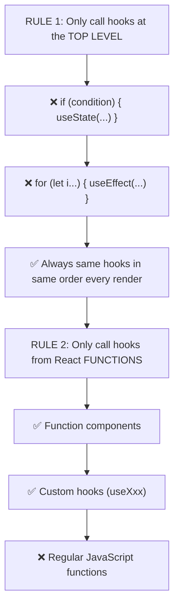

> **Navigation**: [Back to Index](../00_MASTER_INDEX.md) | [← Component Patterns](02_Component_Patterns.md) | [Next: State Management →](04_State_Management.md)

---

# 🪝 React Hooks Deep Dive — Every Hook You Need

## 5W1H — Why Hooks Exist

```
┌──────────────────────────────────────────────────────────────────────┐
│  WHAT: Hooks are functions that let you "hook into" React state      │
│        and lifecycle features from function components.              │
│                                                                      │
│  WHY:  Before Hooks (pre-2019), only CLASS components had state      │
│        and lifecycle. This created 3 problems:                       │
│        1. Wrapper Hell: HOCs and render props nested 5+ levels       │
│        2. Giant Components: related logic split across lifecycle     │
│           methods (componentDidMount + componentDidUpdate +          │
│           componentWillUnmount for ONE feature)                      │
│        3. Confusing Classes: `this` binding, class boilerplate       │
│                                                                      │
│  WHO:  React team (Dan Abramov, Sophie Alpert) introduced at         │
│        React Conf 2018. Released in React 16.8 (Feb 2019).           │
│                                                                      │
│  HOW HOOKS WORK INTERNALLY:                                          │
│  Each component has a Fiber node. Each Fiber has a linked list       │
│  of hooks. When React renders your component, it walks this list:    │
│                                                                      │
│  ComponentFiber.memoizedState → Hook1 → Hook2 → Hook3 → null         │
│                                                                      │
│  useState(0)  → reads Hook1 (state = current value)                  │
│  useEffect()  → reads Hook2 (effect + deps + cleanup)                │
│  useRef()     → reads Hook3 (ref object)                             │
│                                                                      │
│  CRITICAL: Hooks are identified by POSITION in the linked list,      │
│  NOT by name. This is why they MUST be called in the same order.     │
└──────────────────────────────────────────────────────────────────────┘
```

---

## useState (Already covered in Fundamentals)

Quick reminder: `const [state, setState] = useState(initialValue);`

---

## useEffect — Side Effects

### 5W1H: What is useEffect?

```
WHAT: useEffect lets you perform SIDE EFFECTS in function components.
      Side effects = anything outside the render: API calls, timers,
      DOM manipulation, subscriptions, logging.

WHY:  React components are supposed to be PURE FUNCTIONS:
      same props + state → same JSX output, no side effects.
      But real apps NEED side effects (fetching data, setting up
      WebSocket connections). useEffect is the "escape hatch"
      for side effects — it runs AFTER render, not during.

ANALOGY — COOKING:
  Rendering = following the recipe (pure, predictable)
  useEffect = cleaning up after cooking (side effect)
  You don't clean WHILE cooking — you clean AFTER.
  Similarly, useEffect runs AFTER React updates the DOM.

HOW IT WORKS INTERNALLY:
  1. React renders your component (creates Virtual DOM)
  2. React commits changes to real DOM
  3. Browser paints the screen
  4. THEN React runs your useEffect callback
     (this is why useEffect doesn't block the paint!)

  The DEPENDENCY ARRAY tells React WHEN to re-run:
  • No array:     runs after EVERY render (rarely wanted)
  • Empty []:     runs ONCE on mount (like componentDidMount)
  • [dep1, dep2]: runs when dep1 or dep2 changes

  React compares deps using Object.is() (shallow comparison).
  { a: 1 } !== { a: 1 } — objects are compared by REFERENCE.
  This is why you get infinite loops with object dependencies!

  CLEANUP FUNCTION:
  Return a function from useEffect → React calls it before:
  1. Running the effect again (on re-render with changed deps)
  2. Unmounting the component
  This prevents memory leaks (dangling subscriptions, timers).
```

```jsx
import { useState, useEffect } from 'react';

// Pattern 1: Run on EVERY render (rarely needed)
useEffect(() => { console.log('rendered'); });

// Pattern 2: Run ONCE on mount (fetch data, setup subscription)
useEffect(() => {
  fetchData();
  return () => cleanup(); // runs on unmount
}, []);                    // ← empty dependency array

// Pattern 3: Run when specific values change
useEffect(() => {
  fetchUser(userId);
}, [userId]);              // ← runs when userId changes

// COMMON MISTAKE: Infinite loop!
// ❌ BAD:
useEffect(() => {
  setCount(count + 1);  // triggers re-render → triggers effect → infinite!
}, [count]);

// FETCH DATA PATTERN:
function UserProfile({ userId }) {
  const [user, setUser] = useState(null);
  const [loading, setLoading] = useState(true);
  const [error, setError] = useState(null);

  useEffect(() => {
    let cancelled = false;               // ← handle race conditions!
    
    setLoading(true);
    fetch(`/api/users/${userId}`)
      .then(res => res.json())
      .then(data => { if (!cancelled) { setUser(data); setLoading(false); }})
      .catch(err => { if (!cancelled) { setError(err); setLoading(false); }});
    
    return () => { cancelled = true; };  // cleanup: ignore stale responses
  }, [userId]);

  if (loading) return <Spinner />;
  if (error) return <ErrorMessage error={error} />;
  return <UserCard user={user} />;
}
```

---

## useRef — Persist Values Without Re-render

### 5W1H: What is useRef?

```
WHAT: useRef returns a MUTABLE object { current: value } that
      persists across re-renders WITHOUT causing re-renders.

WHY:  Sometimes you need a value that:
      1. Persists across renders (unlike a local variable)
      2. Doesn't trigger re-render when changed (unlike state)
      Examples: DOM references, timer IDs, previous values.

ANALOGY — STICKY NOTE on your MONITOR:
  state = whiteboard (erased and redrawn each render)
  ref = sticky note (stays there, doesn't affect the whiteboard)

  Changing a ref is like writing on the sticky note —
  it doesn't cause React to redraw the whiteboard.

HOW IT WORKS INTERNALLY:
  useRef(initialValue) creates: { current: initialValue }
  This object is stored on the Fiber node's hook linked list.
  Unlike useState, MUTATING ref.current does NOT schedule
  a re-render. React doesn't even know you changed it.

  For DOM refs: React sets ref.current = domNode after mount.
  When component unmounts, React sets ref.current = null.

KEY INSIGHT: useRef is essentially useState without the re-render.
  const ref = useRef(0) ≈ const [ref] = useState({ current: 0 })
  But mutating ref.current doesn't trigger setState.
```

```jsx
import { useRef, useEffect } from 'react';

// USE CASE 1: Access DOM elements
function TextInput() {
  const inputRef = useRef(null);
  
  useEffect(() => {
    inputRef.current.focus(); // focus on mount
  }, []);
  
  return <input ref={inputRef} placeholder="Auto-focused!" />;
}

// USE CASE 2: Store mutable value that survives re-renders (no re-render on change)
function Timer() {
  const intervalRef = useRef(null);
  const [count, setCount] = useState(0);
  
  const start = () => {
    intervalRef.current = setInterval(() => setCount(c => c + 1), 1000);
  };
  const stop = () => clearInterval(intervalRef.current);
  
  return (
    <div>
      <p>{count}</p>
      <button onClick={start}>Start</button>
      <button onClick={stop}>Stop</button>
    </div>
  );
}

// USE CASE 3: Track previous value
function usePrevious(value) {
  const ref = useRef();
  useEffect(() => { ref.current = value; });
  return ref.current;
}
```

---

## useMemo & useCallback — Performance Optimization

### 5W1H: When to Memoize?

```
WHAT: useMemo caches a COMPUTED VALUE.
      useCallback caches a FUNCTION REFERENCE.

WHY:  Every time a component re-renders, ALL code inside runs again.
      This means: expensive computations re-run, new function objects
      are created, child components receive "new" props and re-render.

      useMemo: "Don't re-compute this result unless inputs changed."
      useCallback: "Don't create a new function unless inputs changed."

ANALOGY — HOMEWORK ANSWERS:
  Without memoization: teacher asks "What's 847 × 293?" every class.
  You recalculate every time.
  With memoization: you write the answer in your notebook.
  Next time the teacher asks, you look it up. O(1) vs O(n).

WHEN TO USE (and when NOT to):
  ✘ DON'T memoize simple computations (a + b, string concatenation)
    The overhead of memoization (storing + comparing deps) > recomputing.
  ✔ DO memoize expensive computations (filtering 10,000 items)
  ✔ DO memoize functions passed to React.memo() children
    (otherwise child re-renders because function reference changes)
  ✘ DON'T memoize everything "just in case" — premature optimization.

INTERNAL MECHANISM:
  React stores [deps, value] on the hook's Fiber node.
  On re-render: compare new deps with stored deps (Object.is()).
  If ALL deps are the same → return stored value (skip computation).
  If ANY dep changed → re-compute, store new [deps, value].
```

```jsx
import { useMemo, useCallback } from 'react';

// useMemo: Memoize COMPUTED VALUE (skip expensive recalculation)
function ExpensiveList({ items, filter }) {
  const filteredItems = useMemo(() => {
    return items.filter(item => item.name.includes(filter)); // expensive
  }, [items, filter]); // only recalculate when items or filter change
  
  return <ul>{filteredItems.map(i => <li key={i.id}>{i.name}</li>)}</ul>;
}

// useCallback: Memoize FUNCTION REFERENCE (prevent child re-renders)
function Parent() {
  const [count, setCount] = useState(0);
  
  // Without useCallback: new function on every render → Child re-renders!
  // With useCallback: same function reference → Child skips re-render
  const handleClick = useCallback(() => {
    console.log('clicked');
  }, []); // dependencies: [] = never changes
  
  return (
    <div>
      <p>{count}</p>
      <button onClick={() => setCount(c => c + 1)}>Increment</button>
      <ExpensiveChild onClick={handleClick} /> {/* won't re-render */}
    </div>
  );
}

const ExpensiveChild = React.memo(({ onClick }) => {
  console.log('Child rendered'); // only when onClick reference changes
  return <button onClick={onClick}>Child Button</button>;
});

// RULE: Don't use useMemo/useCallback everywhere!
// → Only for expensive computations or preventing child re-renders
// → Premature optimization = code complexity for no gain
```

---

## useContext — Global State Without Prop Drilling

### 5W1H: What is Context?

```
WHAT: Context provides a way to pass data through the component tree
      WITHOUT passing props manually at every level ("prop drilling").

WHY THE PROBLEM EXISTS:
  App → Layout → Sidebar → UserPanel → Avatar
  If Avatar needs the user object, every component in between
  must pass it down as props — even if they don't use it.
  This is PROP DRILLING. It's tedious and fragile.

ANALOGY — PUBLIC ANNOUNCEMENT vs WHISPER CHAIN:
  Props = whisper chain: "Pass this message to the person at the end"
  Each person in between must relay the message.
  Context = public announcement: "Attention everyone, the user is X"
  Anyone who cares can listen. No relay needed.

HOW CONTEXT WORKS INTERNALLY:
  1. createContext() creates a Context object with a default value
  2. <Provider value={...}> stores the value on a Fiber context stack
  3. useContext(MyContext) walks UP the Fiber tree to find the
     nearest Provider and reads its value
  4. When Provider's value changes, React re-renders ALL consumers

  ⚠️ PERFORMANCE WARNING:
  When Provider value changes, EVERY component using useContext()
  for that context re-renders — even if they only use one field.
  Solution: split contexts, or use external state (Zustand, Redux).
```

```jsx
import { createContext, useContext, useState } from 'react';

// 1. Create context
const ThemeContext = createContext('light');

// 2. Provider wraps tree
function App() {
  const [theme, setTheme] = useState('light');
  return (
    <ThemeContext.Provider value={{ theme, setTheme }}>
      <Header />
      <Main />
    </ThemeContext.Provider>
  );
}

// 3. Any child can consume (no matter how deep)
function ThemeToggle() {
  const { theme, setTheme } = useContext(ThemeContext);
  return (
    <button onClick={() => setTheme(theme === 'light' ? 'dark' : 'light')}>
      Current: {theme}
    </button>
  );
}
```

---

## useReducer — Complex State Logic

### 5W1H: When to Use useReducer?

```
WHAT: useReducer is an alternative to useState for COMPLEX state logic.
      It uses the REDUCER PATTERN: (state, action) → newState.

WHY:  useState works great for simple values (boolean, number, string).
      But when state has MULTIPLE sub-values that change together,
      or when the next state depends on the previous state in
      complex ways, a reducer is clearer:

      useState: multiple setState calls scattered everywhere
      useReducer: ALL state transitions in ONE function

ANALOGY — VENDING MACHINE:
  Current state: { selectedItem: null, coins: 0, dispensing: false }
  Actions: INSERT_COIN, SELECT_ITEM, DISPENSE, RESET
  Each action causes a SPECIFIC state transition.
  The reducer is the vending machine's internal logic.

WHEN useState vs useReducer:
  • useState: 1-3 independent state values, simple updates
  • useReducer: 3+ related state values, complex transitions,
    or when you want to test state logic separately

INTERNAL: useReducer stores [state, dispatch] on the Fiber's hook.
  dispatch(action) → React calls reducer(currentState, action)
  → gets newState → schedules re-render with newState.
  dispatch is STABLE (never changes) — safe in dependency arrays.
```

```jsx
import { useReducer } from 'react';

// Like Redux but local — great for related state transitions
const initialState = { items: [], loading: false, error: null };

function cartReducer(state, action) {
  switch (action.type) {
    case 'ADD_ITEM':
      return { ...state, items: [...state.items, action.payload] };
    case 'REMOVE_ITEM':
      return { ...state, items: state.items.filter(i => i.id !== action.payload) };
    case 'CLEAR':
      return { ...state, items: [] };
    case 'SET_LOADING':
      return { ...state, loading: action.payload };
    case 'SET_ERROR':
      return { ...state, error: action.payload, loading: false };
    default:
      throw new Error(`Unknown action: ${action.type}`);
  }
}

function ShoppingCart() {
  const [state, dispatch] = useReducer(cartReducer, initialState);
  
  return (
    <div>
      <button onClick={() => dispatch({ type: 'ADD_ITEM', payload: { id: 1, name: 'Laptop' } })}>
        Add Laptop
      </button>
      <button onClick={() => dispatch({ type: 'CLEAR' })}>Clear Cart</button>
      {state.items.map(item => <p key={item.id}>{item.name}</p>)}
    </div>
  );
}
```

---

## Custom Hooks — Reuse Logic

### 5W1H: What are Custom Hooks?

```
WHAT: Custom hooks are YOUR OWN functions that start with "use"
      and can call other hooks. They extract reusable stateful logic.

WHY:  Before Hooks, reusing stateful logic required HOCs or render
      props — both added wrapper components ("wrapper hell").
      Custom hooks share logic WITHOUT adding components to the tree.

ANALOGY — POWER TOOLS:
  Built-in hooks = basic tools (hammer, screwdriver)
  Custom hooks = power tools YOU build from basic tools
  useFetch = a power drill (combines useEffect + useState)
  useDebounce = a level (combines useState + useEffect + setTimeout)

KEY INSIGHT:
  Custom hooks don't share STATE. Each component calling useFetch()
  gets its OWN state. Custom hooks share LOGIC, not data.

  Component A: const { data } = useFetch('/api/users')  → own state
  Component B: const { data } = useFetch('/api/posts')  → own state
  They share the fetching PATTERN but have separate data.

NAMING CONVENTION:
  MUST start with "use" — this tells React's linter to check hook rules.
  Without "use" prefix, React can't warn you about rule violations.
```

```jsx
// RULE: Start with "use", can call other hooks

// ── useFetch: Reusable data fetching ──
function useFetch(url) {
  const [data, setData] = useState(null);
  const [loading, setLoading] = useState(true);
  const [error, setError] = useState(null);

  useEffect(() => {
    let cancelled = false;
    setLoading(true);

    fetch(url)
      .then(res => { if (!res.ok) throw new Error(res.statusText); return res.json(); })
      .then(json => { if (!cancelled) { setData(json); setLoading(false); }})
      .catch(err => { if (!cancelled) { setError(err.message); setLoading(false); }});

    return () => { cancelled = true; };
  }, [url]);

  return { data, loading, error };
}

// Usage: const { data: users, loading, error } = useFetch('/api/users');

// ── useLocalStorage: Persist state in localStorage ──
function useLocalStorage(key, initialValue) {
  const [value, setValue] = useState(() => {
    const stored = localStorage.getItem(key);
    return stored ? JSON.parse(stored) : initialValue;
  });

  useEffect(() => {
    localStorage.setItem(key, JSON.stringify(value));
  }, [key, value]);

  return [value, setValue];
}

// ── useDebounce: Debounce a value (for search input) ──
function useDebounce(value, delay = 300) {
  const [debounced, setDebounced] = useState(value);
  useEffect(() => {
    const timer = setTimeout(() => setDebounced(value), delay);
    return () => clearTimeout(timer);
  }, [value, delay]);
  return debounced;
}
```

---

## Hook Rules (MUST FOLLOW)

### 5W1H: WHY These Rules Exist

```
THE INTERNAL REASON:
─────────────────────
  React stores hooks in a LINKED LIST on each Fiber node.
  Hooks are identified by POSITION, not by name.

  Render 1: useState(0) → Hook[0], useEffect() → Hook[1], useRef() → Hook[2]
  Render 2: useState(0) → Hook[0], useEffect() → Hook[1], useRef() → Hook[2]
  ✔ Same order = React knows which hook is which.

  If you put a hook inside an `if` block: 
  Render 1 (condition=true):  useState → Hook[0], useEffect → Hook[1], useRef → Hook[2]
  Render 2 (condition=false): useEffect → Hook[0](!), useRef → Hook[1](!) 
  ✘ Hooks shifted! React returns useEffect's data to useState. CRASH.

  ANALOGY: Hooks are like assigned seats in a classroom.
  Student 1 = useState, Student 2 = useEffect, Student 3 = useRef.
  If Student 1 doesn't show up, everyone sits in the wrong seat.
  React can't tell them apart because it only knows positions.
```

```
┌──────────────────────────────────────────────────────────────────────────────────┐
│  RULE 1: Only call hooks at the TOP LEVEL                                        │
│    ❌ if (condition) { useState(...) }                                            │
│    ❌ for (let i...) { useEffect(...) }                                           │
│    ✅ Always same hooks in same order every render                                │
│                                                                                  │
│  RULE 2: Only call hooks from React FUNCTIONS                                    │
│    ✅ Function components                                                         │
│    ✅ Custom hooks (useXxx)                                                       │
│    ❌ Regular JavaScript functions                                                │
│    ❌ Class components                                                            │
└──────────────────────────────────────────────────────────────────────────────────┘
```

**Flow:**
- RULE 1: Only call hooks at the TOP LEVEL
- ↓
- ❌ if (condition) { useState(...) }
- ↓
- ❌ for (let i...) { useEffect(...) }
- ↓
- ✅ Always same hooks in same order every render
- ↓
- RULE 2: Only call hooks from React FUNCTIONS
- ↓
- ✅ Function components
- ↓
- ✅ Custom hooks (useXxx)



### 🔗 Cross-References to DSA Concepts

| Hooks Concept | Underlying DSA/Algorithm |
|---|---|
| Hook linked list (memoizedState → Hook1 → Hook2) | [LinkedList](../02_Data_Structures/01c_LinkedList.md) |
| useMemo (caching computed values) | [DP — Memoization](../03_Algorithms/04b_DP_Fundamentals.md) |
| useReducer (state machine pattern) | [Design Patterns — State](../06_OOP_Design/02_Design_Patterns.md) |
| useCallback (referential equality) | [HashTable — Object identity](../02_Data_Structures/01e_HashTable.md) |
| useContext (tree traversal to find Provider) | [Tree Algorithms — DFS](../03_Algorithms/05_Trees.md) |
| Custom Hooks (composition) | [OOP — Strategy Pattern](../06_OOP_Design/02_Design_Patterns.md) |

---

> **Navigation**: [< Previous](02_Component_Patterns.md) | [Back to Index](../00_MASTER_INDEX.md) | [Next >](04_State_Management.md)